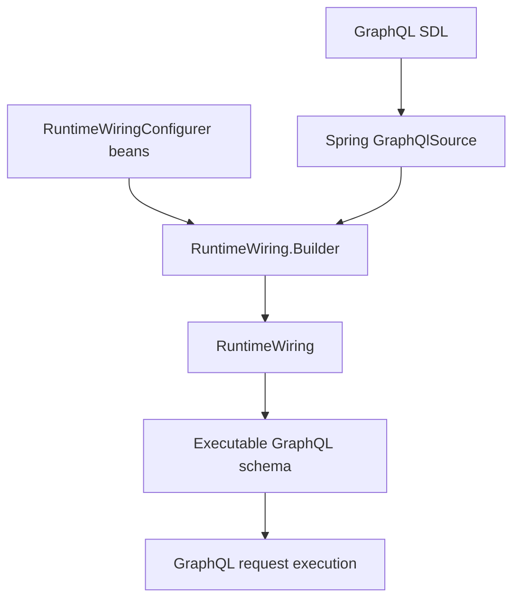

# RuntimeWiring.Builder trong Spring for GraphQL

`RuntimeWiring.Builder` là API của GraphQL Java dùng để đăng ký cách schema được thực thi: field nào gọi data fetcher nào, interface hoặc union được phân giải thành object type nào, scalar tùy chỉnh được xử lý ra sao và directive nào cần áp dụng logic ở giai đoạn xây dựng schema.

Trong Spring for GraphQL, ứng dụng thường không tự tạo `RuntimeWiring` hay `GraphQL` instance. Spring quản lý quá trình xây dựng schema thông qua `GraphQlSource`, còn `RuntimeWiringConfigurer` là extension point để tùy chỉnh `RuntimeWiring.Builder`. Hiểu được vai trò của builder giúp chọn đúng mức cấu hình: dùng annotation controller cho resolver thông thường và dùng runtime wiring khi cần tích hợp trực tiếp với GraphQL Java.

## 1. Runtime wiring nằm ở đâu trong quá trình khởi tạo?

GraphQL SDL mô tả cấu trúc và hợp đồng của API. Runtime wiring liên kết các khai báo đó với logic thực thi trong ứng dụng.



Các bước chính:

1. Spring tải các file schema SDL của ứng dụng.
2. Spring tạo runtime wiring builder và áp dụng các `RuntimeWiringConfigurer` bean.
3. GraphQL Java kết hợp schema definition với runtime wiring để tạo executable schema.
4. GraphQL engine dùng executable schema để thực thi request, gọi data fetcher và hoàn tất kết quả.

`RuntimeWiring.Builder` là builder ở giai đoạn khởi tạo schema. Nó không phải đối tượng nhận từng HTTP request và cũng không phải nơi lưu trạng thái của một request. Các giá trị phụ thuộc người dùng hoặc request nên được lấy từ execution context, `DataFetchingEnvironment` hoặc service phù hợp khi data fetcher chạy.

## 2. RuntimeWiringConfigurer của Spring for GraphQL

Spring for GraphQL cung cấp interface `RuntimeWiringConfigurer` trong package `org.springframework.graphql.execution`. Bean triển khai interface này nhận `RuntimeWiring.Builder` để đăng ký cấu hình:

```java
import org.springframework.context.annotation.Bean;
import org.springframework.context.annotation.Configuration;
import org.springframework.graphql.execution.RuntimeWiringConfigurer;

@Configuration
public class GraphQlRuntimeConfiguration {

    @Bean
    RuntimeWiringConfigurer runtimeWiringConfigurer() {
        return wiringBuilder -> {
            // Đăng ký data fetcher, scalar, type resolver hoặc directive tại đây.
        };
    }
}
```

Khi dùng Spring Boot auto-configuration mặc định, các bean `RuntimeWiringConfigurer` được Spring phát hiện và áp dụng trong quá trình tạo `GraphQlSource`. Có thể chia cấu hình thành nhiều bean theo chức năng, ví dụ một bean cho scalar, một bean cho type resolver và một bean cho data fetcher.

Tên type và field truyền vào builder phải khớp với tên trong SDL. Nếu schema khai báo `type Query`, cấu hình phải dùng `"Query"`; nếu field là `book`, data fetcher phải được gắn với `"book"`.

## 3. Đăng ký data fetcher bằng RuntimeWiring.Builder

Data fetcher là thành phần cung cấp giá trị cho một field GraphQL. Ví dụ schema:

```graphql
type Query {
    book(id: ID!): Book
}

type Book {
    id: ID!
    title: String!
}
```

Có thể đăng ký data fetcher trực tiếp qua builder:

```java
import org.springframework.context.annotation.Bean;
import org.springframework.context.annotation.Configuration;
import org.springframework.graphql.execution.RuntimeWiringConfigurer;

@Configuration
public class BookRuntimeConfiguration {

    @Bean
    RuntimeWiringConfigurer bookDataFetcherConfigurer(BookService bookService) {
        return wiringBuilder -> wiringBuilder.type("Query", typeBuilder ->
                typeBuilder.dataFetcher("book", environment -> {
                    String id = environment.getArgument("id");
                    return bookService.findById(id).orElse(null);
                })
        );
    }
}
```

Trong ví dụ:

- `type("Query", ...)` chọn GraphQL object type `Query`.
- `dataFetcher("book", ...)` gắn data fetcher với field `book`.
- `environment.getArgument("id")` lấy argument `id` mà client gửi.
- `bookService` truy vấn domain và trả về `Book` hoặc null.

Vì field `book` trong SDL là nullable (`Book`), trường hợp không tìm thấy bản ghi có thể trả về null. Nếu đổi thành `Book!`, data fetcher phải luôn cung cấp giá trị khác null hoặc xử lý lỗi theo hợp đồng mới.

`DataFetchingEnvironment` còn cung cấp thông tin như source object, arguments, GraphQL context, selection set và execution metadata. Chỉ lấy những thông tin cần thiết cho field; logic nghiệp vụ và truy cập dữ liệu nên được giữ trong service để có thể tái sử dụng và kiểm thử.

## 4. Đăng ký type resolver cho interface và union

Khi một field trả về interface hoặc union, GraphQL cần xác định object type cụ thể cho từng giá trị. Runtime wiring cho phép đăng ký `TypeResolver` theo tên abstract type.

Schema ví dụ:

```graphql
interface SearchResult {
    id: ID!
}

type Book implements SearchResult {
    id: ID!
    title: String!
}

type Author implements SearchResult {
    id: ID!
    name: String!
}

type Query {
    search: [SearchResult!]!
}
```

Đăng ký resolver:

```java
import graphql.schema.TypeResolver;
import org.springframework.context.annotation.Bean;
import org.springframework.context.annotation.Configuration;
import org.springframework.graphql.execution.RuntimeWiringConfigurer;

@Configuration
public class SearchRuntimeConfiguration {

    @Bean
    RuntimeWiringConfigurer searchTypeResolverConfigurer() {
        TypeResolver resolver = environment -> {
            Object source = environment.getObject();

            if (source instanceof Book) {
                return environment.getSchema().getObjectType("Book");
            }
            if (source instanceof Author) {
                return environment.getSchema().getObjectType("Author");
            }

            throw new IllegalStateException("Unsupported search result type");
        };

        return wiringBuilder -> wiringBuilder.type(
                "SearchResult", typeBuilder -> typeBuilder.typeResolver(resolver));
    }
}
```

`environment.getObject()` là object Java mà data fetcher trả về. Resolver phải trả về object type đã khai báo và hợp lệ với abstract type đang được phân giải. Nếu thêm subtype mới, cần cập nhật schema, mapping và test tương ứng.

## 5. Đăng ký custom scalar

GraphQL có các scalar tích hợp như `String`, `Int`, `Float`, `Boolean` và `ID`. Khi ứng dụng cần kiểu dữ liệu riêng, chẳng hạn `Date`, `DateTime` hoặc `Long`, có thể tạo `GraphQLScalarType` và đăng ký qua `builder.scalar(...)`.

Ví dụ dưới đây giả định ứng dụng đã tạo một scalar `dateScalar` với `Coercing` phù hợp:

```java
import graphql.schema.GraphQLScalarType;
import org.springframework.context.annotation.Bean;
import org.springframework.context.annotation.Configuration;
import org.springframework.graphql.execution.RuntimeWiringConfigurer;

@Configuration
public class ScalarRuntimeConfiguration {

    @Bean
    RuntimeWiringConfigurer scalarConfigurer(GraphQLScalarType dateScalar) {
        return wiringBuilder -> wiringBuilder.scalar(dateScalar);
    }
}
```

Schema sử dụng scalar đó:

```graphql
scalar Date

type Event {
    id: ID!
    startsOn: Date!
}
```

Việc khai báo `scalar Date` trong SDL chỉ tạo tên kiểu. `Coercing` của scalar chịu trách nhiệm chuyển đổi giá trị giữa biểu diễn GraphQL/JSON và kiểu Java trong ứng dụng. Cần xác định rõ định dạng đầu vào, định dạng đầu ra, xử lý giá trị sai và timezone nếu scalar biểu diễn ngày giờ.

Không cần đăng ký lại các built-in scalar nếu chỉ dùng `String`, `Int`, `Float`, `Boolean` hoặc `ID`. Chỉ thêm scalar wiring khi ứng dụng có kiểu mở rộng thực sự.

## 6. Đăng ký schema directive wiring

Directive trong SDL có thể gắn metadata hoặc yêu cầu một hành vi đặc biệt tại schema. GraphQL Java cung cấp `SchemaDirectiveWiring` để can thiệp vào các thành phần schema khi schema được xây dựng.

Ví dụ SDL khai báo directive:

```graphql
directive @uppercase on FIELD_DEFINITION

type Query {
    greeting: String @uppercase
}
```

Đăng ký một implementation của directive:

```java
import graphql.schema.idl.SchemaDirectiveWiring;
import org.springframework.context.annotation.Bean;
import org.springframework.context.annotation.Configuration;
import org.springframework.graphql.execution.RuntimeWiringConfigurer;

@Configuration
public class DirectiveRuntimeConfiguration {

    @Bean
    RuntimeWiringConfigurer directiveConfigurer(
            SchemaDirectiveWiring uppercaseDirectiveWiring) {
        return wiringBuilder -> wiringBuilder.directive(
                "uppercase", uppercaseDirectiveWiring);
    }
}
```

`uppercaseDirectiveWiring` là bean do ứng dụng triển khai, chịu trách nhiệm thay đổi hoặc bọc data fetcher theo định nghĩa directive. Đoạn code trên minh họa cách đăng ký; logic xử lý chữ hoa cần được cài đặt trong implementation của `SchemaDirectiveWiring`.

Directive wiring thường được áp dụng khi schema được xây dựng. Nó khác với việc kiểm tra directive trong từng request. Nếu hành vi phụ thuộc người dùng hoặc quyền hiện tại, hãy lấy principal từ security context/request context tại thời điểm thực thi data fetcher và áp dụng authorization phù hợp.

## 7. RuntimeWiring.Builder và annotation controller

Spring for GraphQL hỗ trợ annotation-based controller như `@QueryMapping`, `@MutationMapping`, `@SubscriptionMapping`, `@SchemaMapping` và `@BatchMapping`. Đây là cách phổ biến để viết resolver trong ứng dụng Spring.

Ví dụ dùng annotation:

```java
@Controller
public class BookController {

    private final BookService bookService;

    public BookController(BookService bookService) {
        this.bookService = bookService;
    }

    @QueryMapping
    public Book book(@Argument("id") String id) {
        return bookService.findById(id).orElse(null);
    }
}
```

Với cách này, Spring for GraphQL phát hiện controller và đăng ký data fetcher tương ứng. Không cần tự viết `RuntimeWiringConfigurer` chỉ để ánh xạ một method controller thông thường.

Nên chọn cơ chế dựa trên nhu cầu:

| Nhu cầu | Cách phù hợp |
| --- | --- |
| Resolver gắn với method Java trong Spring bean | Annotation như `@QueryMapping` hoặc `@SchemaMapping`. |
| Đăng ký data fetcher GraphQL Java trực tiếp | `RuntimeWiringConfigurer` và `RuntimeWiring.Builder`. |
| Đăng ký type resolver cho interface/union | `RuntimeWiringConfigurer` với `typeResolver(...)`. |
| Thêm custom scalar hoặc schema directive wiring | `RuntimeWiringConfigurer` với `scalar(...)` hoặc `directive(...)`. |
| Tải dữ liệu theo batch trong controller | `@BatchMapping` hoặc cơ chế DataLoader phù hợp. |

Tránh đăng ký hai data fetcher cạnh tranh cho cùng một field bằng annotation và builder. Hãy xác định một nơi chịu trách nhiệm ánh xạ field để cấu hình dễ đọc và dễ bảo trì. Nếu dự án cần kết hợp nhiều configurer, hãy tách theo chức năng và kiểm tra wiring cuối cùng khi khởi động/test.

## 8. Nhiều RuntimeWiringConfigurer và custom GraphQlSource

Một ứng dụng có thể có nhiều bean `RuntimeWiringConfigurer`. Ví dụ:

- `BookRuntimeConfiguration` đăng ký data fetcher cho một số field.
- `SearchRuntimeConfiguration` đăng ký type resolver.
- `ScalarRuntimeConfiguration` đăng ký custom scalar.
- `DirectiveRuntimeConfiguration` đăng ký directive wiring.

Spring áp dụng các configurer khi xây dựng runtime wiring. Mỗi configurer nên chỉ quản lý phần cấu hình thuộc trách nhiệm của nó. Nếu các configurer cùng sửa một type/field hoặc thay thế cùng một mapping, kết quả có thể phụ thuộc cách wiring được ghép và thứ tự áp dụng; hãy tránh cấu hình trùng và kiểm tra hành vi thực tế.

Spring Boot auto-configuration tạo `GraphQlSource` từ schema và các thành phần wiring. Nếu ứng dụng tự khai báo `GraphQlSource`, cần hiểu rằng auto-configuration mặc định có thể back off. Khi đó, hãy bảo đảm custom source vẫn nạp schema, áp dụng các `RuntimeWiringConfigurer` và giữ các customization cần thiết như instrumentation, exception resolvers hoặc schema resources. Không tạo một `RuntimeWiring`/`GraphQL` instance độc lập mà HTTP handler của Spring không sử dụng.

## 9. Kiểm thử runtime wiring

Kiểm thử nên thực thi GraphQL document để xác nhận wiring đã nối schema với logic đúng. Với `GraphQlTester` được cấu hình trong test context, có thể kiểm tra field `book`:

```java
@Test
void bookFieldUsesConfiguredDataFetcher() {
    graphQlTester.document("""
            query {
                book(id: "book-1") {
                    id
                    title
                }
            }
            """)
        .execute()
        .path("book.title")
        .entity(String.class)
        .isEqualTo("Spring GraphQL");
}
```

Nếu có custom scalar, kiểm thử cả input coercion lẫn output serialization. Nếu có interface/union, kiểm tra `__typename` và inline fragments. Nếu có directive, xác nhận hành vi được áp dụng cho field có directive và không ảnh hưởng field khác.

Một số kiểm tra cần có:

1. Tên type và field trong wiring khớp SDL.
2. Data fetcher nhận đúng argument và trả đúng kiểu dữ liệu.
3. Nullability của kết quả phù hợp schema.
4. TypeResolver trả về đúng object type.
5. Custom scalar xử lý đúng giá trị hợp lệ và từ chối giá trị sai.
6. Directive wiring áp dụng đúng hành vi.
7. Không có hai cơ chế đăng ký cạnh tranh cho cùng một field.
8. Ứng dụng khởi động thành công với toàn bộ configurer đang bật.

## 10. Lỗi thường gặp

| Hiện tượng | Nguyên nhân có thể có | Cách xử lý |
| --- | --- | --- |
| Field không có data fetcher | Sai tên type/field hoặc chưa đăng ký configurer | So sánh tên trong SDL với `type(...)` và `dataFetcher(...)`. |
| Không thấy thay đổi sau khi thêm configurer | Bean không được component scan hoặc custom `GraphQlSource` không áp dụng configurer | Kiểm tra Spring bean registration và quá trình tạo `GraphQlSource`. |
| Lỗi khi khởi động schema | Wiring tham chiếu type/field không tồn tại hoặc resolver không hợp lệ | Kiểm tra SDL và runtime wiring cùng nhau. |
| Custom scalar không parse được input | Coercing chưa xử lý đúng định dạng client gửi | Kiểm tra `parseValue`, `parseLiteral` và `serialize` của scalar. |
| Interface/union không resolve được | Chưa đăng ký hoặc TypeResolver trả về object type không hợp lệ | Kiểm tra type resolver và danh sách member trong SDL. |
| Annotation resolver không chạy như mong đợi | Có mapping khác cạnh tranh hoặc field name không khớp | Kiểm tra các cơ chế đăng ký data fetcher và chỉ giữ một mapping rõ ràng. |
| Directive không thay đổi kết quả | Chỉ khai báo directive trong SDL mà chưa đăng ký wiring implementation | Đăng ký `SchemaDirectiveWiring` và kiểm thử field được gắn directive. |

## 11. Checklist sử dụng RuntimeWiring.Builder

1. Khai báo schema SDL trước và dùng chính xác tên type/field trong runtime wiring.
2. Dùng `RuntimeWiringConfigurer` bean để Spring áp dụng cấu hình vào `RuntimeWiring.Builder`.
3. Dùng `type(...).dataFetcher(...)` khi cần đăng ký data fetcher trực tiếp.
4. Dùng `type(...).typeResolver(...)` cho interface và union.
5. Dùng `scalar(...)` để đăng ký custom scalar đã được định nghĩa đầy đủ.
6. Dùng `directive(...)` để gắn `SchemaDirectiveWiring` với directive trong SDL.
7. Dùng annotation controller cho resolver Spring thông thường; tránh mapping trùng một field.
8. Nếu tự khai báo `GraphQlSource`, bảo đảm các configurer và customization vẫn được áp dụng.
9. Kiểm thử bằng `GraphQlTester` và xác nhận ứng dụng khởi động với wiring hoàn chỉnh.

`RuntimeWiring.Builder` kết nối khai báo SDL với hành vi thực thi của GraphQL Java. Trong Spring for GraphQL, `RuntimeWiringConfigurer` là điểm tích hợp phù hợp để thêm data fetcher, type resolver, scalar và directive wiring. Khi phân chia rõ trách nhiệm giữa annotation controller và runtime wiring, schema dễ kiểm soát hơn và ứng dụng tránh được các mapping chồng chéo khó truy vết.
