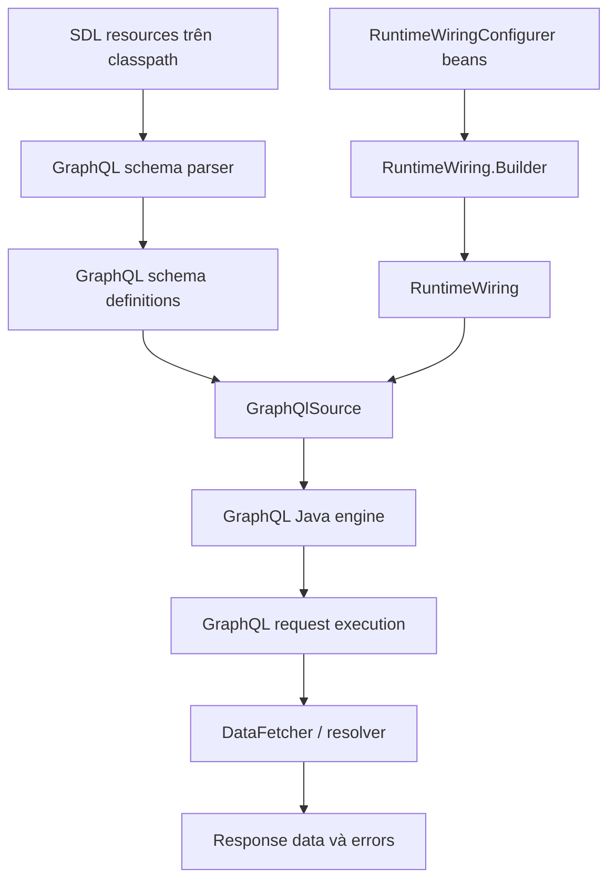

# RuntimeWiringConfigurer trong Boot

Trong Spring for GraphQL, schema SDL mô tả những type và field mà client có thể truy vấn. Nhưng để GraphQL thực thi được schema, runtime còn cần biết cách chuyển đổi scalar, cách xác định object type thực tế cho interface hoặc union, và cách gọi data fetcher cho từng field. Những đăng ký này thuộc phần **runtime wiring**.

Spring for GraphQL cung cấp `RuntimeWiringConfigurer` để bổ sung cấu hình vào `RuntimeWiring.Builder` của GraphQL Java. Khi dùng Spring Boot, chỉ cần khai báo các bean `RuntimeWiringConfigurer`; auto-configuration sẽ thu thập chúng và áp dụng khi xây dựng `GraphQlSource`. Đây là điểm mở rộng phù hợp để đăng ký custom scalar, type resolver, data fetcher thủ công hoặc directive wiring.

Bài học này trình bày vòng đời tạo schema, cách Spring Boot phát hiện và áp dụng configurer, các tình huống sử dụng phổ biến, cách phối hợp với annotated controllers và cách kiểm thử runtime wiring.

## 1. Runtime wiring nằm ở đâu trong vòng đời GraphQL?

Một ứng dụng Spring for GraphQL thường khởi tạo schema và runtime wiring khi application context được tạo. Luồng tổng quát:



Các phần có trách nhiệm khác nhau:

- **SDL** khai báo type, field, argument, input, scalar, interface và union.
- **Runtime wiring** gắn hành vi runtime vào những khai báo đó: scalar coercing, type resolver, data fetcher và directive wiring.
- **GraphQlSource** cung cấp schema đã xây dựng cùng cấu hình thực thi cho GraphQL engine.
- **Resolver** xử lý một field khi operation thực sự chạy.

Runtime wiring thường được xây dựng một lần trong lúc khởi tạo schema. Method trong `RuntimeWiringConfigurer` không chạy cho mỗi GraphQL request. Vì vậy không đưa thông tin người dùng hiện tại, tenant hiện tại hoặc dữ liệu request vào configurer. Những dữ liệu đó thuộc GraphQL context, interceptor, security context hoặc resolver.

## 2. RuntimeWiringConfigurer là gì?

`RuntimeWiringConfigurer` là extension point của Spring for GraphQL nằm trong package:

```java
org.springframework.graphql.execution.RuntimeWiringConfigurer
```

Đây là functional interface với method cấu hình một builder của GraphQL Java:

```java
@FunctionalInterface
public interface RuntimeWiringConfigurer {
    void configure(RuntimeWiring.Builder builder);
}
```

Trong ứng dụng, thường khai báo nó như một bean:

```java
@Configuration
public class GraphQlRuntimeConfiguration {

    @Bean
    RuntimeWiringConfigurer runtimeWiringConfigurer() {
        return builder -> {
            // Đăng ký scalar, type resolver hoặc data fetcher.
        };
    }
}
```

Builder là API của GraphQL Java. Spring for GraphQL cung cấp điểm nối để bean cấu hình của ứng dụng được áp dụng khi tạo schema runtime. Không cần tự gọi method configure trong controller hoặc trong mỗi request.

## 3. Spring Boot tự động thu thập configurer như thế nào?

Khi có starter GraphQL và cấu hình web phù hợp, Spring Boot tạo GraphQL infrastructure mặc định. Trong quá trình tạo `GraphQlSource`, Boot lấy các bean `RuntimeWiringConfigurer` trong application context và áp dụng chúng vào runtime wiring builder.

Vì thế, cấu hình đơn giản thường chỉ cần:

1. Khai báo SDL trong classpath schema location.
2. Tạo một hoặc nhiều bean `RuntimeWiringConfigurer`.
3. Để Spring Boot tạo `GraphQlSource` và GraphQL engine.

Ví dụ:

```java
@Configuration
public class ScalarConfiguration {

    @Bean
    RuntimeWiringConfigurer scalarConfigurer() {
        return wiring -> wiring.scalar(MyScalars.UUID);
    }
}
```

SDL phải khai báo scalar tương ứng:

```graphql
scalar UUID

type Query {
  book(id: UUID!): Book
}
```

Tên scalar trong SDL phải khớp với tên scalar được đăng ký trong runtime wiring. Chỉ khai báo `scalar UUID` trong SDL không cung cấp cách parse và serialize giá trị Java.

### Một hay nhiều configurer?

Có thể chia runtime wiring thành nhiều bean theo trách nhiệm, chẳng hạn:

- `ScalarRuntimeWiringConfigurer` đăng ký custom scalar.
- `TypeResolverRuntimeWiringConfigurer` đăng ký resolver cho interface và union.
- `LegacyDataFetcherConfigurer` đăng ký một số data fetcher thủ công.
- `DirectiveRuntimeWiringConfigurer` đăng ký directive wiring.

Spring quản lý các bean này trong application context. Nếu cần thứ tự áp dụng, có thể dùng cơ chế ordering của Spring như `@Order` hoặc `Ordered`. Tuy nhiên, không nên dựa vào thứ tự để giải quyết hai configurer cùng đăng ký một field theo cách xung đột. Mỗi field nên có một cơ chế phân giải rõ ràng.

## 4. Đăng ký custom scalar

Custom scalar cần hai phần:

1. Khai báo tên scalar trong SDL.
2. Đăng ký một `GraphQLScalarType` có coercing trong runtime wiring.

Ví dụ sử dụng scalar DateTime từ GraphQL Java Extended Scalars:

```java
@Configuration
public class DateTimeScalarConfiguration {

    @Bean
    RuntimeWiringConfigurer dateTimeScalarConfigurer() {
        return wiring -> wiring.scalar(ExtendedScalars.DateTime);
    }
}
```

SDL:

```graphql
scalar DateTime

type AuditEvent {
  id: ID!
  occurredAt: DateTime!
}
```

Extended Scalars cần dependency tương thích với phiên bản GraphQL Java mà Spring Boot quản lý. Nếu tự tạo scalar, dùng `GraphQLScalarType.newScalar()` để cung cấp name, description và `Coercing`.

Các hướng coercion cần được kiểm tra:

| Phương thức | Hướng chuyển đổi |
| --- | --- |
| `parseValue` | JSON variable thành kiểu Java |
| `parseLiteral` | Literal trong GraphQL document thành kiểu Java |
| `serialize` | Giá trị Java thành giá trị trả về GraphQL |

Đừng quên test cả variables, inline literal và output. Một scalar có thể parse variable đúng nhưng vẫn lỗi khi client truyền literal hoặc resolver trả kiểu Java không mong đợi.

## 5. Đăng ký TypeResolver cho interface và union

Khi field trả về interface hoặc union, GraphQL cần biết object type cụ thể của từng giá trị runtime. GraphQL Java sử dụng `TypeResolver` cho việc đó.

SDL:

```graphql
interface SearchResult {
  id: ID!
  title: String!
}

type BookResult implements SearchResult {
  id: ID!
  title: String!
  isbn: String!
}

type AuthorResult implements SearchResult {
  id: ID!
  title: String!
  biography: String
}

union SearchHit = BookResult | AuthorResult

type Query {
  search: [SearchResult!]!
  featured: [SearchHit!]!
}
```

Giả sử Java model có hai class kết quả khác nhau:

```java
public record BookSearchResult(
        String id, String title, String isbn) {
}

public record AuthorSearchResult(
        String id, String title, String biography) {
}
```

Đăng ký type resolver cho interface và union:

```java
@Configuration
public class SearchTypeResolverConfiguration {

    @Bean
    RuntimeWiringConfigurer searchTypeResolverConfigurer() {
        return wiring -> {
            wiring.type(TypeRuntimeWiring.newTypeWiring("SearchResult")
                    .typeResolver(environment -> {
                        Object source = environment.getObject();
                        if (source instanceof BookSearchResult) {
                            return environment.getSchema()
                                    .getObjectType("BookResult");
                        }
                        if (source instanceof AuthorSearchResult) {
                            return environment.getSchema()
                                    .getObjectType("AuthorResult");
                        }
                        throw new IllegalStateException(
                                "Unsupported SearchResult implementation");
                    }));

            wiring.type(TypeRuntimeWiring.newTypeWiring("SearchHit")
                    .typeResolver(environment -> {
                        Object source = environment.getObject();
                        if (source instanceof BookSearchResult) {
                            return environment.getSchema()
                                    .getObjectType("BookResult");
                        }
                        if (source instanceof AuthorSearchResult) {
                            return environment.getSchema()
                                    .getObjectType("AuthorResult");
                        }
                        throw new IllegalStateException(
                                "Unsupported SearchHit implementation");
                    }));
        };
    }
}
```

Resolver phải trả về đúng object type đã khai báo trong schema và phù hợp với interface hoặc union. Nếu có implementation mới mà type resolver không nhận diện, operation sẽ phát sinh lỗi khi serialize kết quả.

Với annotated controllers, Spring for GraphQL có thể suy ra concrete type trong một số trường hợp dựa trên model và schema mapping. Chỉ đăng ký TypeResolver tường minh khi cần kiểm soát cách nhận diện hoặc khi default resolution không đủ. Tránh cấu hình resolver hai lần cho cùng abstract type.

## 6. Đăng ký DataFetcher thủ công

Một field có thể được kết nối với data fetcher trực tiếp bằng `TypeRuntimeWiring`:

```java
@Configuration
public class ManualDataFetcherConfiguration {

    @Bean
    RuntimeWiringConfigurer manualDataFetcherConfigurer(
            GreetingService greetingService) {

        return wiring -> wiring.type(
                TypeRuntimeWiring.newTypeWiring("Query")
                        .dataFetcher("greeting", environment -> {
                            String name = environment.getArgument("name");
                            return greetingService.greet(name);
                        })
        );
    }
}
```

SDL tương ứng:

```graphql
type Query {
  greeting(name: String!): String!
}
```

DataFetcher nhận `DataFetchingEnvironment`, từ đó có thể đọc arguments, source object, GraphQL context và các thông tin thực thi khác. Nên giữ logic nghiệp vụ trong service để dễ kiểm thử và tái sử dụng.

### Chọn annotated controller hay data fetcher thủ công?

Spring for GraphQL cung cấp annotated controllers để ánh xạ method Java bằng `@QueryMapping`, `@MutationMapping` và `@SchemaMapping`. Cấu hình controller được tích hợp vào quá trình runtime wiring.

| Cách làm | Phù hợp khi |
| --- | --- |
| Annotated controller | Ứng dụng Spring thông thường, cần DI, argument binding và code dễ đọc |
| DataFetcher thủ công | Tích hợp data fetcher đặc biệt, migration từ GraphQL Java hoặc cần kiểm soát wiring cấp thấp |
| `@BatchMapping` / DataLoader | Tải field liên quan theo lô để tránh N+1 |

Không đăng ký cùng một field bằng cả `@QueryMapping` và một data fetcher thủ công nếu không có chủ ý. Hai cách cùng cố gắng sở hữu một field có thể gây xung đột hoặc hành vi khó dự đoán. Hãy chọn một nơi chịu trách nhiệm phân giải field đó.

## 7. Đăng ký directive wiring

Directive trong SDL có thể mang metadata hoặc yêu cầu hành vi ở runtime. Nếu directive cần thay đổi cách một field được thực thi, GraphQL Java cho phép đăng ký `SchemaDirectiveWiring` qua runtime wiring.

Ví dụ SDL khai báo directive:

```graphql
directive @uppercase on FIELD_DEFINITION

type Query {
  greeting: String! @uppercase
}
```

Configurer có thể đăng ký implementation của directive:

```java
@Bean
RuntimeWiringConfigurer directiveConfigurer() {
    return wiring -> wiring.directive(
            "uppercase",
            new UppercaseDirectiveWiring());
}
```

`UppercaseDirectiveWiring` là class do ứng dụng triển khai từ `SchemaDirectiveWiring`. Nó có thể lấy data fetcher hiện tại, bọc fetcher và chuyển đổi kết quả trước khi trả về. Phần triển khai cụ thể phụ thuộc API GraphQL Java version; cần kiểm tra chữ ký `SchemaDirectiveWiringEnvironment` và cách cập nhật `GraphQLCodeRegistry` trong dependency đang dùng.

Directive wiring không tự tạo authorization. Nếu directive biểu thị yêu cầu quyền truy cập, implementation phải thực sự kiểm tra quyền hoặc tích hợp với Spring Security. Chỉ đặt tên `@auth` trong SDL không bảo vệ field.

## 8. RuntimeWiringConfigurer và các extension point khác của Spring

Không phải mọi tùy biến GraphQL đều thuộc runtime wiring:

| Nhu cầu | Extension point phù hợp |
| --- | --- |
| Đăng ký scalar | `RuntimeWiringConfigurer` |
| Đăng ký type resolver cho interface/union | `RuntimeWiringConfigurer` |
| Data fetcher cấp thấp | `RuntimeWiringConfigurer` |
| Directive wiring | `RuntimeWiringConfigurer` |
| Truyền HTTP header vào GraphQL context | `WebGraphQlInterceptor` |
| Xử lý lỗi từ data fetcher | `DataFetcherExceptionResolver` |
| Batch loading theo request | `BatchLoaderRegistry`, `@BatchMapping` |
| Authentication/authorization | Spring Security và method/field security phù hợp |
| Đổi schema locations | `spring.graphql.schema.locations` |
| Tùy biến cách tạo GraphQlSource | Builder customizer hoặc bean `GraphQlSource` khi thật sự cần |

Ví dụ, một interceptor đọc request ID chạy theo từng HTTP request. Runtime wiring configurer chỉ đăng ký thành phần schema lúc khởi tạo. Đặt xử lý request ID vào configurer sẽ sai vòng đời và không có request header để đọc.

Tương tự, không dùng runtime wiring để tự viết cơ chế N+1 nếu `@BatchMapping` hoặc DataLoader đáp ứng yêu cầu. Runtime wiring có thể đăng ký data fetcher, nhưng batch loader cần vòng đời và context theo GraphQL request.

## 9. Nhiều RuntimeWiringConfigurer và tránh xung đột

Một ứng dụng có thể chia configurer theo trách nhiệm để dễ bảo trì:

```java
@Configuration
public class GraphQlScalarConfiguration {

    @Bean
    RuntimeWiringConfigurer scalarConfigurer() {
        return wiring -> wiring.scalar(ExtendedScalars.DateTime);
    }
}
```

```java
@Configuration
public class GraphQlTypeConfiguration {

    @Bean
    RuntimeWiringConfigurer typeConfigurer() {
        return wiring -> wiring.type(
                TypeRuntimeWiring.newTypeWiring("SearchResult")
                        .typeResolver(new SearchResultTypeResolver()));
    }
}
```

Việc tách configurer có ích khi mỗi bean sở hữu một phần cấu hình riêng. Tuy nhiên:

- Không khai báo hai custom scalar cùng tên.
- Không đăng ký hai data fetcher khác nhau cho cùng một field nếu không xác định rõ cơ chế ghi đè.
- Không đăng ký nhiều type resolver cạnh tranh cho cùng interface hoặc union.
- Dùng `@Order` khi có phụ thuộc thứ tự thật sự và kiểm tra behavior của phiên bản Boot đang dùng.
- Giữ configurer không phụ thuộc trạng thái mutable của configurer khác.

Nếu runtime wiring trở nên phức tạp, hãy cân nhắc gom cấu hình liên quan vào một class theo domain hoặc tạo test xác nhận schema được xây dựng đúng.

## 10. Khi nào cần tự khai báo GraphQlSource?

Trong cấu hình mặc định, Spring Boot tạo `GraphQlSource` từ SDL resources và các bean runtime wiring. Hầu hết ứng dụng chỉ cần thêm `RuntimeWiringConfigurer` mà không cần tự tạo source.

Tự khai báo bean `GraphQlSource` là lựa chọn cấp thấp hơn. Khi bean này do ứng dụng cung cấp, auto-configuration mặc định có thể lùi lại vì điều kiện missing-bean không còn thỏa mãn. Khi đó ứng dụng phải chịu trách nhiệm cấu hình schema resources, runtime wiring và các thành phần cần thiết khác.

Nếu chỉ cần:

- Thêm custom scalar: dùng `RuntimeWiringConfigurer`.
- Thêm type resolver: dùng `RuntimeWiringConfigurer`.
- Đổi thư mục SDL: dùng `spring.graphql.schema.locations`.
- Thêm request context: dùng `WebGraphQlInterceptor`.

Chỉ tùy biến `GraphQlSource` khi cần kiểm soát schema construction vượt quá các extension point trên. Trước khi thay thế source mặc định, hãy kiểm tra những cấu hình Boot đang tự động cung cấp để tránh vô tình bỏ mất annotated controller configurer hoặc thành phần runtime khác.

## 11. Kiểm thử runtime wiring

Nên kiểm tra runtime wiring thông qua operation GraphQL thực tế. `GraphQlTester` cho phép gửi document và xác nhận response:

```java
@SpringBootTest
class RuntimeWiringTests {

    @Autowired
    GraphQlTester graphQlTester;

    @Test
    void customScalarIsAvailable() {
        graphQlTester.document("""
                query {
                    book(id: "550e8400-e29b-41d4-a716-446655440000") {
                        id
                    }
                }
                """)
                .execute()
                .path("book.id")
                .entity(String.class)
                .isEqualTo("550e8400-e29b-41d4-a716-446655440000");
    }
}
```

Test này giả định schema có field tương ứng, UUID scalar đã được đăng ký và service trả về dữ liệu phù hợp. Có thể mở rộng test để kiểm tra:

- Variable và literal đều được custom scalar parse đúng.
- Giá trị output được serialize theo định dạng công bố.
- Interface/union trả đúng concrete type cho inline fragment.
- Data fetcher thủ công nhận đúng arguments.
- Directive wiring thay đổi behavior như mong đợi.
- Ứng dụng khởi động thất bại rõ ràng nếu schema tham chiếu scalar chưa đăng ký.

Nếu test chỉ dùng `@GraphQlTest`, cần bảo đảm configurer tùy biến được import vào test slice. Khi muốn xác nhận Boot thu thập bean và tạo source như production, `@SpringBootTest` thường phản ánh đầy đủ hơn.

## 12. Lỗi thường gặp

| Biểu hiện | Nguyên nhân | Cách xử lý |
| --- | --- | --- |
| Unknown scalar | SDL có scalar nhưng runtime wiring chưa đăng ký | Tạo bean `RuntimeWiringConfigurer` và đăng ký đúng tên |
| Interface/union không resolve được | Thiếu hoặc sai type resolver | Kiểm tra implementation Java và tên object type trong SDL |
| Resolver không được gọi | Field name/type name sai hoặc field không tồn tại | Đối chiếu SDL và mapping |
| Field có hai data fetcher | Annotated controller và wiring thủ công cùng đăng ký một field | Chọn một cơ chế sở hữu field |
| Directive không có tác dụng | Chỉ khai báo directive trong SDL mà chưa đăng ký wiring behavior | Đăng ký `SchemaDirectiveWiring` |
| Configurer không được áp dụng | Bean không nằm trong application context hoặc cấu hình source tùy biến bỏ qua configurer | Kiểm tra component scan, bean registration và GraphQlSource |
| Chạy test lỗi nhưng production chạy được | Test slice không import configurer cần thiết | Import cấu hình runtime wiring vào test hoặc dùng SpringBootTest |
| Lỗi sau khi nâng cấp dependency | Chữ ký GraphQL Java API thay đổi | Dùng phiên bản tương thích do Boot quản lý và cập nhật implementation |

## 13. Nguyên tắc thiết kế RuntimeWiringConfigurer

- Dùng configurer cho đăng ký cấp schema/runtime, không xử lý dữ liệu riêng của từng request.
- Chia configurer theo trách nhiệm, tránh một class chứa mọi wiring của ứng dụng.
- Giữ một owner rõ ràng cho mỗi field data fetcher.
- Đăng ký scalar có tên khớp SDL và kiểm thử đủ ba hướng coercion.
- Dùng type resolver cho abstract type khi default resolution không đáp ứng mô hình Java.
- Dùng annotated controllers cho phần lớn resolver trong ứng dụng Spring.
- Dùng DataLoader và `@BatchMapping` cho tải dữ liệu theo lô.
- Dùng interceptor cho HTTP/request context và exception resolver cho lỗi.
- Chỉ thay `GraphQlSource` khi các extension point nhỏ hơn không đáp ứng được.
- Kiểm thử schema runtime sau mỗi thay đổi scalar, type resolver, data fetcher hoặc directive.

## 14. Bài tập thực hành

Tạo ứng dụng thư viện với các yêu cầu:

1. Khai báo scalar `UUID` trong SDL và tạo custom `GraphQLScalarType`.
2. Đăng ký UUID scalar bằng một bean `RuntimeWiringConfigurer`.
3. Khai báo interface `SearchResult` cùng hai type triển khai là `BookResult` và `AuthorResult`.
4. Viết `TypeResolver` để GraphQL nhận diện đúng concrete type.
5. Đăng ký một data fetcher thủ công cho field `Query.serverVersion`.
6. Viết test `GraphQlTester` kiểm tra scalar, inline fragment và data fetcher.
7. Thêm một `WebGraphQlInterceptor` để truyền request ID vào context và giải thích vì sao logic này không nằm trong RuntimeWiringConfigurer.

Khi hoàn thành, hãy phân biệt được schema SDL với runtime wiring, biết Boot thu thập configurer ở thời điểm nào, chọn đúng API cho scalar/type resolver/data fetcher và tránh xung đột với annotated controllers.

## 15. Tài liệu tham khảo

- [Spring for GraphQL — GraphQlSource and Runtime Wiring](https://docs.spring.io/spring-graphql/reference/request-execution.html)
- [Spring for GraphQL — Annotated Controllers](https://docs.spring.io/spring-graphql/reference/controllers.html)
- [Spring Boot — Spring for GraphQL](https://docs.spring.io/spring-boot/reference/web/spring-graphql.html)
- [GraphQL Java — RuntimeWiring Javadoc](https://javadoc.io/doc/com.graphql-java/graphql-java/latest/graphql/schema/idl/RuntimeWiring.html)

Các API GraphQL Java có thể thay đổi giữa các phiên bản. Khi dự án nâng cấp Spring Boot, hãy kiểm tra phiên bản GraphQL Java do dependency management chọn và đối chiếu Javadoc tương ứng trước khi thay đổi chữ ký coercing, type resolver hoặc directive wiring.
