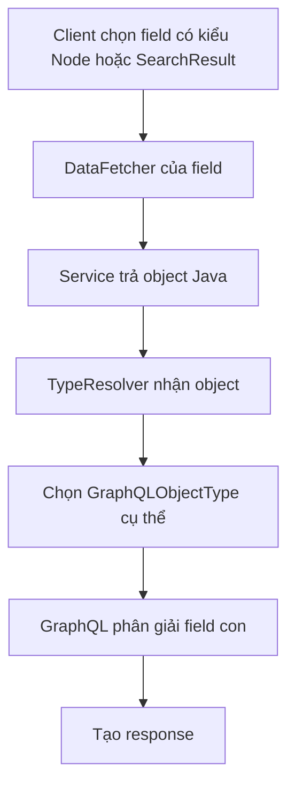

# TypeResolver wiring trong Spring for GraphQL

GraphQL interface và union cho phép một field trả về nhiều kiểu object cụ thể. Khi resolver trả về một object Java, GraphQL cần biết object đó tương ứng với object type nào trong schema để tiếp tục phân giải các field và tạo response. Thành phần thực hiện bước xác định kiểu runtime này là **TypeResolver**.

Trong Spring for GraphQL, các resolver khai báo bằng `@QueryMapping` hoặc `@SchemaMapping` chịu trách nhiệm lấy object dữ liệu. Với field có kiểu trả về là interface hoặc union, GraphQL Java cần thêm `TypeResolver` để ánh xạ object Java sang `GraphQLObjectType`. Ta thường đăng ký resolver này bằng `RuntimeWiringConfigurer`.

Sau bài này, bạn có thể:

- Phân biệt vai trò của DataFetcher và TypeResolver.
- Hiểu khi nào GraphQL cần resolve concrete type cho interface hoặc union.
- Đọc `TypeResolutionEnvironment` và lấy object nguồn.
- Đăng ký TypeResolver bằng `RuntimeWiringConfigurer` trong Spring for GraphQL.
- Ánh xạ nhiều kiểu Java sang object type GraphQL tương ứng.
- Kiểm thử type resolution và xử lý trường hợp không xác định được kiểu.

## 1. Vì sao cần TypeResolver?

Với một field trả về object type cụ thể, GraphQL đã biết kiểu cần phân giải. Ví dụ `Query.book` trả về `Book`, nên các field con được đọc theo định nghĩa `Book`.

Nhưng một field có thể trả về interface hoặc union. Interface mô tả các field chung mà nhiều object type triển khai; union mô tả một trong nhiều object type có thể xuất hiện tại vị trí đó. Khi runtime nhận một object Java, GraphQL cần xác định nó là `Book`, `Author` hay một kiểu cụ thể khác.

Ví dụ schema:

```graphql
interface Node {
    id: ID!
}

type Book implements Node {
    id: ID!
    title: String!
}

type Author implements Node {
    id: ID!
    name: String!
}

union SearchResult = Book | Author

type Query {
    node(id: ID!): Node
    search(text: String!): [SearchResult!]!
}
```

`Query.node` trả về `Node`, còn `Query.search` trả về danh sách `SearchResult`. Cả hai đều là abstract type: schema chưa nói trước mỗi object thực tế sẽ thuộc kiểu cụ thể nào.

Nếu service trả về một `Book`, GraphQL cần chọn object type `Book`; nếu service trả về `Author`, GraphQL cần chọn `Author`. TypeResolver cung cấp ánh xạ đó.

## 2. DataFetcher và TypeResolver có trách nhiệm khác nhau

Hai thành phần này tham gia ở hai bước khác nhau trong quá trình thực thi:

| Thành phần | Trách nhiệm | Câu hỏi được trả lời |
| --- | --- | --- |
| DataFetcher | Lấy giá trị cho một field, thường gọi service hoặc repository | Field này trả về dữ liệu nào? |
| TypeResolver | Xác định object type cụ thể khi kiểu khai báo là interface hoặc union | Object vừa nhận được thuộc kiểu GraphQL nào? |

Luồng thực thi khái quát:



TypeResolver không truy vấn database và không thay thế resolver của field. Nó chỉ nhận object đã có và trả về kiểu GraphQL cụ thể tương ứng. Vì vậy, nếu DataFetcher trả về sai object hoặc không có dữ liệu cần thiết, TypeResolver không thể tự sửa logic truy vấn.

## 3. TypeResolver và TypeResolutionEnvironment

GraphQL Java định nghĩa interface `TypeResolver` với một method nhận `TypeResolutionEnvironment` và trả về `GraphQLObjectType`:

```java
@FunctionalInterface
public interface TypeResolver {
    GraphQLObjectType getType(TypeResolutionEnvironment environment);
}
```

`TypeResolutionEnvironment` cung cấp thông tin cho lần xác định kiểu hiện tại. Thành phần thường dùng nhất là:

- `getObject()`: object nguồn mà DataFetcher đã trả về.
- `getSchema()`: schema hiện tại, có thể dùng để lấy `GraphQLObjectType` theo tên.
- `getGraphQlContext()`: context của GraphQL request, nếu cần thông tin ngữ cảnh đã được server đưa vào.
- `getField()`: field definition đang được thực thi.
- `getFieldType()`: kiểu GraphQL được khai báo cho field.

Với phần lớn ứng dụng, chỉ cần kiểm tra kiểu Java của `getObject()` và lấy object type tương ứng từ schema. Không cần phân tích query string hoặc tự đọc selection set để quyết định object thuộc kiểu nào.

## 4. Chuẩn bị model Java cho interface và union

Giả sử domain model có sách và tác giả. Mỗi object đều có thể được trả về trong kết quả tìm kiếm và đều có ID:

```java
public interface Node {
    String id();
}

public interface SearchResult {
}
```

Các kiểu cụ thể triển khai những abstraction mà chúng có thể xuất hiện trong schema:

```java
public record Book(String id, String title)
        implements Node, SearchResult {
}

public record Author(String id, String name)
        implements Node, SearchResult {
}
```

Java interface `Node` và `SearchResult` giúp model diễn đạt mối quan hệ trong domain. Chúng không tự động tạo GraphQL interface hoặc union; hai kiểu đó vẫn phải được khai báo trong SDL và được nối với TypeResolver qua runtime wiring.

Tên object type GraphQL có thể khác tên class Java. Vì vậy, nên ánh xạ tường minh thay vì mặc định lấy tên class bằng reflection, nhất là khi schema có quy ước đặt tên riêng.

## 5. Khai báo resolver cho field trả về abstract type

SDL khai báo các field:

```graphql
interface Node {
    id: ID!
}

type Book implements Node {
    id: ID!
    title: String!
}

type Author implements Node {
    id: ID!
    name: String!
}

union SearchResult = Book | Author

type Query {
    node(id: ID!): Node
    search(text: String!): [SearchResult!]!
}
```

Controller Spring for GraphQL lấy dữ liệu:

```java
@Controller
public class CatalogController {

    private final CatalogService catalogService;

    public CatalogController(CatalogService catalogService) {
        this.catalogService = catalogService;
    }

    @QueryMapping
    public Node node(@Argument("id") String id) {
        return catalogService.findNode(id).orElse(null);
    }

    @QueryMapping
    public List<SearchResult> search(@Argument("text") String text) {
        return catalogService.search(text);
    }
}
```

`@QueryMapping` đăng ký DataFetcher cho root field tương ứng. Method `node` trả về một object triển khai `Node`; method `search` trả về list các object triển khai `SearchResult`. Ở bước tiếp theo, GraphQL dùng TypeResolver để xác định kiểu object cụ thể của từng giá trị.

Nếu field trả về object type cụ thể như `Book`, TypeResolver không cần tham gia cho field đó. TypeResolver chỉ cần cho các abstract type như interface và union.

## 6. Viết TypeResolver bằng instanceof

Với số lượng object type nhỏ, cách dễ đọc nhất là kiểm tra kiểu Java bằng `instanceof`:

```java
public class CatalogTypeResolver implements TypeResolver {

    @Override
    public GraphQLObjectType getType(TypeResolutionEnvironment environment) {
        Object source = environment.getObject();

        if (source instanceof Book) {
            return environment.getSchema().getObjectType("Book");
        }

        if (source instanceof Author) {
            return environment.getSchema().getObjectType("Author");
        }

        throw new IllegalStateException(
                "Unsupported GraphQL result type: " + source.getClass().getName());
    }
}
```

Mỗi nhánh trả về một `GraphQLObjectType` đã tồn tại trong schema. Tên truyền vào `getObjectType(...)` phải khớp với tên object type trong SDL.

Nếu object không thuộc kiểu nào đã hỗ trợ, ném lỗi có thông tin đủ để chẩn đoán. Không nên âm thầm trả về một object type mặc định, vì khi đó GraphQL có thể phân giải sai field và tạo response không đúng hợp đồng.

Trong thực tế, cần cân nhắc `null` source nếu field nullable và DataFetcher có thể trả null. GraphQL không cần TypeResolver để phân giải một giá trị null. Tuy nhiên, nếu method TypeResolver được gọi với một object không null nhưng không nhận diện được kiểu, đó là lỗi mapping cần được xử lý rõ ràng.

## 7. Đăng ký TypeResolver qua RuntimeWiringConfigurer

Spring for GraphQL sử dụng `RuntimeWiringConfigurer` để bổ sung cấu hình cho GraphQL Java `RuntimeWiring`. Có thể đăng ký TypeResolver cho từng abstract type như sau:

```java
@Configuration
public class GraphQlRuntimeConfiguration {

    @Bean
    RuntimeWiringConfigurer typeResolverConfigurer() {
        TypeResolver catalogTypeResolver = new CatalogTypeResolver();

        return wiringBuilder -> {
            wiringBuilder.type(
                    "Node",
                    typeWiring -> typeWiring.typeResolver(catalogTypeResolver));

            wiringBuilder.type(
                    "SearchResult",
                    typeWiring -> typeWiring.typeResolver(catalogTypeResolver));
        };
    }
}
```

Spring Boot tự phát hiện bean `RuntimeWiringConfigurer` và áp dụng nó khi tạo executable schema. `type("Node", ...)` đăng ký TypeResolver cho interface `Node`; `type("SearchResult", ...)` đăng ký cho union `SearchResult`.

Trong ví dụ, cả hai abstract type có cùng tập object thành viên là `Book` và `Author`, nên có thể dùng chung một resolver. Nếu interface và union có các thành viên khác nhau hoặc có quy tắc mapping khác nhau, hãy đăng ký resolver riêng cho từng type.

Không đăng ký nhiều TypeResolver cạnh tranh cho cùng một abstract type. Hãy tập trung mapping của mỗi interface/union vào một nơi rõ ràng để tránh cấu hình bị ghi đè hoặc khó theo dõi.

## 8. Cách hoạt động với union

Union biểu diễn một trong nhiều object type, không yêu cầu các object phải có field chung. Với:

```graphql
union SearchResult = Book | Author
```

Client cần dùng inline fragment để chọn field theo kiểu cụ thể:

```graphql
query Search($text: String!) {
    search(text: $text) {
        __typename
        ... on Book {
            id
            title
        }
        ... on Author {
            id
            name
        }
    }
}
```

Giả sử service trả về:

```java
List<SearchResult> results = List.of(
        new Book("book-1", "Spring GraphQL"),
        new Author("author-1", "Nguyen An"));
```

TypeResolver được gọi cho từng object. Với `Book`, resolver trả về GraphQL object type `Book`; với `Author`, resolver trả về `Author`. GraphQL dùng kiểu cụ thể đó để xử lý inline fragment phù hợp và điền `__typename`.

Union chỉ được khai báo với object type thành viên. Không đưa scalar, enum hoặc interface vào danh sách thành viên union.

## 9. Cách hoạt động với interface

Interface mô tả field chung của các object triển khai nó:

```graphql
interface Node {
    id: ID!
}

type Book implements Node {
    id: ID!
    title: String!
}

type Author implements Node {
    id: ID!
    name: String!
}
```

Client có thể chọn field chung `id` trực tiếp trên `Node`, rồi dùng inline fragment để lấy field riêng:

```graphql
query {
    node(id: "book-1") {
        __typename
        id
        ... on Book {
            title
        }
        ... on Author {
            name
        }
    }
}
```

TypeResolver phải trả về một object type thực sự triển khai interface đó. Nếu resolver trả `Book` cho một object, GraphQL kiểm tra `Book` là kiểu hợp lệ của `Node` trong schema. Việc object Java có method `id()` không đủ để tự làm nó trở thành GraphQL `Node`; quan hệ triển khai phải được khai báo trong SDL.

## 10. Dùng discriminator thay cho nhiều instanceof

Trong một hệ thống có nhiều kiểu kết quả, domain có thể chứa discriminator rõ ràng. Ví dụ, dữ liệu từ search index có trường `kind`:

```java
public interface SearchDocument {
    String kind();
}
```

TypeResolver có thể dựa vào discriminator:

```java
public class SearchDocumentTypeResolver implements TypeResolver {

    @Override
    public GraphQLObjectType getType(TypeResolutionEnvironment environment) {
        SearchDocument source = (SearchDocument) environment.getObject();

        String graphQlTypeName = switch (source.kind()) {
            case "BOOK" -> "Book";
            case "AUTHOR" -> "Author";
            default -> throw new IllegalStateException(
                    "Unknown search document kind: " + source.kind());
        };

        return environment.getSchema().getObjectType(graphQlTypeName);
    }
}
```

Discriminator hữu ích khi nhiều kiểu dữ liệu được đọc từ một nguồn chung hoặc được deserialize thành một wrapper. Hãy kiểm tra giá trị discriminator và ánh xạ nó sang tên GraphQL rõ ràng; không ghép trực tiếp input bên ngoài thành tên type tùy ý.

Nếu domain model đã có các class riêng biệt, `instanceof` thường đơn giản và an toàn kiểu hơn việc thêm một chuỗi discriminator chỉ để phục vụ GraphQL.

## 11. Những thông tin có thể đọc từ TypeResolutionEnvironment

`TypeResolutionEnvironment` cung cấp context của lần resolve type hiện tại. Ví dụ, khi cần ghi log hoặc áp dụng một mapping phụ thuộc request, có thể đọc GraphQL context:

```java
@Override
public GraphQLObjectType getType(TypeResolutionEnvironment environment) {
    Object source = environment.getObject();
    GraphQLSchema schema = environment.getSchema();
    GraphQLContext context = environment.getGraphQlContext();

    // Xác định object type từ source; context chỉ dùng khi có quy tắc phù hợp.
    if (source instanceof Book) {
        return schema.getObjectType("Book");
    }
    if (source instanceof Author) {
        return schema.getObjectType("Author");
    }

    throw new IllegalStateException("Unsupported source: " + source.getClass());
}
```

Thông thường, kiểu GraphQL phải được xác định từ bản chất object trả về. Không nên để cùng một object Java lúc thì thành `Book`, lúc thì thành `Author` chỉ vì client gửi một argument hoặc context tùy ý; điều đó làm schema mất tính nhất quán. Context chỉ nên tham gia nếu domain thực sự có quy tắc lựa chọn kiểu phụ thuộc ngữ cảnh đã được xác thực.

## 12. Lỗi type resolution và null propagation

Một số lỗi thường xảy ra:

- TypeResolver không được đăng ký cho interface hoặc union cần resolve.
- Tên GraphQL object type trong code không tồn tại trong schema.
- Resolver trả object type không thuộc thành viên union.
- Resolver trả object type không triển khai interface.
- Object Java không thuộc kiểu nào mà TypeResolver nhận diện.
- DataFetcher trả một wrapper hoặc projection mới nhưng TypeResolver vẫn chỉ xử lý các class cũ.

Nếu không xác định được object type, GraphQL không thể hoàn tất việc phân giải field con và sẽ đưa lỗi vào response. Nếu abstract field nullable, lỗi có thể làm field đó trở thành null; nếu field non-null, null có thể lan lên field cha gần nhất cho phép null theo quy tắc GraphQL.

Hãy kiểm tra kiểu thực tế mà service trả về, nhất là khi dùng proxy ORM, DTO projection, map hoặc object deserialize từ JSON. Nếu dùng Hibernate proxy hoặc subclass proxy, `instanceof` với interface domain thường bền vững hơn so sánh `getClass() == Book.class`.

## 13. Kiểm thử TypeResolver bằng GraphQlTester

Nên kiểm tra qua operation thực tế để xác nhận cả DataFetcher, TypeResolver và inline fragment hoạt động cùng nhau:

```java
@SpringBootTest
class CatalogTypeResolverTests {

    @Autowired
    GraphQlTester graphQlTester;

    @Test
    void resolvesBookAndAuthorInUnion() {
        graphQlTester.document("""
                query {
                    search(text: "spring") {
                        __typename
                        ... on Book {
                            title
                        }
                        ... on Author {
                            name
                        }
                    }
                }
                """)
            .execute()
            .path("search[0].__typename")
            .entity(String.class)
            .isEqualTo("Book");

        graphQlTester.document("""
                query {
                    search(text: "spring") {
                        __typename
                    }
                }
                """)
            .execute()
            .path("search[1].__typename")
            .entity(String.class)
            .isEqualTo("Author");
    }
}
```

Với interface, kiểm tra field chung và field riêng:

```java
graphQlTester.document("""
        query {
            node(id: "book-1") {
                __typename
                id
                ... on Book {
                    title
                }
            }
        }
        """)
    .execute()
    .path("node.__typename")
    .entity(String.class)
    .isEqualTo("Book");
```

Nên bổ sung test cho object type không được hỗ trợ, type name sai, null result và các DTO/proxy thực tế mà service có thể trả về. Test cần xác nhận GraphQL trả lỗi có thể chẩn đoán và không vô tình gán object vào một kiểu khác.

## 14. Những lỗi thiết kế thường gặp

- **Nhầm TypeResolver với DataFetcher:** DataFetcher lấy object; TypeResolver xác định object type cụ thể.
- **Chỉ khai báo interface/union trong SDL:** schema mô tả abstract type nhưng runtime vẫn cần biết object Java tương ứng kiểu nào.
- **Trả tên class Java thay cho GraphQLObjectType:** TypeResolver cần trả object type từ schema, không phải chuỗi hoặc `Class<?>`.
- **Dùng sai tên type:** tên trong `getObjectType("...")` phải khớp SDL.
- **Trả kiểu không thuộc union/interface:** object type được chọn phải là thành viên hợp lệ của abstract type.
- **Dùng một fallback type cho mọi object:** response có thể sai cấu trúc và che giấu lỗi domain.
- **So sánh class bằng `getClass()` quá chặt:** proxy hoặc subclass có thể làm điều kiện thất bại; ưu tiên `instanceof` hoặc discriminator ổn định.
- **Đăng ký nhiều resolver cho cùng abstract type:** cấu hình khó đoán và dễ bị ghi đè.
- **Cho rằng Java interface tự tạo GraphQL interface:** quan hệ Java và SDL phải được nối bằng schema và runtime wiring.

## 15. Quy trình triển khai TypeResolver

Khi thêm field trả về interface hoặc union, hãy thực hiện:

1. Xác định abstract type trong SDL và liệt kê các object type có thể xuất hiện.
2. Bảo đảm từng object type triển khai interface hoặc thuộc union theo schema.
3. Xác định các Java class/DTO mà service thực sự trả về.
4. Viết TypeResolver ánh xạ từng object Java sang `GraphQLObjectType`.
5. Đăng ký resolver cho đúng tên interface/union bằng `RuntimeWiringConfigurer`.
6. Giữ DataFetcher ở controller/service tập trung vào việc lấy dữ liệu.
7. Xử lý rõ object không được hỗ trợ và null result.
8. Kiểm thử từng kiểu runtime bằng `__typename`, inline fragment và field selection.
9. Rà soát lại mapping khi thêm object type mới vào interface hoặc union.

TypeResolver là cầu nối giữa object Java thực tế và abstract type trong GraphQL schema. Trong Spring for GraphQL, DataFetcher của controller lấy dữ liệu, còn TypeResolver được đăng ký qua runtime wiring để chọn đúng object type cụ thể. Khi mapping đầy đủ, rõ ràng và được kiểm thử cho mọi kiểu có thể trả về, interface và union sẽ hoạt động ổn định, giúp API biểu diễn nhiều dạng kết quả mà vẫn giữ schema có kiểu chặt chẽ.

## Tài liệu tham khảo

- [GraphQL Specification — Interfaces](https://spec.graphql.org/October2021/#sec-Interfaces)
- [GraphQL Specification — Unions](https://spec.graphql.org/October2021/#sec-Unions)
- [GraphQL Java — RuntimeWiring and TypeResolver](https://graphql-java.com/documentation/schema/)
- [GraphQL Java — TypeResolver API](https://javadoc.io/doc/com.graphql-java/graphql-java/latest/graphql/schema/TypeResolver.html)
- [Spring for GraphQL — RuntimeWiringConfigurer](https://docs.spring.io/spring-graphql/reference/request-execution.html)
