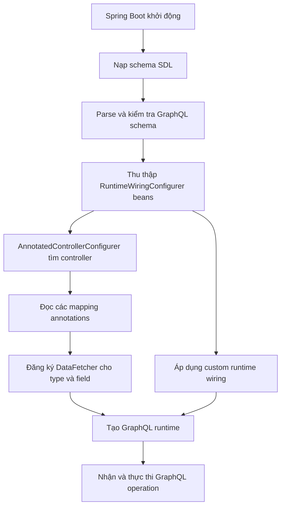

# AnnotatedControllerConfigurer

Trong Spring for GraphQL, `AnnotatedControllerConfigurer` kết nối các method được đánh dấu bằng annotation trong controller Spring với field của GraphQL schema. Nhờ đó, ứng dụng có thể viết resolver bằng các method Java quen thuộc thay vì tự đăng ký từng `DataFetcher` vào GraphQL Java `RuntimeWiring`.

Configurer này phát hiện các bean controller, đọc annotation như `@QueryMapping`, `@MutationMapping`, `@SchemaMapping` và `@BatchMapping`, sau đó đăng ký cách thực thi tương ứng cho field trong schema. Spring Boot thường tự cấu hình thành phần này khi tích hợp Spring for GraphQL. Vì vậy, khi dùng `spring-boot-starter-graphql`, phần lớn ứng dụng chỉ cần khai báo SDL và viết controller đúng quy ước.

## 1. AnnotatedControllerConfigurer giải quyết việc gì?

GraphQL Java cần một `DataFetcher` cho các field cần lấy dữ liệu. Nếu cấu hình trực tiếp, ứng dụng phải nối tên type và field trong schema với logic Java:

```java
RuntimeWiring.newRuntimeWiring()
    .type("Query", typeWiring -> typeWiring
        .dataFetcher("book", environment -> {
            String id = environment.getArgument("id");
            return bookService.findById(id);
        }))
    .build();
```

Với Spring for GraphQL, có thể viết controller:

```java
@Controller
public class BookController {

    private final BookService bookService;

    public BookController(BookService bookService) {
        this.bookService = bookService;
    }

    @QueryMapping
    public Book book(@Argument String id) {
        return bookService.findById(id);
    }
}
```

`AnnotatedControllerConfigurer` đảm nhiệm phần chuyển method được đánh dấu thành `DataFetcher` và đăng ký vào runtime wiring. Controller vẫn là Spring bean thông thường, có thể inject service, repository và các dependency khác qua constructor.

Điểm quan trọng là configurer không tự viết nghiệp vụ và cũng không tạo schema thay cho SDL. Nó kết nối hợp đồng schema đã khai báo với method xử lý field của ứng dụng.

## 2. Vị trí của configurer trong quá trình khởi tạo

`AnnotatedControllerConfigurer` triển khai `RuntimeWiringConfigurer`. Spring for GraphQL sử dụng các bean loại này khi xây dựng GraphQL runtime, cùng với schema SDL và các cấu hình runtime khác.



Ở bước đăng ký, configurer xác định method nào phụ trách field nào. Khi client gửi operation, GraphQL runtime chọn field theo query và gọi `DataFetcher` tương ứng. Spring adapter chuyển lời gọi đó thành việc gọi handler method, giải quyết các tham số và xử lý kết quả trả về.

Việc đăng ký mapping thường diễn ra trong lúc khởi tạo GraphQL schema/runtime, không phải mỗi lần có request. Do đó, lỗi thiếu controller bean hoặc mapping không tương thích có thể được phát hiện sớm tùy trường hợp; lỗi dữ liệu và nghiệp vụ vẫn chỉ xuất hiện khi field được thực thi.

## 3. Spring Boot tự cấu hình trong trường hợp thông thường

Khi ứng dụng sử dụng `spring-boot-starter-graphql`, Spring Boot cung cấp tích hợp mặc định cho annotated controllers. Controller cần là Spring bean, thường được đánh dấu `@Controller` và nằm trong phạm vi component scan.

Ví dụ:

```java
package com.example.graphql;

import org.springframework.stereotype.Controller;

@Controller
public class BookController {
    // Các method GraphQL mapping
}
```

Nếu controller nằm ngoài package gốc mà Spring Boot quét, configurer không thể phát hiện bean đó. Khi một mapping dường như bị bỏ qua, hãy kiểm tra component scan và việc controller có được đăng ký trong application context hay không.

Không nên tự tạo thêm một `AnnotatedControllerConfigurer` khi auto-configuration đã cung cấp một instance. Đăng ký trùng configurer hoặc trùng mapping có thể gây hành vi khó đoán và khiến việc tìm nguồn của một `DataFetcher` trở nên khó khăn.

## 4. Ánh xạ Query và Mutation

`@QueryMapping` là cách viết ngắn cho mapping vào root type `Query`. Tương tự, `@MutationMapping` ánh xạ vào root type `Mutation`.

SDL:

```graphql
type Query {
    book(id: ID!): Book
}

type Mutation {
    renameBook(id: ID!, newTitle: String!): Book!
}

type Book {
    id: ID!
    title: String!
}
```

Controller:

```java
@Controller
public class BookController {

    private final BookService bookService;

    public BookController(BookService bookService) {
        this.bookService = bookService;
    }

    @QueryMapping
    public Book book(@Argument("id") String id) {
        return bookService.findById(id);
    }

    @MutationMapping
    public Book renameBook(
            @Argument("id") String id,
            @Argument("newTitle") String newTitle) {
        return bookService.rename(id, newTitle);
    }
}
```

Tên method mặc định được dùng làm tên field. Nếu tên method không trùng tên field trong SDL, có thể chỉ định tên trong annotation:

```java
@QueryMapping(name = "book")
public Book findBook(@Argument("id") String id) {
    return bookService.findById(id);
}
```

Tên argument trong `@Argument` phải tương ứng với argument được khai báo trên field schema. Tên Java parameter không thay đổi hợp đồng SDL.

## 5. Ánh xạ field lồng nhau với @SchemaMapping

Không phải mọi field đều nằm trên root type `Query` hoặc `Mutation`. Một object type có thể có field cần truy vấn dữ liệu riêng, ví dụ tác giả của một cuốn sách.

SDL:

```graphql
type Query {
    book(id: ID!): Book
}

type Book {
    id: ID!
    title: String!
    author: Author
}

type Author {
    id: ID!
    name: String!
}
```

Controller có thể ánh xạ field `author`:

```java
@SchemaMapping(typeName = "Book", field = "author")
public Author author(Book book) {
    return authorService.findByBookId(book.id());
}
```

Tham số `Book book` là source/parent object của field `author`. Nếu bỏ `typeName`, Spring có thể suy ra tên GraphQL type từ kiểu source parameter theo quy ước mapping. Nếu bỏ `field`, tên method được dùng làm tên field. Khi codebase lớn hoặc tên Java type không khớp tên GraphQL type, nên khai báo tường minh để mapping dễ đọc.

`@QueryMapping` và `@MutationMapping` là các biến thể chuyên biệt của schema mapping cho root operation type. Dùng `@SchemaMapping` khi cần chỉ rõ object type và field, đặc biệt với field lồng nhau.

## 6. Batch mapping và việc đăng ký field

`AnnotatedControllerConfigurer` cũng hỗ trợ method được đánh dấu `@BatchMapping`. Annotation này phù hợp khi cùng một field cần được resolve cho nhiều parent object và có thể tải dữ liệu theo lô.

Ví dụ, trang danh sách sách hiển thị tác giả của từng cuốn. Nếu resolver `author(Book book)` truy vấn riêng cho từng sách, một danh sách 30 sách có thể gây nhiều lần truy vấn. Có thể dùng batch mapping:

```java
@BatchMapping(typeName = "Book", field = "author")
public Map<Book, Author> author(List<Book> books) {
    return authorService.findAuthorsByBooks(books);
}
```

Phương thức nhận danh sách source object và trả về map ghép từng source với kết quả tương ứng. Spring for GraphQL đăng ký cơ chế batch loader cho field đó để các yêu cầu được gom lại trong quá trình thực thi.

Khi dùng `@BatchMapping`, cần bảo đảm kết quả có thể tra cứu đúng cho mọi source object, kể cả khi một số parent không có dữ liệu liên quan. Hãy xác định rõ cách biểu diễn giá trị không tồn tại và không giả định thứ tự map là hợp đồng response.

Với batch loading phức tạp, có thể dùng `BatchLoaderRegistry` và DataLoader trực tiếp. `@BatchMapping` là cách khai báo thuận tiện cho trường hợp mapping một field từ nhiều source object.

## 7. Method argument được giải quyết như thế nào?

Configurer không chỉ tìm method rồi gọi với một mảng argument thô. Spring for GraphQL có cơ chế phân giải tham số dựa trên annotation và kiểu tham số.

Một số kiểu tham số thường gặp:

| Tham số | Ý nghĩa |
| --- | --- |
| `@Argument("id") String id` | Lấy argument `id` từ field đang thực thi |
| Source object như `Book book` | Nhận parent object của field lồng nhau |
| `DataFetchingEnvironment` | Truy cập execution context cấp thấp của GraphQL Java |
| `Principal` | Nhận principal hiện tại khi có tích hợp security phù hợp |
| `@ContextValue("key")` | Đọc giá trị từ GraphQL context |
| `@LocalContextValue("key")` | Đọc giá trị từ local context của field |

Ví dụ dùng argument và context:

```java
@QueryMapping
public List<Book> booksByCategory(
        @Argument("category") String category,
        @ContextValue("tenantId") String tenantId) {
    return bookService.findByCategory(tenantId, category);
}
```

Các annotation giúp method thể hiện rõ dữ liệu phụ thuộc. Không nên lấy thông tin người dùng hoặc tenant từ argument do client tự gửi nếu giá trị đó cần được xác định từ security context của request.

Nếu tên argument không thể suy ra an toàn từ tên parameter Java, hãy chỉ định tường minh bằng `@Argument("...")`. Điều này cũng giúp code không phụ thuộc vào việc compiler có giữ metadata tên parameter hay không.

## 8. Kết quả đồng bộ, bất đồng bộ và reactive

Handler method có thể trả về một object thông thường hoặc kiểu bất đồng bộ được Spring for GraphQL hỗ trợ. Ví dụ:

```java
@QueryMapping
public CompletableFuture<Book> book(@Argument String id) {
    return bookService.findByIdAsync(id);
}
```

Với ứng dụng reactive, method có thể trả về kiểu Reactor như `Mono<Book>` hoặc `Flux<Book>` khi dependency và execution setup tương ứng có mặt.

Configurer và adapter của Spring xử lý việc chuyển kết quả method thành kết quả cho GraphQL execution. Tuy nhiên, không nên bọc mọi lời gọi đồng bộ vào `CompletableFuture` nếu không có công việc bất đồng bộ thực sự. Việc chuyển sang async không tự làm database query nhanh hơn và cũng không thay thế việc kiểm soát thread pool, backpressure hoặc giới hạn tài nguyên.

Với subscription, method cần trả về publisher hoặc kiểu dữ liệu phù hợp với transport và execution model đang dùng. Hãy phân biệt khả năng mapping method với khả năng transport của ứng dụng; một method được ánh xạ đúng chưa bảo đảm mọi HTTP transport đều hỗ trợ cách truyền subscription mà client mong đợi.

## 9. Kết hợp AnnotatedControllerConfigurer với RuntimeWiringConfigurer khác

`RuntimeWiringConfigurer` là extension point để bổ sung wiring trực tiếp cho GraphQL Java, ví dụ custom scalar hoặc một data fetcher đặc biệt. `AnnotatedControllerConfigurer` là một implementation tập trung vào annotated controller methods.

Có thể đăng ký custom scalar bằng một configurer riêng:

```java
import org.springframework.context.annotation.Bean;
import org.springframework.context.annotation.Configuration;
import org.springframework.graphql.execution.RuntimeWiringConfigurer;

@Configuration
public class GraphQlRuntimeConfiguration {

    @Bean
    RuntimeWiringConfigurer customScalarConfigurer() {
        return builder -> builder.scalar(MyScalars.LOCAL_DATE);
    }
}
```

Spring for GraphQL có thể áp dụng nhiều `RuntimeWiringConfigurer` trong quá trình xây dựng runtime. Hãy giữ mỗi configurer tập trung vào một nhiệm vụ, tránh đăng ký cùng field ở cả annotated controller và custom data fetcher.

Không cần tự viết một `RuntimeWiringConfigurer` chỉ để thay thế `@QueryMapping` hoặc `@SchemaMapping`. Chỉ dùng wiring thủ công khi cần tích hợp đặc biệt mà mô hình annotated controller không diễn đạt phù hợp.

## 10. Khi nào cần tạo AnnotatedControllerConfigurer thủ công?

Trong ứng dụng Spring Boot dùng starter, configurer thường đã được auto-configure. Trường hợp không dùng Boot hoặc tự xây dựng GraphQL runtime, có thể đăng ký configurer như một Spring bean:

```java
import org.springframework.context.annotation.Bean;
import org.springframework.context.annotation.Configuration;
import org.springframework.graphql.data.method.annotation.support.AnnotatedControllerConfigurer;

@Configuration
public class GraphQlControllerConfiguration {

    @Bean
    AnnotatedControllerConfigurer annotatedControllerConfigurer() {
        return new AnnotatedControllerConfigurer();
    }
}
```

Khi được quản lý bởi Spring, configurer có thể nhận application context và các dependency cần thiết để phát hiện controller. Cần bảo đảm bean này được đưa vào danh sách `RuntimeWiringConfigurer` mà `GraphQlSource` sử dụng.

Nếu ứng dụng tự tạo `GraphQlSource` hoặc `RuntimeWiring` bằng tay, phải chủ động áp dụng configurer vào builder. Chỉ khai báo bean mà không đưa nó vào quá trình xây dựng schema sẽ không tự động đăng ký handler methods trong một cấu hình GraphQL Java hoàn toàn độc lập.

Trước khi thêm bean thủ công, kiểm tra cấu hình hiện tại để tránh có hai instance cùng quét và đăng ký một tập controller.

## 11. Lỗi mapping thường gặp

| Triệu chứng | Nguyên nhân có thể | Cách kiểm tra hoặc xử lý |
| --- | --- | --- |
| Field trả null dù controller có method | Controller không phải Spring bean hoặc không được component scan | Kiểm tra `@Controller` và package scan |
| Method không được gọi | Annotation hoặc tên field không khớp SDL | So sánh type name, field name và root operation |
| Argument nhận null | Tên argument không đúng hoặc binding không khớp | Dùng `@Argument("name")` tường minh |
| Mapping vào sai object type | Source parameter không giúp suy ra đúng type | Khai báo `typeName` trong `@SchemaMapping` |
| Hai method cùng xử lý một field | Mapping bị đăng ký trùng | Tìm các annotation và custom data fetcher cùng type/field |
| Custom scalar không hoạt động | Chưa đăng ký scalar trong runtime wiring | Bổ sung `RuntimeWiringConfigurer` |
| Field lồng nhau phát sinh nhiều truy vấn | Resolver truy cập dữ liệu riêng cho từng parent | Dùng `@BatchMapping` hoặc DataLoader |
| Controller tồn tại nhưng không có trong context test | Slice test không nạp controller hoặc cấu hình cần thiết | Chỉ định controller và mock dependency trong test |

Khi debug, hãy bắt đầu từ schema field mà client đang gọi, sau đó xác định type cha, mapping annotation, tên method và bean controller. Nếu field là field lồng nhau, kiểm tra source object được truyền vào method. Cách lần theo từ schema đến method thường giúp tìm lỗi nhanh hơn việc thay đổi cấu hình runtime một cách ngẫu nhiên.

## 12. Kiểm thử annotated controller

`GraphQlTester` cho phép thực thi operation trên GraphQL runtime trong test và kiểm tra kết quả field. Với slice test, `@GraphQlTest` có thể giới hạn phạm vi vào controller được chọn.

```java
import org.junit.jupiter.api.Test;
import org.springframework.beans.factory.annotation.Autowired;
import org.springframework.boot.test.autoconfigure.graphql.GraphQlTest;
import org.springframework.graphql.test.tester.GraphQlTester;

@GraphQlTest(BookController.class)
class BookControllerTest {

    @Autowired
    GraphQlTester graphQlTester;

    @Test
    void resolvesBookById() {
        graphQlTester.document("""
                query {
                    book(id: "book-1") {
                        id
                        title
                    }
                }
                """)
            .execute()
            .path("book.id")
            .entity(String.class)
            .isEqualTo("book-1");
    }
}
```

Ví dụ giả định test context cung cấp `BookService` mock hoặc test bean trả về sách có ID `book-1`. Test xác minh mapping từ `Query.book` đến method `@QueryMapping` và response field có cấu trúc mong đợi.

Nên kiểm thử thêm:

- Field mapping với argument thiếu, sai tên hoặc sai kiểu.
- Nested field mapping với source object đúng.
- `@BatchMapping` với nhiều parent và parent không có dữ liệu liên quan.
- Exception từ service và error response đã chuẩn hóa.
- Authorization và context value.
- Async result hoặc subscription nếu ứng dụng sử dụng.

Với integration test đầy đủ, kiểm tra cả schema resource, auto-configuration, security, transport và resolver. Slice test hữu ích cho mapping method nhưng không thay thế mọi kiểm thử khởi động và HTTP.

## 13. Checklist cấu hình AnnotatedControllerConfigurer

- Ứng dụng đã có GraphQL schema SDL và `GraphQlSource` hợp lệ?
- Controller được đăng ký thành Spring bean và nằm trong component scan?
- `AnnotatedControllerConfigurer` đã được Spring Boot auto-configure hoặc được đăng ký thủ công đúng cách?
- Mapping annotation trỏ đúng root type hoặc object type trong SDL?
- Tên field và argument khớp hợp đồng schema?
- Source parameter của nested mapping có đúng parent type?
- Có mapping trùng giữa controller và custom runtime wiring không?
- Field có truy vấn theo lô đã cân nhắc `@BatchMapping` hoặc DataLoader chưa?
- Test đã xác minh operation qua `GraphQlTester`?
- Các quy tắc bảo mật và lỗi nghiệp vụ được xử lý ở tầng phù hợp?

`AnnotatedControllerConfigurer` là cầu nối giữa annotated controller methods của Spring và `DataFetcher` trong GraphQL Java. Nó giúp ánh xạ các method `@QueryMapping`, `@MutationMapping`, `@SchemaMapping` và `@BatchMapping` vào field của schema, đồng thời tận dụng dependency injection và cơ chế phân giải tham số của Spring. Trong ứng dụng Spring Boot, hãy ưu tiên cấu hình mặc định và chỉ tùy chỉnh runtime wiring khi có nhu cầu rõ ràng. Khi mapping được tổ chức minh bạch và kiểm thử bằng operation thực tế, schema và code Java sẽ dễ theo dõi, mở rộng và bảo trì hơn.
