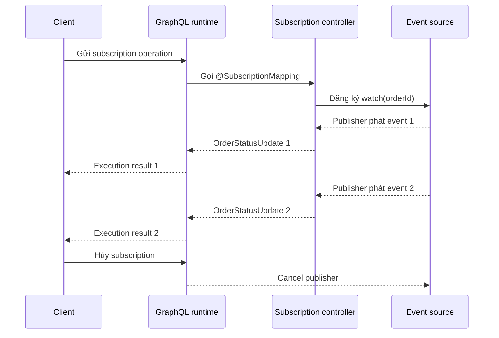

# `@SubscriptionMapping` trong Spring for GraphQL

`@SubscriptionMapping` là annotation của Spring for GraphQL dùng để ánh xạ một phương thức trong controller tới field thuộc root type `Subscription` của GraphQL schema. Phương thức thường trả về một `Publisher`, chẳng hạn Reactor `Flux`, để server phát nhiều kết quả theo thời gian cho client.

Annotation này kết nối ba phần của một subscription: field được khai báo trong SDL, phương thức Java xử lý field đó và nguồn sự kiện tạo ra dữ liệu. `@SubscriptionMapping` không tự tạo sự kiện hoặc mở kết nối mạng; nó chỉ đăng ký logic thực thi field Subscription trong GraphQL runtime.

## Subscription khác Query và Mutation như thế nào?

Query và Mutation thường xử lý một lần thực thi request rồi trả về một kết quả. Subscription giữ một luồng kết quả để server gửi các cập nhật tiếp theo khi có sự kiện mới.

| Operation | Mục đích | Kiểu kết quả thường gặp ở controller |
| --- | --- | --- |
| Query | Đọc dữ liệu tại thời điểm client yêu cầu. | Object, collection, `Mono` hoặc kiểu bất đồng bộ phù hợp. |
| Mutation | Thay đổi dữ liệu và trả kết quả của thao tác. | Object, boolean, `Mono` hoặc kiểu bất đồng bộ phù hợp. |
| Subscription | Theo dõi sự kiện và phát nhiều kết quả trong suốt vòng đời đăng ký. | Reactive Streams `Publisher`, thường là `Flux`. |

Ví dụ, màn hình chi tiết đơn hàng có thể dùng Query để tải trạng thái hiện tại. Sau đó, Subscription theo dõi thay đổi để nhận các trạng thái mới mà không cần client polling liên tục.

## Khai báo Subscription field trong SDL

Trước khi viết controller, schema cần có root type `Subscription` và field cần theo dõi. Ví dụ theo dõi trạng thái đơn hàng:

```graphql
type OrderStatusUpdate {
  orderId: ID!
  status: String!
  changedAt: String!
}

type Subscription {
  orderStatusChanged(orderId: ID!): OrderStatusUpdate!
}
```

Field `orderStatusChanged` nhận `orderId` để xác định đơn hàng cần theo dõi. Mỗi sự kiện trả về một `OrderStatusUpdate` gồm mã đơn, trạng thái mới và thời điểm thay đổi.

Client đăng ký bằng một subscription operation:

```graphql
subscription WatchOrder($orderId: ID!) {
  orderStatusChanged(orderId: $orderId) {
    orderId
    status
    changedAt
  }
}
```

Variables được gửi cùng operation:

```json
{
  "orderId": "ORD-1001"
}
```

Một subscription operation chỉ được chọn đúng một field cấp cao nhất. Các field con của payload như `orderId`, `status` và `changedAt` vẫn được chọn bình thường trong selection set của field đó.

## Ánh xạ field bằng `@SubscriptionMapping`

Spring for GraphQL phát hiện controller có `@SubscriptionMapping` và đăng ký phương thức làm DataFetcher cho field trên root type `Subscription`. Theo quy ước, tên phương thức được dùng làm tên field nếu không khai báo tên khác.

Ví dụ controller:

```java
import java.security.Principal;
import org.springframework.graphql.data.method.annotation.Argument;
import org.springframework.graphql.data.method.annotation.SubscriptionMapping;
import org.springframework.stereotype.Controller;
import reactor.core.publisher.Flux;

@Controller
public class OrderSubscriptionController {

    private final OrderEventService orderEventService;
    private final OrderAuthorizationService authorizationService;

    public OrderSubscriptionController(
            OrderEventService orderEventService,
            OrderAuthorizationService authorizationService) {
        this.orderEventService = orderEventService;
        this.authorizationService = authorizationService;
    }

    @SubscriptionMapping
    public Flux<OrderStatusUpdate> orderStatusChanged(
            @Argument String orderId, Principal principal) {
        authorizationService.checkCanReadOrder(principal, orderId);
        return orderEventService.watch(orderId);
    }
}
```

Trong ví dụ này:

- `@Controller` đăng ký lớp vào cơ chế annotated controller của Spring for GraphQL.
- `@SubscriptionMapping` ánh xạ phương thức `orderStatusChanged` tới field cùng tên trên `Subscription` root.
- `@Argument String orderId` lấy đối số `orderId` từ operation.
- `Principal` đại diện danh tính đã xác thực được cung cấp bởi request/security integration.
- `Flux<OrderStatusUpdate>` phát các sự kiện trạng thái đơn hàng theo thời gian.
- `OrderEventService` chịu trách nhiệm kết nối tới nguồn sự kiện; controller không cần biết chi tiết message broker hoặc event bus.

Tên field trong SDL và tên phương thức phải khớp theo quy ước mapping. Nếu đổi tên field, cần cập nhật mapping hoặc cấu hình tên field tường minh theo API annotation của phiên bản Spring for GraphQL đang dùng.

## Vì sao Subscription handler trả về Publisher?

GraphQL Subscription không chỉ trả một object duy nhất. Khi client đăng ký, server cần một nguồn có thể phát ra nhiều giá trị trong tương lai. Reactive Streams `Publisher` biểu diễn chính luồng đó.

Các kiểu thường gặp:

- `Flux<T>` có thể phát không, một hoặc nhiều phần tử rồi hoàn tất hoặc phát lỗi. Đây là kiểu phổ biến cho subscription liên tục.
- `Mono<T>` chỉ phát tối đa một phần tử. Nó vẫn là Publisher, nhưng thường phù hợp hơn với kết quả bất đồng bộ một lần; nếu mục tiêu là theo dõi nhiều sự kiện, dùng Flux rõ nghĩa hơn.
- Một implementation khác của `org.reactivestreams.Publisher<T>` cũng có thể được dùng nếu tương thích với hạ tầng reactive của ứng dụng.

Khi Publisher phát một giá trị, GraphQL thực thi selection set trên giá trị đó và gửi một execution result tới client. Quá trình lặp lại cho tới khi Publisher hoàn tất, phát lỗi hoặc subscription bị hủy.

Luồng xử lý tổng quát:



## Nguồn sự kiện nằm ở service

Controller nên tập trung vào việc ánh xạ GraphQL field, đọc argument và áp dụng những kiểm tra phù hợp trước khi trả Publisher. Việc phát sự kiện thường thuộc về một service chuyên trách.

Ví dụ hợp đồng service:

```java
import reactor.core.publisher.Flux;

public interface OrderEventService {
    Flux<OrderStatusUpdate> watch(String orderId);
}
```

Implementation có thể lấy dữ liệu từ:

- Event bus hoặc message broker như Kafka, RabbitMQ.
- Một luồng sự kiện nội bộ của ứng dụng.
- Reactor sink hoặc publisher được quản lý trong bộ nhớ cho trường hợp đơn giản.
- Hệ thống thông báo hoặc dịch vụ bên ngoài có API streaming.

Service cần bảo đảm stream chỉ phát các sự kiện phù hợp với `orderId` đã đăng ký. Với hệ thống chạy nhiều instance, nguồn sự kiện phải hoạt động xuyên instance; một `Flux` trong bộ nhớ của một JVM không tự đồng bộ sự kiện sang các node khác.

### Cold và hot Publisher

Khi thiết kế service, cần hiểu cách Publisher hoạt động:

- **Cold Publisher** thường tạo luồng hoặc thực hiện thao tác nguồn riêng cho mỗi subscriber. Mỗi client có thể có một subscription độc lập.
- **Hot Publisher** phát sự kiện độc lập với từng subscriber. Client chỉ nhận được sự kiện trong khoảng thời gian họ đã đăng ký, tùy chính sách buffer và replay của nguồn.

Chọn loại Publisher dựa trên yêu cầu nghiệp vụ. Nếu client cần nhận lại những sự kiện xảy ra trong lúc mất kết nối, WebSocket reconnect đơn thuần không đủ; cần cơ chế lưu event, cursor hoặc sequence number để client có thể tiếp tục từ vị trí đã nhận.

## Đọc argument và thông tin request

`@Argument` là cách thông dụng để nhận dữ liệu từ field trong SDL. Tên argument trong annotation mapping cần khớp với schema:

```graphql
type Subscription {
  inventoryChanged(warehouseId: ID!, productId: ID): InventoryUpdate!
}
```

```java
@SubscriptionMapping
public Flux<InventoryUpdate> inventoryChanged(
        @Argument String warehouseId,
        @Argument String productId) {
    return inventoryEventService.watch(warehouseId, productId);
}
```

Ngoài argument, annotated controller có thể nhận những đối tượng ngữ cảnh được Spring for GraphQL hỗ trợ như `Principal`, `DataFetchingEnvironment`, `GraphQLContext`, hoặc giá trị context qua annotation phù hợp. Dùng chúng khi cần danh tính, tenant hoặc correlation ID của request.

Không nên đặt thông tin xác thực hoặc quyền hạn trong argument do client tự gửi. Argument là dữ liệu đầu vào; danh tính và quyền phải lấy từ security context đáng tin cậy của server.

## Bảo mật Subscription theo tài nguyên

Subscription thường sống lâu hơn một HTTP request nên cần quan tâm tới quyền truy cập trong suốt vòng đời của stream.

Trong ví dụ đơn hàng, việc người dùng biết `orderId` không có nghĩa họ được phép theo dõi đơn đó. Controller hoặc service phải kiểm tra quyền trước khi đăng ký nguồn sự kiện:

```java
@SubscriptionMapping
public Flux<OrderStatusUpdate> orderStatusChanged(
        @Argument String orderId, Principal principal) {
    authorizationService.checkCanReadOrder(principal, orderId);
    return orderEventService.watch(orderId);
}
```

Kiểm tra ban đầu ngăn người dùng không có quyền tạo subscription. Nếu quyền có thể bị thu hồi trong khi stream đang chạy, hệ thống cần thêm chính sách revalidation, giới hạn thời gian stream hoặc hủy publisher khi quyền thay đổi.

Với ứng dụng đa tenant, service phải gắn subscription với tenant của principal hiện tại và lọc sự kiện theo cả tài nguyên lẫn tenant. Không tin `tenantId` do client gửi nếu server chưa xác minh nó thuộc phạm vi người dùng.

Các nguyên tắc khác cần áp dụng:

- Dùng `wss://` khi triển khai qua môi trường HTTPS.
- Xác thực kết nối và xử lý thông tin xác thực theo cơ chế transport đã chọn.
- Giới hạn số subscription đồng thời và tốc độ đăng ký.
- Không ghi token hoặc payload nhạy cảm vào log.
- Kiểm tra quyền cho từng tài nguyên được theo dõi.
- Có chính sách đóng stream khi người dùng đăng xuất, token hết hạn hoặc quyền bị thu hồi.

## Hủy subscription và giải phóng tài nguyên

Khi client không còn cần nhận sự kiện, thư viện client sẽ hủy operation. Với GraphQL over WebSocket, điều này được biểu diễn bằng message `complete` cho operation tương ứng. GraphQL runtime hủy subscription Publisher; tín hiệu cancellation cần được truyền về nguồn nếu implementation hỗ trợ.

Điều này đặc biệt quan trọng nếu mỗi subscriber tạo ra:

- Một consumer hoặc listener trên message broker.
- Một kết nối tới dịch vụ streaming.
- Một subscription tới Reactor sink.
- Một buffer hoặc hàng đợi riêng.

Service cần gỡ listener và giải phóng tài nguyên khi Publisher bị hủy hoặc kết thúc. Với Reactor, có thể dùng các operator như `doFinally` để quan sát tín hiệu hoàn tất, lỗi hoặc cancellation và thực hiện cleanup phù hợp. Không tạo listener ở ngoài Publisher rồi quên gỡ khi client ngắt kết nối.

Ví dụ minh họa vòng đời:

```java
public Flux<OrderStatusUpdate> watch(String orderId) {
    return createOrderEventStream(orderId)
            .doFinally(signal -> releaseSubscriptionResources(orderId));
}
```

`createOrderEventStream` và `releaseSubscriptionResources` là các hàm thuộc implementation của ứng dụng. Nếu có nhiều subscriber cùng theo dõi một order, việc cleanup phải gắn với đúng subscription hoặc reference count; không đóng nguồn dùng chung khi một client đơn lẻ rời đi.

## Backpressure và giới hạn tài nguyên

Nguồn sự kiện có thể phát nhanh hơn tốc độ client xử lý. Reactive Streams có cơ chế demand/cancellation, nhưng các adapter, message broker và transport có thể có buffer riêng. Nếu buffer không giới hạn, một client chậm có thể làm bộ nhớ tăng liên tục.

Khi thiết kế luồng, cần xác định:

- Dùng buffer có giới hạn và quy định cách xử lý khi đầy.
- Có thể bỏ sự kiện trung gian, gộp trạng thái hoặc chỉ phát trạng thái mới nhất hay không.
- Sự kiện có cần đảm bảo không mất và có thể replay hay không.
- Giới hạn số kết nối và subscription theo user hoặc tenant.
- Timeout và chính sách đóng kết nối khi client không còn hoạt động.
- Cách giám sát số subscriber, tốc độ phát, độ trễ và số lần cancellation.

Không phải luồng nào cũng nên dùng chiến lược `latest` hoặc drop. Với trạng thái dashboard, chỉ cần giá trị mới nhất có thể đủ; với giao dịch tài chính hoặc lịch sử trạng thái đơn hàng, bỏ sự kiện có thể làm sai nghiệp vụ. Chính sách backpressure phải phù hợp yêu cầu dữ liệu.

## Xử lý lỗi trong Subscription

Lỗi có thể xảy ra trước hoặc sau khi stream bắt đầu:

| Thời điểm | Ví dụ | Cách xử lý |
| --- | --- | --- |
| Trước khi trả Publisher | Argument sai, không có quyền, tài nguyên không tồn tại. | Ném exception nghiệp vụ phù hợp và ánh xạ qua `DataFetcherExceptionResolver`. |
| Trong lúc stream đang chạy | Message broker lỗi, kết nối nguồn sự kiện bị mất. | Ghi nhận lỗi, kết thúc stream hoặc thực hiện retry theo chính sách service. |
| Khi resolve payload | Một field trong event không lấy được dữ liệu. | Áp dụng error handling GraphQL và nullability trong SDL. |
| Khi client hủy | Người dùng rời màn hình hoặc đóng kết nối. | Xử lý cancellation và giải phóng tài nguyên. |

Không nên để stack trace, thông tin kết nối broker hoặc chi tiết nội bộ xuất hiện trong lỗi trả về client. Nếu service tự retry, cần tránh retry vô hạn hoặc phát trùng sự kiện mà không có event ID/sequence để client xử lý.

Nullability trong schema cũng quan trọng. Nếu field Subscription trả về `OrderStatusUpdate!`, mỗi event phải tạo được một payload khác null. Nếu một payload không hợp lệ, lỗi có thể ảnh hưởng tới execution result tương ứng; client cần kiểm tra cả `data` và `errors`.

## Transport: annotation không tự mở WebSocket

`@SubscriptionMapping` đăng ký field với GraphQL runtime. Để client thực sự nhận các event qua mạng, ứng dụng còn cần một transport hỗ trợ subscription và client tương thích.

Trong Spring Boot, một cách phổ biến là bật GraphQL over WebSocket và cấu hình WebSocket endpoint. Client thường dùng thư viện hỗ trợ protocol `graphql-transport-ws`, ví dụ `graphql-ws` ở JavaScript. Endpoint HTTP GraphQL dùng cho Query/Mutation không tự động biến thành WebSocket endpoint chỉ vì controller có `@SubscriptionMapping`.

Luồng cơ bản của WebSocket gồm handshake, khởi tạo kết nối, đăng ký operation, nhận nhiều message kết quả và hủy operation. Cấu hình path, xác thực và protocol phải khớp giữa client, server và reverse proxy.

## Kiểm thử `@SubscriptionMapping`

Kiểm thử subscription cần xác nhận cả mapping, dữ liệu phát ra và vòng đời stream. Có thể dùng `WebSocketGraphQlTester` hoặc GraphQL client test tương ứng để kiểm thử qua transport thực tế; kiểm thử service riêng cũng hữu ích để xác minh filter và cleanup.

Các trường hợp nên có:

- Subscription hợp lệ gọi đúng phương thức `@SubscriptionMapping`.
- Argument được truyền đúng vào `@Argument`.
- Stream phát nhiều event với payload và thứ tự phù hợp.
- Người dùng không có quyền bị từ chối trước khi đăng ký nguồn sự kiện.
- Event của order hoặc tenant khác không bị phát cho subscriber hiện tại.
- Lỗi từ event source được chuyển thành kết quả lỗi phù hợp.
- Client hủy subscription thì listener và tài nguyên được giải phóng.
- Nhiều client đăng ký cùng một field không làm lẫn dữ liệu hoặc cleanup của nhau.
- Reconnect không tạo listener trùng và có chính sách xử lý event bị bỏ lỡ.

Với test tích hợp, nên phát event từ một nguồn test có thể điều khiển, đăng ký subscription, xác nhận kết quả nhận được, sau đó hủy subscription và kiểm tra cleanup. Tránh chỉ kiểm thử rằng phương thức controller trả về một `Flux`; điều đó chưa chứng minh WebSocket transport và GraphQL subscription lifecycle hoạt động đúng.

## Lỗi thường gặp

| Triệu chứng | Nguyên nhân | Cách xử lý |
| --- | --- | --- |
| Operation không tìm thấy field subscription | Field trong SDL không khớp tên phương thức hoặc root type chưa khai báo. | Kiểm tra `Subscription` root và tên mapping. |
| Controller trả một kết quả rồi kết thúc | Service trả Publisher chỉ phát một phần tử hoặc đã hoàn tất. | Kiểm tra nguồn sự kiện và dùng stream phù hợp với nhu cầu. |
| HTTP Query hoạt động nhưng Subscription không kết nối | Chưa bật transport hỗ trợ subscription hoặc client dùng sai endpoint/protocol. | Kiểm tra WebSocket endpoint, handshake và `graphql-transport-ws`. |
| Subscriber nhận event của tài nguyên khác | Service lọc thiếu theo ID hoặc tenant. | Ràng buộc nguồn stream với principal, tenant và resource đã xác thực. |
| Event vẫn tiếp tục sau khi client rời đi | Publisher không xử lý cancellation hoặc listener chưa được cleanup. | Truyền cancellation tới nguồn và giải phóng tài nguyên trong `doFinally`/cơ chế tương đương. |
| Bộ nhớ tăng khi client chậm | Buffer không giới hạn hoặc nguồn phát nhanh hơn khả năng tiêu thụ. | Áp dụng backpressure và giới hạn buffer phù hợp nghiệp vụ. |
| Client bỏ lỡ event khi reconnect | Subscription không có replay/cursor. | Dùng event ID hoặc sequence và hỗ trợ đọc tiếp từ nguồn lưu trữ. |

## Ghi nhớ

`@SubscriptionMapping` ánh xạ phương thức annotated controller tới field của root type `Subscription`. Phương thức thường nhận argument bằng `@Argument` và trả về Reactive Streams `Publisher`, phổ biến nhất là `Flux`, để GraphQL phát nhiều execution result cho client.

Controller nên ủy quyền việc tạo luồng cho service, kiểm tra quyền truy cập theo tài nguyên, lọc dữ liệu theo tenant và bảo đảm cancellation giải phóng listener. Subscription còn cần transport tương thích như GraphQL over WebSocket, cùng chính sách backpressure, lỗi và reconnect phù hợp. Annotation chỉ đảm nhiệm mapping field; toàn bộ vòng đời sự kiện vẫn cần được thiết kế ở service và hạ tầng truyền tải.
