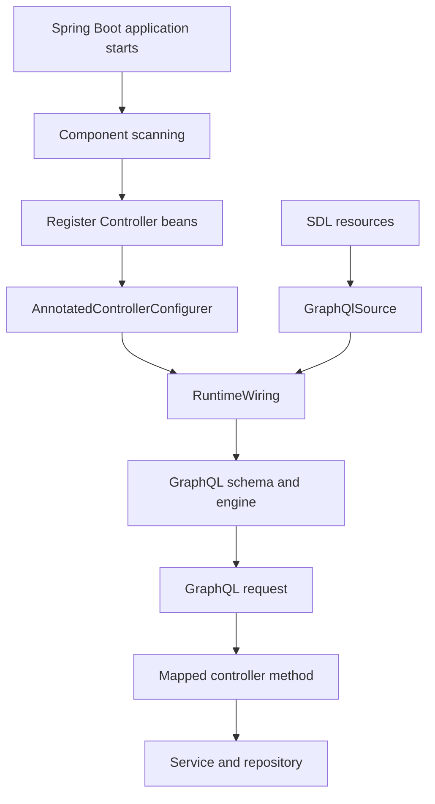

# Controller scan

Trong Spring for GraphQL, các method xử lý GraphQL thường nằm trong class Java được đánh dấu bằng annotation @Controller. Spring Boot không tìm các class này bằng cách đọc file SDL. Chúng được đăng ký thành Spring bean thông qua component scanning hoặc một cơ chế đăng ký bean khác; sau đó thành phần annotated controller của Spring for GraphQL tìm các handler method và kết nối chúng với field trong GraphQL schema.

Vì vậy, một controller có @QueryMapping nhưng nằm ngoài phạm vi component scan sẽ không được phát hiện. Ngược lại, file SDL đã được nạp nhưng không có controller hoặc data fetcher phù hợp thì field vẫn thiếu logic xử lý. Hiểu rõ hai bước discovery này giúp xử lý các lỗi phổ biến như query không gọi vào method, field mapping không được đăng ký hoặc test chạy khác với ứng dụng thật.

Bài học này giải thích component scanning, vai trò của @Controller, cách Spring for GraphQL phát hiện handler method, cách cấu hình package scan cho ứng dụng nhiều module, và cách kiểm thử cũng như chẩn đoán controller scan.

## 1. Hai bước discovery riêng biệt

Một ứng dụng GraphQL dùng Spring Boot có hai việc cần thực hiện:

1. Nạp GraphQL SDL để tạo schema runtime.
2. Phát hiện các Spring bean chứa GraphQL handler method và đăng ký data fetcher cho field.

Luồng tổng quát:



SDL và controller có trách nhiệm khác nhau:

| Thành phần | Vai trò |
| --- | --- |
| GraphQL SDL | Khai báo type, field, argument, input và kiểu trả về |
| Component scanning | Tìm class Spring stereotype và đăng ký bean vào application context |
| AnnotatedControllerConfigurer | Tìm handler method trong controller bean và đăng ký data fetcher |
| Resolver method | Thực thi logic cho field khi client gửi operation |

Đường dẫn src/main/resources/graphql dùng để tìm schema file. Nó không phải package Java và không ảnh hưởng đến component scan. Tương tự, đặt controller trong package graphql không tự tạo field trong schema nếu SDL chưa khai báo field đó.

## 2. Vai trò của @Controller

Spring for GraphQL dùng @Controller để đánh dấu class chứa handler method. Đây là Spring stereotype annotation, được component scan nhận diện và đăng ký thành bean.

```java
package com.acme.library.graphql;

import org.springframework.graphql.data.method.annotation.Argument;
import org.springframework.graphql.data.method.annotation.QueryMapping;
import org.springframework.stereotype.Controller;

@Controller
public class BookGraphQlController {

    private final BookService bookService;

    public BookGraphQlController(BookService bookService) {
        this.bookService = bookService;
    }

    @QueryMapping
    public Book book(@Argument String id) {
        return bookService.findById(id);
    }
}
```

@Controller đánh dấu class để Spring quản lý. @QueryMapping đánh dấu method xử lý một field của root type Query; @Argument lấy argument id từ GraphQL field call.

Method trên tương ứng với SDL:

```graphql
type Query {
  book(id: ID!): Book
}

type Book {
  id: ID!
  title: String!
}
```

GraphQL client gọi operation qua endpoint GraphQL chung, thường là /graphql. @QueryMapping không tạo một HTTP route riêng như @GetMapping. Nó ánh xạ một GraphQL field vào method Java.

### Các annotation mapping phổ biến

| Annotation | Field được ánh xạ |
| --- | --- |
| @QueryMapping | Field trên root type Query |
| @MutationMapping | Field trên root type Mutation |
| @SubscriptionMapping | Field trên root type Subscription |
| @SchemaMapping | Field của một GraphQL object type |
| @BatchMapping | Field được phân giải theo lô cho nhiều source object |

Ví dụ:

```java
@Controller
public class LibraryGraphQlController {

    @QueryMapping
    public List<Book> books() {
        return bookService.findAll();
    }

    @MutationMapping
    public Book createBook(@Argument CreateBookInput input) {
        return bookService.create(input);
    }

    @SchemaMapping(typeName = "Book", field = "author")
    public Author author(Book book) {
        return authorService.findById(book.authorId());
    }
}
```

Các annotation này chỉ có tác dụng khi class chứa chúng được Spring đăng ký thành bean và annotated controller infrastructure được cấu hình.

## 3. @SpringBootApplication xác định package scan mặc định

@SpringBootApplication bao gồm cấu hình component scanning. Nếu không chỉ định package riêng, Spring bắt đầu scan từ package chứa class ứng dụng và đi xuống các package con.

Ví dụ cấu trúc:

```text
src/main/java/
└── com/acme/library/
    ├── LibraryApplication.java
    ├── graphql/
    │   ├── book/
    │   │   └── BookGraphQlController.java
    │   └── author/
    │       └── AuthorGraphQlController.java
    ├── service/
    │   └── BookService.java
    └── repository/
        └── BookRepository.java
```

Class ứng dụng:

```java
package com.acme.library;

@SpringBootApplication
public class LibraryApplication {

    public static void main(String[] args) {
        SpringApplication.run(LibraryApplication.class, args);
    }
}
```

Vì LibraryApplication nằm trong package com.acme.library, Spring scan package này và các package con như com.acme.library.graphql.book. Các controller trong ví dụ được phát hiện tự động.

Một cấu trúc dễ gây lỗi là đặt class ứng dụng trong package con quá sâu:

```text
com/acme/library/bootstrap/LibraryApplication.java
com/acme/library/graphql/BookGraphQlController.java
```

Nếu không cấu hình scan root khác, package mặc định là com.acme.library.bootstrap; controller ở com.acme.library.graphql nằm ngoài nhánh đó và không được phát hiện. Hãy đặt class ứng dụng ở package gốc chung của ứng dụng hoặc cấu hình package scan rõ ràng.

## 4. Mở rộng phạm vi scan cho ứng dụng nhiều package

Khi controller nằm ngoài package gốc mặc định, có thể chỉ định package scan trong @SpringBootApplication.

### Dùng scanBasePackages

```java
@SpringBootApplication(scanBasePackages = {
        "com.acme.library",
        "com.acme.shared.graphql"
})
public class LibraryApplication {
    // ...
}
```

scanBasePackages nhận tên package dưới dạng chuỗi. Cách này dễ hiểu nhưng tên package không được compiler kiểm tra; khi đổi package, chuỗi có thể bị lỗi mà IDE không phát hiện.

### Dùng scanBasePackageClasses

Có thể dùng class marker để chỉ định package an toàn hơn:

```java
package com.acme.shared.graphql;

public final class SharedGraphQlPackage {
    private SharedGraphQlPackage() {
    }
}
```

Sau đó:

```java
@SpringBootApplication(scanBasePackageClasses = {
        LibraryApplication.class,
        SharedGraphQlPackage.class
})
public class LibraryApplication {
    // ...
}
```

Spring scan package chứa từng class marker và các package con. Cách này giảm rủi ro do đổi tên package.

Không nên scan toàn bộ các package quá rộng như com hoặc org nếu không cần. Phạm vi quá lớn có thể làm application context khởi tạo nhiều bean ngoài ý muốn, gây xung đột bean name hoặc tăng thời gian khởi động.

## 5. Đăng ký controller tường minh

Component scanning không phải cách duy nhất để đưa controller vào application context. Có thể đăng ký class cụ thể bằng @Import:

```java
@Configuration
@Import(ExternalBookGraphQlController.class)
public class ExternalGraphQlConfiguration {
}
```

Class được import vẫn cần được đánh dấu @Controller và có các method mapping hợp lệ:

```java
@Controller
public class ExternalBookGraphQlController {

    private final BookService bookService;

    public ExternalBookGraphQlController(BookService bookService) {
        this.bookService = bookService;
    }

    @QueryMapping
    public Book book(@Argument String id) {
        return bookService.findById(id);
    }
}
```

@Import hữu ích khi tích hợp một controller từ thư viện hoặc module khác mà không muốn mở rộng toàn bộ component scan. Các dependency của controller vẫn phải có bean tương ứng để Spring inject.

Có thể đăng ký bean bằng một @Bean factory method trong cấu hình Java nếu cần kiểm soát việc khởi tạo. Tuy nhiên, class phải vẫn được nhận diện là controller theo cơ chế mà annotated controller infrastructure sử dụng. Với controller thông thường, component scan hoặc @Import dễ đọc và ít cấu hình hơn.

## 6. AnnotatedControllerConfigurer phát hiện handler method

Sau khi controller bean đã nằm trong application context, Spring for GraphQL sử dụng AnnotatedControllerConfigurer để tìm các method có annotation mapping và kết nối chúng với schema field.

AnnotatedControllerConfigurer là một thành phần runtime wiring của Spring for GraphQL. Trong cấu hình Spring Boot thông thường, Boot đăng ký thành phần này để hỗ trợ annotated controllers. Nó tìm controller bean và đăng ký data fetcher cho method đã được đánh dấu.

Ví dụ:

```java
@Controller
public class BookGraphQlController {

    @QueryMapping
    public Book book(@Argument String id) {
        // ...
    }

    @MutationMapping
    public Book archiveBook(@Argument String id) {
        // ...
    }

    @SchemaMapping(typeName = "Book", field = "reviews")
    public List<Review> reviews(Book book) {
        // ...
    }
}
```

Các mapping trên tương ứng với:

- Query.book
- Mutation.archiveBook
- Book.reviews

Tên field thường được suy ra từ tên method. Có thể chỉ định rõ name hoặc field trong annotation nếu tên method Java khác tên field SDL.

@QueryMapping là dạng rút gọn của @SchemaMapping trên root type Query; @MutationMapping và @SubscriptionMapping cũng áp dụng tương tự cho root type tương ứng.

### Phân biệt component scan và handler method scan

Hai bước không nên bị nhầm:

1. Component scan tìm class có stereotype như @Controller, sau đó đăng ký bean.
2. Annotated controller configurer kiểm tra bean đã đăng ký và tìm method có @QueryMapping, @SchemaMapping hoặc annotation mapping khác.

Nếu class không trở thành bean, bước thứ hai không có controller để xử lý. Nếu class là bean nhưng method thiếu annotation mapping, method đó không tự trở thành GraphQL data fetcher.

## 7. Điều kiện và profile ảnh hưởng controller scan

Một class có @Controller vẫn có thể không xuất hiện trong application context nếu bị điều kiện cấu hình loại bỏ.

Ví dụ dùng profile:

```java
@Profile("admin-api")
@Controller
public class AdminGraphQlController {

    @QueryMapping
    public AdminDashboard adminDashboard() {
        // ...
    }
}
```

Controller chỉ được đăng ký khi profile admin-api đang active. Nếu client gọi field chỉ được cung cấp trong profile đó nhưng ứng dụng không bật profile, field sẽ không có handler tương ứng.

Có thể dùng @ConditionalOnProperty để bật/tắt controller theo cấu hình:

```java
@ConditionalOnProperty(
        name = "features.graphql.admin-enabled",
        havingValue = "true")
@Controller
public class AdminGraphQlController {
    // ...
}
```

```yaml
features:
  graphql:
    admin-enabled: true
```

Ngoài ra, @ComponentScan có thể cấu hình include/exclude filters. Nếu đặt useDefaultFilters = false hoặc thêm exclude filter cho package chứa controller, các class @Controller có thể không được đăng ký như mong đợi.

Khi điều tra controller mất tích, hãy kiểm tra:

- Package chứa class có nằm trong scan roots không?
- Class có annotation @Controller không?
- Profile cần thiết đã active chưa?
- Điều kiện @Conditional... có match không?
- Có include/exclude filter làm class bị bỏ qua không?
- Có bean definition override hoặc lỗi bean creation khiến context không khởi tạo thành công không?

## 8. Controller scan không thay thế GraphQL schema

Một controller method không tự thêm field vào schema. Field vẫn phải tồn tại trong SDL:

```graphql
type Query {
  book(id: ID!): Book
}
```

Nếu controller có:

```java
@QueryMapping
public Book book(@Argument String id) {
    return bookService.findById(id);
}
```

thì Query.book được kết nối với method. Nếu SDL không có Query.book, controller mapping không phải cách để tự động mở rộng schema.

Tương tự, schema có field nhưng controller không được scan thì GraphQL vẫn biết field đó tồn tại, nhưng không có annotated data fetcher để xử lý. Nếu source object không cung cấp property fetcher phù hợp, kết quả có thể là null hoặc lỗi tùy nullability.

| Schema SDL | Controller bean/mapping | Kết quả |
| --- | --- | --- |
| Có field | Có mapping phù hợp | Field được kết nối với handler |
| Có field | Không có mapping | Có thể dùng property fetcher mặc định; nếu không có property phù hợp, kết quả có thể null |
| Không có field | Có method mapping | Mapping không thể tự tạo field trong schema; cần khai báo SDL |
| Có field | Mapping sai type hoặc field name | Data fetcher không gắn đúng field hoặc schema wiring báo lỗi |

## 9. Tên mapping và lỗi trùng handler

Theo mặc định, Spring suy ra field name từ method name. Ví dụ:

```java
@QueryMapping
public Book findBook(@Argument String id) {
    // ...
}
```

Ở đây field mặc định là findBook, không phải book. Nếu SDL khai báo book, hãy chỉ định tên:

```java
@QueryMapping(name = "book")
public Book findBook(@Argument String id) {
    // ...
}
```

Với field lồng nhau:

```java
@SchemaMapping(typeName = "Book", field = "author")
public Author loadAuthor(Book book) {
    // ...
}
```

Tránh đăng ký nhiều method cho cùng một field trong cùng application context. Ví dụ hai controller đều có @QueryMapping(name = "book") trên Query.book có thể tạo mapping xung đột. Hãy chỉ định một owner cho mỗi field, hoặc thiết kế một resolver điều phối tới nhiều service nếu cần tổng hợp dữ liệu.

Khi mapping không được đăng ký, kiểm tra cả typeName, field, tên method, kiểu source parameter và SDL. Đặc biệt, kiểu Java dùng để suy ra parent type phải phù hợp với GraphQL object type mà field thuộc về.

## 10. Controller bean nên giữ stateless

Controller Spring thường là singleton bean. Vì vậy không lưu dữ liệu riêng của một request vào mutable instance field:

```java
// Không nên: nhiều request có thể dùng chung controller instance.
@Controller
public class UnsafeBookController {

    private String currentUserId;
}
```

Thay vào đó, lấy thông tin cần thiết từ method argument hoặc context:

```java
@QueryMapping
public List<Book> myBooks(Principal principal) {
    return bookService.findByOwner(principal.getName());
}
```

Spring for GraphQL hỗ trợ các loại method argument như @Argument, source object, Principal, @ContextValue, GraphQLContext, DataLoader và các đối tượng thực thi khác tùy handler. Dữ liệu theo request nên được truyền qua các cơ chế này hoặc qua service có context rõ ràng.

Controller scan chỉ quyết định bean có được phát hiện hay không. Nó không tự tạo authentication, authorization hoặc cách ly dữ liệu giữa các người dùng.

## 11. Kiểm thử controller scan

Có hai kiểu test thường dùng:

- @GraphQlTest tạo test slice tập trung vào GraphQL controller và cấu hình liên quan.
- @SpringBootTest khởi tạo application context đầy đủ, phù hợp để kiểm tra component scan và cấu hình production gần thực tế.

### Test một controller bằng @GraphQlTest

```java
@GraphQlTest(BookGraphQlController.class)
class BookGraphQlControllerTests {

    @Autowired
    GraphQlTester graphQlTester;

    @MockBean
    BookService bookService;

    @Test
    void findsBookById() {
        given(bookService.findById("book-1"))
                .willReturn(new Book("book-1", "Spring GraphQL"));

        graphQlTester.document("""
                query {
                    book(id: "book-1") {
                        id
                        title
                    }
                }
                """)
                .execute()
                .path("book.title")
                .entity(String.class)
                .isEqualTo("Spring GraphQL");
    }
}
```

@GraphQlTest(BookGraphQlController.class) đưa controller được chỉ định vào test slice. Service nghiệp vụ thường được mock vì test slice không khởi tạo toàn bộ tầng service/repository của ứng dụng.

Nếu controller phụ thuộc custom scalar hoặc runtime wiring configurer riêng, cần import cấu hình đó vào test:

```java
@GraphQlTest(BookGraphQlController.class)
@Import(BookScalarConfiguration.class)
class BookGraphQlControllerTests {
    // ...
}
```

### Test component scan của ứng dụng

Khi muốn xác nhận controller ở package khác thực sự được phát hiện bởi cấu hình scan, dùng @SpringBootTest:

```java
@SpringBootTest
class GraphQlControllerScanTests {

    @Autowired
    ApplicationContext applicationContext;

    @Test
    void registersBookGraphQlController() {
        assertThat(applicationContext.getBeansOfType(
                BookGraphQlController.class)).hasSize(1);
    }
}
```

Test này xác nhận bean đã có trong application context. Để xác nhận handler method cũng được đăng ký đúng, gửi một GraphQL operation bằng GraphQlTester và kiểm tra response.

Không nên dùng riêng test slice để kết luận component scan production bị lỗi. Test slice có bộ lọc và tập bean khác với @SpringBootTest.

## 12. Chẩn đoán controller không được phát hiện

Khi query không gọi vào controller method, kiểm tra theo thứ tự:

1. Ứng dụng có khởi động thành công và application context còn hoạt động không?
2. Controller class có được đăng ký thành bean không?
3. Package của controller có nằm trong component scan root không?
4. Profile hoặc conditional annotation có loại controller ra không?
5. Class có @Controller và method có annotation mapping đúng không?
6. SDL có field tương ứng với mapping không?
7. Mapping có đúng type name và field name không?
8. Có controller khác đăng ký trùng mapping không?
9. Test có đang dùng @GraphQlTest và quên chỉ định/import controller không?

Có thể kiểm tra nhanh bean bằng test:

```java
assertThat(applicationContext.getBeansOfType(
        BookGraphQlController.class)).isNotEmpty();
```

Hoặc kiểm tra danh sách bean name:

```java
String[] names = applicationContext.getBeanNamesForType(
        BookGraphQlController.class);
```

Nếu bean đã tồn tại nhưng handler không hoạt động, kiểm tra annotation mapping và schema. Nếu bean không tồn tại, tập trung vào component scan, @Import, profile và conditional configuration.

## 13. Lỗi thường gặp

| Triệu chứng | Nguyên nhân | Cách xử lý |
| --- | --- | --- |
| Controller không được gọi | Class nằm ngoài component scan | Đặt class trong package con hoặc cấu hình scanBasePackages/scanBasePackageClasses |
| Controller có @QueryMapping nhưng field không có handler | Thiếu @Controller hoặc bean chưa được đăng ký | Kiểm tra stereotype và application context |
| Chạy production được nhưng @GraphQlTest không thấy controller | Test slice không import controller đó | Chỉ định controller trong @GraphQlTest |
| Chỉ lỗi ở profile triển khai | Controller có @Profile hoặc @Conditional... không match | Kiểm tra active profiles và property |
| Query báo field không tồn tại | SDL không khai báo field | Bổ sung field vào schema SDL |
| Method không nhận đúng field | Tên method khác field nhưng annotation không chỉ định tên | Dùng name hoặc field phù hợp |
| Mapping xung đột | Nhiều controller cùng sở hữu một field | Gộp logic hoặc phân chia field rõ ràng |
| Controller bean tạo lỗi | Dependency constructor chưa có bean hoặc cấu hình không hợp lệ | Kiểm tra lỗi khởi tạo bean đầu tiên trong log |
| Controller bị scan quá rộng | Scan root hoặc filter quá rộng | Thu hẹp base packages và dùng marker class |

## 14. Nguyên tắc tổ chức controller package

- Đặt class ứng dụng tại package gốc chung của các module cần scan.
- Nhóm controller GraphQL theo domain như graphql.book, graphql.author, graphql.order.
- Dùng @Controller cho annotated GraphQL controllers theo quy ước Spring for GraphQL.
- Giữ một mapping owner rõ ràng cho mỗi schema field.
- Dùng scanBasePackageClasses khi cần mở rộng scan qua nhiều module.
- Dùng @Import khi chỉ cần đăng ký một số controller từ module hoặc thư viện khác.
- Kiểm tra @Profile, @ConditionalOnProperty và scan filters khi controller chỉ xuất hiện ở một số môi trường.
- Giữ controller stateless; lấy dữ liệu request từ method arguments và context.
- Dùng @GraphQlTest cho test handler, @SpringBootTest cho test component scan đầy đủ.
- Giữ schema resource discovery và controller bean discovery thành hai bước riêng khi debug.

## 15. Bài tập thực hành

Tạo ứng dụng thư viện có hai package:

```text
com/acme/library/
├── LibraryApplication.java
├── graphql/book/BookGraphQlController.java
└── service/BookService.java

com/acme/shared/graphql/AuthorGraphQlController.java
```

Thực hiện:

1. Đặt LibraryApplication trong package com.acme.library và chạy ứng dụng.
2. Xác nhận BookGraphQlController được phát hiện nhưng AuthorGraphQlController nằm ngoài scan root.
3. Dùng scanBasePackageClasses với marker class trong com.acme.shared.graphql để bổ sung package.
4. Viết SDL cho Query.book và Query.author.
5. Viết @QueryMapping cho cả hai controller.
6. Viết test @GraphQlTest cho Book controller.
7. Viết test @SpringBootTest xác nhận cả hai controller đều là bean.
8. Thêm @Profile cho Author controller và kiểm tra khi profile không active.

Sau bài tập, hãy giải thích được component scan đăng ký controller bean ra sao, AnnotatedControllerConfigurer tìm handler method như thế nào, vì sao schema file không làm controller tự xuất hiện và cách chọn @GraphQlTest hay @SpringBootTest khi điều tra lỗi scan.

## 16. Tài liệu tham khảo

- [Spring for GraphQL — Annotated Controllers](https://docs.spring.io/spring-graphql/reference/controllers.html)
- [Spring Boot — Spring for GraphQL](https://docs.spring.io/spring-boot/reference/web/spring-graphql.html)
- [Spring Framework — Classpath Scanning and Managed Components](https://docs.spring.io/spring-framework/reference/core/beans/classpath-scanning.html)
- [Spring Boot — Testing Spring Applications](https://docs.spring.io/spring-boot/reference/testing/spring-boot-applications.html)

Chi tiết auto-configuration và test slice có thể thay đổi theo phiên bản Spring Boot và Spring for GraphQL. Khi nâng cấp dependency, hãy đối chiếu reference documentation và Javadoc đúng phiên bản đang được dự án sử dụng.
