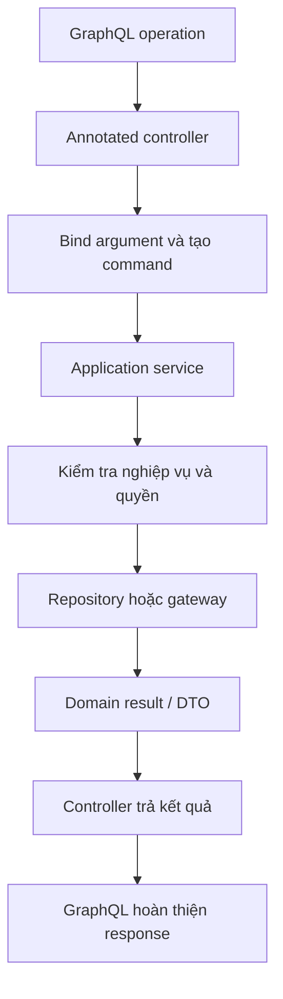

# Controller và service boundary trong Spring for GraphQL

Trong Spring for GraphQL, annotated controller là lớp tiếp nhận GraphQL operation và kết nối field trong schema với logic ứng dụng. Controller nhận argument, gọi service và trả kết quả để GraphQL tiếp tục tạo response. Service boundary là ranh giới giữa lớp giao tiếp GraphQL và các use case của ứng dụng: service thực hiện quy tắc nghiệp vụ, điều phối repository, quản lý transaction và kiểm tra những điều kiện thuộc nghiệp vụ.

Giữ ranh giới này rõ ràng giúp resolver dễ đọc, service có thể tái sử dụng ngoài GraphQL và việc thay đổi schema không buộc phải viết lại logic nghiệp vụ. Nó cũng giúp kiểm thử từng lớp đúng trách nhiệm, đồng thời tránh đưa các khái niệm riêng của GraphQL vào sâu trong domain hoặc persistence.

Sau bài này, bạn có thể:

- Hiểu vai trò của annotated controller, application service và repository.
- Viết resolver mỏng bằng `@QueryMapping`, `@MutationMapping` và `@SchemaMapping`.
- Chuyển argument GraphQL thành input model hoặc command của ứng dụng.
- Đặt transaction, validation nghiệp vụ và authorization ở đúng boundary.
- Xử lý lỗi service thành GraphQL error tại lớp giao tiếp.
- Chọn kiểu trả về đồng bộ hoặc reactive phù hợp với runtime.
- Tránh các lỗi như controller chứa nghiệp vụ, service phụ thuộc GraphQL hoặc resolver tạo N+1.
- Kiểm thử controller và service theo từng lớp.

## 1. Vì sao cần service boundary?

Một GraphQL operation có thể gọi nhiều field, lồng nhiều cấp và chọn dữ liệu theo nhu cầu client. Nếu mỗi resolver tự viết truy vấn database, kiểm tra quyền, mở transaction và thực hiện quy tắc nghiệp vụ, controller sẽ nhanh chóng trở thành nơi chứa toàn bộ ứng dụng.

Hãy xem thao tác đổi tiêu đề một cuốn sách. Nó có thể cần:

1. Xác định sách có tồn tại hay không.
2. Kiểm tra tiêu đề mới hợp lệ.
3. Kiểm tra người dùng có quyền sửa sách.
4. Cập nhật dữ liệu và ghi nhận lịch sử thay đổi.
5. Trả về dữ liệu phù hợp với API.

Đây là một use case của ứng dụng, không phải trách nhiệm riêng của GraphQL. Nếu REST endpoint, batch job hoặc message consumer cũng cần đổi tiêu đề sách, chúng nên gọi cùng một service để áp dụng chung quy tắc.

## 2. Phân chia trách nhiệm giữa các lớp

Một cách tổ chức phổ biến là chia thành ba lớp:

| Lớp | Trách nhiệm | Ví dụ trong Spring for GraphQL |
| --- | --- | --- |
| GraphQL controller / adapter | Nhận field và argument, chuyển input, gọi use case, trả kết quả | `@QueryMapping`, `@MutationMapping`, `@SchemaMapping` |
| Application service | Thực hiện use case, điều phối domain, transaction, authorization nghiệp vụ | `BookService.renameBook(...)` |
| Repository / gateway | Đọc ghi dữ liệu hoặc giao tiếp hệ thống ngoài | `BookRepository`, `AuthorClient` |

Luồng gọi điển hình:



Controller biết GraphQL field nào đang được gọi. Service biết use case cần thực hiện. Repository biết cách đọc hoặc ghi dữ liệu. Khi một lớp phải biết quá nhiều chi tiết của lớp khác, boundary đang bị mờ.

## 3. Khai báo schema cho ví dụ

Ví dụ xuyên suốt bài dùng API quản lý sách:

```graphql
type Query {
    book(id: ID!): Book
}

type Mutation {
    renameBook(id: ID!, input: RenameBookInput!): Book!
}

input RenameBookInput {
    title: String!
}

type Book {
    id: ID!
    title: String!
    author: Author
}

type Author {
    id: ID!
    name: String!
}
```

Schema chỉ mô tả hợp đồng: query nhận ID, mutation nhận input object và trả về Book. Nó không quy định controller phải dùng JPA hay service phải có tên cụ thể. Đó là chi tiết triển khai của ứng dụng.

## 4. Viết annotated controller như một adapter

Controller nhận argument bằng `@Argument`, gọi service và trả kết quả:

```java
@Controller
public class BookGraphQlController {

    private final BookService bookService;
    private final AuthorService authorService;

    public BookGraphQlController(
            BookService bookService,
            AuthorService authorService) {
        this.bookService = bookService;
        this.authorService = authorService;
    }

    @QueryMapping
    public BookView book(@Argument("id") String id) {
        return bookService.findById(id).orElse(null);
    }

    @MutationMapping
    public BookView renameBook(
            @Argument("id") String id,
            @Argument("input") @Valid RenameBookInput input) {

        RenameBookCommand command = new RenameBookCommand(id, input.title());
        return bookService.rename(command);
    }

    @SchemaMapping(typeName = "Book", field = "author")
    public AuthorView author(BookView book) {
        return authorService.findByBookId(book.id()).orElse(null);
    }
}
```

`@QueryMapping` liên kết method với field cùng tên trên root type `Query`; `@MutationMapping` làm điều tương tự với `Mutation`. `@SchemaMapping` liên kết method với field của một object type. Trong ví dụ, `BookView` là source object của field `Book.author`, vì vậy method nhận object cha để lấy ID cần thiết.

Controller chỉ thực hiện việc chuyển dữ liệu từ hợp đồng GraphQL sang lời gọi ứng dụng. Các quyết định như sách có được đổi tên hay không, có cần ghi audit log hay không và transaction kéo dài bao lâu thuộc service.

## 5. Dùng input model và command cho mutation

GraphQL input object mô tả dữ liệu mà client được phép gửi:

```java
public record RenameBookInput(
        @NotBlank
        @Size(max = 200)
        String title) {
}
```

Application command diễn đạt yêu cầu của use case:

```java
public record RenameBookCommand(String bookId, String newTitle) {
}
```

Controller chuyển input thành command:

```java
@MutationMapping
public BookView renameBook(
        @Argument("id") String id,
        @Argument("input") @Valid RenameBookInput input) {

    return bookService.rename(
            new RenameBookCommand(id, input.title()));
}
```

Input GraphQL và command không bắt buộc phải là hai class khác nhau trong mọi ứng dụng. Với use case đơn giản, có thể dùng cùng một DTO nếu cấu trúc API và nhu cầu ứng dụng thực sự trùng nhau. Khi chúng có vòng đời hoặc ý nghĩa khác nhau, tách riêng sẽ giúp thay đổi schema mà không làm ảnh hưởng application layer.

Không đưa `DataFetchingEnvironment`, `GraphQLContext`, `@Argument` hoặc các annotation GraphQL vào command hay service interface. Đây là chi tiết của adapter. Service nên nhận dữ liệu ứng dụng có kiểu rõ ràng, không phụ thuộc cách dữ liệu đến từ GraphQL, REST hay message.

## 6. Đặt quy tắc nghiệp vụ trong service

Service thực hiện use case và gọi repository:

```java
@Service
@Transactional(readOnly = true)
public class BookService {

    private final BookRepository bookRepository;
    private final BookMapper bookMapper;

    public BookService(
            BookRepository bookRepository,
            BookMapper bookMapper) {
        this.bookRepository = bookRepository;
        this.bookMapper = bookMapper;
    }

    public Optional<BookView> findById(String id) {
        return bookRepository.findById(id).map(bookMapper::toView);
    }

    @Transactional
    public BookView rename(RenameBookCommand command) {
        BookEntity book = bookRepository.findById(command.bookId())
                .orElseThrow(() -> new BookNotFoundException(command.bookId()));

        book.rename(command.newTitle());

        return bookMapper.toView(book);
    }
}
```

`findById` là thao tác đọc nên có thể chạy trong read-only transaction. `rename` là thao tác thay đổi dữ liệu và mở transaction ghi. Repository chỉ đảm nhiệm việc tìm entity; quy tắc đổi tên được đặt trong domain method `book.rename(...)` hoặc service tùy cách tổ chức domain.

Transaction nên bao quanh use case cần tính nhất quán, không mặc định bao quanh toàn bộ GraphQL request. Một operation có thể chọn nhiều field và mỗi field có thể gọi use case khác nhau. Nếu cần một mutation gồm nhiều thay đổi phải nguyên tử, hãy tạo một service method điều phối toàn bộ thay đổi trong cùng transaction.

## 7. Đặt transaction đúng boundary

Controller thường không cần gắn `@Transactional` chỉ để gọi service. Transaction ở service làm rõ phạm vi nghiệp vụ và có thể được tái sử dụng từ adapter khác.

Ví dụ mutation cần đổi tên và ghi audit log:

```java
@Transactional
public BookView rename(RenameBookCommand command) {
    BookEntity book = bookRepository.findById(command.bookId())
            .orElseThrow(() -> new BookNotFoundException(command.bookId()));

    String previousTitle = book.title();
    book.rename(command.newTitle());
    auditRepository.save(AuditEntry.bookRenamed(
            book.id(), previousTitle, book.title()));

    return bookMapper.toView(book);
}
```

Nếu cập nhật sách thành công nhưng ghi audit thất bại, transaction cho phép rollback cả hai thao tác khi chúng cùng tham gia một transaction manager. Nếu một use case gọi nhiều hệ thống độc lập, transaction database không tự bảo đảm atomicity trên tất cả hệ thống; cần thiết kế cơ chế như outbox hoặc saga khi phù hợp.

Không nên giữ transaction mở trong lúc chờ client gửi request tiếp theo hoặc trong suốt một subscription dài hạn. Transaction nên ngắn và gắn với một lần thực thi use case.

## 8. Validation ở adapter và service

Có thể chia validation thành hai nhóm:

- **Validation cấu trúc đầu vào:** kiểu GraphQL, non-null, enum hợp lệ, định dạng và giới hạn đơn giản của input. Schema và Bean Validation hỗ trợ nhóm này.
- **Validation nghiệp vụ:** sách có tồn tại, tiêu đề có được phép đổi, trạng thái hiện tại có cho phép chuyển tiếp hay người dùng có quyền sửa bản ghi. Service/domain thực hiện nhóm này.

Ví dụ Bean Validation trên input record:

```java
public record RenameBookInput(
        @NotBlank(message = "Title must not be blank")
        @Size(max = 200, message = "Title must be at most 200 characters")
        String title) {
}
```

Resolver nhận input đã bind và có thể yêu cầu validation bằng `@Valid`:

```java
@MutationMapping
public BookView renameBook(
        @Argument("id") String id,
        @Argument("input") @Valid RenameBookInput input) {
    return bookService.rename(new RenameBookCommand(id, input.title()));
}
```

Để Bean Validation hoạt động, ứng dụng cần dependency và cấu hình validation phù hợp. Cần kiểm thử cách lỗi validation được chuyển thành GraphQL response theo phiên bản Spring for GraphQL đang dùng. Service vẫn phải bảo vệ invariant của domain vì use case có thể được gọi từ những nơi không đi qua GraphQL controller.

## 9. Authorization và service boundary

Xác thực người gọi thường được xử lý ở lớp bảo mật của ứng dụng. Nhưng authorization cần xét cả use case và tài nguyên cụ thể: người dùng có quyền đổi sách này hay không, sách có thuộc tenant hiện tại hay không, hoặc field có chứa dữ liệu nhạy cảm hay không.

Có thể bảo vệ service method bằng Spring Method Security:

```java
@Service
public class BookService {

    @PreAuthorize("hasAuthority('BOOK_WRITE')")
    @Transactional
    public BookView rename(RenameBookCommand command) {
        // Tải sách, kiểm tra quyền trên bản ghi và cập nhật.
        // Phần triển khai được lược bỏ để tập trung vào boundary.
        return performRename(command);
    }
}
```

Ứng dụng cần bật method security, ví dụ bằng `@EnableMethodSecurity`, và bảo đảm lời gọi đi qua Spring proxy. Nếu quyền phụ thuộc owner hoặc tenant, chỉ kiểm tra authority chung là chưa đủ; service cần kiểm tra quan hệ giữa người dùng hiện tại và bản ghi.

Controller có thể nhận `Principal` hoặc thông tin context được Spring cung cấp và chuyển một actor identifier vào command nếu use case cần biết ai đang thực hiện. Không nên nhận `userId` tùy ý từ client rồi coi đó là danh tính đã xác thực. Danh tính phải đến từ security context đáng tin cậy.

Với field nhạy cảm như `Book.internalNotes`, resolver có thể gọi một service có kiểm tra quyền riêng. Dù client không chọn field đó trong giao diện, server vẫn phải bảo vệ field khi có operation trực tiếp yêu cầu nó.

## 10. Xử lý lỗi ở ranh giới GraphQL

Service nên ném exception hoặc trả kết quả theo ngôn ngữ của application/domain, chẳng hạn `BookNotFoundException` hoặc `BookTitleConflictException`. Controller advice hoặc `@GraphQlExceptionHandler` chuyển lỗi đó thành GraphQL error phù hợp.

Ví dụ handler:

```java
@ControllerAdvice
public class GraphQlErrorHandler {

    @GraphQlExceptionHandler
    public GraphQLError handleBookNotFound(BookNotFoundException exception) {
        return GraphqlErrorBuilder.newError()
                .errorType(ErrorType.NOT_FOUND)
                .message("Book not found")
                .build();
    }
}
```

`ErrorType` ở đây là loại lỗi của Spring for GraphQL. Handler không nên trả stack trace hoặc chi tiết database cho client. Thông tin kỹ thuật đầy đủ có thể được ghi log ở server với correlation ID phù hợp.

Không nên bắt mọi exception trong controller rồi trả `null`. Cách đó làm mất nguyên nhân lỗi và có thể khiến client hiểu nhầm rằng dữ liệu không tồn tại. Hãy phân biệt kết quả nghiệp vụ bình thường (ví dụ không tìm thấy một field nullable) với lỗi cần xuất hiện trong mảng `errors` của GraphQL response.

## 11. Resolver field lồng nhau và N+1

Một `@SchemaMapping` thường nhận object nguồn rồi gọi service để lấy dữ liệu cho field con:

```java
@SchemaMapping(typeName = "Book", field = "author")
public AuthorView author(BookView book) {
    return authorService.findByBookId(book.id()).orElse(null);
}
```

Với một cuốn sách, cách này có thể phù hợp. Nhưng nếu client yêu cầu 100 sách và `author` cho từng sách, method có thể gọi service 100 lần. Đây là nguy cơ N+1.

Giữ service boundary rõ ràng vẫn cho phép tối ưu theo lô. Service có thể cung cấp method như `findAuthorsByBookIds(List<String> bookIds)`, còn controller dùng `@BatchMapping` hoặc DataLoader để gom các object nguồn. Việc gom batch thuộc GraphQL adapter; quy tắc lấy tác giả và truy vấn dữ liệu vẫn nằm trong service/gateway.

Ví dụ phác thảo batch mapping:

```java
@BatchMapping(typeName = "Book", field = "author")
public Mono<Map<BookView, AuthorView>> authors(List<BookView> books) {
    List<String> bookIds = books.stream()
            .map(BookView::id)
            .toList();

    return authorService.findByBookIds(bookIds)
            .map(authorsByBookId -> {
                Map<BookView, AuthorView> result = new HashMap<>();
                for (BookView book : books) {
                    result.put(book, authorsByBookId.get(book.id()));
                }
                return result;
            });
}
```

Kiểu trả về của service trong ví dụ là reactive để minh họa. Với ứng dụng Spring MVC và service blocking, batch method có thể trả về `Map` đồng bộ. Điều quan trọng là service cung cấp thao tác batch thực sự, thay vì lặp qua ID rồi gọi repository riêng cho từng phần tử.

## 12. Không để service phụ thuộc vào GraphQL

Service không nên nhận các đối tượng chỉ tồn tại ở tầng GraphQL như:

- `DataFetchingEnvironment`.
- `GraphQLContext` hoặc `DataFetchingFieldSelectionSet`.
- `DataLoader` nếu application layer không thực sự phụ thuộc vào khái niệm batching của GraphQL.
- Annotation `@Argument`, `@QueryMapping` hoặc `@SchemaMapping`.

Ví dụ không nên thiết kế:

```java
// Không nên: application service phụ thuộc trực tiếp vào GraphQL runtime.
public BookView findBook(DataFetchingEnvironment environment) {
    String id = environment.getArgument("id");
    // ...
}
```

Thay vào đó, controller đọc argument rồi gọi service bằng kiểu dữ liệu thông thường:

```java
@QueryMapping
public BookView book(@Argument("id") String id) {
    return bookService.findById(id).orElse(null);
}
```

Nếu selection set giúp chọn projection, controller có thể chuyển nó thành một tùy chọn truy vấn của ứng dụng, ví dụ `BookViewOptions(includeAuthor = true)`. Service nhận tùy chọn có ý nghĩa trong application layer, không nhận trực tiếp đối tượng GraphQL Java. Chỉ làm vậy khi tối ưu đó có lợi ích đo được; không cần biến mọi selection set thành một hệ thống projection phức tạp.

## 13. DTO, entity và dữ liệu trả về

Controller có thể trả entity JPA trực tiếp, nhưng cách này dễ làm API phụ thuộc persistence model. Các rủi ro thường gặp:

- Field GraphQL vô tình phơi bày thuộc tính nội bộ của entity.
- Lazy relationship được truy cập sau khi persistence context đóng.
- Thay đổi database model làm thay đổi response API.
- Entity có trạng thái mutable hoặc proxy gây khó dự đoán khi nhiều field được thực thi.

Một lựa chọn rõ ràng hơn là service trả DTO/view model phù hợp với use case:

```java
public record BookView(
        String id,
        String title,
        String authorId) {
}

public record AuthorView(
        String id,
        String name) {
}
```

Không cần tạo một DTO cho mỗi GraphQL selection set. Chọn mức abstraction vừa đủ: có thể dùng application read model hoặc projection dùng chung nếu nó biểu diễn dữ liệu có ý nghĩa ngoài một query cụ thể. Nếu DTO chỉ tồn tại để tạo một response rất đặc thù, adapter có thể map nó từ application result ở biên.

## 14. Blocking và reactive service

Kiểu trả về của controller nên phù hợp với cách service truy cập dữ liệu và web runtime.

Với Spring MVC và JPA/JDBC, resolver đồng bộ là lựa chọn tự nhiên:

```java
@QueryMapping
public BookView book(@Argument("id") String id) {
    return bookService.findById(id).orElse(null);
}
```

Với Spring WebFlux và repository reactive, giữ pipeline non-blocking:

```java
@QueryMapping
public Mono<BookView> book(@Argument("id") String id) {
    return reactiveBookService.findById(id);
}
```

Service reactive có thể trả `Mono<BookView>` hoặc `Flux<BookView>` và controller chuyển tiếp kết quả cho Spring for GraphQL. Không gọi `.block()` hoặc `.subscribe()` trong controller để lấy kết quả thủ công. Nếu một service trong WebFlux vẫn dùng JDBC/JPA blocking, cần thay bằng API non-blocking hoặc cô lập lời gọi blocking ở integration boundary bằng scheduler/executor có giới hạn.

Không nên chuyển một method blocking thành `Mono.just(blockingCall())`: lời gọi blocking vẫn xảy ra trước khi `Mono` được tạo. Reactive chỉ có ích khi công việc blocking được loại bỏ hoặc được chuyển sang vùng thực thi phù hợp.

## 15. Controller là singleton: giữ stateless

Spring controller thường là singleton bean. Nhiều GraphQL request có thể gọi các method của cùng instance đồng thời. Vì vậy, không lưu dữ liệu request vào mutable field:

```java
// Không nên: giá trị này có thể bị request khác ghi đè.
private String currentBookId;
```

Hãy dùng tham số method, local variable, request context hoặc service có scope phù hợp. Không giữ entity đang xử lý trong field controller và không dùng biến static để chia sẻ trạng thái giữa các request.

GraphQL query có thể thực thi các field song song tùy execution strategy; do đó, service và resolver cần an toàn khi nhiều lời gọi cùng chạy. Đừng dựa vào thứ tự thực thi của các query field sibling để cập nhật trạng thái. Mutation root field có quy tắc thực thi tuần tự theo GraphQL, nhưng các field con của kết quả vẫn có thể được phân giải theo execution strategy của engine.

## 16. Kiểm thử controller và service riêng biệt

Kiểm thử controller nên xác nhận schema mapping, argument binding, response path và cách lỗi được chuyển thành GraphQL response. Có thể dùng `@GraphQlTest` để nạp phần GraphQL cần thiết và thay service bằng mock.

Ví dụ kiểm thử operation:

```java
graphQlTester.document("""
        query {
            book(id: "book-42") {
                id
                title
            }
        }
        """)
    .execute()
    .path("book.title")
    .entity(String.class)
    .isEqualTo("GraphQL in Practice");
```

Kiểm thử service tập trung vào use case và quy tắc nghiệp vụ: đổi tên thành công, không tìm thấy sách, tiêu đề không hợp lệ, không đủ quyền, transaction rollback khi audit thất bại. Service test không cần gửi GraphQL document.

Integration test có thể khởi động toàn bộ ứng dụng với database kiểm thử để xác nhận controller, service, repository và schema phối hợp đúng. Mỗi lớp được kiểm thử ở mức phù hợp sẽ giúp xác định lỗi nhanh hơn khi thay đổi API.

## 17. Những lỗi thường gặp ở service boundary

- **Controller chứa nghiệp vụ:** resolver dài, lặp logic giữa các operation và khó tái sử dụng. Chuyển use case sang service.
- **Service biết GraphQL:** application layer phụ thuộc `DataFetchingEnvironment`, GraphQL context hoặc annotation. Chuyển việc đọc dữ liệu giao thức về controller.
- **Repository được gọi trực tiếp từ mọi resolver:** logic nghiệp vụ và transaction bị phân tán. Đưa truy cập dữ liệu qua service/use case phù hợp.
- **Transaction đặt trên toàn controller:** phạm vi transaction không còn khớp với use case và có thể kéo dài ngoài ý muốn.
- **Trả entity persistence trực tiếp:** API phụ thuộc schema database, lazy loading và thuộc tính nội bộ.
- **Bắt mọi exception rồi trả null:** làm mất thông tin lỗi và gây hiểu nhầm giữa lỗi với dữ liệu vắng mặt.
- **Chỉ kiểm tra quyền ở controller hoặc UI:** service có thể bị gọi từ adapter khác và bỏ qua chính sách. Bảo vệ use case và tài nguyên tại server.
- **Mỗi field resolver gọi một truy vấn riêng:** dễ tạo N+1. Dùng batch service, `@BatchMapping` hoặc DataLoader.
- **Dùng `Mono` bọc lời gọi blocking:** không làm I/O trở thành non-blocking. Chọn API phù hợp hoặc cô lập blocking đúng cách.
- **Lưu request state trong controller singleton:** có thể gây rò rỉ dữ liệu giữa các request đồng thời.

## 18. Quy trình thiết kế một annotated controller

Khi thêm operation GraphQL mới, hãy thực hiện:

1. Khai báo field và input/output type trong SDL theo hợp đồng client cần.
2. Tạo method resolver bằng annotation tương ứng với `Query`, `Mutation` hoặc object field.
3. Bind argument bằng `@Argument` và chuyển input thành command/query model của ứng dụng.
4. Gọi application service; giữ controller không chứa transaction hoặc quy tắc domain.
5. Đặt transaction, authorization và invariant trong use case/service phù hợp.
6. Map lỗi application thành GraphQL error ở controller advice hoặc exception resolver.
7. Chọn DTO/read model để kiểm soát dữ liệu trả về.
8. Nếu field lồng nhau được gọi nhiều lần, cung cấp batch use case và dùng `@BatchMapping`/DataLoader.
9. Giữ kiểu trả về đồng bộ hoặc reactive phù hợp với runtime và service.
10. Kiểm thử mapping GraphQL, service use case và luồng tích hợp.

Annotated controller là adapter giữa GraphQL schema và ứng dụng. Service boundary giữ cho use case, transaction và quy tắc nghiệp vụ không phụ thuộc vào cách client gửi request. Khi controller tập trung vào mapping, service tập trung vào hành vi ứng dụng và repository tập trung vào lưu trữ, Spring for GraphQL API sẽ dễ bảo trì, dễ kiểm thử và có thể phục vụ nhiều loại adapter mà không nhân bản logic.

## Tài liệu tham khảo

- [Spring for GraphQL — Annotated Controllers](https://docs.spring.io/spring-graphql/reference/controllers.html)
- [Spring for GraphQL — Argument Binding and Validation](https://docs.spring.io/spring-graphql/reference/controllers.html#controllers.arguments)
- [Spring for GraphQL — Exception Handling](https://docs.spring.io/spring-graphql/reference/controllers.html#controllers.exception-handling)
- [Spring Framework — Declarative Transaction Management](https://docs.spring.io/spring-framework/reference/data-access/transaction/declarative.html)
- [Spring Security — Method Security](https://docs.spring.io/spring-security/reference/servlet/authorization/method-security.html)
