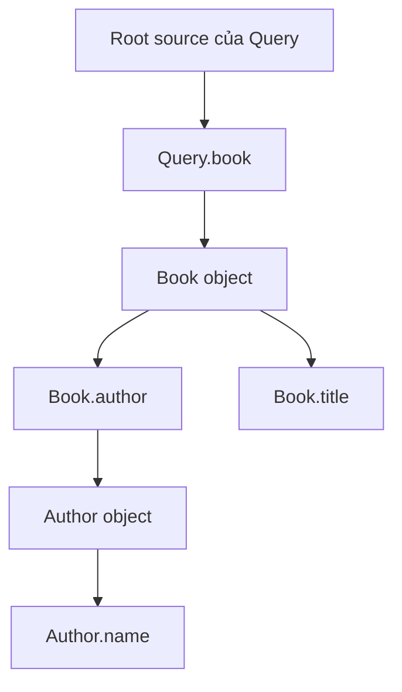

# Query mapping với root source trong Spring for GraphQL

Trong GraphQL, các field cấp cao nhất của một query nằm dưới root object type `Query`. Spring for GraphQL dùng annotation `@QueryMapping` để liên kết method trong controller với từng field này. Khi GraphQL thực thi field, data fetcher nhận một source object từ execution environment; với field root, object đó được gọi là root source.

Trong ứng dụng Spring thông thường, `@QueryMapping` không cần root source để hoạt động. Controller thường lấy dữ liệu từ `@Argument`, gọi service được inject qua constructor và trả kết quả. Root source chỉ có ý nghĩa khi execution được khởi tạo với một root value cụ thể. Hiểu sự khác nhau giữa root source và source của field lồng nhau giúp tránh nhầm `@QueryMapping` với `@SchemaMapping`.

## 1. Query root và source trong GraphQL

Một GraphQL query được thực thi như một cây field. GraphQL giải quyết field cha trước, sau đó dùng giá trị trả về làm source cho các field con.



Trong cây trên:

- Root source là object ban đầu được cung cấp cho GraphQL execution.
- `Query.book` là field root và data fetcher của field này nhận root source.
- Nếu `Query.book` trả về một `Book`, object `Book` trở thành source cho các field `Book.author` và `Book.title`.
- Nếu `Book.author` trả về một `Author`, object `Author` trở thành source cho field `Author.name`.

GraphQL Java cung cấp source của field thông qua `DataFetchingEnvironment.getSource()`. Với field lồng nhau, source thường là object được resolver của field cha trả về. Với field root, source là root value của operation.

## 2. `@QueryMapping` ánh xạ field thuộc root Query

`@QueryMapping` là annotation chuyên biệt cho field thuộc GraphQL type `Query`. Nó tương đương với `@SchemaMapping(typeName = "Query")` và giúp Spring for GraphQL đăng ký method làm data fetcher cho field root.

Ví dụ SDL:

```graphql
type Query {
    book(id: ID!): Book
    books: [Book!]!
}

type Book {
    id: ID!
    title: String!
}
```

Controller xử lý hai query:

```java
import java.util.List;

import org.springframework.graphql.data.method.annotation.Argument;
import org.springframework.graphql.data.method.annotation.QueryMapping;
import org.springframework.stereotype.Controller;

@Controller
public class BookQueryController {

    private final BookService bookService;

    public BookQueryController(BookService bookService) {
        this.bookService = bookService;
    }

    @QueryMapping
    public Book book(@Argument("id") String id) {
        return bookService.findById(id).orElse(null);
    }

    @QueryMapping
    public List<Book> books() {
        return bookService.findAll();
    }
}
```

Tên method được dùng làm tên field nếu không khai báo tên tường minh. Vì vậy `book` ánh xạ tới `Query.book`, còn `books` ánh xạ tới `Query.books`. `@Argument("id")` lấy argument `id` từ query.

Trong cách triển khai phổ biến này, controller không khai báo tham số source. Spring inject `BookService` như một dependency của controller, còn dữ liệu đầu vào của từng query được lấy từ argument. Đây là cách đơn giản nhất khi không có nhu cầu cung cấp root value riêng cho GraphQL execution.

## 3. Root source mặc định và khi nào cần root value

Trong GraphQL Java, root source là object được gán vào `ExecutionInput` khi bắt đầu một operation. Nếu không cung cấp root value, source của các field root thường là `null`. Data fetcher được đăng ký cho `Query.book` vẫn có thể hoạt động bình thường vì nó lấy dữ liệu từ argument, service hoặc context thay vì dựa vào source.

Ví dụ một root value đơn giản:

```java
public record QueryRoot(String tenantCode, String locale) {
}
```

Khi dùng trực tiếp GraphQL Java, có thể truyền root value vào `ExecutionInput`:

```java
import graphql.ExecutionInput;
import graphql.ExecutionResult;
import graphql.GraphQL;

QueryRoot root = new QueryRoot("tenant-a", "vi-VN");

ExecutionInput input = ExecutionInput.newExecutionInput()
        .query("{ tenantCode }")
        .root(root)
        .build();

ExecutionResult result = graphQL.execute(input);
```

Đoạn code này minh họa API của GraphQL Java; `graphQL` là instance đã được xây dựng từ schema và runtime wiring. `ExecutionInput.root(root)` cung cấp object ban đầu cho các field root trong operation đó.

Trong Spring for GraphQL, request HTTP được xử lý qua `GraphQlSource` và execution service do Spring quản lý. Không nên giả định rằng chỉ khai báo một bean Java có kiểu `QueryRoot` thì Spring sẽ tự động dùng nó làm root source. Nếu ứng dụng thực sự cần root value tùy chỉnh, phải tích hợp nó vào đúng execution path đang được HTTP handler sử dụng, thông qua cơ chế tùy biến tương thích với phiên bản Spring for GraphQL của dự án. Không tạo một `GraphQL` instance riêng mà endpoint Spring không gọi tới.

## 4. Đọc root source trong method `@QueryMapping`

Spring for GraphQL hỗ trợ tham số source trong method schema mapping: khai báo tham số có kiểu Java tương ứng với source object, và framework sẽ lấy source từ `DataFetchingEnvironment`. Với root mapping, source chính là root value đã được cung cấp cho operation.

Ví dụ nếu execution được khởi tạo với `QueryRoot` ở phần trước, method có thể nhận source như sau:

```java
import org.springframework.graphql.data.method.annotation.QueryMapping;
import org.springframework.stereotype.Controller;

@Controller
public class TenantQueryController {

    @QueryMapping
    public String tenantCode(QueryRoot root) {
        return root.tenantCode();
    }
}
```

Schema tương ứng:

```graphql
type Query {
    tenantCode: String!
}
```

Method trên chỉ phù hợp khi root source thực sự là một `QueryRoot` khác null. Nếu execution không cung cấp root value hoặc cung cấp một kiểu Java khác, tham số source không thể được sử dụng theo cách này. Vì thế, chỉ thêm source parameter khi ứng dụng kiểm soát rõ việc khởi tạo root value và có kiểm thử cho execution path đó.

Nếu chỉ cần lấy thông tin request, chẳng hạn tenant, locale hoặc principal, hãy cân nhắc `GraphQLContext`, `@ContextValue`, `Principal` hoặc `@AuthenticationPrincipal`. Những cơ chế này thường phù hợp hơn việc dùng root source làm nơi chứa metadata của request.

## 5. Phân biệt root source với source của field lồng nhau

Source parameter thường xuất hiện trong `@SchemaMapping` để truy cập object cha. Ví dụ:

```graphql
type Query {
    book(id: ID!): Book
}

type Book {
    id: ID!
    title: String!
    author: Author
}

type Author {
    id: ID!
    name: String!
}
```

Resolver:

```java
import org.springframework.graphql.data.method.annotation.Argument;
import org.springframework.graphql.data.method.annotation.QueryMapping;
import org.springframework.graphql.data.method.annotation.SchemaMapping;
import org.springframework.stereotype.Controller;

@Controller
public class BookController {

    private final BookService bookService;
    private final AuthorService authorService;

    public BookController(BookService bookService, AuthorService authorService) {
        this.bookService = bookService;
        this.authorService = authorService;
    }

    @QueryMapping
    public Book book(@Argument("id") String id) {
        return bookService.findById(id).orElse(null);
    }

    @SchemaMapping(typeName = "Book", field = "author")
    public Author author(Book source) {
        return authorService.findById(source.authorId()).orElse(null);
    }
}
```

Ở đây, `book` là field root nên method nhận argument `id`; method không cần source object cha. Ngược lại, `author` là field của `Book`, nên tham số `Book source` chính là object mà resolver `book` trả về.

| Đặc điểm | Root field với `@QueryMapping` | Field lồng nhau với `@SchemaMapping` |
| --- | --- | --- |
| Parent type | `Query` | Object type như `Book` |
| Source | Root value của operation | Giá trị trả về từ field cha |
| Input thường dùng | `@Argument`, context, service | Source object, `@Argument`, context |
| Ví dụ | `book(id: ID!): Book` | `Book.author: Author` |

Đừng nhầm source object với argument. `@Argument("id")` là giá trị client truyền vào field; `Book source` là object cha do GraphQL engine chuyển xuống field con.

## 6. Truyền metadata request qua GraphQLContext

Root source không phải lựa chọn duy nhất để truyền thông tin dùng chung cho các resolver. Spring for GraphQL hỗ trợ `GraphQLContext`, `@ContextValue` và principal từ Spring Security.

Ví dụ schema và controller:

```graphql
type Query {
    greeting: String!
}
```

```java
import java.security.Principal;

import org.springframework.graphql.data.method.annotation.ContextValue;
import org.springframework.graphql.data.method.annotation.QueryMapping;
import org.springframework.stereotype.Controller;

@Controller
public class GreetingController {

    @QueryMapping
    public String greeting(
            @ContextValue(name = "tenantCode", required = false) String tenantCode,
            Principal principal) {

        String user = principal != null ? principal.getName() : "guest";
        return "Xin chào " + user + " tại tenant " + tenantCode;
    }
}
```

Ví dụ giả định một `WebGraphQlInterceptor` hoặc thành phần tương đương đã đưa `tenantCode` vào `GraphQLContext`, và Spring Security cung cấp `Principal` nếu request đã xác thực. Không nên tin một tenant identifier do client tự gửi mà chưa kiểm tra quyền truy cập tenant đó.

`GraphQLContext` thích hợp cho metadata theo request và có thể được chia sẻ cho nhiều data fetcher trong cùng operation. `@ContextValue` giúp lấy một giá trị theo key; `Principal` giúp lấy danh tính người dùng đã được xác thực. Không lưu thông tin request vào field mutable của singleton controller vì nhiều request có thể chạy đồng thời.

## 7. Truy vấn root source và truy vấn theo argument

Hãy chọn nguồn dữ liệu theo đúng ý nghĩa của từng thông tin:

| Dữ liệu cần dùng | Cách lấy phù hợp |
| --- | --- |
| ID, keyword, filter, pagination do client truyền | `@Argument` hoặc `@Arguments` |
| Object cha của field lồng nhau | Source parameter trong `@SchemaMapping` |
| Root value được truyền khi khởi tạo GraphQL execution | Source parameter ở root mapping hoặc `DataFetchingEnvironment.getSource()` |
| Principal đã xác thực | `Principal` hoặc `@AuthenticationPrincipal` |
| Metadata chung theo request | `GraphQLContext` hoặc `@ContextValue` |
| Logic truy cập database hoặc domain | Service được inject qua constructor |

Ví dụ query có argument:

```graphql
query {
    book(id: "book-10") {
        id
        title
    }
}
```

Resolver đọc `id` qua `@Argument`. Không cần đặt ID vào root source vì đó là dữ liệu riêng của field và client đã gửi qua argument.

## 8. Truy cập DataFetchingEnvironment khi cần thông tin thấp hơn

Nếu method cần thông tin execution không được bao phủ bởi các annotation parameter, có thể nhận trực tiếp `DataFetchingEnvironment`:

```java
import graphql.schema.DataFetchingEnvironment;
import org.springframework.graphql.data.method.annotation.QueryMapping;
import org.springframework.stereotype.Controller;

@Controller
public class DiagnosticsController {

    @QueryMapping
    public String inspectRoot(DataFetchingEnvironment environment) {
        Object rootSource = environment.getSource();
        return rootSource == null
                ? "Root source is null"
                : rootSource.getClass().getSimpleName();
    }
}
```

Đây là ví dụ phục vụ minh họa. Trong API thực tế, không nên công khai tên class nội bộ qua field diagnostics. `environment.getSource()` trả về source của field đang xử lý; với root field, đó là root value của operation. `environment.getArgument("...")` lấy argument, còn `environment.getGraphQlContext()` truy cập context chung của execution.

Ưu tiên các tham số có kiểu như `@Argument`, `Principal` hoặc `@ContextValue` khi chúng đáp ứng nhu cầu. Chỉ dùng `DataFetchingEnvironment` khi cần nhiều thông tin execution hoặc một API GraphQL Java cụ thể.

## 9. Kiểm thử Query mapping và root source

Với query resolver thông thường, có thể dùng `GraphQlTester` để kiểm tra field và argument:

```java
@Test
void bookQueryUsesIdArgument() {
    graphQlTester.document("""
            query FindBook($id: ID!) {
                book(id: $id) {
                    id
                    title
                }
            }
            """)
        .variable("id", "book-10")
        .execute()
        .path("book.title")
        .entity(String.class)
        .isEqualTo("Spring GraphQL");
}
```

Test này giả định `graphQlTester` đã được cấu hình trong test context và service trả về fixture có thể dự đoán.

Nếu ứng dụng dùng custom root value qua GraphQL Java `ExecutionInput.root(...)`, cần có kiểm thử ở đúng execution path tạo `ExecutionInput` đó. Một unit test GraphQL Java có thể kiểm tra riêng root source:

```java
@Test
void rootValueIsAvailableToRootFieldDataFetcher() {
    QueryRoot root = new QueryRoot("tenant-a", "vi-VN");

    ExecutionInput input = ExecutionInput.newExecutionInput()
            .query("{ tenantCode }")
            .root(root)
            .build();

    ExecutionResult result = graphQL.execute(input);

    assertThat(result.getErrors()).isEmpty();
    assertThat(result.getData()).isEqualTo(Map.of("tenantCode", "tenant-a"));
}
```

Test này giả định schema có field `tenantCode` và data fetcher đọc root source, cùng với biến `graphQL` đã được cấu hình đúng. Nếu root value được đưa vào thông qua một tích hợp Spring tùy chỉnh, nên viết thêm integration test qua `ExecutionGraphQlService` hoặc HTTP endpoint để xác nhận request thực tế sử dụng đúng root value.

Các trường hợp nên kiểm tra:

1. `@QueryMapping` hoạt động khi không có root source riêng.
2. Field root nhận đúng root value khi execution được cấu hình để cung cấp nó.
3. Source parameter có kiểu không tương thích không bị dùng nhầm hoặc che giấu lỗi cấu hình.
4. `@SchemaMapping` nhận đúng object cha do field phía trên trả về.
5. Argument và GraphQLContext được đọc đúng, không bị trộn giữa các request đồng thời.
6. Nullability của root field và field con phù hợp với kết quả resolver.

## 10. Lỗi thường gặp

| Hiện tượng | Nguyên nhân có thể có | Cách xử lý |
| --- | --- | --- |
| Source parameter trong `@QueryMapping` bị null | Execution không cung cấp root value | Bỏ source parameter nếu không cần, hoặc cấu hình root value trên execution path. |
| Không tìm thấy query field | Tên method hoặc tên trong `@QueryMapping` không khớp SDL | Kiểm tra field dưới root type `Query`. |
| Dùng nhầm source làm argument | Nhầm object cha với dữ liệu client truyền vào | Dùng `@Argument` cho argument và source parameter cho parent object. |
| `@SchemaMapping` nhận sai kiểu source | Kiểu Java không tương ứng với object cha | Kiểm tra giá trị field cha trả về và kiểu tham số source. |
| Dữ liệu request bị lẫn giữa người dùng | Lưu metadata trong field mutable của singleton controller | Dùng `GraphQLContext`, principal hoặc request-scoped mechanism phù hợp. |
| Root source hoạt động trong unit test nhưng không qua HTTP | HTTP execution path của Spring không dùng `ExecutionInput` đã cấu hình trong test | Kiểm thử đúng `GraphQlSource`/execution service được endpoint sử dụng. |
| Query root resolver phụ thuộc root object không cần thiết | Đưa dependency hoặc argument vào root source | Inject service và dùng `@Argument`/context theo đúng vai trò. |

## 11. Checklist khi dùng `@QueryMapping` với root source

1. Khai báo query field dưới root type `Query` trong SDL.
2. Dùng `@QueryMapping` để đăng ký method xử lý field root.
3. Dùng `@Argument` cho dữ liệu client truyền vào field.
4. Inject service qua constructor thay vì nhét dependency vào root source.
5. Chỉ khai báo source parameter khi execution thực sự cung cấp root value.
6. Phân biệt root source với source object của `@SchemaMapping` ở field lồng nhau.
7. Dùng `GraphQLContext` hoặc principal cho metadata theo request và danh tính người dùng.
8. Nếu custom root value, tích hợp vào đúng GraphQL execution path mà Spring đang sử dụng.
9. Kiểm thử cả query thông thường và custom root source theo đúng tầng thực thi.

`@QueryMapping` tập trung xử lý các field của root `Query`. Root source là object ban đầu mà GraphQL execution cung cấp cho các field này; nó thường không cần thiết trong controller Spring thông thường. Khi hiểu đúng source, argument và context, ta có thể thiết kế resolver rõ ràng, tránh phụ thuộc ngầm vào root object và kiểm thử đúng đường đi của request.
