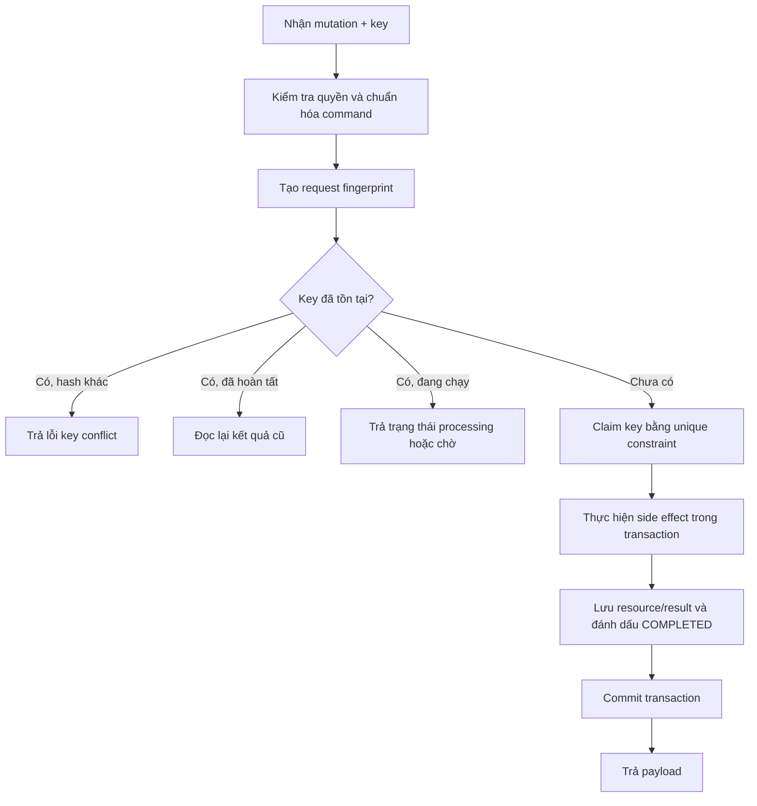

# Mutation idempotency

Một mutation GraphQL thường tạo ra side effect: tạo đơn hàng, trừ tồn kho, đăng ký tài khoản hoặc thanh toán. Trong thực tế, client có thể gửi lại request khi timeout, mất kết nối hoặc không nhận được response dù server đã xử lý xong. Nếu server thực hiện side effect lần nữa, một thao tác của người dùng có thể tạo hai đơn hàng hoặc trừ tiền hai lần.

**Idempotency** giúp một lệnh nghiệp vụ có thể được gửi lại an toàn. Với cùng một idempotency key và cùng nội dung lệnh, server chỉ thực hiện side effect một lần; các lần gửi lại nhận lại kết quả đã ghi nhận hoặc trạng thái xử lý hiện tại. GraphQL không tự cung cấp cơ chế idempotency cho mutation. Ứng dụng Spring for GraphQL phải thiết kế key, lưu trạng thái, kiểm soát đồng thời và đặt transaction đúng ranh giới.

## 1. Idempotency là gì?

> Một operation là idempotent nếu thực hiện nó một lần hay nhiều lần với cùng ý định đều dẫn đến cùng trạng thái nghiệp vụ cuối cùng.

Ví dụ, đặt trạng thái đơn hàng thành `SHIPPED` có thể idempotent:

```java
order.setStatus(OrderStatus.SHIPPED);
```

Gọi lặp lại thao tác này vẫn để đơn hàng ở trạng thái `SHIPPED`. Ngược lại, thao tác tăng số lượng tồn kho:

```java
inventory.setQuantity(inventory.getQuantity() + 1);
```

không idempotent. Gọi hai lần sẽ tăng số lượng hai đơn vị.

Idempotency không nhất thiết có nghĩa mọi response phải giống từng byte. Điều quan trọng là side effect không bị lặp. Một API có thể trả cùng resource đã tạo ở lần đầu, hoặc trả thêm metadata cho biết request là lần phát lại. Với nhiều API, trả lại cùng kết quả nghiệp vụ thường giúp client xử lý đơn giản hơn.

GraphQL không có directive hay annotation chuẩn tên `@Idempotent` để tự bảo vệ mutation. Đây là quy tắc ở tầng ứng dụng và lưu trữ. Việc một endpoint dùng HTTP POST cũng không làm mutation trở nên idempotent; client cần một hợp đồng retry rõ ràng với server.

## 2. Vì sao mutation cần idempotency?

Hãy xét một client gọi mutation tạo đơn hàng:

```graphql
mutation {
    createOrder(input: {
        customerId: "customer-01"
        productId: "book-01"
        quantity: 2
    }) {
        order {
            id
            status
        }
    }
}
```

Server tạo đơn hàng thành công và commit database, nhưng response bị mất trên đường truyền. Client chỉ thấy timeout nên không biết thao tác đã hoàn tất hay chưa. Nếu client gửi lại cùng mutation mà server không có cơ chế nhận diện request trùng, server có thể tạo đơn hàng thứ hai.

Các tình huống thường gặp:

- Client timeout trong khi server vẫn đang xử lý.
- Server commit transaction xong nhưng kết nối bị ngắt trước khi response đến client.
- Người dùng bấm nút gửi nhiều lần hoặc ứng dụng tự retry.
- Gateway hoặc proxy retry request sau lỗi mạng.
- Worker xử lý message nhận lại cùng một command do cơ chế giao nhận ít nhất một lần.

Không thể dựa vào việc client chỉ gửi một lần. Mạng phân tán không cho client biết chắc một request đã thất bại trước khi server xử lý hay chỉ thất bại ở bước trả response. Idempotency giúp client retry cùng một ý định mà không nhân đôi side effect.

## 3. Idempotency key

Client tạo một key duy nhất cho mỗi ý định nghiệp vụ, rồi gửi key đó trong mutation. Nếu cần retry, client phải dùng lại key cũ. Khi người dùng bắt đầu một thao tác mới, client tạo key mới.

Ví dụ schema:

```graphql
input CreateOrderInput {
    idempotencyKey: ID!
    productId: ID!
    quantity: Int!
}

type CreateOrderPayload {
    order: Order!
}

type Mutation {
    createOrder(input: CreateOrderInput!): CreateOrderPayload!
}
```

Client gửi key trong operation:

```graphql
mutation CreateOrder($input: CreateOrderInput!) {
    createOrder(input: $input) {
        order {
            id
            status
        }
    }
}
```

```json
{
  "input": {
    "idempotencyKey": "9f2f4d4e-5f45-4f53-8e8a-34a8c48a4e10",
    "productId": "book-01",
    "quantity": 2
  }
}
```

Key có thể được truyền trong input object như trên hoặc qua HTTP header, chẳng hạn `Idempotency-Key`. Dùng input giúp key hiển thị rõ trong hợp đồng GraphQL và gắn trực tiếp với command. Dùng header phù hợp khi muốn giữ key ở tầng transport. Nếu dùng header, cần đưa nó qua interceptor hoặc context đến service; không nên để logic nghiệp vụ phụ thuộc trực tiếp vào HTTP request.

Một số nguyên tắc khi tạo key:

- Dùng UUID hoặc giá trị ngẫu nhiên đủ mạnh để tránh va chạm.
- Mỗi thao tác mới có key mới; retry cùng thao tác phải dùng lại key.
- Không dùng key chung cho mọi mutation của một người dùng.
- Server phải giới hạn phạm vi key theo user, tenant hoặc client đã xác thực.
- Không xem key là bằng chứng xác thực hay quyền truy cập.

## 4. Cùng key phải đi với cùng nội dung command

Server cần phát hiện trường hợp client dùng lại một key nhưng thay đổi dữ liệu. Ví dụ lần đầu key `K1` tạo đơn hàng với `quantity = 2`, lần sau cùng key `K1` lại gửi `quantity = 5`. Nếu server âm thầm trả kết quả cũ hoặc thực hiện command mới, client sẽ khó hiểu và có thể tạo lỗi nghiệp vụ.

Vì vậy, ngoài key, server nên tạo **request fingerprint** từ nội dung nghiệp vụ đã chuẩn hóa. Fingerprint thường là hash SHA-256 của các trường ảnh hưởng đến command, sau khi áp dụng default và chuẩn hóa kiểu dữ liệu.

Quy tắc xử lý:

| Trường hợp | Hành vi đề xuất |
| --- | --- |
| Key chưa tồn tại | Đăng ký key và thực thi command |
| Key đã hoàn tất, fingerprint giống nhau | Trả lại kết quả đã ghi nhận, không chạy side effect lần nữa |
| Key đang được xử lý, fingerprint giống nhau | Trả trạng thái đang xử lý hoặc chờ kết quả theo hợp đồng API |
| Key đã tồn tại nhưng fingerprint khác | Từ chối request vì key bị dùng lại cho nội dung khác |

Không nên hash raw GraphQL document vì whitespace, alias hoặc thứ tự field có thể khác dù ý định nghiệp vụ giống nhau. Hãy fingerprint command đã được parse thành dữ liệu ứng dụng, chỉ gồm các thuộc tính ảnh hưởng đến side effect. Không đưa idempotency key vào fingerprint; key là khóa tra cứu riêng.

Ví dụ, `CreateOrderFingerprint` có thể gồm tenant, product ID, quantity, currency và giá đã được xác định. Nếu giá được server tính theo thời điểm thực hiện, cần quyết định rõ fingerprint dùng giá client yêu cầu hay dữ liệu đã được server chuẩn hóa. Quy tắc phải ổn định trong toàn bộ thời gian key còn hiệu lực.

## 5. Lưu idempotency record ở đâu?

Idempotency cần hoạt động qua nhiều instance server và sau khi process restart. Vì vậy, không nên chỉ lưu key trong biến `Map` hoặc cache trong bộ nhớ của một JVM. Nhiều instance sẽ không chia sẻ cache; restart cũng làm mất lịch sử request.

Một bảng lưu trữ có thể gồm:

| Cột | Mục đích |
| --- | --- |
| `scope` | Phạm vi user, tenant hoặc client đã xác thực |
| `operation` | Tên command, ví dụ `createOrder` |
| `idempotency_key` | Key do client gửi |
| `request_hash` | Fingerprint của command đã chuẩn hóa |
| `status` | `IN_PROGRESS`, `COMPLETED` hoặc `FAILED` theo state model |
| `resource_id` / `result` | ID resource đã tạo hoặc dữ liệu cần để dựng lại kết quả |
| `created_at` | Thời điểm bắt đầu xử lý |
| `completed_at` | Thời điểm hoàn tất |
| `expires_at` | Thời điểm hết hạn lưu key theo chính sách |

Nên đặt unique constraint trên tổ hợp phù hợp, chẳng hạn:

```sql
CREATE UNIQUE INDEX uq_idempotency_scope_operation_key
    ON idempotency_record (scope, operation, idempotency_key);
```

Unique constraint là hàng rào cuối cùng chống hai request đồng thời cùng chiếm một key. Cách làm `SELECT` để kiểm tra key chưa tồn tại rồi mới `INSERT` mà không có ràng buộc duy nhất vẫn có race condition: hai request có thể cùng đọc thấy chưa có record rồi cùng thực hiện side effect.

Không nhất thiết phải lưu toàn bộ response JSON. Với command tạo order, lưu `order_id` và dựng lại payload từ resource thường an toàn hơn, tránh lưu dữ liệu nhạy cảm hoặc response quá lớn. Nếu hợp đồng yêu cầu phát lại response nguyên trạng, hãy lưu kết quả đã lọc dữ liệu nhạy cảm và xác định rõ thời gian lưu.

## 6. Transaction và chống xử lý đồng thời

Với command chỉ thay đổi dữ liệu trong cùng một database, cách an toàn là đặt claim idempotency, side effect nghiệp vụ và kết quả hoàn tất trong một transaction có ràng buộc duy nhất.

Luồng khái quát:



Với mô hình transaction đơn giản, record idempotency và dữ liệu nghiệp vụ cùng commit hoặc cùng rollback. Nếu transaction thất bại trước commit, claim và side effect cũng rollback; request có thể được retry. Nếu commit thành công nhưng response bị mất, request sau đọc record đã hoàn tất và trả lại resource cũ.

Khi hai request đồng thời dùng cùng key, unique constraint đảm bảo chỉ một request claim thành công. Request còn lại phải đọc trạng thái/kết quả của request thắng và không thực hiện side effect lần nữa. Chi tiết xử lý unique violation phụ thuộc database và transaction manager: lỗi constraint có thể đánh dấu transaction hiện tại rollback-only, vì vậy không nên bắt exception rồi tiếp tục truy vấn trong cùng transaction như thể transaction vẫn hợp lệ. Có thể dùng câu lệnh insert/upsert nguyên tử hoặc xử lý lần đọc lại trong transaction mới.

Với tác vụ dài hoặc bất đồng bộ, có thể cần ghi trạng thái `IN_PROGRESS` bền vững trước, kèm lease, owner token và cơ chế phục hồi record bị bỏ dở. Khi đó phải xác định cách xử lý worker chết giữa chừng, lease hết hạn, retry và trạng thái không rõ kết quả. Một record `IN_PROGRESS` không có timeout hay quy trình phục hồi có thể khiến key bị kẹt vĩnh viễn.

## 7. Tích hợp trong Spring for GraphQL

Schema định nghĩa input có key và payload trả về:

```graphql
input CreateOrderInput {
    idempotencyKey: ID!
    productId: ID!
    quantity: Int!
}

type CreateOrderPayload {
    order: Order!
}

type Mutation {
    createOrder(input: CreateOrderInput!): CreateOrderPayload!
}
```

Java input có thể là record:

```java
public record CreateOrderInput(
        String idempotencyKey,
        String productId,
        int quantity) {
}
```

Controller chỉ nhận command và chuyển sang application service:

```java
@Controller
public class OrderMutationController {

    private final OrderCommandService orderCommandService;

    public OrderMutationController(OrderCommandService orderCommandService) {
        this.orderCommandService = orderCommandService;
    }

    @MutationMapping
    public CreateOrderPayload createOrder(
            @Argument("input") CreateOrderInput input,
            Principal principal) {
        return orderCommandService.create(principal.getName(), input);
    }
}
```

Phạm vi idempotency được lấy từ danh tính đã xác thực, không lấy từ một `customerId` tùy ý do client cung cấp. Nếu API cho phép người dùng thao tác thay mặt tenant hoặc khách hàng khác, service phải kiểm tra quyền và xác định scope theo danh tính/tenant hợp lệ.

Application service phối hợp fingerprint, idempotency store và nghiệp vụ:

```java
@Service
public class OrderCommandService {

    private final IdempotencyExecutor idempotencyExecutor;
    private final OrderRepository orderRepository;
    private final OrderMapper orderMapper;
    private final RequestFingerprint requestFingerprint;

    public OrderCommandService(
            IdempotencyExecutor idempotencyExecutor,
            OrderRepository orderRepository,
            OrderMapper orderMapper,
            RequestFingerprint requestFingerprint) {
        this.idempotencyExecutor = idempotencyExecutor;
        this.orderRepository = orderRepository;
        this.orderMapper = orderMapper;
        this.requestFingerprint = requestFingerprint;
    }

    @Transactional
    public CreateOrderPayload create(String principalScope, CreateOrderInput input) {
        CreateOrderCommand command = new CreateOrderCommand(
            input.productId(), input.quantity());

        String fingerprint = requestFingerprint.sha256(command);

        return idempotencyExecutor.execute(
            principalScope,
            "createOrder",
            input.idempotencyKey(),
            fingerprint,
            () -> {
                Order order = orderRepository.save(
                    Order.create(command.productId(), command.quantity()));
                return new CreateOrderPayload(orderMapper.toGraphQl(order));
            }
        );
    }
}
```

`IdempotencyExecutor` ở đây là abstraction của ứng dụng, không phải API có sẵn của Spring for GraphQL. Contract của nó là claim key một cách nguyên tử, so sánh fingerprint, trả lại kết quả đã hoàn tất hoặc chạy supplier đúng một lần. Implementation cần tham gia cùng transaction với `OrderRepository` khi side effect và record idempotency nằm trong cùng database. Nếu dùng database riêng hoặc xử lý bất đồng bộ, cần thiết kế ranh giới transaction và recovery tương ứng.

Không đặt toàn bộ logic idempotency trong controller. Application service có thể được gọi từ GraphQL, REST, message consumer hoặc job; giữ quy tắc ở tầng service giúp mọi entry point dùng cùng chính sách.

## 8. Xử lý key đang chạy và key bị dùng lại

API cần định nghĩa response khi nhận lại một key:

| Trạng thái record | Hành vi API có thể chọn |
| --- | --- |
| `COMPLETED`, fingerprint giống | Trả lại payload của lần đầu |
| `IN_PROGRESS`, fingerprint giống | Trả operation ID/trạng thái `PROCESSING`, hoặc chờ trong giới hạn thời gian |
| Bất kỳ trạng thái nào, fingerprint khác | Trả lỗi conflict, không chạy command mới |
| `FAILED` có thể retry | Chỉ cho phép retry theo chính sách rõ ràng, không tự xóa dấu vết side effect chưa xác định |

Không phải mọi lỗi đều có nghĩa side effect chưa xảy ra. Ví dụ provider thanh toán có thể đã charge thành công nhưng kết nối bị timeout trước khi server nhận kết quả. Nếu đánh dấu `FAILED` rồi cho phép chạy một charge mới với key khác, khách hàng có thể bị trừ tiền hai lần. Trạng thái lỗi cần phân biệt lỗi chắc chắn rollback với kết quả chưa xác định.

Với GraphQL, lỗi nghiệp vụ có thể được trả qua `DataFetcherExceptionResolver` dưới dạng GraphQL error có `extensions.code`, ví dụ `IDEMPOTENCY_KEY_REUSED`. Request đang chạy có thể trả payload chứa trạng thái hoặc một error code như `IDEMPOTENCY_IN_PROGRESS`; lựa chọn nào cũng được, miễn là client biết phải chờ, poll hoặc retry bằng cùng key.

HTTP status của GraphQL response còn phụ thuộc transport và cách ứng dụng cấu hình exception handling. Không nên giả định mọi conflict luôn được chuyển thành HTTP 409; hãy xác định rõ hợp đồng GraphQL response mà client sẽ dựa vào.

## 9. Idempotency với dịch vụ bên ngoài và thanh toán

Database transaction của ứng dụng không thể tự động bao trùm một hệ thống thanh toán bên ngoài. Ví dụ, server ghi order vào database rồi gọi payment provider. Nếu provider đã charge nhưng response bị timeout, rollback transaction local không thể hoàn lại side effect ở provider.

Với tích hợp thanh toán, nên:

1. Tạo idempotency key ổn định cho thao tác thanh toán và lưu cùng payment attempt.
2. Gửi cùng key đó đến payment provider nếu provider hỗ trợ idempotency.
3. Khi timeout và chưa rõ kết quả, truy vấn/reconcile trạng thái payment theo key hoặc provider reference trước khi tạo charge mới.
4. Ghi nhận trạng thái và lịch sử chuyển đổi để có thể khôi phục sau lỗi.
5. Dùng transactional outbox nếu cần phát event sau khi ghi order/payment state vào database.

Transactional outbox lưu event cần phát trong cùng transaction với thay đổi nghiệp vụ. Worker đọc outbox và gửi message; nếu worker gửi thành công nhưng chết trước khi đánh dấu event đã xử lý, message có thể được gửi lại. Consumer cũng cần deduplicate theo event ID hoặc command ID để side effect downstream không bị lặp.

Đây là cách xây dựng quy trình chịu được retry trong hệ thống phân tán. Idempotency giúp kiểm soát lặp, nhưng không tạo ra giao dịch phân tán atomic giữa database, payment provider và message broker.

## 10. Phạm vi key, bảo mật và thời hạn lưu

Key cần được scope để một người dùng không thể đoán hoặc dùng key của người khác để đọc lại kết quả. Một scope phổ biến là tổ hợp tenant ID, authenticated principal và operation. Khi phát lại kết quả, server vẫn phải xác thực và kiểm tra quyền truy cập resource theo chính sách hiện tại.

Fingerprint và result có thể chứa dữ liệu nhạy cảm. Chỉ lưu thông tin cần thiết, kiểm soát quyền đọc bảng idempotency, mã hóa dữ liệu cần thiết và đặt retention phù hợp. Không log toàn bộ input chứa thông tin thanh toán hoặc dữ liệu cá nhân chỉ để debug.

Thời hạn key phải dài hơn khoảng thời gian client hoặc hệ thống có thể retry. Nếu xóa record quá sớm, một retry muộn có thể bị hiểu thành command mới. Với các thao tác giá trị cao như thanh toán hoặc tạo đơn hàng, cần retention phù hợp với vòng đời nghiệp vụ và có thể cần unique business reference lâu dài ngoài idempotency cache.

Idempotency key không thay thế constraint nghiệp vụ. Ví dụ, nếu mỗi đơn hàng từ một `checkoutSessionId` chỉ được tạo một lần, vẫn nên có unique constraint trên `checkout_session_id`. Idempotency key bảo vệ retry của request; business key bảo vệ invariant của domain khi client vô tình tạo key mới cho cùng một ý định.

## 11. Kiểm thử mutation idempotency

Nên kiểm thử từ tầng service và qua GraphQL endpoint. Một số kịch bản quan trọng:

| Kịch bản | Kết quả mong đợi |
| --- | --- |
| Gửi cùng key và cùng input hai lần | Chỉ một order được tạo; cả hai lần tham chiếu cùng order |
| Gửi cùng key nhưng quantity khác | Request sau bị từ chối vì fingerprint khác |
| Hai request đồng thời dùng cùng key | Chỉ một request claim thành công và side effect chỉ xảy ra một lần |
| Server commit nhưng response bị mất | Retry trả lại kết quả đã lưu |
| Transaction thất bại trước commit | Không còn side effect/record hoàn tất; retry có thể chạy theo chính sách |
| Cùng key ở hai tenant khác nhau | Được xử lý theo scope riêng, không đọc kết quả chéo tenant |
| Key hết hạn | Hành vi theo retention policy đã công bố |
| Provider timeout sau khi có thể đã charge | Reconcile bằng provider key trước khi retry charge |

Ví dụ operation kiểm thử qua `GraphQlTester`:

```java
String mutation = """
    mutation CreateOrder($input: CreateOrderInput!) {
        createOrder(input: $input) {
            order {
                id
                status
            }
        }
    }
    """;

Map<String, Object> input = Map.of(
    "idempotencyKey", "test-order-key-01",
    "productId", "book-01",
    "quantity", 2
);

graphQlTester.document(mutation)
    .variable("input", input)
    .execute()
    .path("createOrder.order.id")
    .entity(String.class)
    .satisfies(firstOrderId -> {
        graphQlTester.document(mutation)
            .variable("input", input)
            .execute()
            .path("createOrder.order.id")
            .entity(String.class)
            .isEqualTo(firstOrderId);
    });
```

Đây là ví dụ minh họa cho việc gửi lại cùng mutation và xác nhận cùng order ID. Test hoàn chỉnh cần kiểm tra thêm số bản ghi order trong repository chỉ tăng một lần. Với race condition, dùng test concurrency có barrier để hai request bắt đầu cùng lúc; test tuần tự không thể chứng minh unique constraint xử lý đúng tranh chấp.

## 12. Lỗi thường gặp

| Sai lầm | Hậu quả | Cách xử lý |
| --- | --- | --- |
| Tạo key mới cho mỗi lần retry | Server coi retry là command mới | Lưu key theo ý định và tái sử dụng khi retry |
| Chỉ lưu key trong memory | Restart hoặc nhiều instance làm mất khả năng deduplicate | Lưu bền vững trong database/shared store |
| Chỉ `SELECT` rồi `INSERT` | Race condition cho phép hai request cùng xử lý | Dùng unique constraint và thao tác claim nguyên tử |
| Không so sánh fingerprint | Cùng key nhưng payload khác bị trả nhầm kết quả | Lưu và so sánh hash của command đã chuẩn hóa |
| Xóa key ngay khi hoàn tất | Retry muộn có thể tạo side effect mới | Áp dụng retention theo nghiệp vụ |
| Bắt lỗi unique constraint rồi tiếp tục trong transaction hỏng | Transaction có thể đã rollback-only | Xử lý duplicate trong transaction mới hoặc dùng upsert/claim nguyên tử |
| Chỉ idempotent ở GraphQL controller | Entry point khác vẫn có thể lặp side effect | Đặt cơ chế tại application service/domain boundary |
| Cho rằng rollback DB hoàn tác payment provider | Side effect bên ngoài vẫn tồn tại | Dùng provider idempotency key, outbox và reconciliation |
| Dùng idempotency key thay business constraint | Một ý định mới với key mới vẫn tạo dữ liệu trùng | Bảo vệ invariant bằng unique constraint/domain rule |

## 13. Nguyên tắc thiết kế

Thiết kế mutation theo command nghiệp vụ rõ ràng, có input object và idempotency key khi client có thể retry side effect. Scope key theo danh tính đã xác thực, fingerprint nội dung command và lưu record bền vững với unique constraint. Đặt record cùng side effect trong transaction khi chúng nằm trong cùng database; với xử lý dài hoặc hệ thống bên ngoài, dùng state machine, lease, outbox và cơ chế reconciliation phù hợp.

Định nghĩa rõ hành vi cho key đã hoàn tất, đang chạy, bị dùng lại với payload khác và hết hạn. Giữ response phát lại nhất quán, không tiết lộ kết quả của principal khác, và không xem timeout là bằng chứng side effect chưa xảy ra. Kiểm thử cả retry tuần tự lẫn request đồng thời.

Trong Spring for GraphQL, `@MutationMapping` chỉ là điểm nhận operation và chuyển dữ liệu vào ứng dụng. Idempotency phải được thực hiện ở tầng service và persistence để mọi đường gọi cùng tuân theo một quy tắc. Khi thiết kế đúng, client có thể retry mutation sau lỗi mạng mà không tạo đơn hàng, giao dịch hoặc side effect trùng lặp.
