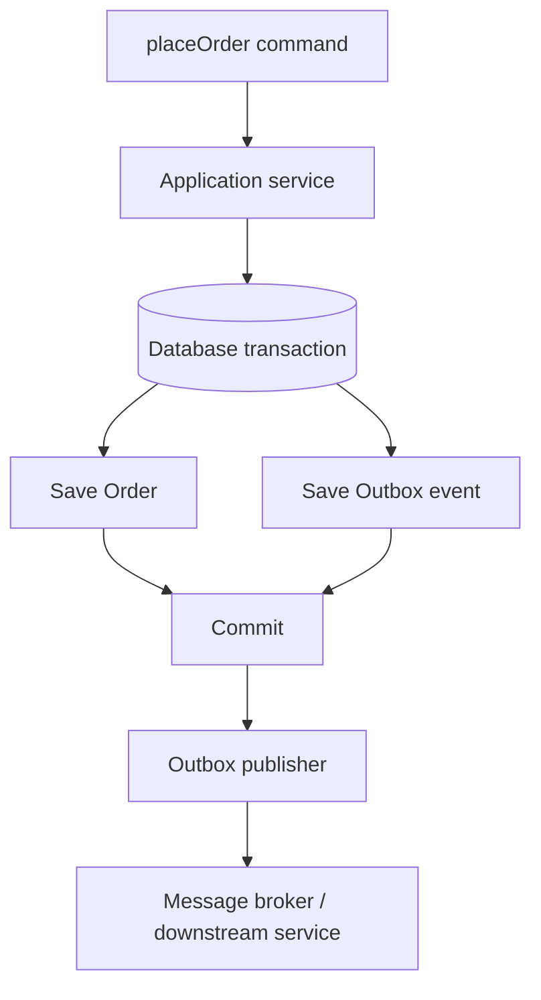

# Thiết kế mutation theo nghiệp vụ trong Spring for GraphQL

Mutation là điểm vào của GraphQL API để thực hiện một hành động làm thay đổi trạng thái hệ thống. Khi thiết kế mutation, cần bắt đầu từ nghiệp vụ mà người dùng muốn hoàn thành, ví dụ đặt hàng, hủy đơn, duyệt yêu cầu hoặc đổi mật khẩu. Từ hành động đó mới xác định input, kết quả, lỗi có thể xảy ra và các quy tắc bảo đảm dữ liệu.

Trong Spring for GraphQL, `@MutationMapping` kết nối method controller với field trên root type `Mutation`. Controller nên nhận input, lấy danh tính người gọi và chuyển yêu cầu đến application service. Quy tắc nghiệp vụ, transaction và phối hợp các thao tác dữ liệu thuộc service/domain, giúp API giữ được tính nhất quán khi được gọi từ GraphQL hoặc một entry point khác.

## 1. Thiết kế theo hành động nghiệp vụ

Một mutation nên diễn đạt một ý định nghiệp vụ có tên rõ ràng. Ví dụ với hệ thống bán hàng:

| Hành động của người dùng | Mutation gợi ý |
| --- | --- |
| Đặt một đơn hàng mới | `placeOrder` |
| Hủy đơn hàng còn được phép hủy | `cancelOrder` |
| Xác nhận đã nhận hàng | `confirmDelivery` |
| Yêu cầu hoàn tiền | `requestRefund` |

Các tên như `updateOrder`, `setStatus` hoặc `saveData` thường quá chung. Chúng không cho biết hành động nào được phép, điều kiện nào cần thỏa mãn và side effect nào sẽ xảy ra. Ví dụ `cancelOrder` có thể kiểm tra đơn hàng đang ở trạng thái `PENDING` hoặc `CONFIRMED`, ghi nhận người hủy và phát sự kiện. Một mutation tổng quát `updateOrder(status: ...)` có thể vô tình cho client chuyển đơn từ `DELIVERED` về `PENDING` nếu server không kiểm tra kỹ.

Hãy đặt câu hỏi: người dùng đang yêu cầu hệ thống thực hiện điều gì? Kết quả hợp lệ của hành động là gì? Điều kiện nào khiến hành động bị từ chối? Những câu trả lời này giúp xác định tên mutation và ranh giới nghiệp vụ.

## 2. Một mutation nên đại diện cho một use case

Một field mutation thường nên tương ứng với một use case hoặc một command có ý nghĩa độc lập. Ví dụ `placeOrder` có thể bao gồm kiểm tra sản phẩm, tính giá, giữ tồn kho và tạo đơn. Đây là một hành động nghiệp vụ thống nhất dù bên trong cần nhiều bước.

Không nên buộc client gọi một chuỗi mutation nhỏ để tự điều phối một use case quan trọng:

```graphql
mutation {
    reserveInventory(productId: "p-10", quantity: 2)
    calculateShipping(orderId: "o-20")
    createOrder(orderId: "o-20")
}
```

Cách này khiến client phải hiểu trình tự nội bộ, tự xử lý trường hợp một bước thành công còn bước sau thất bại và có thể để lại trạng thái trung gian. Thay vào đó, một mutation cấp nghiệp vụ có thể điều phối các bước trong server:

```graphql
mutation PlaceOrder($input: PlaceOrderInput!) {
    placeOrder(input: $input) {
        order {
            id
            status
            total
        }
        userErrors {
            code
            message
        }
    }
}
```

GraphQL thực thi các field cấp cao nhất trong một mutation operation theo thứ tự tuần tự. Tuy nhiên, điều đó không tự tạo một transaction chung cho tất cả field, cũng không làm các HTTP request riêng biệt được tuần tự hóa. Nếu một use case cần tính nguyên tử, hãy thực hiện và quản lý transaction bên trong application service.

## 3. Thiết kế input object theo nhu cầu nghiệp vụ

Khi mutation có nhiều dữ liệu đầu vào, dùng một input object để gom các thông tin thuộc cùng hành động. Ví dụ:

```graphql
input PlaceOrderLineInput {
    productId: ID!
    quantity: Int!
}

input PlaceOrderInput {
    idempotencyKey: String!
    lines: [PlaceOrderLineInput!]!
    deliveryAddressId: ID!
    note: String
}

type Mutation {
    placeOrder(input: PlaceOrderInput!): PlaceOrderPayload!
}
```

Input object làm rõ cấu trúc command và giúp mở rộng schema. Khi thêm một trường tùy chọn, client cũ có thể tiếp tục gửi input mà không cần biết trường mới. Với trường bắt buộc mới, cần cân nhắc tương thích ngược vì client cũ có thể không truyền trường đó.

Một số nguyên tắc thiết kế input:

- Chỉ nhận dữ liệu client có quyền và có lý do cung cấp. Không nhận `userId`, `role` hoặc `ownerId` nếu những giá trị đó phải được xác định từ danh tính đã xác thực.
- Dùng kiểu cụ thể và nullability phù hợp. `quantity: Int!` yêu cầu có số nguyên, nhưng vẫn cần validation để bảo đảm số lượng lớn hơn 0.
- Dùng input type riêng cho command, tránh dùng trực tiếp object output hoặc entity persistence làm input.
- Gom các trường có quan hệ vào input object lồng nhau khi giúp schema dễ hiểu.
- Không đưa trường chỉ dùng nội bộ như cờ bỏ qua authorization hoặc giá tiền do client tự tính vào input.

## 4. Phân biệt create, update và command chuyển trạng thái

Không phải mọi thay đổi đều nên là một mutation `update` tổng quát.

| Loại thao tác | Ví dụ | Thiết kế phù hợp |
| --- | --- | --- |
| Tạo tài nguyên | Tạo đơn hàng | `placeOrder(input: ...)` hoặc `createDraftOrder(input: ...)` |
| Cập nhật một phần thông tin | Sửa địa chỉ giao hàng | `updateDeliveryAddress(input: ...)` |
| Chuyển trạng thái theo quy tắc domain | Hủy đơn hàng | `cancelOrder(input: ...)` |
| Hành động có điều kiện | Duyệt yêu cầu | `approveRequest(input: ...)` |

Với cập nhật một phần, cần phân biệt field bị bỏ qua với field được gửi `null`. Ví dụ khi sửa ghi chú, bỏ qua `note` có thể mang nghĩa giữ nguyên ghi chú hiện tại; gửi `note: null` có thể mang nghĩa xóa ghi chú. Nếu cần phân biệt hai trường hợp trong Spring for GraphQL, dùng `ArgumentValue<T>` ở argument phù hợp hoặc kiểu binding có thể giữ trạng thái field được cung cấp hay không.

Với command chuyển trạng thái, client nên yêu cầu hành động (`cancelOrder`) thay vì gửi trạng thái đích (`status: CANCELLED`). Server sẽ kiểm tra state machine và quyền thực hiện. Điều này giúp không bỏ qua các điều kiện như thời hạn hủy, thanh toán đã hoàn tất hoặc đơn hàng đã giao.

## 5. Thiết kế payload cho kết quả mutation

Mutation có thể trả về trực tiếp object, nhưng payload type hữu ích khi client cần nhận kết quả cùng thông tin bổ sung hoặc lỗi nghiệp vụ có thể dự đoán.

```graphql
enum OrderStatus {
    PENDING
    CONFIRMED
    CANCELLED
    SHIPPED
    DELIVERED
}

enum OrderErrorCode {
    INVALID_QUANTITY
    PRODUCT_UNAVAILABLE
    OUT_OF_STOCK
    ADDRESS_NOT_FOUND
    ORDER_NOT_FOUND
    ORDER_CANNOT_BE_CANCELLED
    VERSION_CONFLICT
}

type UserError {
    code: OrderErrorCode!
    message: String!
    field: String
}

type Order {
    id: ID!
    status: OrderStatus!
    total: Decimal!
    version: Int!
}

scalar Decimal

type PlaceOrderPayload {
    order: Order
    userErrors: [UserError!]!
    replayed: Boolean!
}

type CancelOrderPayload {
    order: Order
    userErrors: [UserError!]!
}

input CancelOrderInput {
    orderId: ID!
    expectedVersion: Int!
}

type Mutation {
    placeOrder(input: PlaceOrderInput!): PlaceOrderPayload!
    cancelOrder(input: CancelOrderInput!): CancelOrderPayload!
}
```

Trong payload:

- `order` nullable vì một yêu cầu bị từ chối có thể không tạo hoặc không cập nhật được đơn hàng.
- `userErrors` luôn là danh sách khác null; khi không có lỗi, server trả `[]`.
- `replayed` cho biết kết quả có được trả lại từ một yêu cầu idempotent trước đó hay không.
- `expectedVersion` hỗ trợ kiểm soát cập nhật đồng thời trong command hủy đơn.

Không phải API nào cũng cần mọi trường này. Chọn payload theo nhu cầu client và quy tắc domain. Tránh thêm metadata không có ý nghĩa chỉ để payload trông đầy đủ.

`Decimal` trong ví dụ là custom scalar cần được đăng ký với coercing phù hợp, thường ánh xạ sang `BigDecimal`. Không dùng GraphQL `Float` cho tiền hoặc số thập phân cần độ chính xác tuyệt đối vì số dấu phẩy động có thể phát sinh sai số.

## 6. Phân biệt lỗi nghiệp vụ và lỗi thực thi GraphQL

Lỗi nghiệp vụ dự kiến là kết quả mà client có thể xử lý theo luồng giao diện, ví dụ sản phẩm hết hàng hoặc đơn hàng không còn được phép hủy. Có thể biểu diễn các lỗi này bằng `userErrors` trong payload.

Lỗi ở tầng GraphQL execution thường phản ánh request không thể được thực thi đúng, ví dụ:

- GraphQL document sai cú pháp hoặc không vượt qua validation.
- Client truyền argument sai kiểu hoặc thiếu giá trị Non-Null.
- Resolver gặp lỗi hệ thống không dự kiến.
- Service hoặc database không khả dụng.

Ví dụ response có lỗi nghiệp vụ:

```json
{
  "data": {
    "placeOrder": {
      "order": null,
      "userErrors": [
        {
          "code": "OUT_OF_STOCK",
          "message": "Sản phẩm không đủ tồn kho",
          "field": "lines[0].quantity"
        }
      ],
      "replayed": false
    }
  }
}
```

Ví dụ lỗi thực thi:

```json
{
  "data": {
    "placeOrder": null
  },
  "errors": [
    {
      "message": "Không thể xử lý yêu cầu",
      "path": ["placeOrder"]
    }
  ]
}
```

Đây là response minh họa. Lỗi thực tế còn chịu ảnh hưởng bởi nullability trong SDL và exception resolver. Không đưa stack trace, SQL, tên bảng hoặc thông tin bí mật vào message trả về client. Dùng mã lỗi ổn định để client xử lý; không bắt client phân tích chuỗi message tự do.

## 7. Controller mỏng với `@MutationMapping`

Trong Spring for GraphQL, controller nhận input và chuyển command đến application service. Ví dụ DTO:

```java
import jakarta.validation.Valid;
import jakarta.validation.constraints.NotBlank;
import jakarta.validation.constraints.NotEmpty;
import jakarta.validation.constraints.Positive;
import jakarta.validation.constraints.PositiveOrZero;
import java.util.List;

public record PlaceOrderInput(
        @NotBlank String idempotencyKey,
        @NotEmpty List<@Valid PlaceOrderLineInput> lines,
        @NotBlank String deliveryAddressId,
        String note) {
}

public record PlaceOrderLineInput(
        @NotBlank String productId,
        @Positive Integer quantity) {
}

public record CancelOrderInput(
        @NotBlank String orderId,
        @PositiveOrZero Integer expectedVersion) {
}
```

Controller:

```java
import java.security.Principal;
import jakarta.validation.Valid;
import org.springframework.graphql.data.method.annotation.Argument;
import org.springframework.graphql.data.method.annotation.MutationMapping;
import org.springframework.stereotype.Controller;

@Controller
public class OrderMutationController {

    private final OrderApplicationService orderService;

    public OrderMutationController(OrderApplicationService orderService) {
        this.orderService = orderService;
    }

    @MutationMapping
    public PlaceOrderPayload placeOrder(
            @Valid @Argument("input") PlaceOrderInput input,
            Principal principal) {
        return orderService.placeOrder(principal.getName(), input);
    }

    @MutationMapping
    public CancelOrderPayload cancelOrder(
            @Valid @Argument("input") CancelOrderInput input,
            Principal principal) {
        return orderService.cancelOrder(principal.getName(), input);
    }
}
```

Ví dụ giả định request đã được xác thực và `Principal` luôn có mặt ở các mutation này. Nếu API cho phép anonymous action, hãy mô hình hóa trường hợp đó rõ ràng và không gọi `principal.getName()` khi principal có thể null. Để Jakarta Bean Validation hoạt động, ứng dụng cần có validation implementation và cấu hình Spring phù hợp.

Không nên đặt logic kiểm tra tồn kho, tính giá, kiểm tra quyền sở hữu hoặc lưu nhiều bảng trực tiếp trong controller. Controller là adapter của GraphQL; application service điều phối use case và có thể được kiểm thử độc lập.

## 8. Thực thi use case trong application service

Service nên nhận danh tính đã xác thực và command input, sau đó thực hiện các bước nghiệp vụ trong ranh giới transaction phù hợp.

```java
import org.springframework.stereotype.Service;
import org.springframework.transaction.annotation.Transactional;

@Service
public class OrderApplicationService {

    private final OrderRepository orderRepository;
    private final InventoryService inventoryService;
    private final AddressService addressService;

    public OrderApplicationService(
            OrderRepository orderRepository,
            InventoryService inventoryService,
            AddressService addressService) {
        this.orderRepository = orderRepository;
        this.inventoryService = inventoryService;
        this.addressService = addressService;
    }

    @Transactional
    public PlaceOrderPayload placeOrder(String userId, PlaceOrderInput input) {
        addressService.requireOwnedAddress(userId, input.deliveryAddressId());

        var reservation = inventoryService.reserve(input.lines());
        if (!reservation.successful()) {
            // reserve phải bảo đảm all-or-nothing và không để lại giữ chỗ một phần.
            return PlaceOrderPayload.withError(
                    OrderErrorCode.OUT_OF_STOCK,
                    "Sản phẩm không đủ tồn kho",
                    "lines");
        }

        Order order = Order.place(userId, input.lines(), reservation, input.note());
        orderRepository.save(order);

        return PlaceOrderPayload.success(order);
    }
}
```

Đây là skeleton minh họa; các kiểu `Order`, `OrderRepository`, `InventoryService`, `PlaceOrderPayload` và `OrderErrorCode` là thành phần domain/application của dự án. Vì nhánh thất bại trả payload bình thường nên transaction sẽ commit nếu không có exception. Do đó, `reserve` trong ví dụ phải bảo đảm all-or-nothing và không để lại giữ chỗ một phần khi trả thất bại. Nếu thao tác giữ chỗ cần rollback bằng exception, hãy ánh xạ lỗi đó thành payload ở ranh giới phù hợp sau khi transaction đã rollback. Nếu tồn kho thuộc một service độc lập, không thể giả định transaction database cục bộ sẽ rollback được hệ thống từ xa; cần cơ chế bù trừ hoặc quy trình saga.

Application service chịu trách nhiệm điều phối use case, còn domain object có thể giữ các quy tắc chuyển trạng thái. Ví dụ `order.cancel(...)` tự kiểm tra trạng thái hiện tại và lý do hủy thay vì để controller tự gán `status = CANCELLED`.

## 9. Transaction và tính nguyên tử

Một use case có thể ghi nhiều bản ghi: order, order lines, reservation và audit record. Nếu các thay đổi này thuộc cùng một database và cần thành công hoặc thất bại cùng nhau, hãy bao chúng trong một transaction service.

Một số điểm cần chú ý:

- Đặt `@Transactional` ở application service để bao trọn hành động nghiệp vụ.
- Dùng constraint ở database cho các bất biến như unique order number hoặc idempotency key.
- Tránh thực hiện network call kéo dài trong transaction database nếu có thể.
- Nếu thao tác liên quan nhiều hệ thống, cân nhắc saga/process manager và các hành động bù trừ thay vì giả định có distributed transaction tự động.
- GraphQL thực thi tuần tự các root mutation field trong một operation, nhưng không tự bao chúng trong cùng transaction.

Transaction chỉ bảo đảm tính nguyên tử trong phạm vi transaction manager và tài nguyên tham gia. Nó không tự rollback email đã gửi, message đã publish hoặc API thanh toán từ xa.

## 10. Idempotency để xử lý retry

Client có thể gửi lại mutation khi mất kết nối hoặc timeout, trong khi server đã xử lý xong request trước đó. Với thao tác tạo đơn, retry có thể tạo đơn trùng nếu không có cơ chế idempotency.

Một cách phổ biến là nhận `idempotencyKey` trong input và lưu kết quả theo khóa đó:

1. Client tạo một key duy nhất cho một ý định đặt hàng và gửi cùng key ở mọi lần retry.
2. Server tìm bản ghi idempotency theo key và principal/tenant phù hợp.
3. Nếu key đã hoàn tất, server trả lại kết quả đã lưu.
4. Nếu key chưa tồn tại, server xử lý command và lưu kết quả cùng key trong transaction.
5. Unique constraint hoặc cơ chế khóa bảo đảm hai request đồng thời không cùng xử lý như hai yêu cầu mới.

Không nên chỉ kiểm tra `exists` rồi mới insert mà thiếu ràng buộc đồng thời; hai request có thể cùng thấy key chưa tồn tại. Cần unique constraint, insert có kiểm soát hoặc cơ chế khóa thích hợp. Phạm vi key phải được thiết kế rõ, thường kết hợp principal/tenant và loại operation.

Idempotency không có nghĩa mọi mutation đều phải nhận key. Nó đặc biệt hữu ích cho hành động có side effect khó đảo ngược hoặc client thường retry như đặt hàng, tạo thanh toán hay gửi yêu cầu.

## 11. Kiểm soát cập nhật đồng thời bằng version

Hai người dùng có thể cùng mở một đơn hàng và thực hiện thay đổi gần như đồng thời. Nếu cả hai cập nhật mà không kiểm tra version, thao tác sau có thể ghi đè thay đổi trước.

Có thể yêu cầu `expectedVersion` trong input:

```graphql
input CancelOrderInput {
    orderId: ID!
    expectedVersion: Int!
}

type Mutation {
    cancelOrder(input: CancelOrderInput!): CancelOrderPayload!
}
```

Service chỉ thực hiện hủy nếu version hiện tại khớp với version client đã đọc. Nếu không khớp, trả `VERSION_CONFLICT` để client tải lại dữ liệu và quyết định tiếp. Có thể triển khai bằng optimistic locking như `@Version` của JPA hoặc câu lệnh update có điều kiện theo version.

Version kiểm soát xung đột ghi; nó không thay thế authorization hoặc các quy tắc trạng thái domain. Server vẫn phải xác nhận người gọi có quyền hủy đơn và đơn đang ở trạng thái được phép hủy.

## 12. Side effect và sự kiện sau commit

Một mutation có thể cần gửi email, phát message hoặc gọi hệ thống khác sau khi dữ liệu được lưu. Nếu thực hiện side effect trước khi transaction commit, hệ thống có thể gửi thông báo thành công dù transaction sau đó rollback.

Với side effect cần độ tin cậy cao, có thể dùng Transactional Outbox:



Order và outbox event được ghi trong cùng transaction. Một publisher đọc các event đã commit rồi gửi đến message broker. Consumer cần xử lý message theo cách idempotent vì hệ thống message thường có thể giao lại event.

Không phải side effect nào cũng cần outbox. Với thao tác đơn giản hoặc thông báo không quan trọng, có thể dùng event listener sau commit. Hãy chọn cơ chế theo yêu cầu mất message, khả năng retry và mức độ nhất quán mà nghiệp vụ cần.

## 13. Bảo mật theo hành động và tài nguyên

Mutation cần kiểm tra quyền tại server. Xác thực người dùng chỉ cho biết ai đang gọi; authorization phải xác định người đó có được phép thực hiện hành động trên tài nguyên cụ thể hay không.

Ví dụ:

- `placeOrder`: người dùng được đặt hàng cho chính tài khoản hoặc tenant của mình.
- `cancelOrder`: người dùng có quyền hủy đơn và là chủ đơn, hoặc có vai trò hỗ trợ được cấp quyền.
- `approveRequest`: chỉ người có quyền phê duyệt trong đúng phạm vi tổ chức mới được thực hiện.

Có thể dùng Spring Security method security như `@PreAuthorize` để kiểm tra quyền tổng quát, sau đó kiểm tra ownership trong application service/domain. Không lấy `userId` từ input rồi tin đó là danh tính người thực hiện. Lấy principal từ security context và kiểm tra quyền trên tài nguyên được truy vấn.

Với mutation có dữ liệu nhạy cảm, cần ghi audit log gồm actor, hành động, tài nguyên, thời điểm và kết quả theo chính sách của hệ thống. Không ghi access token, mật khẩu hoặc dữ liệu nhạy cảm không cần thiết.

## 14. Kiểm thử mutation theo nghiệp vụ

Kiểm thử không chỉ xác nhận resolver trả về object. Cần kiểm tra các quy tắc của use case và trạng thái dữ liệu sau khi thực thi.

Ví dụ kiểm thử mutation bằng `GraphQlTester`:

```java
import java.util.List;
import java.util.Map;

@Test
void placeOrderReturnsCreatedOrder() {
    graphQlTester.document("""
            mutation PlaceOrder($input: PlaceOrderInput!) {
                placeOrder(input: $input) {
                    order {
                        id
                        status
                    }
                    userErrors {
                        code
                    }
                    replayed
                }
            }
            """)
        .variable("input", Map.of(
                "idempotencyKey", "request-001",
                "deliveryAddressId", "address-10",
                "lines", List.of(Map.of(
                        "productId", "product-10",
                        "quantity", 2))))
        .execute()
        .path("placeOrder.order.status")
        .entity(String.class)
        .isEqualTo("PENDING");
}
```

Ví dụ giả định `graphQlTester`, fixture địa chỉ/sản phẩm và service được cấu hình trong test context. Có thể dùng integration test với database test để kiểm tra transaction và ràng buộc dữ liệu.

Các trường hợp nên kiểm tra:

1. Đặt hàng hợp lệ tạo đúng order và order lines.
2. Số lượng không hợp lệ bị từ chối trước khi ghi dữ liệu.
3. Sản phẩm hết hàng trả đúng user error và không tạo đơn.
4. Người dùng không sở hữu địa chỉ giao hàng không thể đặt đơn bằng địa chỉ đó.
5. Hủy đơn ở trạng thái không cho phép trả `ORDER_CANNOT_BE_CANCELLED`.
6. Hai request dùng cùng idempotency key chỉ tạo một đơn.
7. Hai cập nhật cùng version được xử lý với một kết quả xung đột phù hợp.
8. Lỗi trong transaction không để lại order hoặc reservation một phần.
9. Outbox event chỉ được publish sau khi transaction commit.
10. Client nhận đúng payload hoặc GraphQL execution error theo loại lỗi.

## 15. Lỗi thường gặp khi thiết kế mutation

| Vấn đề | Hệ quả | Cách cải thiện |
| --- | --- | --- |
| Mutation CRUD quá tổng quát | Bỏ qua quy tắc của từng hành động nghiệp vụ | Dùng tên command cụ thể như `cancelOrder` hoặc `approveRequest`. |
| Client tự điều phối nhiều bước nội bộ | Trạng thái dở dang khi một bước thất bại | Đưa use case vào application service và expose một mutation phù hợp. |
| Nhận `userId` hoặc `role` từ input | Người gọi có thể giả mạo danh tính hoặc phạm vi | Dùng principal đã xác thực và kiểm tra quyền trên tài nguyên. |
| Chỉ dựa vào GraphQL Non-Null để validation | Giá trị vẫn có thể sai quy tắc domain | Dùng Bean Validation và kiểm tra domain/service. |
| Trả exception cho mọi lỗi nghiệp vụ | Client khó phân biệt lỗi có thể khắc phục với lỗi hệ thống | Dùng payload `userErrors` cho lỗi dự kiến; exception cho lỗi thực thi. |
| Coi nhiều root mutation field là một transaction | Có thể lưu một phần khi field sau thất bại | Đặt transaction ở application service cho từng use case nguyên tử. |
| Không có idempotency | Retry có thể tạo side effect trùng | Dùng idempotency key và ràng buộc đồng thời cho command cần thiết. |
| Không kiểm soát version | Cập nhật sau ghi đè dữ liệu mới hơn | Dùng optimistic locking hoặc điều kiện version. |
| Gửi event trước khi commit | Downstream nhận sự kiện cho dữ liệu chưa được commit | Dùng after-commit handling hoặc Transactional Outbox. |

## 16. Checklist thiết kế mutation theo nghiệp vụ

1. Đặt tên mutation theo hành động mà người dùng muốn thực hiện.
2. Xác định ranh giới use case và các quy tắc domain cần bảo đảm.
3. Thiết kế input object chỉ chứa dữ liệu client được phép cung cấp.
4. Chọn nullability và default phù hợp; phân biệt omitted với explicit null khi cập nhật một phần.
5. Chọn output trực tiếp hoặc payload có mã lỗi ổn định theo nhu cầu client.
6. Phân biệt lỗi nghiệp vụ dự kiến với lỗi GraphQL execution/hệ thống.
7. Giữ controller mỏng và điều phối nghiệp vụ trong application service.
8. Quản lý transaction, constraint database và cập nhật đồng thời ở tầng phù hợp.
9. Dùng idempotency cho hành động cần chống retry trùng.
10. Bảo vệ hành động và tài nguyên bằng authorization.
11. Xử lý side effect sau commit hoặc qua outbox khi cần độ tin cậy cao.
12. Kiểm thử thành công, lỗi nghiệp vụ, phân quyền, rollback, retry và concurrency.

Thiết kế mutation tốt bắt đầu từ ngôn ngữ và quy tắc của nghiệp vụ. Khi mỗi field mutation đại diện cho một hành động rõ ràng, input chỉ nhận dữ liệu cần thiết, payload mô tả kết quả dễ xử lý và application service bảo đảm tính nhất quán, GraphQL API sẽ dễ mở rộng mà không đẩy logic domain sang client.
