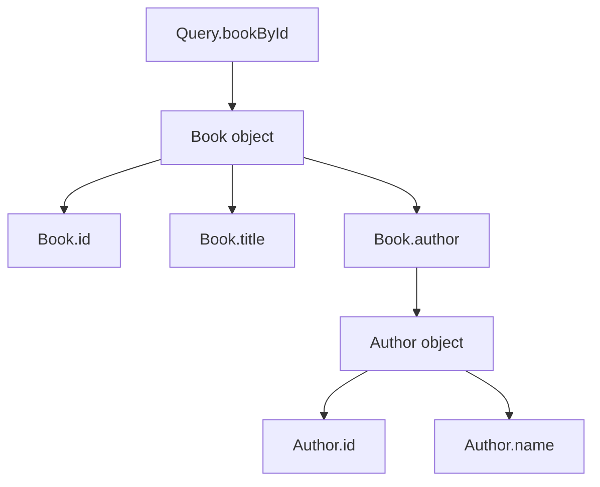

# Source parameter

Trong một GraphQL query, dữ liệu thường được phân giải theo cây field. Resolver của field cha trả về một object; khi GraphQL tiếp tục phân giải field con, object đó trở thành **source** (còn gọi là parent hoặc container object) của field con. Spring for GraphQL cho phép nhận object này trực tiếp bằng một method parameter trong annotated controller.

Ví dụ, resolver Query.bookById trả về một Book. Khi client yêu cầu thêm field Book.author, Spring truyền chính object Book đó vào method xử lý author(Book book). Method có thể đọc authorId từ source rồi tải tác giả tương ứng.

Source parameter đặc biệt hữu ích khi field con cần thông tin từ object cha để tính toán hoặc tải dữ liệu. Nó cũng giúp Spring suy ra GraphQL parent type cho SchemaMapping trong nhiều trường hợp, nhờ vậy annotation có thể ngắn gọn hơn.

Bài học này giải thích source object trong GraphQL Java, cách nhận source parameter trong Spring for GraphQL, cách suy ra type name, cách kết hợp source với arguments và DataLoader, cùng những lỗi thường gặp khi mapping.

## 1. Source là gì trong quá trình thực thi GraphQL?

GraphQL thực thi operation theo cây field. Mỗi field có thể trả về scalar, object hoặc danh sách object. Nếu kết quả là object, GraphQL tiếp tục phân giải các field con mà client đã chọn.

Ví dụ schema:

```graphql
type Query {
  bookById(id: ID!): Book
}

type Book {
  id: ID!
  title: String!
  author: Author
}

type Author {
  id: ID!
  name: String!
}
```

Client truy vấn:

```graphql
query {
  bookById(id: "book-1") {
    id
    title
    author {
      id
      name
    }
  }
}
```

Quá trình phân giải có thể hình dung như sau:



Ở bước đầu, resolver của bookById trả về một object Book. Object đó là source của các field id, title và author. Khi field author trả về một object Author, object Author lại trở thành source cho các field con id và name.

Trong GraphQL Java, source được truy cập qua DataFetchingEnvironment.getSource(). Với Spring annotated controllers, không cần lấy environment thủ công trong trường hợp thông thường: chỉ cần khai báo method parameter có kiểu Java mong muốn.

## 2. Nhận source parameter trong @SchemaMapping

Giả sử Java model:

```java
public record Book(
        String id,
        String title,
        String authorId) {
}

public record Author(
        String id,
        String name) {
}
```

Resolver root query trả về Book:

```java
@Controller
public class BookController {

    private final BookService bookService;

    public BookController(BookService bookService) {
        this.bookService = bookService;
    }

    @QueryMapping
    public Book bookById(@Argument String id) {
        return bookService.findById(id);
    }
}
```

Resolver field con nhận source:

```java
@Controller
public class BookFieldController {

    private final AuthorService authorService;

    public BookFieldController(AuthorService authorService) {
        this.authorService = authorService;
    }

    @SchemaMapping
    public Author author(Book book) {
        return authorService.findById(book.authorId());
    }
}
```

Tham số Book book là source object của field author. Spring lấy object được resolver cha trả về và truyền vào method. Không cần đánh dấu source bằng @Argument hay một annotation riêng.

Method trên mặc định được ánh xạ tới Book.author vì:

- Tên method là author nên field name mặc định là author.
- Kiểu source parameter là Book nên parent type name mặc định là Book.

Nếu tên class Java khớp tên object type trong SDL, có thể bỏ cả hai thuộc tính của @SchemaMapping.

## 3. Phân biệt source parameter và @Argument

Source và argument đều có thể xuất hiện trong cùng một handler method, nhưng chúng đến từ hai nơi khác nhau:

| Tham số | Lấy dữ liệu từ | Ví dụ |
| --- | --- | --- |
| Source parameter | Object cha đã được field cha phân giải | Book book |
| @Argument | Argument client truyền vào field hiện tại | @Argument String format |
| DataLoader | DataLoader đã đăng ký trong request | DataLoader<String, Author> loader |
| GraphQLContext | Context chung của GraphQL request | GraphQLContext context |

Ví dụ field Book.author có thêm argument để chọn cách hiển thị:

```graphql
type Book {
  id: ID!
  title: String!
  author(format: AuthorFormat = FULL): Author
}

enum AuthorFormat {
  FULL
  SHORT
}
```

Handler nhận cả source và argument:

```java
@SchemaMapping(typeName = "Book", field = "author")
public Author author(
        Book book,
        @Argument("format") AuthorFormat format) {

    return authorService.findForBook(book.authorId(), format);
}
```

Ở đây:

- book là object Book cha của field author.
- format là argument của chính field author mà client yêu cầu.

Không nên thêm @Argument vào source parameter. Nếu viết @Argument("book") Book book, Spring sẽ tìm argument có tên book trong GraphQL field call, chứ không lấy object cha.

## 4. Source parameter giúp suy ra type name

@SchemaMapping có hai thuộc tính thường dùng:

- typeName: tên GraphQL parent type sở hữu field.
- field: tên field cần ánh xạ.

Nếu bỏ qua, Spring suy ra:

1. Field name từ tên method.
2. Type name từ simple class name của source parameter.

Ví dụ:

```java
@SchemaMapping
public Author author(Book book) {
    // ...
}
```

Mapping mặc định là Book.author.

Có thể khai báo tường minh:

```java
@SchemaMapping(typeName = "Book", field = "author")
public Author loadAuthor(Book source) {
    // ...
}
```

Tên tham số Java như source hay book không quyết định GraphQL field name. Kiểu Java của tham số source mới được dùng để suy ra parent type; tên method được dùng để suy ra field name.

### Khi nào cần chỉ định typeName?

Nếu simple class name của Java không trùng GraphQL type name, hãy chỉ định typeName:

```java
public record BookEntity(
        String id,
        String title,
        String authorId) {
}
```

Schema vẫn có type tên Book:

```graphql
type Book {
  id: ID!
  title: String!
  author: Author
}
```

Khi đó:

```java
@SchemaMapping(typeName = "Book", field = "author")
public Author author(BookEntity book) {
    return authorService.findById(book.authorId());
}
```

Nếu bỏ typeName = "Book", Spring có thể suy ra parent type là BookEntity và không tìm thấy type đó trong schema. Chỉ định rõ type name giúp tách tên domain/persistence class khỏi tên API GraphQL.

### Dùng @SchemaMapping ở cấp class

Nếu nhiều method cùng phân giải field của một parent type, có thể đặt mặc định ở cấp class:

```java
@Controller
@SchemaMapping(typeName = "Book")
public class BookFieldController {

    @SchemaMapping
    public Author author(Book book) {
        // Field Book.author
    }

    @SchemaMapping
    public List<Review> reviews(Book book) {
        // Field Book.reviews
    }
}
```

Các method kế thừa typeName = "Book" từ class-level annotation. Method-level attribute có thể ghi đè giá trị mặc định này khi cần.

## 5. Source có thể là record, class hoặc Map

Source không bắt buộc phải là JPA entity hay một kiểu đặc biệt của Spring. Đó là object mà resolver cha trả về. Nó có thể là:

- Java record.
- POJO có getter.
- Domain object.
- Projection object.
- Map hoặc cấu trúc dữ liệu khác mà GraphQL data fetcher có thể dùng.

Ví dụ source là record:

```java
public record Book(String id, String title, String authorId) {
}
```

Ví dụ source là class:

```java
public class BookView {

    private final String id;
    private final String title;
    private final String authorId;

    public BookView(String id, String title, String authorId) {
        this.id = id;
        this.title = title;
        this.authorId = authorId;
    }

    public String getId() {
        return id;
    }

    public String getTitle() {
        return title;
    }

    public String getAuthorId() {
        return authorId;
    }
}
```

Nếu source là BookView trong khi GraphQL type là Book, chỉ định parent type tường minh:

```java
@SchemaMapping(typeName = "Book", field = "author")
public Author author(BookView book) {
    return authorService.findById(book.getAuthorId());
}
```

### Source là Map

Một số resolver trả về Map thay vì domain object:

```java
@QueryMapping
public Map<String, Object> bookById(@Argument String id) {
    return bookService.findViewAsMap(id);
}
```

Handler field con có thể nhận chính Map đó:

```java
@SchemaMapping(typeName = "Book", field = "author")
public Author author(Map<String, Object> book) {
    String authorId = (String) book.get("authorId");
    return authorService.findById(authorId);
}
```

Vì simple class name của source là Map chứ không phải Book, cần khai báo typeName rõ ràng. Cũng cần bảo đảm key và value có kiểu nhất quán; ép kiểu sai có thể gây lỗi runtime.

@Argument Map<String, Object> hoàn toàn khác: nó lấy giá trị argument từ client, còn Map<String, Object> không có annotation trong ví dụ trên là source object của field.

## 6. Một source object có thể cung cấp nhiều field con

Một object cha có thể làm source cho nhiều resolver:

```graphql
type Book {
  id: ID!
  title: String!
  author: Author
  reviews: [Review!]!
  averageRating: Float
}
```

Controller:

```java
@Controller
@SchemaMapping(typeName = "Book")
public class BookFieldController {

    private final AuthorService authorService;
    private final ReviewService reviewService;

    public BookFieldController(
            AuthorService authorService,
            ReviewService reviewService) {
        this.authorService = authorService;
        this.reviewService = reviewService;
    }

    @SchemaMapping
    public Author author(Book book) {
        return authorService.findById(book.authorId());
    }

    @SchemaMapping
    public List<Review> reviews(Book book) {
        return reviewService.findByBookId(book.id());
    }

    @SchemaMapping
    public double averageRating(Book book) {
        return reviewService.averageRating(book.id());
    }
}
```

Mỗi method nhận cùng kiểu source Book nhưng xử lý một field khác nhau. Spring phân biệt mapping theo cặp parent type và field name.

Nếu source object đã có sẵn property phù hợp, GraphQL Java có thể dùng property data fetcher mặc định mà không cần method @SchemaMapping riêng. Chỉ viết resolver khi cần logic tùy biến, gọi service, áp dụng quy tắc nghiệp vụ hoặc chuyển đổi dữ liệu.

## 7. Kết hợp source parameter với DataLoader

Source parameter thường chứa foreign key hoặc thông tin để tải quan hệ. Nếu query trả về nhiều parent object, gọi service riêng cho mỗi source có thể gây N+1.

Ví dụ chưa tối ưu:

```java
@SchemaMapping
public Author author(Book book) {
    return authorService.findById(book.authorId());
}
```

Nếu client lấy 50 cuốn sách và chọn author, method có thể được gọi 50 lần. Nếu mỗi lần truy vấn database riêng, server thực hiện một query lấy sách và thêm nhiều query lấy tác giả.

Có thể giữ source parameter nhưng dùng DataLoader để gom các lần tải:

```java
@SchemaMapping
public CompletableFuture<Author> author(
        Book book,
        DataLoader<String, Author> authorLoader) {

    return authorLoader.load(book.authorId());
}
```

Batch loader được đăng ký theo request:

```java
@Controller
public class BookController {

    public BookController(
            BatchLoaderRegistry registry,
            AuthorService authorService) {

        registry.forTypePair(String.class, Author.class)
                .registerMappedBatchLoader((authorIds, environment) ->
                        Mono.just(authorService.findAllByIds(authorIds)));
    }

    @SchemaMapping
    public CompletableFuture<Author> author(
            Book book,
            DataLoader<String, Author> authorLoader) {
        return authorLoader.load(book.authorId());
    }
}
```

Ở đây source parameter cung cấp author ID cho mỗi field call. DataLoader trì hoãn các lần tải, gom các key và gọi batch function. Nhiều sách cùng tham chiếu một tác giả cũng có thể dùng chung kết quả trong cache của request.

Nếu trường hợp chỉ đơn giản là tải một field liên quan từ danh sách parent object, @BatchMapping có thể ngắn gọn hơn:

```java
@BatchMapping
public Map<Book, Author> author(List<Book> books) {
    Set<String> authorIds = books.stream()
            .map(Book::authorId)
            .collect(Collectors.toSet());

    Map<String, Author> authors = authorService.findAllByIds(authorIds);

    return books.stream().collect(Collectors.toMap(
            Function.identity(),
            book -> authors.get(book.authorId())));
}
```

@BatchMapping dùng danh sách source objects và tự đăng ký DataLoader cho field tương ứng. Với trường hợp cần argument riêng cho từng field call hoặc local context phức tạp, dùng @SchemaMapping kết hợp DataLoader và BatchLoaderRegistry sẽ linh hoạt hơn.

Source parameter tự nó không giải quyết N+1. Nó chỉ cung cấp object cha; việc tải dữ liệu theo lô cần DataLoader, @BatchMapping hoặc một chiến lược bulk query.

## 8. Source parameter với interface và inheritance

Java model có thể dùng interface chung cho nhiều object type GraphQL:

```graphql
interface Activity {
  id: ID!
  coordinator: User
}

type WorkshopActivity implements Activity {
  id: ID!
  coordinator: User
  room: String!
}

type BookLaunchActivity implements Activity {
  id: ID!
  coordinator: User
  isbn: String!
}
```

Java:

```java
public interface Activity {
    String id();
    String coordinatorId();
}
```

Resolver có thể nhận source kiểu interface:

```java
@SchemaMapping
public User coordinator(Activity activity) {
    return userService.findById(activity.coordinatorId());
}
```

Spring for GraphQL hỗ trợ interface schema mapping: mapping trên interface có thể được mở rộng thành các mapping cho từng object type triển khai interface. Điều này cho phép dùng một source parameter chung cho nhiều subtype khi logic giống nhau.

Nếu một subtype cần xử lý riêng, có thể khai báo mapping cụ thể cho subtype:

```java
@SchemaMapping
public User coordinator(Activity activity) {
    return userService.findById(activity.coordinatorId());
}

@SchemaMapping
public User coordinator(WorkshopActivity activity) {
    return workshopService.findCoordinator(activity);
}
```

Kiểu source parameter cụ thể giúp Spring xác định mapping dành cho subtype. Hãy kiểm tra tên GraphQL type và phiên bản Spring for GraphQL nếu dùng interface mapping trong ứng dụng.

## 9. Source parameter và các method argument khác

Một handler method có thể kết hợp source với nhiều loại method argument được Spring hỗ trợ:

```java
@SchemaMapping(typeName = "Book", field = "author")
public Author author(
        Book book,
        @Argument("locale") String locale,
        Principal principal,
        DataLoader<String, Author> authorLoader) {

    return authorLoader.load(book.authorId());
}
```

Ví dụ này minh họa các nguồn dữ liệu khác nhau:

- Book book: source/parent object.
- @Argument("locale"): argument client truyền vào field.
- Principal: người dùng hiện tại nếu Spring Security context có sẵn.
- DataLoader: loader được đăng ký trong DataLoaderRegistry của request.

Các kiểu khác có thể được hỗ trợ gồm GraphQLContext, @ContextValue, @LocalContextValue, DataFetchingEnvironment, DataFetchingFieldSelectionSet và Locale. Chỉ thêm tham số khi resolver thực sự cần dữ liệu đó.

Nếu cần truy cập toàn bộ source và metadata thực thi cấp thấp, có thể nhận DataFetchingEnvironment:

```java
@SchemaMapping
public Author author(DataFetchingEnvironment environment) {
    Book book = environment.getSource();
    return authorService.findById(book.authorId());
}
```

Thông thường khai báo source parameter có kiểu cụ thể dễ đọc và an toàn kiểu hơn. Dùng environment trực tiếp khi cần API GraphQL Java mà method argument resolver không cung cấp thuận tiện.

## 10. Những điều source parameter không làm

Source parameter chỉ cung cấp object cha cho handler. Nó không tự động:

- Tải dữ liệu quan hệ từ database.
- Tạo transaction.
- Kiểm tra quyền truy cập resource.
- Chuyển đổi source class thành GraphQL type nếu tên không khớp.
- Giải quyết N+1.
- Đọc argument của field.
- Bảo đảm object cha không null hoặc dữ liệu trong object luôn hợp lệ.

Ví dụ source chứa authorId chỉ cho biết định danh tác giả. Resolver vẫn phải quyết định cách tải tác giả, có cần kiểm tra quyền hay không, và xử lý trường hợp tác giả không tồn tại như thế nào.

Không nên xem source object là bằng chứng authorization. Một object có ID hợp lệ không chứng minh người dùng hiện tại được phép đọc các field của nó. Quyền truy cập phải được kiểm tra dựa trên identity, tenant và chính sách nghiệp vụ.

## 11. Nullability và dữ liệu source

Nếu parent resolver trả về null, GraphQL áp dụng null propagation theo nullability của field cha. Những field con của object không tồn tại sẽ không được phân giải như một object thông thường.

Ví dụ:

```graphql
type Query {
  bookById(id: ID!): Book
}

type Book {
  id: ID!
  author: Author!
}
```

bookById có thể trả null nếu không tìm thấy sách. Nhưng nếu đã có Book, field author được khai báo non-null thì resolver phải trả một Author hợp lệ hoặc phát sinh execution error. Nếu domain cho phép sách chưa có tác giả, schema nên biểu diễn field nullable:

```graphql
type Book {
  id: ID!
  author: Author
}
```

Tương tự, nếu source object không có authorId hoặc Map thiếu key đó, resolver phải có quy tắc rõ ràng. Tránh để lỗi ép kiểu hoặc null pointer xuất hiện ngoài dự kiến.

## 12. Source parameter ở root field và nested field

Source parameter được dùng thường xuyên nhất trong resolver của field lồng nhau, ví dụ Book.author hoặc Author.books. Lúc này object cha là một domain object có kiểu rõ ràng.

Với root field như Query.bookById, method thường nhận arguments của query:

~~~java
@QueryMapping
public Book bookById(@Argument String id) {
    return bookService.findById(id);
}
~~~

Không nên mặc định rằng source của root Query là một Book. Root source là đối tượng root được GraphQL engine cung cấp cho operation, thường không phải domain object của kết quả query. Book chỉ trở thành source của các field con sau khi resolver bookById trả về nó.

Một cách nhớ hữu ích:

- Resolver root field nhận input từ client và tạo/trả về object gốc của nhánh dữ liệu.
- Resolver nested field nhận object cha làm source để phân giải field con.
- Kết quả của nested resolver lại trở thành source cho tầng field tiếp theo.

## 13. Kiểm thử source parameter

Nên kiểm tra source parameter bằng cách thực thi operation đầy đủ từ root field đến field con. Khi đó test xác nhận resolver cha trả đúng object và resolver con nhận đúng source.

Ví dụ dùng GraphQlTester:

~~~java
@GraphQlTest({BookController.class, BookFieldController.class})
class BookSourceMappingTests {

    @Autowired
    GraphQlTester graphQlTester;

    @MockBean
    BookService bookService;

    @MockBean
    AuthorService authorService;

    @Test
    void passesParentBookAsSourceToAuthorMapping() {
        Book book = new Book("book-1", "Spring GraphQL", "author-7");
        Author author = new Author("author-7", "An Nguyen");

        given(bookService.findById("book-1")).willReturn(book);
        given(authorService.findById("author-7")).willReturn(author);

        graphQlTester.document("""
                query {
                    bookById(id: "book-1") {
                        id
                        title
                        author {
                            id
                            name
                        }
                    }
                }
                """)
                .execute()
                .path("bookById.author.name")
                .entity(String.class)
                .isEqualTo("An Nguyen");

        then(authorService).should().findById("author-7");
    }
}
~~~

Đây là ví dụ minh họa; cần import đúng controller và mock các dependency thực tế. Test hữu ích nên bao gồm:

- Source object được resolver cha trả về có đúng kiểu và dữ liệu.
- Resolver field con đọc đúng property từ source.
- Tên parent type được suy ra đúng hoặc được chỉ định tường minh.
- Field argument không bị nhầm với source parameter.
- Source là record, POJO hoặc Map được xử lý đúng theo thiết kế.
- DataLoader được gọi bằng key lấy từ source khi dùng batch loading.
- Trường hợp source thiếu dữ liệu tuân theo nullability và error contract.

## 14. Lỗi thường gặp

| Biểu hiện | Nguyên nhân | Cách xử lý |
| --- | --- | --- |
| Không tìm thấy mapping cho field con | Source class simple name không khớp GraphQL parent type | Chỉ định typeName trong @SchemaMapping |
| Resolver nhận null hoặc sai object | Parent resolver trả sai kiểu hoặc không trả object như mong đợi | Kiểm tra return value của field cha |
| Spring xem source như argument | Gắn @Argument nhầm lên source parameter | Để source parameter không có @Argument |
| Mapping sai field | Tên method không khớp SDL field | Chỉ định field hoặc value trong @SchemaMapping |
| Map source không được suy ra đúng type | Simple class name của source là Map | Chỉ định typeName tường minh |
| Method con chạy nhiều truy vấn | Mỗi source call service/database riêng | Dùng DataLoader, @BatchMapping hoặc bulk query |
| Interface mapping không áp dụng cho subtype | Source/interface và GraphQL interface không khớp hoặc phiên bản không hỗ trợ như kỳ vọng | Kiểm tra SDL, source type và phiên bản Spring for GraphQL |
| Ép kiểu source bị lỗi | Java source model không đúng với kiểu method parameter | Đồng bộ kiểu trả về của parent resolver và source parameter |
| Field con trả null ngoài ý muốn | Property/key trong source không có hoặc quan hệ không tồn tại | Kiểm tra dữ liệu source và nullability |

## 15. Nguyên tắc sử dụng Source parameter

- Dùng source parameter để nhận object cha mà resolver trước đó trả về.
- Để source parameter không có @Argument; dùng @Argument riêng cho dữ liệu client gửi.
- Đặt tên method trùng field name để tận dụng convention mặc định.
- Để simple class name của source khớp GraphQL parent type khi có thể.
- Chỉ định typeName rõ ràng khi Java model và GraphQL schema dùng tên khác nhau.
- Dùng class-level @SchemaMapping khi nhiều method cùng thuộc một parent type.
- Dùng source type là interface khi nhiều subtype có chung logic.
- Dùng DataLoader hoặc @BatchMapping khi source parameter dẫn đến tải quan hệ trên nhiều parent objects.
- Giữ resolver dễ đọc và ủy quyền nghiệp vụ cho service.
- Không dùng source object thay cho authorization hoặc request context.
- Kiểm thử từ root query tới field con để xác nhận source được truyền đúng.

## 16. Bài tập thực hành

Xây dựng API thư viện với các yêu cầu:

1. Khai báo Query.bookById, Book.author và Author.books trong SDL.
2. Tạo Java record Book có id, title, authorId.
3. Viết @QueryMapping trả về một Book.
4. Viết @SchemaMapping nhận Book book để tải Author.
5. Thêm argument locale vào field author và nhận bằng @Argument.
6. Đổi Java model thành BookEntity nhưng giữ GraphQL type là Book; cập nhật typeName tường minh.
7. Thử trả source dưới dạng Map<String, Object> và kiểm tra mapping.
8. Thêm nhiều sách cùng tác giả, dùng DataLoader để tránh truy vấn tác giả lặp lại.
9. Viết GraphQlTester kiểm tra cả field cha và field con.

Sau khi hoàn thành, hãy giải thích được source object được lấy từ đâu, vì sao source parameter không cần annotation riêng, cách Spring suy ra parent type, và khi nào cần kết hợp source với DataLoader.

## 17. Tài liệu tham khảo

- [Spring for GraphQL — Annotated Controllers: Source](https://docs.spring.io/spring-graphql/reference/controllers.html#controllers.schema-mapping.source)
- [Spring for GraphQL — SchemaMapping API](https://docs.spring.io/spring-graphql/docs/1.4.x/api/org/springframework/graphql/data/method/annotation/SchemaMapping.html)
- [GraphQL Java — DataFetchingEnvironment](https://javadoc.io/doc/com.graphql-java/graphql-java/latest/graphql/schema/DataFetchingEnvironment.html)

Chữ ký method argument và hành vi mapping có thể thay đổi theo phiên bản Spring for GraphQL. Khi nâng cấp dependency, hãy kiểm tra reference documentation và Javadoc đúng phiên bản đang được dự án sử dụng.
