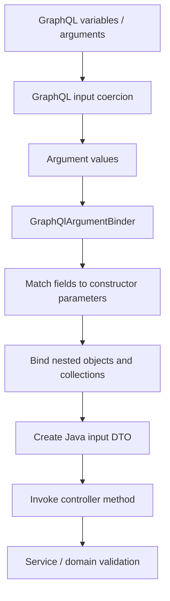

# Constructor binding

Trong Spring for GraphQL, client gửi dữ liệu đầu vào dưới dạng GraphQL arguments hoặc input object. Khi controller nhận tham số Java bằng `@Argument`, Spring chuyển dữ liệu đó thành kiểu Java mà method yêu cầu. Với một input DTO có constructor, quá trình này sử dụng **constructor binding**: các giá trị trong input được ghép với tham số constructor để tạo một object hoàn chỉnh.

Constructor binding phù hợp với Java record và DTO bất biến. Thay vì tạo object rỗng rồi gọi setter cho từng thuộc tính, binder tạo object ngay với các giá trị đầu vào. Cách này giúp input model gọn, dễ kiểm thử và hạn chế trạng thái object chưa hợp lệ.

Bài học này giải thích `GraphQlArgumentBinder`, cách binding input object vào constructor, xử lý input lồng nhau và danh sách, đổi tên field bằng `@BindParam`, yêu cầu về tên tham số, validation và cách kiểm thử constructor binding trong Spring for GraphQL.

## 1. Từ GraphQL input đến Java object

GraphQL SDL định nghĩa input type và các field client được phép gửi:

```graphql
input CreateBookInput {
  title: String!
  authorId: ID!
  publishedYear: Int
}

type Mutation {
  createBook(input: CreateBookInput!): Book!
}

type Book {
  id: ID!
  title: String!
  publishedYear: Int
}
```

Client gửi mutation:

```graphql
mutation CreateBook($input: CreateBookInput!) {
  createBook(input: $input) {
    id
    title
    publishedYear
  }
}
```

Variables:

```json
{
  "input": {
    "title": "Spring for GraphQL",
    "authorId": "author-1",
    "publishedYear": 2026
  }
}
```

Controller nhận toàn bộ input bằng một Java type:

```java
@MutationMapping
public Book createBook(@Argument("input") CreateBookInput input) {
    return bookService.create(input);
}
```

Spring for GraphQL lấy argument `input` rồi bind map của các field thành object `CreateBookInput`. Việc chuyển đổi này được thực hiện bởi `GraphQlArgumentBinder`.

## 2. GraphQlArgumentBinder và constructor binding

`GraphQlArgumentBinder` là thành phần của Spring for GraphQL chịu trách nhiệm chuyển GraphQL argument values thành object Java. Binder hỗ trợ hai kiểu xây dựng object thường gặp:

- **Constructor binding:** tạo object bằng cách truyền các giá trị đã bind vào constructor.
- **Property binding:** tạo object rồi gán giá trị vào các thuộc tính có thể truy cập, chẳng hạn setter hoặc field có thể bind.

Với input DTO bất biến, constructor binding là lựa chọn tự nhiên. Binder có thể bind đệ quy input object lồng nhau và chuyển đổi giá trị theo kiểu Java đích. Nếu quá trình bind gặp lỗi, binder thu thập thông tin lỗi để Spring for GraphQL trả lỗi thực thi phù hợp.

Luồng tổng quát:



GraphQL kiểm tra cấu trúc input, scalar và nullability trước khi gọi data fetcher. Sau đó Spring bind argument values sang kiểu Java của method parameter. Hai bước này liên quan nhưng có trách nhiệm khác nhau: GraphQL kiểm tra hợp đồng SDL; binder chuyển giá trị sang Java object.

## 3. Constructor binding với Java record

Java record là lựa chọn gọn cho input DTO bất biến. Record tự sinh canonical constructor, accessor và các phương thức `equals`, `hashCode`, `toString`.

Java model:

```java
public record CreateBookInput(
        String title,
        String authorId,
        Integer publishedYear) {
}
```

Controller:

```java
@Controller
public class BookMutationController {

    private final BookService bookService;

    public BookMutationController(BookService bookService) {
        this.bookService = bookService;
    }

    @MutationMapping
    public Book createBook(@Argument("input") CreateBookInput input) {
        return bookService.create(input);
    }
}
```

Binder tạo record tương đương với việc gọi constructor:

```java
new CreateBookInput(
        "Spring for GraphQL",
        "author-1",
        2026);
```

Đây là cách diễn giải để hiểu cơ chế; trong ứng dụng, Spring tự thực hiện việc bind và tạo object. Controller không cần tự đọc map hay gọi constructor.

### Vì sao record phù hợp?

- Không cần setter.
- Các field được khởi tạo cùng lúc.
- Sau khi tạo, input object không bị thay đổi ngoài ý muốn.
- Kiểu field thể hiện rõ hợp đồng dữ liệu.
- Dễ dùng trong unit test và service method.

Với field có thể null, dùng kiểu Java nullable như `Integer`, `Long` hoặc `Boolean` thay vì primitive `int`, `long`, `boolean`. Primitive không biểu diễn được null.

## 4. Constructor binding với class thông thường

Không bắt buộc phải dùng record. Một class có constructor phù hợp cũng có thể được bind:

```java
public class CreateAuthorInput {

    private final String name;
    private final String biography;

    public CreateAuthorInput(String name, String biography) {
        this.name = name;
        this.biography = biography;
    }

    public String getName() {
        return name;
    }

    public String getBiography() {
        return biography;
    }
}
```

SDL:

```graphql
input CreateAuthorInput {
  name: String!
  biography: String
}

type Mutation {
  createAuthor(input: CreateAuthorInput!): Author!
}
```

Controller:

```java
@MutationMapping
public Author createAuthor(@Argument("input") CreateAuthorInput input) {
    return authorService.create(input);
}
```

Binder cần biết tên các constructor parameter để ghép chúng với tên field trong input object. Với Java class thông thường, hãy bảo đảm compiler lưu parameter names (ví dụ compile với tùy chọn `-parameters`) hoặc dùng cơ chế metadata tên tham số phù hợp. Java record lưu tên record component trong bytecode nên phù hợp cho constructor binding.

Nên giữ một constructor chính có tham số tương ứng với input fields. Nhiều constructor overload có thể làm việc lựa chọn constructor trở nên khó hiểu; DTO đầu vào nên có cấu trúc đơn giản và rõ ràng.

## 5. Tên constructor parameter phải khớp input field

Theo mặc định, binder ghép tên constructor parameter với tên field trong GraphQL input object.

SDL:

```graphql
input CreateBookInput {
  title: String!
  authorId: ID!
}
```

Java:

```java
public record CreateBookInput(
        String title,
        String authorId) {
}
```

Tên `title` khớp `title`; tên `authorId` khớp `authorId`. Binder có thể gán giá trị tương ứng mà không cần cấu hình thêm.

Nếu tên không khớp, binder không thể ghép đúng field vào constructor parameter. Ví dụ:

```java
public record CreateBookInput(
        String bookTitle,
        String authorIdentifier) {
}
```

Trong khi SDL vẫn dùng `title` và `authorId`, hai tên Java ở trên khác với tên input fields. Cần dùng `@BindParam` để khai báo tên GraphQL input field tương ứng.

## 6. Đổi tên field bằng @BindParam

`@BindParam` cho phép chỉ định rõ tên input field được bind vào constructor parameter. Annotation nằm trong package:

```java
org.springframework.graphql.data.method.annotation.BindParam
```

Ví dụ SDL sử dụng snake_case:

```graphql
input CreateBookInput {
  book_title: String!
  author_id: ID!
}

type Mutation {
  createBook(input: CreateBookInput!): Book!
}
```

Java record vẫn dùng camelCase:

```java
public record CreateBookInput(
        @BindParam("book_title") String bookTitle,
        @BindParam("author_id") String authorId) {
}
```

`@BindParam("book_title")` nói với binder rằng tham số `bookTitle` nhận giá trị từ field SDL `book_title`. Tương tự, `authorId` nhận giá trị từ `author_id`.

Client gửi:

```graphql
mutation {
  createBook(input: {
    book_title: "Spring GraphQL"
    author_id: "author-1"
  }) {
    id
    title
  }
}
```

### Khi nào nên dùng @BindParam?

- GraphQL API dùng snake_case nhưng Java dùng camelCase.
- Tên field công khai cần giữ ổn định trong khi Java model đổi tên.
- DTO dùng thuật ngữ Java khác tên field API.
- Cần tránh phụ thuộc vào quy ước đặt tên tự động.

Không nên đổi tên field tùy tiện. Tên trong SDL là một phần public contract của API; `@BindParam` chỉ tạo ánh xạ giữa contract đó và tên Java.

## 7. Constructor binding với input object lồng nhau

GraphQL input object có thể chứa một input object khác. Binder hỗ trợ bind đệ quy các cấu trúc lồng nhau.

SDL:

```graphql
input AuthorInput {
  name: String!
  email: String
}

input CreateBookInput {
  title: String!
  author: AuthorInput!
}

type Mutation {
  createBook(input: CreateBookInput!): Book!
}
```

Java DTO:

```java
public record AuthorInput(
        String name,
        String email) {
}

public record CreateBookInput(
        String title,
        AuthorInput author) {
}
```

Controller:

```java
@MutationMapping
public Book createBook(@Argument("input") CreateBookInput input) {
    return bookService.create(input);
}
```

Binder thực hiện các bước:

1. Đọc field `title` của `CreateBookInput`.
2. Đọc map `author`.
3. Bind map đó thành `AuthorInput`.
4. Gọi constructor `CreateBookInput` với title và AuthorInput đã tạo.

Client:

```graphql
mutation {
  createBook(input: {
    title: "Spring GraphQL"
    author: {
      name: "An Nguyen"
      email: "an@example.com"
    }
  }) {
    id
    title
  }
}
```

Mỗi tầng input nên có DTO riêng để thể hiện cấu trúc API. Không cần tự chuyển từng nested map trong controller nếu binder đã có thể bind sang Java type.

## 8. Constructor binding với danh sách và collection

Input object có thể chứa danh sách scalar hoặc danh sách input object:

```graphql
input ChapterInput {
  title: String!
  pageCount: Int!
}

input CreateBookInput {
  title: String!
  tags: [String!]!
  chapters: [ChapterInput!]!
}
```

Java DTO:

```java
public record ChapterInput(
        String title,
        Integer pageCount) {
}

public record CreateBookInput(
        String title,
        List<String> tags,
        List<ChapterInput> chapters) {
}
```

Binder chuyển từng phần tử trong danh sách `chapters` thành `ChapterInput`, rồi truyền collection vào constructor `CreateBookInput`.

Nếu cần collection bất biến trong domain, service có thể sao chép dữ liệu:

```java
List<Chapter> chapters = input.chapters().stream()
        .map(chapter -> new Chapter(
                chapter.title(),
                chapter.pageCount()))
        .toList();
```

DTO input chỉ nên đại diện cho dữ liệu client gửi. Việc chuyển sang domain entity hoặc aggregate nên nằm trong service/domain layer.

## 9. Nullability và giá trị mặc định

GraphQL SDL quyết định field nào bắt buộc và field nào có thể null:

```graphql
input CreateBookInput {
  title: String!
  subtitle: String
  publishedYear: Int = 2026
}
```

Ý nghĩa:

- `title: String!`: bắt buộc và không được null.
- `subtitle: String`: có thể bị bỏ qua hoặc truyền null.
- `publishedYear: Int = 2026`: GraphQL áp dụng default value khi client không cung cấp field theo quy tắc input coercion.

Java DTO:

```java
public record CreateBookInput(
        String title,
        String subtitle,
        Integer publishedYear) {
}
```

Dùng `Integer` cho `publishedYear` vì field SDL không có `!` và có thể null. Nếu dùng primitive `int`, Java không thể biểu diễn trạng thái null.

GraphQL xử lý required field và default value trong giai đoạn input coercion. Constructor binding nhận giá trị sau bước đó. Vì vậy, không nên tự lặp lại logic default trong constructor nếu default đã được khai báo trong SDL, trừ khi domain có quy tắc riêng.

### Phân biệt omitted và null

Trong partial update, client có thể cần phân biệt:

| Input | Ý nghĩa nghiệp vụ có thể chọn |
| --- | --- |
| Không gửi field | Giữ nguyên giá trị cũ |
| Gửi field với null | Xóa giá trị hiện tại |
| Gửi giá trị | Gán giá trị mới |

Một field nullable trong constructor DTO thường không đủ để phân biệt hai trạng thái đầu nếu cả hai đều được bind thành null. Với nhu cầu này, hãy dùng kiểu biểu diễn sự hiện diện như `ArgumentValue<T>` ở cấp argument phù hợp hoặc thiết kế input model có trạng thái rõ ràng. Không tự suy luận rằng null luôn có nghĩa là giữ nguyên hoặc xóa dữ liệu.

## 10. Constructor binding và property binding

Spring for GraphQL có thể bind input vào class theo constructor hoặc property. Hai cách có đặc điểm khác nhau:

| Đặc điểm | Constructor binding | Property binding |
| --- | --- | --- |
| Cách tạo object | Gọi constructor với giá trị đã bind | Tạo instance rồi gán thuộc tính |
| DTO phù hợp | Record, immutable class | Mutable bean có setter hoặc field có thể bind |
| Trạng thái object | Các giá trị được truyền lúc khởi tạo | Có thể tồn tại trạng thái trung gian trước khi gán đủ |
| Tính bất biến | Tự nhiên hơn | Cần thiết kế thêm |
| Metadata cần thiết | Tên constructor parameter hoặc `@BindParam` | Tên property/setter/field có thể bind |

Ví dụ property binding:

```java
public class MutableCreateBookInput {

    private String title;
    private String authorId;

    public MutableCreateBookInput() {
    }

    public void setTitle(String title) {
        this.title = title;
    }

    public void setAuthorId(String authorId) {
        this.authorId = authorId;
    }

    public String getTitle() {
        return title;
    }

    public String getAuthorId() {
        return authorId;
    }
}
```

Class này có thể được bind qua no-argument constructor và setter. Tuy nhiên, với DTO chỉ dùng để nhận input, record thường ngắn gọn và dễ hiểu hơn.

Không nhầm constructor binding của `GraphQlArgumentBinder` với annotation `@ConstructorBinding` dùng trong một số trường hợp Spring Boot configuration properties. Đây là hai cơ chế phục vụ hai mục đích khác nhau.

## 11. Chuyển đổi kiểu dữ liệu

GraphQL có các scalar tích hợp như `String`, `Int`, `Float`, `Boolean` và `ID`. Khi dùng custom scalar, GraphQL Java thực hiện coercion trước khi Spring bind giá trị sang kiểu Java đích.

Ví dụ schema khai báo:

```graphql
scalar UUID

input CreateBookInput {
  id: UUID!
  title: String!
}
```

Java DTO:

```java
public record CreateBookInput(
        UUID id,
        String title) {
}
```

Điều này yêu cầu custom scalar UUID được đăng ký đúng trong runtime wiring và trả ra giá trị Java tương thích với kiểu `UUID`. Nếu scalar coercing trả về String nhưng DTO yêu cầu UUID, cần có conversion phù hợp hoặc điều chỉnh scalar/DTO cho thống nhất.

Không nên dựa vào ép kiểu ngầm không rõ ràng. Với enum, ngày giờ, tiền tệ hoặc identifier chuyên biệt, hãy xác định rõ kiểu Java mà scalar coercion tạo ra và kiểu mà constructor nhận.

## 12. Validation sau khi bind

Constructor binding tạo input DTO; nó không thay thế validation nghiệp vụ. Có thể dùng Jakarta Bean Validation trên record:

```java
public record CreateBookInput(
        @NotBlank
        @Size(max = 200)
        String title,

        @NotBlank
        String authorId,

        @Min(1)
        Integer publishedYear) {
}
```

Controller:

```java
@MutationMapping
public Book createBook(
        @Argument("input") @Valid CreateBookInput input) {
    return bookService.create(input);
}
```

Khi dùng nested DTO, thêm `@Valid` ở component cần cascade validation:

```java
public record CreateBookInput(
        @NotBlank String title,
        @Valid AuthorInput author) {
}
```

Validation có thể kiểm tra format, độ dài hoặc giá trị trong input. Các quy tắc phụ thuộc database như author có tồn tại hay người dùng có quyền tạo sách trong thư viện hay không nên được kiểm tra trong service/domain layer.

GraphQL non-null chỉ kiểm tra nullability, không kiểm tra chuỗi có rỗng hay giá trị có hợp lệ về nghiệp vụ. Ví dụ `String!` vẫn có thể là chuỗi rỗng.

## 13. Xử lý lỗi constructor binding

Binding có thể thất bại vì:

- Input field không chuyển đổi được sang kiểu Java.
- Nested input object không bind được.
- Constructor parameter không có tên phù hợp với input field.
- Giá trị null không thể gán cho kiểu đích.
- Constructor hoặc setter ném exception khi tạo object.

Spring for GraphQL thu thập lỗi binding và báo lỗi trong quá trình thực thi field. Khi debug, hãy kiểm tra GraphQL error message, path của field và lỗi binding chi tiết trong log server.

Ví dụ mismatch:

```graphql
input CreateBookInput {
  title: String!
  authorId: ID!
}
```

```java
public record CreateBookInput(
        String bookTitle,
        String authorId) {
}
```

Parameter `bookTitle` không khớp field `title`. Sửa tên Java parameter hoặc ánh xạ rõ bằng `@BindParam("title")`:

```java
public record CreateBookInput(
        @BindParam("title") String bookTitle,
        String authorId) {
}
```

Không nên bắt mọi exception binding rồi trả một object rỗng. Điều đó có thể khiến mutation tiếp tục với dữ liệu thiếu và làm sai trạng thái domain.

## 14. Không bind trực tiếp persistence entity

Không nên nhận trực tiếp JPA entity hoặc domain aggregate phức tạp làm input DTO:

```java
// Không nên dùng entity persistence làm input công khai.
@MutationMapping
public BookEntity createBook(@Argument BookEntity input) {
    // ...
}
```

Entity có thể chứa field nội bộ như ID do server quản lý, owner, tenant, trạng thái kiểm duyệt hoặc quan hệ persistence. Nếu client bind trực tiếp vào entity, API có thể vô tình cho phép cập nhật field mà client không nên kiểm soát.

Nên tạo DTO riêng:

```java
public record CreateBookInput(
        String title,
        String authorId) {
}
```

Service kiểm tra quyền, áp dụng giá trị server-managed và tạo entity:

```java
@Transactional
public Book create(CreateBookInput input, UserPrincipal principal) {
    Author author = authorRepository.findById(input.authorId())
            .orElseThrow(AuthorNotFoundException::new);

    authorizationService.checkCanCreateBook(principal, author);

    BookEntity entity = new BookEntity(
            input.title().trim(),
            author,
            principal.userId());

    return bookRepository.save(entity).toDomain();
}
```

Input DTO mô tả dữ liệu mà client được phép gửi. Service quyết định dữ liệu nào được chấp nhận và các field nào do server quản lý.

## 15. Kiểm thử constructor binding với GraphQlTester

Kiểm thử qua GraphQL operation giúp xác nhận cả schema, argument binding và controller mapping:

```java
@GraphQlTest(BookMutationController.class)
class BookConstructorBindingTests {

    @Autowired
    GraphQlTester graphQlTester;

    @MockBean
    BookService bookService;

    @Test
    void bindsInputObjectToRecord() {
        Book created = new Book(
                "book-1",
                "Spring for GraphQL",
                2026);

        given(bookService.create(any(CreateBookInput.class)))
                .willReturn(created);

        graphQlTester.document("""
                mutation CreateBook($input: CreateBookInput!) {
                    createBook(input: $input) {
                        id
                        title
                        publishedYear
                    }
                }
                """)
                .variable("input", Map.of(
                        "title", "Spring for GraphQL",
                        "authorId", "author-1",
                        "publishedYear", 2026))
                .execute()
                .path("createBook.title")
                .entity(String.class)
                .isEqualTo("Spring for GraphQL");

        then(bookService).should()
                .create(any(CreateBookInput.class));
    }
}
```

Ví dụ minh họa; thay model, service signature và mock cho phù hợp ứng dụng thực tế. Có thể capture argument của service để xác nhận từng component của record đã được bind đúng.

Nên có test cho:

- Record với các field cùng tên SDL.
- Class constructor có parameter names được giữ.
- `@BindParam` khi tên Java khác tên SDL.
- Nested input object và list of input objects.
- Nullable field và default value.
- Custom scalar sang kiểu Java đích.
- Validation failure và binding failure.
- Input thiếu field bắt buộc.

Với test slice `@GraphQlTest`, import cấu hình custom scalar hoặc runtime wiring cần thiết nếu schema sử dụng chúng. Dùng `@SpringBootTest` khi muốn kiểm tra toàn bộ application configuration và bean setup.

## 16. Lỗi thường gặp

| Biểu hiện | Nguyên nhân | Cách xử lý |
| --- | --- | --- |
| Input DTO không được tạo | Constructor parameter không khớp tên input field | Đổi tên parameter hoặc dùng `@BindParam` |
| Record nhận sai giá trị | Component name không khớp SDL | Kiểm tra record component names và input type |
| Class thường không bind được constructor | Compiler không lưu parameter names | Compile với `-parameters` hoặc dùng metadata tên phù hợp |
| Nested object bị lỗi bind | Java nested DTO không tương ứng cấu trúc input | Tạo DTO cho từng nested input type |
| Field nullable gây lỗi với primitive | Primitive không biểu diễn null | Dùng wrapper như `Integer` hoặc `Boolean` |
| Custom scalar không chuyển đổi được | Scalar coercing và Java constructor type không tương thích | Đồng bộ scalar output với kiểu DTO |
| Validation không chạy | Thiếu `@Valid` hoặc Bean Validation provider | Kiểm tra annotation và dependency validation |
| Input cho phép sửa field nội bộ | Bind trực tiếp persistence entity | Dùng input DTO riêng và map trong service |
| Test không thấy configurer | Test slice không import runtime wiring | Import cấu hình hoặc dùng application test phù hợp |

## 17. Nguyên tắc thiết kế constructor-bound input

- Dùng Java record cho input DTO đơn giản và bất biến.
- Giữ tên constructor parameter khớp tên GraphQL input field.
- Dùng `@BindParam` khi cần ánh xạ tên khác nhau.
- Bảo đảm parameter names có sẵn với Java class thông thường.
- Ưu tiên một constructor chính rõ ràng, tránh overload không cần thiết.
- Dùng DTO riêng cho nested input object và collection.
- Dùng wrapper types cho field có thể null.
- Để GraphQL SDL xử lý required fields và default values.
- Dùng Bean Validation cho constraint cấu trúc và service/domain validation cho quy tắc nghiệp vụ.
- Không bind trực tiếp persistence entity hoặc aggregate có field server-managed.
- Kiểm tra custom scalar coercion tương thích với kiểu constructor.
- Kiểm thử từ GraphQL operation đến service argument bằng GraphQlTester.

## 18. Bài tập thực hành

Xây dựng mutation tạo sách với input lồng nhau:

1. Khai báo `CreateBookInput` gồm `title`, `publishedYear`, `author` và `tags`.
2. Khai báo `AuthorInput` gồm `name` và `email`.
3. Tạo Java record cho cả hai input DTO.
4. Viết `@MutationMapping` nhận `@Argument("input") CreateBookInput`.
5. Thêm `@BindParam` để ánh xạ field SDL `book_title` sang record component `bookTitle`.
6. Dùng `List<String>` để bind tags và kiểm tra thứ tự phần tử.
7. Thêm Bean Validation cho title và email.
8. Dùng service để kiểm tra author và tạo entity; không bind trực tiếp entity từ client.
9. Viết GraphQlTester kiểm tra binding thành công, nested binding và validation failure.
10. Thử dùng primitive cho một field nullable, quan sát lỗi và đổi sang wrapper type.

Sau khi hoàn thành, hãy giải thích được GraphQlArgumentBinder tạo input DTO như thế nào, constructor parameter được ghép với SDL field ra sao, khi nào dùng `@BindParam`, và vì sao record là lựa chọn phù hợp cho constructor-bound input.

## 19. Tài liệu tham khảo

- [Spring for GraphQL — Annotated Controllers: Argument Binding](https://docs.spring.io/spring-graphql/reference/controllers.html#controllers.arguments)
- [Spring for GraphQL — BindParam API](https://docs.spring.io/spring-graphql/docs/1.4.x/api/org/springframework/graphql/data/method/annotation/BindParam.html)
- [Spring for GraphQL — GraphQlArgumentBinder API](https://docs.spring.io/spring-graphql/docs/1.4.x/api/org/springframework/graphql/data/GraphQlArgumentBinder.html)
- [Spring Framework — Data Binding](https://docs.spring.io/spring-framework/reference/core/validation/data-binding.html)

Chi tiết constructor selection, parameter name discovery và method argument support có thể thay đổi theo phiên bản Spring for GraphQL/Spring Framework. Khi nâng cấp dependency, hãy kiểm tra reference documentation và Javadoc đúng phiên bản đang được dự án sử dụng.
