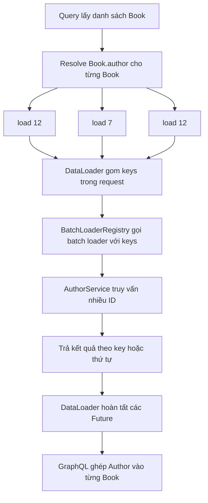

# Register batch loader

Trong GraphQL, nhiều field lồng nhau có thể cần cùng một loại dữ liệu. Ví dụ, một query lấy danh sách sách và yêu cầu tác giả của từng cuốn. Nếu mỗi field `Book.author` tự gọi repository để tìm một tác giả, server có thể phát sinh một truy vấn cho từng cuốn sách. DataLoader giải quyết tình huống này bằng cách gom các lần tải dữ liệu thành một batch.

Với Spring for GraphQL, `BatchLoaderRegistry` là nơi đăng ký batch loader. Spring tạo và quản lý DataLoader theo từng GraphQL request, đồng thời kết nối chúng với execution context. Resolver có thể yêu cầu dữ liệu bằng `DataLoader.load(key)`; các key được gom lại và chuyển cho batch loader đã đăng ký.

## 1. Vì sao cần đăng ký batch loader?

Giả sử schema có quan hệ giữa sách và tác giả:

```graphql
type Query {
    books: [Book!]!
}

type Book {
    id: ID!
    title: String!
    author: Author
}

type Author {
    id: ID!
    name: String!
}
```

Client gửi query:

```graphql
query {
    books {
        id
        title
        author {
            id
            name
        }
    }
}
```

Giả sử `books` trả về 30 cuốn sách. Nếu resolver của `Book.author` gọi `authorRepository.findById(book.authorId())` cho từng cuốn, server có thể thực hiện:

- Một truy vấn lấy danh sách 30 sách.
- 30 truy vấn riêng để lấy tác giả.

Đây là vấn đề N+1. Một HTTP request GraphQL vẫn có thể tạo ra nhiều truy vấn database.

DataLoader gom các key tác giả được yêu cầu trong cùng nhịp thực thi, sau đó gọi batch loader một lần với tập key đó. Server có thể lấy nhiều tác giả trong một truy vấn như `WHERE id IN (...)`.

## 2. BatchLoaderRegistry và vòng đời DataLoader

`BatchLoaderRegistry` thuộc package `org.springframework.graphql.execution`. Đây là abstraction của Spring for GraphQL để đăng ký batch loader và mapped batch loader.

Trong ứng dụng Spring Boot dùng `spring-boot-starter-graphql`, Spring Boot cung cấp registry mặc định. Có thể inject registry vào configuration hoặc component để đăng ký loader khi application context khởi tạo.

Điểm quan trọng về vòng đời:

- Định nghĩa batch loader được đăng ký ở cấp ứng dụng khi khởi tạo.
- DataLoader instance được tạo và gắn vào GraphQL request context cho từng request.
- Những lời gọi `load(key)` trong cùng request có thể được gom thành batch.
- Cache mặc định của DataLoader có phạm vi request, không phải cache dùng chung giữa tất cả người dùng.
- Khi request kết thúc, DataLoader của request đó không được tái sử dụng cho request tiếp theo.

Phạm vi theo request giúp tránh chia sẻ cache dữ liệu giữa các người dùng. Không nên tự tạo một DataLoader static hoặc giữ instance trong singleton service để dùng chung nhiều request.

## 3. Đăng ký batch loader theo cặp kiểu key và value

Giả sử `Book.authorId` có kiểu `Long` và object trả về là `Author`. Có thể đăng ký loader bằng `forTypePair`:

```java
package com.example.graphql.config;

import org.springframework.context.annotation.Configuration;
import org.springframework.graphql.execution.BatchLoaderRegistry;

@Configuration
public class GraphQlBatchLoaderConfiguration {

    public GraphQlBatchLoaderConfiguration(
            BatchLoaderRegistry registry,
            AuthorService authorService) {

        registry.forTypePair(Long.class, Author.class)
            .registerBatchLoader((authorIds, environment) ->
                authorService.findAllByIds(authorIds)
            );
    }
}
```

Ví dụ giả định `AuthorService.findAllByIds` nhận danh sách ID và trả về `CompletionStage<List<Author>>`. `registerBatchLoader` đăng ký một batch loader thông thường: đầu vào là các key cần tải, đầu ra là danh sách value tương ứng.

`forTypePair(Long.class, Author.class)` khai báo kiểu key và kiểu value để Spring for GraphQL xác định DataLoader tương ứng. Cách này phù hợp khi một cặp kiểu key/value đủ để nhận diện loader trong ứng dụng.

Trong dự án thực tế, service có thể dùng JDBC, JPA, một service khác hoặc nguồn dữ liệu bất kỳ. Điều quan trọng là batch service nhận nhiều ID trong một lần gọi và trả về kết quả theo đúng hợp đồng của loader.

## 4. Quy tắc thứ tự của batch loader thông thường

Với `registerBatchLoader`, danh sách kết quả phải tương ứng theo đúng thứ tự của danh sách key đầu vào. Đây là điều rất quan trọng vì DataLoader ghép value với key dựa trên vị trí.

Ví dụ keys nhận được là:

```text
[12, 7, 25]
```

Loader phải trả về danh sách theo cùng thứ tự:

```text
[Author(12), Author(7), Author(25)]
```

Không nên giả định truy vấn `WHERE id IN (...)` sẽ trả về các bản ghi theo thứ tự ID đầu vào. Nhiều database không bảo đảm thứ tự nếu câu truy vấn không có `ORDER BY`, và ngay cả `ORDER BY` cũng cần được thiết kế phù hợp với danh sách key.

Một cách xử lý an toàn là lấy dữ liệu thành map rồi dựng lại list theo thứ tự key:

```java
public CompletionStage<List<Author>> findAllByIds(List<Long> ids) {
    Map<Long, Author> authorsById = repository.findAllById(ids).stream()
        .collect(Collectors.toMap(AuthorEntity::getId, mapper::toDomain));

    List<Author> ordered = ids.stream()
        .map(authorsById::get)
        .toList();

    return CompletableFuture.completedFuture(ordered);
}
```

Đoạn code minh họa service đồng bộ được bọc trong `CompletionStage`; trong ứng dụng thực tế, không cần tạo future chỉ để giả vờ có I/O bất đồng bộ. Có thể thực hiện batch query đồng bộ trong transaction hoặc dùng API reactive/async phù hợp với stack đang chạy. Hãy xử lý rõ key không tìm thấy; danh sách kết quả vẫn phải có vị trí tương ứng với key đó, thường bằng `null` nếu hợp đồng field cho phép.

## 5. Dùng registerMappedBatchLoader khi kết quả là Map

Nếu service trả dữ liệu dưới dạng map key/value, `registerMappedBatchLoader` thường dễ dùng hơn vì không cần tự sắp xếp danh sách kết quả theo thứ tự key.

```java
@Configuration
public class GraphQlBatchLoaderConfiguration {

    public GraphQlBatchLoaderConfiguration(
            BatchLoaderRegistry registry,
            AuthorService authorService) {

        registry.forTypePair(Long.class, Author.class)
            .registerMappedBatchLoader((authorIds, environment) ->
                authorService.findMapByIds(authorIds)
            );
    }
}
```

Ví dụ giả định `findMapByIds` trả về `CompletionStage<Map<Long, Author>>`. Map dùng ID làm key, nên thứ tự các entry không quan trọng.

Ví dụ kết quả:

```java
Map<Long, Author> authorsById = Map.of(
    12L, author12,
    7L, author7,
    25L, author25
);
```

DataLoader tìm value theo key tương ứng. Nếu một key không xuất hiện trong map, kết quả cho key đó sẽ là `null`; field GraphQL tương ứng cần có nullability phù hợp hoặc xử lý lỗi theo quy tắc nghiệp vụ.

Hãy chọn:

- `registerBatchLoader` khi service tự trả danh sách và có thể bảo đảm thứ tự đúng với keys.
- `registerMappedBatchLoader` khi service trả map key/value và muốn ghép kết quả theo key.

Không nên chọn loader theo sở thích cú pháp; hãy xem kiểu kết quả tự nhiên của tầng truy cập dữ liệu và cách biểu diễn trường hợp thiếu bản ghi.

## 6. Inject DataLoader vào resolver

Sau khi đăng ký loader, resolver có thể nhận `DataLoader<K, V>` như một tham số. Ví dụ:

```java
package com.example.graphql.book;

import org.dataloader.DataLoader;
import org.springframework.graphql.data.method.annotation.SchemaMapping;
import org.springframework.stereotype.Controller;

import java.util.concurrent.CompletableFuture;

@Controller
public class BookFieldController {

    @SchemaMapping(typeName = "Book", field = "author")
    public CompletableFuture<Author> author(
            Book book,
            DataLoader<Long, Author> authorLoader) {

        return authorLoader.load(book.authorId());
    }
}
```

Method nhận `Book` là source object và `DataLoader<Long, Author>` là loader đã đăng ký theo cặp kiểu tương ứng. Lời gọi `load` trả về `CompletableFuture<Author>`; GraphQL runtime chờ kết quả bất đồng bộ để hoàn tất field.

Khi query lấy nhiều sách, resolver được gọi cho từng `Book`. Mỗi lần gọi chỉ gửi key vào DataLoader. DataLoader thu thập các key và dispatch batch loader theo cơ chế thực thi của GraphQL, nhờ đó nhiều lần `load` có thể được xử lý chung.

Resolver không cần tự gọi `dispatch()` trong trường hợp tích hợp Spring for GraphQL thông thường. Framework kết nối DataLoader với GraphQL execution và quản lý dispatch trong quá trình thực thi request.

## 7. Luồng hoạt động của một batch

Giả sử query trả về ba sách có `authorId` lần lượt là `12`, `7` và `12`:



Với cache mặc định, hai lần `load(12)` trong cùng request thường dùng chung kết quả đã tải, nên batch có thể chỉ cần hai key duy nhất: `12` và `7`. Cả ba field `Book.author` vẫn nhận đúng tác giả của mình.

Batching không có nghĩa tất cả key trong mọi query đều được gửi trong một lần gọi bất kể thời điểm. DataLoader gom các lần load trong cùng dispatch cycle; nếu resolver tạo thêm các lần load ở giai đoạn sau, có thể phát sinh batch tiếp theo.

## 8. Đăng ký nhiều batch loader

Một API có thể cần nhiều loại batch loader, ví dụ tác giả theo sách, đánh giá theo sách và quyền truy cập theo người dùng. Có thể đăng ký nhiều cặp kiểu:

```java
@Configuration
public class GraphQlBatchLoaderConfiguration {

    public GraphQlBatchLoaderConfiguration(
            BatchLoaderRegistry registry,
            AuthorService authorService,
            ReviewService reviewService) {

        registry.forTypePair(Long.class, Author.class)
            .registerBatchLoader((ids, environment) ->
                authorService.findAllByIds(ids));

        registry.forTypePair(Long.class, ReviewSummary.class)
            .registerMappedBatchLoader((bookIds, environment) ->
                reviewService.findSummaryByBookIds(bookIds));
    }
}
```

Trong ví dụ, loader thứ nhất nhận author ID và trả danh sách `Author`; loader thứ hai nhận book ID và trả map `bookId -> ReviewSummary`. Kiểu key/value giúp phân biệt các loader theo mục đích dữ liệu.

Nếu cùng một cặp key/value cần nhiều loader độc lập, hãy đặt tên loader tường minh bằng API naming của `RegistrationSpec` được cung cấp bởi phiên bản Spring for GraphQL đang dùng và chỉ định tên tương ứng khi inject. Không nên đăng ký nhiều loader trùng định danh mặc định rồi kỳ vọng Spring tự chọn đúng loader.

## 9. Khi nào nên dùng tên loader?

`forTypePair` là cách tiện lợi khi cặp kiểu key/value xác định duy nhất một loader. Trong một số thiết kế, cùng kiểu key/value có thể được dùng để tải hai góc nhìn khác nhau, ví dụ:

- `Long -> UserSummary` cho dữ liệu hồ sơ công khai.
- `Long -> UserPermissionView` cho dữ liệu quyền.

Nếu value type khác nhau, cặp kiểu đã đủ phân biệt. Nếu hai loader có cùng key và value type nhưng mục đích khác nhau, dùng tên loader riêng để tránh trùng đăng ký.

Khi dùng named loader, cần bảo đảm tên ở nơi đăng ký khớp với tên được dùng để phân giải DataLoader trong handler. Cú pháp API có thể thay đổi theo phiên bản Spring for GraphQL; kiểm tra Javadoc của `BatchLoaderRegistry.RegistrationSpec` trong version mà dự án quản lý.

## 10. Dữ liệu theo request, tenant và security context

Batch loader có thể cần thông tin ngoài key, ví dụ tenant hiện tại, locale hoặc principal để giới hạn dữ liệu. Spring for GraphQL cung cấp `BatchLoaderEnvironment` cho batch loader và tích hợp context propagation trong quá trình thực thi.

Không đưa `tenantId` hoặc user ID do client tự khai báo vào key rồi xem đó là bằng chứng phân quyền. Nguồn danh tính và tenant phải được xác thực từ security context hoặc context đáng tin cậy của server.

Ví dụ khái niệm:

```java
registry.forTypePair(Long.class, Author.class)
    .registerBatchLoader((authorIds, environment) ->
        authorService.findVisibleAuthors(authorIds, environment)
    );
```

`findVisibleAuthors` ở đây đại diện cho service biết cách đọc context và áp dụng phạm vi truy cập. API đọc context cụ thể phụ thuộc cách ứng dụng thiết lập GraphQL context và Spring Security; không nên giả định một giá trị context có sẵn nếu chưa cấu hình.

DataLoader cache thường có phạm vi một request, nhưng điều đó không thay thế authorization. Batch query vẫn phải giới hạn dữ liệu theo người dùng/tenant hiện tại, đặc biệt nếu một request có thể chứa nhiều field hoặc nhiều key thuộc các phạm vi khác nhau.

## 11. Cache và trường hợp dữ liệu không tồn tại

DataLoader thường có cache theo key trong phạm vi request để tránh tải lặp cùng một dữ liệu. Ví dụ `load(12)` được gọi nhiều lần trong cùng request có thể dùng chung kết quả đã tải.

Cache này có một số hệ quả:

- Nếu cùng key được tải lại sau khi mutation thay đổi dữ liệu trong cùng request, cần cân nhắc clear hoặc prime DataLoader tương ứng để tránh dùng giá trị cũ.
- Không dùng cache request-scoped thay cho cache ứng dụng hoặc cache phân tán.
- Không chia sẻ DataLoader instance giữa các request hoặc người dùng.
- Nếu key không duy nhất theo ngữ cảnh, phải đưa các thành phần cần thiết vào key hoặc xử lý context trong batch loader.

Khi resource không tồn tại, batch loader cần trả kết quả tương ứng theo hợp đồng. Với `registerBatchLoader`, vị trí của key thiếu vẫn cần được biểu diễn trong danh sách kết quả, thường là `null`. Với mapped loader, key có thể không xuất hiện trong map và DataLoader sẽ trả null cho lần load tương ứng.

Nếu field GraphQL được khai báo non-null nhưng loader trả null, GraphQL sẽ phát sinh execution error và lan truyền null theo quy tắc nullability. Hãy quyết định rõ field có thể thiếu hay cần trả lỗi not found.

## 12. Batch size và giới hạn truy vấn

Gom mọi key vào một câu lệnh `IN` không phải lúc nào cũng tốt. Một query có thể yêu cầu hàng chục nghìn key; database có giới hạn bind parameter, kích thước câu lệnh và tài nguyên thực thi.

Nên cân nhắc:

- Giới hạn số phần tử mỗi batch theo khả năng database/service.
- Chia batch lớn thành nhiều nhóm nếu tầng dữ liệu có giới hạn.
- Dùng phân trang ở query root để tránh tạo quá nhiều parent object.
- Chỉ tải field client cần, nhưng tránh thiết kế projection làm tăng số truy vấn.
- Đo thời gian batch, số key, số lần dispatch và số truy vấn backend.

DataLoader giảm số lần gọi data source khi có thể gom key, nhưng không tự tối ưu câu SQL hoặc API phía sau. Batch service vẫn cần truy vấn hiệu quả, có index phù hợp và trả về lượng dữ liệu vừa đủ.

## 13. Kiểm thử batch loader

Nên kiểm tra cả kết quả GraphQL và số lần batch service được gọi. Ví dụ test query lấy nhiều sách:

```java
import org.junit.jupiter.api.Test;
import org.springframework.beans.factory.annotation.Autowired;
import org.springframework.boot.test.autoconfigure.graphql.GraphQlTest;
import org.springframework.graphql.test.tester.GraphQlTester;

@GraphQlTest({BookQueryController.class, BookFieldController.class})
class BookBatchLoaderTest {

    @Autowired
    GraphQlTester graphQlTester;

    @Test
    void resolvesAuthorsForMultipleBooks() {
        graphQlTester.document("""
                query {
                    books {
                        id
                        author {
                            id
                            name
                        }
                    }
                }
                """)
            .execute()
            .path("books[0].author.name")
            .entity(String.class)
            .isEqualTo("Nguyen An");
    }
}
```

Ví dụ giả định test context cung cấp `BookService` và `AuthorService` mock/test bean với fixture tương ứng, đồng thời nạp cấu hình đăng ký batch loader (có thể dùng `@Import(GraphQlBatchLoaderConfiguration.class)` trong slice test). Có thể dùng Mockito `verify(authorService, times(1))` để xác nhận batch method được gọi một lần với tập ID mong đợi, thay vì gọi một lần cho mỗi sách. Cần viết assertion theo đúng số batch thực tế của query; không giả định mọi tình huống luôn chỉ có một batch nếu query có nhiều nhánh hoặc nhiều dispatch cycle.

Các tình huống nên kiểm tra:

- Nhiều parent object có key khác nhau.
- Nhiều parent dùng chung một key và cache hoạt động đúng.
- Một hoặc nhiều key không tìm thấy dữ liệu.
- Thứ tự kết quả của batch loader thông thường.
- Mapped loader trả map không có một số key.
- Lỗi từ service và cách GraphQL trả errors.
- Hai request độc lập không chia sẻ cache dữ liệu.
- Context/tenant/security giới hạn kết quả đúng.

`@GraphQlTest` kiểm tra GraphQL slice. Nếu cần xác minh SQL thực tế, transaction, index hoặc hiệu năng, bổ sung integration/performance test với data source phù hợp.

## 14. BatchLoaderRegistry và @BatchMapping khác nhau thế nào?

Spring for GraphQL có hai cách phổ biến để batch dữ liệu:

| Cách | Đặc điểm | Khi phù hợp |
| --- | --- | --- |
| `BatchLoaderRegistry` + `DataLoader` | Đăng ký loader theo key/value; resolver gọi `load(key)` | Cần tái sử dụng loader, nhiều resolver dùng chung, kiểm soát cache/context hoặc quy trình tải phức tạp |
| `@BatchMapping` | Khai báo trực tiếp method nhận nhiều source object và trả kết quả cho field | Field mapping đơn giản, muốn gom code resolver và batch logic trong một method |

Ví dụ `@BatchMapping`:

```java
@BatchMapping(typeName = "Book", field = "author")
public Map<Book, Author> author(List<Book> books) {
    return authorService.findAuthorsByBooks(books);
}
```

`@BatchMapping` là cách khai báo gọn cho một quan hệ field cụ thể. Khi cần DataLoader được gọi từ nhiều nơi hoặc cần loader theo key độc lập với source object, `BatchLoaderRegistry` linh hoạt hơn.

Hai cách đều nhằm giảm N+1; hãy chọn một cách rõ ràng cho từng field và tránh đăng ký hai cơ chế cùng resolve một field.

## 15. Lỗi thường gặp khi đăng ký batch loader

| Triệu chứng | Nguyên nhân có thể | Cách xử lý |
| --- | --- | --- |
| DataLoader không được tìm thấy | Chưa đăng ký loader hoặc cặp kiểu/tên không khớp | Kiểm tra `forTypePair`, tên loader và tham số handler |
| Kết quả bị ghép sai parent | Batch loader trả list sai thứ tự key | Sắp xếp lại theo thứ tự keys hoặc dùng mapped loader |
| Field trả null dù bản ghi tồn tại | Key Java khác kiểu hoặc map dùng key sai | Đồng bộ kiểu key và kiểm tra mapping ID |
| Vẫn có nhiều truy vấn backend | Resolver không dùng DataLoader hoặc dispatch chia thành nhiều batch | Kiểm tra nơi gọi `load` và đo số lần batch |
| Dữ liệu cũ sau mutation | DataLoader cache trong cùng request | Clear/prime key phù hợp sau thay đổi |
| Rò rỉ dữ liệu giữa tenant | Loader hoặc cache dùng chung ngoài phạm vi request | Giữ DataLoader request-scoped và áp dụng tenant filter |
| Batch query quá lớn | Không giới hạn key hoặc page size | Chia batch và giới hạn query |
| Key không tồn tại làm lỗi non-null | Schema cam kết non-null nhưng loader trả null | Điều chỉnh hợp đồng hoặc xử lý not found rõ ràng |

Khi debug, hãy kiểm tra theo thứ tự: loader đã được đăng ký chưa, resolver có nhận đúng DataLoader không, key có cùng kiểu không, batch method có được gọi không và kết quả có ghép đúng key không. Sau đó đo truy vấn database để xác nhận N+1 thực sự đã được loại bỏ.

## 16. Checklist đăng ký batch loader

- Đã chọn đúng cặp kiểu key/value cho loader?
- Loader được đăng ký một lần khi application context khởi tạo?
- Resolver gọi `DataLoader.load(key)` thay vì truy vấn riêng từng parent?
- Với list batch loader, kết quả có đúng thứ tự key đầu vào?
- Với mapped batch loader, map có dùng đúng key và xử lý key thiếu?
- DataLoader instance có phạm vi từng request?
- Cache không bị dùng chung giữa người dùng hoặc tenant?
- Batch service có giới hạn kích thước và truy vấn hiệu quả?
- Mutation có cập nhật/clear cache khi cần trong cùng request?
- Test xác minh response, số lần batch và trường hợp key không tồn tại?

`BatchLoaderRegistry` cho phép đăng ký cách tải dữ liệu theo lô, còn `DataLoader` cung cấp API `load(key)` cho resolver. Spring for GraphQL kết nối loader với từng request để các lần tải có thể được gom lại và cache trong phạm vi request. Khi chọn đúng kiểu loader, giữ đúng quan hệ key/value, kiểm soát thứ tự kết quả và bảo vệ context người dùng, ứng dụng có thể giảm N+1 mà vẫn giữ mapping GraphQL rõ ràng và an toàn.
