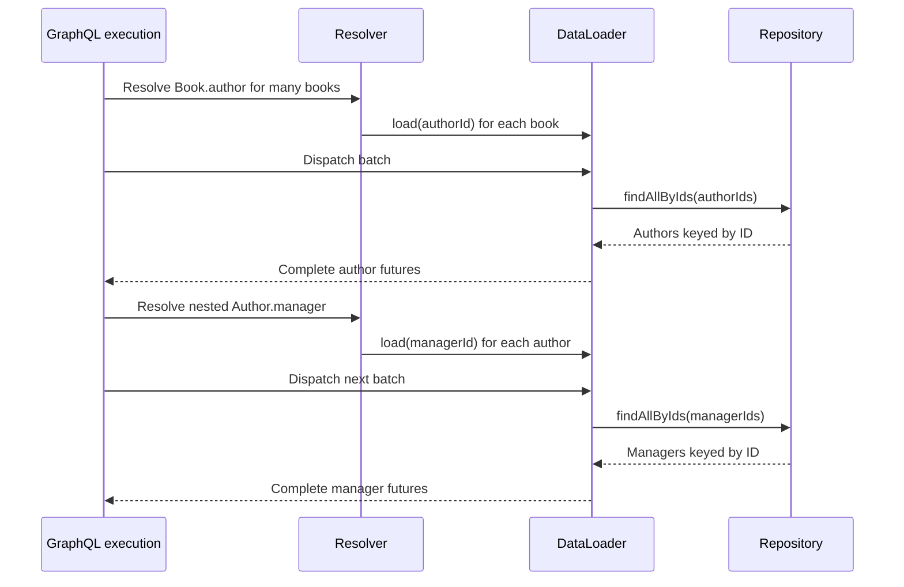

# DataLoaderRegistry

Trong GraphQL, một operation có thể trả về nhiều object và mỗi object lại cần tải dữ liệu liên quan. Nếu mỗi resolver tự truy vấn dữ liệu cho từng object, server dễ gặp vấn đề N+1. **DataLoaderRegistry** của GraphQL Java là nơi tập hợp các `DataLoader` theo tên để resolver có thể yêu cầu dữ liệu theo key, gom nhiều yêu cầu thành batch và dùng cache trong phạm vi một lần thực thi.

`DataLoaderRegistry` không phải nơi chứa dữ liệu nghiệp vụ và cũng không phải singleton dùng chung cho toàn ứng dụng. Nó chứa các DataLoader instance dành cho một GraphQL execution. Trong Spring for GraphQL, `BatchLoaderRegistry` là abstraction cấp Spring để đăng ký cách tạo các loader; Spring tạo và gắn DataLoaderRegistry phù hợp vào từng request. Hiểu ranh giới giữa hai registry này giúp tránh tự quản lý sai vòng đời loader.

## 1. Vấn đề N+1 và vai trò của DataLoader

Giả sử schema cho phép lấy danh sách sách cùng tác giả:

```graphql
type Query {
    books: [Book!]!
}

type Book {
    id: ID!
    title: String!
    author: Author
}

type Author {
    id: ID!
    name: String!
}
```

Nếu query lấy 30 quyển sách và field `Book.author` gọi repository một lần cho mỗi sách, server có thể chạy một truy vấn lấy danh sách sách rồi thêm 30 truy vấn lấy tác giả. Tổng số truy vấn tăng theo số lượng sách.

DataLoader thay đổi cách resolver yêu cầu dữ liệu. Mỗi resolver gọi `load(key)` thay vì truy vấn ngay. DataLoader thu thập các key trong cùng execution, sau đó gọi batch loader một lần cho một nhóm key. Kết quả được phân phối lại cho từng resolver đã yêu cầu key tương ứng.

```mermaid
flowchart TD
    A[Query lấy danh sách Book] --> B[Book 1, Book 2, ..., Book N]
    B --> C[Resolver Book.author gọi load(authorId)]
    C --> D[DataLoaderRegistry chứa authorLoader]
    D --> E[Gom các authorId thành một batch]
    E --> F[Batch loader truy vấn nhiều Author]
    F --> G[Phân phối kết quả theo từng key]
    G --> H[GraphQL hoàn thiện response]
```

DataLoader không tự biết cách truy vấn database. Ứng dụng cung cấp batch loader để nhận nhiều key và trả dữ liệu tương ứng. DataLoader đảm nhiệm việc gom request, phối hợp kết quả và cache theo cấu hình.

## 2. DataLoaderRegistry là gì?

Trong GraphQL Java, `DataLoaderRegistry` là một registry chứa nhiều `DataLoader` được đăng ký bằng tên. Resolver lấy loader theo tên từ `DataFetchingEnvironment`, sau đó gọi `load(key)` để nhận một `CompletionStage` hoặc `CompletableFuture` cho kết quả.

Ví dụ một registry có hai loader:

| Tên loader | Key | Giá trị |
| --- | --- | --- |
| `authorLoader` | `String` author ID | `Author` |
| `reviewCountLoader` | `String` book ID | `Integer` số lượng review |

Hai loader phục vụ hai loại dữ liệu khác nhau nhưng cùng thuộc một DataLoaderRegistry của execution hiện tại. Resolver không cần biết loader được tạo từ database, HTTP client hay cache; nó chỉ cần biết tên và kiểu key/value đã thống nhất.

DataLoaderRegistry cung cấp các thao tác chính:

- `register(name, dataLoader)`: đăng ký loader theo tên.
- `getDataLoader(name)`: lấy loader đã đăng ký.
- `containsKey(name)`: kiểm tra tên loader có trong registry.
- `unregister(name)`: bỏ loader theo tên.
- `dispatchAll()`: yêu cầu dispatch các loader đang chờ trong registry khi tự quản lý vòng dispatch ở mức thấp.

Tên loader là một phần của hợp đồng nội bộ giữa nơi đăng ký và resolver. Nếu tên không khớp, `getDataLoader` không lấy được loader mong muốn. Nên dùng hằng số hoặc một quy ước đặt tên tập trung khi có nhiều loader.

## 3. Vòng đời của DataLoaderRegistry

DataLoaderRegistry cần được tạo cho mỗi GraphQL execution/request để cache không bị chia sẻ ngoài phạm vi mong muốn. Khi request kết thúc, registry và các loader của nó không còn được tái sử dụng cho request tiếp theo.

Không đăng ký DataLoader trong static field hoặc singleton Spring rồi chia sẻ cùng instance cho mọi request. Nếu làm vậy, cache có thể chứa dữ liệu của người dùng trước và trả nhầm cho request sau; loader cũng có thể giữ dữ liệu cũ sau khi entity thay đổi.

Luồng vòng đời thông thường:

1. GraphQL request đến server.
2. Spring for GraphQL hoặc lớp tích hợp tạo DataLoaderRegistry cho execution.
3. Các DataLoader được đăng ký vào registry.
4. Resolver lấy loader và gọi `load(key)`.
5. GraphQL Java phối hợp dispatch các batch trong quá trình thực thi.
6. Kết quả được trả về response; registry kết thúc cùng execution.

Với subscription có vòng đời dài và nhiều event, cần hiểu rõ phạm vi execution cho từng event và tránh giữ cache request quá lâu. Không nên mặc định một loader có cache phù hợp để dùng xuyên suốt một kết nối subscription lâu dài nếu dữ liệu có thể thay đổi.

## 4. Tạo DataLoader và đăng ký thủ công trong GraphQL Java

GraphQL Java DataLoader hỗ trợ các loại batch loader khác nhau. `BatchLoader<K, V>` nhận danh sách key và trả về danh sách value theo cùng thứ tự. Ví dụ:

```java
BatchLoader<String, Author> authorBatchLoader = authorIds ->
    authorRepository.findAllByIdsAsync(authorIds);

DataLoader<String, Author> authorLoader =
    DataLoaderFactory.newDataLoader(authorBatchLoader);

DataLoaderRegistry registry = new DataLoaderRegistry();
registry.register("authorLoader", authorLoader);
```

Khi dùng `BatchLoader`, thứ tự phần tử trong danh sách kết quả phải tương ứng với thứ tự key đầu vào. Nếu database trả kết quả theo thứ tự khác, cần lập Map theo ID rồi tạo lại list theo danh sách key:

```java
BatchLoader<String, Author> authorBatchLoader = authorIds ->
    authorRepository.findAllByIdsAsync(authorIds)
        .thenApply(authors -> {
            Map<String, Author> byId = authors.stream()
                .collect(Collectors.toMap(Author::id, Function.identity()));

            return authorIds.stream()
                .map(byId::get)
                .toList();
        });
```

Trong các ví dụ này, `findAllByIdsAsync` trả về `CompletionStage<List<Author>>`; batch loader không chặn thread để đợi repository. Nếu repository chỉ có API blocking, hãy cô lập nó trên executor có giới hạn phù hợp thay vì mặc định chạy I/O blocking trên common pool. Nếu một key không có dữ liệu, list kết quả vẫn phải giữ đúng số lượng và vị trí tương ứng; giá trị tại vị trí đó có thể là `null` nếu kiểu GraphQL cho phép.

### Dùng MappedBatchLoader

Khi repository trả về dữ liệu không theo thứ tự key, `MappedBatchLoader<K, V>` thường tiện hơn. Batch loader nhận tập key và trả về Map từ key sang value:

```java
MappedBatchLoader<String, Author> authorBatchLoader = authorIds ->
    authorRepository.findAllByIdsAsync(authorIds)
        .thenApply(authors -> authors.stream()
            .collect(Collectors.toMap(Author::id, Function.identity())));

DataLoader<String, Author> authorLoader =
    DataLoaderFactory.newMappedDataLoader(authorBatchLoader);

DataLoaderRegistry registry = new DataLoaderRegistry()
    .register("authorLoader", authorLoader);
```

Map cho phép bỏ qua key không tìm thấy; DataLoader sẽ không có value cho key đó và resolver nhận kết quả rỗng/null theo API của loader. Hãy xác định rõ cách biểu diễn trường hợp không tồn tại trong schema, đặc biệt với field non-null.

### Gắn registry vào GraphQL execution

Khi tự cấu hình GraphQL Java, truyền registry vào `ExecutionInput`:

```java
ExecutionInput input = ExecutionInput.newExecutionInput()
    .query("{ books { id title author { name } } }")
    .dataLoaderRegistry(registry)
    .build();
```

GraphQL Java cần cơ chế dispatch để các lệnh `load` được gom và batch loader được gọi đúng thời điểm. Khi tự xây dựng engine, cấu hình `DataLoaderDispatcherInstrumentation` theo phiên bản GraphQL Java đang dùng:

```java
GraphQL graphQL = GraphQL.newGraphQL(schema)
    .instrumentation(new DataLoaderDispatcherInstrumentation())
    .build();
```

Instrumentation phối hợp dispatch trong các giai đoạn thực thi, bao gồm các vòng tiếp theo khi resolver con phát sinh thêm yêu cầu DataLoader. Không nên gọi `dispatch()` thủ công trong từng resolver; làm vậy có thể phá vỡ cơ chế gom batch và khiến mỗi field lại dispatch riêng.

Đoạn cấu hình trên dành cho ứng dụng dùng GraphQL Java trực tiếp. Với Spring for GraphQL, nên dùng `BatchLoaderRegistry` và cơ chế tích hợp sẵn thay vì tự tạo một `GraphQL` engine hoặc registry singleton.

## 5. Lấy DataLoader trong resolver

Sau khi đăng ký loader với tên `authorLoader`, resolver có thể lấy nó từ `DataFetchingEnvironment`:

```java
@SchemaMapping(typeName = "Book", field = "author")
public CompletableFuture<Author> author(
        Book book,
        DataFetchingEnvironment environment) {

    DataLoader<String, Author> loader =
        environment.getDataLoader("authorLoader");

    return loader.load(book.authorId());
}
```

`load` không thực hiện truy vấn ngay theo kiểu đồng bộ. Nó ghi nhận key và trả future cho kết quả. GraphQL Java phối hợp dispatch sau khi thu thập các yêu cầu phù hợp. Resolver trả future cho engine thay vì gọi `join()` hoặc `get()` để chặn luồng.

Một operation có thể phân giải nhiều `Book.author`. Mỗi resolver gọi `load(authorId)`; nếu nhiều sách có cùng author ID, DataLoader có thể dùng cache để chia sẻ cùng kết quả trong request. Với các ID khác nhau, chúng có thể được gom vào cùng batch.

## 6. DataLoaderOptions và cache

DataLoader có các tùy chọn để kiểm soát batching và cache. Ví dụ:

```java
DataLoaderOptions options = DataLoaderOptions.newOptions()
    .setCachingEnabled(true)
    .setMaxBatchSize(100);

DataLoader<String, Author> authorLoader =
    DataLoaderFactory.newMappedDataLoader(authorBatchLoader, options);
```

Các tùy chọn thường quan tâm:

| Tùy chọn | Ý nghĩa |
| --- | --- |
| Caching enabled | Cache kết quả theo key trong vòng đời loader; mặc định thường bật |
| Max batch size | Giới hạn số key trong một batch, hữu ích khi database có giới hạn tham số hoặc query size |
| Caching key function | Chuẩn hóa key cache khi kiểu key cần quy tắc so sánh riêng |
| Cache map | Thay cấu trúc cache mặc định khi cần chính sách riêng |
| Batch loader context | Truyền context cần thiết đến batch loader |

Cache của DataLoader thường là memoization theo key trong phạm vi loader. Nó không phải cache phân tán và không tự đồng bộ giữa các request. Khi request kết thúc, cache của loader cũng kết thúc.

Nếu tắt cache, cùng một key có thể được yêu cầu nhiều lần trong một execution và xuất hiện lặp trong batch tùy cấu hình. Chỉ tắt caching khi có lý do rõ ràng và batch loader xử lý được các key trùng. Trong đa số trường hợp đọc dữ liệu, cache theo request giúp tránh tải cùng một object nhiều lần.

### Xóa và nạp trước cache

DataLoader cung cấp các thao tác như `clear(key)`, `clearAll()` và `prime(key, value)` để quản lý cache trong execution hiện tại.

Ví dụ, sau khi mutation cập nhật tác giả, loader có thể xóa key cũ rồi nạp trước giá trị mới:

```java
DataLoader<String, Author> loader = environment.getDataLoader("authorLoader");
loader.clear(updatedAuthor.id());
loader.prime(updatedAuthor.id(), updatedAuthor);
```

`prime` thường không ghi đè một key đã có trong cache; vì vậy xóa trước rồi prime giúp kết quả mới thay thế giá trị cũ trong request hiện tại. Việc này không cập nhật cache bên ngoài hoặc request khác. Nếu ứng dụng có cache cấp service, cache đó vẫn cần được invalidation theo chính sách riêng.

## 7. BatchLoaderRegistry trong Spring for GraphQL

Spring for GraphQL cung cấp `BatchLoaderRegistry` để đăng ký batch loader theo kiểu key/value. Spring dùng registry này để tạo DataLoader cho mỗi GraphQL request và đưa chúng vào DataLoaderRegistry của GraphQL Java. Cách này giúp ứng dụng không phải tự tạo `ExecutionInput` hoặc quản lý dispatch instrumentation ở tầng controller.

Ví dụ đăng ký mapped batch loader:

```java
@Configuration
public class DataLoaderConfiguration {

    public DataLoaderConfiguration(
            BatchLoaderRegistry registry,
            AuthorService authorService) {

        registry.forTypePair(String.class, Author.class)
            .registerMappedBatchLoader((authorIds, environment) ->
                authorService.findAllByIds(authorIds));
    }
}
```

`forTypePair(String.class, Author.class)` xác định key/value type cho loader. `registerMappedBatchLoader` đăng ký hàm nhận tập author ID và trả Map từ ID sang `Author`. Spring đăng ký loader cho request và hỗ trợ truyền context của GraphQL execution vào batch loader.

Trong controller, có thể nhận DataLoader như một tham số được Spring phân giải theo kiểu key/value:

```java
@Controller
public class BookController {

    @SchemaMapping(typeName = "Book", field = "author")
    public CompletableFuture<Author> author(
            Book book,
            DataLoader<String, Author> authorLoader) {
        return authorLoader.load(book.authorId());
    }
}
```

Spring for GraphQL hỗ trợ phân giải tham số `DataLoader` trong annotated controller dựa trên generic key/value type. Điều này giúp resolver không cần tự gọi `environment.getDataLoader(name)` khi dùng cơ chế đăng ký theo type pair.

`BatchLoaderRegistry` và `DataLoaderRegistry` có vai trò khác nhau:

| Thành phần | Vai trò |
| --- | --- |
| `BatchLoaderRegistry` | Đăng ký định nghĩa batch loader trong cấu hình Spring; dùng để tạo loader theo request |
| `DataLoaderRegistry` | Chứa các DataLoader instance thực tế được gắn vào một GraphQL execution |
| `DataLoader` | Nhận key, gom yêu cầu, cache và trả future cho value |
| `BatchLoader` / `MappedBatchLoader` | Thực hiện tải dữ liệu theo nhóm key |

Không tạo `DataLoaderRegistry` singleton để thay thế `BatchLoaderRegistry`. Spring quản lý registry runtime theo vòng đời request; ứng dụng chỉ đăng ký cách tải dữ liệu.

## 8. Dùng @BatchMapping hay DataLoaderRegistry?

Với resolver field lồng nhau đơn giản, `@BatchMapping` thường là cách ngắn gọn nhất:

```java
@Controller
public class BookController {

    private final AuthorService authorService;

    public BookController(AuthorService authorService) {
        this.authorService = authorService;
    }

    @BatchMapping(typeName = "Book", field = "author")
    public Map<Book, Author> authors(List<Book> books) {
        Set<String> ids = books.stream()
            .map(Book::authorId)
            .collect(Collectors.toSet());
        Map<String, Author> byId = authorService.findAllByIds(ids);

        Map<Book, Author> result = new HashMap<>();
        for (Book book : books) {
            result.put(book, byId.get(book.authorId()));
        }
        return result;
    }
}
```

`@BatchMapping` tự đăng ký batch loader và kết nối nó với field tương ứng. Dùng `BatchLoaderRegistry` khi muốn tái sử dụng loader theo key/value type ở nhiều resolver hoặc cần kiểm soát loader rõ hơn. Dùng trực tiếp `DataLoaderRegistry` khi tích hợp GraphQL Java ở mức thấp hoặc khi tự quản lý `ExecutionInput`.

Không cần vừa tạo `@BatchMapping` vừa đăng ký một DataLoader khác cho cùng field nếu không có thiết kế cụ thể. Hai cơ chế cùng ánh xạ một field có thể tạo xung đột hoặc khiến nhóm phát triển khó hiểu resolver nào đang thực thi.

## 9. Batch dispatch diễn ra theo nhiều vòng

DataLoader thường dispatch theo các vòng trong GraphQL execution. Ví dụ query lấy sách, tác giả của sách và người quản lý của tác giả:

```graphql
type Query {
    books: [Book!]!
}

type Book {
    id: ID!
    author: Author
}

type Author {
    id: ID!
    manager: Author
}
```

Vòng đầu, GraphQL gọi resolver `Book.author` cho các sách; các resolver gọi `authorLoader.load(...)`. Khi đến điểm dispatch, các author ID được gom và tải theo batch. Sau khi có `Author`, GraphQL tiếp tục phân giải field `Author.manager`; các resolver gọi `authorLoader.load(managerId)`, tạo batch tiếp theo. Vì vậy, một operation có thể có nhiều dispatch round tùy cấu trúc selection set.



Đừng gọi `dispatch()` ngay sau từng `load()` trong resolver. Nếu mỗi resolver tự dispatch, các key không còn cơ hội được gom chung. Để GraphQL Java instrumentation hoặc cơ chế tích hợp Spring điều phối dispatch.

## 10. Context và bảo mật trong batch loader

Batch loader đôi khi cần tenant ID, user identity hoặc thông tin request để lọc dữ liệu. Spring for GraphQL hỗ trợ truyền context vào batch loader thông qua `BatchLoaderEnvironment` và cơ chế context của `BatchLoaderRegistry`.

Không dùng dữ liệu do client tự khai báo như `tenantId` để quyết định quyền truy cập nếu chưa xác thực. Lấy scope từ security context đã được xác minh, sau đó truyền giá trị cần thiết đến batch loader. Nếu loader trả dữ liệu theo tenant, batch query phải áp dụng tenant filter cho toàn bộ key.

DataLoader cache theo key trong registry. Nếu cùng một ID có thể trả dữ liệu khác nhau theo tenant hoặc principal, chỉ dùng ID làm key có thể không đủ trong một execution có nhiều security scope. Hãy bảo đảm execution có một security scope nhất quán, hoặc thiết kế key chứa đầy đủ ngữ cảnh cần thiết và không chia sẻ loader giữa các scope khác nhau.

Với Spring Security và async batch loader, cần bảo đảm context được truyền đúng đến thời điểm batch dispatch. Không giả định `ThreadLocal` tự động có mặt trên thread thực thi batch. Khi cần, dùng cơ chế context propagation của Spring và truyền tường minh tenant/principal đã xác thực.

## 11. Xử lý lỗi và dữ liệu không tìm thấy

Batch loader có thể gặp lỗi khi truy vấn database hoặc dịch vụ ngoài. Nếu một batch loader hoàn tất bất thường, các load liên quan trong batch đó có thể cùng thất bại. Cần xác định cách phân loại lỗi và để cơ chế GraphQL error handling chuyển lỗi phù hợp cho client.

Trường hợp một số key không có dữ liệu cần được phân biệt với lỗi toàn batch. Với `MappedBatchLoader`, Map có thể không chứa key không tìm thấy; DataLoader sẽ hoàn tất load tương ứng mà không có value. Với `BatchLoader`, phải trả list có vị trí tương ứng từng key, dùng `null` cho key không có dữ liệu nếu contract cho phép.

Ví dụ, `Book.author: Author` có thể nullable nên không tìm thấy tác giả có thể trả `null`. Nếu schema khai báo `author: Author!`, giá trị null vi phạm contract và GraphQL sẽ áp dụng null propagation. Chọn nullability theo khả năng thực tế của dữ liệu.

Không nên bắt mọi exception rồi trả Map rỗng, vì điều đó làm lỗi hệ thống trông giống như tất cả key đều không tồn tại. Chỉ trả thiếu key khi đó là kết quả nghiệp vụ hợp lệ; lỗi truy vấn cần được truyền như lỗi.

## 12. Cache invalidation sau mutation

DataLoader cache giúp tránh tải cùng key nhiều lần trong một request, nhưng có thể khiến resolver đọc lại giá trị cũ sau khi mutation thay đổi dữ liệu trong cùng operation hoặc cùng execution context.

Ví dụ một operation mutation cập nhật tác giả rồi tiếp tục yêu cầu tác giả đó. Nếu loader đã cache giá trị cũ, cần xóa key hoặc prime giá trị mới:

```java
@MutationMapping
public Author updateAuthor(
        @Argument("input") UpdateAuthorInput input,
        DataLoader<String, Author> authorLoader) {

    Author updated = authorService.update(input);
    authorLoader.clear(updated.id());
    authorLoader.prime(updated.id(), updated);
    return updated;
}
```

Đây là cache của DataLoader hiện tại. Nếu mutation cập nhật dữ liệu mà request khác có cache riêng, thao tác clear trong request này không ảnh hưởng request kia. Cache phân tán hoặc cache service cần được invalidation độc lập.

## 13. Kiểm thử DataLoaderRegistry và batching

Kiểm thử cần chứng minh cả kết quả GraphQL lẫn việc batch loader thực sự giảm số lần truy vấn. Chỉ kiểm tra response đúng chưa chứng minh DataLoader đã gom key.

Với `GraphQlTester`, gửi query lấy nhiều sách và tác giả:

```java
graphQlTester.document("""
        query {
            books {
                id
                title
                author {
                    id
                    name
                }
            }
        }
        """)
    .execute()
    .path("books")
    .entityList(BookView.class)
    .hasSize(3);
```

Mock hoặc spy batch service/repository để xác nhận:

- Nhiều author ID được gửi trong một batch thay vì một lần cho mỗi sách.
- Các sách cùng author ID có thể dùng chung kết quả trong request.
- Key không tồn tại được xử lý theo nullability của schema.
- Hai GraphQL request riêng biệt không dùng chung cache của DataLoader.
- Mutation clear/prime cache cho kết quả mới trong execution hiện tại.
- Batch loader lỗi tạo GraphQL error phù hợp, không bị biến thành dữ liệu rỗng ngoài ý muốn.

Nếu dùng GraphQL Java trực tiếp, có thể kiểm thử riêng việc đăng ký tên loader và gắn registry vào `ExecutionInput`. Với Spring for GraphQL, nên có kiểm thử tích hợp application context để xác nhận `BatchLoaderRegistry` được phát hiện và DataLoader được inject vào controller đúng kiểu generic.

## 14. Lỗi thường gặp

| Triệu chứng | Nguyên nhân | Cách xử lý |
| --- | --- | --- |
| `getDataLoader` trả null | Tên loader không khớp hoặc registry chưa đăng ký | Thống nhất tên và kiểm tra cấu hình registry |
| Batch vẫn chạy một truy vấn cho mỗi object | Gọi repository trực tiếp trong resolver hoặc dispatch quá sớm | Gọi `load(key)` và để execution điều phối batch |
| Kết quả bị gán nhầm key | BatchLoader trả list sai thứ tự | Trả đúng thứ tự key hoặc dùng MappedBatchLoader |
| Dữ liệu cũ trong cùng request | DataLoader cache giữ giá trị đã tải trước mutation | Dùng `clear(key)` và `prime(key, value)` phù hợp |
| Dữ liệu người dùng khác bị lộ | Chia sẻ loader/cache giữa request hoặc thiếu tenant scope | Tạo registry theo request và áp dụng security scope |
| Batch lỗi làm nhiều field lỗi | Batch loader hoàn tất bất thường | Phân loại lỗi, log và ánh xạ GraphQL error rõ ràng |
| Missing key bị xem là lỗi hệ thống | Không phân biệt không tồn tại với batch failure | Dùng mapped result/nullable field theo contract |
| Loader không dispatch | Thiếu dispatcher instrumentation khi tự dùng GraphQL Java | Cấu hình `DataLoaderDispatcherInstrumentation` hoặc dùng tích hợp Spring |
| Resolver block chờ loader | Gọi `join()` hoặc `get()` | Trả future từ `load(key)` trực tiếp |

## 15. Nguyên tắc thiết kế DataLoaderRegistry

Tạo DataLoaderRegistry theo từng GraphQL execution, đặt tên loader rõ ràng và thống nhất kiểu key/value giữa batch loader với resolver. Dùng `MappedBatchLoader` khi dữ liệu được trả về theo key và thứ tự repository không bảo đảm; dùng `BatchLoader` khi có thể giữ đúng thứ tự đầu vào. Cấu hình max batch size theo giới hạn database và cache theo phạm vi request.

Trong Spring for GraphQL, ưu tiên `BatchLoaderRegistry` để đăng ký loader và để framework tạo DataLoaderRegistry theo request. Dùng `@BatchMapping` cho quan hệ field đơn giản; dùng DataLoader được đăng ký khi cần tái sử dụng hoặc kiểm soát loader chi tiết; chỉ tự quản lý `DataLoaderRegistry` và instrumentation khi tích hợp GraphQL Java ở mức thấp.

Không chặn bằng `join()` trong resolver, không dispatch thủ công sau từng lần load và không chia sẻ cache giữa người dùng. Kiểm thử số lần gọi batch, thứ tự key/value, lỗi, cache invalidation và tenant isolation. Khi được quản lý đúng vòng đời, DataLoaderRegistry là nền tảng để GraphQL gom truy vấn, giảm N+1 và giữ resolver độc lập với cách tải dữ liệu bên dưới.
