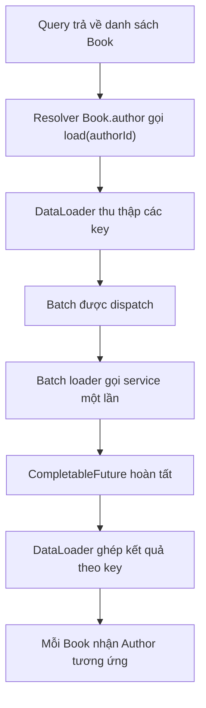

# Batch loader trả về `CompletableFuture`

Trong GraphQL, một field lồng nhau có thể được resolve cho nhiều object cha trong cùng một operation. Nếu mỗi lần resolve đều gọi database riêng, ứng dụng dễ gặp vấn đề N+1. **DataLoader** gom các key được yêu cầu trong cùng một đợt và gọi batch loader để tải dữ liệu theo nhóm.

Với GraphQL Java, batch loader có thể trả về `CompletionStage`, thường được triển khai bằng `CompletableFuture`. Cách này cho phép truy vấn batch chạy bất đồng bộ: resolver gọi `DataLoader.load(key)` và trả về future cho GraphQL; khi batch hoàn tất, mỗi field nhận giá trị tương ứng với key của nó.

Trong Spring for GraphQL, nên đăng ký loader qua `BatchLoaderRegistry` để Spring quản lý DataLoader theo từng GraphQL request. Nếu service hiện có API trả `CompletableFuture`, có thể dùng `Mono.fromFuture` để nối API đó với reactive publisher mà registry của Spring nhận.

## Vấn đề N+1 trước khi dùng DataLoader

Giả sử API trả danh sách sách và mỗi sách có một tác giả:

```graphql
type Query {
  books: [Book!]!
}

type Book {
  id: ID!
  title: String!
  author: Author
}

type Author {
  id: ID!
  name: String!
}
```

Client gửi operation:

```graphql
query BooksWithAuthors {
  books {
    id
    title
    author {
      id
      name
    }
  }
}
```

Giả sử `Query.books` tải 100 sách bằng một truy vấn. Sau đó resolver `Book.author` được gọi cho từng sách và mỗi lần lại truy vấn tác giả theo `authorId`. Số lần truy vấn có thể là:

- 1 truy vấn lấy danh sách sách.
- 100 truy vấn lấy tác giả cho 100 sách.

Tổng cộng 101 truy vấn cho một operation. Nếu nhiều sách cùng tham chiếu một tác giả, hệ thống còn có thể tải lặp cùng một bản ghi.

DataLoader thay các lần tải riêng lẻ bằng lời gọi `load(authorId)`. Những key được yêu cầu gần nhau trong quá trình thực thi được gom thành một batch, rồi batch loader truy vấn nhiều tác giả cùng lúc.

## Luồng hoạt động của DataLoader



Quy trình thường diễn ra như sau:

1. Resolver của `Query.books` trả về danh sách `Book`.
2. GraphQL thực thi field `Book.author` trên từng phần tử.
3. Mỗi resolver gọi `authorLoader.load(book.getAuthorId())`; lời gọi trả về ngay một `CompletableFuture<Author>`.
4. DataLoader thu thập các key và dispatch batch theo cơ chế thực thi của GraphQL Java.
5. Batch loader gọi service để tải nhiều tác giả và trả về `CompletableFuture` chứa kết quả.
6. DataLoader phân phối giá trị cho future tương ứng với từng key.
7. GraphQL tiếp tục hoàn thành response theo selection set.

Resolver không cần tự gom danh sách key hoặc tự dispatch trong trường hợp tích hợp GraphQL thông thường. GraphQL Java phối hợp dispatch DataLoader trong quá trình thực thi operation.

## `BatchLoader` của GraphQL Java trả về CompletionStage

GraphQL Java DataLoader cung cấp interface `BatchLoader<K, V>`. Phương thức `load` nhận danh sách key và trả về `CompletionStage<List<V>>`. Một `CompletableFuture<List<V>>` đáp ứng hợp đồng này vì `CompletableFuture` triển khai `CompletionStage`.

Ví dụ service trả về kết quả bất đồng bộ:

```java
public interface AuthorService {
    CompletableFuture<List<Author>> findAllByIds(List<Long> authorIds);
}
```

Đăng ký một `BatchLoader` trực tiếp bằng GraphQL Java:

```java
import org.dataloader.BatchLoader;
import org.dataloader.DataLoader;
import org.dataloader.DataLoaderFactory;

BatchLoader<Long, Author> batchLoader = authorIds ->
        authorService.findAllByIds(authorIds);

DataLoader<Long, Author> authorLoader =
        DataLoaderFactory.newDataLoader(batchLoader);
```

Ở đây:

- `Long` là kiểu key, tương ứng với `Book.authorId`.
- `Author` là kiểu giá trị mà mỗi key cần tải.
- `BatchLoader` nhận danh sách key trong một batch.
- `CompletableFuture<List<Author>>` cho biết kết quả sẽ hoàn tất bất đồng bộ.

Đây là cách dùng trực tiếp API GraphQL Java. Trong ứng dụng Spring for GraphQL, thường nên đăng ký qua `BatchLoaderRegistry` để DataLoader được tạo và gắn với registry của từng request. Phần tiếp theo trình bày cách tích hợp đó.

## Quy tắc quan trọng: kết quả phải đúng thứ tự key

Với `BatchLoader<K, V>` trả về `List<V>`, thứ tự phần tử trong list phải tương ứng chính xác với thứ tự key đầu vào. DataLoader ghép kết quả theo vị trí, không tự suy ra quan hệ từ ID trong object.

Giả sử batch nhận key:

```text
[12, 5, 20]
```

Thì list kết quả phải có thứ tự:

```text
[Author(id=12), Author(id=5), Author(id=20)]
```

Nếu database trả kết quả theo thứ tự `[5, 12, 20]` mà service chuyển nguyên list đó về, DataLoader có thể gán nhầm tác giả cho sách. Không nên dựa vào thứ tự tự nhiên của câu truy vấn `WHERE id IN (...)`; database không bảo đảm thứ tự nếu không có `ORDER BY`, và `ORDER BY` theo ID cũng chưa chắc trùng thứ tự key ban đầu.

Có thể tái sắp xếp kết quả theo danh sách key:

```java
BatchLoader<Long, Author> batchLoader = authorIds ->
        authorService.findAllByIds(authorIds).thenApply(authors -> {
            Map<Long, Author> byId = authors.stream()
                    .collect(Collectors.toMap(Author::getId, Function.identity()));

            return authorIds.stream()
                    .map(byId::get)
                    .collect(Collectors.toList());
        });
```

Ví dụ này giữ đúng thứ tự key. Nếu một ID không tồn tại, `byId.get(id)` trả `null`; điều đó chỉ phù hợp khi field GraphQL có thể nullable và ứng dụng muốn biểu diễn trường hợp không tìm thấy bằng null. Nếu schema khai báo `author: Author!`, cần xử lý not-found theo hợp đồng, tránh trả null ngoài ý muốn.

## Dùng `MappedBatchLoader` khi service trả về Map

Nhiều service hoặc repository trả kết quả dưới dạng `Map<ID, Entity>`. Trong trường hợp đó, `MappedBatchLoader<K, V>` thường tiện hơn vì loader trả `CompletionStage<Map<K, V>>`; DataLoader ghép kết quả dựa trên key thay vì vị trí trong list.

```java
import org.dataloader.MappedBatchLoader;

MappedBatchLoader<Long, Author> mappedBatchLoader = authorIds ->
        authorService.findAllByIdsAsMap(authorIds);
```

Service có hợp đồng:

```java
public interface AuthorService {
    CompletableFuture<Map<Long, Author>> findAllByIdsAsMap(Set<Long> authorIds);
}
```

Với mapped loader, không cần sắp xếp list theo thứ tự key. Mỗi giá trị được tìm theo key tương ứng trong map. Key không xuất hiện trong map được xem là không có kết quả và thường trở thành null cho key đó.

| Loại loader | Đầu vào | Kết quả bất đồng bộ | Yêu cầu ghép kết quả |
| --- | --- | --- | --- |
| `BatchLoader<K, V>` | `List<K>` | `CompletionStage<List<V>>` | List phải cùng thứ tự với list key. |
| `MappedBatchLoader<K, V>` | `Set<K>` | `CompletionStage<Map<K, V>>` | Ghép bằng key; không cần giữ thứ tự. |

Chọn mapped loader khi service trả về map hoặc dữ liệu được tra cứu tự nhiên theo ID. Chọn batch loader dạng list khi service đã bảo đảm thứ tự hoặc có thể sắp xếp lại kết quả rõ ràng.

## Đăng ký CompletableFuture batch loader trong Spring for GraphQL

Spring for GraphQL cung cấp `BatchLoaderRegistry` để đăng ký DataLoader. Registry này được tích hợp với vòng đời GraphQL request và giúp DataLoader không bị chia sẻ nhầm giữa các request khác nhau.

Giả sử service có phương thức trả về `CompletableFuture<Map<Long, Author>>`:

```java
public interface AuthorService {
    CompletableFuture<Map<Long, Author>> findAllByIdsAsMap(Set<Long> authorIds);
}
```

Có thể đăng ký mapped batch loader và chuyển future thành Reactor `Mono` bằng `Mono.fromFuture`:

```java
import org.springframework.context.annotation.Configuration;
import org.springframework.graphql.execution.BatchLoaderRegistry;
import org.springframework.beans.factory.annotation.Autowired;
import reactor.core.publisher.Mono;

@Configuration
public class GraphQlDataLoaderConfiguration {

    @Autowired
    public void registerAuthorLoader(
            BatchLoaderRegistry registry,
            AuthorService authorService) {

        registry.forTypePair(Long.class, Author.class)
                .registerMappedBatchLoader((authorIds, environment) ->
                        Mono.fromFuture(
                                () -> authorService.findAllByIdsAsMap(authorIds)));
    }
}
```

`registerMappedBatchLoader` nhận các key cần tải và một publisher phát ra map kết quả. `Mono.fromFuture` chuyển `CompletableFuture<Map<Long, Author>>` thành `Mono<Map<Long, Author>>`, phù hợp với reactive integration của Spring for GraphQL. Supplier giúp tạo future khi publisher được subscribe, thay vì gọi service quá sớm lúc cấu hình.

`BatchLoaderRegistry` thường đã được Spring Boot/Spring for GraphQL cấu hình sẵn. Ứng dụng có thể inject registry để đăng ký loader; không cần tự tạo một DataLoader singleton dùng chung cho mọi request.

### Dùng `registerBatchLoader` với list kết quả

Nếu service trả về `CompletableFuture<List<Author>>`, có thể đăng ký batch loader dạng list. Registry của Spring nhận publisher các giá trị `Author`, vì vậy chuyển future list thành `Flux<Author>`:

```java
registry.forTypePair(Long.class, Author.class)
        .registerBatchLoader((authorIds, environment) ->
                Mono.fromFuture(
                            () -> authorService.findAllByIdsInKeyOrder(authorIds))
                        .flatMapMany(Flux::fromIterable));
```

`findAllByIdsInKeyOrder` phải trả danh sách cùng thứ tự với `authorIds`. `Flux.fromIterable` phát các phần tử theo thứ tự đó; Spring chuyển kết quả publisher thành batch result cho GraphQL Java DataLoader.

Với Spring API, `registerBatchLoader` và `registerMappedBatchLoader` che giấu việc tạo `DataLoader` cấp thấp, đồng thời tích hợp context và vòng đời request. Chữ ký cụ thể của registry có thể có overload theo phiên bản; hãy dùng đúng kiểu `Publisher` được khai báo trong dependency Spring for GraphQL của dự án.

## Gọi DataLoader từ `@SchemaMapping`

Khi đã đăng ký loader theo cặp key/value `Long` và `Author`, controller có thể nhận `DataLoader<Long, Author>` làm tham số:

```java
import org.dataloader.DataLoader;
import org.springframework.graphql.data.method.annotation.SchemaMapping;
import org.springframework.stereotype.Controller;

@Controller
public class BookController {

    @SchemaMapping(typeName = "Book", field = "author")
    public CompletableFuture<Author> author(
            Book book, DataLoader<Long, Author> authorLoader) {
        return authorLoader.load(book.getAuthorId());
    }
}
```

`load` trả về `CompletableFuture<Author>`. Resolver trả future này trực tiếp cho GraphQL, không gọi `join()` hoặc `get()` để chờ kết quả đồng bộ. Khi nhiều `Book.author` gọi `load`, DataLoader có thể gom các ID lại và gọi batch loader một lần.

Kiểu generic của DataLoader trong controller phải khớp với loader đã đăng ký. Nếu đăng ký `forTypePair(Long.class, Author.class)` nhưng controller yêu cầu `DataLoader<String, Author>`, đó là hai cặp kiểu khác nhau và Spring không thể coi chúng là cùng loader.

## Luồng hoàn chỉnh từ Query tới CompletableFuture batch

Ví dụ rút gọn các thành phần chính:

```graphql
type Query {
  books: [Book!]!
}

type Book {
  id: ID!
  title: String!
  author: Author
}

type Author {
  id: ID!
  name: String!
}
```

`Query.books` trả về danh sách sách. `Book.author` dùng DataLoader:

```java
@Controller
public class BookQueryController {

    private final BookService bookService;

    public BookQueryController(BookService bookService) {
        this.bookService = bookService;
    }

    @QueryMapping
    public List<Book> books() {
        return bookService.findAll();
    }

    @SchemaMapping(typeName = "Book", field = "author")
    public CompletableFuture<Author> author(
            Book book, DataLoader<Long, Author> authorLoader) {
        return authorLoader.load(book.getAuthorId());
    }
}
```

Với 100 sách có 100 author ID khác nhau, thay vì gọi service 100 lần trong field resolver, DataLoader gom key và gọi batch service. Nếu nhiều sách cùng tác giả, cache theo key trong cùng request còn có thể tránh tải lặp.

## DataLoader cache theo request

DataLoader thường cache kết quả theo key trong phạm vi một request. Khi cùng key được load nhiều lần trong request, DataLoader có thể trả lại cùng future đã lưu và tránh đưa key trùng vào batch tiếp theo.

Trong Spring for GraphQL, loader đăng ký qua `BatchLoaderRegistry` được gắn với DataLoader registry của từng request. Điều này quan trọng vì kết quả có thể phụ thuộc principal, tenant hoặc dữ liệu được phép xem của request đó.

Không tạo DataLoader static hoặc singleton rồi dùng chung giữa nhiều request. Cache dùng chung có thể làm dữ liệu cũ tồn tại quá lâu và gây rò rỉ dữ liệu giữa người dùng hoặc tenant nếu kết quả phụ thuộc quyền truy cập.

Khi mutation cập nhật một Author rồi cùng operation cần đọc lại author đó qua DataLoader, cache của request có thể chứa giá trị cũ. Có thể xóa hoặc cập nhật entry tương ứng bằng các thao tác như `clear(key)` và `prime(key, value)` trên DataLoader, tùy luồng nghiệp vụ. Không cần clear cache cho mỗi lần load thông thường.

## Batch size, dispatch và giới hạn tải

DataLoader gom các key thành batch, nhưng một batch quá lớn có thể vượt giới hạn `IN` clause của database hoặc làm service downstream quá tải. Nên cân nhắc:

- Giới hạn số key tối đa cho một lần truy vấn database.
- Chia batch lớn thành nhiều truy vấn nhỏ trong service nếu cần.
- Giới hạn số phần tử trả về từ Query bằng pagination.
- Đặt timeout cho truy vấn và dịch vụ phụ thuộc.
- Theo dõi số key trong batch, thời gian batch, số cache hit và số lỗi.

DataLoader giảm số lần round-trip nhưng không thay thế pagination hoặc query optimization. Một batch tải hàng chục nghìn bản ghi vẫn có thể tốn bộ nhớ và thời gian serialize.

## Xử lý lỗi và dữ liệu không tồn tại

Batch loader có thể gặp lỗi khi truy vấn database hoặc dịch vụ ngoài. Nếu `CompletableFuture` hoàn tất exceptional, DataLoader không có kết quả bình thường cho batch đó và lỗi sẽ đi vào quá trình thực thi GraphQL.

Ví dụ chuyển lỗi có ngữ cảnh:

```java
BatchLoader<Long, Author> batchLoader = authorIds ->
        authorService.findAllByIds(authorIds)
                .handle((authors, error) -> {
                    if (error != null) {
                        throw new CompletionException(
                                new AuthorBatchLoadException(error));
                    }
                    return authors;
                });
```

Trong ứng dụng thực tế, nên để exception resolver của Spring for GraphQL ánh xạ lỗi thành thông báo và error code công khai phù hợp. Không đưa SQL, stack trace hoặc thông tin kết nối nội bộ vào response.

Phân biệt lỗi cả batch với một key không tìm thấy:

- Nếu service không tìm thấy một tác giả, batch loader có thể trả null cho key đó hoặc bỏ key khỏi map trong mapped loader. Điều này phù hợp khi field GraphQL nullable.
- Nếu một phần tử không được phép null theo SDL, GraphQL sẽ tạo execution error và áp dụng null propagation theo schema.
- Nếu toàn bộ truy vấn batch thất bại, future hoàn tất exceptional; nhiều field phụ thuộc batch đó có thể cùng nhận lỗi.

Không dùng một exception chung để biểu diễn trường hợp không tìm thấy bình thường nếu hợp đồng API mong đợi null. Ngược lại, không biến lỗi database thành null một cách âm thầm vì client sẽ khó phân biệt không có dữ liệu với hệ thống đang lỗi.

## Không chặn future bằng `join()` hoặc `get()`

Đây là anti-pattern trong resolver:

```java
@SchemaMapping(typeName = "Book", field = "author")
public Author author(Book book, DataLoader<Long, Author> authorLoader) {
    return authorLoader.load(book.getAuthorId()).join();
}
```

`join()` chặn thread chờ future hoàn tất. Điều này làm mất lợi ích bất đồng bộ của DataLoader và có thể gây nghẽn thread hoặc deadlock trong một số cấu hình thực thi.

Hãy trả future trực tiếp:

```java
@SchemaMapping(typeName = "Book", field = "author")
public CompletableFuture<Author> author(
        Book book, DataLoader<Long, Author> authorLoader) {
    return authorLoader.load(book.getAuthorId());
}
```

GraphQL Java sẽ phối hợp future và dispatch DataLoader trong quá trình thực thi.

## Kiểm thử batch loader trả CompletableFuture

Có thể kiểm thử hai lớp riêng:

1. **Batch service/loader:** xác minh một lần gọi nhận nhiều key, trả kết quả đúng thứ tự hoặc map đúng key, và xử lý missing key/lỗi.
2. **GraphQL integration:** gửi query có nhiều object cha, xác minh resolver dùng DataLoader và service chỉ được gọi theo batch dự kiến.

Ví dụ kiểm tra response bằng `GraphQlTester`:

```java
@Test
void booksResolveAuthorsThroughBatchLoader() {
    graphQlTester.document("""
        query {
          books {
            id
            author {
              id
              name
            }
          }
        }
        """)
        .execute()
        .path("books[0].author.name")
        .entity(String.class)
        .isEqualTo("Nguyen An");
}
```

Test tích hợp nên xác minh thêm số lần gọi batch service và danh sách key nhận được. Không chỉ kiểm tra response đúng, vì resolver vẫn có thể tạo N+1 nhưng dữ liệu trả về không sai.

Các trường hợp nên có:

- Nhiều parent object tạo một batch thay vì một lần gọi service cho mỗi parent.
- Key trùng trong cùng request được cache theo cấu hình mặc định.
- List batch được trả đúng thứ tự key.
- Mapped batch trả đúng giá trị theo key dù thứ tự map không cố định.
- Key không có kết quả được xử lý đúng nullability.
- `CompletableFuture` exceptional tạo GraphQL error phù hợp.
- Hai request khác nhau không chia sẻ cache DataLoader.
- Mutation cập nhật dữ liệu không khiến loader trả entry cũ ngoài ý muốn.
- Batch lớn được giới hạn hoặc chia nhỏ theo chính sách service.

## Lỗi thường gặp

| Triệu chứng | Nguyên nhân | Cách xử lý |
| --- | --- | --- |
| Tác giả bị gán nhầm cho sách | `BatchLoader` trả list khác thứ tự key. | Sắp xếp kết quả theo key đầu vào hoặc dùng `MappedBatchLoader`. |
| Vẫn có N+1 | Resolver gọi repository trực tiếp hoặc DataLoader không được inject đúng. | Dùng `DataLoader.load` và xác minh loader đã đăng ký. |
| `DataLoader` không được resolve trong controller | Cặp kiểu key/value không khớp registry hoặc loader chưa được đăng ký. | Kiểm tra `forTypePair` và generic parameter. |
| Resolver bị block | Gọi `.join()` hoặc `.get()` trên future. | Trả `CompletableFuture` trực tiếp. |
| Một key không có kết quả làm hỏng cả response | Field Non-Null nhưng batch trả null cho key đó. | Xác định nullability và xử lý not-found theo hợp đồng. |
| Dữ liệu cũ sau mutation | DataLoader cache trong request vẫn giữ giá trị cũ. | `clear(key)` và `prime(key, value)` khi phù hợp. |
| Cache lộ dữ liệu giữa request | Dùng DataLoader/cache singleton hoặc static. | Dùng registry theo request của Spring for GraphQL. |
| Batch quá lớn gây chậm hoặc lỗi SQL | Không giới hạn số key. | Chia batch, phân trang và đặt giới hạn tải. |

## Ghi nhớ

GraphQL Java `BatchLoader<K, V>` nhận `List<K>` và trả `CompletionStage<List<V>>`; `CompletableFuture<List<V>>` là một kiểu trả về phù hợp. Với dạng list, kết quả phải giữ đúng thứ tự key. `MappedBatchLoader<K, V>` trả `CompletionStage<Map<K, V>>`, phù hợp khi service trả kết quả theo ID.

Trong Spring for GraphQL, đăng ký loader qua `BatchLoaderRegistry` để DataLoader được quản lý theo request. Nếu service trả CompletableFuture, có thể chuyển nó thành `Mono` bằng `Mono.fromFuture` khi đăng ký với registry. Resolver nhận `DataLoader<K, V>`, gọi `load(key)` và trả future trực tiếp; không dùng `join()` hoặc `get()`. Batching, cache theo request, xử lý lỗi và giới hạn batch giúp giảm N+1 mà vẫn giữ đúng dữ liệu và vòng đời request.
