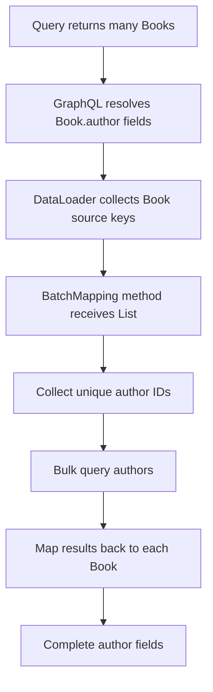

# @BatchMapping

Khi một GraphQL query lấy danh sách nhiều object và mỗi object có một field quan hệ, resolver thông thường có thể tạo ra vấn đề **N+1 query**. Ví dụ query lấy 50 cuốn sách, sau đó mỗi cuốn sách lại gọi database riêng để tải tác giả. Server phải chạy một query lấy sách và thêm 50 query lấy tác giả.

Spring for GraphQL cung cấp `@BatchMapping` để giải quyết mẫu này. Thay vì gọi resolver một lần cho từng object cha, Spring gom các source objects thành một batch và gọi method một lần cho nhóm đó. Method tải dữ liệu liên quan theo lô rồi trả kết quả tương ứng với từng source object. `@BatchMapping` tự tích hợp DataLoader, vì vậy controller không cần tự đăng ký batch loader cho trường hợp đơn giản.

Bài học này giải thích N+1, cách `@BatchMapping` kết nối với DataLoader, chữ ký method, cách trả về `Map` hoặc `List`, xử lý batch reactive, cấu hình kích thước batch, xử lý null và kiểm thử để xác nhận việc gom dữ liệu hoạt động đúng.

## 1. Vấn đề N+1 trong field mapping

Giả sử schema có Book và Author:

```graphql
type Query {
  books: [Book!]!
}

type Book {
  id: ID!
  title: String!
  author: Author
}

type Author {
  id: ID!
  name: String!
}
```

Client lấy danh sách sách và tác giả:

```graphql
query {
  books {
    id
    title
    author {
      id
      name
    }
  }
}
```

Một cách triển khai trực tiếp dùng `@SchemaMapping`:

```java
@Controller
public class BookFieldController {

    private final AuthorService authorService;

    public BookFieldController(AuthorService authorService) {
        this.authorService = authorService;
    }

    @SchemaMapping
    public Author author(Book book) {
        return authorService.findById(book.authorId());
    }
}
```

Nếu query trả về N cuốn sách, resolver `author` có thể được gọi N lần. Nếu mỗi lần gọi đều thực hiện một query riêng, tổng số query gần bằng `1 + N`.

| Số sách | Query lấy sách | Query lấy tác giả | Tổng |
| ---: | ---: | ---: | ---: |
| 1 | 1 | 1 | 2 |
| 10 | 1 | 10 | 11 |
| 50 | 1 | 50 | 51 |
| 100 | 1 | 100 | 101 |

Đây là N+1: một query lấy danh sách cha và N query tải dữ liệu quan hệ. Khi số lượng parent objects tăng, số lần round-trip tới database cũng tăng theo.

Giải pháp là lấy toàn bộ author IDs từ danh sách Book, truy vấn các Author trong một batch, sau đó ghép kết quả trở lại từng Book.

## 2. @BatchMapping là gì?

`@BatchMapping` là annotation của Spring for GraphQL nằm trong package:

```java
org.springframework.graphql.data.method.annotation.BatchMapping
```

Annotation này cho phép khai báo một batch resolver cho field của GraphQL object type. Spring đăng ký DataLoader tương ứng và gọi method với một danh sách source objects khi GraphQL cần phân giải field cho nhiều parent objects.

Thay vì method nhận một source:

```java
@SchemaMapping
public Author author(Book book) {
    // Một source object mỗi lần gọi.
}
```

Batch method nhận một danh sách source:

```java
@BatchMapping
public List<Author> author(List<Book> books) {
    // Một nhóm source objects mỗi lần gọi.
}
```

`@BatchMapping` là cách viết ngắn cho việc đăng ký field mapping kết hợp DataLoader. Nó phù hợp khi kết quả của field con có thể được tính từ một nhóm source objects cùng lúc.

## 3. Ví dụ @BatchMapping cơ bản

Giả sử model Java:

```java
public record Book(
        String id,
        String title,
        String authorId) {
}

public record Author(
        String id,
        String name) {
}
```

Service có phương thức tải nhiều tác giả theo ID:

```java
public interface AuthorService {

    Map<String, Author> findAllByIds(Set<String> authorIds);
}
```

Batch controller:

```java
@Controller
public class BookFieldController {

    private final AuthorService authorService;

    public BookFieldController(AuthorService authorService) {
        this.authorService = authorService;
    }

    @BatchMapping(typeName = "Book", field = "author")
    public List<Author> author(List<Book> books) {
        Set<String> authorIds = books.stream()
                .map(Book::authorId)
                .filter(Objects::nonNull)
                .collect(Collectors.toSet());

        Map<String, Author> authorsById =
                authorService.findAllByIds(authorIds);

        return books.stream()
                .map(book -> book.authorId() == null
                        ? null
                        : authorsById.get(book.authorId()))
                .collect(Collectors.toCollection(ArrayList::new));
    }
}
```

Method nhận toàn bộ danh sách Book cần phân giải field `author`. Nó thu thập các author IDs duy nhất, gọi service một lần để tải dữ liệu theo lô, rồi tạo danh sách Author tương ứng với từng Book.

Nếu query lấy 50 sách, batch method có thể xử lý cả nhóm đó bằng một lần gọi service. Số query tới database lúc này phụ thuộc cách `findAllByIds` được triển khai, nhưng thường chỉ cần một truy vấn với điều kiện `IN` thay vì N truy vấn riêng lẻ.

Ví dụ repository:

```java
public interface AuthorRepository extends JpaRepository<AuthorEntity, String> {

    List<AuthorEntity> findByIdIn(Collection<String> ids);
}
```

Service:

```java
public Map<String, Author> findAllByIds(Set<String> authorIds) {
    if (authorIds.isEmpty()) {
        return Map.of();
    }

    return authorRepository.findByIdIn(authorIds).stream()
            .map(AuthorEntity::toDomain)
            .collect(Collectors.toMap(
                    Author::id,
                    Function.identity()));
}
```

Đoạn repository và service minh họa cách bulk loading; hãy điều chỉnh theo persistence layer của ứng dụng.

## 4. Quy tắc ghép kết quả với source objects

Batch method cần trả kết quả theo đúng source objects mà Spring đưa vào. Có hai dạng return thường dùng:

1. `Map<Source, Value>`: key là source object, value là giá trị của field tương ứng.
2. `List<Value>`: mỗi phần tử phải nằm đúng vị trí tương ứng với source object cùng vị trí trong danh sách đầu vào.

### Trả về List theo đúng thứ tự

Với chữ ký:

```java
@BatchMapping
public List<Author> author(List<Book> books) {
    // ...
}
```

Nếu danh sách source là:

```text
[Book-A, Book-B, Book-C]
```

Thì danh sách kết quả phải có cùng thứ tự:

```text
[Author-A, Author-B, Author-C]
```

Không được sắp xếp kết quả theo author name hoặc database order nếu thứ tự đó khác với danh sách source. Spring ghép phần tử theo index. Nếu trả sai thứ tự, một cuốn sách có thể hiển thị nhầm tác giả.

Danh sách kết quả cũng phải có số phần tử tương ứng với số source objects. Với quan hệ nullable, có thể đặt `null` ở vị trí tương ứng nếu field SDL cho phép null.

### Trả về Map theo source object

Có thể dùng Map khi muốn thể hiện quan hệ source-to-value rõ ràng:

```java
@BatchMapping(typeName = "Book", field = "author")
public Map<Book, Author> author(List<Book> books) {
    Set<String> authorIds = books.stream()
            .map(Book::authorId)
            .filter(Objects::nonNull)
            .collect(Collectors.toSet());
    Map<String, Author> authorsById =
            authorService.findAllByIds(authorIds);

    Map<Book, Author> result = new HashMap<>();
    for (Book book : books) {
        Author author = book.authorId() == null
                ? null
                : authorsById.get(book.authorId());
        result.put(book, author);
    }

    return result;
}
```

Với Map, key phải là source object được truyền vào batch method. Không dùng author ID làm key nếu source là Book; DataLoader cần ánh xạ kết quả trở lại đúng source object.

Nếu một key không có trong Map, kết quả của source tương ứng được xem là không có giá trị. Hãy chủ động quyết định field đó có thể null hay cần phát sinh lỗi domain.

Map dùng quy tắc equality/hash code của key. Nếu source là Java record, equals/hashCode được sinh tự động. Với entity hoặc class mutable, hãy bảo đảm key semantics ổn định trong suốt quá trình batch. Nếu không muốn phụ thuộc equality của source objects, có thể dùng dạng List và giữ đúng thứ tự.

## 5. Suy luận typeName và field name

`@BatchMapping` có thể khai báo tường minh:

- `typeName`: GraphQL parent type sở hữu field.
- `field`: GraphQL field được phân giải theo batch.
- `maxBatchSize`: giới hạn số source keys trong một batch.

Nếu không khai báo, Spring suy luận field name từ tên method và parent type từ kiểu phần tử của source parameter `List<T>`.

Ví dụ:

```java
@BatchMapping
public List<Author> author(List<Book> books) {
    // ...
}
```

Mapping mặc định là `Book.author`:

- Tên method `author` trở thành field name.
- Kiểu phần tử `Book` trong `List<Book>` được dùng để suy ra parent type.

Nếu Java class không trùng GraphQL type, khai báo rõ:

```java
@BatchMapping(typeName = "Book", field = "author")
public List<Author> authors(List<BookEntity> books) {
    // ...
}
```

Ở đây Java source type là `BookEntity` nhưng schema type là `Book`. Thuộc tính `typeName` giữ mapping đúng với SDL.

## 6. Reactive @BatchMapping

Batch resolver có thể trả về kết quả bất đồng bộ. Với nguồn dữ liệu reactive, có thể trả về `Mono<List<V>>` hoặc `Mono<Map<S,V>>` để không chặn thread trong WebFlux.

Ví dụ service reactive:

```java
public interface ReactiveAuthorService {

    Mono<Map<String, Author>> findAllByIds(Set<String> authorIds);
}
```

Batch mapping:

```java
@BatchMapping(typeName = "Book", field = "author")
public Mono<List<Author>> author(List<Book> books) {
    Set<String> authorIds = books.stream()
            .map(Book::authorId)
            .filter(Objects::nonNull)
            .collect(Collectors.toSet());

    return authorService.findAllByIds(authorIds)
            .map(authorsById -> books.stream()
                    .map(book -> book.authorId() == null
                            ? null
                            : authorsById.get(book.authorId()))
                    .collect(Collectors.toCollection(ArrayList::new)));
}
```

Method trả về một Mono chứa danh sách kết quả đã được ghép đúng thứ tự. GraphQL chờ kết quả bất đồng bộ trước khi hoàn tất field.

Không gọi `block()` trong batch resolver WebFlux. Nếu service vẫn dùng JDBC hoặc API blocking, cần chuyển công việc sang Executor phù hợp hoặc thiết kế lại tầng truy cập dữ liệu; bọc lời gọi blocking trong `Mono.just` không làm nó non-blocking.

## 7. maxBatchSize và chia batch lớn

Một query có thể yêu cầu rất nhiều parent objects. Gửi hàng nghìn IDs trong một câu SQL hoặc một request tới dịch vụ khác có thể vượt giới hạn parameter, payload hoặc năng lực của dependency.

`@BatchMapping` cho phép đặt `maxBatchSize`:

```java
@BatchMapping(
        typeName = "Book",
        field = "author",
        maxBatchSize = 200)
public List<Author> author(List<Book> books) {
    // Tải tối đa 200 source objects mỗi batch.
}
```

Khi số keys vượt giới hạn, DataLoader chia chúng thành nhiều batch. Method có thể được gọi nhiều lần trong cùng một GraphQL request.

Ví dụ query cần phân giải 450 sách với `maxBatchSize = 200` có thể tạo các batch có kích thước:

| Batch | Số source objects |
| --- | ---: |
| 1 | 200 |
| 2 | 200 |
| 3 | 50 |

Giá trị tối ưu phụ thuộc database, số cột, giới hạn bind parameters, kích thước dữ liệu và latency của dependency. Không nên đặt batch size quá lớn chỉ để giảm số lần gọi; một batch khổng lồ có thể gây query chậm và tốn bộ nhớ.

Nếu không chỉ định `maxBatchSize`, DataLoader dùng cấu hình mặc định không giới hạn kích thước batch theo annotation. Hãy đặt giới hạn khi backend có ngưỡng rõ ràng.

## 8. @BatchMapping và DataLoader hoạt động cùng nhau

DataLoader gom các lần yêu cầu cùng một loader trong một GraphQL request. Khi các field resolver yêu cầu dữ liệu, loader có thể gom keys và gọi batch function thay vì thực hiện một lần tải riêng cho từng key.

Với `@BatchMapping`, Spring tạo và đăng ký loader tương ứng từ method batch. Controller chỉ khai báo source list và cách tạo kết quả. Không cần tự inject `DataLoader` hoặc gọi `BatchLoaderRegistry` trong trường hợp đơn giản.

Luồng tổng quát:



Loader và cache của nó có phạm vi theo GraphQL request. Các request khác nhau không chia sẻ cache DataLoader. Đây là chủ ý quan trọng để tránh dữ liệu của request hoặc người dùng này bị dùng lại trong request khác.

Batching chỉ gom những load calls phù hợp xảy ra trong cùng request và cùng loader. Nó không tự gom các lời gọi đến nhiều loader khác nhau hoặc các request HTTP độc lập.

### Cache key và source object

Với `@BatchMapping`, source object được dùng làm key cho field mapping. Nếu nhiều field call dùng cùng source key trong cùng request, DataLoader có thể tái sử dụng kết quả đã cache.

Nếu source class là mutable entity và equality/hashCode phụ thuộc field có thể thay đổi, cần cẩn trọng khi dùng source làm Map key. Có thể dùng immutable projection/record hoặc chuyển sang custom DataLoader với key ổn định như ID.

Nếu muốn cache theo author ID thay vì theo Book source, custom DataLoader keyed by author ID có thể phù hợp hơn. Khi đó `@SchemaMapping` nhận từng Book và gọi `authorLoader.load(book.authorId())`.

## 9. Khi nào dùng @BatchMapping, khi nào dùng @SchemaMapping?

Hai cách đều có thể tránh N+1, nhưng mức độ kiểm soát khác nhau:

| Tiêu chí | `@BatchMapping` | `@SchemaMapping` + DataLoader |
| --- | --- | --- |
| Source parameter | `List<Source>` | Một `Source` |
| Ai đăng ký loader? | Spring tự tạo từ annotation | Ứng dụng đăng ký loader |
| Batch function | Method batch nhận nhiều source objects | Batch loader được đăng ký riêng |
| Key của loader | Source object của field | Có thể là ID hoặc composite key |
| Độ linh hoạt | Đơn giản cho một field phụ thuộc source | Linh hoạt với nhiều kiểu key và logic |
| Boilerplate | Ít hơn | Nhiều cấu hình hơn |

Chọn `@BatchMapping` khi:

- Field con được phân giải từ source objects cùng kiểu.
- Có thể tải dữ liệu liên quan cho cả nhóm parent objects.
- Kết quả có thể trả về bằng Map theo source hoặc List theo đúng thứ tự.
- Không cần tự kiểm soát DataLoader key.

Chọn `@SchemaMapping` kết hợp DataLoader khi:

- Muốn key là ID thay vì source object.
- Cần tái sử dụng cùng một DataLoader ở nhiều resolver.
- Cần composite key hoặc key có chứa tham số field.
- Cần điều khiển cache, local context hoặc batch loader chi tiết hơn.
- Một batch loader được nhiều field hoặc nhiều controller sử dụng.

Không cần kết hợp cả `@BatchMapping` và `@SchemaMapping` cho cùng một cặp parent type/field. Mỗi field nên có một cơ chế mapping rõ ràng.

## 10. Field arguments và batch key

Một field GraphQL có thể nhận arguments:

```graphql
type Book {
  reviews(limit: Int, language: String): [Review!]!
}
```

Kết quả của `reviews` có thể thay đổi theo `limit` hoặc `language`. Nhưng `@BatchMapping` mặc định gom source objects làm keys; nếu kết quả phụ thuộc vào arguments của từng field call, chỉ dùng source object làm key có thể không đủ để phân biệt các yêu cầu khác nhau.

Ví dụ cùng một Book có thể được yêu cầu với hai giá trị limit khác nhau:

```graphql
query {
  first: bookById(id: "book-1") {
    reviews(limit: 5) { id }
  }
  second: bookById(id: "book-1") {
    reviews(limit: 20) { id }
  }
}
```

Trong trường hợp kết quả phụ thuộc vào argument, hãy thiết kế key chứa cả source ID và argument, chẳng hạn `ReviewQueryKey(bookId, limit, language)`, rồi dùng custom DataLoader. Hoặc thiết kế lại schema để batch field không có các argument làm thay đổi kết quả. Không giả định một batch mapping keyed chỉ bởi source sẽ tự phân biệt mọi biến thể arguments.

## 11. Null và quan hệ không tồn tại

Quan hệ có thể không tồn tại:

- Book chưa có author.
- Author ID trong Book không còn hợp lệ.
- Bản ghi bị xóa hoặc không được phép hiển thị.

Nếu field SDL nullable:

```graphql
type Book {
  author: Author
}
```

Batch method có thể trả null ở vị trí tương ứng trong List, hoặc Map không có giá trị cho source tương ứng. Ví dụ trước dùng `ArrayList` để giữ null value trong kết quả.

Nếu field là non-null:

```graphql
type Book {
  author: Author!
}
```

Batch method phải bảo đảm luôn có Author hợp lệ hoặc phát sinh lỗi. Trả null cho non-null field khiến GraphQL tạo execution error và áp dụng null propagation lên parent.

Không nên biến mọi trường hợp author không tồn tại thành exception nếu domain cho phép Book không có tác giả. Nullability nên phản ánh hợp đồng dữ liệu thật.

### Phân biệt thiếu key và giá trị null

Với Map return:

- Map có key và value là object: field nhận object đó.
- Map có key nhưng value null: field nhận null.
- Map không có key: không có kết quả cho source tương ứng và được xử lý như không có giá trị.

Hãy chọn một quy ước nhất quán để code dễ hiểu. Nếu cần phân biệt “không tìm thấy” với “không được phép xem”, hãy biểu diễn điều đó trong service/domain result và error policy, không dựa vào việc thiếu key một cách ngầm định.

## 12. Batch loading và bảo mật dữ liệu

Batch query thường tải nhiều bản ghi cùng lúc. Điều đó không có nghĩa có thể bỏ qua authorization. Mỗi kết quả phải được lọc theo người dùng, tenant và chính sách truy cập hiện tại.

Ví dụ service nên nhận thông tin tenant hoặc principal nếu dữ liệu được phân vùng:

```java
Map<String, Author> findVisibleAuthors(
        Set<String> authorIds,
        String tenantId);
```

Batch resolver có thể lấy tenant từ GraphQL context hoặc principal được Spring Security cung cấp theo cơ chế method argument phù hợp:

```java
@BatchMapping(typeName = "Book", field = "author")
public List<Author> author(
        List<Book> books,
        Principal principal) {
    // Lọc dữ liệu theo người dùng hiện tại trong service.
}
```

Đoạn chữ ký minh họa việc truyền principal; hãy kiểm tra các method argument được hỗ trợ bởi phiên bản Spring for GraphQL đang dùng. Quan trọng nhất là service phải lọc quyền trên batch query, không chỉ tải mọi author ID rồi trả nguyên kết quả.

DataLoader mặc định có phạm vi request nên cache không được chia sẻ giữa các request. Tuy nhiên, điều đó không thay thế authorization. Batch method vẫn phải xác thực người dùng và lọc dữ liệu trước khi trả kết quả.

## 13. Lỗi trong batch resolver

Batch method có thể thất bại vì:

- Backend không truy vấn được database.
- Một source object chứa ID không hợp lệ.
- Batch response không ghép được về source objects.
- Service ném exception do quy tắc nghiệp vụ.
- Batch size vượt giới hạn dependency.

Nếu toàn bộ batch method ném exception, các field phụ thuộc batch đó có thể nhận lỗi. Với lỗi riêng của một source object, cần cân nhắc cách biểu diễn lỗi theo từng phần tử và khả năng của batch loader; đừng biến một lỗi dữ liệu cục bộ thành lỗi toàn bộ batch nếu có thể xử lý riêng.

Các nguyên tắc:

- Kiểm tra input keys trước khi gọi dependency.
- Xử lý trường hợp batch rỗng.
- Trả đủ kết quả và đúng thứ tự nếu dùng List.
- Không trả Map keyed bởi loại ID khác source object.
- Giới hạn kích thước batch theo giới hạn backend.
- Ánh xạ lỗi kỹ thuật sang GraphQL error an toàn.
- Không đưa stack trace hoặc SQL vào message trả cho client.

## 14. Kiểm thử @BatchMapping bằng GraphQlTester

Nên kiểm tra từ query root trả về nhiều parent objects cho đến field quan hệ được batch:

```java
@GraphQlTest({BookQueryController.class, BookFieldController.class})
class BookBatchMappingTests {

    @Autowired
    GraphQlTester graphQlTester;

    @MockBean
    BookService bookService;

    @MockBean
    AuthorService authorService;

    @Test
    void loadsAuthorsForBooksInOneBatch() {
        Book book1 = new Book("book-1", "GraphQL", "author-1");
        Book book2 = new Book("book-2", "Spring", "author-2");

        given(bookService.findAll())
                .willReturn(List.of(book1, book2));

        Author author1 = new Author("author-1", "An");
        Author author2 = new Author("author-2", "Binh");
        given(authorService.findAllByIds(Set.of("author-1", "author-2")))
                .willReturn(Map.of(
                        "author-1", author1,
                        "author-2", author2));

        graphQlTester.document("""
                query {
                    books {
                        id
                        author {
                            id
                            name
                        }
                    }
                }
                """)
                .execute()
                .path("books[0].author.name")
                .entity(String.class)
                .isEqualTo("An");

        then(authorService).should(times(1))
                .findAllByIds(Set.of("author-1", "author-2"));
    }
}
```

Ví dụ giả định `BookQueryController` có method `books()` gọi `bookService.findAll()`, còn batch controller trả về List<Author> theo đúng thứ tự. Cần bổ sung import, model và cấu hình test theo ứng dụng thực tế.

Test này xác nhận batch service được gọi một lần cho nhóm hai sách trong cùng request khi không cấu hình chia nhỏ batch. Nếu `maxBatchSize` được đặt thấp hơn số source objects, nhiều lần gọi batch là hành vi đúng.

### Những trường hợp cần test thêm

- Danh sách source rỗng hoặc một phần tử.
- Nhiều Book cùng author ID.
- Book không có author ID.
- Author ID không tồn tại.
- List return giữ đúng thứ tự source.
- Map return ghép đúng source object.
- `maxBatchSize` chia batch thành nhiều lần gọi.
- Reactive batch trả kết quả đúng và không block.
- Quyền tenant/user được áp dụng trên bulk query.
- Lỗi backend được trả theo error contract.

## 15. Lỗi thường gặp

| Biểu hiện | Nguyên nhân | Cách xử lý |
| --- | --- | --- |
| Batch method không được gọi | Controller không được scan hoặc annotation không khớp SDL | Kiểm tra `@Controller`, typeName và field |
| Field trả sai đối tượng | List return không cùng thứ tự với source list | Ghép kết quả theo source order |
| Map không ghép được kết quả | Dùng ID làm key thay vì source object | Dùng source object làm Map key hoặc trả List |
| Vẫn có N query | Method batch gọi service riêng cho từng source | Dùng bulk query theo tập ID |
| Batch method chạy nhiều lần | `maxBatchSize` chia nhóm hoặc DataLoader dispatch nhiều đợt | Kiểm tra kích thước batch và execution phases |
| Null propagation bất ngờ | SDL khai báo non-null nhưng batch result có null | Điều chỉnh nullability hoặc bảo đảm kết quả |
| Duplicate key khi tạo Map | Nhiều kết quả có cùng key ID | Dùng `toMap` với quy tắc merge rõ ràng hoặc xử lý trùng |
| Kết quả phụ thuộc argument bị dùng chung | Loader key chỉ dựa trên source object | Dùng custom DataLoader với composite key |
| Batch lộ dữ liệu tenant khác | Bulk query không lọc theo quyền | Đưa tenant/principal vào service query |
| Reactive batch chặn event-loop | Gọi API blocking trong method reactive | Dùng reactive dependency hoặc Executor phù hợp |

## 16. Nguyên tắc thiết kế @BatchMapping

- Dùng `@BatchMapping` cho field quan hệ cần phân giải từ nhiều source objects.
- Thu thập keys duy nhất trước khi gọi backend.
- Dùng một bulk query thay cho vòng lặp gọi repository theo từng source.
- Trả `List` theo đúng thứ tự source hoặc `Map` keyed bởi source object.
- Chỉ định `typeName` và `field` khi tên Java không thể suy ra đúng SDL.
- Đặt `maxBatchSize` theo giới hạn database hoặc service phụ thuộc.
- Dùng `Mono<List<V>>` hoặc `Mono<Map<S,V>>` khi batch loading reactive.
- Dùng custom DataLoader nếu key cần chứa ID hoặc arguments.
- Giữ cache DataLoader trong phạm vi request và lọc dữ liệu theo quyền.
- Thiết kế nullability phù hợp với quan hệ domain.
- Không đăng ký đồng thời mapping khác cho cùng parent type/field.
- Kiểm thử cả thứ tự kết quả, số lần bulk call và trường hợp lỗi.

## 17. Bài tập thực hành

Xây dựng GraphQL API cho thư viện:

1. Khai báo Query.books và Book.author trong SDL.
2. Tạo record Book gồm id, title và authorId; tạo record Author gồm id và name.
3. Viết query resolver trả về danh sách Book.
4. Viết `@SchemaMapping` ban đầu để tải từng Author và quan sát số lần gọi service.
5. Thay bằng `@BatchMapping` nhận `List<Book>`.
6. Dùng một bulk service method nhận tập author IDs và trả Map theo ID.
7. Trả `List<Author>` theo đúng thứ tự Book source list.
8. Thêm một Book không có author và kiểm tra nullable field.
9. Cấu hình `maxBatchSize` rồi kiểm tra số batch call.
10. Viết GraphQlTester xác nhận tên tác giả đúng và bulk service được gọi ít lần.
11. Thử thay List return bằng `Map<Book, Author>` và so sánh cách ghép kết quả.
12. Giải thích khi nào nên dùng `@SchemaMapping` kết hợp custom DataLoader thay vì `@BatchMapping`.

Sau bài tập, bạn cần hiểu vì sao N+1 xuất hiện, cách Spring gom source objects, quy tắc ghép batch result và cách đo lường để chứng minh số lần truy vấn đã giảm.

## 18. Tài liệu tham khảo

- [Spring for GraphQL — Annotated Controllers: Batch Mapping](https://docs.spring.io/spring-graphql/reference/controllers.html#controllers.batch-mapping)
- [Spring for GraphQL — BatchLoaderRegistry](https://docs.spring.io/spring-graphql/reference/request-execution.html#execution.batch-loading)
- [GraphQL Java — DataLoader](https://github.com/graphql-java/java-dataloader)
- [Spring for GraphQL — BatchMapping API](https://docs.spring.io/spring-graphql/docs/1.4.x/api/org/springframework/graphql/data/method/annotation/BatchMapping.html)

Chữ ký return, các thuộc tính annotation và khả năng reactive có thể thay đổi theo phiên bản Spring for GraphQL. Khi nâng cấp dependency, hãy kiểm tra reference documentation và Javadoc đúng phiên bản mà Spring Boot quản lý.
