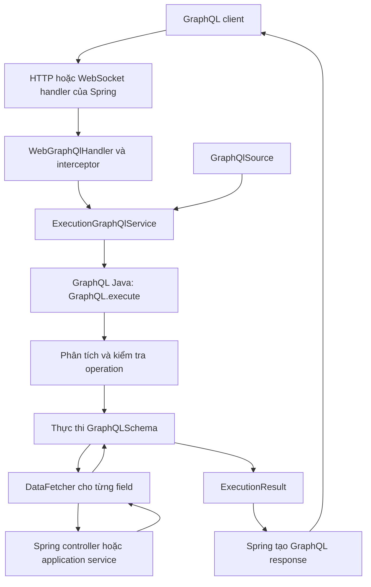

# Quan hệ với GraphQL Java

Spring for GraphQL và GraphQL Java đảm nhiệm hai lớp trách nhiệm khác nhau trong cùng một ứng dụng. **GraphQL Java là thư viện thực thi GraphQL trên JVM**: nó hiểu schema, phân tích và kiểm tra operation, điều phối việc lấy dữ liệu cho từng field, rồi tạo kết quả thực thi. **Spring for GraphQL tích hợp engine đó vào hệ sinh thái Spring**: nó quản lý schema và cấu hình runtime, kết nối các phương thức trong ứng dụng với field GraphQL, đưa request qua HTTP hoặc WebSocket, đồng thời cung cấp cơ chế xử lý context, lỗi, DataLoader và kiểm thử.

Vì vậy, khi xây dựng API bằng Spring for GraphQL, phần thực thi GraphQL vẫn do GraphQL Java đảm nhận. Spring cung cấp cách cấu hình và mở rộng thuận tiện để ứng dụng không phải tự lắp ghép toàn bộ các thành phần cấp thấp.

## 1. Hai dự án nằm ở hai lớp khác nhau

GraphQL Java là thư viện Java độc lập với Spring. Nó cung cấp các kiểu và API cốt lõi như `GraphQL`, `GraphQLSchema`, `ExecutionInput`, `ExecutionResult`, `DataFetcher`, `DataFetchingEnvironment` và `RuntimeWiring`. Bạn có thể dùng thư viện này trong một ứng dụng Java thuần mà không cần Spring Boot hay Spring MVC.

Spring for GraphQL xây dựng lớp tích hợp xung quanh GraphQL Java. Framework này cung cấp các abstraction như `GraphQlSource`, `GraphQlService`, `ExecutionGraphQlService`, `RuntimeWiringConfigurer`, các annotation dành cho controller và các adapter cho transport. Các thành phần đó phối hợp để biến một request đến từ client thành lời gọi thực thi GraphQL Java, rồi chuyển kết quả thành response phù hợp với transport.

| Thành phần | Trách nhiệm chính |
| --- | --- |
| GraphQL SDL | Khai báo contract: type, field, argument, scalar, query, mutation và subscription |
| GraphQL Java | Tạo executable schema, kiểm tra operation và thực thi các field theo schema |
| `DataFetcher` của GraphQL Java | Lấy giá trị cho một field từ dữ liệu nguồn, service hoặc hệ thống bên ngoài |
| Spring for GraphQL | Kết nối schema, `DataFetcher`, Spring bean, transport, context, xử lý lỗi và kiểm thử |
| Ứng dụng Spring | Chứa nghiệp vụ thực tế trong service, repository và các thành phần domain |

Luồng tổng quát khi client gửi một query qua HTTP có thể hình dung như sau:



`GraphQlSource` giữ schema và cấu hình GraphQL Java đã được xây dựng. `ExecutionGraphQlService` nhận request ở mức GraphQL, tạo input thực thi và gọi engine. Adapter HTTP, WebSocket hoặc transport được hỗ trợ khác đảm nhận việc nhận và trả dữ liệu qua giao thức tương ứng. Các interceptor của Spring có thể tham gia trước hoặc sau bước thực thi để bổ sung context, kiểm tra request hay ghi nhận thông tin quan sát.

## 2. GraphQL Java thực thi schema và operation như thế nào?

Schema SDL mô tả những gì client được phép yêu cầu. Ví dụ:

```graphql
type Query {
    bookById(id: ID!): Book
}

type Book {
    id: ID!
    title: String!
    author: Author
}

type Author {
    id: ID!
    name: String!
}
```

Đoạn SDL trên khai báo `Query.bookById`, `Book.author` và các field khác, nhưng bản thân SDL không biết phải truy vấn cơ sở dữ liệu hay gọi service nào. Phần nối giữa field trong schema và nguồn dữ liệu được thực hiện bằng `DataFetcher`.

Trong cách dùng GraphQL Java trực tiếp, quá trình xây dựng thường gồm các bước:

1. `SchemaParser` đọc SDL và tạo `TypeDefinitionRegistry`.
2. `RuntimeWiring` khai báo `DataFetcher` cho các field cần xử lý, cùng những cấu hình runtime như scalar hoặc type resolver.
3. `SchemaGenerator` kết hợp registry và wiring để tạo `GraphQLSchema` có thể thực thi.
4. `GraphQL.newGraphQL(schema).build()` tạo engine.
5. Mỗi request được biểu diễn bằng `ExecutionInput`, sau đó truyền vào `GraphQL.execute(...)` hoặc `GraphQL.executeAsync(...)`.

Ví dụ rút gọn khi dùng GraphQL Java mà không có Spring:

```java
TypeDefinitionRegistry registry = new SchemaParser().parse(sdl);

RuntimeWiring wiring = RuntimeWiring.newRuntimeWiring()
    .type(TypeRuntimeWiring.newTypeWiring("Query")
        .dataFetcher("bookById", environment ->
            bookService.findById(environment.getArgument("id"))))
    .type(TypeRuntimeWiring.newTypeWiring("Book")
        .dataFetcher("author", environment -> {
            Book book = environment.getSource();
            return authorService.findById(book.authorId());
        }))
    .build();

GraphQLSchema schema = new SchemaGenerator()
    .makeExecutableSchema(registry, wiring);

GraphQL graphQL = GraphQL.newGraphQL(schema).build();

ExecutionInput input = ExecutionInput.newExecutionInput()
    .query("""
        { bookById(id: "book-1") { title author { name } } }
        """)
    .build();

ExecutionResult result = graphQL.execute(input);
```

Ở đây, `environment.getArgument("id")` đọc argument của field đang được thực thi. Với field `Book.author`, `environment.getSource()` trả về object `Book` do field cha cung cấp. GraphQL Java dùng source object đó để tính giá trị cho field con.

Khi thực thi một operation, GraphQL Java chịu trách nhiệm phân tích cú pháp, kiểm tra operation với schema, xác định field được yêu cầu và điều phối việc gọi các `DataFetcher`. Nó cũng xử lý quy tắc GraphQL như kiểu dữ liệu, nullability, alias, fragment, variable, lỗi theo field và cách thực thi mutation. Kết quả được đóng gói trong `ExecutionResult`, bao gồm dữ liệu, danh sách lỗi và các phần mở rộng nếu có.

Một response GraphQL có thể chứa cả `data` và `errors`. Chẳng hạn, một field con có thể thất bại trong khi những field khác vẫn trả dữ liệu hợp lệ. Đây là hành vi có chủ đích của mô hình thực thi GraphQL, không giống cách một lỗi bất kỳ luôn làm hỏng toàn bộ response HTTP.

## 3. Spring for GraphQL kết nối controller với DataFetcher

Nếu tự dùng GraphQL Java, lập trình viên phải tự tạo `RuntimeWiring` và đăng ký `DataFetcher` cho từng field. Spring for GraphQL cho phép khai báo các phương thức trong Spring bean bằng annotation. Framework phát hiện các phương thức đó và đăng ký chúng vào runtime wiring để GraphQL Java gọi khi cần lấy dữ liệu.

Ví dụ với cùng schema ở trên:

```java
@Controller
public class BookController {

    private final BookService bookService;
    private final AuthorService authorService;

    public BookController(
            BookService bookService,
            AuthorService authorService) {
        this.bookService = bookService;
        this.authorService = authorService;
    }

    @QueryMapping
    public Book bookById(@Argument String id) {
        return bookService.findById(id);
    }

    @SchemaMapping(typeName = "Book", field = "author")
    public Author author(Book book) {
        return authorService.findById(book.authorId());
    }
}
```

`@QueryMapping` là cách khai báo ngắn cho một field thuộc root type `Query`. `@SchemaMapping` liên kết phương thức với một field cụ thể của một GraphQL type. Trong ví dụ, `Book` được truyền vào phương thức `author` là source object của field `Book.author`.

Khi xử lý phương thức controller, Spring for GraphQL đảm nhiệm việc phân giải tham số như `@Argument`, source object và `DataFetchingEnvironment`, sau đó gọi phương thức Spring bean. Giá trị phương thức trả về được chuyển lại cho GraphQL Java để engine tiếp tục xử lý theo kiểu đã khai báo trong schema. Do đó, annotation của Spring là lớp khai báo mapping; còn quy tắc thực thi field vẫn thuộc GraphQL Java.

Các annotation thường gặp gồm:

| Annotation | Ý nghĩa |
| --- | --- |
| `@QueryMapping` | Ánh xạ phương thức vào field của root type `Query` |
| `@MutationMapping` | Ánh xạ phương thức vào field của root type `Mutation` |
| `@SubscriptionMapping` | Ánh xạ phương thức vào field của root type `Subscription` |
| `@SchemaMapping` | Ánh xạ phương thức vào field của một GraphQL type bất kỳ |
| `@BatchMapping` | Đăng ký cách phân giải một field theo nhóm source object |
| `@Argument` | Lấy argument của field GraphQL và chuyển thành tham số phương thức |

Không phải mọi field đều cần một phương thức `@SchemaMapping`. GraphQL Java có `PropertyDataFetcher` mặc định để đọc property từ source object, chẳng hạn getter của Java bean, accessor của record hoặc key của `Map`. Nếu object `Book` đã có property `title`, engine thường có thể lấy `Book.title` trực tiếp mà không cần viết resolver riêng. Hãy khai báo mapping khi field cần gọi service, chuyển đổi dữ liệu, áp dụng nghiệp vụ hoặc lấy dữ liệu từ nguồn khác.

### Cấu hình RuntimeWiring bằng API của Spring

Annotation controller phù hợp với các resolver gắn với nghiệp vụ ứng dụng. Trong một số trường hợp, cần cấu hình trực tiếp runtime wiring, ví dụ đăng ký scalar, directive, type resolver hoặc một `DataFetcher` đặc biệt. Spring for GraphQL cung cấp `RuntimeWiringConfigurer` để bổ sung cấu hình vào `RuntimeWiring.Builder` của GraphQL Java:

```java
@Bean
RuntimeWiringConfigurer bookRuntimeWiring(BookService bookService) {
    return builder -> builder
        .type("Query", type -> type
            .dataFetcher("bookById", environment ->
                bookService.findById(environment.getArgument("id"))));
}
```

Đoạn cấu hình này vẫn dùng API `DataFetcher` của GraphQL Java. Điểm khác biệt là Spring quản lý bean và đưa cấu hình vào quá trình tạo `GraphQlSource`. Có thể kết hợp cách cấu hình này với annotated controller khi mỗi cách được dùng cho đúng mục đích.

## 4. Đồng bộ, bất đồng bộ và Subscription

Một `DataFetcher` của GraphQL Java có thể trả về object thông thường hoặc một kết quả bất đồng bộ, chẳng hạn `CompletionStage` hay `CompletableFuture`. Engine quản lý các kết quả đó trong quá trình thực thi query. Vì vậy, một field có thể gọi service bất đồng bộ mà không phải tự điều phối toàn bộ operation.

Spring for GraphQL hỗ trợ cách làm tương tự trong controller. Phương thức mapping có thể trả về kiểu đồng bộ hoặc kiểu bất đồng bộ phù hợp. Với ứng dụng reactive, các kiểu như `Mono` và `Flux` được tích hợp qua Reactive Streams.

Mutation cũng được ánh xạ vào `DataFetcher`, nhưng GraphQL Java áp dụng quy tắc thực thi tuần tự cho các field ở cấp cao nhất của mutation. Với subscription, field gốc tạo ra một luồng sự kiện. GraphQL Java hỗ trợ mô hình `Publisher` cho luồng đó; Spring for GraphQL kết nối mô hình này với kiểu reactive mà ứng dụng sử dụng.

Ví dụ một subscription trong controller reactive:

```java
@Controller
public class BookEventController {

    private final BookEventService eventService;

    public BookEventController(BookEventService eventService) {
        this.eventService = eventService;
    }

    @SubscriptionMapping
    public Flux<BookEvent> bookEvents(@Argument String category) {
        return eventService.eventsFor(category);
    }
}
```

`@SubscriptionMapping` giúp Spring đăng ký phương thức vào field của root type `Subscription`. Việc quản lý operation subscription và thực thi field vẫn do GraphQL Java đảm nhận; Spring cung cấp adapter để nhận và duy trì kết nối transport phù hợp.

## 5. DataLoader và xử lý vấn đề N+1

GraphQL Java gọi resolver theo cấu trúc field mà client yêu cầu. Nếu một query lấy nhiều quyển sách và mỗi quyển sách lại yêu cầu `author`, resolver `Book.author` có thể bị gọi nhiều lần. Nếu mỗi lần gọi đều truy vấn cơ sở dữ liệu riêng, một request có thể tạo ra một truy vấn lấy danh sách sách cộng thêm N truy vấn lấy tác giả. Đây là vấn đề N+1.

GraphQL Java tích hợp DataLoader để gom các lần tải dữ liệu thành một batch và cache kết quả trong phạm vi request. Spring for GraphQL cung cấp `BatchLoaderRegistry` để đăng ký batch loader theo vòng đời của GraphQL request, đồng thời cung cấp `@BatchMapping` cho trường hợp phổ biến.

Ví dụ dùng `@BatchMapping` để phân giải tác giả cho nhiều sách:

```java
@Controller
public class BookAuthorController {

    private final AuthorService authorService;

    public BookAuthorController(AuthorService authorService) {
        this.authorService = authorService;
    }

    @BatchMapping(typeName = "Book", field = "author")
    public Map<Book, Author> authors(List<Book> books) {
        Set<String> authorIds = books.stream()
            .map(Book::authorId)
            .collect(Collectors.toSet());

        Map<String, Author> authorsById =
            authorService.findAllByIds(authorIds);

        Map<Book, Author> result = new HashMap<>();
        for (Book book : books) {
            result.put(book, authorsById.get(book.authorId()));
        }
        return result;
    }
}
```

Phương thức nhận một nhóm `Book`, tải các tác giả theo tập ID và trả về ánh xạ từ từng source object sang `Author` tương ứng. Spring đăng ký cơ chế batch này thông qua DataLoader của GraphQL Java. Các lần phân giải field trong cùng request có thể được gom lại để gọi batch loader, thay vì thực hiện một lần tải riêng cho mỗi quyển sách.

Khi cần kiểm soát chi tiết hơn, có thể đăng ký loader qua `BatchLoaderRegistry` và lấy `DataLoader` từ `DataFetchingEnvironment` hoặc tham số được Spring hỗ trợ. Dù dùng cách nào, cần bảo đảm loader được tạo và quản lý theo request để cache không vô tình chia sẻ dữ liệu giữa các request khác nhau.

## 6. Context, lỗi và các điểm mở rộng

GraphQL Java cung cấp `DataFetchingEnvironment` cho mỗi lần gọi `DataFetcher`. Từ đối tượng này, resolver có thể đọc source object, argument, thông tin field, selection set, GraphQL context và DataLoader đã đăng ký. Đây là điểm kết nối giữa operation hiện tại với dữ liệu hoặc trạng thái cần thiết trong lúc thực thi.

Spring for GraphQL bổ sung các cơ chế để đưa thông tin từ tầng transport vào quá trình thực thi. `WebGraphQlInterceptor` có thể tham gia xử lý request, còn `GraphQLContext` được dùng để truyền dữ liệu cần thiết đến resolver. Ví dụ, ứng dụng có thể đưa thông tin người dùng đã xác thực hoặc correlation ID vào context để service và resolver sử dụng. Không nên dùng context như nơi lưu trạng thái nghiệp vụ lâu dài; nó phục vụ một lần thực thi GraphQL.

Về lỗi, GraphQL Java biểu diễn lỗi thực thi bằng `GraphQLError` và có thể trả dữ liệu một phần cùng danh sách lỗi. Spring for GraphQL cung cấp `DataFetcherExceptionResolver` và lớp tiện ích `DataFetcherExceptionResolverAdapter` để chuyển exception phát sinh từ data fetcher thành lỗi GraphQL có thông điệp và mã phù hợp. Cần phân biệt lỗi này với lỗi cú pháp hoặc lỗi validation của query: các lỗi cú pháp và validation được phát hiện trong quá trình xử lý operation của GraphQL Java trước khi resolver tương ứng được gọi.

GraphQL Java còn có các extension point cấp engine, chẳng hạn `Instrumentation`, scalar, directive, type resolver và execution strategy. Spring for GraphQL cho phép bổ sung cấu hình engine trong quá trình tạo `GraphQlSource`, vì vậy ứng dụng có thể dùng các extension của GraphQL Java mà vẫn giữ cách cấu hình theo Spring. Khi tích hợp bảo mật theo field, có thể đặt kiểm tra ở service hoặc resolver và dùng cơ chế bảo mật của Spring; GraphQL Java tự nó không biết quy tắc phân quyền riêng của ứng dụng.

## 7. Kiểm thử qua Spring GraphQL

Vì GraphQL Java là engine thực thi, có thể kiểm thử riêng một `DataFetcher` hoặc schema khi cần kiểm tra logic cấp thấp. Tuy nhiên, khi ứng dụng dùng Spring for GraphQL, `GraphQlTester` thường là lựa chọn phù hợp để kiểm thử từ góc nhìn GraphQL: gửi document, truyền variable, thực thi operation và kiểm tra đường dẫn dữ liệu hoặc lỗi trong response.

Ví dụ:

```java
graphQlTester.document("""
        query {
            bookById(id: "book-1") {
                id
                title
            }
        }
        """)
    .execute()
    .path("bookById.title")
    .entity(String.class)
    .isEqualTo("Spring in Action");
```

`GraphQlTester` kiểm tra hành vi ở mức GraphQL mà không buộc test phải tự gọi `GraphQL.execute(...)` của GraphQL Java. Nếu cần kiểm tra tích hợp HTTP hoặc WebSocket, có thể dùng biến thể tester phù hợp với transport để kiểm tra cả lớp kết nối mà Spring cung cấp.

## 8. Khi nào làm việc ở từng lớp?

Trong ứng dụng Spring Boot thông thường, hãy bắt đầu bằng SDL và các annotation như `@QueryMapping`, `@MutationMapping`, `@SchemaMapping` hoặc `@BatchMapping`. Đây là cách khai báo gần với cấu trúc ứng dụng Spring, giúp dependency injection, kiểm thử và tổ chức nghiệp vụ rõ ràng.

Sử dụng `RuntimeWiringConfigurer` khi cần bổ sung cấu hình đặc thù của GraphQL Java như scalar hoặc type resolver. Tìm hiểu `DataFetcher`, `DataFetchingEnvironment`, `ExecutionInput` và `ExecutionResult` khi cần hiểu sâu cách engine gọi resolver, xử lý dữ liệu bất đồng bộ hoặc chẩn đoán hành vi thực thi. Dùng trực tiếp GraphQL Java khi xây dựng một thành phần Java không cần Spring hoặc khi cần kiểm soát engine ở mức thấp.

Spring for GraphQL phụ thuộc vào GraphQL Java để thực thi schema và operation. Vì vậy, khi khai báo dependency hoặc nâng cấp framework, nên để Spring Boot dependency management hoặc phiên bản Spring for GraphQL đang dùng quản lý phiên bản GraphQL Java tương thích. Chỉ ghi đè phiên bản GraphQL Java trực tiếp khi đã kiểm tra tương thích API và chạy lại các kiểm thử liên quan.

Điểm cần nhớ là: **Spring for GraphQL cung cấp cách tích hợp và lập trình theo Spring; GraphQL Java cung cấp engine thực thi GraphQL.** Hiểu ranh giới này giúp xác định đúng nơi cần cấu hình: controller và interceptor cho tích hợp ứng dụng, `RuntimeWiring` và `DataFetcher` cho việc nối field với dữ liệu, còn schema validation và execution strategy thuộc trách nhiệm của GraphQL Java.
