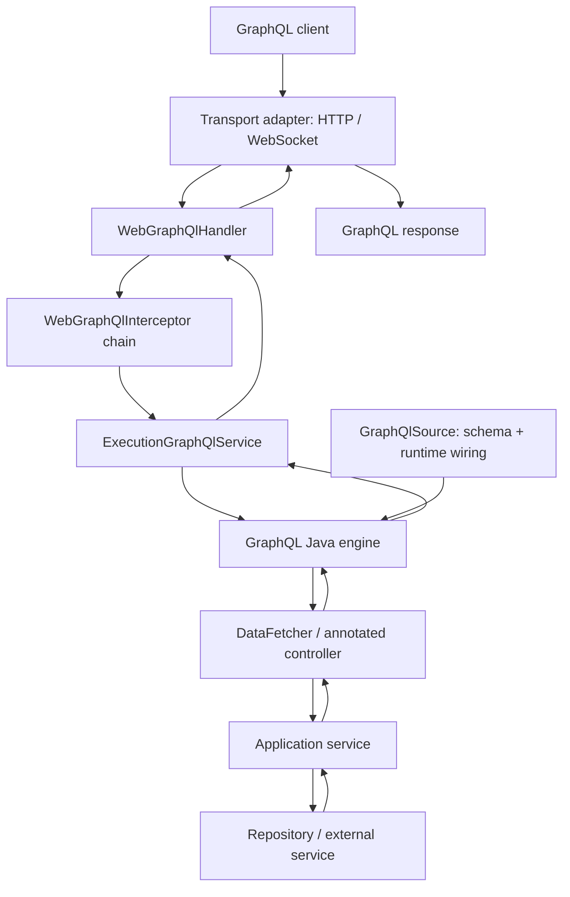

# Các lớp trong kiến trúc Spring GraphQL

Spring for GraphQL tổ chức việc xử lý GraphQL API thành nhiều lớp có trách nhiệm riêng: lớp giao tiếp nhận request, lớp điều phối request, GraphQL engine thực thi operation, schema mô tả hợp đồng API và các data fetcher lấy dữ liệu từ ứng dụng. Spring cung cấp cách tích hợp các lớp này với Spring MVC, Spring WebFlux, Spring Boot và mô hình lập trình dựa trên controller.

Hiểu kiến trúc này giúp xác định đúng nơi để đặt logic: endpoint và giao thức thuộc lớp giao tiếp; xử lý xuyên suốt request thuộc interceptor; ánh xạ field thuộc controller hoặc data fetcher; nghiệp vụ thuộc service; truy cập dữ liệu thuộc repository hoặc client tích hợp. Các lớp được kết nối với nhau nhưng không nên dồn toàn bộ trách nhiệm vào một controller.

## Bức tranh tổng thể

Spring for GraphQL dựa trên GraphQL Java để phân tích và thực thi GraphQL operation. Spring bổ sung các abstraction và adapter để đưa engine vào ứng dụng Spring. Với cấu hình Spring Boot thông thường, nhiều thành phần nền tảng được tự động cấu hình; lập trình viên chủ yếu khai báo schema và viết các thành phần xử lý field.

Luồng xử lý tổng quát có thể hình dung như sau:



Sơ đồ mô tả đường đi khái quát. Trong quá trình khởi tạo ứng dụng, schema và runtime wiring được chuẩn bị trước để engine sử dụng khi có request. Khi request đến, transport adapter chuyển nội dung giao thức thành request GraphQL của Spring; phần thực thi sau đó gọi data fetcher tương ứng với các field mà client yêu cầu.

## 1. Lớp schema và cấu hình GraphQL

### Schema Definition Language

Schema là hợp đồng mô tả client có thể gọi những operation nào, các field nhận đối số gì và kết quả có kiểu dữ liệu ra sao. Spring for GraphQL thường dùng Schema Definition Language (SDL) để khai báo schema trong các file `.graphqls` hoặc `.gqls`.

Ví dụ, một API quản lý sách có thể khai báo:

```graphql
type Book {
  id: ID!
  title: String!
  price: Float!
  author: Author!
}

type Author {
  id: ID!
  name: String!
}

type Query {
  book(id: ID!): Book
  books: [Book!]!
}

input CreateBookInput {
  title: String!
  price: Float!
  authorId: ID!
}

type Mutation {
  createBook(input: CreateBookInput!): Book!
}
```

Schema mô tả cấu trúc và quy tắc kiểu. Nó không tự truy vấn cơ sở dữ liệu và cũng không chứa toàn bộ nghiệp vụ của ứng dụng. Để một field trả về dữ liệu thực tế, GraphQL cần một data fetcher hoặc cơ chế phân giải field mặc định.

Trong Spring Boot, schema thường được đặt dưới `src/main/resources/graphql/`. Spring Boot tìm và kết hợp các file schema theo cấu hình của ứng dụng. Có thể chia schema thành nhiều file theo miền nghiệp vụ; khi khởi tạo, chúng được ghép thành một schema GraphQL dùng chung.

### GraphQlSource và RuntimeWiring

`GraphQlSource` là abstraction quan trọng đại diện cho GraphQL schema đã được xây dựng cùng runtime wiring cần thiết để thực thi. Nó kết nối định nghĩa SDL với các data fetcher, scalar và thành phần runtime khác.

Runtime wiring cho GraphQL Java biết cách phân giải field. Spring for GraphQL hỗ trợ đăng ký cấu hình runtime thông qua `RuntimeWiringConfigurer`. Ví dụ, ứng dụng có thể thêm một scalar hoặc đăng ký một data fetcher tùy chỉnh:

```java
@Configuration
public class GraphQlRuntimeConfig {

    @Bean
    RuntimeWiringConfigurer customWiring() {
        return wiringBuilder -> {
            // Đăng ký scalar hoặc DataFetcher tùy chỉnh tại đây.
        };
    }
}
```

Đoạn code trên minh họa điểm mở rộng; phần cấu hình bên trong phụ thuộc vào scalar hoặc field cụ thể của schema. Với controller có annotation, Spring for GraphQL cung cấp cơ chế tự đăng ký các handler method vào runtime wiring, vì vậy không cần tự viết `DataFetcher` cho mọi field.

## 2. Lớp GraphQL engine và dịch vụ thực thi

GraphQL Java là engine thực hiện các quy tắc cốt lõi của GraphQL. Engine nhận một operation, phân tích cú pháp, kiểm tra operation với schema, sau đó thực thi các field được chọn và tạo kết quả.

Trong Spring for GraphQL, `GraphQlService` là abstraction dịch vụ để thực thi request GraphQL. `ExecutionGraphQlService` là implementation dựa trên GraphQL Java và `GraphQlSource`. Lớp này chuyển request thành đầu vào thực thi, gọi engine và chuyển kết quả thực thi thành response GraphQL của Spring.

Các bước chính khi engine xử lý một operation gồm:

1. **Parse:** chuyển nội dung GraphQL thành cấu trúc truy vấn có thể xử lý.
2. **Validate:** kiểm tra tên field, đối số, kiểu dữ liệu và selection set dựa trên schema.
3. **Execute:** duyệt các field theo quy tắc GraphQL và gọi data fetcher tương ứng.
4. **Collect result:** ghép giá trị các field, xử lý lỗi và tạo cấu trúc `data` cùng `errors` nếu có.

Engine điều phối việc thực thi theo schema và operation. Nó không quyết định quy tắc nghiệp vụ như một cuốn sách có được phép bán hay người dùng có quyền sửa sách hay không. Các quyết định đó thuộc application service và lớp bảo mật của ứng dụng.

## 3. Lớp giao tiếp và transport

Lớp transport tiếp nhận request từ client theo một giao thức cụ thể. Spring for GraphQL tách phần giao tiếp khỏi phần thực thi GraphQL để cùng một schema và logic field có thể phục vụ nhiều kiểu kết nối.

### HTTP

Với HTTP, client thường gửi GraphQL operation tới endpoint `/graphql`. Request chứa query hoặc mutation, có thể kèm `operationName` và `variables`. Adapter HTTP của Spring chuyển request HTTP thành request GraphQL và trả response theo giao thức HTTP.

Ứng dụng có thể tích hợp với Spring MVC hoặc Spring WebFlux. Spring Boot hỗ trợ tự cấu hình endpoint GraphQL theo stack web đang dùng. Việc chọn MVC hay WebFlux ảnh hưởng đến mô hình xử lý HTTP của ứng dụng, còn schema và cách ánh xạ field vẫn theo mô hình GraphQL.

Ví dụ phần request body mà client gửi:

```json
{
  "query": "query BookById($id: ID!) { book(id: $id) { id title price } }",
  "operationName": "BookById",
  "variables": {
    "id": "book-10"
  }
}
```

### WebSocket và Subscription

HTTP request/response phù hợp với các operation thông thường. Khi client cần nhận dữ liệu được server phát ra theo thời gian, ứng dụng có thể bật transport WebSocket cho GraphQL Subscription.

WebSocket adapter quản lý kết nối và thông điệp theo giao thức GraphQL over WebSocket được hỗ trợ. Subscription vẫn được thực thi qua GraphQL engine và data fetcher; transport chỉ đảm nhiệm vòng đời kết nối và việc chuyển các sự kiện/kết quả tới client.

Việc bật Subscription cần cấu hình endpoint WebSocket và cơ chế phát sự kiện phù hợp. Không nên giả định rằng chỉ khai báo `type Subscription` trong SDL là ứng dụng đã có thể phát sự kiện: server còn phải cung cấp publisher hoặc nguồn sự kiện cho field subscription và cấu hình transport tương ứng.

## 4. Lớp điều phối request: WebGraphQlHandler và interceptor

`WebGraphQlHandler` là điểm vào cấp cao của Spring for GraphQL cho request web. Các adapter HTTP hoặc WebSocket chuyển request transport thành request của Spring rồi ủy quyền xử lý. Nhờ vậy, logic điều phối GraphQL không bị gắn chặt với một giao thức duy nhất.

`WebGraphQlInterceptor` cho phép can thiệp vào request/response ở lớp web trước và sau khi GraphQL operation được thực thi. Đây là nơi thích hợp cho những xử lý xuyên suốt như:

- Đọc thông tin xác thực hoặc metadata từ HTTP headers.
- Đưa dữ liệu dùng chung như tenant ID, correlation ID hoặc thông tin người dùng vào GraphQL context.
- Ghi log, đo thời gian xử lý và bổ sung thông tin quan sát request.
- Chuẩn hóa hoặc kiểm tra metadata của request theo chính sách ứng dụng.

Ví dụ một interceptor có thể lấy mã tenant từ header và đưa vào context:

```java
@Component
public class TenantInterceptor implements WebGraphQlInterceptor {

    @Override
    public Mono<WebGraphQlResponse> intercept(
            WebGraphQlRequest request, Chain chain) {
        String tenantId = request.getHeaders().getFirst("X-Tenant-Id");

        request.configureExecutionInput((input, builder) ->
                builder.graphQLContext(context ->
                        context.put("tenantId", tenantId)).build());

        return chain.next(request);
    }
}
```

Ví dụ cần các import Reactor và Spring GraphQL tương ứng. Trong ứng dụng thực tế, phải xác thực tenant và kiểm tra quyền truy cập trước khi tin dùng giá trị do client gửi qua header. Interceptor có thể chuyển thông tin vào context; service vẫn phải thực hiện kiểm tra quyền và phạm vi dữ liệu.

Không nên đặt toàn bộ nghiệp vụ vào interceptor. Interceptor phù hợp với dữ liệu và hành vi chung của request; quy tắc của từng use case nên nằm trong application service hoặc lớp bảo mật tương ứng.

## 5. Lớp ánh xạ field: DataFetcher và annotated controller

GraphQL thực thi theo field. Với mỗi field trong selection set, engine cần một data fetcher để lấy giá trị. Trong GraphQL Java, `DataFetcher` là thành phần cung cấp giá trị cho một field dựa trên `DataFetchingEnvironment`, trong đó có source object, arguments và context của lần thực thi.

Spring for GraphQL cung cấp mô hình annotated controller để ánh xạ phương thức Java vào field trong schema. Controller được đánh dấu `@Controller`; các annotation chuyên dụng xác định field cần xử lý.

Ví dụ với schema `Query.book` ở trên:

```java
@Controller
public class BookController {

    private final BookService bookService;

    public BookController(BookService bookService) {
        this.bookService = bookService;
    }

    @QueryMapping
    public Book book(@Argument String id) {
        return bookService.findById(id);
    }

    @QueryMapping
    public List<Book> books() {
        return bookService.findAll();
    }
}
```

`@QueryMapping` ánh xạ phương thức vào field của root type `Query`; `@Argument` lấy giá trị đối số từ operation. Các annotation tương ứng khác gồm `@MutationMapping` cho field của `Mutation`, `@SubscriptionMapping` cho field của `Subscription` và `@SchemaMapping` cho field thuộc một object type bất kỳ.

### Field lồng nhau và source object

Khi client yêu cầu `book { author { name } }`, GraphQL engine phải phân giải cả field `book` và field `author` lồng bên trong. Đối với field `Book.author`, Spring có thể truyền object `Book` cha vào tham số đầu tiên của phương thức mapping:

```java
@Controller
public class AuthorController {

    private final AuthorService authorService;

    public AuthorController(AuthorService authorService) {
        this.authorService = authorService;
    }

    @SchemaMapping(typeName = "Book", field = "author")
    public Author author(Book book) {
        return authorService.findById(book.getAuthorId());
    }
}
```

`@SchemaMapping` liên kết phương thức với field `author` của type `Book`. Nếu tên phương thức trùng với tên field và tên kiểu nguồn có thể suy ra từ tham số, một số thuộc tính mapping có thể được rút gọn; khai báo tường minh thường giúp ví dụ dễ đọc hơn.

Với những field đơn giản có cùng tên với thuộc tính của object Java, GraphQL Java có thể dùng property data fetcher mặc định để đọc thuộc tính. Chỉ cần viết mapping riêng khi field cần truy vấn bổ sung, biến đổi dữ liệu, áp dụng quy tắc hoặc có logic đặc biệt.

### Đầu vào cho controller method

Spring for GraphQL hỗ trợ nhiều kiểu tham số để lấy dữ liệu của lần thực thi, ví dụ:

- `@Argument` để nhận một argument cụ thể của field.
- `DataFetchingEnvironment` khi cần truy cập API thực thi cấp thấp của GraphQL Java.
- `GraphQLContext` để đọc dữ liệu ngữ cảnh được chia sẻ trong operation.
- `Principal` hoặc thông tin xác thực được tích hợp để sử dụng danh tính hiện tại, tùy cấu hình bảo mật.

Chỉ nên nhận những dữ liệu cần thiết cho phương thức. Với input object lớn, có thể bind vào một DTO hoặc record đầu vào để giữ chữ ký phương thức rõ ràng và dễ kiểm tra.

## 6. Lớp nghiệp vụ và truy cập dữ liệu

Controller GraphQL nên đóng vai trò adapter: nhận argument, gọi use case và trả kết quả. Logic nghiệp vụ nên được đặt trong service; việc lưu trữ hoặc gọi hệ thống khác nên nằm trong repository hay integration client.

```java
@Service
public class BookService {

    private final BookRepository bookRepository;

    public BookService(BookRepository bookRepository) {
        this.bookRepository = bookRepository;
    }

    public Book findById(String id) {
        return bookRepository.findById(id)
                .orElseThrow(() -> new BookNotFoundException(id));
    }

    public List<Book> findAll() {
        return bookRepository.findAll();
    }
}
```

`BookService` không cần biết request đến từ HTTP hay WebSocket. Nhờ giữ nghiệp vụ độc lập với transport và GraphQL annotation, cùng use case có thể được tái sử dụng từ REST controller, scheduled job hoặc luồng xử lý khác khi cần.

Với field lồng nhau, việc phân chia service và data fetcher cần được thiết kế để tránh truy vấn lặp. Nếu một query lấy danh sách nhiều sách rồi mỗi field `author` lại gọi database riêng, số lần truy vấn có thể tăng theo số sách. Đây là vấn đề N+1.

## 7. Lớp batching và DataLoader

Spring for GraphQL tích hợp DataLoader của GraphQL Java để gom các lần tải dữ liệu trong cùng một lần thực thi. `BatchLoaderRegistry` là nơi đăng ký batch loader và kết nối chúng với GraphQL context. Khi nhiều resolver yêu cầu cùng một loại dữ liệu, DataLoader có thể gom các key để gọi batch loader một lần, đồng thời hỗ trợ cache trong phạm vi phù hợp.

Với trường hợp phổ biến là tải cùng một quan hệ cho nhiều parent object, Spring for GraphQL cung cấp `@BatchMapping`. Ví dụ, thay vì mỗi sách truy vấn riêng tác giả, có thể ánh xạ một batch từ danh sách sách sang danh sách tác giả:

```java
@Controller
public class BookAuthorController {

    private final AuthorService authorService;

    public BookAuthorController(AuthorService authorService) {
        this.authorService = authorService;
    }

    @BatchMapping(typeName = "Book", field = "author")
    public Map<Book, Author> author(List<Book> books) {
        return authorService.findByBooks(books);
    }
}
```

Ví dụ minh họa chữ ký batch mapping; implementation service cần trả về map có key là từng `Book` và value là `Author` tương ứng. Có thể dùng `@BatchMapping` khi việc tải field phù hợp với một thao tác batch. Với nhu cầu phức tạp hơn, đăng ký `DataLoader` qua `BatchLoaderRegistry` và yêu cầu loader trong resolver.

Batching giảm số lần gọi xuống tầng dữ liệu, nhưng không tự động làm mọi query nhanh hơn. Batch loader vẫn cần truy vấn có giới hạn, xử lý thứ tự/kết quả tương ứng đúng với key và tôn trọng phân quyền theo từng bản ghi.

## 8. Các mối quan tâm xuyên suốt: bảo mật, lỗi và quan sát

Các lớp bảo mật và vận hành đi qua nhiều phần của kiến trúc; không nên xem chúng là trách nhiệm riêng của một resolver.

### Bảo mật

Xác thực thường được thực hiện ở tầng Spring Security và transport, sau đó danh tính người dùng có thể được cung cấp cho quá trình thực thi GraphQL. Phân quyền có thể áp dụng ở mức request, method hoặc field. Với Spring Security method security, service hoặc controller method có thể dùng các annotation như `@PreAuthorize` nếu ứng dụng đã bật cấu hình method security.

```java
@QueryMapping
@PreAuthorize("hasAuthority('BOOK_READ')")
public Book book(@Argument String id) {
    return bookService.findById(id);
}
```

Kiểm soát quyền ở field giúp ngăn người dùng truy cập dữ liệu họ không được phép xem. Tuy nhiên, cần bảo vệ cả service và thao tác dữ liệu nhạy cảm; không nên dựa vào việc client không yêu cầu một field để xem đó là biện pháp bảo mật.

### Xử lý lỗi

Lỗi nghiệp vụ hoặc lỗi kỹ thuật có thể phát sinh trong data fetcher hay service. Spring for GraphQL cung cấp `DataFetcherExceptionResolver` để chuyển exception thành GraphQL error có cấu trúc. Với controller, có thể dùng `@GraphQlExceptionHandler` trong controller hoặc `@ControllerAdvice` theo phạm vi phù hợp.

Việc ánh xạ lỗi cần tránh đưa stack trace, SQL hoặc dữ liệu nhạy cảm ra response. Client nên nhận mã lỗi và thông điệp ổn định đủ để xử lý; chi tiết kỹ thuật nên được ghi log ở server với correlation ID.

### Quan sát và hiệu năng

Khi vận hành, cần theo dõi thời gian xử lý operation, field hoặc data fetcher chậm, tỷ lệ lỗi, số lượng truy vấn dữ liệu và mức sử dụng tài nguyên. Spring for GraphQL có tích hợp quan sát với hệ sinh thái Micrometer; cấu hình cụ thể phụ thuộc vào phiên bản Spring Boot và hệ thống metrics/tracing của ứng dụng.

Ngoài batching, server cần cân nhắc pagination, giới hạn độ sâu hoặc độ phức tạp query, timeout và giới hạn kích thước request. Một request GraphQL có thể yêu cầu nhiều field lồng nhau nên chỉ giới hạn số HTTP request là chưa đủ để kiểm soát chi phí thực thi.

## 9. Spring Boot kết nối các lớp như thế nào?

Trong ứng dụng Spring Boot sử dụng starter GraphQL, auto-configuration có thể tạo các thành phần nền tảng dựa trên dependency và cấu hình hiện có, chẳng hạn nguồn schema, dịch vụ thực thi và endpoint transport. Ứng dụng thường cần cung cấp:

- Các file schema SDL trong thư mục tài nguyên được cấu hình.
- Các `@Controller` chứa method mapping cho Query, Mutation, Subscription hoặc field lồng nhau.
- Service và repository thực hiện nghiệp vụ, truy cập dữ liệu.
- Cấu hình bổ sung khi cần scalar, runtime wiring, interceptor, DataLoader, bảo mật hoặc xử lý lỗi tùy chỉnh.

Ví dụ cấu trúc mã nguồn có thể được tổ chức như sau:

```text
src/main/
  java/com/example/library/
    config/
      GraphQlRuntimeConfig.java
    graphql/
      BookController.java
      AuthorController.java
    service/
      BookService.java
      AuthorService.java
    repository/
      BookRepository.java
      AuthorRepository.java
  resources/
    graphql/
      schema.graphqls
```

Đây là cách tổ chức tham khảo; dự án có thể gom hoặc tách package theo quy mô và quy ước riêng. Điểm quan trọng là giữ schema, lớp ánh xạ GraphQL, nghiệp vụ và truy cập dữ liệu có ranh giới dễ hiểu.

Khi cần cấu hình sâu hơn, có thể thay thế hoặc bổ sung bean mặc định theo extension point mà Spring Boot và Spring for GraphQL cung cấp. Chỉ nên tùy biến khi có nhu cầu rõ ràng, vì việc tự tạo lại toàn bộ hạ tầng có thể làm mất lợi ích của auto-configuration.

## 10. Chọn đúng lớp để triển khai một yêu cầu

| Nhu cầu | Lớp hoặc thành phần phù hợp |
| --- | --- |
| Khai báo field, argument, kiểu trả về | SDL schema |
| Thêm scalar hoặc data fetcher tùy chỉnh | `RuntimeWiringConfigurer` / runtime wiring |
| Nhận HTTP hoặc WebSocket message | Transport adapter |
| Đọc header, thêm tenant hoặc correlation ID vào context | `WebGraphQlInterceptor` |
| Thực thi operation theo schema | `GraphQlService` / GraphQL Java engine |
| Ánh xạ Query, Mutation và field object | `@QueryMapping`, `@MutationMapping`, `@SchemaMapping` |
| Gom việc tải quan hệ cho nhiều object | `@BatchMapping` / DataLoader |
| Thực hiện quy tắc nghiệp vụ | Application service |
| Đọc/ghi dữ liệu hoặc gọi hệ thống ngoài | Repository / integration client |
| Ánh xạ exception thành GraphQL error | `DataFetcherExceptionResolver` / `@GraphQlExceptionHandler` |
| Kiểm soát quyền truy cập | Spring Security ở request, method hoặc service |

Khi một yêu cầu mới xuất hiện, hãy xác định nó thuộc request chung, field cụ thể hay nghiệp vụ. Ví dụ, thêm một trường `Book.discountedPrice` cần cập nhật schema và cung cấp logic phân giải field; nếu giá giảm phụ thuộc quy tắc khuyến mãi, quy tắc đó nên nằm trong service. Nếu field này tải dữ liệu quan hệ cho nhiều sách, cân nhắc batching. Cách phân chia như vậy giúp controller không trở thành nơi chứa toàn bộ ứng dụng.

## Ghi nhớ

Kiến trúc Spring for GraphQL gồm schema và runtime wiring, GraphQL Java engine, dịch vụ thực thi của Spring, lớp transport, bộ điều phối request/interceptor và các data fetcher được ánh xạ từ controller. Phía sau data fetcher là application service và repository để xử lý nghiệp vụ và dữ liệu.

Spring Boot có thể tự cấu hình nhiều thành phần kết nối. Người phát triển tập trung vào schema, controller mapping và service; sau đó bổ sung interceptor, DataLoader, bảo mật và xử lý lỗi theo nhu cầu. Nắm rõ trách nhiệm của từng lớp giúp thiết kế API dễ kiểm thử, dễ mở rộng và kiểm soát hiệu năng tốt hơn.
