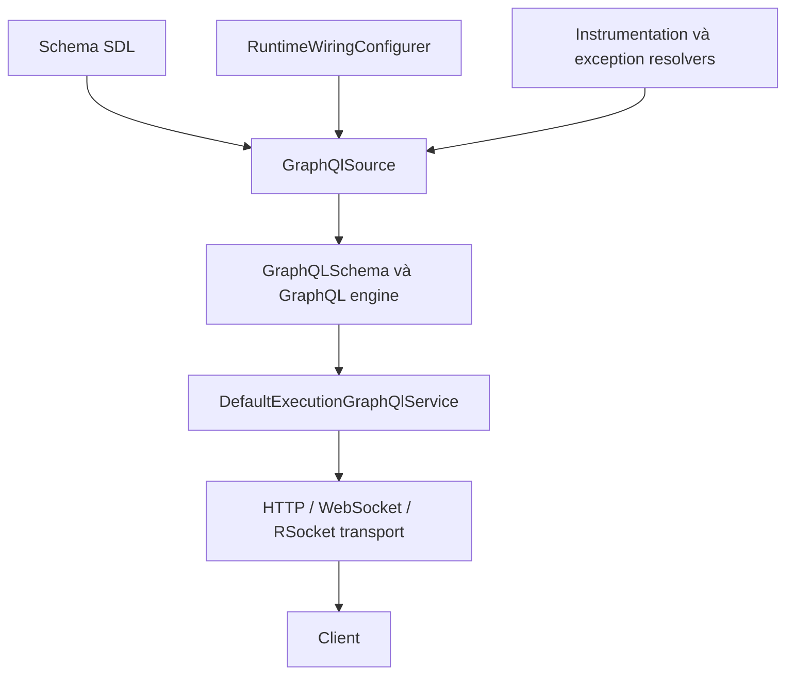
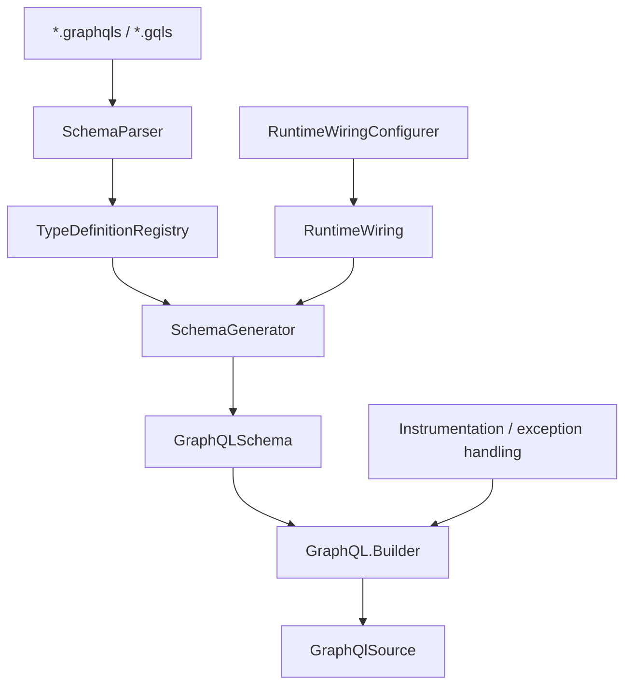

# GraphQlSource

## Mục tiêu

Sau bài học này, bạn có thể:

- Giải thích vai trò của `GraphQlSource` trong kiến trúc Spring for GraphQL.
- Mô tả cách Spring tạo `GraphQLSchema` và đối tượng `GraphQL` từ các file SDL cùng cấu hình runtime.
- Phân biệt `GraphQlSource`, `RuntimeWiringConfigurer` và các controller dùng `@QueryMapping`, `@SchemaMapping`.
- Cấu hình schema resources và runtime wiring bằng Spring Boot hoặc trực tiếp bằng builder.
- Dùng schema mapping inspection để phát hiện những field chưa được ánh xạ.

## 1. GraphQlSource là gì?

`GraphQlSource` là abstraction trung tâm của Spring for GraphQL để cung cấp hai thành phần:

- `GraphQLSchema`: schema thực thi được, mô tả các kiểu, field, argument và quan hệ trong API.
- `GraphQL`: engine GraphQL Java được cấu hình để phân tích, kiểm tra và thực thi operation.

Interface `org.springframework.graphql.execution.GraphQlSource` cung cấp hai phương thức truy cập tương ứng:

```java
GraphQL graphQL = graphQlSource.graphQl();
GraphQLSchema schema = graphQlSource.schema();
```

Trong ứng dụng thông thường, bạn không cần tự gọi engine này trong controller. `DefaultExecutionGraphQlService` sử dụng `GraphQlSource` để lấy GraphQL engine và thực thi request. Các tầng transport như HTTP hoặc WebSocket chuyển request đến execution service.

Có thể hình dung vai trò của các thành phần như sau:



Điểm cần nhớ: `GraphQlSource` chuẩn bị GraphQL runtime. Nó không phải controller, endpoint HTTP hay nơi xử lý trực tiếp từng request của người dùng.

## 2. Từ file SDL đến GraphQL runtime

Để tạo một GraphQL API có thể thực thi, server cần cả phần khai báo schema và phần triển khai hành vi cho các field.

Ví dụ schema:

```graphql
type Query {
  book(id: ID!): Book
}

type Book {
  id: ID!
  title: String!
  author: String
}
```

SDL cho biết query `book` nhận một argument `id` và trả về `Book`. Tuy nhiên, schema chưa cho biết cách tìm quyển sách trong database. Server cần một `DataFetcher` hoặc một phương thức controller để cung cấp dữ liệu.

Quá trình tạo runtime có thể chia thành các bước:

1. **Đọc schema resources:** Spring đọc một hoặc nhiều resource chứa SDL.
2. **Parse và hợp nhất định nghĩa:** GraphQL Java phân tích SDL thành `TypeDefinitionRegistry`. Nhiều file có thể đóng góp các type hoặc field vào cùng một schema.
3. **Tạo RuntimeWiring:** các thành phần cấu hình đăng ký `DataFetcher`, custom scalar, directive wiring, `TypeResolver` và các thành phần runtime khác.
4. **Tạo GraphQLSchema:** `SchemaGenerator` kết hợp `TypeDefinitionRegistry` với `RuntimeWiring` để tạo schema thực thi và kiểm tra tính hợp lệ.
5. **Tạo GraphQL engine:** builder cấu hình đối tượng `GraphQL` để Spring sử dụng khi thực thi request.



Nếu SDL có lỗi cú pháp hoặc định nghĩa type không hợp lệ, quá trình khởi tạo schema có thể thất bại khi ứng dụng khởi động. Một số lỗi wiring, chẳng hạn đăng ký DataFetcher cho field không có trong schema, có thể không được GraphQL Java phát hiện đầy đủ nếu không bật schema mapping inspection. Vì vậy, nên kiểm tra cả tính hợp lệ của schema lẫn sự tương ứng giữa schema và phần triển khai.

## 3. Schema resources được tìm ở đâu?

Spring Boot GraphQL starter mặc định tìm các file có phần mở rộng `.graphqls` hoặc `.gqls` bên dưới:

```text
src/main/resources/graphql/
```

Một dự án có thể chia schema thành nhiều file theo miền nghiệp vụ:

```text
src/main/resources/
└── graphql/
    ├── common.graphqls
    ├── book.graphqls
    ├── author.graphqls
    └── review.graphqls
```

Ví dụ, `book.graphqls` khai báo `Book` và field liên quan đến sách; `author.graphqls` khai báo type `Author`. Các file được nạp và hợp nhất thành một schema. Việc chia file giúp tổ chức mã nguồn, không tạo ra nhiều GraphQL endpoint hay nhiều schema độc lập.

Có thể thay đổi vị trí và phần mở rộng file bằng cấu hình:

```yaml
spring:
  graphql:
    schema:
      locations: classpath:graphql/**/
      file-extensions: .graphqls,.gqls
```

Nếu schema nằm trong nhiều module hoặc dependency trên classpath, dùng prefix `classpath*:` để tìm resource ở tất cả vị trí phù hợp:

```yaml
spring:
  graphql:
    schema:
      locations: classpath*:graphql/**/
```

`classpath:` thường tìm theo một vị trí classpath; `classpath*:` cho phép tìm trên nhiều vị trí classpath. Điều này hữu ích khi mỗi module đóng góp một phần schema.

Spring sử dụng abstraction `Resource` của Spring Framework, vì vậy builder cũng có thể nhận resource từ filesystem hoặc nguồn được ứng dụng cung cấp. Không bắt buộc mọi schema phải được lưu trong một file duy nhất.

## 4. RuntimeWiring và RuntimeWiringConfigurer

`RuntimeWiring` là cấu hình runtime của GraphQL Java. Nó kết nối các khai báo trong SDL với hành vi thực tế của server.

Những thành phần thường được đăng ký qua runtime wiring gồm:

| Thành phần | Vai trò |
|---|---|
| `DataFetcher` | Lấy dữ liệu cho một field |
| Custom scalar | Định nghĩa cách parse và serialize kiểu dữ liệu tùy chỉnh |
| `TypeResolver` | Xác định object type cụ thể cho interface hoặc union |
| `SchemaDirectiveWiring` | Gắn hành vi xử lý cho directive trong schema |
| Wiring factory | Tạo wiring dựa trên thông tin định nghĩa schema |

Spring for GraphQL cung cấp `RuntimeWiringConfigurer` để ứng dụng tùy chỉnh `RuntimeWiring.Builder`. Với Spring Boot, các bean loại này được tự động phát hiện và thêm vào cấu hình `GraphQlSource`.

Ví dụ đăng ký một `DataFetcher` trực tiếp:

```java
@Configuration
public class GraphQlRuntimeConfiguration {

    @Bean
    RuntimeWiringConfigurer bookDataFetcher(BookRepository repository) {
        return wiringBuilder -> wiringBuilder
            .type("Query", typeBuilder -> typeBuilder
                .dataFetcher("book", environment -> {
                    String id = environment.getArgument("id");
                    return repository.findById(id).orElse(null);
                }));
    }
}
```

Trong ví dụ này:

- `type("Query", ...)` chọn GraphQL object type có tên `Query`.
- `dataFetcher("book", ...)` gắn hành vi cho field `Query.book`.
- `environment.getArgument("id")` đọc argument do client truyền vào.
- Giá trị trả về của repository trở thành source value cho field `book`.

Tên type và field phải khớp với SDL. Nếu SDL đổi tên `book` thành `findBook` mà wiring vẫn đăng ký `book`, cấu hình sẽ không còn ánh xạ đúng với schema mới.

### Khi nào cần đăng ký DataFetcher trực tiếp?

Spring for GraphQL thường dùng annotated controller. Các phương thức controller được phát hiện và đăng ký thành `DataFetcher` thông qua `AnnotatedControllerConfigurer`, vốn cũng là một `RuntimeWiringConfigurer`.

Ví dụ:

```java
@Controller
public class BookController {

    private final BookRepository repository;

    public BookController(BookRepository repository) {
        this.repository = repository;
    }

    @QueryMapping
    public Book book(@Argument String id) {
        return repository.findById(id).orElse(null);
    }
}
```

Với Spring Boot GraphQL starter, controller được cấu hình tự động. Bạn thường chỉ cần khai báo controller và schema. Dùng `RuntimeWiringConfigurer` cho những phần bổ sung như custom scalar, directive, type resolver hoặc một `DataFetcher` đặc thù.

Tránh đăng ký hai cách xử lý cho cùng một field nếu không có chủ đích rõ ràng. Ví dụ, không nên vừa khai báo `@QueryMapping` cho `Query.book`, vừa đăng ký một `DataFetcher` khác cho đúng field đó. Việc có nhiều nơi cùng định nghĩa một mapping làm cấu hình khó hiểu và dễ dẫn đến xung đột.

## 5. Tạo GraphQlSource bằng builder

Spring for GraphQL cung cấp builder mặc định qua:

```java
GraphQlSource.schemaResourceBuilder()
```

Builder này đọc SDL resources và dùng `RuntimeWiring` để tạo `GraphQLSchema`.

Ví dụ sau tạo một `GraphQlSource` trực tiếp, không phụ thuộc vào cơ chế tự cấu hình GraphQL của Spring Boot:

```java
@Configuration
public class GraphQlSourceConfiguration {

    @Bean
    GraphQlSource graphQlSource(BookRepository repository) {
        return GraphQlSource.schemaResourceBuilder()
            .schemaResources(
                new ClassPathResource("graphql/books.graphqls")
            )
            .configureRuntimeWiring(wiringBuilder ->
                wiringBuilder.type("Query", typeBuilder ->
                    typeBuilder.dataFetcher("book", environment -> {
                        String id = environment.getArgument("id");
                        return repository.findById(id).orElse(null);
                    })
                )
            )
            .inspectSchemaMappings(System.out::println)
            .build();
    }
}
```

Đoạn cấu hình thể hiện các phần chính:

- `schemaResources(...)` cung cấp file SDL để parse.
- `configureRuntimeWiring(...)` đăng ký hành vi cho field.
- `inspectSchemaMappings(...)` yêu cầu Spring kiểm tra mapping và gửi báo cáo đến callback.
- `build()` tạo `GraphQlSource` từ cấu hình đã khai báo.

Các import chính:

```java
import org.springframework.context.annotation.Bean;
import org.springframework.context.annotation.Configuration;
import org.springframework.core.io.ClassPathResource;
import org.springframework.graphql.execution.GraphQlSource;
```

Ví dụ này minh họa builder ở mức thấp. Khi tự tạo `GraphQlSource` trong một ứng dụng Spring Boot, bạn phải chịu trách nhiệm đưa vào đầy đủ các cấu hình runtime cần thiết của ứng dụng. Với dự án thông thường, nên tận dụng auto-configuration của Spring Boot và chỉ bổ sung các bean tùy biến cần thiết.

Ngoài `schemaResourceBuilder()`, `GraphQlSource.builder(graphQLSchema)` cho phép tạo source từ một `GraphQLSchema` đã được chuẩn bị bên ngoài. Cách này phù hợp khi schema được tạo bởi một quy trình chuyên biệt hoặc một thư viện tích hợp khác.

## 6. Spring Boot tự cấu hình GraphQlSource như thế nào?

Khi thêm `spring-boot-starter-graphql`, Spring Boot tự tạo builder và cấu hình `GraphQlSource` dựa trên các thành phần trong application context.

Ở mức khái quát, Boot thực hiện những việc sau:

- Tìm schema resources theo `spring.graphql.schema.locations` và `spring.graphql.schema.file-extensions`.
- Áp dụng các thuộc tính cấu hình dành cho GraphQL source.
- Phát hiện bean `RuntimeWiringConfigurer` để bổ sung runtime wiring.
- Phát hiện bean `Instrumentation` để tích hợp instrumentation và metrics.
- Phát hiện bean `DataFetcherExceptionResolver` và `SubscriptionExceptionResolver` để xử lý lỗi.
- Đăng ký cơ chế ánh xạ các annotated controller thành data fetcher.

Do đó, cấu hình thường ngày có thể chỉ cần schema resources và các bean mở rộng:

```java
@Configuration
public class GraphQlConfiguration {

    @Bean
    RuntimeWiringConfigurer customRuntimeWiring() {
        return wiringBuilder -> {
            // Đăng ký custom scalar, directive hoặc TypeResolver tại đây.
        };
    }
}
```

Nếu cần thay đổi sâu hơn các thiết lập trên `GraphQlSource.Builder`, Spring Boot cung cấp extension point `GraphQlSourceBuilderCustomizer`. Ví dụ, customizer có thể gọi `configureGraphQl(...)` để cấu hình một tùy chọn trên `GraphQL.Builder`.

Nên chọn đúng điểm mở rộng theo mục đích:

| Nhu cầu | Cơ chế |
|---|---|
| Thêm custom scalar, directive hoặc DataFetcher | `RuntimeWiringConfigurer` |
| Viết logic cho query hoặc field bằng controller | `@QueryMapping`, `@SchemaMapping`, `@BatchMapping` |
| Điều chỉnh cấu hình GraphQL engine | `GraphQlSourceBuilderCustomizer` |
| Tạo schema từ nguồn SDL | `GraphQlSource.schemaResourceBuilder()` |
| Dùng GraphQLSchema đã tạo sẵn | `GraphQlSource.builder(schema)` |

Không nên khai báo một `GraphQlSource` bean tùy chỉnh chỉ để thêm một scalar hoặc một DataFetcher. Trong trường hợp đó, bean `RuntimeWiringConfigurer` đơn giản hơn và vẫn để Spring Boot quản lý vòng đời cấu hình source.

## 7. Kiểm tra schema mapping khi ứng dụng khởi động

SDL hợp lệ chưa chắc đã có đầy đủ phần triển khai. Ví dụ:

```graphql
type Query {
  book(id: ID!): Book
}

type Book {
  id: ID!
  title: String!
}
```

Nếu server không có data fetcher cho `Query.book`, query có thể không lấy được dữ liệu mong muốn. Với field lồng như `Book.title`, GraphQL Java có thể dùng `PropertyDataFetcher` mặc định để đọc property hoặc getter tương ứng từ object cha. Tuy vậy, một field không có mapping tường minh và cũng không có property phù hợp có thể trả về `null`.

Một số lỗi mapping chỉ xuất hiện khi client gửi query. Chúng có thể bị bỏ sót nếu test chưa bao phủ field đó. Spring for GraphQL hỗ trợ schema mapping inspection để phát hiện sớm các vấn đề phổ biến.

Có thể bật inspection bằng builder:

```java
GraphQlSource graphQlSource = GraphQlSource.schemaResourceBuilder()
    .schemaResources(new ClassPathResource("graphql/books.graphqls"))
    .inspectSchemaMappings(System.out::println)
    .build();
```

Báo cáo có thể chỉ ra:

- Field trong schema chưa có data fetcher hoặc property phù hợp.
- DataFetcher đăng ký vào field không tồn tại trong schema.
- Argument mà data fetcher mong đợi không khớp argument được khai báo trong SDL.
- Một số trường hợp không tương thích về nullability giữa schema và kiểu Java có thể xác định được.

Inspection không thể suy luận mọi trường hợp. Nếu data fetcher trả về `Object`, `List<?>` hoặc kiểu quá tổng quát, Spring có thể không đủ thông tin để kiểm tra sâu. Với interface và union, cần có thông tin về các kiểu Java cụ thể hoặc cấu hình type mapping phù hợp.

### Nullability cần được thiết kế có chủ đích

GraphQL phân biệt field nullable và non-null:

```graphql
type Book {
  title: String
  isbn: String!
}
```

Nếu field `isbn` được khai báo non-null nhưng data fetcher trả về `null` hoặc phát sinh lỗi, GraphQL sẽ áp dụng quy tắc null propagation: giá trị null lan lên field cha gần nhất cho phép null và có thể làm mất một phần dữ liệu của response.

Vì vậy, không nên đánh dấu mọi field là non-null theo thói quen. Hãy dùng dấu `!` khi ứng dụng có thể đảm bảo field luôn có giá trị theo hợp đồng nghiệp vụ. Schema inspection giúp tìm một số điểm không khớp giữa nullability của SDL và kiểu Java, nhưng vẫn cần test các tình huống dữ liệu thực tế.

## 8. Các tùy chọn mở rộng của GraphQlSource.Builder

Ngoài việc nạp schema và cấu hình runtime wiring, builder còn cung cấp các extension point cho trường hợp nâng cao.

| API | Mục đích |
|---|---|
| `configureGraphQl(...)` | Cấu hình `GraphQL.Builder`, ví dụ execution ID provider hoặc operation cache |
| `exceptionResolvers(...)` | Đăng ký resolver cho lỗi phát sinh trong data fetching |
| `subscriptionExceptionResolvers(...)` | Đăng ký resolver cho lỗi từ luồng subscription |
| `instrumentation(...)` | Gắn instrumentation để theo dõi hoặc tùy chỉnh quá trình thực thi |
| `typeVisitors(...)` | Duyệt schema sau khi tạo và có thể cập nhật code registry |
| `typeVisitorsToTransformSchema(...)` | Duyệt và biến đổi schema khi thực sự cần thay đổi cấu trúc |
| `schemaFactory(...)` | Tự cung cấp cách tạo `GraphQLSchema` từ registry và runtime wiring |

Một số tình huống sử dụng:

- **Custom scalar hoặc directive:** dùng `RuntimeWiringConfigurer` để đăng ký hành vi tương ứng.
- **Interface và union:** cấu hình `TypeResolver` khi server cần xác định kiểu object cụ thể. Builder có `defaultTypeResolver(...)`; mặc định Spring dùng `ClassNameTypeResolver` để suy ra tên GraphQL type từ tên lớp Java và hệ thống kế thừa.
- **Federation hoặc schema được tạo đặc biệt:** cân nhắc `schemaFactory(...)` khi `SchemaGenerator` mặc định không đáp ứng quy trình tạo schema.
- **Theo dõi hoạt động:** dùng `Instrumentation` để đo thời gian hoặc gắn metadata cho quá trình thực thi.
- **Operation caching:** có thể cấu hình `PreparsedDocumentProvider` qua `configureGraphQl(...)` để cache kết quả parse và validation. Đây là cache operation, khác với cache dữ liệu nghiệp vụ.

Chỉ nên thêm extension point khi có yêu cầu cụ thể. Càng nhiều tùy biến ở tầng source thì việc theo dõi cấu hình, nâng cấp phiên bản và chẩn đoán lỗi càng cần được quản lý cẩn thận.

## 9. Phân biệt các thành phần thường bị nhầm lẫn

| Thành phần | Trách nhiệm chính | Ví dụ |
|---|---|---|
| SDL | Khai báo hợp đồng API | `type Query { book(id: ID!): Book }` |
| `GraphQlSource` | Cung cấp GraphQL engine và schema thực thi | Đọc SDL, áp dụng wiring và build runtime |
| `RuntimeWiringConfigurer` | Bổ sung cấu hình runtime wiring | Custom scalar, directive, DataFetcher |
| Annotated controller | Triển khai logic cho field | `@QueryMapping`, `@SchemaMapping` |
| `ExecutionGraphQlService` | Điều phối thực thi GraphQL request | `DefaultExecutionGraphQlService` |
| Transport handler | Nhận request qua giao thức cụ thể | HTTP, WebSocket, RSocket |

Ví dụ, khi client gửi query `book(id: "b-1")` qua HTTP:

1. HTTP handler nhận request và chuyển request vào execution service.
2. `DefaultExecutionGraphQlService` dùng GraphQL engine từ `GraphQlSource`.
3. GraphQL engine kiểm tra query theo schema.
4. DataFetcher được đăng ký cho field `Query.book` gọi controller hoặc logic đã wiring.
5. Kết quả được đóng thành GraphQL response và trả qua transport.

Việc chia trách nhiệm này cho phép cùng một GraphQL schema và runtime được sử dụng với các transport phù hợp mà không buộc logic nghiệp vụ phụ thuộc trực tiếp vào HTTP.

## 10. Khi nào nên tùy biến GraphQlSource?

Trong phần lớn ứng dụng Spring Boot, hãy bắt đầu với auto-configuration:

- Đặt file SDL trong `src/main/resources/graphql/`.
- Dùng annotated controller cho query, mutation và field mapping.
- Dùng `RuntimeWiringConfigurer` cho scalar, directive, type resolver hoặc DataFetcher đặc thù.
- Dùng các bean exception resolver và instrumentation khi cần xử lý lỗi hoặc quan sát runtime.

Chỉ tạo `GraphQlSource` thủ công khi cần kiểm soát quá trình tạo schema hoặc runtime ở mức thấp, chẳng hạn nguồn schema đặc biệt, schema factory tùy chỉnh hay một cấu hình engine không thể biểu diễn bằng các extension point thông thường.

Khi tự xây dựng source, cần kiểm tra rằng tất cả schema resources, runtime wiring, annotated controller configurer, exception resolver và instrumentation cần thiết đều được đưa vào builder. Nếu thiếu một thành phần mà trước đó Boot tự động đăng ký, ứng dụng có thể khởi động nhưng một số field hoặc hành vi runtime không hoạt động như mong đợi.

## Kết luận

`GraphQlSource` là điểm kết nối giữa schema SDL, runtime wiring và GraphQL Java engine trong Spring for GraphQL. Nó tạo ra `GraphQLSchema` có thể thực thi và cung cấp đối tượng `GraphQL` cho `ExecutionGraphQlService`.

Với Spring Boot, phần lớn ứng dụng không cần tự tạo source. Boot tự tìm schema resources, phát hiện các bean `RuntimeWiringConfigurer`, controller và các thành phần mở rộng. Khi hiểu vai trò của `GraphQlSource`, bạn có thể chọn đúng extension point: dùng controller cho logic field, runtime configurer cho wiring bổ sung, builder customizer cho cấu hình engine và builder trực tiếp khi thật sự cần kiểm soát quá trình tạo GraphQL runtime.

## Tài liệu tham khảo

- [Spring for GraphQL — Request Execution](https://docs.spring.io/spring-graphql/reference/request-execution.html)
- [Spring for GraphQL 1.4.3 — GraphQlSource.SchemaResourceBuilder API](https://docs.spring.io/spring-graphql/docs/1.4.3/api/org/springframework/graphql/execution/GraphQlSource.SchemaResourceBuilder.html)
- [Spring Boot — Spring for GraphQL](https://docs.spring.io/spring-boot/reference/web/spring-graphql.html)
