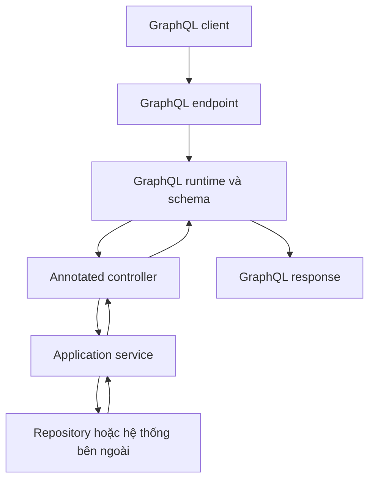

# Annotated controller

## Mục tiêu

Sau bài học này, bạn có thể:

- Giải thích vai trò của annotated controller trong Spring for GraphQL và mối quan hệ giữa controller với schema SDL.
- Dùng `@QueryMapping`, `@MutationMapping` và `@SubscriptionMapping` để ánh xạ các root field.
- Dùng `@SchemaMapping` để cung cấp dữ liệu cho field trên object type.
- Nhận argument, object nguồn và các ngữ cảnh cần thiết trong method controller.
- Tổ chức controller theo trách nhiệm, xử lý kết quả đồng bộ hoặc bất đồng bộ và kiểm thử mapping.

## Annotated controller là gì?

Spring for GraphQL cung cấp mô hình annotated controller để liên kết method Java với field trong GraphQL schema. Thay vì tự đăng ký từng `DataFetcher` bằng mã cấu hình, bạn đánh dấu một Spring bean bằng `@Controller`, sau đó dùng annotation trên các method để mô tả method nào xử lý field nào.

Controller là lớp điều phối request GraphQL. Nó nhận dữ liệu đầu vào, gọi service thực hiện nghiệp vụ và trả kết quả cho GraphQL runtime. Schema SDL vẫn định nghĩa contract của API: tên type, field, argument, kiểu dữ liệu và tính nullable. Annotation chỉ kết nối method Java với field đã được khai báo trong schema; annotation không thay thế schema và cũng không tự tạo ra một thiết kế API hoàn chỉnh.

Ví dụ, schema có field `bookById(id: ID!): Book`. Một method Java được đánh dấu `@QueryMapping` có thể xử lý field này. Client gọi field qua GraphQL endpoint; Spring for GraphQL dựa trên mapping để tìm method phù hợp và chuyển argument vào method.

## Khai báo schema trước khi viết controller

Giả sử ứng dụng thư viện cung cấp API đọc sách, xem tác giả và thêm sách. Schema SDL có thể được khai báo như sau:

```graphql
type Query {
  bookById(id: ID!): Book
}

type Mutation {
  addBook(input: CreateBookInput!): Book!
}

type Book {
  id: ID!
  title: String!
  author: Author
}

type Author {
  id: ID!
  name: String!
}

input CreateBookInput {
  title: String!
  authorId: ID!
}
```

Schema trên mô tả hai root operation type là `Query` và `Mutation`. `Book.author` là field lồng nhau, có thể cần tra cứu tác giả từ `authorId` của sách. `CreateBookInput` là input object dùng để nhận dữ liệu khi thêm sách.

Trong ứng dụng Spring Boot, các file schema thường được đặt trong `src/main/resources/graphql/`. Spring Boot tự phát hiện schema trong vị trí mặc định này khi cấu hình Spring for GraphQL phù hợp. Tên file có thể chia theo miền hoặc chức năng; các file SDL được ghép thành schema của ứng dụng.

## Đăng ký controller với `@Controller`

Một annotated controller là Spring bean được đánh dấu bằng `org.springframework.stereotype.Controller`:

```java
import org.springframework.stereotype.Controller;

@Controller
public class BookGraphQlController {
    // Các method xử lý field GraphQL được khai báo tại đây.
}
```

Spring for GraphQL phát hiện các controller bean và đăng ký những method có annotation mapping. Dùng `@Controller` để đánh dấu bean xử lý GraphQL. Đây không phải là một REST controller: method mapping GraphQL không tạo ra một HTTP route riêng cho từng method. HTTP request đi vào GraphQL endpoint, sau đó GraphQL runtime chọn resolver dựa trên operation và schema.

Một controller có thể chứa nhiều mapping. Tuy nhiên, khi controller có quá nhiều method hoặc trộn nhiều miền nghiệp vụ, nên tách thành các controller theo nhóm type hoặc chức năng để dễ đọc, kiểm thử và bảo trì.

## Ánh xạ root field bằng `@QueryMapping`

`@QueryMapping` là annotation chuyên dùng cho field trên root type `Query`. Annotation này là cách viết rút gọn của `@SchemaMapping(typeName = "Query", ...)`.

Với schema:

```graphql
type Query {
  bookById(id: ID!): Book
}
```

Controller có thể triển khai như sau:

```java
import org.springframework.graphql.data.method.annotation.Argument;
import org.springframework.graphql.data.method.annotation.QueryMapping;
import org.springframework.stereotype.Controller;

@Controller
public class BookQueryController {

    private final BookService bookService;

    public BookQueryController(BookService bookService) {
        this.bookService = bookService;
    }

    @QueryMapping
    public Book bookById(@Argument("id") String id) {
        return bookService.findById(id).orElse(null);
    }
}
```

Tên method `bookById` được dùng làm tên field mặc định. `@Argument("id")` liên kết tham số Java với argument `id` trong SDL. Việc ghi rõ tên argument giúp mapping không phụ thuộc vào tên tham số được giữ trong bytecode khi biên dịch.

Nếu cần, có thể chỉ định tên field trực tiếp trong annotation:

```java
@QueryMapping(name = "bookById")
public Book findBook(@Argument("id") String bookId) {
    return bookService.findById(bookId).orElse(null);
}
```

Tên field trong schema và mapping phải khớp nhau. Nếu method trả về `null`, GraphQL trả `null` cho field này vì `Book` trong schema là nullable. Nếu nghiệp vụ yêu cầu báo lỗi khi không tìm thấy sách, hãy dùng exception hoặc cơ chế xử lý lỗi GraphQL theo quy ước của API thay vì thay đổi tính nullable một cách tùy tiện.

## Ánh xạ field lồng nhau bằng `@SchemaMapping`

Root resolver thường trả về object cha. Khi client yêu cầu field lồng nhau, Spring for GraphQL cần một resolver để cung cấp giá trị field đó nếu giá trị chưa có sẵn từ object cha.

Với schema `Book.author`, ta có thể viết:

```java
import org.springframework.graphql.data.method.annotation.SchemaMapping;
import org.springframework.stereotype.Controller;

@Controller
public class BookFieldController {

    private final AuthorService authorService;

    public BookFieldController(AuthorService authorService) {
        this.authorService = authorService;
    }

    @SchemaMapping(typeName = "Book", field = "author")
    public Author author(Book book) {
        return authorService.findById(book.authorId()).orElse(null);
    }
}
```

Trong ví dụ này:

- `typeName = "Book"` chỉ rõ object type chứa field cần xử lý.
- `field = "author"` chỉ rõ field được ánh xạ.
- Tham số `Book book` là source object, tức object cha mà GraphQL đang phân giải.
- Giá trị trả về `Author` được dùng để tạo nội dung cho field `Book.author`.

Nếu bỏ `field`, Spring for GraphQL mặc định suy ra tên field từ tên method. Nếu bỏ `typeName`, framework có thể suy ra tên type từ kiểu của source argument. Việc khai báo tường minh như trên giúp mapping dễ đọc hơn, đặc biệt khi tên class Java khác tên type trong schema.

`@SchemaMapping` có thể được dùng cho field trên bất kỳ object type nào, không chỉ `Book`. Ví dụ `Author.books`, `Order.customer` hoặc `Product.category` đều có thể được xử lý bằng mapping tương ứng.

### Không phải field nào cũng cần resolver riêng

Nếu object Java đã có thuộc tính hoặc getter tương ứng với field schema, GraphQL runtime có thể đọc giá trị từ object đó bằng property data fetcher mặc định. Ví dụ, nếu `Book` đã có `getTitle()` và schema có `Book.title`, không cần viết thêm method chỉ để trả về `title`.

Hãy viết `@SchemaMapping` khi cần thực hiện logic bổ sung, truy vấn một nguồn dữ liệu khác, biến đổi kết quả hoặc kiểm soát việc phân giải field. Cách này giúp controller tập trung vào các field thực sự cần điều phối.

## Nhận argument bằng `@Argument`

GraphQL field có thể khai báo nhiều argument. `@Argument` lấy giá trị theo tên từ argument của field hiện tại.

Ví dụ schema có query tìm kiếm:

```graphql
type Query {
  books(authorId: ID, keyword: String, first: Int = 20): [Book!]!
}
```

Controller nhận từng argument:

```java
@QueryMapping
public List<Book> books(
        @Argument("authorId") String authorId,
        @Argument("keyword") String keyword,
        @Argument("first") Integer first) {

    int pageSize = first != null ? first : 20;
    return bookService.search(authorId, keyword, pageSize);
}
```

Kiểu Java cần tương thích với kiểu GraphQL. Với argument có thể không được truyền hoặc có thể nhận `null`, dùng kiểu tham chiếu như `Integer` thay vì kiểu nguyên thủy `int` để biểu diễn trạng thái thiếu giá trị. Giá trị mặc định trong SDL được áp dụng theo quy tắc coercion của GraphQL khi argument không được cung cấp.

### Bind input object vào Java object

Với input object, có thể bind toàn bộ argument vào một Java record hoặc class:

```java
public record CreateBookInput(String title, String authorId) {}
```

```java
@MutationMapping
public Book addBook(@Argument("input") CreateBookInput input) {
    return bookService.add(input.title(), input.authorId());
}
```

Spring for GraphQL dùng cơ chế argument binding để chuyển dữ liệu GraphQL sang cấu trúc Java. Tên và kiểu của các thuộc tính phải phù hợp với input object trong schema. Với input phức tạp, nên dùng DTO riêng để kiểm soát dữ liệu đầu vào, tránh bind trực tiếp vào entity lưu trữ của persistence layer.

Nếu ứng dụng có Spring Validation, có thể kết hợp `@Valid` với argument để kiểm tra các ràng buộc khai báo trên DTO:

```java
@MutationMapping
public Book addBook(@Argument("input") @Valid CreateBookInput input) {
    return bookService.add(input.title(), input.authorId());
}
```

Hãy xác định rõ cách chuyển lỗi validation thành GraphQL error và định dạng thông tin lỗi mà client được phép nhìn thấy.

## Ánh xạ mutation bằng `@MutationMapping`

`@MutationMapping` là shortcut cho mapping trên root type `Mutation`. Cách dùng tương tự `@QueryMapping`, nhưng method thường gọi service để thay đổi trạng thái hệ thống.

```java
@Controller
public class BookMutationController {

    private final BookService bookService;

    public BookMutationController(BookService bookService) {
        this.bookService = bookService;
    }

    @MutationMapping
    public Book addBook(@Argument("input") CreateBookInput input) {
        return bookService.add(input.title(), input.authorId());
    }
}
```

Với SDL `addBook(input: CreateBookInput!): Book!`, method trên xử lý đúng root field `addBook`. GraphQL vẫn cho client chọn các field muốn nhận trong object kết quả:

```graphql
mutation AddBook($input: CreateBookInput!) {
  addBook(input: $input) {
    id
    title
    author {
      id
      name
    }
  }
}
```

Mutation có thể kích hoạt các `@SchemaMapping` để phân giải field lồng nhau của object trả về. Vì mutation thay đổi dữ liệu, cần áp dụng quy tắc xác thực, phân quyền, transaction và xử lý lỗi phù hợp với nghiệp vụ. Không nên đặt toàn bộ logic nghiệp vụ trong method controller; controller nên gọi service chịu trách nhiệm thực hiện use case.

## Ánh xạ subscription bằng `@SubscriptionMapping`

`@SubscriptionMapping` ánh xạ field trên root type `Subscription`. Method thường trả về một reactive publisher để phát ra nhiều kết quả theo thời gian.

Schema ví dụ:

```graphql
type Subscription {
  bookAdded: Book!
}
```

Controller có thể trả về `Flux<Book>`:

```java
import reactor.core.publisher.Flux;
import org.springframework.graphql.data.method.annotation.SubscriptionMapping;
import org.springframework.stereotype.Controller;

@Controller
public class BookSubscriptionController {

    private final BookEventService eventService;

    public BookSubscriptionController(BookEventService eventService) {
        this.eventService = eventService;
    }

    @SubscriptionMapping
    public Flux<Book> bookAdded() {
        return eventService.bookAdded();
    }
}
```

`Flux<Book>` phát ra các sách mới khi có sự kiện. Subscription cần transport hỗ trợ kết nối dạng stream, chẳng hạn WebSocket hoặc Server-Sent Events tùy cấu hình ứng dụng. Việc khai báo `@SubscriptionMapping` chỉ tạo mapping ở tầng GraphQL; ứng dụng vẫn cần cấu hình transport và nguồn phát sự kiện.

## Các tham số method ngoài `@Argument`

Annotated controller hỗ trợ nhiều loại tham số để method có thể truy cập dữ liệu của lần thực thi hiện tại. Một số loại thường gặp:

| Tham số | Mục đích |
| --- | --- |
| `@Argument("id") String id` | Lấy argument có tên `id` của field |
| `Book book` | Nhận source object khi xử lý field lồng nhau |
| `DataFetchingEnvironment environment` | Truy cập thông tin thực thi của GraphQL Java |
| `GraphQLContext context` | Đọc context dùng chung trong một lần thực thi GraphQL |
| `@ContextValue("tenantId") String tenantId` | Lấy giá trị theo key từ GraphQL context |
| `Principal principal` | Truy cập principal đã được xác thực nếu có |

Ví dụ, một field cần tenant hiện tại có thể nhận context value:

```java
@QueryMapping
public List<Book> booksForTenant(
        @ContextValue("tenantId") String tenantId) {
    return bookService.findForTenant(tenantId);
}
```

Giá trị `tenantId` phải được thiết lập vào GraphQL context ở bước xử lý request trước đó. Không nên lấy tenant hoặc danh tính người dùng từ một argument do client tự gửi rồi coi đó là bằng chứng phân quyền. Context và principal cần được tạo từ nguồn đáng tin cậy ở server.

## Kiểu trả về và xử lý bất đồng bộ

Method mapping có thể trả về object hoặc kiểu dữ liệu tương thích với cơ chế thực thi của Spring for GraphQL. Tùy cách xây dựng ứng dụng, các kiểu thường gặp gồm:

- Object hoặc collection cho xử lý đồng bộ.
- `CompletableFuture<T>` hoặc `CompletionStage<T>` cho xử lý bất đồng bộ theo Java.
- `Mono<T>` và `Flux<T>` trong ứng dụng dùng Project Reactor.
- `Publisher<T>` cho luồng dữ liệu reactive, đặc biệt trong subscription.

Ví dụ một query bất đồng bộ:

```java
@QueryMapping
public CompletableFuture<Book> bookById(@Argument("id") String id) {
    return bookService.findByIdAsync(id);
}
```

Không cần tự tạo thread cho mỗi resolver nếu framework hoặc service đã cung cấp cơ chế bất đồng bộ phù hợp. Cần hiểu scheduler, transaction context và cách truy cập persistence để tránh chạy tác vụ blocking trên event-loop trong ứng dụng reactive.

## Tổ chức controller và trách nhiệm nghiệp vụ

Một cấu trúc đơn giản có thể chia trách nhiệm như sau:



Controller liên kết field với use case, chuyển argument và source object sang lời gọi service, rồi trả kết quả. Service thực hiện quy tắc nghiệp vụ và phối hợp repository hoặc hệ thống bên ngoài. Schema mô tả contract mà client sử dụng.

Một số nguyên tắc giúp controller dễ bảo trì:

- Giữ method mapping ngắn, tập trung vào điều phối.
- Dùng input DTO cho mutation và query có nhiều argument liên quan.
- Không trả entity persistence trực tiếp nếu điều đó làm lộ cấu trúc nội bộ hoặc tạo coupling với database.
- Đặt kiểm tra quyền ở nơi bảo đảm mọi đường truy cập đều được bảo vệ; có thể kết hợp method security với Spring Security khi đã bật cấu hình tương ứng.
- Không tạo resolver riêng cho mọi field một cách máy móc; tận dụng property data fetcher mặc định khi object đã có sẵn dữ liệu.
- Theo dõi truy vấn phát sinh từ field mapping. Resolver gọi database theo từng object có thể tạo vấn đề N+1; khi cần, cân nhắc `@BatchMapping` hoặc DataLoader.

## Kiểm thử annotated controller

Spring for GraphQL cung cấp `GraphQlTester` để kiểm thử operation và response mà không cần viết HTTP client cho từng test. Trong kiểm thử controller hoặc ứng dụng, có thể gửi document GraphQL, truyền variable và kiểm tra đường dẫn trong response.

Ví dụ:

```java
graphQlTester.document("""
        query BookById($id: ID!) {
            bookById(id: $id) {
                id
                title
            }
        }
        """)
    .variable("id", "book-101")
    .execute()
    .path("bookById.title")
    .entity(String.class)
    .isEqualTo("Spring in Practice");
```

Một bộ kiểm thử mapping nên bao phủ:

1. Tên field trong annotation khớp với schema SDL.
2. Argument và input object được bind đúng kiểu, bao gồm trường hợp thiếu hoặc không hợp lệ.
3. Root mapping trả dữ liệu đúng; field lồng nhau nhận đúng source object.
4. Mutation thực hiện đúng use case và xử lý lỗi theo contract.
5. Subscription phát sự kiện theo đúng luồng và transport được cấu hình.
6. Quyền truy cập được kiểm tra với cả field root và field lồng nhau có dữ liệu nhạy cảm.

Khi kiểm thử mapping độc lập, có thể dùng `@GraphQlTest` để tạo test slice cho các thành phần GraphQL cần thiết và mock service phụ thuộc. Khi cần xác minh tích hợp HTTP hoặc transport subscription, hãy bổ sung kiểm thử ở cấp ứng dụng phù hợp.

## Lỗi thường gặp

| Hiện tượng | Nguyên nhân có thể | Cách kiểm tra |
| --- | --- | --- |
| Field không tìm thấy mapping | Tên method hoặc giá trị `name`/`field` không khớp SDL; controller không được Spring phát hiện | Kiểm tra schema, annotation và bean scan |
| Argument nhận `null` | Tên `@Argument` sai hoặc kiểu Java không phù hợp | So sánh tên argument trong SDL và annotation; kiểm tra input binding |
| Field lồng nhau trả `null` | Source object thiếu dữ liệu hoặc resolver tra cứu không tìm thấy bản ghi | Kiểm tra source object và service |
| Lỗi khi bind input object | DTO không tương thích với input type hoặc dữ liệu không hợp lệ | Kiểm tra tên field, kiểu, constructor và validation |
| Subscription không phát sự kiện | Chưa có publisher hoặc transport chưa được cấu hình đúng | Kiểm tra nguồn sự kiện và cấu hình WebSocket/SSE |
| Query chậm khi trả danh sách | Resolver field lồng nhau tải dữ liệu riêng cho từng object | Theo dõi số truy vấn; cân nhắc batch loading |

## Thực hành tổng hợp

Từ schema thư viện ở đầu bài, hãy hoàn thiện một annotated controller có các chức năng:

1. `bookById(id: ID!)` tìm một cuốn sách theo mã.
2. `addBook(input: CreateBookInput!)` thêm sách mới.
3. `Book.author` lấy thông tin tác giả của một cuốn sách.

Sau đó, mở rộng bài thực hành:

- Thêm query tìm sách theo tác giả và từ khóa.
- Dùng DTO cho input object và bật validation.
- Thêm kiểm tra quyền cho mutation.
- Viết test bằng `GraphQlTester` cho root field và field lồng nhau.
- Quan sát số lần truy cập repository khi trả danh sách nhiều sách; nếu có N+1, tìm hiểu `@BatchMapping` hoặc DataLoader ở bài học chuyên sâu.

## Ghi nhớ

Annotated controller là cách Spring for GraphQL liên kết method Java với field trong schema SDL. `@Controller` đăng ký bean xử lý GraphQL; `@QueryMapping`, `@MutationMapping` và `@SubscriptionMapping` xử lý root field; `@SchemaMapping` xử lý field trên object type. `@Argument` bind dữ liệu đầu vào, source object cung cấp object cha cho field lồng nhau, còn context và principal cung cấp thông tin thực thi từ server. Controller nên điều phối service, giữ schema làm contract của API và được kiểm thử bằng các operation GraphQL thực tế.
