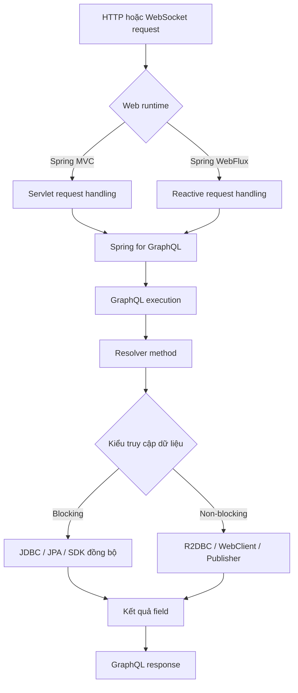

# Blocking và reactive application với Spring for GraphQL

Spring for GraphQL có thể chạy trong ứng dụng Spring MVC hoặc Spring WebFlux. Resolver của GraphQL cũng có thể trả về giá trị đồng bộ, `CompletableFuture`, `Mono` hoặc `Flux`. Hai lựa chọn này liên quan với nhau nhưng không phải cùng một khái niệm: MVC/WebFlux quyết định mô hình xử lý request của ứng dụng, còn kiểu trả về và cách truy cập dữ liệu quyết định resolver xử lý công việc như thế nào.

Điều cần quan tâm nhất là nơi thực thi I/O. JDBC, JPA và các thư viện đồng bộ thường giữ luồng hiện tại trong lúc chờ database hoặc dịch vụ bên ngoài. Nếu thao tác đó chạy trên luồng event-loop của WebFlux, nó có thể làm chậm nhiều request khác. Ngược lại, một pipeline reactive chỉ thực sự có lợi khi các thao tác bên trong nó cũng không chặn luồng.

Sau bài này, bạn có thể:

- Phân biệt runtime Spring MVC và Spring WebFlux khi phục vụ GraphQL.
- Chọn kiểu resolver đồng bộ, bất đồng bộ hoặc reactive theo stack truy cập dữ liệu.
- Nhận diện việc chặn luồng trong ứng dụng WebFlux và cô lập thư viện blocking khi chưa thể thay thế.
- Xây dựng resolver, batch mapping và subscription phù hợp với từng mô hình.
- Xử lý transaction, lỗi, timeout và kiểm thử cho ứng dụng blocking hoặc reactive.

## 1. Hai trục cần phân biệt

Khi thiết kế Spring for GraphQL, hãy xem xét hai câu hỏi độc lập:

1. Ứng dụng nhận HTTP request bằng Spring MVC hay Spring WebFlux?
2. Resolver lấy dữ liệu bằng API blocking, API bất đồng bộ hay API reactive?

Spring MVC thường chạy trên nền Servlet với mô hình xử lý request gắn với thread. Spring WebFlux được xây dựng cho xử lý non-blocking và thường chạy trên event-loop của Reactor Netty; WebFlux cũng có thể chạy trên một số Servlet container. Trong cả hai môi trường, Spring for GraphQL vẫn dùng các annotation như `@QueryMapping`, `@MutationMapping` và `@SchemaMapping`.

| Khía cạnh | Spring MVC | Spring WebFlux |
| --- | --- | --- |
| Mô hình web | Servlet, thường là một thread xử lý request trong thời gian xử lý đồng bộ | Reactive, ưu tiên xử lý non-blocking và event-loop |
| Truy cập dữ liệu phù hợp tự nhiên | JDBC, JPA và thư viện blocking | R2DBC, `WebClient` và API reactive/non-blocking |
| Resolver đồng bộ | Thường phù hợp với service blocking | Có thể khai báo nhưng phải xem xét nơi method được gọi và tránh I/O blocking trên luồng xử lý reactive |
| Resolver reactive | Có thể dùng khi phù hợp với service và adapter của Spring MVC | Là lựa chọn tự nhiên cho đường đi non-blocking |
| Rủi ro chính | Giữ thread của request quá lâu, cạn servlet thread hoặc connection pool | Chặn event-loop, làm giảm khả năng phục vụ đồng thời |

Vì vậy, không nên kết luận rằng dùng `Mono` là ứng dụng đã trở thành WebFlux, hoặc rằng chạy WebFlux tự động làm cho JDBC trở thành non-blocking. Hãy chọn runtime theo nhu cầu của ứng dụng và giữ cho đường đi dữ liệu nhất quán với lựa chọn đó.

## 2. Vị trí của resolver trong luồng xử lý

Một request GraphQL đi qua web runtime, handler GraphQL, bộ thực thi schema và các resolver. Resolver gọi service hoặc repository để lấy dữ liệu, sau đó GraphQL ghép kết quả theo selection set của client.



Spring for GraphQL cung cấp lớp tích hợp để biến method có annotation thành data fetcher và thích nghi các kiểu kết quả được Spring hỗ trợ. Tuy nhiên, framework không thể tự biến một lời gọi JDBC đồng bộ thành thao tác non-blocking. Nếu method gọi một thư viện blocking, lời gọi đó vẫn phải chờ hoàn thành trên thread đang thực thi nó, trừ khi ứng dụng chủ động chuyển công việc sang executor hoặc scheduler khác.

## 3. Ứng dụng Spring MVC với resolver blocking

Nếu ứng dụng đang dùng Spring MVC cùng JDBC hoặc JPA, resolver đồng bộ thường là cách triển khai đơn giản. Ví dụ:

```java
@Controller
public class BookGraphQlController {

    private final BookService bookService;

    public BookGraphQlController(BookService bookService) {
        this.bookService = bookService;
    }

    @QueryMapping
    public Book book(@Argument("id") String id) {
        return bookService.findById(id).orElse(null);
    }

    @QueryMapping
    public List<Book> books() {
        return bookService.findAll();
    }
}
```

Trong ví dụ này, `BookService` có thể dùng Spring Data JPA hoặc `JdbcTemplate`. Khi gọi service, thread thực thi resolver chờ database trả kết quả rồi mới trả object cho GraphQL. Mô hình này dễ hiểu, dễ debug và phù hợp với nhiều ứng dụng CRUD.

Đổi lại, mỗi thao tác chờ I/O giữ tài nguyên thread trong suốt thời gian chờ. Nếu nhiều request cùng đến, số servlet thread và kết nối database có thể trở thành giới hạn. Cần cấu hình connection pool, timeout truy vấn, giới hạn request đồng thời và kích thước thread pool dựa trên tải thực tế.

Spring MVC cũng hỗ trợ kiểu trả về bất đồng bộ và reactive thông qua các adapter của Spring. Điều đó không thay đổi bản chất của thư viện truy cập dữ liệu: nếu resolver gọi JPA đồng bộ trước khi trả về một `Mono`, phần gọi JPA vẫn blocking. Kiểu trả về reactive không thể sửa một thao tác đã chặn thread.

## 4. Ứng dụng WebFlux với resolver reactive

Với WebFlux, nên ưu tiên các API không chặn như Spring Data R2DBC, `WebClient` hoặc service trả về Reactor `Mono`/`Flux`. Resolver trả tiếp publisher cho Spring for GraphQL:

```java
@Controller
public class BookGraphQlController {

    private final ReactiveBookRepository bookRepository;

    public BookGraphQlController(ReactiveBookRepository bookRepository) {
        this.bookRepository = bookRepository;
    }

    @QueryMapping
    public Mono<Book> book(@Argument("id") String id) {
        return bookRepository.findById(id);
    }

    @QueryMapping
    public Flux<Book> books() {
        return bookRepository.findAll();
    }
}
```

`Mono<Book>` biểu diễn kết quả có tối đa một sách; nếu không có kết quả, publisher có thể hoàn tất rỗng. `Flux<Book>` biểu diễn một chuỗi sách cho field danh sách. Spring for GraphQL tích hợp các kiểu reactive được Spring nhận diện để chuyển kết quả về quá trình thực thi GraphQL.

Một pipeline reactive không giữ một thread trong lúc chờ I/O non-blocking. Khi database hoặc HTTP client chưa có dữ liệu, runtime có thể dùng thread đó xử lý công việc khác; khi có tín hiệu, pipeline tiếp tục. Cách này có thể tăng khả năng xử lý đồng thời, nhưng không loại bỏ giới hạn của database, connection pool, CPU hoặc dịch vụ phụ thuộc.

Hãy để framework quản lý việc subscribe vào publisher của resolver. Không tự gọi `subscribe()` bên trong method controller để chạy một luồng phụ; làm như vậy khiến GraphQL có thể hoàn tất response trước khi công việc kết thúc và khiến lỗi khó được gắn với field tương ứng.

## 5. Vì sao blocking I/O nguy hiểm trong WebFlux?

Đoạn mã sau trông có vẻ reactive nhưng thực chất vẫn chặn:

```java
@QueryMapping
public Mono<Book> book(@Argument("id") String id) {
    Book book = jpaBookRepository.findById(id).orElse(null);
    return Mono.justOrEmpty(book);
}
```

`findById` được gọi ngay khi method chạy. `Mono` chỉ được tạo sau khi database đã trả kết quả, nên nó không giúp chuyển thao tác JPA sang luồng khác. Trong môi trường WebFlux, một lời gọi blocking như vậy có thể chiếm thread xử lý reactive và ảnh hưởng đến những request không liên quan.

Các biểu hiện thường gặp gồm:

- Độ trễ tăng mạnh khi database hoặc dịch vụ phụ thuộc phản hồi chậm.
- Throughput giảm dù CPU chưa được sử dụng hết.
- Nhiều request cùng chậm vì một số thread xử lý reactive đang bị giữ lại.
- Xuất hiện cảnh báo hoặc lỗi từ công cụ phát hiện blocking trong non-blocking thread.

Một số lời gọi cần tránh trong đường đi reactive là `block()`, `blockFirst()`, `blockLast()`, `Future.get()`, `Thread.sleep()` và các API JDBC/JPA đồng bộ. Việc đổi tên method hoặc bọc kết quả bằng `Mono.just(...)` không thay đổi hành vi blocking của chúng.

## 6. Cô lập thư viện blocking khi chưa thể thay thế

Trong giai đoạn chuyển đổi, ứng dụng có thể vẫn phải dùng JPA, JDBC hoặc SDK chỉ có API đồng bộ. Khi đó, hãy cô lập lời gọi blocking vào một scheduler dành cho công việc blocking:

```java
@QueryMapping
public Mono<Book> book(@Argument("id") String id) {
    return Mono.fromCallable(() -> jpaBookRepository.findById(id))
            .subscribeOn(Schedulers.boundedElastic())
            .flatMap(optional -> Mono.justOrEmpty(optional));
}
```

`Mono.fromCallable` trì hoãn việc gọi repository cho đến khi publisher được subscribe. `subscribeOn(Schedulers.boundedElastic())` chuyển việc thực thi nguồn sang scheduler phù hợp cho tác vụ blocking. `flatMap` chuyển `Optional<Book>` thành publisher có thể rỗng nếu không tìm thấy bản ghi.

`boundedElastic` có giới hạn tài nguyên tốt hơn việc tự tạo thread không giới hạn, nhưng nó không làm cho database trở thành non-blocking. Nếu số tác vụ blocking vượt khả năng xử lý, hàng đợi và thời gian chờ vẫn tăng. Với tải lớn hoặc một hệ thống phụ thuộc có giới hạn riêng, cân nhắc tạo scheduler riêng có giới hạn thread và queue để cô lập tải.

Một số nguyên tắc khi dùng scheduler:

- Dùng `subscribeOn` để chuyển nơi thực thi thao tác blocking ở upstream, gần nguồn phát sinh I/O.
- Không dùng `Schedulers.parallel()` cho JDBC, JPA hoặc tác vụ blocking; scheduler này dành cho công việc CPU ngắn, không chờ I/O.
- `publishOn` chuyển nơi xử lý các tín hiệu ở phía sau nó; đặt `publishOn` sau một lời gọi blocking đã thực thi không thể chuyển ngược lời gọi đó sang thread khác.
- Không tạo scheduler mới cho từng request. Nếu cần kiểm soát tải, tạo và quản lý scheduler ở cấp ứng dụng rồi giải phóng khi ứng dụng dừng.
- Đặt timeout ở repository, driver hoặc client tương ứng. Timeout ở tầng GraphQL không nhất thiết dừng được một lời gọi JDBC đã chặn thread.

Nếu có thể thay thế JPA bằng R2DBC hoặc SDK đồng bộ bằng API non-blocking, đó thường là hướng tốt hơn cho một đường đi WebFlux thuần reactive. Cách bọc blocking là cầu nối có kiểm soát, không phải tối ưu cuối cùng.

## 7. Dùng CompletableFuture và executor

GraphQL Java hỗ trợ kết quả bất đồng bộ qua `CompletionStage`; Spring for GraphQL cũng có thể thích nghi `CompletableFuture`. Kiểu này phù hợp khi service hoặc thư viện đã cung cấp API future:

```java
@QueryMapping
public CompletableFuture<Book> book(@Argument("id") String id) {
    return bookService.findByIdAsync(id);
}
```

Nếu cần chạy một lời gọi blocking bất đồng bộ, có thể dùng executor có giới hạn:

```java
@Configuration
public class GraphQlExecutorConfiguration {

    @Bean
    public ThreadPoolTaskExecutor bookIoExecutor() {
        ThreadPoolTaskExecutor executor = new ThreadPoolTaskExecutor();
        executor.setCorePoolSize(8);
        executor.setMaxPoolSize(16);
        executor.setQueueCapacity(200);
        executor.setThreadNamePrefix("book-io-");
        executor.setRejectedExecutionHandler(new ThreadPoolExecutor.AbortPolicy());
        return executor;
    }
}
```

```java
@Controller
public class BookGraphQlController {

    private final BookService bookService;
    private final Executor bookIoExecutor;

    public BookGraphQlController(
            BookService bookService,
            @Qualifier("bookIoExecutor") Executor bookIoExecutor) {
        this.bookService = bookService;
        this.bookIoExecutor = bookIoExecutor;
    }

    @QueryMapping
    public CompletableFuture<Book> book(@Argument("id") String id) {
        return CompletableFuture.supplyAsync(
                () -> bookService.findById(id).orElse(null),
                bookIoExecutor);
    }
}
```

Ví dụ này minh họa việc dùng executor riêng để giới hạn số tác vụ blocking. Cấu hình thực tế cần được điều chỉnh theo thời gian xử lý, số kết nối database và tải dự kiến. Khi executor quá tải, chính sách từ chối giúp báo lỗi để ứng dụng có thể xử lý tình trạng quá tải; tránh chính sách chạy tác vụ bị từ chối ngay trên thread gọi nếu thread đó có thể là event-loop. `CompletableFuture.supplyAsync(...)` không chỉ định executor sẽ dùng common pool mặc định; không nên mặc định rằng common pool là nơi phù hợp cho I/O blocking của ứng dụng.

`CompletableFuture` cung cấp composition bất đồng bộ nhưng không có mô hình backpressure của Reactive Streams. Nếu toàn bộ service đã dùng Reactor, giữ `Mono`/`Flux` xuyên suốt thường đơn giản hơn việc chuyển đổi qua lại giữa nhiều abstraction.

## 8. Batch loading vẫn phải phù hợp với runtime

Batch loading giúp giảm số lần truy vấn khi GraphQL phân giải field con cho nhiều object cha. Tuy nhiên, batch không tự động làm cho I/O trở thành non-blocking.

Với repository reactive, một batch mapping có thể trả về `Mono<Map<...>>`:

```java
@BatchMapping(typeName = "Book", field = "author")
public Mono<Map<Book, Author>> authors(List<Book> books) {
    Set<String> authorIds = books.stream()
            .map(Book::authorId)
            .collect(Collectors.toSet());

    return authorRepository.findAllById(authorIds)
            .collectMap(Author::id)
            .map(authorsById -> {
                Map<Book, Author> result = new HashMap<>();
                for (Book book : books) {
                    result.put(book, authorsById.get(book.authorId()));
                }
                return result;
            });
}
```

Với JPA repository trong ứng dụng MVC, method batch đồng bộ cũng có thể phù hợp:

```java
@BatchMapping(typeName = "Book", field = "author")
public Map<Book, Author> authors(List<Book> books) {
    Set<String> ids = books.stream()
            .map(Book::authorId)
            .collect(Collectors.toSet());

    Map<String, Author> byId = authorRepository.findAllById(ids).stream()
            .collect(Collectors.toMap(Author::id, Function.identity()));

    Map<Book, Author> result = new HashMap<>();
    for (Book book : books) {
        result.put(book, byId.get(book.authorId()));
    }
    return result;
}
```

Nếu phải gọi repository blocking từ WebFlux, đưa toàn bộ thao tác batch vào vùng cô lập blocking thay vì lặp qua từng object trên luồng reactive. Cũng cần kiểm tra batch loader thực sự phát ra một truy vấn theo lô; một vòng lặp gọi repository cho từng ID vẫn là N+1 dù nằm bên trong `@BatchMapping`.

Với `DataLoader`, nguyên tắc tương tự: batch loader có thể trả về future hoặc publisher được Spring hỗ trợ, nhưng phần truy cập dữ liệu bên trong phải tuân theo mô hình blocking/non-blocking đã chọn. Việc gom key chỉ giảm số lượt truy cập; nó không thay đổi bản chất của driver.

## 9. Subscription và luồng sự kiện

Subscription thường được biểu diễn bằng `Flux<T>` vì client nhận nhiều sự kiện trong suốt thời gian kết nối:

```java
@SubscriptionMapping
public Flux<BookEvent> bookCreated() {
    return bookEventService.bookCreated();
}
```

Trong đường đi reactive, nguồn sự kiện nên phát tín hiệu non-blocking và tôn trọng vòng đời subscription. Khi client ngắt kết nối, pipeline cần có khả năng hủy và giải phóng tài nguyên. Nếu mỗi sự kiện cần gọi một SDK blocking, hãy chuyển phần công việc đó sang scheduler phù hợp và giới hạn concurrency để một luồng sự kiện lớn không làm cạn tài nguyên.

Ứng dụng cũng phải cấu hình transport hỗ trợ subscription, chẳng hạn WebSocket hoặc RSocket. Việc resolver trả về `Flux` không tự tạo endpoint hay giao thức kết nối cho client.

## 10. Transaction và ranh giới bất đồng bộ

Transaction cần khớp với công nghệ truy cập dữ liệu và cách thực thi resolver.

Với JDBC/JPA, transaction thông thường gắn với thread hiện tại. Một service imperative có thể mở transaction, đọc hoặc ghi dữ liệu rồi hoàn tất transaction trong cùng lời gọi đồng bộ. Nếu đưa công việc sang executor khác, không giả định transaction hoặc các tài nguyên gắn với thread tự động được truyền sang thread mới.

Với R2DBC và Spring reactive transaction management, transaction được truyền theo Reactor context và gắn với quá trình subscribe vào pipeline. Cần dùng reactive transaction manager và giữ các thao tác trong cùng reactive chain. Không gọi `.block()` giữa pipeline để chờ kết quả, vì việc đó phá vỡ mô hình thực thi reactive và có thể làm mất ngữ cảnh transaction.

Một lưu ý khác với JPA là lazy loading. Nếu resolver trả entity rồi field resolver khác mới truy cập quan hệ lazy sau khi transaction đã đóng, ứng dụng có thể gặp `LazyInitializationException` hoặc phát sinh nhiều truy vấn ngoài dự kiến. Hãy cân nhắc DTO, projection, fetch plan hoặc batch loader để lấy dữ liệu đúng ranh giới và tránh phụ thuộc vào session mở kéo dài.

Không trộn imperative transaction với reactive transaction một cách tùy tiện. Chọn transaction manager đúng loại dữ liệu, xác định ranh giới transaction ở service và kiểm thử đường đi thực tế, nhất là khi có scheduler hoặc nhiều publisher tham gia.

## 11. Lỗi, timeout và hủy tác vụ

Trong resolver blocking, exception thường được ném trực tiếp trong lúc method chạy. Trong resolver reactive, lỗi được phát thành tín hiệu `onError`; trong `CompletableFuture`, lỗi được biểu diễn qua trạng thái hoàn tất exceptional. Spring for GraphQL đưa các lỗi này vào cơ chế xử lý lỗi GraphQL, bao gồm `DataFetcherExceptionResolver` và các exception handler được cấu hình.

Với lỗi nghiệp vụ có thể dự đoán, hãy ánh xạ sang mã và thông điệp phù hợp cho client. Không nuốt lỗi bằng `onErrorResume` trả về dữ liệu giả nếu điều đó làm response trông như thành công. Ghi log chi tiết ở server và tránh để stack trace hoặc thông tin nhạy cảm xuất hiện trong response.

Timeout cần được đặt ở nơi thực hiện I/O: query timeout của database, timeout của HTTP client, giới hạn thời gian gọi service và giới hạn request phù hợp. Khi client hủy request hoặc subscription, publisher reactive có thể nhận tín hiệu cancel; nhưng một lời gọi blocking đang chạy thường không thể bị dừng an toàn chỉ vì wrapper future hoặc publisher bị hủy. Vì vậy, timeout và giới hạn tài nguyên của chính thư viện blocking vẫn rất quan trọng.

## 12. Kiểm thử blocking và reactive resolver

`GraphQlTester` giúp kiểm tra operation từ góc nhìn GraphQL mà không buộc test phải biết chi tiết wiring của từng resolver:

```java
graphQlTester.document("""
        query {
            book(id: "book-42") {
                id
                title
            }
        }
        """)
    .execute()
    .path("book.title")
    .entity(String.class)
    .isEqualTo("Spring GraphQL in Practice");
```

Với resolver blocking, kiểm tra service/repository được gọi đúng và xử lý đúng khi truy vấn chậm hoặc thất bại. Với resolver reactive, kiểm tra publisher hoàn tất đúng dữ liệu, phát lỗi đúng trường hợp và không subscribe nhiều lần ngoài ý muốn. Với batch mapping, xác nhận một nhóm object nguồn dẫn đến một lần truy vấn theo lô.

Nếu ứng dụng WebFlux còn phụ thuộc thư viện blocking, có thể cân nhắc BlockHound trong môi trường test hoặc phát triển để phát hiện một số lời gọi blocking trên thread được đánh dấu non-blocking. Công cụ này bổ sung cho việc đo tải và quan sát runtime; nó không thay thế integration test với database và dịch vụ phụ thuộc.

Khi cần kiểm tra cả web runtime, hãy có integration test tương ứng với cấu hình MVC hoặc WebFlux thực tế. Các test ở cấp `GraphQlTester` tập trung vào schema và resolver; test transport xác nhận request HTTP/WebSocket đi qua runtime và cấu hình endpoint như mong đợi.

## 13. Chọn mô hình theo tình huống

| Tình huống | Hướng triển khai phù hợp |
| --- | --- |
| Ứng dụng hiện tại dùng Spring MVC và JPA | Giữ resolver đồng bộ, tối ưu truy vấn, transaction, pool và timeout |
| Ứng dụng WebFlux dùng R2DBC | Dùng `Mono`/`Flux` xuyên suốt từ resolver đến repository |
| WebFlux gọi dịch vụ HTTP | Ưu tiên `WebClient` và publisher reactive |
| WebFlux phải dùng SDK blocking | Cô lập lời gọi bằng `boundedElastic` hoặc executor riêng có giới hạn; lên kế hoạch thay thế nếu tải yêu cầu |
| Service đã cung cấp `CompletionStage` | Có thể trả `CompletableFuture` và quản lý executor của service |
| Field lồng nhau tải dữ liệu cho nhiều object | Dùng `@BatchMapping` hoặc DataLoader; bảo đảm batch loader phù hợp với runtime |
| Cần phát sự kiện cho client | Dùng `@SubscriptionMapping` với publisher và cấu hình transport hỗ trợ subscription |

Không có một kiểu trả về duy nhất phù hợp cho mọi ứng dụng. Một ứng dụng MVC có thể dùng reactive service; một ứng dụng WebFlux có thể tạm thời tích hợp thư viện blocking. Điều quan trọng là nhận diện rõ nơi thread bị giữ, giới hạn tài nguyên và tránh để một đoạn blocking không kiểm soát làm ảnh hưởng toàn bộ request.

## 14. Quy trình rà soát trước khi đưa resolver vào sử dụng

Khi thêm hoặc sửa resolver, hãy lần lượt kiểm tra:

1. Xác định runtime thực tế là MVC hay WebFlux và transport GraphQL đang dùng.
2. Lần theo lời gọi từ resolver đến repository hoặc dịch vụ bên ngoài để biết API cuối cùng là blocking hay non-blocking.
3. Chọn kiểu trả về tương ứng: giá trị đồng bộ, `CompletableFuture`, `Mono` hoặc `Flux`.
4. Nếu có I/O blocking trong WebFlux, thay bằng API non-blocking hoặc cô lập bằng scheduler/executor có giới hạn.
5. Kiểm tra N+1, batch loader, lazy loading và số kết nối database.
6. Xác định ranh giới transaction, timeout, cách ánh xạ lỗi và hành vi khi request bị hủy.
7. Kiểm thử operation GraphQL, batch behavior và transport; đo độ trễ, throughput cùng mức sử dụng thread khi có tải.

Spring for GraphQL cho phép dùng cùng mô hình schema và annotation resolver trong cả ứng dụng blocking lẫn reactive. Chất lượng của thiết kế phụ thuộc vào việc đường đi dữ liệu có nhất quán với runtime hay không: dùng blocking có kiểm soát trong stack phù hợp, hoặc giữ I/O non-blocking xuyên suốt khi chọn WebFlux.
