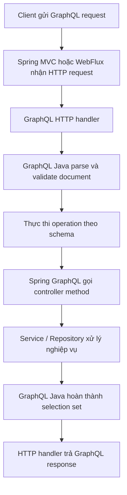

# Spring Boot integration

Spring for GraphQL cung cấp lớp tích hợp giữa GraphQL Java và hệ sinh thái Spring. Khi dùng cùng Spring Boot, ứng dụng có thể tự động tạo GraphQL runtime từ schema SDL, đăng ký các hàm xử lý field trong controller Spring và đưa GraphQL endpoint vào HTTP server của ứng dụng.

Bài học này tập trung vào cách ghép các thành phần đó thành một ứng dụng chạy được: khai báo dependency, đặt schema đúng vị trí, viết controller, cấu hình endpoint, bổ sung thành phần tùy chỉnh và kiểm thử. Các ví dụ dùng Java và Spring Boot 3.x; khi triển khai, hãy dùng phiên bản Spring for GraphQL tương thích với phiên bản Spring Boot được quản lý bởi dự án.

## 1. Các thành phần khi tích hợp

Một ứng dụng Spring Boot dùng Spring for GraphQL thường có những thành phần sau:

| Thành phần | Vai trò |
| --- | --- |
| Spring Boot auto-configuration | Tạo và kết nối các bean GraphQL dựa trên dependency, schema và cấu hình ứng dụng. |
| GraphQL schema SDL | Khai báo root operation, type, field, argument và scalar mà API công bố. |
| GraphQL Java | Parse, validate và thực thi operation theo schema. |
| Spring GraphQL controller | Cung cấp method xử lý field thông qua các annotation như `@QueryMapping`, `@MutationMapping` và `@SchemaMapping`. |
| HTTP transport | Nhận request tại endpoint GraphQL và chuyển response về client. |
| Service và repository | Chứa nghiệp vụ và truy cập dữ liệu; controller gọi các thành phần này để phân giải field. |

Luồng xử lý khái quát:



Spring Boot giúp tự động cấu hình phần kết nối, nhưng ứng dụng vẫn phải cung cấp schema và logic xử lý các field cần thiết. Một HTTP endpoint duy nhất có thể phục vụ nhiều query và mutation; mỗi field trong schema được phân giải theo mapping tương ứng.

## 2. Khai báo dependency

Với dự án Maven dùng Spring Boot 3.x, khai báo starter GraphQL và một web starter. Spring Boot quản lý phiên bản thư viện tương thích thông qua parent hoặc BOM, vì vậy không cần tự đặt version riêng cho từng dependency.

```xml
<dependencies>
    <dependency>
        <groupId>org.springframework.boot</groupId>
        <artifactId>spring-boot-starter-graphql</artifactId>
    </dependency>

    <dependency>
        <groupId>org.springframework.boot</groupId>
        <artifactId>spring-boot-starter-web</artifactId>
    </dependency>

    <dependency>
        <groupId>org.springframework.boot</groupId>
        <artifactId>spring-boot-starter-test</artifactId>
        <scope>test</scope>
    </dependency>

    <dependency>
        <groupId>org.springframework.graphql</groupId>
        <artifactId>spring-graphql-test</artifactId>
        <scope>test</scope>
    </dependency>
</dependencies>
```

Ý nghĩa của các dependency:

- `spring-boot-starter-graphql` đưa Spring for GraphQL và các thành phần GraphQL cần thiết vào ứng dụng, đồng thời kích hoạt auto-configuration khi điều kiện phù hợp.
- `spring-boot-starter-web` cung cấp HTTP server dựa trên Spring MVC và servlet stack. Nếu ứng dụng được xây dựng theo reactive stack, dùng `spring-boot-starter-webflux` thay cho MVC starter.
- `spring-boot-starter-test` cung cấp nền tảng kiểm thử Spring và JUnit; `spring-graphql-test` bổ sung `GraphQlTester` để kiểm thử operation và response.

Không nên thêm cả MVC và WebFlux starter chỉ để tạo endpoint GraphQL. Hãy chọn web stack phù hợp với kiến trúc ứng dụng. Spring for GraphQL hỗ trợ cả hai, nhưng transport, cấu hình server và một số cách kiểm thử sẽ khác nhau.

## 3. Cấu trúc thư mục và schema SDL

Spring Boot mặc định tìm GraphQL schema trong thư mục tài nguyên `graphql`. Một cấu trúc đơn giản:

```text
src/
├── main/
│   ├── java/
│   │   └── com/example/catalog/
│   │       ├── CatalogApplication.java
│   │       ├── graphql/
│   │       │   └── GreetingController.java
│   │       └── service/
│   │           └── GreetingService.java
│   └── resources/
│       ├── application.yml
│       └── graphql/
│           └── schema.graphqls
└── test/
    └── java/
        └── com/example/catalog/graphql/
            └── GreetingControllerTests.java
```

Tệp schema thường dùng phần mở rộng `.graphqls` hoặc `.gqls`. Có thể chia schema thành nhiều tệp trong các thư mục con; Spring Boot và Spring GraphQL sẽ hợp nhất các tài nguyên schema tìm được theo cấu hình locations.

Tạo tệp `src/main/resources/graphql/schema.graphqls`:

```graphql
type Query {
    greeting(name: String! = "Spring"): String!
}
```

Schema khai báo một field `greeting` trên root type `Query`. Argument `name` có kiểu `String!` và giá trị mặc định là `Spring`. Field trả về `String!`, nghĩa là kết quả phải có giá trị khác `null`.

GraphQL cần root query type để phục vụ thao tác đọc dữ liệu. Khi bổ sung thao tác ghi, khai báo thêm root type `Mutation`; với luồng sự kiện, khai báo root type `Subscription`. Schema là hợp đồng công khai của API, vì vậy kiểu dữ liệu và nullability nên phản ánh đúng cam kết của nghiệp vụ.

## 4. Khởi tạo ứng dụng Spring Boot

Lớp main application có thể giữ nguyên cấu trúc Spring Boot quen thuộc:

```java
package com.example.catalog;

import org.springframework.boot.SpringApplication;
import org.springframework.boot.autoconfigure.SpringBootApplication;

@SpringBootApplication
public class CatalogApplication {

    public static void main(String[] args) {
        SpringApplication.run(CatalogApplication.class, args);
    }
}
```

Khi ứng dụng khởi động, component scan tìm controller và service trong package hiện tại cùng các package con. Auto-configuration của Spring Boot kiểm tra classpath, cấu hình và schema để tạo các thành phần cần thiết cho GraphQL.

Vì vậy, nên đặt lớp main ở package gốc để controller và service được scan tự động. Nếu controller nằm ngoài phạm vi component scan, schema có thể được tải nhưng method xử lý field không được đăng ký như mong đợi.

## 5. Ánh xạ schema field bằng controller

Spring for GraphQL dùng các annotation chuyên biệt để nối field trong schema với method Java. Với ví dụ `greeting`, tạo controller:

```java
package com.example.catalog.graphql;

import org.springframework.graphql.data.method.annotation.Argument;
import org.springframework.graphql.data.method.annotation.QueryMapping;
import org.springframework.stereotype.Controller;

@Controller
public class GreetingController {

    @QueryMapping
    public String greeting(@Argument("name") String name) {
        return "Hello, " + name + "!";
    }
}
```

Một số điểm cần chú ý:

- Dùng `@Controller` để đăng ký controller với Spring. Đây là controller GraphQL, không phải REST controller trả về HTTP response theo từng route.
- `@QueryMapping` ánh xạ method vào field cùng tên trên root type `Query`. Ở ví dụ này, method `greeting` xử lý field `Query.greeting`.
- `@Argument` lấy giá trị argument `name` từ GraphQL field và chuyển thành kiểu Java phù hợp.
- Giá trị trả về của method trở thành kết quả field trong GraphQL response. GraphQL engine tiếp tục hoàn thành các field còn lại theo selection set.

Có thể chỉ rõ tên field nếu tên method Java khác tên field trong schema:

```java
@QueryMapping(name = "greeting")
public String getGreeting(@Argument("name") String personName) {
    return "Hello, " + personName + "!";
}
```

Tên argument trong `@Argument` phải khớp với tên khai báo trong schema. Việc chỉ định rõ tên giúp tránh phụ thuộc vào tên tham số Java hoặc cấu hình biên dịch giữ lại parameter name.

### Tách nghiệp vụ vào service

Trong ứng dụng thực tế, controller nên đóng vai trò adapter giữa GraphQL và lớp nghiệp vụ. Có thể chuyển logic sang service:

```java
package com.example.catalog.service;

import org.springframework.stereotype.Service;

@Service
public class GreetingService {

    public String greet(String name) {
        return "Hello, " + name + "!";
    }
}
```

```java
package com.example.catalog.graphql;

import com.example.catalog.service.GreetingService;
import org.springframework.graphql.data.method.annotation.Argument;
import org.springframework.graphql.data.method.annotation.QueryMapping;
import org.springframework.stereotype.Controller;

@Controller
public class GreetingController {

    private final GreetingService greetingService;

    public GreetingController(GreetingService greetingService) {
        this.greetingService = greetingService;
    }

    @QueryMapping
    public String greeting(@Argument("name") String name) {
        return greetingService.greet(name);
    }
}
```

Constructor injection giúp dependency được khai báo rõ ràng, thuận tiện cho kiểm thử và thay thế implementation. Service có thể tiếp tục gọi repository hoặc client đến hệ thống khác mà không làm controller phụ thuộc trực tiếp vào chi tiết lưu trữ.

## 6. Cấu hình endpoint và schema bằng application.yml

Với Spring Boot, HTTP GraphQL endpoint mặc định là `/graphql`. Có thể khai báo rõ trong `application.yml`:

```yaml
spring:
  application:
    name: catalog-api
  graphql:
    path: /graphql
```

Khi giữ cấu hình mặc định, client gửi request đến:

```http
POST http://localhost:8080/graphql
Content-Type: application/json
```

Body:

```json
{
  "query": "query Greeting($name: String!) { greeting(name: $name) }",
  "operationName": "Greeting",
  "variables": {
    "name": "Lan"
  }
}
```

Response dự kiến:

```json
{
  "data": {
    "greeting": "Hello, Lan!"
  }
}
```

Nếu muốn đổi đường dẫn, chỉ cần đổi thuộc tính `spring.graphql.path`, ví dụ `/api/graphql`. Client và cấu hình hạ tầng như reverse proxy, gateway hoặc security matcher phải sử dụng cùng đường dẫn mới.

### Thay đổi vị trí schema

Nếu schema không nằm trong thư mục mặc định, cấu hình `spring.graphql.schema.locations` để chỉ định các vị trí tìm kiếm. Ví dụ:

```yaml
spring:
  graphql:
    schema:
      locations: classpath:graphql/**/
```

Có thể dùng nhiều location khi schema được chia theo module. Hãy bảo đảm các tài nguyên được đóng gói vào classpath khi build ứng dụng; một schema chỉ tồn tại trong thư mục làm việc của IDE có thể khiến ứng dụng chạy được ở local nhưng lỗi khi đóng gói hoặc triển khai.

## 7. Tùy chỉnh GraphQL runtime

Auto-configuration đáp ứng phần lớn trường hợp thông thường. Khi cần đăng ký scalar, directive hoặc cấu hình wiring bổ sung, có thể cung cấp bean `RuntimeWiringConfigurer`. Spring for GraphQL sử dụng các configurer này khi xây dựng GraphQL runtime từ schema.

Ví dụ khung cấu hình:

```java
package com.example.catalog.config;

import org.springframework.context.annotation.Bean;
import org.springframework.context.annotation.Configuration;
import org.springframework.graphql.execution.RuntimeWiringConfigurer;

@Configuration
public class GraphQlConfig {

    @Bean
    RuntimeWiringConfigurer runtimeWiringConfigurer() {
        return wiringBuilder -> {
            // Đăng ký scalar hoặc wiring bổ sung tại đây.
        };
    }
}
```

Đây là điểm mở rộng cho các thành phần cần tích hợp với GraphQL Java. Nếu một custom scalar được thêm vào schema, cần đăng ký implementation tương ứng để GraphQL biết cách parse input và serialize output. Chỉ khai báo tên scalar trong SDL là chưa đủ.

Spring for GraphQL cũng cung cấp các điểm mở rộng khác như interceptor, instrumentation, exception resolver và DataLoader registry. Chỉ bổ sung khi ứng dụng có nhu cầu cụ thể; cấu hình mặc định thường đã đủ để đưa query cơ bản vào hoạt động.

## 8. Phân giải field lồng nhau

Một GraphQL request có thể chọn field trên nhiều object lồng nhau. Spring for GraphQL hỗ trợ `@SchemaMapping` để xử lý field trên một type bất kỳ, không chỉ root `Query`.

Ví dụ schema:

```graphql
type Query {
    book(id: ID!): Book
}

type Book {
    id: ID!
    title: String!
    author: Author
}

type Author {
    id: ID!
    name: String!
}
```

Controller xử lý query root:

```java
@Controller
public class BookController {

    private final BookService bookService;

    public BookController(BookService bookService) {
        this.bookService = bookService;
    }

    @QueryMapping
    public Book book(@Argument("id") String id) {
        return bookService.findById(id);
    }
}
```

Nếu object `Book` có sẵn thuộc tính tương ứng, GraphQL có thể dùng property access để lấy field. Khi cần truy vấn tác giả từ một nguồn riêng, khai báo mapping rõ ràng:

```java
@Controller
public class BookAuthorController {

    private final AuthorService authorService;

    public BookAuthorController(AuthorService authorService) {
        this.authorService = authorService;
    }

    @SchemaMapping(typeName = "Book", field = "author")
    public Author author(Book book) {
        return authorService.findById(book.authorId());
    }
}
```

Method này xử lý field `author` trên type `Book`. Tham số đầu tiên là source object `Book`, từ đó resolver có thể lấy thông tin cần thiết để truy vấn tác giả.

Nếu một query lấy danh sách nhiều sách và mỗi sách lại truy vấn tác giả riêng, ứng dụng có thể gặp vấn đề N+1. Spring for GraphQL tích hợp DataLoader và hỗ trợ `@BatchMapping` để gom việc phân giải field thành các batch. Đây là bước tối ưu quan trọng khi tích hợp GraphQL với database hoặc service phía sau; cần đo truy vấn thực tế trước khi chọn chiến lược batch.

## 9. Mutation và Subscription trong ứng dụng Boot

Spring Boot không yêu cầu một endpoint HTTP riêng cho từng loại operation. Query và mutation cùng được gửi đến GraphQL endpoint; schema và operation document quyết định loại thao tác.

Khai báo mutation:

```graphql
type Mutation {
    renameBook(id: ID!, title: String!): Book!
}
```

Ánh xạ bằng `@MutationMapping`:

```java
@MutationMapping
public Book renameBook(
        @Argument("id") String id,
        @Argument("title") String title) {
    return bookService.rename(id, title);
}
```

Với subscription, method có thể trả về publisher như `Flux<T>`:

```graphql
type Subscription {
    bookUpdated: Book!
}
```

```java
@SubscriptionMapping
public Flux<Book> bookUpdated() {
    return bookEventService.bookUpdates();
}
```

Subscription cần một transport hỗ trợ luồng dữ liệu như Server-Sent Events (SSE), WebSocket hoặc RSocket, tùy phiên bản Spring GraphQL và cấu hình web stack. Chỉ thêm field `Subscription` và method `@SubscriptionMapping` chưa đủ để client nhận được sự kiện qua HTTP request/response thông thường. Chi tiết endpoint và dependency transport phụ thuộc cấu hình ứng dụng.

## 10. Kiểm thử bằng @GraphQlTest và GraphQlTester

Spring Boot cung cấp `@GraphQlTest` để kiểm thử lát cắt GraphQL. Annotation này tập trung vào GraphQL controller và các thành phần liên quan, giúp kiểm tra schema, mapping và kết quả mà không cần khởi động toàn bộ web server.

Ví dụ:

```java
package com.example.catalog.graphql;

import org.junit.jupiter.api.Test;
import org.springframework.beans.factory.annotation.Autowired;
import org.springframework.boot.test.autoconfigure.graphql.GraphQlTest;
import org.springframework.context.annotation.Import;
import org.springframework.graphql.test.tester.GraphQlTester;
import com.example.catalog.service.GreetingService;

@GraphQlTest(GreetingController.class)
@Import(GreetingService.class)
class GreetingControllerTests {

    @Autowired
    GraphQlTester graphQlTester;

    @Test
    void returnsGreeting() {
        graphQlTester.document("""
                query Greeting($name: String!) {
                    greeting(name: $name)
                }
                """)
            .variable("name", "Lan")
            .execute()
            .path("greeting")
            .entity(String.class)
            .isEqualTo("Hello, Lan!");
    }
}
```

Test gửi một GraphQL document, truyền variable và xác minh field trong response. Nếu controller phụ thuộc service, cần đưa dependency đó vào test context, chẳng hạn bằng một test configuration hoặc mock bean phù hợp với phiên bản Spring Boot đang dùng.

Với kiểm thử tích hợp qua HTTP thật, dùng `@SpringBootTest` cùng web environment và một GraphQL tester gắn với HTTP client. Cách này kiểm tra thêm routing, HTTP transport, serialization và các filter của ứng dụng. Nên có cả test lát cắt nhanh cho mapping và một số test tích hợp cho luồng request quan trọng.

## 11. Các lỗi tích hợp thường gặp

| Hiện tượng | Nguyên nhân có thể | Cách xử lý |
| --- | --- | --- |
| Gọi `/graphql` nhận 404 | Chưa có web starter, endpoint đã đổi path hoặc GraphQL HTTP handler không được cấu hình. | Kiểm tra dependency web, `spring.graphql.path` và log khởi động. |
| Ứng dụng không tìm thấy schema | File nằm ngoài classpath hoặc sai thư mục/tên tài nguyên. | Đặt schema trong `src/main/resources/graphql/` hoặc cấu hình schema locations. |
| Schema load được nhưng field trả `null` | Chưa có mapping tương ứng hoặc object nguồn không cung cấp thuộc tính cần thiết. | Đối chiếu field với `@QueryMapping`, `@SchemaMapping` và dữ liệu trả về. |
| Method controller không được gọi | Controller ngoài component scan, annotation mapping sai hoặc field không khớp schema. | Kiểm tra package, annotation và tên field/argument. |
| Argument nhận sai hoặc không bind được | Tên argument hoặc kiểu Java không khớp schema. | Kiểm tra `@Argument`, kiểu SDL và cấu trúc input. |
| Startup báo lỗi schema | SDL sai cú pháp, khai báo type trùng hoặc root operation không hợp lệ. | Đọc thông báo lỗi lúc khởi động và sửa schema nguồn. |
| Query chậm khi lấy object lồng nhau | Resolver truy vấn riêng cho từng object, gây N+1. | Dùng DataLoader hoặc `@BatchMapping`, sau đó đo lại số truy vấn. |
| Subscription không nhận được sự kiện | Chưa cấu hình transport streaming hoặc client đang dùng HTTP request/response thông thường. | Kiểm tra WebSocket/RSocket transport và cấu hình endpoint tương ứng. |

Khi debug, nên kiểm tra theo thứ tự: dependency và web stack, log khởi động, schema có được tải không, endpoint có nhận request không, document có validate được không, rồi mới kiểm tra resolver và service. Cách chia lớp này giúp khoanh vùng lỗi nhanh hơn.

## 12. Checklist khi tích hợp vào một dự án

Trước khi đưa Spring for GraphQL vào ứng dụng, hãy xác nhận:

1. Dự án dùng phiên bản Spring Boot và Spring for GraphQL tương thích.
2. Có starter GraphQL và đúng một web stack phù hợp.
3. Schema SDL được đóng gói trong classpath và khai báo root operation hợp lệ.
4. Controller được Spring scan và method mapping khớp schema.
5. Endpoint và schema locations được cấu hình đúng nếu dùng đường dẫn tùy chỉnh.
6. Các field lồng nhau có chiến lược phân giải dữ liệu rõ ràng; những đường truy vấn có nguy cơ N+1 được xem xét batching.
7. Test bao phủ mapping quan trọng và luồng HTTP tích hợp.
8. Security, CORS, giới hạn truy vấn và xử lý lỗi được cấu hình theo yêu cầu triển khai.

Spring Boot giúp khởi tạo GraphQL runtime và HTTP endpoint nhanh chóng. Chất lượng tích hợp phụ thuộc vào schema rõ ràng, mapping có trách nhiệm, service tách biệt và kiểm thử đủ các đường đi của dữ liệu. Khi đã nắm phần nền tảng này, có thể mở rộng ứng dụng với DataLoader, xử lý lỗi, bảo mật theo field và tối ưu truy vấn server-side.

