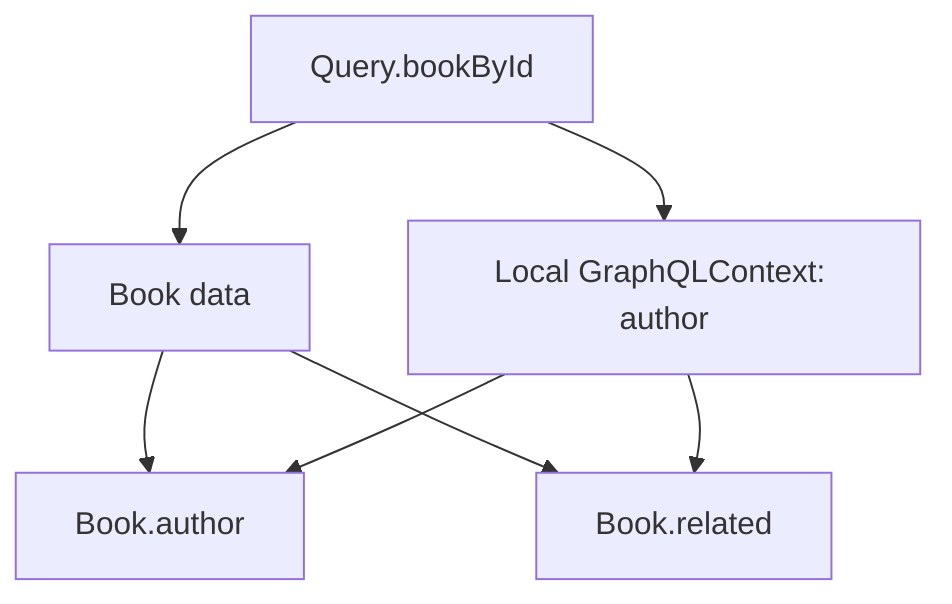

# @LocalContextValue

Trong một GraphQL query, resolver của field cha đôi khi đã lấy được dữ liệu mà các field con cũng cần dùng. Nếu mỗi field con tự gọi service để lấy lại dữ liệu đó, ứng dụng có thể tạo thêm truy vấn không cần thiết. Spring for GraphQL cung cấp `@LocalContextValue` để một field resolver đọc thông tin được field cha truyền xuống trong phạm vi một nhánh của cây GraphQL.

Local context được tạo từ kết quả của resolver cha, thường thông qua `DataFetcherResult<T>` và thuộc tính `localContext`. Resolver con nhận giá trị bằng `@LocalContextValue`. Cách này cho phép chia sẻ dữ liệu đã tải trước, thông tin tính toán hoặc metadata riêng cho nhánh mà không đưa chúng vào context chung của toàn operation.

Bài học này giải thích local context trong GraphQL Java, cách tạo và truyền local context từ parent field, cách đọc bằng `@LocalContextValue`, cách xử lý giá trị không tồn tại, sự khác nhau giữa local context và main GraphQL context, cùng ví dụ kiểm thử và các lỗi thường gặp.

## 1. Local context là gì?

GraphQL thực thi operation theo cây field. Resolver của field cha trả về object; GraphQL dùng object đó làm source cho các field con. Ngoài source object, parent resolver có thể truyền thêm một context object xuống các resolver con.

Ví dụ schema:

```graphql
type Query {
  bookById(id: ID!): Book
}

type Book {
  id: ID!
  title: String!
  author: Author
  related: [Book!]!
}

type Author {
  id: ID!
  name: String!
}
```

Client truy vấn:

```graphql
query {
  bookById(id: "book-1") {
    title
    author {
      id
      name
    }
    related {
      id
      title
    }
  }
}
```

Resolver `bookById` có thể tải trước cả Book và Author. Nó trả Book làm dữ liệu chính và truyền Author xuống nhánh con qua local context. Resolver `related` có thể nhận Author đó mà không cần tải lại:



Local context là dữ liệu bổ sung được truyền từ parent field xuống các child fields của field đó. Nó có phạm vi theo nhánh thực thi, không phải một vùng lưu trữ dùng chung cho toàn bộ GraphQL operation.

Trong GraphQL Java, child DataFetcher đọc local context qua `DataFetchingEnvironment.getLocalContext()`. Spring for GraphQL cung cấp `@LocalContextValue` để lấy một attribute có tên từ local GraphQL context mà không cần truy cập environment trực tiếp.

## 2. Phân biệt main GraphQLContext và local context

Spring for GraphQL có hai loại context với phạm vi khác nhau:

| Đặc điểm | Main GraphQLContext | Local context |
| --- | --- | --- |
| Phạm vi | Toàn bộ GraphQL operation | Một nhánh từ parent field xuống child fields |
| Nguồn tạo | Execution input, WebGraphQlInterceptor hoặc thành phần thực thi | Parent resolver trả `DataFetcherResult` có local context |
| Cách đọc trong controller | `@ContextValue` hoặc `GraphQLContext` | `@LocalContextValue` |
| Mục đích | Thông tin request-wide như correlation ID, principal, locale hoặc metadata chung | Dữ liệu đã tải trước hoặc metadata chỉ liên quan một nhánh |
| Các child fields cùng parent | Không áp dụng | Cùng nhận local context do parent field cung cấp |

Ví dụ main context:

```java
@QueryMapping
public Book bookById(
        @Argument String id,
        @ContextValue("tenantId") String tenantId) {
    return bookService.findVisibleBook(id, tenantId);
}
```

Ví dụ local context:

```java
@SchemaMapping
public List<Book> related(
        Book book,
        @LocalContextValue("author") Author author) {
    return bookService.findRelatedByAuthor(book, author);
}
```

Không dùng local context để thay thế thông tin request-wide như identity hoặc tenant nếu nhiều nhánh cần cùng dữ liệu đó. Ngược lại, không nên đưa mọi dữ liệu riêng của một nhánh vào main context vì sẽ làm context chung chứa nhiều trạng thái không liên quan.

Một parent field có thể truyền cùng local context cho nhiều child fields của nó, ví dụ cả `Book.author` và `Book.related`. Nhưng local context do một child field tự tạo không lan ngang sang sibling của nó; nó chỉ được truyền tiếp xuống các field con của child đó.

## 3. Tạo local context bằng DataFetcherResult

Resolver cha có thể trả về `DataFetcherResult<T>` thay vì chỉ trả về object domain. `DataFetcherResult` chứa dữ liệu chính và có thể chứa thêm local context, errors hoặc extensions.

Ví dụ model:

```java
public record Book(
        String id,
        String title,
        String authorId) {
}

public record Author(
        String id,
        String name) {
}

public record BookAndAuthor(Book book, Author author) {
}
```

Service tải cả Book và Author trong cùng một use case:

```java
public BookAndAuthor findBookAndAuthor(String id) {
    Book book = bookRepository.findById(id);
    Author author = authorRepository.findById(book.authorId());
    return new BookAndAuthor(book, author);
}
```

Resolver root trả Book và truyền Author qua local context:

```java
@Controller
public class BookQueryController {

    private final BookService bookService;

    public BookQueryController(BookService bookService) {
        this.bookService = bookService;
    }

    @QueryMapping
    public DataFetcherResult<Book> bookById(@Argument String id) {
        BookAndAuthor result = bookService.findBookAndAuthor(id);

        GraphQLContext localContext = GraphQLContext.getDefault()
                .put("author", result.author());

        return DataFetcherResult.<Book>newResult()
                .data(result.book())
                .localContext(localContext)
                .build();
    }
}
```

Ở đây:

- `data(result.book())` là object Book GraphQL dùng để phân giải các field con.
- `localContext(localContext)` truyền GraphQLContext riêng xuống các field con của Book.
- Key `author` lưu object Author đã được tải trước.

`GraphQLContext.getDefault()` tạo một context rỗng mới. Ví dụ thêm attribute vào context đó rồi gắn vào `DataFetcherResult`; không dùng lại một mutable local context làm singleton hoặc lưu nó trong field của controller.

## 4. Đọc local context bằng @LocalContextValue

Sau khi parent resolver truyền context, child resolver có thể đọc attribute:

```java
@Controller
public class BookFieldController {

    private final BookService bookService;

    public BookFieldController(BookService bookService) {
        this.bookService = bookService;
    }

    @SchemaMapping
    public Author author(
            Book book,
            @LocalContextValue("author") Author author) {
        return author;
    }

    @SchemaMapping
    public List<Book> related(
            Book book,
            @LocalContextValue("author") Author author) {
        return bookService.findRelatedBooks(book, author);
    }
}
```

`@LocalContextValue("author")` yêu cầu Spring lấy attribute có tên `author` từ local GraphQLContext rồi bind sang kiểu Java `Author`.

Annotation thuộc package:

```java
org.springframework.graphql.data.method.annotation.LocalContextValue
```

Nó có hai thuộc tính tên tương đương:

- `name`: tên attribute trong local context.
- `value`: alias của `name`.

Hai cách viết sau tương đương:

```java
@LocalContextValue("author") Author author
```

```java
@LocalContextValue(name = "author") Author author
```

Tên key phải khớp chính xác với key được đặt trong context. Nếu parent lưu `author` nhưng child đọc `bookAuthor`, Spring không tìm thấy attribute mong muốn.

## 5. Xử lý khi local context không có giá trị

Mặc định, `required` của `@LocalContextValue` là `true`. Nếu attribute không tồn tại trong local context, Spring báo lỗi khi phân giải method argument.

Có thể đánh dấu attribute là không bắt buộc:

```java
@SchemaMapping
public List<Book> related(
        Book book,
        @LocalContextValue(value = "author", required = false) Author author) {

    if (author != null) {
        return bookService.findRelatedBooksByAuthor(book, author);
    }

    return bookService.findRelatedBooksByBook(book);
}
```

Với `required = false`, method nhận `null` khi không có attribute. Cách này phù hợp khi cùng một field có thể được gọi từ nhiều nhánh hoặc parent resolver khác nhau, trong đó chỉ một số nhánh cung cấp local context.

Nếu muốn thể hiện sự vắng mặt bằng kiểu dữ liệu rõ ràng, có thể dùng `Optional<Author>`:

```java
@SchemaMapping
public List<Book> related(
        Book book,
        @LocalContextValue(value = "author", required = false)
        Optional<Author> author) {

    return author
            .map(value -> bookService.findRelatedBooksByAuthor(book, value))
            .orElseGet(() -> bookService.findRelatedBooksByBook(book));
}
```

Chọn một quy ước nhất quán cho codebase. Không để `required = true` nếu parent field có thể không cung cấp key đó.

## 6. Local context được truyền xuống nhánh con như thế nào?

Khi DataFetcher trả về `DataFetcherResult` có local context, GraphQL Java đưa context đó vào `DataFetchingEnvironment.getLocalContext()` của các field con.

Ví dụ:

```graphql
type Query {
  bookById(id: ID!): Book
  featuredBooks: [Book!]!
}

type Book {
  id: ID!
  author: Author
  related: [Book!]!
}
```

Nếu `bookById` trả `DataFetcherResult<Book>` với local context chứa `author`, các field con bên dưới nhánh `bookById` có thể đọc key đó. Nhánh `featuredBooks` là một root field khác, không tự động nhận local context do `bookById` tạo ra.

Local context được truyền theo quan hệ parent-child:

- Parent resolver tạo local context.
- Các child field resolver nhận local context của parent.
- Một child resolver có thể trả `DataFetcherResult` với local context mới cho các field con của chính nó.
- Nếu resolver không cung cấp local context mới, GraphQL Java giữ local context của parent cho bước con tiếp theo.

Local context không phải biến toàn cục. Nó không được chia sẻ tự động giữa các root fields độc lập hoặc các request khác nhau.

### Local context không thay thế source object

Source và local context là hai thứ riêng biệt:

| Giá trị | Cách nhận | Vai trò |
| --- | --- | --- |
| Source object | Tham số Java không annotation | Object cha mà field hiện tại đang phân giải |
| Local context | `@LocalContextValue` | Dữ liệu bổ sung do ancestor resolver truyền xuống |

Ví dụ method có thể nhận cả hai:

```java
@SchemaMapping
public List<Book> related(
        Book book,
        @LocalContextValue("author") Author author) {
    return bookService.findRelatedBooks(book, author);
}
```

`book` là source hiện tại; `author` là dữ liệu được truyền từ ancestor. Không dùng local context thay cho source object, vì GraphQL vẫn cần source để xác định object đang được phân giải.

## 7. Khi nào nên dùng @LocalContextValue?

Local context hữu ích khi parent resolver đã có dữ liệu mà một số child resolvers trong cùng nhánh cần dùng lại.

### Tái sử dụng dữ liệu đã tải

Parent resolver có thể lấy Book và Author trong một use case:

```java
BookAndAuthor result = bookService.findBookAndAuthor(id);
```

Nó trả Book làm data và Author làm local context. Child resolver dùng Author đã có thay vì gọi lại repository.

### Chia sẻ kết quả tính toán cho các field con

Parent resolver có thể tính một giá trị dẫn xuất, ví dụ:

- Quyền hiển thị một nhóm field theo resource hiện tại.
- Một tập dữ liệu đã lọc theo trạng thái.
- Thông tin tổng hợp phục vụ nhiều child fields.
- Một kết quả look-ahead đã được tính từ selection set.

Nếu nhiều child fields cần cùng kết quả đó, local context có thể tránh lặp phép tính hoặc truy vấn.

### Giữ metadata trong đúng nhánh

Một số metadata chỉ có ý nghĩa với một resource subtree. Local context giúp giữ metadata đó gần với field cần dùng, thay vì đưa vào main GraphQLContext và làm context toàn operation phức tạp hơn.

Không nên sử dụng local context chỉ để truyền một giá trị đơn giản mà child có thể lấy trực tiếp từ source object. Hãy cân nhắc chi phí tạo context và độ phức tạp khi bảo trì.

## 8. Khi nào nên dùng @ContextValue thay cho @LocalContextValue?

`@ContextValue` đọc attribute từ main `GraphQLContext`, còn `@LocalContextValue` đọc attribute từ local context. Chọn annotation theo phạm vi dữ liệu:

```java
@SchemaMapping
public Author author(
        Book book,
        @ContextValue("tenantId") String tenantId,
        @LocalContextValue(value = "preloadedAuthor", required = false)
        Author preloadedAuthor) {

    if (preloadedAuthor != null) {
        return preloadedAuthor;
    }
    return authorService.findVisibleById(book.authorId(), tenantId);
}
```

Trong ví dụ:

- `tenantId` là thông tin request-wide và có thể cần ở nhiều nhánh.
- `preloadedAuthor` chỉ được parent branch truyền xuống nếu đã tải trước.

Không chuyển tenant ID hoặc principal sang local context chỉ vì một field đang cần chúng. Thông tin xác thực và phân vùng dữ liệu thường thuộc main context hoặc Spring Security context để các resolver có thể áp dụng nhất quán.

## 9. Local context và DataFetcherResult

`DataFetcherResult<T>` không chỉ truyền local context. Nó còn có thể chứa:

- `data`: dữ liệu chính mà field trả về.
- `localContext`: context dành cho child fields.
- `errors`: GraphQL errors gắn với kết quả field.
- `extensions`: metadata được gộp vào execution result.

Ví dụ chỉ dùng data và local context:

```java
return DataFetcherResult.<Book>newResult()
        .data(book)
        .localContext(localContext)
        .build();
```

Nếu không cần local context, trả trực tiếp Book thường đơn giản hơn. Chỉ dùng `DataFetcherResult` khi thực sự cần metadata, local context hoặc errors.

### Có thể kết hợp với async return

Generic của `DataFetcherResult<P>` có thể là kiểu bất đồng bộ được hỗ trợ, chẳng hạn `Mono<Book>`. Nếu local context đã có sẵn khi method được gọi, có thể trả:

```java
@QueryMapping
public DataFetcherResult<Mono<Book>> bookById(@Argument String id) {
    Author preloadedAuthor = authorService.findFromRequestCache(id);

    GraphQLContext localContext = GraphQLContext.getDefault()
            .put("author", preloadedAuthor);

    return DataFetcherResult.<Mono<Book>>newResult()
            .data(bookService.findByIdReactive(id))
            .localContext(localContext)
            .build();
}
```

Trong ví dụ này, Book được tải bất đồng bộ bằng Mono, còn local context đã được tạo trước khi trả về `DataFetcherResult`. Nếu local context phụ thuộc vào kết quả async, hãy thiết kế pipeline sao cho dữ liệu và context được tạo đồng bộ trong cùng một bước xử lý; không đặt một Mono làm local context rồi mong `@LocalContextValue` tự subscribe vào nó. Không gọi `block()` để lấy giá trị từ Mono trong controller WebFlux.

Tên `findFromRequestCache` trong ví dụ là phương thức minh họa và giả định luôn trả về Author hợp lệ. Nếu Author có thể vắng mặt, đừng gọi `put` với giá trị null; chỉ thêm key khi có giá trị và khai báo child parameter với `required = false`.

## 10. Local context và DataLoader khác nhau thế nào?

Local context và DataLoader đều có thể giúp tránh tải lại dữ liệu, nhưng giải quyết hai bài toán khác nhau:

| Tiêu chí | Local context | DataLoader |
| --- | --- | --- |
| Mục đích | Truyền dữ liệu bổ sung từ parent xuống child fields | Gom nhiều yêu cầu tải dữ liệu theo key |
| Nguồn dữ liệu | Parent resolver đã lấy hoặc tính sẵn | Batch loader tải dữ liệu khi keys được yêu cầu |
| Phạm vi | Nhánh parent-child trong cây GraphQL | Một GraphQL request và một DataLoader |
| Cách đọc | `@LocalContextValue` | `DataLoader.load(key)` |
| Xử lý N+1 | Có thể tránh fetch lặp nếu parent đã có dữ liệu cần thiết | Trực tiếp gom nhiều lần fetch thành batch |

Ví dụ local context phù hợp khi root resolver đã lấy cả Book và Author trong cùng một use case. Nó truyền Author xuống child fields để dùng lại.

DataLoader phù hợp khi query trả về nhiều Book, mỗi Book có author ID khác nhau và server cần gom tất cả author IDs thành một bulk query. Parent resolver không nhất thiết phải biết trước danh sách Author.

Hai cơ chế có thể phối hợp. Parent resolver có thể truyền một metadata nhỏ qua local context; child resolver dùng metadata đó để tạo key hoặc quyết định cách gọi DataLoader. Tuy nhiên, không nên dùng local context thay cho batching nếu vấn đề thực tế là nhiều parent objects cần tải các quan hệ khác nhau.

## 11. Local context và vòng đời request

Local context gắn với quá trình thực thi GraphQL hiện tại:

- Parent resolver tạo local context cho kết quả field.
- GraphQL truyền context đó xuống các field con của kết quả.
- Child resolver đọc context qua `@LocalContextValue`.
- Kết thúc operation, context không được giữ làm trạng thái dùng chung cho request tiếp theo.

Tạo context mới cho từng lần thực thi field. Không lưu local context vào static field, singleton mutable state hoặc biến instance của controller. Controller trong Spring thường là singleton; giữ dữ liệu request trong field của controller có thể làm nhiều request nhìn thấy trạng thái của nhau.

`GraphQLContext` yêu cầu key và value không null. Trước khi gọi `put`, hãy bảo đảm giá trị đã có. Nếu một giá trị có thể vắng mặt, hãy bỏ key khỏi context hoặc dùng một cấu trúc value không null có thể biểu diễn trạng thái đó.

Không đặt object quá lớn vào local context nếu chỉ một child field cần một phần nhỏ. Context nên chứa dữ liệu bổ sung có ích cho subtree, không phải bản sao toàn bộ request hoặc toàn bộ database entity graph.

## 12. Bảo mật và dữ liệu nhạy cảm

Local context là dữ liệu nội bộ trong quá trình thực thi GraphQL; nó không tự động trở thành field trong response JSON. Tuy vậy, các child resolvers trong phạm vi nhánh có thể đọc nó, vì vậy cần kiểm soát nội dung và cách sử dụng.

Một số nguyên tắc:

- Không đưa password, access token hoặc credential vào local context.
- Không xem việc có một object trong local context là bằng chứng người dùng được phép truy cập object đó.
- Kiểm tra authorization tại service/domain boundary dựa trên principal và tenant hiện tại.
- Chỉ truyền các field hoặc projection mà child resolver thực sự cần.
- Không dùng local context để chia sẻ dữ liệu giữa các request.
- Tránh ghi toàn bộ local context vào log; có thể chứa dữ liệu nội bộ của resource.

Ví dụ có thể truyền một kết quả quyết định quyền đã được tính cho đúng resource và người dùng hiện tại, nhưng service vẫn phải bảo đảm kết quả đó gắn với đúng request, tenant và đối tượng đang truy cập. Khi điều kiện quyền thay đổi hoặc child resolver có thể được gọi trong ngữ cảnh khác, cần kiểm tra lại theo chính sách của hệ thống.

## 13. Kiểm thử @LocalContextValue bằng GraphQlTester

Kiểm thử tốt nên thực thi từ root field để xác nhận parent resolver tạo local context và child resolver nhận đúng attribute.

Ví dụ controller con:

```java
@Controller
public class BookFieldController {

    @SchemaMapping
    public Author author(
            Book book,
            @LocalContextValue("author") Author author) {
        return author;
    }
}
```

Test:

```java
@GraphQlTest({BookQueryController.class, BookFieldController.class})
class LocalContextValueTests {

    @Autowired
    GraphQlTester graphQlTester;

    @MockBean
    BookService bookService;

    @Test
    void passesAuthorFromParentLocalContextToChildField() {
        Book book = new Book("book-1", "Spring GraphQL", "author-1");
        Author author = new Author("author-1", "An Nguyen");
        given(bookService.findBookAndAuthor("book-1"))
                .willReturn(new BookAndAuthor(book, author));

        graphQlTester.document("""
                query {
                    bookById(id: "book-1") {
                        id
                        title
                        author {
                            id
                            name
                        }
                    }
                }
                """)
                .execute()
                .path("bookById.author.name")
                .entity(String.class)
                .isEqualTo("An Nguyen");

        then(bookService).should(times(1))
                .findBookAndAuthor("book-1");
    }
}
```

Ví dụ giả định `BookQueryController` tạo `DataFetcherResult<Book>` như phần trước và gọi `bookService.findBookAndAuthor`. Bổ sung imports, schema resource và các dependency mock theo cấu hình dự án. Tùy phiên bản Spring Boot, annotation mock bean có thể là `@MockBean` hoặc `@MockitoBean`.

### Những tình huống nên kiểm thử

- Parent resolver đặt đúng key và đúng kiểu value.
- Child resolver đọc đúng giá trị bằng `@LocalContextValue`.
- Key không tồn tại khi `required = true` tạo lỗi mong đợi.
- Key không tồn tại khi `required = false` cho phép fallback.
- Một root field có local context không làm rò context sang root field sibling.
- Child resolver có thể truyền local context mới xuống các field con của nó.
- Nhiều GraphQL requests đồng thời không dùng chung local context.
- Local context không làm thay đổi dữ liệu response ngoài các field được chọn.

## 14. Lỗi thường gặp

| Biểu hiện | Nguyên nhân | Cách xử lý |
| --- | --- | --- |
| Child resolver báo thiếu local context value | Parent không trả `DataFetcherResult` hoặc không đặt key | Tạo local context ở parent và kiểm tra tên key |
| `@LocalContextValue` nhận sai kiểu | Giá trị được lưu không tương thích với parameter type | Đồng bộ kiểu value và kiểu Java parameter |
| Resolver lỗi khi chạy từ root field khác | Nhánh đó không có local context | Dùng `required = false` và fallback nếu hợp lệ |
| Child field không thấy context mới | Parent trả object thường thay vì `DataFetcherResult` | Trả `DataFetcherResult` có `.localContext(...)` |
| Nhầm với `@ContextValue` | Đọc main context thay vì local context | Chọn annotation theo phạm vi dữ liệu |
| Dữ liệu bị chia sẻ giữa request | Lưu context vào static hoặc field singleton | Tạo local context trong mỗi lần resolver chạy |
| Giá trị null gây lỗi khi put | GraphQLContext không nhận null key/value | Chỉ put giá trị đã có hoặc biểu diễn trạng thái rõ ràng |
| Dùng local context để tránh mọi N+1 | Local context không tự gom keys | Dùng DataLoader hoặc `@BatchMapping` cho batch loading |
| Child resolver phụ thuộc metadata cũ | Local context không được cập nhật theo resource mới | Truyền context mới từ resolver phù hợp hoặc tải lại dữ liệu |

## 15. Nguyên tắc sử dụng @LocalContextValue

- Dùng `@LocalContextValue` để đọc attribute từ local GraphQLContext của parent field.
- Tạo local context bằng `DataFetcherResult.localContext` ở resolver cha.
- Dùng `@ContextValue` cho dữ liệu thuộc main context của toàn operation.
- Đặt key rõ ràng và nhất quán giữa nơi ghi và nơi đọc.
- Giữ kiểu value tương thích với method parameter.
- Dùng `required = false` khi field có thể được gọi từ nhánh không cung cấp attribute.
- Chỉ truyền dữ liệu mà các child fields trong nhánh thực sự cần.
- Tạo context mới theo từng lần thực thi; không lưu vào singleton state.
- Không dùng local context làm cơ chế authorization độc lập.
- Dùng DataLoader hoặc `@BatchMapping` khi cần gom nhiều yêu cầu tải dữ liệu.
- Kiểm thử cả trường hợp có context, thiếu context và các nhánh sibling.

## 16. Bài tập thực hành

Xây dựng API thư viện để truyền dữ liệu tác giả qua local context:

1. Khai báo `Query.bookById`, `Book.author` và `Book.related` trong SDL.
2. Tạo record `Book`, `Author` và `BookAndAuthor`.
3. Viết service tải Book và Author trong cùng một use case.
4. Cho `@QueryMapping` trả `DataFetcherResult<Book>` với local context chứa key `author`.
5. Viết `@SchemaMapping` nhận `@LocalContextValue("author") Author`.
6. Dùng Author trong resolver `related` để tìm sách cùng tác giả.
7. Tạo một query root khác trả Book mà không có local context; xử lý bằng `required = false`.
8. So sánh `@LocalContextValue` với `@ContextValue`.
9. Viết GraphQlTester xác nhận child resolver nhận đúng Author.
10. Kiểm tra local context của một root field không xuất hiện trong sibling root field.
11. Giải thích khi nào cần DataLoader thay vì truyền dữ liệu qua local context.

Sau bài tập, bạn cần giải thích được local context được tạo ở đâu, đi theo nhánh nào, cách Spring bind key vào method parameter và vì sao nó khác main GraphQLContext.

## 17. Tài liệu tham khảo

- [Spring for GraphQL — Annotated Controllers: Local Context](https://docs.spring.io/spring-graphql/reference/controllers.html#controllers.local-context)
- [Spring for GraphQL — LocalContextValue API](https://docs.spring.io/spring-graphql/docs/1.4.x/api/org/springframework/graphql/data/method/annotation/LocalContextValue.html)
- [GraphQL Java — DataFetchingEnvironment](https://javadoc.io/doc/com.graphql-java/graphql-java/latest/graphql/schema/DataFetchingEnvironment.html)
- [GraphQL Java — DataFetcherResult](https://javadoc.io/doc/com.graphql-java/graphql-java/latest/graphql/execution/DataFetcherResult.html)

Chữ ký annotation, method argument resolver và API của GraphQL Java có thể thay đổi theo phiên bản Spring for GraphQL. Khi nâng cấp dependency, hãy kiểm tra reference documentation và Javadoc đúng phiên bản mà ứng dụng đang sử dụng.
