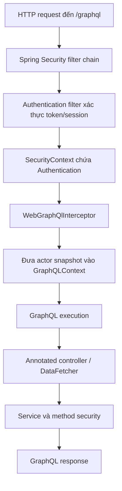

# SecurityContext trong GraphQL context

Spring Security lưu danh tính đã xác thực và các quyền của người gọi trong `SecurityContext`, thường được truy cập qua `SecurityContextHolder` ở ứng dụng Servlet hoặc `ReactiveSecurityContextHolder` ở ứng dụng WebFlux. Trong khi đó, Spring for GraphQL cung cấp `GraphQLContext` để truyền dữ liệu theo từng lần thực thi GraphQL đến các resolver và thành phần xử lý liên quan.

Hai context này có liên quan nhưng không phải cùng một đối tượng và không tự động thay thế cho nhau. `SecurityContext` là nguồn danh tính và quyền do Spring Security quản lý; `GraphQLContext` là vùng dữ liệu theo request/operation của GraphQL. Khi resolver hoặc batch loader cần thông tin actor, tenant hay correlation ID, ứng dụng có thể chuyển một snapshot an toàn từ security context vào GraphQL context bằng `WebGraphQlInterceptor`.

Sau bài này, bạn có thể:

- Phân biệt `SecurityContext`, `SecurityContextHolder` và `GraphQLContext`.
- Hiểu cách Spring Security lưu `Authentication` trên Servlet và WebFlux.
- Truyền thông tin người dùng đã xác thực vào GraphQL context bằng interceptor.
- Đọc context trong annotated controller bằng `@ContextValue` hoặc `DataFetchingEnvironment`.
- Dùng method security để bảo vệ query, mutation và field resolver.
- Tránh lỗi mất context khi GraphQL thực thi bất đồng bộ hoặc dùng DataLoader.
- Xử lý multi-tenancy, subscription và kiểm thử quyền truy cập.

## 1. SecurityContext và GraphQLContext giải quyết hai vấn đề khác nhau

Spring Security và Spring for GraphQL có hai cơ chế context riêng:

| Thành phần | Vai trò | Phạm vi thường gặp |
| --- | --- | --- |
| `SecurityContext` | Chứa `Authentication` của người gọi đã xác thực | Request/security execution context |
| `SecurityContextHolder` | Cung cấp điểm truy cập tới `SecurityContext` trong ứng dụng Servlet | Thường gắn với thread qua strategy mặc định |
| `ReactiveSecurityContextHolder` | Truy cập security context trong Reactor Context | Reactive pipeline |
| `GraphQLContext` | Chứa dữ liệu phục vụ một lần GraphQL execution | Một GraphQL request/operation |

Ví dụ `Authentication` có thể chứa principal, authorities và thông tin xác thực. `GraphQLContext` có thể chứa một actor snapshot gồm subject ID, tenant ID hoặc correlation ID để resolver dùng trong quá trình phân giải field.

Không nên xem `GraphQLContext` là nơi xác thực người dùng. Client không được quyền tự gửi một map `GraphQLContext` tùy ý qua GraphQL variables. Server mới là thành phần tạo và bổ sung context sau khi request đi qua cơ chế xác thực.

## 2. Luồng xác thực của một GraphQL request

Trong ứng dụng web, request đến endpoint GraphQL thường đi qua Spring Security filter chain trước khi tới Spring for GraphQL:



Các bước có thể diễn ra khác nhau tùy Servlet hay WebFlux, phương thức xác thực và cách cấu hình ứng dụng. Điểm quan trọng là interceptor chạy sau khi security layer đã thiết lập danh tính, và resolver nhận dữ liệu context do server đưa vào.

## 3. SecurityContext chứa gì?

`SecurityContext` giữ một đối tượng `Authentication`. `Authentication` thường cung cấp:

- `getPrincipal()`: danh tính người dùng, có thể là `UserDetails`, JWT principal hoặc kiểu principal riêng.
- `getName()`: tên định danh của người dùng.
- `getAuthorities()`: các quyền như `BOOK_READ`, `BOOK_WRITE` hoặc role được chuyển thành authority.
- `isAuthenticated()`: trạng thái xác thực của đối tượng.

Không nên nhầm `Authentication` với dữ liệu do client truyền trong GraphQL input. Ví dụ, một mutation có thể nhận `createdBy` hoặc `userId`, nhưng các trường đó không thể thay thế danh tính đã được Spring Security xác thực.

Thông thường, không cần đưa toàn bộ `Authentication` vào GraphQL context. `Authentication` có thể chứa principal hoặc credentials nhạy cảm. Thay vào đó, hãy tạo một snapshot tối thiểu chỉ gồm dữ liệu mà resolver thực sự cần:

```java
public record CurrentActor(
        String subject,
        Set<String> authorities) {

    public static CurrentActor from(Authentication authentication) {
        Set<String> authorities = authentication.getAuthorities().stream()
                .map(GrantedAuthority::getAuthority)
                .collect(Collectors.toUnmodifiableSet());

        return new CurrentActor(authentication.getName(), authorities);
    }
}
```

Snapshot này không chứa password, bearer token hay credentials. Nếu ứng dụng cần tenant ID, locale hoặc thuộc tính khác, chỉ thêm những giá trị đã được xác minh và thực sự cần cho GraphQL execution.

## 4. Khác biệt giữa Servlet và WebFlux

Trong ứng dụng Servlet, Spring Security mặc định lưu `SecurityContext` bằng `ThreadLocal` thông qua `SecurityContextHolder`. Security filter thiết lập context trước khi xử lý request và dọn context sau khi request kết thúc.

Trong ứng dụng WebFlux, security context được truyền qua Reactor Context. Nên truy cập bằng `ReactiveSecurityContextHolder`, không dựa vào `SecurityContextHolder` như một thread-local thông thường.

| Nền tảng | Cách truy cập thường dùng | Lưu ý |
| --- | --- | --- |
| Spring MVC / Servlet | `SecurityContextHolder.getContext()` | Context gắn với thread theo strategy mặc định |
| Spring WebFlux | `ReactiveSecurityContextHolder.getContext()` | Context đi theo Reactor pipeline, không gắn cố định với thread |

Không sao chép nguyên xi code đọc security context từ ứng dụng MVC sang WebFlux. Khi đổi sang reactive stack, cần xem lại interceptor, executor, service và cách truyền context.

## 5. Đưa actor vào GraphQLContext bằng WebGraphQlInterceptor

`WebGraphQlInterceptor` nằm ở ranh giới giữa HTTP/WebSocket transport và GraphQL execution. Nó có thể bổ sung dữ liệu vào `ExecutionInput` trước khi operation chạy.

Trước tiên, định nghĩa key và kiểu actor:

```java
public final class GraphQlContextKeys {
    public static final String CURRENT_ACTOR = "currentActor";

    private GraphQlContextKeys() {
    }
}
```

Với ứng dụng Servlet, có thể đọc `Authentication` từ `SecurityContextHolder`, tạo snapshot rồi đưa vào GraphQL context:

```java
@Component
public class ServletSecurityGraphQlInterceptor implements WebGraphQlInterceptor {

    @Override
    public Mono<WebGraphQlResponse> intercept(
            WebGraphQlRequest request,
            Chain chain) {

        Authentication authentication =
                SecurityContextHolder.getContext().getAuthentication();

        if (authentication != null
                && authentication.isAuthenticated()
                && !(authentication instanceof AnonymousAuthenticationToken)) {

            CurrentActor actor = CurrentActor.from(authentication);

            request.configureExecutionInput((input, builder) ->
                    builder.graphQLContext(context ->
                            context.put(GraphQlContextKeys.CURRENT_ACTOR, actor))
                            .build());
        }

        return chain.next(request);
    }
}
```

Interceptor này chỉ là ví dụ cho Servlet stack. Nó giả định Spring Security filter chain đã thiết lập context trước khi GraphQL handler xử lý request. Nếu ứng dụng dùng custom authentication filter hoặc cơ chế transport khác, cần xác nhận interceptor chạy trong phạm vi context đã xác thực.

Chỉ đưa actor snapshot vào GraphQL context khi có authentication hợp lệ. Request anonymous có thể không có key `currentActor`; resolver cần xử lý trường hợp đó nếu schema cho phép truy cập ẩn danh.

## 6. Truyền context trong WebFlux

Với WebFlux, lấy security context từ Reactor Context:

```java
@Component
public class ReactiveSecurityGraphQlInterceptor implements WebGraphQlInterceptor {

    @Override
    public Mono<WebGraphQlResponse> intercept(
            WebGraphQlRequest request,
            Chain chain) {

        return ReactiveSecurityContextHolder.getContext()
                .map(SecurityContext::getAuthentication)
                .filter(authentication -> authentication.isAuthenticated()
                        && !(authentication instanceof AnonymousAuthenticationToken))
                .map(CurrentActor::from)
                .doOnNext(actor ->
                    request.configureExecutionInput((input, builder) ->
                            builder.graphQLContext(context ->
                                    context.put(GraphQlContextKeys.CURRENT_ACTOR, actor))
                                    .build()))
                .then(Mono.defer(() -> chain.next(request)));
    }
}
```

Nếu không có authenticated principal, interceptor vẫn tiếp tục GraphQL request mà không thêm actor. Resolver hoặc security policy sẽ quyết định field nào được phép truy cập ẩn danh.

Trong một ứng dụng, chỉ đăng ký interceptor phù hợp với web stack đang chạy. Không đăng ký đồng thời hai interceptor Servlet và WebFlux nếu chúng cùng ghi một key context và có thể chạy trên cùng đường request.

## 7. Đọc actor trong annotated controller

Spring for GraphQL cung cấp `@ContextValue` để bind một giá trị từ `GraphQLContext` vào tham số controller:

```java
@Controller
public class BookController {

    private final BookService bookService;

    public BookController(BookService bookService) {
        this.bookService = bookService;
    }

    @QueryMapping
    public List<BookView> myBooks(
            @ContextValue(name = GraphQlContextKeys.CURRENT_ACTOR, required = false)
            CurrentActor actor) {

        if (actor == null) {
            throw new AccessDeniedException("Authentication is required");
        }

        return bookService.findVisibleTo(actor.subject());
    }
}
```

`required = false` cho phép method nhận null nếu context key không tồn tại. Điều này phù hợp khi endpoint cho phép một số operation anonymous nhưng field cụ thể yêu cầu đăng nhập.

Nếu field luôn yêu cầu actor, có thể để `required = true` hoặc dùng method security. Tuy nhiên, đừng chỉ dựa vào việc context key tồn tại để xác nhận quyền; context chỉ cung cấp danh tính đã được xác thực, còn policy cần được kiểm tra riêng.

## 8. Đọc GraphQLContext bằng DataFetchingEnvironment

Khi resolver cần nhiều giá trị context hoặc cần API GraphQL Java, có thể nhận `DataFetchingEnvironment`:

```java
@QueryMapping
public List<BookView> myBooks(DataFetchingEnvironment environment) {
    CurrentActor actor = environment.getGraphQlContext()
            .get(GraphQlContextKeys.CURRENT_ACTOR);

    if (actor == null) {
        throw new AccessDeniedException("Authentication is required");
    }

    return bookService.findVisibleTo(actor.subject());
}
```

`@ContextValue` phù hợp khi chỉ cần một hoặc vài giá trị có kiểu rõ ràng. `DataFetchingEnvironment` hữu ích khi cần truy cập thêm field definition, arguments, selection set hoặc GraphQL context. Dù chọn cách nào, service vẫn nên nhận dữ liệu ứng dụng như actor ID hoặc tenant ID thay vì nhận trực tiếp `DataFetchingEnvironment`.

## 9. Bảo vệ endpoint GraphQL ở HTTP layer

GraphQL thường dùng một endpoint HTTP, chẳng hạn `/graphql`, cho nhiều query, mutation và field khác nhau. Spring Security có thể bảo vệ endpoint ở cấp request:

```java
@Configuration
@EnableMethodSecurity
public class SecurityConfiguration {

    @Bean
    SecurityFilterChain securityFilterChain(HttpSecurity http) throws Exception {
        return http
                .authorizeHttpRequests(authorize -> authorize
                        .requestMatchers("/graphql").authenticated()
                        .anyRequest().permitAll())
                .build();
    }
}
```

Ví dụ này yêu cầu xác thực cho endpoint `/graphql`. Cơ chế login/token cụ thể được cấu hình theo ứng dụng, chẳng hạn OAuth2 Resource Server với JWT hoặc session authentication.

Request-level security phù hợp cho chính sách thô như toàn bộ endpoint chỉ dành cho người dùng đã đăng nhập. Nó không phân biệt field `books` với `adminReport` trong cùng một GraphQL document. Nếu cần phân quyền theo operation hoặc field, phải bổ sung authorization ở tầng GraphQL/application.

Không tắt CSRF một cách toàn cục chỉ vì ứng dụng có GraphQL endpoint. Cách xử lý CSRF phụ thuộc vào cơ chế xác thực: session/cookie và bearer token có rủi ro khác nhau. Hãy cấu hình theo mô hình transport và credential thực tế.

## 10. Phân quyền operation và field bằng method security

Bật method security bằng `@EnableMethodSecurity`, sau đó bảo vệ application service hoặc resolver method bằng `@PreAuthorize`:

```java
@Service
public class BookService {

    @PreAuthorize("hasAuthority('BOOK_READ')")
    public List<BookView> findAll() {
        return bookRepository.findAllViews();
    }

    @PreAuthorize("hasAuthority('BOOK_WRITE')")
    @Transactional
    public BookView create(CreateBookCommand command) {
        BookEntity entity = BookEntity.from(command);
        BookEntity saved = bookRepository.save(entity);
        return bookMapper.toView(saved);
    }
}
```

Resolver gọi service như bình thường:

```java
@QueryMapping
public List<BookView> books() {
    return bookService.findAll();
}
```

Nếu một field cụ thể nhạy cảm, có thể bảo vệ use case chuyên biệt mà field resolver gọi:

```java
@Service
public class BookAuditService {

    @PreAuthorize("hasAuthority('BOOK_AUDIT_READ')")
    public String internalNotes(String bookId) {
        return auditRepository.findNotesByBookId(bookId);
    }
}
```

Method security bảo vệ logic bất kể nó được gọi từ GraphQL, REST hay một adapter khác, miễn là lời gọi đi qua Spring proxy. Với quyền phụ thuộc resource, tenant hoặc owner, cần kiểm tra cả quan hệ dữ liệu thay vì chỉ kiểm tra authority chung.

Với ứng dụng reactive dùng WebFlux, bật reactive method security bằng `@EnableReactiveMethodSecurity` và giữ các method được bảo vệ trong reactive return type như `Mono` hoặc `Flux`. `@EnableMethodSecurity` là cấu hình cho method security kiểu Servlet/imperative; không nên giả định nó tự thay thế cấu hình reactive.

## 11. Không tin user ID do client gửi

Một lỗi bảo mật phổ biến là để client gửi `userId` rồi dùng nó làm danh tính của người đang gọi:

```graphql
query {
    privateBooks(userId: "user-100") {
        id
        title
    }
}
```

Nếu server không kiểm tra quyền, người dùng có thể thay ID để đọc dữ liệu của người khác. Thay vào đó, lấy subject từ actor snapshot do server tạo:

```java
@QueryMapping
public List<BookView> myBooks(
        @ContextValue(name = GraphQlContextKeys.CURRENT_ACTOR) CurrentActor actor) {
    return bookService.findVisibleTo(actor.subject());
}
```

Nếu use case thực sự cần một `userId` mục tiêu, service phải xác minh caller có quyền truy cập target đó. `GraphQLContext` không làm cho một giá trị trở nên đáng tin chỉ vì nó được đặt trong map; nguồn gốc và quá trình xác thực giá trị mới quyết định độ tin cậy.

## 12. Multi-tenancy và request state

Với hệ thống multi-tenant, actor snapshot có thể chứa tenant đã được xác minh từ token hoặc server-side identity provider:

```java
public record CurrentActor(
        String subject,
        String tenantId,
        Set<String> authorities) {
}
```

Interceptor tạo snapshot từ claims/principal đã được xác thực. Resolver chuyển subject và tenant ID vào service:

```java
@QueryMapping
public List<BookView> books(
        @ContextValue(name = GraphQlContextKeys.CURRENT_ACTOR) CurrentActor actor) {
    return bookService.findByTenant(actor.tenantId());
}
```

Service/repository phải áp dụng tenant filter trên mọi đường truy cập dữ liệu. Không chỉ thêm tenant vào GraphQL context rồi kỳ vọng query tự động được cô lập. Các batch loader và DataLoader cũng phải dùng cùng tenant/security context khi tải nhiều resource.

Không lấy tenant từ argument client trừ khi đó là chức năng chọn tenant được phép và server xác minh người dùng có quyền chuyển sang tenant đó. Tenant ID trong token hoặc session cũng cần được xác minh theo chính sách ứng dụng.

## 13. SecurityContext trong xử lý bất đồng bộ

GraphQL có thể phân giải các field sibling song song, sử dụng `CompletableFuture`, DataLoader hoặc executor riêng. Trong ứng dụng Servlet, `SecurityContextHolder` mặc định gắn context với thread; khi công việc chuyển sang thread khác, context có thể không còn hiện diện.

Không nên giả định rằng đoạn code chạy trong `CompletableFuture.supplyAsync(...)` luôn đọc được cùng `SecurityContextHolder` như resolver ban đầu. Nếu công việc bất đồng bộ cần Spring Security context, hãy cấu hình context propagation phù hợp, ví dụ dùng `DelegatingSecurityContextExecutor`/`DelegatingSecurityContextExecutorService` cho executor trong Servlet stack.

Với WebFlux, giữ security context trong Reactor Context và tránh chuyển sang callback tự tạo thread mà không truyền context. Các toán tử Reactor thông thường giữ Reactor Context theo subscription; khi dùng scheduler hoặc thư viện ngoài, hãy xác nhận context propagation được hỗ trợ.

Một cách giảm phụ thuộc thread-local trong resolver là đưa actor snapshot bất biến vào `GraphQLContext`. GraphQL context đi theo execution và có thể được đọc từ `DataFetchingEnvironment` hoặc `@ContextValue`. Tuy nhiên, method security vẫn cần Spring Security context đúng cách nếu policy dựa vào `SecurityContextHolder` hoặc `ReactiveSecurityContextHolder`.

## 14. DataLoader và batch loader cần giữ đúng security context

Batch loader có thể gom key của nhiều field thành một truy vấn. Điều đó không làm mất yêu cầu authorization. Tất cả key trong batch đều thuộc cùng một GraphQL execution, nhưng mỗi resource vẫn có thể thuộc tenant hoặc phạm vi quyền khác nhau.

Khi batch loader tải dữ liệu, hãy:

- Dùng actor/tenant đã được xác thực từ request context.
- Lọc dữ liệu theo tenant hoặc quyền trong truy vấn bulk.
- Không dùng key client gửi làm bằng chứng caller được phép đọc resource.
- Tránh đăng ký DataLoader singleton có cache dùng chung giữa người dùng.
- Nếu mutation thay đổi dữ liệu trong cùng request, cập nhật/clear cache theo semantics phù hợp.

DataLoader cache thường có phạm vi request khi được đăng ký qua `BatchLoaderRegistry` của Spring for GraphQL. Không tự tạo cache toàn cục cho kết quả phụ thuộc người dùng. Cache theo key thiếu tenant hoặc security dimension có thể trả dữ liệu của một phạm vi quyền cho request khác.

## 15. Subscription và vòng đời authentication

Subscription có thể sống lâu hơn một HTTP request thông thường. Với WebSocket, authentication thường được thực hiện ở bước handshake hoặc thông qua cơ chế xác thực connection của transport. Nhưng một subscription có thể tiếp tục chạy sau khi token hết hạn, quyền bị thu hồi hoặc người dùng bị khóa.

Vì vậy, cần xác định rõ:

- Authentication được xác minh ở handshake, mỗi operation hay mỗi message.
- Actor snapshot trong GraphQL context thuộc subscription operation nào.
- Khi token hết hạn hoặc quyền bị thu hồi, subscription có bị đóng hoặc kiểm tra lại không.
- Dữ liệu phát ra sau thời điểm thay đổi quyền có còn được phép gửi không.

Không chia sẻ một `SecurityContext` mutable giữa nhiều subscription hoặc nhiều người dùng. Nếu policy yêu cầu thu hồi quyền tức thời, không thể chỉ dựa vào snapshot được tạo một lần ở handshake; cần cơ chế kiểm tra lại hoặc kết thúc subscription phù hợp.

## 16. Xử lý AccessDeniedException thành GraphQL error

Khi người dùng không có quyền, Spring Security có thể ném `AccessDeniedException`. GraphQL cần chuyển lỗi này thành response error phù hợp với contract của API.

Ví dụ handler:

```java
@ControllerAdvice
public class GraphQlSecurityExceptionHandler {

    @GraphQlExceptionHandler
    public GraphQLError handleAccessDenied(AccessDeniedException exception) {
        return GraphqlErrorBuilder.newError()
                .errorType(ErrorType.FORBIDDEN)
                .message("You are not allowed to access this resource")
                .build();
    }
}
```

Tên `ErrorType` và cách phân loại lỗi nên thống nhất với quy ước API của ứng dụng. Không trả role nội bộ, policy expression, token claim nhạy cảm hoặc stack trace cho client. Log phía server có thể giữ thông tin chi tiết để điều tra.

Nếu field bị từ chối có kiểu non-null, lỗi execution có thể làm null lan lên field cha. Vì vậy, nullability trong SDL cần phản ánh đúng semantics khi caller không có quyền. Không dùng null để che giấu mọi lỗi authorization nếu client cần phân biệt forbidden với dữ liệu không tồn tại.

## 17. Kiểm thử SecurityContext và GraphQL context

Nên kiểm thử riêng việc xác thực, truyền context và phân quyền:

1. Request không có authentication bị từ chối ở HTTP layer nếu endpoint yêu cầu đăng nhập.
2. Request đã xác thực tạo đúng `CurrentActor` trong GraphQL context.
3. Resolver đọc đúng actor qua `@ContextValue` hoặc `DataFetchingEnvironment`.
4. Người có `BOOK_READ` đọc được field được phép.
5. Người thiếu `BOOK_AUDIT_READ` không đọc được field nhạy cảm.
6. User A không thể gửi `userId` của User B để đọc dữ liệu của B.
7. Tenant A không thể đọc resource thuộc tenant B.
8. Async resolver và batch loader nhận đúng request context.
9. Hai request độc lập không chia sẻ actor hoặc DataLoader cache.
10. Subscription xử lý đúng trường hợp token hết hạn hoặc quyền bị thu hồi theo policy.

Với service dùng method security, có thể kiểm thử bằng `@WithMockUser` hoặc test security context tương ứng. Với interceptor và transport, nên có integration test qua `WebGraphQlTester`/HTTP client để xác nhận security filter chain, interceptor và GraphQL execution phối hợp đúng. Unit test gọi trực tiếp resolver không đủ để kiểm tra việc context được truyền từ HTTP request.

## 18. Những lỗi thường gặp

- **Nhầm `SecurityContext` với `GraphQLContext`:** hai context có vòng đời và mục đích khác nhau.
- **Giả định SecurityContextHolder tự xuất hiện trong GraphQLContext:** cần truyền rõ ràng nếu resolver cần snapshot trong GraphQL context.
- **Dùng `SecurityContextHolder` trong WebFlux:** reactive stack cần `ReactiveSecurityContextHolder` và Reactor Context.
- **Đưa toàn bộ credentials vào GraphQLContext:** có thể làm lộ token hoặc dữ liệu nhạy cảm; chỉ truyền actor snapshot tối thiểu.
- **Tin `userId`/`tenantId` từ GraphQL variables:** danh tính và tenant phải được xác thực hoặc được server kiểm tra quyền.
- **Chỉ bảo vệ endpoint `/graphql`:** một endpoint chứa nhiều field có chính sách truy cập khác nhau; cần method/field authorization.
- **Cho rằng field không được UI hiển thị là an toàn:** client có thể gửi GraphQL document trực tiếp.
- **Mất ThreadLocal context khi chạy executor khác:** cấu hình context propagation hoặc dùng actor snapshot phù hợp.
- **Dùng DataLoader cache toàn cục:** có thể rò rỉ dữ liệu giữa người dùng/tenant.
- **Không xem lại subscription lâu dài:** authentication hoặc quyền có thể thay đổi trong khi subscription vẫn chạy.
- **Trả lỗi quá chi tiết:** response có thể tiết lộ policy, role hoặc dữ liệu nội bộ.

## 19. Quy trình triển khai SecurityContext trong GraphQL

Khi một resolver cần danh tính hoặc quyền của người gọi, hãy thực hiện:

1. Cấu hình Spring Security để xác thực request đến GraphQL endpoint.
2. Chọn cách truy cập security context đúng với Servlet hoặc WebFlux.
3. Xác định resolver/service cần những thuộc tính actor nào.
4. Tạo actor snapshot tối thiểu, không chứa credentials.
5. Dùng `WebGraphQlInterceptor` đưa snapshot vào `GraphQLContext`.
6. Đọc context bằng `@ContextValue` hoặc `DataFetchingEnvironment`.
7. Bảo vệ use case và field bằng method security/authorization theo resource.
8. Truyền tenant và security context đúng cách đến DataLoader/batch loader.
9. Cấu hình context propagation cho executor hoặc reactive pipeline khi cần.
10. Kiểm thử anonymous, authenticated, forbidden, multi-tenant, async và subscription.

`SecurityContext` là nguồn danh tính và quyền do Spring Security quản lý; `GraphQLContext` là nơi truyền dữ liệu theo một lần GraphQL execution. Khi đưa một actor snapshot đã được xác thực vào GraphQL context qua interceptor, resolver có thể sử dụng thông tin người gọi mà không phụ thuộc trực tiếp vào thread-local. Kết hợp cách truyền context phù hợp với Servlet/WebFlux, method security và kiểm tra quyền theo resource sẽ giúp GraphQL API bảo vệ dữ liệu nhất quán từ root field đến field lồng nhau và batch loader.

## Tài liệu tham khảo

- [Spring Security — SecurityContextHolder](https://docs.spring.io/spring-security/reference/servlet/authentication/architecture.html)
- [Spring Security — Reactive SecurityContext](https://docs.spring.io/spring-security/reference/reactive/authorization/method.html)
- [Spring for GraphQL — Web Interception](https://docs.spring.io/spring-graphql/reference/transports.html#web-interception)
- [Spring for GraphQL — GraphQL Context](https://docs.spring.io/spring-graphql/reference/request-execution.html)
- [Spring for GraphQL — Annotated Controllers and ContextValue](https://docs.spring.io/spring-graphql/reference/controllers.html)
- [Spring Security — Method Security](https://docs.spring.io/spring-security/reference/servlet/authorization/method-security.html)
