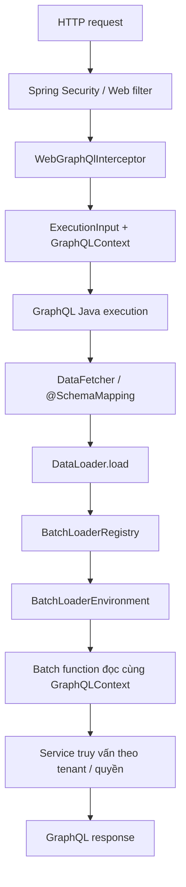

# Context propagation sang DataLoader

## 1. Vì sao DataLoader cần request context?

Một GraphQL request thường đi qua nhiều thành phần: HTTP transport, interceptor, GraphQL engine, data fetcher, DataLoader và batch loading function. Các thành phần này có thể chạy ở những thời điểm hoặc thread khác nhau. Nếu batch loader cần biết tenant hiện tại, người dùng đang đăng nhập, locale hoặc correlation ID, ứng dụng phải truyền những thông tin đó đến đúng nơi xử lý.

Ví dụ, query lấy danh sách sách và field `Book.author` được tải bằng DataLoader. Tác giả phải được truy vấn trong phạm vi tenant của request. Nếu batch loader không nhận được tenant context, nó có thể truy vấn sai phạm vi dữ liệu hoặc không áp dụng được quy tắc phân quyền.

Spring for GraphQL hỗ trợ truyền context từ transport qua GraphQL Java đến data fetcher và batch loader. Cơ chế này bao gồm `GraphQLContext`, Reactor `Context` trong WebFlux và `ThreadLocal` được đăng ký accessor trong Spring MVC. `BatchLoaderRegistry` còn bảo đảm batch loading function và `@BatchMapping` có thể truy cập cùng `GraphQLContext` với data fetcher.

## 2. Phân biệt các loại context

Các khái niệm context có liên quan nhưng không thay thế lẫn nhau:

| Loại context | Phạm vi và mục đích | Cách truy cập thường gặp |
| --- | --- | --- |
| `GraphQLContext` | Dữ liệu dùng chung trong một GraphQL execution, ví dụ tenant đã xác thực, correlation ID, locale | `DataFetchingEnvironment.getGraphQlContext()`, `@ContextValue`, `BatchLoaderEnvironment.getContext()` |
| `BatchLoaderEnvironment` | Môi trường của một lần chạy batch; chứa `GraphQLContext` và context gắn với từng key | Tham số thứ hai của mapped batch loader |
| Reactor `Context` | Dữ liệu đi cùng reactive pipeline, không phụ thuộc thread hiện tại | `Mono.deferContextual`, `Flux.deferContextual` |
| `ThreadLocal` | Dữ liệu gắn với thread, thường được dùng bởi thư viện imperative hoặc Spring MVC | `ThreadLocal`, `SecurityContextHolder`, `RequestContextHolder` |
| Local context | Dữ liệu chỉ truyền đến một nhánh field con thay vì toàn bộ request | `DataFetcherResult.localContext`, `getLocalContext()` và key contexts của batch loader |

`GraphQLContext` là lựa chọn rõ ràng cho dữ liệu cần dùng chung giữa resolver và DataLoader trong cùng execution. Reactor `Context` phù hợp với dữ liệu cần đi theo reactive pipeline. `ThreadLocal` có thể được duy trì qua chuyển thread khi có cơ chế context propagation và accessor tương ứng.

Không nên nhầm `GraphQLContext` với GraphQL variables. Variables là dữ liệu do client gửi để thực hiện operation; context là dữ liệu server gắn vào request sau khi tiếp nhận và xác thực.

## 3. Luồng context từ HTTP đến batch loader

Với Spring Boot và Spring for GraphQL, luồng tổng quát như sau:



Các bước chính:

1. Security filter hoặc transport interceptor xác định thông tin request đáng tin cậy.
2. `WebGraphQlInterceptor` có thể thêm thông tin cần thiết vào `ExecutionInput` và `GraphQLContext`.
3. Data fetcher đọc context để xử lý field hoặc gửi key vào DataLoader.
4. Spring for GraphQL đăng ký DataLoader theo từng request thông qua `BatchLoaderRegistry`.
5. Batch loading function nhận `BatchLoaderEnvironment` và đọc cùng `GraphQLContext`.
6. Service áp dụng tenant, authorization và các quy tắc nghiệp vụ khi tải dữ liệu.

DataLoader không cần nhận lại mọi thông tin qua GraphQL argument. Context cho phép truyền dữ liệu cross-cutting mà không làm schema phải công bố những tham số nội bộ của server.

## 4. Đưa dữ liệu vào GraphQLContext bằng WebGraphQlInterceptor

`WebGraphQlInterceptor` chạy trước và sau GraphQL engine. Đây là điểm phù hợp để kiểm tra request, đọc thông tin transport và thêm dữ liệu server-side vào `ExecutionInput`.

Ví dụ, `TenantResolver` là thành phần của ứng dụng, lấy tenant đã được xác thực từ security context và kiểm tra tenant mà request được phép truy cập:

```java
import java.util.Collections;
import org.springframework.graphql.server.WebGraphQlInterceptor;
import org.springframework.graphql.server.WebGraphQlRequest;
import org.springframework.graphql.server.WebGraphQlResponse;
import org.springframework.stereotype.Component;
import reactor.core.publisher.Mono;

@Component
public class TenantGraphQlInterceptor implements WebGraphQlInterceptor {

    private final TenantResolver tenantResolver;

    public TenantGraphQlInterceptor(TenantResolver tenantResolver) {
        this.tenantResolver = tenantResolver;
    }

    @Override
    public Mono<WebGraphQlResponse> intercept(
            WebGraphQlRequest request, Chain chain) {

        String requestedTenant = request.getHeaders().getFirst("X-Tenant-Id");
        String tenantId = tenantResolver.resolveAuthorizedTenant(requestedTenant);

        request.configureExecutionInput((input, builder) ->
            builder.graphQLContext(
                Collections.singletonMap("tenantId", tenantId)
            ).build()
        );

        return chain.next(request);
    }
}
```

`TenantResolver` là logic riêng của ứng dụng; nó phải xác nhận người dùng hiện tại có quyền sử dụng tenant đó. Header `X-Tenant-Id` chỉ là giá trị client yêu cầu, không phải bằng chứng về quyền truy cập. Không đưa thẳng header do client gửi vào context rồi dùng nó làm ranh giới bảo mật.

Ví dụ trên minh họa một interceptor chịu trách nhiệm tạo `tenantId`. Nếu ứng dụng có nhiều interceptor cùng bổ sung context, hãy phối hợp cách ghi để giữ các key đã được thiết lập; tránh vô tình thay thế toàn bộ context trước đó bằng một map chỉ có một giá trị.

### Dùng interceptor có sẵn cho HTTP header

Nếu chỉ cần chuyển một số HTTP header không nhạy cảm vào context, Spring for GraphQL có `HttpRequestHeaderInterceptor`:

```java
import org.springframework.context.annotation.Bean;
import org.springframework.context.annotation.Configuration;
import org.springframework.graphql.server.support.HttpRequestHeaderInterceptor;

@Configuration
public class GraphQlHeaderConfig {

    @Bean
    HttpRequestHeaderInterceptor correlationHeaderInterceptor() {
        return HttpRequestHeaderInterceptor.builder()
            .mapHeader("X-Correlation-Id")
            .build();
    }
}
```

Sau đó controller hoặc batch mapping có thể đọc giá trị đã được đưa vào context. Chỉ map những header thực sự cần thiết; không sao chép toàn bộ request headers vào GraphQLContext.

## 5. Đọc GraphQLContext trong resolver

Trong annotation-based controller, có thể đọc context theo hai cách.

**Dùng `@ContextValue`:**

```java
import org.springframework.graphql.data.method.annotation.ContextValue;
import org.springframework.graphql.data.method.annotation.QueryMapping;
import org.springframework.stereotype.Controller;

@Controller
public class BookQueryController {

    private final BookQueryService bookQueryService;

    public BookQueryController(BookQueryService bookQueryService) {
        this.bookQueryService = bookQueryService;
    }

    @QueryMapping
    public List<Book> books(@ContextValue("tenantId") String tenantId) {
        return bookQueryService.findAllByTenant(tenantId);
    }
}
```

**Nhận trực tiếp `GraphQLContext`:**

```java
import graphql.GraphQLContext;

@QueryMapping
public List<Book> books(GraphQLContext context) {
    String tenantId = context.get("tenantId");
    return bookQueryService.findAllByTenant(tenantId);
}
```

`@ContextValue` phù hợp khi method chỉ cần một hoặc vài key cụ thể. Nhận `GraphQLContext` phù hợp khi method cần nhiều giá trị hoặc muốn truyền context cho một thành phần khác. Với `@ContextValue`, có thể khai báo `required = false` hoặc dùng `Optional` nếu key không bắt buộc; mặc định key bị thiếu sẽ làm argument resolution thất bại.

## 6. Đọc context trong mapped batch loader

Khi đăng ký batch loader qua `BatchLoaderRegistry`, hàm batch nhận `BatchLoaderEnvironment` làm tham số thứ hai. `environment.getContext()` trả về `GraphQLContext` của cùng execution với data fetcher.

Ví dụ tải tác giả theo ID trong phạm vi tenant:

```java
import graphql.GraphQLContext;
import java.util.Map;
import java.util.Set;
import org.springframework.context.annotation.Configuration;
import org.springframework.graphql.execution.BatchLoaderRegistry;
import reactor.core.publisher.Mono;

@Configuration
public class AuthorBatchLoaderConfig {

    public AuthorBatchLoaderConfig(
            BatchLoaderRegistry registry,
            AuthorQueryService authorQueryService) {

        registry.forTypePair(String.class, Author.class)
            .registerMappedBatchLoader((authorIds, environment) -> {
                GraphQLContext context = environment.getContext();
                String tenantId = context.get("tenantId");

                return authorQueryService.findAllByIdsAndTenant(
                    authorIds,
                    tenantId
                );
            });
    }
}
```

Service có thể khai báo:

```java
public interface AuthorQueryService {
    Mono<Map<String, Author>> findAllByIdsAndTenant(
        Set<String> authorIds,
        String tenantId);
}
```

`BatchLoaderRegistry` của Spring Boot đăng ký DataLoader cho từng request và gắn context tương ứng vào batch loader. Nhờ vậy, batch function có thể dùng `tenantId` mà không phải thêm tenant thành GraphQL argument cho từng field quan hệ.

Không tự tạo `DataLoaderRegistry` toàn cục hoặc chia sẻ DataLoader singleton giữa các request. Làm vậy có thể làm mất tích hợp context propagation và tạo nguy cơ cache dữ liệu chéo người dùng.

## 7. Truyền context vào `@BatchMapping`

`@BatchMapping` là shortcut cho trường hợp batch một field quan hệ. Method `@BatchMapping` cũng có thể nhận `GraphQLContext`, `@ContextValue`, `BatchLoaderEnvironment` và `Principal` nếu Spring Security cung cấp.

Ví dụ:

```java
import java.util.List;
import java.util.Map;
import java.util.Objects;
import java.util.Set;
import java.util.function.Function;
import java.util.stream.Collectors;
import org.springframework.graphql.data.method.annotation.BatchMapping;
import org.springframework.graphql.data.method.annotation.ContextValue;
import org.springframework.stereotype.Controller;
import reactor.core.publisher.Mono;

@Controller
public class BookBatchController {

    private final AuthorQueryService authorQueryService;

    public BookBatchController(AuthorQueryService authorQueryService) {
        this.authorQueryService = authorQueryService;
    }

    @BatchMapping(typeName = "Book", field = "author")
    public Mono<Map<Book, Author>> author(
            List<Book> books,
            @ContextValue("tenantId") String tenantId) {

        Set<String> authorIds = books.stream()
            .map(Book::authorId)
            .filter(Objects::nonNull)
            .collect(Collectors.toSet());

        return authorQueryService.findAllByIdsAndTenant(authorIds, tenantId)
            .map(authorsById -> books.stream()
                .filter(book -> book.authorId() != null
                    && authorsById.containsKey(book.authorId()))
                .collect(Collectors.toMap(
                    Function.identity(),
                    book -> authorsById.get(book.authorId())
                )));
    }
}
```

Spring for GraphQL lấy `tenantId` từ `GraphQLContext` của `BatchLoaderEnvironment`, cùng context mà data fetcher nhìn thấy. Nếu method cần nhiều giá trị context, có thể nhận trực tiếp `GraphQLContext` thay cho nhiều tham số `@ContextValue`.

`@BatchMapping` phù hợp khi logic batch gắn với một field và không cần thêm thông tin đặc biệt từ lần gọi parent. Nếu cần đọc arguments, selection set hoặc context riêng theo từng lần `DataLoader.load`, cân nhắc dùng `BatchLoaderRegistry` và một `@SchemaMapping` gọi DataLoader.

## 8. Vì sao nên dùng BatchLoaderRegistry?

Spring for GraphQL khuyến nghị đăng ký batch loading function qua `BatchLoaderRegistry`. Cơ chế này có hai lợi ích quan trọng:

1. DataLoader được đăng ký trong `DataLoaderRegistry` riêng cho từng request.
2. Batch loading function và `@BatchMapping` có thể truy cập cùng `GraphQLContext` với data fetcher; Spring cũng tích hợp context propagation cho chúng.

Nếu tự đăng ký DataLoader trực tiếp vào `DataLoaderRegistry`, ứng dụng phải tự đảm bảo lifecycle, context và các tùy chọn phù hợp. Việc đăng ký thủ công có thể bỏ qua những lợi ích tích hợp mà `BatchLoaderRegistry` cung cấp.

Ví dụ đăng ký qua Spring:

```java
registry.forTypePair(String.class, Author.class)
    .registerMappedBatchLoader((authorIds, environment) -> {
        String tenantId = environment.getContext().get("tenantId");
        return authorQueryService.findAllByIdsAndTenant(authorIds, tenantId);
    });
```

Loader được tạo cho từng execution; cache của DataLoader cũng nằm trong phạm vi request. Cùng một author ID trong cùng request có thể được dùng lại, nhưng request của tenant khác có DataLoader và context riêng.

## 9. Context propagation với Spring MVC và ThreadLocal

Trong Spring MVC, request ban đầu thường chạy trên servlet thread. GraphQL Java có thể gọi data fetcher hoặc batch loader trên thread khác, đặc biệt khi có xử lý bất đồng bộ. Một `ThreadLocal` thông thường không tự chuyển giá trị sang thread mới.

Spring for GraphQL hỗ trợ truyền `ThreadLocal` qua các lần chuyển thread bằng Micrometer Context Propagation. Với mỗi loại `ThreadLocal` cần truyền, ứng dụng đăng ký một `ThreadLocalAccessor`.

Ví dụ accessor cho `TenantContext` do ứng dụng định nghĩa:

```java
import io.micrometer.context.ThreadLocalAccessor;

public class TenantThreadLocalAccessor implements ThreadLocalAccessor<String> {

    @Override
    public Object key() {
        return "tenantId";
    }

    @Override
    public String getValue() {
        return TenantContext.get();
    }

    @Override
    public void setValue(String tenantId) {
        TenantContext.set(tenantId);
    }

    @Override
    public void reset() {
        TenantContext.clear();
    }
}
```

Đăng ký accessor lúc ứng dụng khởi động:

```java
import io.micrometer.context.ContextRegistry;
import org.springframework.context.annotation.Configuration;

@Configuration
public class ContextPropagationConfig {

    public ContextPropagationConfig() {
        ContextRegistry.getInstance()
            .registerThreadLocalAccessor(new TenantThreadLocalAccessor());
    }
}
```

Accessor phải khôi phục đúng giá trị và reset sau khi scope kết thúc để tránh rò rỉ dữ liệu giữa các request dùng chung thread. Có thể đăng ký accessor qua `ServiceLoader` thay vì đăng ký trực tiếp trong cấu hình.

Không cần tạo `ThreadLocalAccessor` nếu ứng dụng không dùng `ThreadLocal` tùy chỉnh. Với dữ liệu cần thiết cho batch loader, `GraphQLContext` thường rõ ràng hơn vì nó được truyền tường minh theo GraphQL execution.

## 10. Context propagation trong Spring WebFlux và Reactor

Trong WebFlux, request được xử lý bằng reactive pipeline. Reactor `Context` mang dữ liệu đi theo pipeline thay vì gắn với thread hiện tại. Vì vậy, khi một `Mono` chuyển thread hoặc tiếp tục ở thời điểm khác, context vẫn có thể được truy cập qua Reactor API.

Ví dụ đọc correlation ID từ Reactor Context:

```java
public Mono<List<Book>> findBooks() {
    return Mono.deferContextual(contextView -> {
        String correlationId = contextView.getOrDefault(
            "correlationId", "unknown");

        return bookRepository.findAll()
            .collectList()
            .doOnNext(books -> log.debug(
                "Loaded {} books for request {}",
                books.size(), correlationId
            ));
    });
}
```

Spring for GraphQL hỗ trợ truyền Reactor Context từ WebFlux request handling chain đến reactive data fetcher và các thành phần được gọi trong quá trình GraphQL execution. Nếu batch loader cần một giá trị cross-cutting, có thể dùng `GraphQLContext` hoặc Reactor Context theo đúng mục đích; không giả định rằng một `ThreadLocal` bất kỳ luôn có sẵn trên event-loop thread.

Trong reactive code, tránh đọc `ThreadLocal` trực tiếp bên trong `map` hoặc `flatMap` nếu chưa cấu hình context propagation. Ưu tiên `deferContextual` cho Reactor Context và `GraphQLContext`/`@ContextValue` cho dữ liệu thuộc GraphQL execution.

## 11. Main GraphQLContext và local context

`GraphQLContext` chính được dùng chung cho toàn bộ GraphQL execution. Điều này phù hợp với tenant, principal đã xác thực, locale hoặc correlation ID. Tuy nhiên, có lúc một field cha cần truyền dữ liệu riêng chỉ cho một nhánh field con. Khi đó, dùng local context thay vì thêm mọi dữ liệu vào context toàn request.

Một data fetcher có thể trả `DataFetcherResult<T>` và gắn local context:

```java
@QueryMapping
public DataFetcherResult<Book> book(@Argument String id) {
    Book book = bookQueryService.findById(id).orElse(null);

    return DataFetcherResult.<Book>newResult()
        .data(book)
        .localContext(Map.of("visibility", "internal"))
        .build();
}
```

Field con có thể đọc local context qua `@LocalContextValue` hoặc `DataFetchingEnvironment.getLocalContext()`. Khi DataLoader được gọi từ một field có local context, `BatchLoaderEnvironment` có thể cung cấp các key contexts tương ứng với từng lần load.

Main context và local context có phạm vi khác nhau:

- Dùng main `GraphQLContext` cho dữ liệu áp dụng xuyên suốt request.
- Dùng local context cho thông tin chỉ áp dụng cho nhánh field con cụ thể.
- Không dùng local context để thay thế tenant/security context toàn request.
- Nếu batch cần context khác nhau cho từng key, phải đọc và xử lý key context theo từng key thay vì giả định một giá trị duy nhất cho cả batch.

## 12. Bảo mật và cô lập dữ liệu khi truyền context

Context propagation giúp batch loader nhận đúng thông tin request, nhưng bản thân context không phải cơ chế authorization. Service và repository vẫn phải kiểm tra quyền truy cập ở server.

Các nguyên tắc quan trọng:

- Chỉ đưa vào context giá trị đã được xác thực hoặc kiểm tra theo security policy.
- Không tin tenant ID, role hoặc user ID lấy trực tiếp từ GraphQL variables hay HTTP header do client tự đặt.
- Batch query phải lọc theo tenant hoặc quyền truy cập, không chỉ tải theo danh sách ID.
- Không đưa access token, mật khẩu hoặc dữ liệu nhạy cảm không cần thiết vào context.
- Không chia sẻ DataLoader cache toàn cục giữa nhiều request.
- Nếu kết quả phụ thuộc vào quyền khác nhau theo từng key, hãy thiết kế key/cache scope phù hợp để không dùng nhầm kết quả.
- Không log toàn bộ GraphQLContext; chỉ ghi những metadata cần thiết như correlation ID.

Ví dụ, service nên nhận cả tenant ID và tập author ID:

```java
public Mono<Map<String, Author>> findAllByIdsAndTenant(
        Set<String> authorIds,
        String tenantId) {

    return authorRepository.findByTenantIdAndIdIn(tenantId, authorIds)
        .collectMap(Author::id);
}
```

Truy vấn theo cả tenant và ID giúp ngăn một ID hợp lệ ở tenant khác bị trả về chỉ vì client biết định danh đó. Không tải dữ liệu toàn cục rồi trông chờ resolver hoặc client lọc sau.

## 13. Kiểm thử context propagation sang DataLoader

Nên kiểm thử toàn bộ luồng từ transport interceptor đến batch service. `WebGraphQlTester` cho phép gửi request qua `WebGraphQlHandler` và chuỗi `WebGraphQlInterceptor`, vì vậy phù hợp để kiểm tra context được thêm trước khi GraphQL engine thực thi.

Ví dụ tạo tester có header tenant:

```java
WebGraphQlTester tester = WebGraphQlTester.builder(webGraphQlHandler)
    .headers(headers -> headers.set("X-Tenant-Id", "tenant-a"))
    .build();
```

`webGraphQlHandler` là handler của ứng dụng đã đăng ký `TenantGraphQlInterceptor`. `TenantResolver` trong test cần xác nhận tenant `tenant-a` được phép sử dụng bởi principal kiểm thử.

Gửi query có field cần DataLoader:

```java
tester.document("""
    query {
        books {
            id
            author {
                id
                name
            }
        }
    }
    """)
    .execute()
    .path("books[0].author.name")
    .entity(String.class)
    .isEqualTo("Nguyen An");
```

Ngoài response, dùng spy hoặc mock ở `AuthorQueryService` để xác nhận batch function nhận đúng tenant ID. Nên kiểm thử:

- Request của tenant A chỉ tải dữ liệu tenant A.
- Request của tenant B không nhận kết quả cache của tenant A.
- `@ContextValue` và `BatchLoaderEnvironment.getContext()` đọc cùng giá trị.
- Context vẫn có mặt khi batch function chạy bất đồng bộ.
- Context thiếu hoặc tenant không hợp lệ bị từ chối theo chính sách.
- Batch query vẫn áp dụng authorization khi ID được client cung cấp.
- Local context theo key không bị nhầm với main GraphQLContext.
- Nhiều lần `load` trong một request được gom batch và cache theo request.

Nếu kiểm thử trực tiếp `ExecutionGraphQlService` thay vì transport, cần tự cấu hình `ExecutionInput`/`GraphQLContext` trong test. Muốn kiểm tra interceptor, header hoặc WebFlux transport thì dùng `WebGraphQlTester` hoặc `HttpGraphQlTester` phù hợp.

## 14. Lỗi thường gặp khi context không đến được DataLoader

| Hiện tượng | Nguyên nhân có thể | Cách xử lý |
| --- | --- | --- |
| `@ContextValue` không tìm thấy key | Interceptor chưa ghi key hoặc tên key không khớp | Kiểm tra `GraphQLContext` và tên trong `@ContextValue` |
| Resolver đọc được context nhưng batch loader không có | DataLoader được đăng ký trực tiếp, không qua `BatchLoaderRegistry`, hoặc context không được gắn vào execution | Dùng `BatchLoaderRegistry` do Spring quản lý và đọc `BatchLoaderEnvironment.getContext()` |
| Context biến mất sau khi đổi thread trong MVC | `ThreadLocal` không có accessor hoặc accessor chưa đăng ký | Đăng ký `ThreadLocalAccessor` với `ContextRegistry` |
| Dữ liệu mất trong reactive pipeline | Đọc `ThreadLocal` thay vì Reactor Context hoặc context không được nối đúng pipeline | Dùng `deferContextual` và kiểm tra propagation từ WebFlux chain |
| Batch query lấy nhầm tenant | Dùng tenant từ client mà không xác thực hoặc không truyền tenant vào repository | Đưa tenant đã xác thực vào context và lọc trong service/repository |
| Dữ liệu chéo request | Dùng DataLoader singleton hoặc cache toàn cục | Dùng DataLoader per request thông qua `BatchLoaderRegistry` |
| Batch loader thiếu local context của một key | Chỉ đọc main GraphQLContext trong trường hợp dữ liệu khác nhau theo parent | Dùng `BatchLoaderEnvironment` và key contexts |
| Context bị mất key khi có nhiều interceptor | Một interceptor ghi đè context do interceptor trước thiết lập | Phối hợp các key và tránh thay thế context không chủ đích |
| Log lộ thông tin nhạy cảm | Ghi toàn bộ context hoặc header | Chỉ log metadata đã cho phép và đã giảm thiểu |

## 15. Checklist triển khai context propagation

- [ ] Xác định dữ liệu nào thực sự cần dùng chung giữa resolver và batch loader.
- [ ] Dùng `GraphQLContext` cho metadata thuộc GraphQL execution.
- [ ] Đưa context vào `ExecutionInput` qua `WebGraphQlInterceptor` hoặc cơ chế transport phù hợp.
- [ ] Xác thực tenant/user/role trước khi đưa vào context.
- [ ] Dùng `@ContextValue` hoặc `GraphQLContext` trong controller.
- [ ] Đăng ký DataLoader qua `BatchLoaderRegistry`.
- [ ] Đọc context trong mapped batch loader qua `BatchLoaderEnvironment.getContext()`.
- [ ] Dùng `@BatchMapping` với `@ContextValue` hoặc `GraphQLContext` khi phù hợp.
- [ ] Chỉ thêm `ThreadLocalAccessor` khi cần truyền ThreadLocal qua thread trong Spring MVC.
- [ ] Dùng Reactor Context cho dữ liệu của reactive pipeline trong WebFlux.
- [ ] Phân biệt main context và local context theo phạm vi dữ liệu.
- [ ] Không chia sẻ DataLoader/cache giữa các request.
- [ ] Áp dụng authorization và tenant filter trong service/repository.
- [ ] Kiểm thử request qua interceptor và xác nhận batch loader nhận đúng context.

## Kết luận

Context propagation giúp DataLoader truy cập được thông tin request cần thiết dù batch loading function có thể chạy ở thời điểm hoặc thread khác với transport handler. Trong Spring for GraphQL, `BatchLoaderRegistry` là cơ chế tích hợp nên dùng vì nó đăng ký DataLoader theo request, cung cấp cùng `GraphQLContext` cho batch loading function và `@BatchMapping`, đồng thời hỗ trợ context propagation.

Hãy đưa dữ liệu server-side đã xác thực vào `GraphQLContext` qua interceptor, đọc bằng `@ContextValue` hoặc `BatchLoaderEnvironment.getContext()`, và dùng Reactor Context hoặc `ThreadLocalAccessor` đúng với stack đang chạy. Context chỉ mang thông tin; service/repository vẫn phải thực thi authorization và tenant filtering. Kiểm thử cả response lẫn giá trị context mà batch loader thực sự nhận để phát hiện sớm lỗi mất context hoặc rò rỉ dữ liệu giữa request.

## Tài liệu tham khảo

- [Spring for GraphQL — Request Execution: Context Propagation and BatchLoaderRegistry](https://docs.spring.io/spring-graphql/reference/request-execution.html)
- [Spring for GraphQL — Server Transports: WebGraphQlInterceptor](https://docs.spring.io/spring-graphql/reference/transports.html)
- [Spring for GraphQL — Annotated Controllers: Context and Batch Mapping](https://docs.spring.io/spring-graphql/reference/controllers.html)
- [Spring for GraphQL — Testing: WebGraphQlTester](https://docs.spring.io/spring-graphql/reference/testing.html)
- [Micrometer Context Propagation](https://docs.micrometer.io/context-propagation/reference/)
