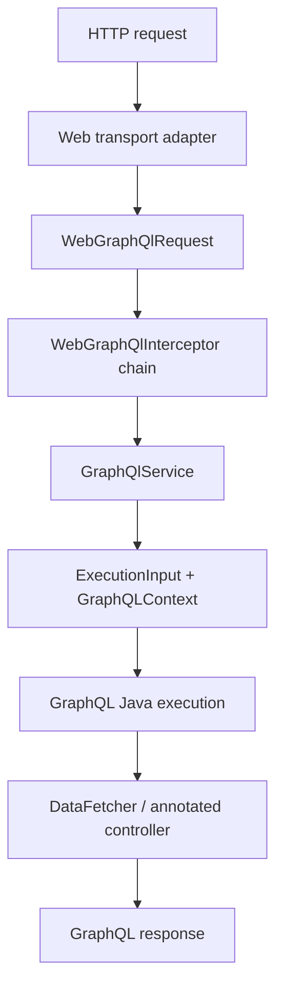

# WebGraphQlRequest và context

Trong Spring for GraphQL, một request đi qua nhiều lớp trước khi resolver được gọi. Lớp web nhận thông tin transport như HTTP headers, cookies, URI và remote address; lớp GraphQL thực thi operation; resolver và DataLoader cần truy cập một số dữ liệu theo request như tenant, locale, correlation ID hoặc thông tin người dùng đã xác thực.

`WebGraphQlRequest` cung cấp thông tin của request ở tầng web. `WebGraphQlInterceptor` cho phép đọc, kiểm tra và bổ sung dữ liệu trước khi operation được thực thi. Để dữ liệu đó có thể được dùng trong resolver, ứng dụng thường chuyển những giá trị cần thiết vào `GraphQLContext` của `ExecutionInput`.

Điểm cần nhớ là request object, GraphQL execution context, local context và Reactor context phục vụ các phạm vi khác nhau. Hiểu đúng ranh giới này giúp truyền request state an toàn, tránh phụ thuộc vào `ThreadLocal` và không chia sẻ dữ liệu giữa các request.

## 1. WebGraphQlRequest là gì?

`WebGraphQlRequest` là abstraction của Spring for GraphQL đại diện cho một request GraphQL đi qua tầng web. Nó cung cấp GraphQL document, operation name, variables và các thông tin liên quan đến transport. Tùy loại transport, request có thể cung cấp headers, cookies, URI, remote address và attributes.

Một số dữ liệu thường cần đọc ở tầng web:

| Dữ liệu | Ví dụ mục đích |
| --- | --- |
| HTTP headers | Request ID, locale, thông tin tracing hoặc token ở tầng transport |
| Cookies | Session cookie hoặc thông tin phiên do cơ chế xác thực quản lý |
| URI và method | Phân biệt endpoint hoặc thông tin phục vụ logging |
| Remote address | Ghi nhận nguồn kết nối theo chính sách proxy/network |
| Request attributes | Dữ liệu phụ trợ do adapter/interceptor gắn trong vòng đời request |
| GraphQL document và variables | Nội dung operation, operation name và đầu vào client gửi |

`WebGraphQlRequest` thuộc tầng web. Resolver không nên phụ thuộc trực tiếp vào HTTP request để đọc headers ở mọi field. Hãy đọc và xác thực thông tin transport một lần tại interceptor, sau đó chuyển dữ liệu đã chuẩn hóa cần thiết vào execution context.

## 2. Luồng từ web request đến resolver

Một request GraphQL qua HTTP thường đi qua các thành phần theo thứ tự khái quát:



Transport adapter chuyển request HTTP thành `WebGraphQlRequest`. Các `WebGraphQlInterceptor` chạy trước khi operation được thực thi và có thể đọc headers, xác thực metadata, thêm context hoặc xử lý response. Sau đó `GraphQlService` thực thi GraphQL document bằng `ExecutionInput` đã được cấu hình.

Trong resolver, Spring for GraphQL cung cấp các cách đọc context như `@ContextValue` hoặc `DataFetchingEnvironment.getGraphQlContext()`. Resolver nhận dữ liệu đã được interceptor đưa vào execution context mà không cần biết chi tiết HTTP request ban đầu.

## 3. WebGraphQlInterceptor

`WebGraphQlInterceptor` là extension point ở tầng web của Spring for GraphQL. Nó có thể kiểm tra request trước khi chuyển tiếp đến interceptor tiếp theo hoặc GraphQL service. Phương thức chính có dạng reactive và trả về `Mono<WebGraphQlResponse>`:

```java
public interface WebGraphQlInterceptor {
    Mono<WebGraphQlResponse> intercept(WebGraphQlRequest request, Chain chain);
}
```

Một interceptor thường thực hiện các việc sau:

- Đọc request metadata như correlation ID hoặc locale.
- Kiểm tra định dạng header và chuẩn hóa giá trị.
- Đưa dữ liệu đã xác thực vào `ExecutionInput`/`GraphQLContext`.
- Ghi log thời điểm bắt đầu và kết thúc operation.
- Áp dụng quy tắc web-level chung trước khi request đến GraphQL execution.
- Quan sát hoặc biến đổi response theo chính sách của ứng dụng.

Ví dụ interceptor tạo correlation ID nếu client chưa gửi:

```java
@Component
public class RequestMetadataInterceptor implements WebGraphQlInterceptor {

    private static final String REQUEST_ID = "requestId";

    @Override
    public Mono<WebGraphQlResponse> intercept(
            WebGraphQlRequest request, Chain chain) {

        String requestId = request.getHeaders().getFirst("X-Request-Id");
        if (requestId == null || requestId.isBlank()) {
            requestId = UUID.randomUUID().toString();
        }

        String finalRequestId = requestId;
        request.configureExecutionInput((input, builder) ->
            builder.graphQLContext(context ->
                context.put(REQUEST_ID, finalRequestId)
            ).build()
        );

        return chain.next(request);
    }
}
```

`configureExecutionInput` cho phép bổ sung cấu hình vào `ExecutionInput` trước khi GraphQL Java thực thi operation. Trong ví dụ, correlation ID được đưa vào `GraphQLContext` với key `requestId`. Sau đó resolver, DataFetcher hoặc instrumentation có thể đọc giá trị này.

Interceptor cần giữ tính reactive. Không gọi `.block()` trên `Mono` trong `intercept`; hãy trả về `chain.next(request)` hoặc nối các reactive operator phù hợp. Việc block có thể chiếm event-loop thread và gây nghẽn ứng dụng.

## 4. Chuyển request metadata vào GraphQLContext

`GraphQLContext` là vùng dữ liệu gắn với một GraphQL execution. Nó phù hợp để truyền các giá trị chung mà resolver, instrumentation hoặc DataLoader cần dùng trong cùng operation, chẳng hạn:

- Correlation ID hoặc trace ID.
- Tenant ID đã được xác thực.
- Locale đã chuẩn hóa.
- Một đối tượng request metadata bất biến.
- Thông tin policy hoặc feature flag đã được xác định cho execution.

Có thể gom các giá trị vào một record thay vì thêm nhiều key rời rạc:

```java
public record RequestMetadata(
        String requestId,
        String tenantId,
        Locale locale) {
}
```

Interceptor đọc thông tin web, kiểm tra và tạo metadata:

```java
@Component
public class RequestMetadataInterceptor implements WebGraphQlInterceptor {

    private static final String METADATA_KEY = "requestMetadata";

    private final TenantResolver tenantResolver;
    private final LocaleResolver localeResolver;

    public RequestMetadataInterceptor(
            TenantResolver tenantResolver,
            LocaleResolver localeResolver) {
        this.tenantResolver = tenantResolver;
        this.localeResolver = localeResolver;
    }

    @Override
    public Mono<WebGraphQlResponse> intercept(
            WebGraphQlRequest request, Chain chain) {

        String requestId = Optional.ofNullable(
                request.getHeaders().getFirst("X-Request-Id"))
            .filter(value -> !value.isBlank())
            .orElseGet(() -> UUID.randomUUID().toString());

        Locale locale = localeResolver.resolve(request.getHeaders());

        return tenantResolver.resolveAuthorizedTenant(request)
            .flatMap(tenantId -> {
                RequestMetadata metadata =
                    new RequestMetadata(requestId, tenantId, locale);

                request.configureExecutionInput((input, builder) ->
                    builder.graphQLContext(context ->
                        context.put(METADATA_KEY, metadata)
                    ).build()
                );

                return chain.next(request);
            });
    }
}
```

`TenantResolver` trong ví dụ là service của ứng dụng, chịu trách nhiệm xác định tenant được phép dùng dựa trên danh tính đã xác thực và chính sách truy cập. Không được coi `X-Tenant-Id` hoặc bất kỳ header client gửi nào là bằng chứng quyền truy cập. Header có thể là dữ liệu đầu vào để chọn tenant, nhưng server phải xác minh người gọi có quyền với tenant đó.

Nếu ứng dụng dùng servlet/blocking stack, service xác định tenant có thể trả kết quả đồng bộ; nếu dùng reactive stack, giữ kết quả dưới dạng `Mono` như ví dụ. Không cần chuyển một giá trị đồng bộ thành reactive chỉ để thêm độ phức tạp.

## 5. Đọc GraphQLContext trong resolver

Có hai cách phổ biến để đọc dữ liệu trong execution context.

### Dùng @ContextValue

Spring for GraphQL hỗ trợ `@ContextValue` để bind một giá trị theo key trong `GraphQLContext` vào tham số annotated controller:

```java
@Controller
public class BookQueryController {

    @QueryMapping
    public List<Book> books(
            @ContextValue("requestMetadata") RequestMetadata metadata) {
        return bookService.findVisibleBooks(
            metadata.tenantId(), metadata.locale());
    }
}
```

`@ContextValue` làm rõ rằng tham số đến từ GraphQL context, không phải argument do client truyền trong GraphQL document. Nếu key có thể không tồn tại, có thể cấu hình tham số là không bắt buộc theo thuộc tính `required` của annotation và dùng kiểu nullable phù hợp.

### Dùng DataFetchingEnvironment

Khi resolver cần nhiều thông tin thực thi hoặc API thấp hơn, có thể nhận `DataFetchingEnvironment`:

```java
@QueryMapping
public List<Book> books(DataFetchingEnvironment environment) {
    RequestMetadata metadata = environment.getGraphQlContext()
        .get("requestMetadata");

    return bookService.findVisibleBooks(
        metadata.tenantId(), metadata.locale());
}
```

`getGraphQlContext()` trả về context của execution. Các resolver có thể đọc cùng metadata mà interceptor đã thêm vào `ExecutionInput`.

Không nhầm `GraphQLContext` với arguments của field. `@Argument` và `@Arguments` lấy dữ liệu client truyền cho field; `@ContextValue` lấy dữ liệu server gắn vào execution. Client không thể tự ghi đè một key context chỉ bằng cách thêm field cùng tên vào query.

## 6. Phân biệt request attributes, GraphQLContext và local context

Các loại context có phạm vi khác nhau:

| Cơ chế | Phạm vi | Mục đích |
| --- | --- | --- |
| `WebGraphQlRequest` attributes | Vòng đời web request/interceptor | Dữ liệu phụ trợ giữa các thành phần ở tầng transport |
| `GraphQLContext` | Một GraphQL execution | Metadata dùng chung cho resolver, instrumentation và DataLoader trong operation |
| Local context | Một nhánh thực thi/field con | Truyền dữ liệu từ resolver cha xuống resolver con |
| Reactor Context | Một reactive subscriber chain | Truyền metadata qua các bước reactive mà không phụ thuộc thread cố định |
| Spring SecurityContext | Danh tính và authorities đã xác thực | Cơ chế bảo mật do Spring Security quản lý |

Request attributes không tự động trở thành GraphQL context. Nếu resolver cần một giá trị từ request attribute, interceptor phải chủ động chuyển giá trị đó vào `ExecutionInput`/`GraphQLContext`.

Local context của GraphQL Java phù hợp khi chỉ một nhánh resolver con cần nhận dữ liệu do resolver cha tạo ra. Nó không phải nơi lưu metadata dùng chung toàn operation. `DataFetcherResult` có thể mang local context đến field con; Spring for GraphQL cung cấp `@LocalContextValue` để đọc giá trị đó trong annotated controller khi cần.

Reactor Context là cơ chế của Reactor, không phải `GraphQLContext`. Nó theo reactive chain và có thể được dùng bởi Spring Security reactive. Khi cần dữ liệu cho resolver hoặc DataLoader, hãy xác định rõ nên đọc từ GraphQL context hay từ security/reactive context; đừng mặc định mọi loại context tự đồng bộ với nhau.

## 7. Context và Spring Security

Thông tin xác thực cần được lấy từ cơ chế bảo mật của server. Spring Security có thể xác thực request trước khi GraphQL handler xử lý operation. Resolver có thể nhận `Principal` hoặc tham số bảo mật được hỗ trợ, còn service áp dụng authorization theo user, tenant và resource.

Ví dụ resolver nhận principal:

```java
@QueryMapping
public List<Book> myBooks(Principal principal) {
    return bookService.findByOwner(principal.getName());
}
```

Nếu cần truyền thông tin đã được xác thực vào `GraphQLContext`, hãy lấy nó từ security context do Spring Security quản lý hoặc một thành phần xác thực đáng tin cậy. Không sao chép một `userId` client gửi trong header vào context rồi xem đó là danh tính đã xác thực.

`GraphQLContext` là nơi truyền metadata; nó không tự thực hiện authorization. Dù resolver nhận `tenantId` từ context, service vẫn cần bảo vệ truy cập resource theo policy. Các mutation thay đổi dữ liệu cũng phải kiểm tra quyền trên từng resource, không dựa vào việc client có chọn field hay không.

Với reactive Spring Security, `SecurityContext` được truyền qua Reactor Context. Không giả định `SecurityContextHolder` dựa trên `ThreadLocal` luôn có dữ liệu khi callback chuyển sang thread khác. Hãy dùng cách truy cập security context phù hợp với stack servlet hay reactive đang chạy và tránh tự tạo cơ chế truyền principal không an toàn.

## 8. Context trong DataLoader và batch loader

DataLoader thường cần cùng request metadata để lọc dữ liệu theo tenant hoặc locale. Với Spring for GraphQL, batch loader đăng ký qua `BatchLoaderRegistry` có thể nhận `BatchLoaderEnvironment` và truy cập context của execution theo API tương ứng.

Ví dụ ý tưởng:

```java
registry.forTypePair(Long.class, Author.class)
    .registerMappedBatchLoader((authorIds, environment) -> {
        GraphQLContext context = environment.getContext();
        RequestMetadata metadata = context.get("requestMetadata");

        return authorService.findVisibleAuthors(
            metadata.tenantId(), authorIds);
    });
```

Batch query phải áp dụng cùng tenant filter và authorization như truy vấn đơn. Không được tải tất cả author rồi chỉ lọc ở controller sau khi dữ liệu đã rời khỏi tầng truy cập dữ liệu nếu cách đó có thể làm lộ thông tin.

DataLoader cache theo key trong phạm vi execution. Nếu cùng một ID có thể cho kết quả khác nhau theo tenant hoặc locale, key phải bao gồm các yếu tố đó hoặc loader phải được giới hạn trong một scope nhất quán. Ví dụ key có thể là record `(tenantId, authorId)` thay vì chỉ `authorId`.

## 9. Truyền correlation ID và logging

Correlation ID giúp nối log của web request, resolver, service và lời gọi downstream. Có thể nhận ID từ header nếu giá trị hợp lệ, hoặc tạo ID mới ở interceptor. Sau đó đưa ID vào `GraphQLContext` để resolver và batch loader có thể ghi log với cùng một định danh.

Không nên ghi toàn bộ GraphQL variables hoặc headers vào log nếu chúng có thể chứa token, dữ liệu cá nhân hay thông tin thanh toán. Chỉ log các metadata đã được chọn lọc, giới hạn độ dài và loại bỏ giá trị nhạy cảm.

Nếu muốn đưa correlation ID vào MDC, cần chú ý MDC thường dựa trên `ThreadLocal`. Khi tác vụ chuyển thread qua `CompletableFuture` hoặc Reactor scheduler, MDC không tự động luôn được truyền. Dùng cơ chế context propagation phù hợp hoặc đọc correlation ID từ GraphQL context ở nơi cần log.

## 10. Interceptor chain và thứ tự thực thi

Một ứng dụng có thể đăng ký nhiều `WebGraphQlInterceptor`, ví dụ:

1. Interceptor ghi nhận correlation ID.
2. Interceptor xác định tenant và metadata locale.
3. Interceptor ghi metrics hoặc tracing.
4. Interceptor chuyển request đến GraphQL service.

Các interceptor được xếp thành chain. Mỗi interceptor quyết định có tiếp tục bằng `chain.next(request)` hay kết thúc sớm với response/lỗi. Thứ tự có thể ảnh hưởng khi một interceptor phụ thuộc metadata do interceptor trước tạo ra. Dùng cơ chế ordering của Spring như `@Order` khi cần thứ tự rõ ràng, và tránh để nhiều interceptor cùng ghi đè một context key.

Ví dụ một interceptor chỉ đo thời gian:

```java
@Component
@Order(20)
public class GraphQlTimingInterceptor implements WebGraphQlInterceptor {

    private final MeterRegistry meterRegistry;

    public GraphQlTimingInterceptor(MeterRegistry meterRegistry) {
        this.meterRegistry = meterRegistry;
    }

    @Override
    public Mono<WebGraphQlResponse> intercept(
            WebGraphQlRequest request, Chain chain) {

        long start = System.nanoTime();
        return chain.next(request)
            .doFinally(signal -> meterRegistry.timer("graphql.web.request")
                .record(System.nanoTime() - start, TimeUnit.NANOSECONDS));
    }
}
```

Metrics thực tế nên được gắn thêm tag có cardinality giới hạn, chẳng hạn operation type hoặc operation name đã kiểm soát. Tránh dùng request ID, user ID hoặc raw query làm metric tag vì sẽ tạo cardinality rất lớn.

## 11. WebGraphQlRequest và WebSocket

`WebGraphQlRequest` thuộc abstraction web, nhưng HTTP request và WebSocket message có vòng đời khác nhau. Với HTTP, mỗi request thường mang một operation và metadata transport của request đó. Với WebSocket, có thêm vòng đời kết nối, bước khởi tạo connection và nhiều operation có thể được gửi qua cùng kết nối.

Spring for GraphQL cung cấp interceptor riêng cho WebSocket như `WebSocketGraphQlInterceptor` để xử lý các sự kiện ở cấp kết nối, ví dụ connection initialization và metadata được gửi lúc thiết lập kết nối. Không nên coi connection state và GraphQL execution context là một phạm vi duy nhất:

- Connection state có thể tồn tại qua nhiều operation trên cùng WebSocket.
- GraphQLContext nên gắn với từng execution để request state của operation không rò sang operation tiếp theo.
- Thông tin xác thực có thể hết hạn hoặc bị thu hồi trong khi WebSocket vẫn mở; cần có chính sách kiểm tra lại phù hợp.
- Dữ liệu từ connection initialization vẫn phải được xác thực và kiểm tra quyền trước khi sử dụng.

Nếu ứng dụng chỉ phục vụ HTTP, tập trung vào `WebGraphQlInterceptor`. Nếu bật subscription qua WebSocket, thiết kế thêm vòng đời connection, operation và event riêng; không lưu DataLoader hay request metadata trong singleton connection handler theo cách có thể làm lẫn dữ liệu giữa các operation.

## 12. Kiểm thử context và interceptor

Nên kiểm thử cả hai phần: interceptor chuyển metadata vào execution context, và resolver thực sự đọc được metadata đó.

Với `GraphQlTester`, có thể kiểm thử GraphQL execution và resolver khi test đã cấu hình context tương ứng. Để kiểm tra việc đọc HTTP header, cần dùng tester ở tầng web như `HttpGraphQlTester` hoặc `WebGraphQlTester`, hoặc kiểm thử trực tiếp `WebGraphQlHandler` với request có headers.

Một operation kiểm tra metadata có thể được xây dựng qua field chỉ dùng trong test hoặc resolver nghiệp vụ có hành vi phụ thuộc tenant/locale. Ví dụ test endpoint với header:

```java
HttpGraphQlTester tester = HttpGraphQlTester.builder(webTestClient)
    .headers(headers -> headers.set("X-Request-Id", "test-request-01"))
    .build();
```

API builder cụ thể phụ thuộc loại tester và phiên bản Spring for GraphQL; điểm quan trọng là request test phải đi qua web interceptor để header được đọc và đưa vào context.

Các kịch bản nên có:

- Header có giá trị hợp lệ được chuyển vào `GraphQLContext`.
- Header thiếu hoặc rỗng được xử lý bằng default theo chính sách.
- Header sai định dạng bị từ chối hoặc bỏ qua có kiểm soát.
- Tenant không thuộc quyền của principal bị từ chối.
- Resolver và batch loader đọc cùng metadata trong một execution.
- Hai request song song có context độc lập, không ghi đè dữ liệu của nhau.
- Interceptor không block reactive chain.
- WebSocket connection metadata không bị nhầm với operation context.

## 13. Lỗi thường gặp

| Triệu chứng | Nguyên nhân | Cách xử lý |
| --- | --- | --- |
| Resolver không thấy context key | Interceptor chưa gọi `configureExecutionInput` hoặc dùng key khác | Kiểm tra key và thời điểm cấu hình trước `chain.next` |
| `@ContextValue` không bind được | Key không tồn tại hoặc kiểu Java không tương thích | Kiểm tra context và cân nhắc `required = false` nếu hợp lệ |
| Header có trong request nhưng không có trong GraphQLContext | Request metadata không tự động được copy vào execution context | Chuyển giá trị rõ ràng trong interceptor |
| Tenant từ header truy cập được dữ liệu ngoài quyền | Tin header client gửi mà không xác minh | Xác thực tenant với principal và policy server-side |
| Dữ liệu request rò giữa hai operation | Dùng static/singleton mutable state hoặc loader dùng chung | Dùng context theo execution và DataLoader theo request |
| Context mất khi async callback chạy | Phụ thuộc `ThreadLocal` khi đổi thread | Truyền metadata tường minh hoặc cấu hình context propagation |
| Reactive endpoint bị nghẽn | Gọi `.block()` trong interceptor hoặc callback | Giữ luồng reactive và không block event loop |
| MDC thiếu correlation ID | MDC không được truyền qua executor/reactor scheduler | Propagate context hoặc đọc ID từ GraphQLContext |
| WebSocket operation dùng state cũ | Nhầm connection state với execution state | Tạo context riêng cho từng operation và xác thực lại theo policy |

## 14. Nguyên tắc thiết kế request context

Đọc dữ liệu transport ở `WebGraphQlInterceptor`, xác thực và chuẩn hóa trước khi đưa vào `GraphQLContext`. Chỉ đưa vào context những giá trị cần cho execution, ưu tiên một metadata object bất biến thay vì nhiều biến mutable rời rạc. Dùng `@ContextValue` cho resolver cần một giá trị cụ thể; dùng `DataFetchingEnvironment` khi cần truy cập nhiều thành phần của execution.

Giữ rõ ranh giới giữa request attributes, GraphQLContext, local context, Reactor Context và Spring SecurityContext. Không lưu request state trong singleton hoặc static field. Không tin header client như bằng chứng xác thực, không dùng context thay authorization và không chia sẻ cache DataLoader ngoài execution.

Trong Spring for GraphQL, `WebGraphQlRequest` cho biết request đến từ tầng web; `WebGraphQlInterceptor` là nơi phù hợp để xử lý metadata xuyên suốt request; `GraphQLContext` đưa metadata đã xác thực đến resolver và batch loader. Khi truyền state đúng phạm vi, ứng dụng có thể hỗ trợ tenant, locale, tracing và security mà vẫn giữ resolver độc lập với transport và an toàn khi xử lý đồng thời.
