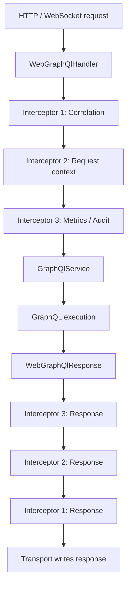

# Interceptor chain trong Spring for GraphQL

Interceptor chain là chuỗi các thành phần bao quanh quá trình xử lý một GraphQL request. Trong Spring for GraphQL, `WebGraphQlInterceptor` cho phép ứng dụng quan sát hoặc tùy biến request trước khi GraphQL execution bắt đầu, sau đó tiếp tục xử lý response khi các thành phần phía sau hoàn tất.

Mỗi interceptor có thể thực hiện một nhiệm vụ riêng như tạo correlation ID, đưa tenant đã xác thực vào `GraphQLContext`, ghi nhận metrics hoặc kiểm tra metadata của request. Các interceptor được nối thành một chain: request đi qua theo thứ tự đăng ký, còn response quay ngược qua các interceptor trước đó. Hiểu đúng chiều đi và chiều về giúp tổ chức middleware rõ ràng, tránh xử lý lặp, ghi đè context hoặc làm mất lỗi.

## 1. Interceptor chain nằm ở đâu?

Spring for GraphQL tách phần xử lý GraphQL khỏi transport. HTTP, WebSocket hoặc transport phù hợp khác chuyển request đến `WebGraphQlHandler`. Handler dùng `GraphQlService` để thực thi document trên schema và chạy các `WebGraphQlInterceptor` đã cấu hình.



`WebGraphQlInterceptor` là extension point ở lớp GraphQL request. Nó không phải resolver của một field cụ thể và cũng không chạy một lần cho từng field. Một interceptor thường bao quanh toàn bộ lần xử lý GraphQL request/operation được chuyển đến handler.

## 2. Interface `WebGraphQlInterceptor`

Interface nằm trong package `org.springframework.graphql.server` và có một method chính:

```java
public interface WebGraphQlInterceptor {

    Mono<WebGraphQlResponse> intercept(
            WebGraphQlRequest request,
            Chain chain);
}
```

`WebGraphQlRequest` chứa thông tin của GraphQL request ở tầng server, ví dụ document, operation name, variables, headers và attributes. `Chain` đại diện cho interceptor tiếp theo hoặc bước thực thi cuối cùng. `Mono<WebGraphQlResponse>` biểu diễn response bất đồng bộ.

Một interceptor tối thiểu:

```java
import org.springframework.graphql.server.WebGraphQlInterceptor;
import org.springframework.graphql.server.WebGraphQlRequest;
import org.springframework.graphql.server.WebGraphQlResponse;
import org.springframework.stereotype.Component;
import reactor.core.publisher.Mono;

@Component
public class RequestLoggingInterceptor implements WebGraphQlInterceptor {

    @Override
    public Mono<WebGraphQlResponse> intercept(
            WebGraphQlRequest request, Chain chain) {

        log.info("GraphQL operation: {}", request.getOperationName());

        return chain.next(request)
                .doOnNext(response -> log.info(
                        "GraphQL response contains {} error(s)",
                        response.getErrors().size()));
    }
}
```

Ví dụ giả định ứng dụng đã có logger `log`. `chain.next(request)` chuyển request đến interceptor kế tiếp hoặc GraphQL service nếu đây là interceptor cuối cùng. `doOnNext` quan sát response khi nó được phát ra; nó không thay đổi response.

## 3. Thứ tự request và response

Giả sử chain có ba interceptor A, B và C:

```text
Request:   A -> B -> C -> GraphQlService
Response:  A <- B <- C <- GraphQlService
```

A nhận request trước, sau đó gọi `chain.next(request)` để chuyển cho B. B tiếp tục chuyển cho C. C gọi GraphQL service. Khi service tạo response, C xử lý response trước, rồi B, cuối cùng A.

Mô hình này giống cách bọc một lời gọi hàm:

```java
return chain.next(request)
        .map(response -> transformResponse(response));
```

Phần trước `chain.next` phù hợp để chuẩn bị request. Các operator gắn sau `chain.next` phù hợp để quan sát hoặc biến đổi kết quả bất đồng bộ. Nếu interceptor A cần đo toàn bộ thời gian từ lúc nhận request đến khi response quay lại, nó có thể bắt đầu đồng hồ trước `chain.next` và ghi kết quả trong `doFinally`.

## 4. Đăng ký nhiều interceptor

Có thể khai báo mỗi interceptor thành một Spring bean riêng:

```java
import org.springframework.core.Ordered;
import org.springframework.core.annotation.Order;
import org.springframework.graphql.server.WebGraphQlInterceptor;
import org.springframework.stereotype.Component;

@Component
@Order(Ordered.HIGHEST_PRECEDENCE)
class CorrelationIdInterceptor implements WebGraphQlInterceptor {
    // ...
}

@Component
@Order(10)
class TenantContextInterceptor implements WebGraphQlInterceptor {
    // ...
}

@Component
@Order(20)
class MetricsInterceptor implements WebGraphQlInterceptor {
    // ...
}
```

Khi Spring thu thập các interceptor bean theo thứ tự, giá trị order nhỏ hơn được áp dụng trước. `Ordered.HIGHEST_PRECEDENCE` đặt interceptor ở đầu danh sách. Với cấu hình `WebGraphQlHandler` thủ công, thứ tự còn phụ thuộc thứ tự interceptor được thêm vào builder.

Nên sắp xếp theo trách nhiệm:

1. Correlation/tracing: tạo hoặc xác thực correlation ID để các bước sau có thể ghi log cùng mã.
2. Request context: xác định tenant, locale hoặc metadata đã được xác thực.
3. Audit/metrics: ghi nhận request và response, bao gồm lỗi GraphQL.

Đây là một thứ tự tham khảo. Nếu metrics cần đo cả thời gian mà interceptor context tiêu tốn, đặt metrics ở ngoài interceptor context để nó bao trọn thời gian đó. Hãy xác định thứ tự theo dữ liệu mỗi interceptor cần quan sát.

## 5. Tùy biến request bằng `configureExecutionInput`

Một công việc thường gặp của interceptor là đưa metadata request vào `GraphQLContext`. `WebGraphQlRequest.configureExecutionInput` cho phép tùy biến `ExecutionInput` trước khi GraphQL Java thực thi operation.

Ví dụ tạo correlation ID và thêm vào context:

```java
import java.util.UUID;
import org.springframework.graphql.server.WebGraphQlInterceptor;
import org.springframework.graphql.server.WebGraphQlRequest;
import org.springframework.graphql.server.WebGraphQlResponse;
import org.springframework.stereotype.Component;
import reactor.core.publisher.Mono;

@Component
public class CorrelationIdInterceptor implements WebGraphQlInterceptor {

    @Override
    public Mono<WebGraphQlResponse> intercept(
            WebGraphQlRequest request, Chain chain) {

        String correlationId = request.getHeaders().getFirst("X-Correlation-Id");
        if (correlationId == null || correlationId.isBlank()) {
            correlationId = UUID.randomUUID().toString();
        }

        String requestCorrelationId = correlationId;
        request.configureExecutionInput((input, builder) ->
                builder.graphQLContext(context ->
                        context.put("correlationId", requestCorrelationId))
                        .build());

        return chain.next(request);
    }
}
```

Giá trị được gán vào biến `requestCorrelationId` để lambda sử dụng một biến effectively final. Resolver có thể đọc giá trị bằng `@ContextValue("correlationId")` hoặc `DataFetchingEnvironment.getGraphQlContext()`.

Correlation ID từ header chỉ phục vụ liên kết log/trace. Nếu nhận giá trị do client gửi, nên kiểm tra độ dài và tập ký tự cho phép trước khi ghi log để tránh log injection hoặc giá trị bất thường. Với request không có ID hợp lệ, server có thể tự sinh ID.

## 6. Đưa tenant và principal vào GraphQLContext

Interceptor có thể phối hợp với Spring Security để lấy danh tính đã xác thực, xác định tenant mà người dùng được phép truy cập rồi đưa metadata đó vào execution context.

```java
import org.springframework.graphql.server.WebGraphQlInterceptor;
import org.springframework.graphql.server.WebGraphQlRequest;
import org.springframework.graphql.server.WebGraphQlResponse;
import org.springframework.stereotype.Component;
import reactor.core.publisher.Mono;

@Component
public class TenantContextInterceptor implements WebGraphQlInterceptor {

    private final TenantResolver tenantResolver;

    public TenantContextInterceptor(TenantResolver tenantResolver) {
        this.tenantResolver = tenantResolver;
    }

    @Override
    public Mono<WebGraphQlResponse> intercept(
            WebGraphQlRequest request, Chain chain) {

        return tenantResolver.resolveAuthorizedTenant(request)
                .flatMap(tenantId -> {
                    request.configureExecutionInput((input, builder) ->
                            builder.graphQLContext(context ->
                                    context.put("tenantId", tenantId))
                                    .build());
                    return chain.next(request);
                });
    }
}
```

Ví dụ giả định `TenantResolver.resolveAuthorizedTenant` trả về `Mono<String>` và chỉ phát tenant sau khi xác minh người gọi có quyền truy cập. Nếu resolver là API đồng bộ, có thể thực hiện bước đó trước `chain.next` rồi tiếp tục chain. Không lấy tenant từ header hoặc GraphQL argument rồi coi đó là dữ liệu đáng tin cậy nếu chưa kiểm tra quyền.

Resolver có thể sử dụng context:

```java
@QueryMapping
public List<Book> books(@ContextValue("tenantId") String tenantId) {
    return bookService.findBooksForTenant(tenantId);
}
```

Với DataLoader đăng ký qua `BatchLoaderRegistry`, context của GraphQL execution có thể được sử dụng trong `BatchLoaderEnvironment`. Như vậy query resolver và batch loader có thể dùng cùng tenant đã được xác thực.

## 7. Không ghi đè cấu hình ExecutionInput giữa các interceptor

Khi nhiều interceptor cùng cần bổ sung metadata, cần thống nhất cách phối hợp `configureExecutionInput`. Đừng giả định rằng nhiều lần gọi API cấu hình sẽ luôn tự động hợp nhất theo ý muốn trên mọi phiên bản.

Một cách dễ kiểm soát là gom các giá trị cần đưa vào context tại một interceptor chuyên trách, hoặc cung cấp một cơ chế cấu hình chung để ghép các thay đổi trên cùng `ExecutionInput.Builder`. Mỗi interceptor nên ghi vào key riêng, có quy ước đặt tên ổn định, và tránh thay toàn bộ `GraphQLContext` nếu chỉ cần thêm một giá trị.

Ví dụ context có nhiều metadata:

```java
request.configureExecutionInput((input, builder) ->
        builder.graphQLContext(context -> {
            context.put("correlationId", correlationId);
            context.put("tenantId", tenantId);
            context.put("requestLocale", locale);
        }).build());
```

Nếu ứng dụng có nhiều interceptor độc lập cần thay đổi `ExecutionInput`, hãy xác minh cách `WebGraphQlRequest` ghép các configurer trong phiên bản Spring for GraphQL đang dùng và viết integration test cho trường hợp tất cả interceptor cùng hoạt động.

## 8. Quan sát response khi chain quay về

Sau `chain.next(request)`, interceptor có thể quan sát response hoặc lỗi reactive:

```java
@Override
public Mono<WebGraphQlResponse> intercept(
        WebGraphQlRequest request, Chain chain) {

    long startedAt = System.nanoTime();

    return chain.next(request)
            .doOnNext(response -> {
                int errorCount = response.getErrors().size();
                metrics.recordGraphQlResponse(
                        request.getOperationName(), errorCount);
            })
            .doOnError(error ->
                    metrics.recordGraphQlFailure(request.getOperationName()))
            .doFinally(signal -> {
                long elapsedNanos = System.nanoTime() - startedAt;
                metrics.recordGraphQlDuration(
                        request.getOperationName(), elapsedNanos, signal.name());
            });
}
```

Ví dụ giả định ứng dụng có `metrics` service. `response.getErrors()` cho biết các lỗi GraphQL được biểu diễn trong response. `doOnError` quan sát lỗi reactive khiến publisher kết thúc bằng error; nó khác với lỗi GraphQL execution vốn có thể được đưa vào `response.getErrors()` cùng một phần `data`.

Không ghi query variables hoặc response data nhạy cảm vào log một cách mặc định. Chỉ ghi operation name, correlation ID, thời gian, số lỗi và metadata đã được phép. Nếu cần audit chi tiết, phải xác định dữ liệu nào được phép lưu và thời gian lưu phù hợp.

## 9. Interceptor không thay thế các extension point khác

Spring for GraphQL có nhiều extension point. Chọn đúng lớp giúp code dễ hiểu và tránh nhồi mọi logic vào interceptor chain.

| Nhu cầu | Extension point phù hợp |
| --- | --- |
| Xử lý request/response GraphQL ở cấp operation | `WebGraphQlInterceptor` |
| Xác thực HTTP, kiểm tra header hoặc policy ở tầng transport | Spring Security filter chain, WebFilter hoặc servlet filter tương ứng |
| Kiểm tra quyền tại một method/field | Spring Security method security, ví dụ `@PreAuthorize` |
| Ánh xạ exception phát sinh khi resolver thực thi | `@GraphQlExceptionHandler`, `@ControllerAdvice` hoặc `DataFetcherExceptionResolver` |
| Hook sâu vào vòng đời GraphQL Java execution | GraphQL Java `Instrumentation` |
| Cung cấp dữ liệu cho field | `@QueryMapping`, `@MutationMapping`, `@SchemaMapping`, `@BatchMapping` |

Ví dụ, interceptor có thể đưa principal/tenant vào `GraphQLContext`, nhưng quyết định người dùng có được sửa một cuốn sách cụ thể vẫn nên được kiểm tra tại service hoặc method bảo vệ field. Một request có thể chứa nhiều field với quyền truy cập khác nhau.

## 10. Xử lý lỗi trong interceptor chain

Cần phân biệt ba tình huống:

1. Request không hợp lệ trước khi GraphQL execution bắt đầu, ví dụ metadata bắt buộc bị thiếu.
2. GraphQL execution chạy nhưng một resolver phát sinh lỗi; GraphQL response có thể chứa `data` một phần và danh sách `errors`.
3. Reactive chain kết thúc bằng lỗi ngoài GraphQL response, ví dụ interceptor hoặc hạ tầng downstream phát sinh exception không được chuyển thành `WebGraphQlResponse`.

`@GraphQlExceptionHandler` và `DataFetcherExceptionResolver` chủ yếu xử lý exception trong quá trình thực thi data fetcher. Không nên giả định chúng tự động chuyển mọi exception phát sinh trước execution trong interceptor thành GraphQL error.

Nếu interceptor phát sinh `Mono.error(...)`, lỗi reactive có thể được chuyển thành lỗi ở transport layer tùy cách handler/transport xử lý. Với xác thực HTTP, nên dùng Spring Security ở tầng transport. Với authorization theo field, dùng method security hoặc kiểm tra trong service. Nếu chủ động short-circuit một GraphQL request và tạo response lỗi, hãy dùng API response phù hợp với phiên bản Spring for GraphQL, giữ đúng HTTP/GraphQL error contract và kiểm thử qua transport thực tế.

Không nuốt lỗi bằng cách thay mọi exception thành `Mono.empty()` hoặc response thành công rỗng. Điều đó làm client khó phân biệt request thất bại với query hợp lệ không có dữ liệu.

## 11. Short-circuit và điều kiện gọi `chain.next`

Một interceptor thông thường nên gọi `chain.next(request)` đúng một lần và trả lại publisher để framework quản lý việc subscribe. Không tự gọi `subscribe()` hoặc `block()` trong interceptor.

Trong trường hợp đặc biệt, interceptor có thể quyết định không chuyển request xuống chain, ví dụ một policy ở cấp request từ chối operation trước khi execution. Đây là short-circuit. Khi thực hiện, interceptor phải trả về một kết quả phù hợp với contract của `WebGraphQlResponse` và transport, đồng thời ghi nhận rõ request đã bị chặn.

Các lỗi triển khai thường gặp:

- Gọi `chain.next(request)` hai lần khiến cùng operation có thể bị thực thi hai lần.
- Gọi `subscribe()` thủ công làm mất liên kết lifecycle và error propagation của chain.
- Gọi `block()` gây blocking, đặc biệt nguy hiểm trên reactive event-loop thread.
- Bắt exception rồi bỏ qua khiến lỗi biến mất khỏi response và log.
- Short-circuit bằng một response không đúng contract làm client nhận payload không hợp lệ.

## 12. Tránh state dùng chung trong interceptor singleton

Interceptor bean thường là singleton. Không lưu thông tin riêng của request vào field mutable:

```java
// Không nên: request đồng thời có thể ghi đè giá trị của nhau.
private String currentTenantId;
```

Hãy giữ dữ liệu request trong biến local, `WebGraphQlRequest` attributes hoặc `GraphQLContext` phù hợp. Không dùng `ThreadLocal` tùy tiện để truyền metadata trong reactive pipeline vì các bước có thể chạy trên thread khác nhau.

Nếu cần phối hợp nhiều interceptor, dùng key/attribute rõ ràng hoặc một context customizer có phạm vi request. Không lưu `Principal`, tenant hoặc variables trong static field hay singleton state để dùng cho request tiếp theo.

## 13. Kiểm thử interceptor chain

Nên kiểm thử cả thứ tự request lẫn thứ tự response. Một test có thể dùng các interceptor giả ghi lại sự kiện trước và sau khi gọi `chain.next`:

```text
Expected event order:
  A-before
  B-before
  C-before
  GraphQL-execution
  C-after
  B-after
  A-after
```

Các test integration nên xác nhận:

1. Các interceptor được đăng ký đúng thứ tự theo `@Order` hoặc thứ tự builder.
2. Interceptor đầu tiên chạy trước và interceptor cuối cùng chạy sau cùng ở chiều response.
3. Request metadata được đưa vào `GraphQLContext` và resolver đọc được đúng giá trị.
4. Hai request đồng thời với hai tenant khác nhau không bị dùng chung context.
5. Response có GraphQL errors vẫn đi ngược qua toàn bộ interceptor đã gọi `chain.next`.
6. Reactive error được quan sát và không bị nuốt.
7. Short-circuit không gọi service và trả response phù hợp nếu ứng dụng có sử dụng.
8. Không có blocking hoặc subscribe thủ công trong chain.

Với `WebGraphQlTester`, có thể kiểm thử ở lớp `WebGraphQlHandler` để bao gồm interceptor. Nếu cần xác minh HTTP header, WebSocket handshake hoặc hành vi transport cụ thể, hãy dùng tester tương ứng với transport hoặc integration test qua endpoint thực tế. `GraphQlTester` ở tầng execution không tự xác nhận toàn bộ HTTP filter chain.

## 14. Lỗi thường gặp

| Hiện tượng | Nguyên nhân có thể có | Cách xử lý |
| --- | --- | --- |
| Interceptor không chạy | Bean chưa được đăng ký vào `WebGraphQlHandler` hoặc custom handler bỏ qua bean | Kiểm tra cách tạo handler và interceptor registration. |
| Thứ tự chạy không như mong đợi | `@Order` không áp dụng trong cách đăng ký thủ công hoặc order value chưa đúng | Kiểm tra thứ tự builder và Spring ordered beans. |
| Context bị thiếu ở resolver | Chưa gọi `configureExecutionInput` đúng lúc hoặc key không thống nhất | Thêm context trước `chain.next` và dùng constant cho key. |
| Context của interceptor này mất sau interceptor khác | Nhiều configurer thay đổi ExecutionInput không được ghép như dự định | Gom cấu hình hoặc xác minh cơ chế composition theo phiên bản. |
| Metrics không ghi nhận lỗi GraphQL | Chỉ dùng `doOnError` mà không kiểm tra `response.getErrors()` | Quan sát cả GraphQL errors trong response và reactive errors. |
| Exception interceptor bị trả thành lỗi transport | Nhầm interceptor exception với GraphQL execution error | Xử lý auth ở transport layer hoặc tạo GraphQL response theo contract. |
| Request bị thực thi hai lần | Gọi `chain.next` nhiều lần | Gọi một lần và compose các operator trên cùng publisher. |
| Dữ liệu tenant bị lẫn | Lưu tenant trong field singleton hoặc ThreadLocal | Dùng GraphQLContext theo request và kiểm thử request đồng thời. |

## 15. Checklist thiết kế interceptor chain

1. Dùng `WebGraphQlInterceptor` cho logic bao quanh GraphQL request/response.
2. Tách mỗi interceptor theo một trách nhiệm như correlation, context, audit hoặc metrics.
3. Xác định rõ thứ tự request và thứ tự response ngược lại.
4. Dùng `@Order` cho interceptor bean khi Spring quản lý danh sách; kiểm tra thứ tự nếu tự tạo handler.
5. Gọi `chain.next(request)` đúng một lần trong luồng thông thường.
6. Dùng `configureExecutionInput` để đưa metadata cần thiết vào `GraphQLContext`.
7. Không tin tenant hoặc identity do client gửi nếu chưa xác thực và kiểm tra quyền.
8. Phối hợp các thay đổi ExecutionInput để không ghi đè context của nhau.
9. Quan sát cả `response.getErrors()` và lỗi reactive của publisher.
10. Dùng đúng extension point cho transport security, field authorization và exception mapping.
11. Không `block()`, `subscribe()` thủ công hoặc lưu request state vào singleton mutable field.
12. Kiểm thử thứ tự, context propagation, lỗi, concurrency và short-circuit qua handler/transport thực tế.

Interceptor chain giúp chuẩn hóa các tác vụ dùng chung quanh GraphQL request mà không làm controller phải lặp lại logic hạ tầng. Khi chia interceptor theo trách nhiệm, xác định đúng thứ tự, truyền metadata qua `GraphQLContext` và giữ nguyên reactive lifecycle, ứng dụng có thể bổ sung tracing, tenant context, audit và metrics một cách nhất quán. Các quyết định về quyền truy cập field và nghiệp vụ vẫn cần được bảo vệ ở đúng tầng chuyên trách.

Tài liệu tham khảo: [Spring for GraphQL — Interception](https://docs.spring.io/spring-graphql/reference/transports.html#server-interception) và [Spring for GraphQL — WebGraphQlInterceptor API](https://docs.spring.io/spring-graphql/docs/current/api/org/springframework/graphql/server/WebGraphQlInterceptor.html).
