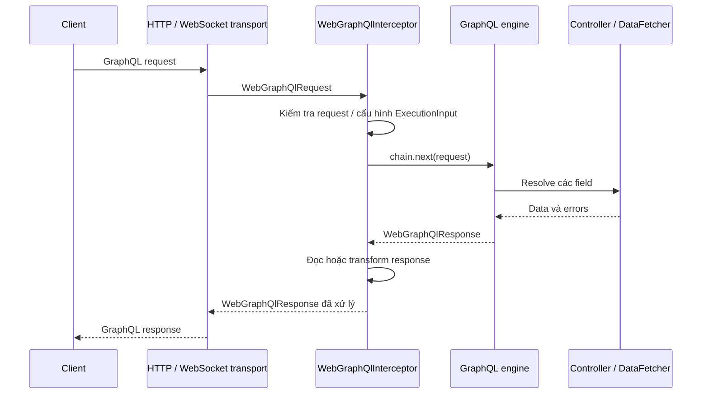

# `WebGraphQlResponse` trong Spring for GraphQL

`WebGraphQlResponse` là đối tượng biểu diễn kết quả GraphQL ở tầng web transport của Spring for GraphQL. Nó cho phép interceptor đọc kết quả thực thi, xem `data`, `errors`, `extensions`, bổ sung HTTP response headers hoặc tạo một response mới với phần `ExecutionResult` đã được điều chỉnh.

Trong một request, `WebGraphQlInterceptor` có thể xử lý thông tin trước khi GraphQL engine chạy và tiếp tục xử lý `WebGraphQlResponse` sau khi `chain.next(request)` hoàn tất. Đây là vị trí phù hợp để gắn request ID vào response, thêm metadata vào `extensions`, chuẩn hóa một số lỗi ở cấp request hoặc thiết lập response header.

`WebGraphQlResponse` không thay thế resolver, `DataFetcherExceptionResolver` hay Spring Security. Nó xử lý kết quả ở ranh giới transport; các quy tắc nghiệp vụ và quyền truy cập dữ liệu vẫn cần được áp dụng ở đúng tầng.

## `WebGraphQlResponse` nằm ở đâu trong vòng đời request?

Spring for GraphQL hỗ trợ các web transport như HTTP và WebSocket. Các transport này chuyển request qua chuỗi `WebGraphQlInterceptor`, sau đó tới `ExecutionGraphQlService`, nơi gọi GraphQL Java engine. Khi engine hoàn tất, response đi ngược qua chuỗi interceptor để từng interceptor có thể quan sát hoặc điều chỉnh kết quả.



Phần response thường được xử lý bằng `map` hoặc `doOnNext` trên `Mono<WebGraphQlResponse>` do `chain.next(request)` trả về:

```java
@Override
public Mono<WebGraphQlResponse> intercept(
        WebGraphQlRequest request, Chain chain) {
    return chain.next(request)
            .map(response -> {
                // Đọc hoặc tạo response mới tại đây
                return response;
            });
}
```

`map` phù hợp khi cần tạo một response mới bằng `response.transform(...)`. `doOnNext` phù hợp cho thao tác phụ có chủ đích, chẳng hạn thêm HTTP header vào response headers. Không gọi `block()` bên trong interceptor vì sẽ chặn luồng reactive.

## Những dữ liệu có thể đọc từ response

`WebGraphQlResponse` kế thừa các khả năng của `ExecutionGraphQlResponse` và `GraphQlResponse`. Những phương thức thường dùng gồm:

| Phương thức | Ý nghĩa |
| --- | --- |
| `getData()` | Lấy phần dữ liệu GraphQL trong response. |
| `getErrors()` | Lấy danh sách lỗi GraphQL. |
| `getExtensions()` | Lấy metadata trong phần `extensions` của GraphQL response. |
| `getExecutionResult()` | Lấy `ExecutionResult` gốc của GraphQL Java. |
| `getExecutionInput()` | Lấy `ExecutionInput` đã được dùng để thực thi operation. |
| `isValid()` | Cho biết kết quả có khóa `data` với giá trị khác null hay không. |
| `toMap()` | Chuyển response thành map theo cấu trúc GraphQL response. |
| `getResponseHeaders()` | Lấy các HTTP headers sẽ được thêm vào HTTP response. |
| `transform(...)` | Tạo response mới sau khi điều chỉnh `ExecutionResult`. |

`isValid()` không có nghĩa là operation không có lỗi. GraphQL có thể trả dữ liệu một phần cùng `errors`; khi `data` khác null, `isValid()` vẫn có thể là true. Nếu mục tiêu là kiểm tra có lỗi hay không, hãy xem `getErrors().isEmpty()`.

Trong Spring for GraphQL, `getErrors()` trả về các `ResponseError` để đọc lỗi theo mô hình response của Spring. Nếu cần thao tác trực tiếp với `GraphQLError` của GraphQL Java, chẳng hạn truyền danh sách lỗi vào `WebGraphQlResponse.Builder.errors(...)`, lấy danh sách từ `response.getExecutionResult().getErrors()`.

Ví dụ đọc dữ liệu và lỗi:

```java
return chain.next(request).map(response -> {
    Object data = response.getData();
    var errors = response.getErrors();
    Map<Object, Object> extensions = response.getExtensions();

    log.debug("GraphQL response valid={}, errorCount={}",
            response.isValid(), errors.size());

    return response;
});
```

Khi ghi log, chỉ ghi thông tin cần thiết để theo dõi. Không ghi toàn bộ `data`, variables, token hoặc dữ liệu cá nhân vào log nếu chưa có chính sách bảo vệ phù hợp.

## Thêm metadata vào GraphQL `extensions`

GraphQL response có thể chứa `extensions` để mang metadata bổ sung do server định nghĩa, chẳng hạn request ID, mã correlation hoặc thông tin phiên bản API. `extensions` nằm trong body GraphQL và khác với HTTP response headers.

Ví dụ thêm request ID mà vẫn giữ các extension đã có:

```java
import java.util.LinkedHashMap;
import java.util.Map;

return chain.next(request).map(response -> {
    Map<Object, Object> extensions = new LinkedHashMap<>();
    if (response.getExtensions() != null) {
        extensions.putAll(response.getExtensions());
    }
    extensions.put("requestId", requestId);

    return response.transform(builder ->
            builder.extensions(extensions).build());
});
```

`transform` tạo một `WebGraphQlResponse` mới với `ExecutionResult` được cập nhật. Đoạn code sao chép extensions cũ trước khi thêm `requestId`, tránh vô tình ghi đè metadata do GraphQL engine hoặc thành phần khác đã cung cấp.

Response body có thể có dạng:

```json
{
  "data": {
    "book": {
      "id": "book-10",
      "title": "Spring in Practice"
    }
  },
  "extensions": {
    "requestId": "8a73f5c2-9b7d-4c3d-a15f-42d9c2e10c11"
  }
}
```

Client có thể đọc `extensions.requestId` để cung cấp mã tham chiếu khi báo lỗi. Không đưa thông tin nhạy cảm, stack trace, token hoặc chi tiết nội bộ vào extensions vì client nhận được toàn bộ nội dung này.

## Thêm HTTP response header

`WebGraphQlResponse` cung cấp `getResponseHeaders()` để thêm header vào HTTP response. Ví dụ gắn request ID vào header:

```java
import org.springframework.http.HttpHeaders;

return chain.next(request).doOnNext(response -> {
    response.getResponseHeaders().set("X-Request-Id", requestId);
});
```

Transport HTTP sẽ đưa header này vào response trả về client. Có thể dùng `add` nếu cần thêm một giá trị mà không thay thế giá trị cũ, hoặc `set` để đặt một giá trị duy nhất.

### Thêm cookie

Có thể tạo `ResponseCookie` rồi ghi vào `Set-Cookie` header:

```java
import org.springframework.http.HttpHeaders;
import org.springframework.http.ResponseCookie;

return chain.next(request).doOnNext(response -> {
    ResponseCookie cookie = ResponseCookie.from("sessionHint", "active")
            .httpOnly(true)
            .secure(true)
            .sameSite("Lax")
            .path("/")
            .build();

    response.getResponseHeaders().add(
            HttpHeaders.SET_COOKIE, cookie.toString());
});
```

Đây chỉ là ví dụ cú pháp. Giá trị cookie, domain, thời hạn, `SameSite`, `Secure` và `HttpOnly` phải phù hợp với mô hình session và môi trường triển khai. Không tự tạo cookie xác thực từ một giá trị tùy ý hoặc ghi đè cookie bảo mật do Spring Security quản lý.

### Giới hạn với WebSocket

`getResponseHeaders()` dành cho HTTP response. Với GraphQL over WebSocket, HTTP handshake đã hoàn tất trước khi client gửi từng GraphQL operation. Vì vậy không thể dùng `WebGraphQlResponse.getResponseHeaders()` để thêm một HTTP header riêng cho mỗi message GraphQL qua WebSocket.

Nếu cần truyền metadata cho operation WebSocket, hãy dùng GraphQL `extensions` hoặc cơ chế payload/protocol phù hợp. Header của handshake cần được xử lý ở bước thiết lập kết nối hoặc thông qua WebSocket interceptor tương ứng.

## Đọc GraphQLContext trong response phase

Interceptor có thể đọc `ExecutionInput` gắn với response. Điều này hữu ích khi request phase đã thêm một giá trị vào GraphQL context và response phase cần dùng lại nó, chẳng hạn correlation ID:

```java
return chain.next(request).doOnNext(response -> {
    String requestId = response.getExecutionInput()
            .getGraphQLContext()
            .get("requestId");

    if (requestId != null) {
        response.getResponseHeaders().set("X-Request-Id", requestId);
    }
});
```

Giá trị context có thể được thiết lập trước khi gọi `chain.next` bằng `request.configureExecutionInput(...)`. Ví dụ interceptor tạo ID ở phía server:

```java
String requestId = UUID.randomUUID().toString();
request.configureExecutionInput((input, builder) ->
        builder.graphQLContext(Map.of("requestId", requestId)).build());

return chain.next(request).doOnNext(response ->
        response.getResponseHeaders().set("X-Request-Id", requestId));
```

Không nên tin một request ID do client gửi lên nếu nó được dùng làm định danh bảo mật. Có thể tiếp nhận correlation ID từ client để liên kết trace, nhưng cần kiểm tra định dạng và phân biệt rõ với ID do server tự sinh.

## Ví dụ interceptor hoàn chỉnh trong Spring Boot

Spring Boot tự đăng ký bean triển khai `WebGraphQlInterceptor` với web transport. Có thể khai báo một bean để thêm request ID vào GraphQL context, HTTP response header và GraphQL extensions:

```java
import java.util.LinkedHashMap;
import java.util.Map;
import java.util.UUID;

import org.springframework.context.annotation.Bean;
import org.springframework.context.annotation.Configuration;
import org.springframework.graphql.server.WebGraphQlInterceptor;

@Configuration(proxyBeanMethods = false)
public class GraphQlInterceptorConfiguration {

    @Bean
    WebGraphQlInterceptor responseMetadataInterceptor() {
        return (request, chain) -> {
            String requestId = UUID.randomUUID().toString();

            request.configureExecutionInput((input, builder) ->
                    builder.graphQLContext(Map.of("requestId", requestId)).build());

            return chain.next(request).map(response -> {
                Map<Object, Object> extensions = new LinkedHashMap<>();
                if (response.getExtensions() != null) {
                    extensions.putAll(response.getExtensions());
                }
                extensions.put("requestId", requestId);

                response.getResponseHeaders().set("X-Request-Id", requestId);

                return response.transform(builder ->
                        builder.extensions(extensions).build());
            });
        };
    }
}
```

Interceptor trên tạo request ID ở server, đặt nó vào GraphQL context để các thành phần xử lý operation có thể đọc, sau đó đưa cùng ID vào `extensions` và HTTP header. Nếu ứng dụng có nhiều interceptor, có thể dùng `@Order` để xác định thứ tự; thứ tự cần nhất quán khi interceptor phụ thuộc dữ liệu do interceptor trước tạo ra.

Trong ứng dụng không dùng Spring Boot auto-configuration, cần tự đăng ký interceptor vào `WebGraphQlHandler` thông qua builder của handler. Không cần tự tạo handler nếu Spring Boot đã cấu hình web transport và nhận bean interceptor.

## Thay đổi `data`, `errors` và `extensions`

`WebGraphQlResponse.transform(...)` cho phép cập nhật phần `ExecutionResult`. Builder cung cấp các thao tác như `data(...)`, `errors(...)` và `extensions(...)` rồi `build()` response mới.

Ví dụ bổ sung một extension:

```java
return response.transform(builder ->
        builder.extensions(extensions).build());
```

Có thể dùng cùng cơ chế để thay thế danh sách GraphQL errors sau khi đã kiểm tra và chuẩn hóa chúng:

```java
import graphql.GraphQLError;
import graphql.GraphqlErrorBuilder;
import java.util.List;

List<GraphQLError> sanitizedErrors = response.getExecutionResult().getErrors().stream()
        .map(error -> GraphqlErrorBuilder.newError()
                .message("Không thể xử lý GraphQL request")
                .locations(error.getLocations())
                .path(error.getPath())
                .build())
        .toList();

return response.transform(builder ->
        builder.errors(sanitizedErrors).build());
```

Ví dụ trên minh họa việc thay message nhưng giữ lại vị trí và path để client còn biết lỗi nằm ở đâu. Nếu ứng dụng cần giữ `extensions`, error classification hoặc metadata khác, hãy sao chép có chọn lọc những giá trị an toàn trước khi tạo error mới. Không xóa toàn bộ thông tin lỗi một cách máy móc vì client và công cụ giám sát có thể cần error code ổn định.

Không nên sửa `data` trong interceptor để thay thế authorization. Nếu người dùng không được đọc một field, resolver hoặc service phải từ chối truy cập trước khi dữ liệu được đưa vào kết quả. Post-process response để xóa field có thể che giấu lỗi thiết kế quyền và làm mất thông tin cần thiết cho null propagation.

## Xử lý lỗi cấp request bằng response interceptor

Không phải mọi GraphQL error đều phát sinh từ DataFetcher. Lỗi parse hoặc validation xảy ra trước khi GraphQL gọi resolver. Vì vậy, `DataFetcherExceptionResolver` không xử lý được các lỗi request-level này.

Interceptor có thể kiểm tra `response.getErrors()` sau khi `chain.next` hoàn tất và chuẩn hóa lỗi cấp request theo chính sách API. Ví dụ, có thể thêm một mã lỗi chung vào `extensions` hoặc thay đổi message công khai trong khi vẫn giữ `locations` và các thông tin an toàn khác.

Không nên dựa riêng vào `response.isValid()` để kết luận request không có lỗi. Theo định nghĩa, `isValid()` phản ánh việc kết quả có khóa `data` khác null; một response có partial data và một hoặc nhiều execution errors vẫn có thể hợp lệ theo nghĩa này. Nếu muốn nhận biết response có lỗi, hãy kiểm tra danh sách `getErrors()`.

`DataFetcherExceptionResolver` vẫn là nơi phù hợp để xử lý exception từ resolver/service. Response interceptor phù hợp hơn cho các lỗi ở cấp request hoặc việc chuẩn hóa toàn response. Hai cơ chế bổ sung cho nhau.

## Phân biệt GraphQL response body với HTTP response

GraphQL response body thường gồm `data`, `errors` và `extensions`. HTTP response còn có status code, headers và các thuộc tính transport khác. `WebGraphQlResponse` cung cấp cả góc nhìn GraphQL lẫn response headers, nhưng không nên nhầm chúng thành một loại metadata.

| Thành phần | Ví dụ | Nơi xử lý phù hợp |
| --- | --- | --- |
| GraphQL data | `data.book.title` | Resolver và GraphQL execution. |
| GraphQL errors | `errors[].message`, `path`, `locations` | DataFetcher exception resolver hoặc response interceptor cho request-level errors. |
| GraphQL extensions | `extensions.requestId` | `WebGraphQlResponse.transform(...)`. |
| HTTP response header | `X-Request-Id`, `Set-Cookie` | `response.getResponseHeaders()`. |
| HTTP status | 200, 400, 401, 500 | Web transport, security filter và handler theo quy tắc HTTP GraphQL. |

Với GraphQL over HTTP, sau khi request được parse và validate thành công, lỗi phát sinh trong quá trình thực thi thường được biểu diễn trong `errors` của GraphQL body và HTTP status thường là 200. Status cho lỗi parse/validation còn phụ thuộc media type và quy tắc GraphQL over HTTP được transport áp dụng. Không tự đổi mọi response có GraphQL errors thành HTTP 500; client cần có thể nhận partial data và errors cùng lúc.

`WebGraphQlResponse` có `getResponseHeaders()` để thêm header, nhưng không cung cấp một API chung để tùy ý đặt HTTP status code cho mọi loại transport. Nếu cần thay đổi status cho trường hợp đặc biệt, phải cấu hình ở tầng handler/transport phù hợp và tuân thủ giao thức đang dùng.

## Interceptor áp dụng cho HTTP và WebSocket

`WebGraphQlInterceptor` được gọi cho GraphQL request qua HTTP và WebSocket. Một số thao tác giống nhau ở cả hai transport:

- Đọc thông tin request có sẵn.
- Cấu hình `ExecutionInput` và GraphQL context.
- Quan sát `data`, `errors` và `extensions`.
- Transform GraphQL `ExecutionResult`.

Những thao tác phụ thuộc HTTP như thêm `X-Request-Id` hoặc `Set-Cookie` chỉ có ý nghĩa với HTTP response. Với WebSocket, handshake đã hoàn tất trước khi từng GraphQL operation được xử lý; dùng response header cho từng operation sẽ không có tác dụng như HTTP.

Nếu cần callback riêng cho vòng đời WebSocket connection, message khởi tạo hoặc hủy subscription, xem `WebSocketGraphQlInterceptor`, là phần mở rộng của `WebGraphQlInterceptor` dành cho WebSocket.

## Kiểm thử response interceptor

Kiểm thử nên xác minh cả GraphQL body lẫn HTTP metadata. `GraphQlTester` phù hợp để kiểm tra `data`, `errors` và `extensions`. Với HTTP headers, dùng kiểm thử transport như `WebTestClient` cho WebFlux hoặc `MockMvc` cho Spring MVC.

Các trường hợp nên kiểm tra:

- Response thành công giữ nguyên `data` và có request ID trong `extensions`.
- HTTP response có `X-Request-Id` tương ứng với request.
- Các `extensions` đã có không bị ghi đè khi thêm metadata mới.
- Response có partial data và errors vẫn giữ cả hai phần.
- `isValid()` không bị dùng nhầm như phép kiểm tra danh sách lỗi rỗng.
- Request parse/validation error được xử lý đúng nếu interceptor có chuẩn hóa lỗi.
- Error path và locations được giữ khi thay đổi message.
- Header không được giả định là gửi theo từng operation trên WebSocket.
- Nhiều interceptor chạy đúng thứ tự và không ghi đè metadata của nhau.
- Không có dữ liệu nhạy cảm xuất hiện trong response body, headers hoặc log.

Ví dụ kiểm tra extension bằng `GraphQlTester`:

```java
graphQlTester.document("""
        query {
          book(id: "book-10") {
            id
          }
        }
        """)
        .execute()
        .path("extensions.requestId")
        .entity(String.class)
        .satisfies(requestId -> assertThat(requestId).isNotBlank());
```

Để kiểm tra header, gửi request qua HTTP test client và assert `X-Request-Id` trong response headers. Nếu test chỉ dùng một tester không gắn với HTTP transport, nó có thể không quan sát được header do transport chịu trách nhiệm ghi ra mạng.

## Lỗi thường gặp

| Triệu chứng | Nguyên nhân | Cách xử lý |
| --- | --- | --- |
| Thêm header nhưng client không nhận | Đang dùng WebSocket hoặc interceptor chạy trên transport không có HTTP response tương ứng. | Chỉ dùng `getResponseHeaders()` cho HTTP; dùng extensions cho metadata từng operation. |
| `extensions` cũ bị mất | Tạo map mới nhưng không sao chép extension hiện có. | Copy `getExtensions()` rồi thêm key mới. |
| Response bị biến đổi nhưng client không thấy | Gọi `transform` nhưng không trả response mới từ `map`. | Return kết quả `response.transform(...)`. |
| `isValid()` true nhưng response vẫn có errors | Hiểu nhầm valid là không có lỗi. | Kiểm tra `getErrors().isEmpty()` khi cần xác định lỗi. |
| DataFetcherExceptionResolver không xử lý lỗi validation | Lỗi xảy ra trước khi resolver được gọi. | Dùng response interceptor để xem và chuẩn hóa request-level errors. |
| Partial data biến mất sau khi chuẩn hóa errors | Transform response không giữ lại data hoặc logic thay thế cả ExecutionResult. | Chỉ cập nhật trường cần thiết, giữ nguyên các phần còn lại. |
| Request ID không đồng nhất giữa log và response | Tạo ID ở nhiều tầng hoặc ghi đè context. | Tạo một ID ở request phase và dùng lại trong context, extension và header. |
| Lộ thông tin nội bộ trong extensions hoặc header | Đưa exception, token hoặc dữ liệu nhạy cảm vào metadata. | Chỉ công bố mã tham chiếu và thông tin an toàn. |

## Ghi nhớ

`WebGraphQlResponse` là kết quả ở tầng web transport sau khi GraphQL engine thực thi operation. Có thể đọc `data`, `errors`, `extensions`, `ExecutionInput`, dùng `transform(...)` để tạo response mới hoặc dùng `getResponseHeaders()` để thêm HTTP headers.

`extensions` thuộc GraphQL response body; `getResponseHeaders()` dành cho HTTP response và không tạo header riêng cho từng message WebSocket. `transform` cập nhật `ExecutionResult` thông qua builder như `data`, `errors` và `extensions`. `isValid()` chỉ cho biết data có khác null, không có nghĩa response không chứa errors.

Trong Spring Boot, khai báo `WebGraphQlInterceptor` bean để xử lý response sau `chain.next(request)`. Dùng interceptor cho metadata, correlation ID và chuẩn hóa lỗi cấp request; dùng resolver/service cho nghiệp vụ và authorization. Kiểm thử cả GraphQL body lẫn HTTP headers để xác nhận response hoạt động đúng trên transport thực tế.

## Tài liệu tham khảo

- [Spring for GraphQL — Server Transports và Interception](https://docs.spring.io/spring-graphql/reference/transports.html)
- [Spring for GraphQL — `WebGraphQlResponse` API](https://docs.spring.io/spring-graphql/docs/current/api/org/springframework/graphql/server/WebGraphQlResponse.html)
- [Spring Boot — Spring for GraphQL](https://docs.spring.io/spring-boot/reference/web/spring-graphql.html)
