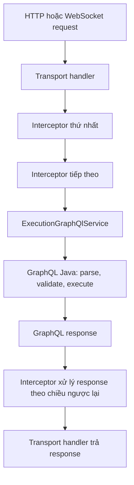

# GraphQlInterceptor

Interceptor là điểm mở rộng cho phép ứng dụng Spring for GraphQL quan sát hoặc điều chỉnh request và response quanh quá trình thực thi GraphQL. Interceptor thường được dùng để đưa thông tin của transport vào `GraphQLContext`, gắn correlation ID, bổ sung HTTP response header, ghi nhận thời gian xử lý hoặc chuẩn hóa một số lỗi ở cấp request.

Trong Spring for GraphQL, tên API cụ thể phụ thuộc transport. Với HTTP và WebSocket, interceptor chính là `WebGraphQlInterceptor`; WebSocket có thêm `WebSocketGraphQlInterceptor`. Với RSocket, Spring cung cấp `RSocketQlInterceptor`. Vì vậy, khi nói chung về GraphQL interceptor, cần xác định request đang đi qua transport nào để chọn đúng extension point.

## 1. Interceptor nằm ở đâu trong luồng xử lý?

HTTP và WebSocket handler chuyển request qua chuỗi `WebGraphQlInterceptor`, sau đó mới gọi `ExecutionGraphQlService` để thực thi GraphQL Java. Interceptor có thể chạy logic trước khi chuyển tiếp request và tiếp tục xử lý response sau khi phần còn lại của chain hoàn tất.



Ví dụ, interceptor đầu tiên có thể đọc header `X-Request-Id`, đưa giá trị vào GraphQL context rồi gọi interceptor tiếp theo. Sau khi GraphQL execution hoàn tất, một interceptor khác có thể đọc dữ liệu trong response và bổ sung header trả về.

Interceptor không thay thế resolver. Resolver chịu trách nhiệm cung cấp dữ liệu cho field; interceptor xử lý mối quan tâm xuyên suốt request hoặc transport, áp dụng cho nhiều operation và nhiều resolver.

## 2. WebGraphQlInterceptor là API cho HTTP và WebSocket

`WebGraphQlInterceptor` thuộc package `org.springframework.graphql.server`. Interface có method chính:

```java
Mono<WebGraphQlResponse> intercept(
    WebGraphQlRequest request,
    WebGraphQlInterceptor.Chain chain
);
```

Trong đó:

- `WebGraphQlRequest` cung cấp thông tin request GraphQL và thông tin transport tương ứng, chẳng hạn HTTP headers.
- `Chain` đại diện cho phần còn lại của chuỗi interceptor và bước thực thi GraphQL.
- `chain.next(request)` chuyển request cho interceptor tiếp theo hoặc `ExecutionGraphQlService` và trả về `Mono<WebGraphQlResponse>`.
- `WebGraphQlResponse` cho phép đọc kết quả thực thi và điều chỉnh một số thông tin response, ví dụ HTTP response headers.

`Mono` là kiểu reactive của Project Reactor. Cả ứng dụng Spring MVC và Spring WebFlux đều sử dụng API interceptor này; không nên gọi `block()` hoặc tự `subscribe()` trong interceptor để chờ kết quả. Hãy trả về và kết hợp `Mono` để framework quản lý vòng đời bất đồng bộ.

## 3. Tạo interceptor và đăng ký trong Spring Boot

Trong ứng dụng Spring Boot dùng `spring-boot-starter-graphql`, có thể khai báo interceptor thành Spring bean. Boot sẽ đưa các bean `WebGraphQlInterceptor` vào chain của web transport.

Ví dụ interceptor ghi nhận mã request từ header:

```java
package com.example.graphql.config;

import java.util.Map;

import reactor.core.publisher.Mono;
import org.springframework.core.annotation.Order;
import org.springframework.graphql.server.WebGraphQlInterceptor;
import org.springframework.graphql.server.WebGraphQlRequest;
import org.springframework.graphql.server.WebGraphQlResponse;
import org.springframework.stereotype.Component;

@Component
@Order(10)
public class RequestIdInterceptor implements WebGraphQlInterceptor {

    @Override
    public Mono<WebGraphQlResponse> intercept(
            WebGraphQlRequest request, Chain chain) {

        String requestId = request.getHeaders().getFirst("X-Request-Id");

        if (requestId != null && !requestId.isBlank()) {
            request.configureExecutionInput((input, builder) ->
                builder.graphQLContext(Map.of("requestId", requestId)).build()
            );
        }

        return chain.next(request);
    }
}
```

`@Component` đăng ký interceptor vào application context. `@Order(10)` chỉ định thứ tự tương đối giữa các interceptor bean; Spring for GraphQL lấy chúng theo thứ tự đã được sắp xếp. Nếu không cần thứ tự đặc biệt, có thể dùng một giá trị order mặc định hoặc triển khai `Ordered`.

Trong code thực tế, cần phối hợp việc thêm dữ liệu vào `GraphQLContext` với các nguồn context khác của ứng dụng để tránh ghi đè những key đã được thiết lập. Chọn key có namespace rõ ràng, ví dụ `requestId` hoặc `tenantContext`.

## 4. Đưa HTTP header vào GraphQLContext

Một ứng dụng thường cần chuyển thông tin từ HTTP request sang GraphQL resolver. Ví dụ correlation ID, locale hoặc tenant đã được xác thực có thể được đưa vào `GraphQLContext`.

Spring for GraphQL có interceptor dựng sẵn `HttpRequestHeaderInterceptor` để sao chép một số HTTP header vào GraphQL context. Có thể đăng ký bean:

```java
import org.springframework.context.annotation.Bean;
import org.springframework.context.annotation.Configuration;
import org.springframework.graphql.server.support.HttpRequestHeaderInterceptor;

@Configuration
public class GraphQlInterceptorConfiguration {

    @Bean
    HttpRequestHeaderInterceptor requestHeaderInterceptor() {
        return HttpRequestHeaderInterceptor.builder()
            .mapHeader("X-Request-Id")
            .build();
    }
}
```

Sau đó controller đọc giá trị qua `@ContextValue`:

```java
import org.springframework.graphql.data.method.annotation.ContextValue;
import org.springframework.graphql.data.method.annotation.QueryMapping;
import org.springframework.stereotype.Controller;

@Controller
public class RequestInfoController {

    @QueryMapping
    public String requestId(@ContextValue("X-Request-Id") String requestId) {
        return requestId;
    }
}
```

Tên context key cần khớp với key mà interceptor ghi vào context theo cấu hình của phiên bản đang sử dụng. Với header interceptor dựng sẵn, hãy kiểm tra API builder và quy ước key trong version Spring for GraphQL mà dự án quản lý. Nếu cần đổi tên hoặc biến đổi giá trị, viết `WebGraphQlInterceptor` riêng sẽ linh hoạt hơn.

Không nên xem mọi header client gửi lên là dữ liệu đáng tin. Header tenant, role hoặc user ID có thể bị giả mạo nếu không được gateway hay ứng dụng xác thực. Với dữ liệu phân quyền, lấy danh tính từ Spring Security `Principal`/`SecurityContext` hoặc một nguồn server-side đáng tin cậy.

## 5. Đọc GraphQLContext trong resolver

Khi interceptor đưa dữ liệu vào `GraphQLContext`, resolver có thể nhận context trực tiếp hoặc dùng `@ContextValue`.

Ví dụ nhận context key:

```java
@QueryMapping
public Dashboard dashboard(@ContextValue("requestId") String requestId) {
    return dashboardService.load(requestId);
}
```

Hoặc truy cập toàn bộ `GraphQLContext`:

```java
import graphql.GraphQLContext;

@QueryMapping
public Dashboard dashboard(GraphQLContext context) {
    String requestId = context.get("requestId");
    return dashboardService.load(requestId);
}
```

`GraphQLContext` dành cho dữ liệu chung của một lần thực thi GraphQL. Nó phù hợp với thông tin request như correlation ID, tenant đã được xác minh, locale hoặc metadata do server tạo. Không dùng nó làm kho lưu trạng thái toàn cục giữa nhiều request.

Khi giá trị context có thể không tồn tại, hãy dùng kiểu nullable hoặc cung cấp giá trị mặc định và kiểm tra rõ ràng. Nếu resolver yêu cầu tenant bắt buộc, nên từ chối request khi context chưa được xác thực thay vì tiếp tục với tenant mặc định không rõ nguồn gốc.

## 6. Thêm HTTP response header sau khi GraphQL thực thi

Interceptor có thể tiếp tục xử lý response sau `chain.next(request)`. Ví dụ thêm một response header để client đối chiếu request:

```java
import org.springframework.http.HttpHeaders;

@Component
public class ResponseRequestIdInterceptor implements WebGraphQlInterceptor {

    @Override
    public Mono<WebGraphQlResponse> intercept(
            WebGraphQlRequest request, Chain chain) {

        String requestId = request.getHeaders().getFirst("X-Request-Id");

        return chain.next(request).doOnNext(response -> {
            if (requestId != null && !requestId.isBlank()) {
                response.getResponseHeaders()
                    .add("X-Request-Id", requestId);
            }
        });
    }
}
```

`doOnNext` thực hiện side effect khi response được phát ra. Nếu cần biến đổi response hoặc tạo response mới, dùng các toán tử như `map` và API `response.transform(...)` phù hợp với mục đích. Không thay đổi GraphQL `data` một cách tùy tiện vì việc đó có thể phá vỡ hợp đồng schema hoặc làm sai ý nghĩa dữ liệu.

Một trường hợp khác là controller ghi một giá trị vào `GraphQLContext`, rồi interceptor đọc giá trị sau khi execution hoàn tất để tạo cookie hoặc header. Cách này hữu ích khi response metadata phụ thuộc vào kết quả xử lý, nhưng cần xác định rõ chính sách cookie, `Secure`, `HttpOnly`, `SameSite` và domain/path trong ứng dụng thật.

## 7. Quan sát và biến đổi GraphQL errors

Một interceptor có thể đọc `WebGraphQlResponse` để quan sát lỗi sau khi GraphQL engine xử lý operation. Điều này hữu ích với lỗi validation của document, vì một số lỗi xảy ra trước khi resolver chạy và không đi qua `DataFetcherExceptionResolver`.

Ví dụ kiểm tra response:

```java
return chain.next(request).map(response -> {
    if (response.isValid()) {
        return response;
    }

    // Ghi nhận hoặc chuẩn hóa lỗi theo chính sách của ứng dụng.
    return response;
});
```

`isValid()` giúp phân biệt response có kết quả data hợp lệ theo tiêu chí của API với response chỉ chứa lỗi request/validation. Khi biến đổi lỗi, có thể tạo danh sách `GraphQLError` mới và dùng `response.transform(builder -> builder.errors(errors).build())`.

Không nên xóa lỗi hoặc thay message theo cách làm client hiểu nhầm operation thành công. Hãy giữ mã lỗi ổn định, không đưa stack trace hay chi tiết nội bộ vào message công khai và bảo toàn thông tin cần thiết như error path/extensions nếu client dựa vào chúng.

Phân biệt trách nhiệm:

- `DataFetcherExceptionResolver` xử lý exception phát sinh trong quá trình resolver/field thực thi.
- `WebGraphQlInterceptor` quan sát request/response ở cấp web transport, bao gồm cả các lỗi validation trước resolver.
- Spring Security filter chain xử lý xác thực và bảo vệ HTTP endpoint ở lớp bảo mật web.

Không nên dồn toàn bộ validation nghiệp vụ hoặc exception handling của resolver vào interceptor.

## 8. Chuỗi interceptor và thứ tự thực thi

Một ứng dụng có thể có nhiều interceptor với nhiệm vụ riêng:

1. Interceptor kiểm tra metadata transport và tạo correlation ID.
2. Interceptor đưa context đã xác thực vào GraphQL execution.
3. Interceptor đo thời gian và ghi metric.
4. Interceptor xử lý response header hoặc chuẩn hóa lỗi.

Các interceptor được gọi theo thứ tự cấu hình trước execution; phần xử lý sau `chain.next` diễn ra khi response quay ngược qua chain. Điều này tương tự mô hình middleware/decorator.

Ví dụ:

```java
@Component
@Order(1)
public class CorrelationInterceptor implements WebGraphQlInterceptor {
    // Tạo hoặc xác nhận correlation ID trước execution.
}

@Component
@Order(2)
public class MetricsInterceptor implements WebGraphQlInterceptor {
    // Đo thời gian và ghi nhận kết quả sau execution.
}
```

Hãy đặt thứ tự có chủ đích khi interceptor phụ thuộc dữ liệu do interceptor trước tạo ra. Tránh nhiều interceptor cùng sửa một context key hoặc cùng thay đổi một response header theo những quy tắc mâu thuẫn.

Mỗi interceptor thường gọi `chain.next(request)` đúng một lần để tiếp tục xử lý. Nếu cố ý chặn request và trả kết quả sớm, phải bảo đảm response tuân thủ hợp đồng GraphQL và không bỏ qua kiểm tra bảo mật bắt buộc. Không gọi `chain.next` nhiều lần cho cùng một request trừ khi API và use case được thiết kế rõ ràng cho việc đó.

## 9. WebSocketGraphQlInterceptor

`WebSocketGraphQlInterceptor` mở rộng `WebGraphQlInterceptor`. Ngoài việc intercept từng GraphQL request trên WebSocket, nó cung cấp callback cho vòng đời connection và việc client hủy subscription.

WebSocket khác HTTP ở chỗ một connection có thể tồn tại lâu và mang nhiều operation/subscription. Vì vậy, ứng dụng có thể cần xử lý:

- Xác thực khi client gửi thông điệp `connection_init`.
- Gắn thông tin principal/security context cho các request tiếp theo trên connection.
- Theo dõi khi connection bắt đầu hoặc kết thúc.
- Xử lý client cancellation cho subscription đang chạy.

Spring for GraphQL có các `AuthenticationWebSocketInterceptor` dựng sẵn cho Spring MVC và WebFlux để hỗ trợ lấy thông tin xác thực từ payload `connection_init` và truyền `SecurityContext` tới các request tiếp theo.

Trong một chain chỉ có thể có tối đa một `WebSocketGraphQlInterceptor`. Khi ứng dụng cần nhiều xử lý WebSocket, có thể kết hợp logic đó trong một interceptor WebSocket duy nhất và dùng các `WebGraphQlInterceptor` khác cho xử lý chung.

Không giả định HTTP request header của lần handshake sẽ tự động thay đổi cho từng operation trong connection. Thông tin xác thực và metadata cần được gắn với vòng đời WebSocket theo đúng giao thức và chính sách refresh/revoke của ứng dụng.

## 10. Interceptor cho RSocket

Với GraphQL chạy qua RSocket, Spring cung cấp `RSocketQlInterceptor` để intercept request trước và sau khi GraphQL Java thực thi. Mục đích tương tự `WebGraphQlInterceptor`: tùy chỉnh `ExecutionInput`, quan sát hoặc biến đổi `ExecutionResult`.

RSocket có mô hình interaction riêng. Query và mutation thường dùng request-response, còn subscription dùng request-stream. Vì vậy, không thể dùng trực tiếp `WebGraphQlInterceptor` để thay thế interceptor RSocket; hãy dùng extension point đúng transport.

Nếu ứng dụng chỉ cung cấp GraphQL qua HTTP/WebSocket, không cần cấu hình RSocket interceptor. Chỉ thêm khi hệ thống thực sự bật RSocket transport và có yêu cầu xuyên suốt phù hợp.

## 11. Interceptor, filter và resolver khác nhau thế nào?

| Thành phần | Phạm vi | Ví dụ nhiệm vụ |
| --- | --- | --- |
| Servlet/WebFlux filter | HTTP request trước khi vào handler | CORS, security chain, xử lý request web tổng quát |
| `WebGraphQlInterceptor` | GraphQL request/response qua HTTP hoặc WebSocket | Đưa header vào GraphQLContext, response header, đo request |
| `RSocketQlInterceptor` | GraphQL request/response qua RSocket | Context và kết quả cho RSocket operation |
| `@QueryMapping` / `@SchemaMapping` | Một field cụ thể trong schema | Lấy dữ liệu hoặc thực hiện logic field |
| `DataFetcherExceptionResolver` | Exception từ quá trình thực thi field | Chuyển exception thành GraphQL error |
| GraphQL Java Instrumentation | Các bước bên trong engine execution | Theo dõi hoặc can thiệp sâu vào parse, validation và execution |

Chọn extension point theo nơi cần can thiệp. Ví dụ, xác thực HTTP bearer token thường phù hợp với Spring Security; đưa request ID vào GraphQLContext phù hợp với `WebGraphQlInterceptor`; xử lý lỗi domain của `Book.author` phù hợp với resolver hoặc exception resolver.

## 12. Logging, metrics và bảo mật

Interceptor là vị trí thuận tiện để ghi nhận thời gian request, operation name, request ID và kết quả tổng quát. Tuy nhiên, GraphQL request có thể chứa variables nhạy cảm như email, access token, thông tin thanh toán hoặc dữ liệu cá nhân.

Một số nguyên tắc:

- Ghi operation name, correlation ID, thời gian xử lý và số lượng lỗi khi cần; hạn chế log toàn bộ document/variables.
- Nếu cần log query để debug, phải lọc hoặc che giá trị nhạy cảm và áp dụng thời hạn lưu trữ phù hợp.
- Không ghi access token, cookie, session ID hoặc thông tin xác thực thô vào GraphQLContext log.
- Không tin tenant ID, role hay user ID chỉ vì chúng xuất hiện trong HTTP header.
- Dùng Spring Security để xác thực và authorization; interceptor chỉ chuyển thông tin đã xác minh tới execution context khi cần.
- Không để exception trong interceptor làm lộ thông tin nội bộ hoặc vô tình biến lỗi bảo mật thành response thành công.
- Với WebSocket, giới hạn connection và subscription, đồng thời xử lý cancellation và thu hồi quyền theo vòng đời connection.

Nếu cần timeout cho GraphQL request qua web transport, Spring for GraphQL cung cấp `TimeoutWebGraphQlInterceptor`. Có thể cấu hình interceptor này thành bean với thời lượng phù hợp để request vượt quá giới hạn bị hủy. Timeout cần được chọn theo đặc tính query và SLA; một giá trị quá thấp có thể cắt các operation hợp lệ, còn giá trị quá cao không bảo vệ được tài nguyên hiệu quả.

## 13. Kiểm thử interceptor

Interceptor là logic ở lớp transport, vì vậy test cần đi qua đúng handler để xác minh chain thực sự được áp dụng. Một unit test cho method `intercept` có thể mock `Chain`, nhưng integration test qua `WebGraphQlHandler` hoặc HTTP test với `WebTestClient` sẽ kiểm tra được cả đăng ký bean và hành vi transport.

Ví dụ các tình huống nên kiểm thử:

- Header request được chuyển vào `GraphQLContext` và controller đọc được bằng `@ContextValue`.
- Header thiếu hoặc rỗng không làm request lỗi ngoài dự kiến.
- Response header được thêm sau khi GraphQL execution hoàn tất.
- Interceptor gọi chain đúng một lần và không block reactive pipeline.
- Interceptor vẫn giữ nguyên `data` và `errors` khi chỉ cần quan sát response.
- Validation error trước resolver vẫn được ghi nhận/chuẩn hóa đúng.
- Thứ tự nhiều interceptor đúng với `@Order`.
- WebSocket connection initialization, cancellation và authentication được kiểm tra riêng nếu ứng dụng hỗ trợ WebSocket.
- RSocket interceptor được kiểm thử qua RSocket handler nếu ứng dụng dùng RSocket.

Với test dùng `GraphQlTester` ở mức execution service, interceptor của web transport có thể không chạy. Hãy chọn `WebGraphQlTester` hoặc test HTTP/WebSocket tương ứng khi mục tiêu là kiểm thử `WebGraphQlInterceptor`.

## 14. Những lỗi thường gặp

| Triệu chứng | Nguyên nhân có thể | Cách xử lý |
| --- | --- | --- |
| Interceptor không được gọi | Bean không được đăng ký hoặc đang dùng transport khác | Kiểm tra component scan, bean và handler transport |
| `@ContextValue` nhận null | Context key không khớp hoặc interceptor chưa cấu hình execution input | Kiểm tra key và thứ tự chain |
| Header response không xuất hiện | Sửa response trước khi chain hoàn tất hoặc dùng sai response headers API | Thực hiện sau `chain.next` và kiểm tra HTTP handler |
| Request bị thực thi hai lần | Gọi `chain.next` nhiều lần | Chỉ tiếp tục chain một lần cho mỗi request thông thường |
| MVC request bị treo | Gọi `block()` hoặc tự subscribe trong interceptor | Kết hợp `Mono` và trả về pipeline |
| Lỗi validation không được resolver xử lý | Validation xảy ra trước field execution | Quan sát `WebGraphQlResponse` trong interceptor nếu cần |
| WebSocket auth không áp dụng cho operation sau | Chưa gắn SecurityContext với connection/request lifecycle | Dùng `WebSocketGraphQlInterceptor` phù hợp |
| Tenant data bị lộ | Tin header client gửi hoặc cache context sai phạm vi | Xác minh tenant server-side và giữ context theo request |
| Log chứa dữ liệu nhạy cảm | Ghi toàn bộ query/variables/headers | Mask hoặc bỏ dữ liệu nhạy cảm khỏi log |

## 15. Checklist triển khai interceptor

- Đã xác định transport là HTTP, WebSocket hay RSocket?
- Đã chọn đúng interface: `WebGraphQlInterceptor`, `WebSocketGraphQlInterceptor` hoặc `RSocketQlInterceptor`?
- Interceptor đã được đăng ký thành bean hoặc thêm vào handler chain?
- Thứ tự interceptor có được xác định khi có phụ thuộc không?
- Context key có tên rõ ràng và không ghi đè dữ liệu khác?
- Dữ liệu từ header đã được xác minh trước khi dùng cho tenant/authorization?
- `chain.next(request)` được gọi đúng cách và không block reactive pipeline?
- Response header và error transformation có giữ đúng hợp đồng GraphQL?
- Logging không làm lộ query variables hoặc thông tin xác thực?
- Test đã chạy qua đúng transport để xác minh interceptor?

Interceptor trong Spring for GraphQL là điểm mở rộng ở ranh giới giữa transport và GraphQL execution. Với HTTP/WebSocket, `WebGraphQlInterceptor` cho phép đọc request, tùy chỉnh `ExecutionInput`, chuyển dữ liệu vào `GraphQLContext` và xử lý response sau execution; WebSocket có interceptor mở rộng cho connection lifecycle, còn RSocket có API riêng. Chọn đúng interceptor theo transport, giữ pipeline reactive, xác minh dữ liệu đầu vào và kiểm thử qua đúng handler giúp các xử lý xuyên suốt như correlation, context, header và metrics hoạt động nhất quán mà không làm resolver gánh trách nhiệm không thuộc về nó.

## Tài liệu tham khảo

- [Spring for GraphQL — Server Transports và Interception](https://docs.spring.io/spring-graphql/reference/transports.html)
- [Spring for GraphQL — WebGraphQlInterceptor API](https://docs.spring.io/spring-graphql/docs/current/api/org/springframework/graphql/server/WebGraphQlInterceptor.html)
- [Spring Boot — Spring for GraphQL](https://docs.spring.io/spring-boot/reference/web/spring-graphql.html)
