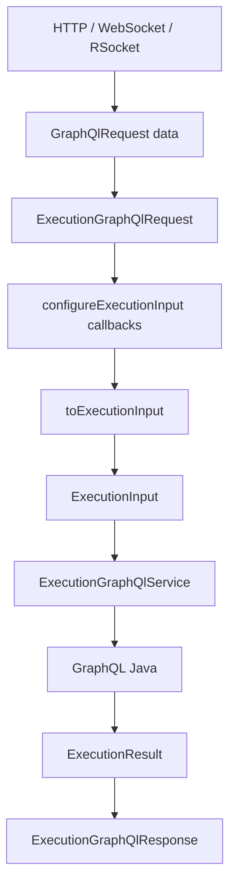

# ExecutionGraphQlRequest

## 1. `ExecutionGraphQlRequest` là gì?

Trong Spring for GraphQL, một request cần mang thông tin operation mà client muốn thực thi và những dữ liệu bổ sung để GraphQL Java chạy operation đó. `GraphQlRequest` định nghĩa phần dữ liệu cơ bản như GraphQL document, operation name, variables và extensions. `ExecutionGraphQlRequest` mở rộng hợp đồng này cho phía server bằng cách bổ sung khả năng chuẩn bị `ExecutionInput` trước khi chuyển request vào GraphQL Java.

Nói cách khác, `ExecutionGraphQlRequest` là abstraction nối request của Spring for GraphQL với đối tượng `graphql.ExecutionInput` mà GraphQL Java sử dụng để thực thi. Nó không phải GraphQL schema, resolver hay một HTTP endpoint. Nó mang dữ liệu đầu vào và các tùy chỉnh cần thiết cho một lần GraphQL execution.

Interface nằm trong package `org.springframework.graphql`:

```java
import org.springframework.graphql.ExecutionGraphQlRequest;
```

Các implementation thường gặp gồm:

- `DefaultExecutionGraphQlRequest`: implementation mặc định cho server-side execution.
- `WebGraphQlRequest`: request qua HTTP hoặc WebSocket, có thêm thông tin transport như URI và HTTP headers.
- `WebSocketGraphQlRequest`: request gắn với một message GraphQL over WebSocket.
- `RSocketGraphQlRequest`: request đến từ transport RSocket.

Các implementation này đều giữ phần dữ liệu chung của GraphQL request, nhưng có thể bổ sung thông tin riêng của transport.

## 2. Phân biệt `GraphQlRequest` và `ExecutionGraphQlRequest`

`GraphQlRequest` mô tả nội dung một operation. `ExecutionGraphQlRequest` bổ sung những gì cần để thực thi operation đó ở server.

| Thành phần | `GraphQlRequest` | `ExecutionGraphQlRequest` |
| --- | --- | --- |
| GraphQL document | Có | Kế thừa |
| Operation name | Có | Kế thừa |
| Variables | Có | Kế thừa |
| Protocol extensions | Có | Kế thừa |
| Chuyển thành `Map` theo GraphQL over HTTP/WebSocket | Có | Kế thừa |
| Transport request ID | Không phải trách nhiệm chung | Có |
| Locale của request | Không phải trách nhiệm chung | Có thể có |
| Tùy chỉnh `ExecutionInput` | Không | Có |
| Tạo `ExecutionInput` cho GraphQL Java | Không | Có |

Ví dụ, một request có thể chứa document:

```graphql
query BookById($id: ID!) {
    book(id: $id) {
        id
        title
    }
}
```

và variables:

```json
{
  "id": "book-42"
}
```

`GraphQlRequest` giữ document và variables. Khi request được dùng để gọi GraphQL Java, `ExecutionGraphQlRequest` còn có thể bổ sung execution ID, locale và các giá trị khác vào `ExecutionInput`.

## 3. Các thuộc tính chính của request

Vì `ExecutionGraphQlRequest` kế thừa `GraphQlRequest`, nó cung cấp các thông tin cơ bản sau:

| Phương thức | Ý nghĩa |
| --- | --- |
| `getDocument()` | GraphQL document chứa operation, selection set và fragment |
| `getOperationName()` | Tên operation cần chạy khi document chứa nhiều operation |
| `getVariables()` | Map giá trị biến của operation |
| `getExtensions()` | Metadata mở rộng theo giao thức hoặc implementation |
| `toMap()` | Chuyển request thành map theo định dạng GraphQL over HTTP/WebSocket |
| `getId()` | ID do transport gán cho request |
| `getExecutionId()` | `ExecutionId` đã cấu hình để đưa vào GraphQL Java, nếu có |
| `getLocale()` | Locale do transport cung cấp, nếu có |

`getOperationName()` có thể null nếu request chỉ có một operation hoặc client không cung cấp tên. `getVariables()` có thể rỗng. `getExtensions()` thường được dùng cho metadata đặc thù của client hoặc giao thức; không nên nhầm nó với `extensions` trong GraphQL response.

`getId()` và `getExecutionId()` có mục đích gần nhau nhưng không hoàn toàn giống nhau. `getId()` là ID transport cung cấp; `getExecutionId()` là ID thực tế được cấu hình cho lần chạy GraphQL. Nếu không override, transport ID thường được dùng làm cơ sở cho execution ID.

## 4. Luồng từ request đến `ExecutionInput`

Khi server nhận một GraphQL request, Spring for GraphQL tạo một implementation của `ExecutionGraphQlRequest`. Request được dùng để tạo `ExecutionInput`, sau đó `ExecutionGraphQlService` chuyển input vào GraphQL Java.



`ExecutionGraphQlRequest` không tự chạy operation. Nó chuẩn bị dữ liệu đầu vào. `ExecutionGraphQlService` chịu trách nhiệm gọi GraphQL Java và trả về response.

Về nguyên tắc, `toExecutionInput()` thực hiện hai việc:

1. Khởi tạo `ExecutionInput` từ document, operation name, variables, extensions, execution ID và locale của request.
2. Áp dụng các hàm tùy chỉnh đã đăng ký qua `configureExecutionInput(...)`.

Điều này giúp các lớp phía server bổ sung metadata hoặc điều chỉnh execution mà không cần tự xây dựng lại toàn bộ `ExecutionInput`.

## 5. Tùy chỉnh `ExecutionInput` bằng `configureExecutionInput`

`configureExecutionInput` là điểm mở rộng quan trọng nhất của `ExecutionGraphQlRequest`. Phương thức nhận một `BiFunction` gồm:

- `ExecutionInput`: input đã được khởi tạo từ request.
- `ExecutionInput.Builder`: builder để thay đổi hoặc bổ sung cấu hình.

Hàm phải trả về `ExecutionInput` sau khi gọi `build()`.

Ví dụ bổ sung tenant và correlation ID vào `GraphQLContext`:

```java
request.configureExecutionInput((input, builder) ->
    builder.graphQLContext(context -> {
        context.put("tenantId", tenantId);
        if (correlationId != null) {
            context.put("correlationId", correlationId);
        }
    }).build()
);
```

Sau đó, resolver có thể đọc giá trị bằng `GraphQLContext` hoặc `@ContextValue`:

```java
@QueryMapping
public List<Book> books(@ContextValue("tenantId") String tenantId) {
    return bookQueryService.findAllByTenant(tenantId);
}
```

Context phù hợp với dữ liệu server-side cần dùng trong cùng execution, chẳng hạn tenant đã được xác thực, principal, locale hiển thị hoặc correlation ID. Không đưa trực tiếp giá trị do client tự khai báo vào context rồi coi đó là dữ liệu đáng tin cậy.

### Không ghi đè context đã có một cách vô ý

Khi có nhiều thành phần cùng tùy chỉnh `ExecutionInput`, hãy dùng builder để bổ sung key cần thiết và tránh thay thế dữ liệu do thành phần trước đã thiết lập. Nếu nhiều callback cùng sửa một thuộc tính, cần thống nhất thứ tự và quy ước để kết quả cuối cùng không phụ thuộc vào cấu hình khó đoán.

Không tự tạo một `ExecutionInput` hoàn toàn mới từ document và variables nếu chỉ cần thêm context. Cách đó dễ làm mất execution ID, locale, extensions hoặc các giá trị đã được Spring chuẩn bị.

## 6. Tạo request mặc định và gọi `ExecutionGraphQlService`

Trong trường hợp ứng dụng cần gọi GraphQL execution service trực tiếp, có thể tạo `DefaultExecutionGraphQlRequest`:

```java
import java.util.Locale;
import java.util.Map;
import org.springframework.graphql.ExecutionGraphQlRequest;
import org.springframework.graphql.ExecutionGraphQlResponse;
import org.springframework.graphql.support.DefaultExecutionGraphQlRequest;
import org.springframework.graphql.ExecutionGraphQlService;
import reactor.core.publisher.Mono;

public class InternalGraphQlExecutor {

    private final ExecutionGraphQlService executionGraphQlService;

    public InternalGraphQlExecutor(
            ExecutionGraphQlService executionGraphQlService) {
        this.executionGraphQlService = executionGraphQlService;
    }

    public Mono<ExecutionGraphQlResponse> findBook(String tenantId) {
        String document = """
            query BookById($id: ID!) {
                book(id: $id) {
                    id
                    title
                }
            }
            """;

        ExecutionGraphQlRequest request = new DefaultExecutionGraphQlRequest(
            document,
            "BookById",
            Map.of("id", "book-42"),
            Map.of(),
            "internal-request-42",
            Locale.US
        );

        request.configureExecutionInput((input, builder) ->
            builder.graphQLContext(context -> context.put("tenantId", tenantId))
                .build()
        );

        return executionGraphQlService.execute(request);
    }
}
```

`DefaultExecutionGraphQlRequest` nhận document, operation name, variables, extensions, request ID và locale. `ExecutionGraphQlService.execute(...)` trả về `Mono<ExecutionGraphQlResponse>`, vì quá trình thực thi có thể bao gồm data fetcher bất đồng bộ hoặc reactive.

Đây là ví dụ gọi nội bộ để minh họa abstraction. Trong ứng dụng web thông thường, Spring Boot đã cấu hình transport và `ExecutionGraphQlService`; không cần tự tạo request và gọi service thay cho endpoint HTTP nếu client đã có thể gọi endpoint GraphQL.

## 7. `WebGraphQlRequest` là implementation có thông tin transport

`WebGraphQlRequest` kế thừa `DefaultExecutionGraphQlRequest` và triển khai `ExecutionGraphQlRequest`. Ngoài document, operation name và variables, nó còn cung cấp thông tin HTTP hoặc WebSocket handshake như:

- URI của request.
- HTTP headers.
- Cookies.
- Remote address nếu có.
- Request hoặc WebSocket session attributes.

Ví dụ, interceptor có thể đọc correlation ID từ header và thêm vào `ExecutionInput`:

```java
import org.springframework.graphql.server.WebGraphQlInterceptor;
import org.springframework.graphql.server.WebGraphQlRequest;
import org.springframework.graphql.server.WebGraphQlResponse;
import org.springframework.stereotype.Component;
import reactor.core.publisher.Mono;

@Component
public class CorrelationIdInterceptor implements WebGraphQlInterceptor {

    @Override
    public Mono<WebGraphQlResponse> intercept(
            WebGraphQlRequest request, Chain chain) {

        String correlationId = request.getHeaders()
            .getFirst("X-Correlation-Id");

        request.configureExecutionInput((input, builder) ->
            builder.graphQLContext(context -> {
                if (correlationId != null) {
                    context.put("correlationId", correlationId);
                }
            }).build()
        );

        return chain.next(request);
    }
}
```

`WebGraphQlInterceptor` là abstraction dành cho HTTP/WebSocket transport. Nó nhận `WebGraphQlRequest`, cho phép đọc thông tin transport và gọi `configureExecutionInput` trước khi request được chuyển đến execution service.

Nếu code chỉ cần làm việc với document, variables và execution input mà không phụ thuộc HTTP header, hãy nhận kiểu `ExecutionGraphQlRequest` hoặc `GraphQlRequest` phù hợp. Không ép kiểu sang `WebGraphQlRequest` nếu request có thể đến từ RSocket hoặc một transport khác.

## 8. Execution ID và khả năng truy vết request

GraphQL Java dùng `ExecutionId` để nhận diện một lần thực thi. `ExecutionGraphQlRequest` cung cấp:

- `getId()`: ID do transport gán.
- `executionId(ExecutionId)`: cấu hình execution ID khác với ID transport.
- `getExecutionId()`: đọc execution ID đã cấu hình.

Ví dụ override execution ID:

```java
import graphql.execution.ExecutionId;

request.executionId(ExecutionId.generate());
```

Nếu không override, transport ID được dùng làm cơ sở cho execution ID. ID này được đưa vào `ExecutionInput` và có thể được dùng bởi instrumentation, log hoặc error handling để liên kết thông tin của cùng một lần thực thi.

Khi ứng dụng đã có trace ID hoặc correlation ID từ gateway, có thể cân nhắc dùng cùng giá trị hoặc lưu nó trong `GraphQLContext`. Chỉ override execution ID khi có quy ước rõ ràng; không dùng một ID cố định cho nhiều request vì sẽ làm mất khả năng phân biệt lần thực thi.

## 9. Locale của request

`ExecutionGraphQlRequest.getLocale()` trả về locale do transport cung cấp, nếu có. Locale có thể được dùng bởi scalar, formatter hoặc logic nghiệp vụ cần định dạng theo ngôn ngữ/vùng.

Ví dụ kiểm tra locale:

```java
Locale locale = request.getLocale();

if (locale == null) {
    locale = Locale.getDefault();
}
```

Locale không tự động dịch dữ liệu hoặc thông báo GraphQL. Ứng dụng phải chủ động sử dụng nó trong resolver, formatter hoặc exception resolver phù hợp. Nếu locale cần được dùng ở nhiều tầng, có thể đưa nó vào `GraphQLContext` trong `configureExecutionInput`.

Không lấy locale từ một biến GraphQL tùy ý nếu ứng dụng đã có quy tắc locale ở transport hoặc user profile. Hãy thống nhất nguồn ưu tiên để response không bị định dạng không nhất quán.

## 10. `ExecutionGraphQlService` và `ExecutionGraphQlResponse`

`ExecutionGraphQlService` là abstraction của Spring for GraphQL để gọi GraphQL Java. Phương thức chính là:

```java
Mono<ExecutionGraphQlResponse> execute(ExecutionGraphQlRequest request);
```

`ExecutionGraphQlResponse` bọc kết quả từ GraphQL Java và cung cấp:

- `getExecutionInput()`: `ExecutionInput` thực tế đã được tạo từ request và truyền vào GraphQL.
- `getExecutionResult()`: `ExecutionResult` GraphQL Java trả về.
- Các phương thức của `GraphQlResponse` như `getData()`, `getErrors()`, `getExtensions()` và `toMap()`.

Điều này hữu ích khi cần kiểm tra cấu hình execution hoặc tích hợp với thành phần server-side. Ví dụ, trong instrumentation hoặc kiểm thử, có thể so sánh context đã được gắn vào request với context thực tế trong `ExecutionInput`.

Thông thường, ứng dụng nên để Spring Boot cấu hình `DefaultExecutionGraphQlService` cùng `GraphQlSource`. Chỉ thay thế service khi có yêu cầu đặc biệt về cách thực thi request hoặc cần tích hợp một execution pipeline tùy chỉnh.

## 11. Ràng buộc operation theo transport

Một GraphQL document có thể chứa Query, Mutation hoặc Subscription, nhưng không phải transport nào cũng hỗ trợ mọi loại operation. Ví dụ:

- HTTP GET là phương thức an toàn, không được dùng để thực thi Mutation.
- HTTP POST hỗ trợ Query và Mutation; subscription cần transport streaming phù hợp.
- WebSocket hỗ trợ subscription và cũng có thể xử lý request một lần.
- RSocket có các quy tắc thực thi riêng theo interaction model.

Spring for GraphQL có thể truyền các giới hạn operation từ transport vào request để execution layer kiểm tra. Vì vậy, không nên tự tạo request hoặc chỉnh `ExecutionInput` nhằm bỏ qua các ràng buộc an toàn của transport. Nếu ứng dụng xây dựng transport riêng, hãy tự định nghĩa rõ loại operation được phép và kiểm tra trước khi thực thi.

Chi tiết API cho việc giới hạn operation có thể khác giữa các phiên bản Spring for GraphQL. Hãy kiểm tra `DefaultExecutionGraphQlRequest` và transport handler của đúng phiên bản dependency đang dùng trước khi cấu hình thủ công.

## 12. Kiểm thử request và execution input

Có hai tầng kiểm thử thường dùng:

1. `ExecutionGraphQlServiceTester`: gọi trực tiếp execution service, phù hợp kiểm thử schema, resolver và execution input mà không cần transport.
2. `WebGraphQlTester`: chạy request qua `WebGraphQlHandler` và chuỗi `WebGraphQlInterceptor`, phù hợp kiểm thử header, interceptor và context được thêm từ transport.

Ví dụ kiểm thử trực tiếp execution service:

```java
ExecutionGraphQlServiceTester tester =
    ExecutionGraphQlServiceTester.create(executionGraphQlService);

tester.document("""
    query BookById($id: ID!) {
        book(id: $id) {
            id
            title
        }
    }
    """)
    .variable("id", "book-42")
    .execute()
    .path("book.id")
    .entity(String.class)
    .isEqualTo("book-42");
```

Nếu cần kiểm tra `configureExecutionInput`, có thể tạo tester bằng builder và cấu hình `ExecutionInput` trước khi thực thi:

```java
ExecutionGraphQlServiceTester tester =
    ExecutionGraphQlServiceTester.builder(executionGraphQlService)
        .configureExecutionInput((input, builder) ->
            builder.graphQLContext(context ->
                context.put("tenantId", "tenant-a")
            ).build()
        )
        .build();
```

Để xác nhận interceptor thực sự nhận header và ghi context, dùng `WebGraphQlTester`:

```java
WebGraphQlTester tester = WebGraphQlTester.builder(webGraphQlHandler)
    .headers(headers -> headers.set("X-Correlation-Id", "trace-42"))
    .build();
```

`webGraphQlHandler` cần được cấu hình với interceptor đang kiểm thử. Dùng spy hoặc resolver test để xác nhận `correlationId` có trong context của execution.

## 13. Lỗi thường gặp khi làm việc với ExecutionGraphQlRequest

| Hiện tượng | Nguyên nhân có thể | Cách xử lý |
| --- | --- | --- |
| Resolver không thấy context | Chưa gọi `configureExecutionInput` hoặc key context không khớp | Kiểm tra callback và tên key trong resolver |
| Variables không đến resolver | Tạo request với map variables sai hoặc thiếu biến | Kiểm tra `getVariables()` và variable name trong document |
| Chạy nhầm operation trong document nhiều operation | `operationName` bị thiếu hoặc sai | Cung cấp operation name hợp lệ |
| Execution ID không như mong đợi | Transport ID và execution ID bị nhầm | Kiểm tra `getId()`, `getExecutionId()` và nơi gọi `executionId(...)` |
| Locale không có giá trị | Transport không cung cấp locale | Xác định fallback hoặc đưa locale từ user preference vào context |
| Header không đọc được từ request | Đang dùng kiểu `ExecutionGraphQlRequest` chung hoặc request không qua web transport | Dùng `WebGraphQlRequest` trong interceptor web và kiểm tra transport |
| Tùy chỉnh làm mất context khác | Builder được cấu hình thay thế thay vì bổ sung | Bổ sung key trên builder hiện có, thống nhất callback giữa các interceptor |
| Tự gọi GraphQL Java không áp dụng cấu hình Spring | Bỏ qua `ExecutionGraphQlService` hoặc GraphQlSource đã cấu hình | Dùng execution service do Spring quản lý nếu cần tích hợp resolver, wiring và exception handling |
| Test không chạy interceptor | Dùng `ExecutionGraphQlServiceTester` trong khi muốn kiểm tra transport | Dùng `WebGraphQlTester` với `WebGraphQlHandler` |
| Mutation chạy qua GET | Transport hoặc custom request bỏ qua giới hạn method | Giữ quy tắc operation theo transport và kiểm thử request không hợp lệ |

## 14. Checklist sử dụng ExecutionGraphQlRequest

- [ ] Phân biệt dữ liệu GraphQL request với dữ liệu execution-specific.
- [ ] Cung cấp document, operation name và variables đúng.
- [ ] Dùng `DefaultExecutionGraphQlRequest` cho trường hợp server-side execution không gắn với HTTP-specific data.
- [ ] Dùng `WebGraphQlRequest` khi cần URI, headers, cookies hoặc attributes.
- [ ] Dùng `configureExecutionInput` để bổ sung context hoặc execution metadata.
- [ ] Không tạo lại `ExecutionInput` từ đầu khi chỉ cần thêm một vài giá trị.
- [ ] Hiểu khác biệt giữa transport ID và `ExecutionId`.
- [ ] Xử lý locale theo một quy tắc thống nhất.
- [ ] Gọi request qua `ExecutionGraphQlService` nếu cần execution pipeline của Spring.
- [ ] Giữ các giới hạn operation do transport áp đặt.
- [ ] Dùng `ExecutionGraphQlServiceTester` cho execution-level test.
- [ ] Dùng `WebGraphQlTester` khi cần kiểm tra interceptor và transport metadata.

## Kết luận

`ExecutionGraphQlRequest` là abstraction phía server mở rộng `GraphQlRequest` để chuẩn bị `ExecutionInput` cho GraphQL Java. Nó giữ document, operation name, variables và extensions, đồng thời hỗ trợ execution ID, locale và callback tùy chỉnh input. `toExecutionInput()` tạo input từ dữ liệu request rồi áp dụng các tùy chỉnh đã đăng ký bằng `configureExecutionInput(...)`.

Trong Spring for GraphQL, `DefaultExecutionGraphQlRequest` phù hợp với execution không phụ thuộc HTTP, còn `WebGraphQlRequest` bổ sung thông tin transport để interceptor đọc URI, headers và cookies. `ExecutionGraphQlService` thực thi request và trả `ExecutionGraphQlResponse`. Khi cần test, dùng `ExecutionGraphQlServiceTester` cho execution pipeline và `WebGraphQlTester` cho interceptor/transport. Hiểu rõ các lớp này giúp bổ sung context, tracing và execution metadata mà vẫn giữ đúng ranh giới giữa request data, transport data và GraphQL Java input.

## Tài liệu tham khảo

- [Spring for GraphQL — `ExecutionGraphQlRequest` API](https://docs.spring.io/spring-graphql/docs/current/api/org/springframework/graphql/ExecutionGraphQlRequest.html)
- [Spring for GraphQL — `DefaultExecutionGraphQlRequest` API](https://docs.spring.io/spring-graphql/docs/current/api/org/springframework/graphql/support/DefaultExecutionGraphQlRequest.html)
- [Spring for GraphQL — `ExecutionGraphQlService` API](https://docs.spring.io/spring-graphql/docs/current/api/org/springframework/graphql/ExecutionGraphQlService.html)
- [Spring for GraphQL — Server Transports and Interception](https://docs.spring.io/spring-graphql/reference/transports.html)
- [Spring for GraphQL — Testing](https://docs.spring.io/spring-graphql/reference/testing.html)
