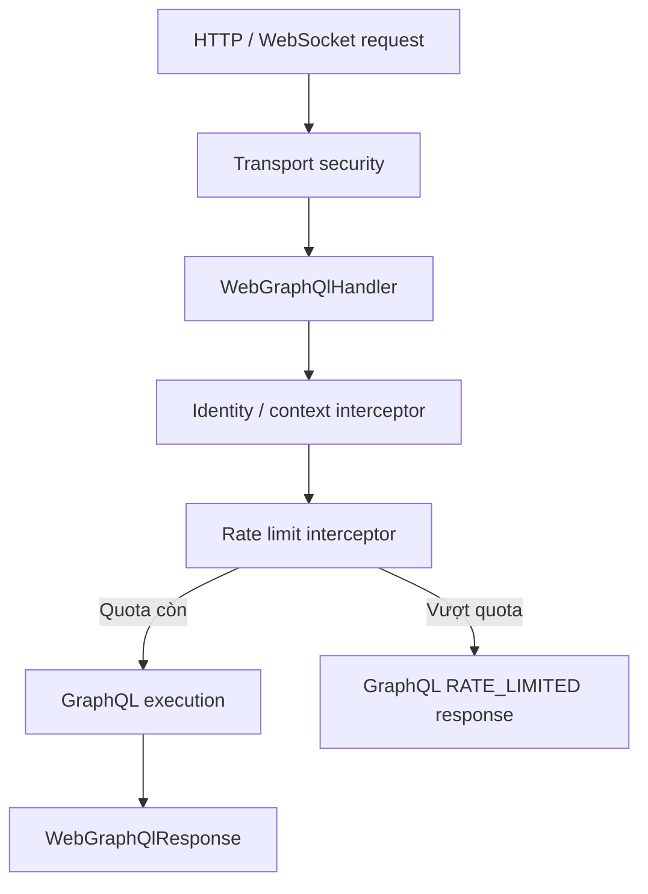

# Rate limit trong interceptor của Spring for GraphQL

Rate limiting giới hạn số request mà một client có thể gửi trong một khoảng thời gian. Với GraphQL, một HTTP request có thể yêu cầu nhiều field, alias hoặc quan hệ lồng nhau, nên giới hạn số request là lớp bảo vệ cần thiết nhưng chưa đủ để kiểm soát chi phí thực thi.

Spring for GraphQL cung cấp `WebGraphQlInterceptor` để kiểm tra request trước khi GraphQL engine chạy. Ta có thể dùng interceptor để xác định danh tính client, tiêu thụ quota, cho phép request đi tiếp hoặc trả về GraphQL error khi vượt giới hạn. Với hệ thống chạy nhiều instance, bộ đếm cần dùng kho chia sẻ như Redis hoặc một rate limiter phân tán; bộ đếm trong bộ nhớ của một JVM chỉ phù hợp với môi trường đơn instance hoặc giới hạn bổ sung tại từng node.

## 1. Rate limiting nằm ở đâu trong request flow?

HTTP và WebSocket transport của Spring for GraphQL chuyển GraphQL request qua `WebGraphQlHandler`. Handler gọi interceptor chain trước `ExecutionGraphQlService`, sau đó GraphQL Java mới parse, validate và thực thi operation.



Rate limiter đặt trong interceptor có thể sử dụng metadata của GraphQL request như operation name, document, request attributes và context đã được các interceptor trước đó chuẩn bị. Nó có thể từ chối trước khi resolver hoặc DataFetcher chạy, nhờ vậy giảm tải cho tầng nghiệp vụ và database.

Rate limiting cũng có thể được đặt ở API gateway, reverse proxy hoặc HTTP filter. Các lớp này phù hợp để giới hạn request thô theo IP, API key hoặc đường dẫn trước khi body GraphQL được parse. Interceptor phù hợp hơn khi chính sách cần biết danh tính GraphQL, loại operation hoặc metadata đã được xác thực. Nhiều hệ thống kết hợp cả hai lớp.

## 2. Xác định quota áp dụng cho ai

Rate limit cần một key ổn định để nhóm các request thuộc cùng client. Các lựa chọn thường gặp:

| Đối tượng | Key gợi ý | Khi phù hợp |
| --- | --- | --- |
| Người dùng đã đăng nhập | `user:{userId}` | API cá nhân hoặc ứng dụng có user identity rõ ràng. |
| API client | `client:{clientId}` | Tích hợp server-to-server bằng API key/OAuth client. |
| Tenant/organization | `tenant:{tenantId}` | Giới hạn tổng tài nguyên của một tenant. |
| Người dùng trong tenant | `tenant:{tenantId}:user:{userId}` | Cần quota riêng cho từng user nhưng vẫn phân vùng tenant. |
| Người dùng chưa đăng nhập | IP đã được xác định qua proxy tin cậy | Endpoint public hoặc đăng nhập. |

Không nên dùng một header tùy ý như `X-User-Id` làm identity nếu client có thể tự đặt header đó. Hãy lấy principal hoặc API client từ Spring Security, token đã xác minh hay thuộc tính do gateway tin cậy ghi vào request. Nếu dùng IP, cần cấu hình trusted proxy đúng cách; không tin trực tiếp `X-Forwarded-For` từ Internet.

Một `RateLimitKeyResolver` giúp tách việc xác định identity khỏi interceptor:

```java
import org.springframework.graphql.server.WebGraphQlRequest;
import reactor.core.publisher.Mono;

public interface RateLimitKeyResolver {
    Mono<String> resolveKey(WebGraphQlRequest request);
}
```

Implementation của interface này cần trả về key đã chuẩn hóa từ principal, API key hoặc địa chỉ client đáng tin cậy. Với anonymous request, có thể trả key theo IP. Nếu không xác định được identity và endpoint không cho phép anonymous, nên từ chối theo chính sách bảo mật thay vì dồn mọi request vào một key chung như `unknown`.

## 3. Chọn thuật toán rate limiting

Một số thuật toán thường dùng:

| Thuật toán | Cách hoạt động | Đặc điểm |
| --- | --- | --- |
| Fixed window | Đếm request trong từng cửa sổ thời gian cố định | Đơn giản, nhưng có thể cho phép burst lớn ở ranh giới hai cửa sổ. |
| Sliding window | Tính request trong cửa sổ trượt hoặc xấp xỉ cửa sổ trượt | Mượt hơn fixed window, cần lưu nhiều mốc thời gian hoặc bộ đếm phụ. |
| Token bucket | Token được nạp lại theo tốc độ; mỗi request tiêu thụ token | Cho phép burst có giới hạn và kiểm soát tốc độ trung bình. |
| Leaky bucket | Request được xử lý theo tốc độ đều hoặc đưa vào hàng đợi | Giúp làm phẳng tải, nhưng cần quản lý queue và độ trễ. |

Token bucket là lựa chọn phổ biến cho API. Ví dụ bucket có dung lượng 60 token và được nạp lại 60 token mỗi phút. Một client có thể gửi burst tối đa 60 request khi bucket đầy; sau đó token được nạp dần theo thời gian. Mỗi request được phép khi còn token.

Rate limit nên mô tả cả hai thông số: dung lượng bucket (burst capacity) và tốc độ refill. Chỉ ghi “60 request/phút” có thể chưa diễn tả rõ client có thể gửi 60 request cùng lúc hay phải phân bố đều.

## 4. Cài đặt token bucket bằng Bucket4j

Có thể dùng Bucket4j để tránh tự viết thuật toán token bucket. Thêm module Bucket4j phù hợp với phiên bản JDK và dependency management của dự án; ví dụ dưới đây sử dụng API Bucket4j 8.x. Dùng Caffeine để loại các bucket không còn được truy cập, tránh map giữ key vô hạn trong ứng dụng chạy lâu.

Ví dụ service giới hạn 60 request mỗi phút cho từng key:

```java
import java.time.Duration;

import com.github.benmanes.caffeine.cache.Cache;
import com.github.benmanes.caffeine.cache.Caffeine;
import io.github.bucket4j.Bucket;
import io.github.bucket4j.ConsumptionProbe;
import org.springframework.stereotype.Service;

@Service
public class GraphQlRateLimiter {

    private static final long CAPACITY = 60;
    private static final Duration REFILL_PERIOD = Duration.ofMinutes(1);

    private final Cache<String, Bucket> buckets = Caffeine.newBuilder()
            .maximumSize(100_000)
            .expireAfterAccess(Duration.ofHours(1))
            .build();

    public RateLimitDecision tryAcquire(String key) {
        Bucket bucket = buckets.get(key, ignored -> newBucket());
        ConsumptionProbe probe = bucket.tryConsumeAndReturnRemaining(1);

        Duration retryAfter = probe.isConsumed()
                ? Duration.ZERO
                : Duration.ofNanos(probe.getNanosToWaitForRefill());

        return new RateLimitDecision(
                probe.isConsumed(), probe.getRemainingTokens(), retryAfter);
    }

    private Bucket newBucket() {
        return Bucket.builder()
                .addLimit(limit -> limit.capacity(CAPACITY)
                        .refillGreedy(CAPACITY, REFILL_PERIOD))
                .build();
    }
}
```

Decision object:

```java
import java.time.Duration;

public record RateLimitDecision(
        boolean allowed,
        long remainingTokens,
        Duration retryAfter) {
}
```

`tryConsumeAndReturnRemaining(1)` vừa thử lấy một token vừa trả thông tin số token còn lại và thời gian cần chờ để có token tiếp theo. Bucket4j xử lý đồng bộ việc tiêu thụ token trong bucket, vì vậy nhiều request đồng thời cùng key không thể cùng tiêu thụ một token đã hết.

Caffeine giới hạn số bucket được giữ và loại bucket không hoạt động sau một giờ. Đây là ví dụ in-memory cho một JVM. Khi chạy nhiều instance, mỗi node sẽ có map bucket riêng và tổng quota thực tế có thể nhân lên theo số node. Không dùng cấu hình này làm quota dùng chung cho production cluster.

## 5. Viết `WebGraphQlInterceptor` để chặn request

Interceptor lấy rate-limit key, tiêu thụ token và chỉ gọi `chain.next(request)` khi request được phép:

```java
import java.util.Map;

import graphql.ExecutionResult;
import graphql.GraphQLError;
import graphql.GraphqlErrorBuilder;
import org.springframework.core.annotation.Order;
import org.springframework.graphql.server.WebGraphQlInterceptor;
import org.springframework.graphql.server.WebGraphQlRequest;
import org.springframework.graphql.server.WebGraphQlResponse;
import org.springframework.graphql.support.DefaultExecutionGraphQlResponse;
import org.springframework.http.HttpHeaders;
import org.springframework.stereotype.Component;
import reactor.core.publisher.Mono;

@Component
@Order(50)
public class GraphQlRateLimitInterceptor implements WebGraphQlInterceptor {

    private final RateLimitKeyResolver keyResolver;
    private final GraphQlRateLimiter rateLimiter;

    public GraphQlRateLimitInterceptor(
            RateLimitKeyResolver keyResolver,
            GraphQlRateLimiter rateLimiter) {
        this.keyResolver = keyResolver;
        this.rateLimiter = rateLimiter;
    }

    @Override
    public Mono<WebGraphQlResponse> intercept(
            WebGraphQlRequest request, Chain chain) {

        return keyResolver.resolveKey(request)
                .switchIfEmpty(Mono.error(
                        new IllegalStateException("Rate limit identity is unavailable")))
                .flatMap(key -> {
                    RateLimitDecision decision = rateLimiter.tryAcquire(key);

                    if (!decision.allowed()) {
                        return Mono.just(rejectedResponse(request, decision));
                    }

                    return chain.next(request)
                            .doOnNext(response -> {
                                response.getResponseHeaders().set(
                                        "X-RateLimit-Limit", "60");
                                response.getResponseHeaders().set(
                                        "X-RateLimit-Remaining",
                                        Long.toString(decision.remainingTokens()));
                            });
                });
    }

    private WebGraphQlResponse rejectedResponse(
            WebGraphQlRequest request, RateLimitDecision decision) {

        long retryAfterSeconds = Math.max(1,
                decision.retryAfter().getSeconds()
                        + (decision.retryAfter().getNano() > 0 ? 1 : 0));
        GraphQLError error = GraphqlErrorBuilder.newError()
                .message("Rate limit exceeded")
                .extensions(Map.of(
                        "code", "RATE_LIMITED",
                        "retryAfterSeconds", retryAfterSeconds))
                .build();

        ExecutionResult result = ExecutionResult.newExecutionResult()
                .data(null)
                .errors(java.util.List.of(error))
                .build();

        WebGraphQlResponse response = new WebGraphQlResponse(
                new DefaultExecutionGraphQlResponse(
                        request.toExecutionInput(), result));

        response.getResponseHeaders().set(
                HttpHeaders.RETRY_AFTER, Long.toString(retryAfterSeconds));
        response.getResponseHeaders().set("X-RateLimit-Limit", "60");
        response.getResponseHeaders().set("X-RateLimit-Remaining", "0");
        return response;
    }
}
```

Ví dụ sử dụng API `WebGraphQlResponse` và `DefaultExecutionGraphQlResponse` để tạo response GraphQL có `data: null` và một error với extension code `RATE_LIMITED`. `request.toExecutionInput()` giữ execution input đã được chuẩn bị bởi request và các interceptor chạy trước đó. Nếu dự án dùng phiên bản Spring for GraphQL khác, hãy đối chiếu constructor/API với phiên bản dependency đang dùng.

`@Order(50)` chỉ là ví dụ. Đặt rate-limit interceptor sau thành phần xác thực hoặc interceptor tạo identity context nếu `RateLimitKeyResolver` phụ thuộc vào metadata do các thành phần đó thêm vào. Đặt nó trước các interceptor tốn chi phí hoặc trước GraphQL execution để từ chối request sớm.

## 6. GraphQL error khác với HTTP 429

Đoạn code trên trả về một GraphQL response có error `RATE_LIMITED` và header `Retry-After`. Nó không tự đặt HTTP status thành `429 Too Many Requests`: `WebGraphQlResponse` cung cấp response headers và execution result, không phải API tổng quát để đổi HTTP status.

Ví dụ phần body mà client nhận được:

```json
{
  "data": null,
  "errors": [
    {
      "message": "Rate limit exceeded",
      "extensions": {
        "code": "RATE_LIMITED",
        "retryAfterSeconds": 12
      }
    }
  ]
}
```

Với HTTP, nếu hợp đồng API yêu cầu status `429`, hãy thực hiện giới hạn thô ở API gateway, Spring WebFlux `WebFilter` hoặc Servlet Filter trước khi request đi vào GraphQL handler. Một giải pháp khác là tùy biến transport handler theo cách phù hợp với ứng dụng. Không nên giả định chỉ thêm `Retry-After` header vào `WebGraphQlResponse` sẽ biến status thành 429.

Với WebSocket, mỗi GraphQL operation được gửi qua interceptor, nhưng header HTTP của `WebGraphQlResponse` không phải kênh trả header riêng cho từng message sau khi handshake đã hoàn tất. Hãy dùng GraphQL error extension như `code` và `retryAfterSeconds` để client biết operation bị giới hạn.

## 7. Phân biệt request quota và query cost

Một request GraphQL đơn giản và một request có hàng trăm field lồng nhau có chi phí rất khác nhau. Nếu mỗi request chỉ tiêu thụ một token, client vẫn có thể gửi một số ít query cực nặng và gây tải lớn.

Nên kết hợp rate limiting với các biện pháp khác:

- Query depth limit để giới hạn độ sâu quan hệ lồng nhau.
- Query complexity/cost analysis để ước tính số field hoặc lượng dữ liệu cần tải.
- Giới hạn page size cho các field list.
- Timeout cho request thực thi quá lâu.
- Giới hạn request body và số lượng alias/field theo chính sách.
- Authorization và giới hạn truy cập các field nhạy cảm.

Có thể tính token cost theo nhóm operation hoặc theo complexity đã được phân tích. Ví dụ query nhỏ tiêu thụ 1 token, query trung bình tiêu thụ 5 token, query nặng tiêu thụ 20 token. Việc phân loại cần dựa trên GraphQL document đã parse/validate hoặc cost estimator ở server; không dùng `operationName` do client gửi làm căn cứ duy nhất vì client có thể tự đặt tên.

## 8. Rate limit theo operation và theo plan

Các client có thể có quota khác nhau theo subscription plan hoặc loại API:

| Plan | Ví dụ quota | Chính sách |
| --- | --- | --- |
| Anonymous | 10 request/phút/IP | Bảo vệ endpoint public. |
| Standard | 60 token/phút/user | Phù hợp ứng dụng thông thường. |
| Premium | 300 token/phút/user | Cho phép tải cao hơn theo hợp đồng. |
| Internal service | Quota riêng theo client ID | Dành cho service-to-service đã xác thực. |

Các con số chỉ là ví dụ. Quota thực tế cần dựa trên năng lực hệ thống, SLA, chi phí operation và hợp đồng với client.

Có thể tạo key theo identity và policy:

```java
String bucketKey = identity.clientId() + ":" + policy.name();
```

Nếu cần quota riêng cho query, mutation hoặc subscription, hãy phân loại operation bằng parser/AST và policy phía server. Đừng tin trường `operationName` là một nhóm bảo mật; nó chỉ là nhãn client cung cấp. Với operation có nhiều alias hoặc field đắt, cần tính complexity thay vì chỉ đếm tên operation.

## 9. Dùng Redis hoặc gateway cho nhiều instance

Rate limiter trong bộ nhớ có các giới hạn:

- Mỗi JVM giữ bộ đếm riêng nên nhiều node không chia sẻ quota.
- Restart ứng dụng làm mất trạng thái bucket.
- Load balancer có thể phân request của cùng user sang các node khác nhau.
- Autoscaling làm thay đổi tổng quota nếu mỗi node có cùng giới hạn local.

Với production cluster, chọn một trong các cách:

1. Dùng Bucket4j với backend phân tán phù hợp, ví dụ Redis integration được hỗ trợ bởi phiên bản Bucket4j.
2. Dùng Redis script/transaction atomic để kiểm tra và cập nhật token/window trong một thao tác.
3. Đặt coarse-grained rate limit tại API gateway, sau đó dùng interceptor cho quota theo user, tenant hoặc operation.

Không triển khai Redis bằng chuỗi lệnh `GET` rồi `SET` tách rời mà không có atomicity; hai request đồng thời có thể cùng thấy quota còn và cùng được phép. Phải dùng thao tác nguyên tử, Lua script, transaction/locking phù hợp hoặc thư viện đã xử lý đồng thời.

Khi rate-limit store không khả dụng, cần quyết định fail-open hay fail-closed theo mức độ rủi ro. Với endpoint nhạy cảm hoặc có thể gây chi phí lớn, fail-closed hoặc fallback sang local emergency limit có thể phù hợp. Với một số API ít rủi ro, fail-open có thể giữ availability. Hãy ghi metrics và cảnh báo khi fallback xảy ra.

## 10. Subscription và WebSocket cần quota riêng

Một subscription thường chỉ gửi một request lúc bắt đầu nhưng có thể giữ kết nối và phát sự kiện trong thời gian dài. Vì vậy, request rate limit chỉ kiểm soát số lần mở operation, chưa kiểm soát số subscription đang hoạt động hoặc tốc độ event.

Nên cân nhắc thêm:

- Số subscription đồng thời tối đa trên mỗi user/client/tenant.
- Số kết nối WebSocket đồng thời.
- Giới hạn tần suất mở subscription mới.
- Giới hạn tốc độ event hoặc dung lượng dữ liệu phát ra.
- Hủy subscription khi principal hết hạn hoặc quyền bị thu hồi.
- Giới hạn thời gian sống của subscription nếu nghiệp vụ yêu cầu.

Spring for GraphQL có `WebSocketGraphQlInterceptor` với callback liên quan vòng đời kết nối và việc bắt đầu/kết thúc subscription. Có thể dùng extension point này cho quota cấp connection, còn `WebGraphQlInterceptor` tiếp tục kiểm soát từng GraphQL request/operation được gửi qua kết nối.

Không tiêu thụ một request token cho từng event do server phát ra nếu mục tiêu là giới hạn số operation mở; event throughput cần quota riêng ở publisher hoặc event service.

## 11. Thứ tự interceptor và tương tác với các lớp bảo vệ khác

Một thứ tự tham khảo:

| Thứ tự | Thành phần | Mục đích |
| --- | --- | --- |
| 1 | Spring Security / transport authentication | Xác thực HTTP hoặc WebSocket connection. |
| 2 | Identity/context interceptor | Đưa principal, tenant hoặc client ID đã xác minh vào context. |
| 3 | Rate-limit interceptor | Kiểm tra và tiêu thụ quota trước GraphQL execution. |
| 4 | Metrics/tracing interceptor | Đo thời gian thực thi và kết quả theo policy. |
| 5 | GraphQL execution | Parse, validate và gọi resolver. |

Thứ tự cụ thể phụ thuộc dữ liệu mỗi interceptor cần. Nếu metrics cần ghi cả request bị rate limit, đặt metrics bên ngoài rate limiter để nó quan sát cả response bị chặn. Nếu metrics chỉ đo thời gian GraphQL execution, đặt nó phía trong.

Rate limiting không thay thế authentication, authorization, CSRF protection cho cookie-based HTTP transport, query complexity limit hoặc database quota. Đây là một lớp kiểm soát lưu lượng trong nhiều lớp bảo vệ.

## 12. Kiểm thử rate limiter

Nên kiểm thử riêng thuật toán limiter và hành vi interceptor:

- Unit test token bucket: cho phép đủ số token ban đầu, từ chối khi hết token, cho phép lại sau refill.
- Concurrency test: nhiều thread cùng key không vượt quá số token có sẵn.
- Identity test: hai user hoặc tenant khác nhau có bucket riêng nếu policy yêu cầu.
- Interceptor test: request được phép gọi `chain.next`; request bị giới hạn không gọi GraphQL execution.
- Response test: error extension có code `RATE_LIMITED`, retry duration hợp lý và header được thêm cho HTTP.
- WebSocket test: client nhận GraphQL error cho operation bị giới hạn; quota connection/subscription hoạt động đúng.
- Distributed test: nhiều application instance cùng tiêu thụ một quota chia sẻ trong Redis/backend.

Ví dụ kiểm thử interceptor ở mức GraphQL response với `GraphQlTester` đã cấu hình qua `WebGraphQlHandler`:

```java
@Test
void requestOverLimitReturnsRateLimitedError() {
    graphQlTester.document("{ books { id } }")
            .execute()
            .errors()
            .satisfy(errors -> assertThat(errors)
                    .anyMatch(error -> "RATE_LIMITED".equals(
                            error.getExtensions().get("code"))));
}
```

Test giả định rate limiter đã được cấu hình để từ chối identity của test và `graphQlTester` gọi đúng handler có interceptor. Có thể thêm verify trên mock service để chắc rằng resolver không chạy khi bị từ chối.

## 13. Lỗi thường gặp

| Hiện tượng | Nguyên nhân | Cách xử lý |
| --- | --- | --- |
| Mỗi node có quota riêng | Dùng map in-memory trong cluster | Dùng Redis/distributed backend hoặc quota ở gateway. |
| User có thể giả mạo quota key | Tin header user ID do client gửi | Dùng principal/API client đã xác thực hoặc IP qua proxy tin cậy. |
| Request nặng vẫn lọt qua | Chỉ đếm số request, không tính query cost | Kết hợp depth, complexity, page size và timeout. |
| Request bị chặn nhưng client không biết khi nào retry | Không trả retry metadata | Trả `Retry-After` cho HTTP và `retryAfterSeconds` trong GraphQL extensions. |
| HTTP response không có status 429 | Chỉ thêm error vào `WebGraphQlResponse` | Dùng gateway/WebFilter/Servlet Filter nếu hợp đồng yêu cầu HTTP 429. |
| Subscription tạo tải dài hạn dù request quota thấp | Chỉ giới hạn lần mở operation | Giới hạn số subscription, connection và event throughput riêng. |
| Map bucket tăng vô hạn | Không hết hạn key không hoạt động | Dùng cache có eviction hoặc distributed store có TTL. |
| Hai request đồng thời cùng vượt quota | Bộ đếm cập nhật không atomic | Dùng bucket thread-safe hoặc cập nhật atomic trong Redis. |

## 14. Checklist triển khai

1. Xác định quota theo user, API client, tenant hoặc IP đáng tin cậy.
2. Lấy identity từ authentication/gateway đã xác minh, không tin header tùy ý.
3. Chọn thuật toán và định nghĩa rõ burst capacity cùng refill rate.
4. Dùng `WebGraphQlInterceptor` để chặn trước khi GraphQL execution chạy.
5. Trả GraphQL error có mã ổn định và thông tin retry.
6. Nếu cần HTTP 429, thực hiện ở gateway hoặc transport filter phù hợp.
7. Dùng Redis/distributed backend khi cần quota chung giữa nhiều instance.
8. Kết hợp query complexity, depth, pagination và timeout.
9. Giới hạn active subscription và event throughput riêng cho WebSocket.
10. Kiểm thử concurrency, nhiều identity, response error và distributed quota.
11. Theo dõi số request bị chặn, quota store latency và tình trạng fallback.
12. Quyết định rõ hành vi fail-open/fail-closed khi rate-limit store lỗi.

`WebGraphQlInterceptor` là vị trí phù hợp để áp dụng quota hiểu ngữ cảnh GraphQL trước khi resolver chạy. Token bucket giúp cân bằng tốc độ trung bình và burst; identity key bảo đảm quota áp dụng đúng client; response error giúp GraphQL client nhận biết request bị giới hạn. Với production nhiều instance, cần bộ đếm phân tán và kết hợp rate limit với query cost, timeout, pagination cùng quota riêng cho subscription.

Tài liệu tham khảo: [Spring for GraphQL — Server Transports and Interception](https://docs.spring.io/spring-graphql/reference/transports.html#server-interception), [Spring for GraphQL — Request Execution and Timeout](https://docs.spring.io/spring-graphql/reference/request-execution.html), và [Bucket4j documentation](https://bucket4j.com/).
