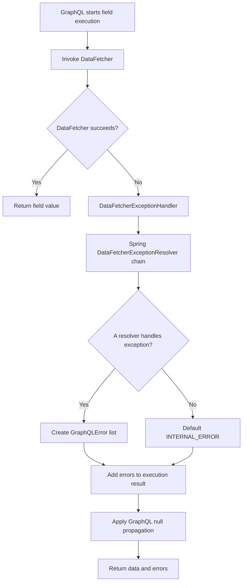

# DataFetchingException

Trong quá trình thực thi GraphQL, mỗi field được phân giải bởi một DataFetcher. DataFetcher có thể đọc dữ liệu từ database, gọi service khác, kiểm tra quyền hoặc thực hiện nghiệp vụ. Những thao tác đó có thể thất bại và ném exception. Spring for GraphQL cung cấp cơ chế **data fetching exception resolution** để chuyển exception thành GraphQL error có cấu trúc, giúp client hiểu lỗi ở field nào và ứng dụng kiểm soát thông tin được trả ra.

Trung tâm của cơ chế này là `DataFetcherExceptionResolver`. Resolver nhận exception cùng `DataFetchingEnvironment` của field gây lỗi, rồi quyết định chuyển exception thành một hay nhiều `GraphQLError`. Spring for GraphQL có `DataFetcherExceptionResolverAdapter` để đơn giản hóa triển khai đồng bộ, hỗ trợ nhiều resolver theo thứ tự và cung cấp các nhóm lỗi chuẩn qua `ErrorType`.

Bài học này trình bày vòng đời exception trong data fetching, cách viết resolver, tạo error gắn đúng field path, phân loại lỗi, xử lý nhiều resolver, cách Spring Boot đăng ký resolver, và ranh giới giữa data fetching errors với request errors hoặc Subscription errors.

## 1. Data fetching exception là gì?

Một GraphQL operation có thể yêu cầu nhiều field:

```graphql
query {
  bookById(id: "book-1") {
    id
    title
    author {
      id
      name
    }
    reviews {
      rating
    }
  }
}
```

GraphQL gọi DataFetcher cho các field cần được phân giải. Ví dụ:

- `Query.bookById` gọi BookService.
- `Book.author` gọi AuthorService.
- `Book.reviews` gọi ReviewService.

Một DataFetcher có thể gặp nhiều lỗi:

| Nguồn | Exception ví dụ |
| --- | --- |
| Không tìm thấy resource | `BookNotFoundException` |
| Không đủ quyền | `AccessDeniedException` |
| Dữ liệu đầu vào không hợp lệ ở tầng nghiệp vụ | `InvalidBookFilterException` |
| Database hoặc dịch vụ phụ thuộc lỗi | `DataAccessException`, client exception |
| Lỗi lập trình không dự kiến | `NullPointerException`, `IllegalStateException` |

Nếu exception thoát khỏi DataFetcher, GraphQL Java gọi `DataFetcherExceptionHandler` để chuyển nó thành một `GraphQLError` trong response. Spring for GraphQL đăng ký handler mặc định và cung cấp contract `DataFetcherExceptionResolver` để ứng dụng tùy biến cách ánh xạ.

Trong bài này, cụm từ *data fetching exception* chỉ exception phát sinh khi GraphQL đang thực thi một DataFetcher. Nó không phải tên của một exception class duy nhất.

## 2. Vòng đời xử lý exception

Luồng xử lý cơ bản:



Các bước:

1. GraphQL gọi DataFetcher cho field đang được yêu cầu.
2. DataFetcher trả giá trị hoặc phát sinh exception.
3. GraphQL Java chuyển exception tới DataFetcher exception handler.
4. Spring handler lần lượt gọi các `DataFetcherExceptionResolver` đã đăng ký.
5. Resolver phù hợp tạo danh sách GraphQL errors.
6. Nếu không resolver nào xử lý, Spring dùng lỗi mặc định `INTERNAL_ERROR`.
7. GraphQL áp dụng nullability của schema và tạo response.

Exception resolver không tự quyết định toàn bộ response. Nó chỉ cung cấp error object cho field bị lỗi. GraphQL engine vẫn chịu trách nhiệm xác định `data`, `errors`, `path` và null propagation.

## 3. GraphQLError trong response

Một response có thể chứa dữ liệu của các field thành công và error của field thất bại:

```json
{
  "data": {
    "bookById": {
      "id": "book-1",
      "title": "Spring for GraphQL",
      "author": null
    }
  },
  "errors": [
    {
      "message": "Author not found",
      "path": ["bookById", "author"],
      "extensions": {
        "classification": "NOT_FOUND",
        "code": "AUTHOR_NOT_FOUND"
      }
    }
  ]
}
```

Các thuộc tính thường gặp của `GraphQLError`:

- `message`: thông điệp dành cho client.
- `locations`: vị trí field trong GraphQL document, nếu xác định được.
- `path`: đường dẫn tới field gây lỗi, bao gồm alias hoặc index của list nếu có.
- `extensions`: metadata bổ sung như error code, classification hoặc correlation information.

Với data fetching error, path rất hữu ích vì client biết field nào thất bại trong một response có thể chứa nhiều field. Hãy tạo error bằng `GraphqlErrorBuilder.newError(environment)` để builder lấy coordinates và path từ đúng `DataFetchingEnvironment`.

Không nên tự tạo path bằng chuỗi hard-code như `["bookById", "author"]`. Query có thể đổi alias, lồng field sâu hơn hoặc gọi field trong list. Environment đã chứa thông tin thực thi chính xác.

## 4. DataFetcherExceptionResolver

`DataFetcherExceptionResolver` là contract của Spring for GraphQL để xử lý exception từ DataFetcher. Interface nằm trong package:

```java
org.springframework.graphql.execution.DataFetcherExceptionResolver
```

Method chính có dạng:

```java
Mono<List<GraphQLError>> resolveException(
        Throwable exception,
        DataFetchingEnvironment environment);
```

Các tham số:

- `exception`: exception do DataFetcher phát sinh.
- `environment`: context thực thi của field, gồm source, arguments, field definition, path và GraphQL context.

Resolver trả về một `Mono<List<GraphQLError>>`. Cách hoàn tất Mono có ý nghĩa quan trọng:

| Kết quả | Ý nghĩa |
| --- | --- |
| Emit một danh sách có errors | Đã xử lý exception và thêm các errors đó vào response |
| Emit danh sách rỗng | Đã xử lý exception nhưng chủ động không thêm GraphQL error |
| Complete empty, không emit list | Chưa xử lý; cho phép resolver tiếp theo thử |
| Emit error signal | Bản thân resolver thất bại; không nên dùng đây làm cách báo lỗi nghiệp vụ |

Phân biệt danh sách rỗng với Mono empty:

- `Mono.just(List.of())` có nghĩa exception đã được resolver nhận xử lý, không thêm lỗi vào response.
- `Mono.empty()` có nghĩa resolver không nhận xử lý exception; Spring tiếp tục chuỗi resolver.

Nếu resolver không nhận biết exception, hãy để nó unresolved. Không trả một danh sách rỗng chỉ để bỏ qua lỗi, vì client sẽ không thấy error và field có thể chỉ còn null theo cách khó chẩn đoán.

## 5. DataFetcherExceptionResolverAdapter

Trong nhiều trường hợp, logic ánh xạ exception là đồng bộ. `DataFetcherExceptionResolverAdapter` là lớp tiện ích triển khai contract bất đồng bộ và cho phép override các method đồng bộ:

- `resolveToSingleError(Throwable, DataFetchingEnvironment)`: ánh xạ một exception thành một GraphQL error.
- `resolveToMultipleErrors(Throwable, DataFetchingEnvironment)`: ánh xạ một exception thành nhiều GraphQL errors.

Class thuộc package:

```java
org.springframework.graphql.execution.DataFetcherExceptionResolverAdapter
```

Ví dụ domain exception:

```java
public class BookNotFoundException extends RuntimeException {

    public BookNotFoundException(String id) {
        super("Book not found: " + id);
    }
}
```

Resolver:

```java
@Component
public class BookExceptionResolver extends DataFetcherExceptionResolverAdapter {

    @Override
    protected GraphQLError resolveToSingleError(
            Throwable exception,
            DataFetchingEnvironment environment) {

        if (exception instanceof BookNotFoundException) {
            return GraphqlErrorBuilder.newError(environment)
                    .errorType(ErrorType.NOT_FOUND)
                    .message("Book not found")
                    .build();
        }

        return null;
    }
}
```

Trong ví dụ:

- Nếu exception là `BookNotFoundException`, resolver trả GraphQL error có classification `NOT_FOUND`.
- `GraphqlErrorBuilder.newError(environment)` gắn error với field đang thực thi.
- `message("Book not found")` không tiết lộ ID hay chi tiết nội bộ.
- Trả `null` có nghĩa resolver không nhận xử lý exception này.

Không cần override `resolveException` trong trường hợp thông thường. Adapter đã chuyển kết quả từ các method protected sang contract Mono<List<GraphQLError>>.

## 6. Phân loại lỗi bằng ErrorType

Spring for GraphQL cung cấp `ErrorType` để phân loại các lỗi phổ biến phát sinh trong DataFetcher:

| ErrorType | Ý nghĩa | Ví dụ |
| --- | --- | --- |
| `BAD_REQUEST` | DataFetcher không thể hoặc không chấp nhận dữ liệu do lỗi phía client | Bộ lọc nghiệp vụ không hợp lệ |
| `UNAUTHORIZED` | Thiếu thông tin xác thực hợp lệ | Token không hợp lệ hoặc chưa đăng nhập |
| `FORBIDDEN` | Người dùng đã xác thực nhưng không được phép truy cập | Không có quyền xem sách thuộc tenant khác |
| `NOT_FOUND` | Không tìm thấy dữ liệu hoặc không muốn tiết lộ dữ liệu có tồn tại | Không tìm thấy Book |
| `INTERNAL_ERROR` | Lỗi nội bộ không dự kiến | Database hoặc code gặp lỗi ngoài dự kiến |

`ErrorType` implement GraphQL `ErrorClassification`. Client có thể đọc classification trong `extensions` và quyết định cách hiển thị hoặc xử lý. Hãy xem classification là một phần của hợp đồng API, vì vậy chọn nhóm lỗi ổn định và nhất quán.

Không dùng `INTERNAL_ERROR` cho mọi lỗi. Nếu lỗi nghiệp vụ đã biết như không tìm thấy resource, hãy trả `NOT_FOUND`. Ngược lại, không gán `BAD_REQUEST` cho lỗi database hoặc lỗi lập trình.

## 7. Thêm error code và metadata

`ErrorType` phân loại ở mức tổng quát. Ứng dụng có thể bổ sung error code riêng để client phân biệt các trường hợp trong cùng một category:

```java
if (exception instanceof BookNotFoundException) {
    return GraphqlErrorBuilder.newError(environment)
            .errorType(ErrorType.NOT_FOUND)
            .message("Book not found")
            .extensions(Map.of(
                    "code", "BOOK_NOT_FOUND",
                    "resource", "Book"))
            .build();
}
```

Ví dụ response:

```json
{
  "errors": [
    {
      "message": "Book not found",
      "path": ["bookById"],
      "extensions": {
        "classification": "NOT_FOUND",
        "code": "BOOK_NOT_FOUND",
        "resource": "Book"
      }
    }
  ]
}
```

Thiết kế error code theo quy ước rõ ràng:

- Dùng code ổn định, không phụ thuộc tên class Java.
- Không nhúng message động vào code.
- Chỉ đưa metadata mà client thực sự cần.
- Không đưa SQL, stack trace, nội dung exception gốc hoặc thông tin hạ tầng vào extensions.
- Không đưa dữ liệu cá nhân hoặc bí mật vào message.

Client nên dựa vào code/category để xử lý máy đọc được; message chủ yếu dành cho người dùng hoặc log phía client.

## 8. Xử lý nhiều loại exception trong một resolver

Một resolver có thể ánh xạ nhiều exception domain:

```java
@Component
public class DomainExceptionResolver extends DataFetcherExceptionResolverAdapter {

    @Override
    protected GraphQLError resolveToSingleError(
            Throwable exception,
            DataFetchingEnvironment environment) {

        if (exception instanceof BookNotFoundException) {
            return GraphqlErrorBuilder.newError(environment)
                    .errorType(ErrorType.NOT_FOUND)
                    .message("Book not found")
                    .extensions(Map.of("code", "BOOK_NOT_FOUND"))
                    .build();
        }

        if (exception instanceof InvalidBookFilterException) {
            return GraphqlErrorBuilder.newError(environment)
                    .errorType(ErrorType.BAD_REQUEST)
                    .message("Book filter is invalid")
                    .extensions(Map.of("code", "INVALID_BOOK_FILTER"))
                    .build();
        }

        if (exception instanceof AccessDeniedException) {
            return GraphqlErrorBuilder.newError(environment)
                    .errorType(ErrorType.FORBIDDEN)
                    .message("You are not allowed to access this book")
                    .extensions(Map.of("code", "BOOK_ACCESS_DENIED"))
                    .build();
        }

        return null;
    }
}
```

Đoạn code chỉ ánh xạ các exception đã biết. Với exception khác, trả null để resolver tiếp theo hoặc default handler xử lý. Không ánh xạ mọi Throwable thành một lỗi nghiệp vụ chung vì điều đó che giấu lỗi lập trình.

Trong ứng dụng thực tế, có thể tách resolver theo bounded context hoặc nhóm exception để dễ bảo trì. Tránh tạo một resolver khổng lồ chứa toàn bộ lỗi của mọi module.

## 9. Ánh xạ một exception thành nhiều GraphQL errors

Một exception có thể đại diện cho nhiều vi phạm dữ liệu. Ví dụ một bước kiểm tra nghiệp vụ phát hiện nhiều lỗi validation cùng lúc. Khi đó có thể override `resolveToMultipleErrors`:

```java
@Component
public class BookValidationExceptionResolver extends DataFetcherExceptionResolverAdapter {

    @Override
    protected List<GraphQLError> resolveToMultipleErrors(
            Throwable exception,
            DataFetchingEnvironment environment) {

        if (!(exception instanceof BookValidationException validationException)) {
            return null;
        }

        return validationException.violations().stream()
                .map(violation -> GraphqlErrorBuilder.newError(environment)
                        .errorType(ErrorType.BAD_REQUEST)
                        .message(violation.message())
                        .extensions(Map.of(
                                "code", "BOOK_VALIDATION_FAILED",
                                "field", violation.field()))
                        .build())
                .toList();
    }
}
```

Tất cả errors được tạo trong cùng DataFetcher environment nên cùng gắn với field đang thực thi. Nếu muốn chỉ ra vị trí input cụ thể, đưa tên input field vào extensions như ví dụ. Không nhầm GraphQL response path với đường dẫn tới thuộc tính bên trong input object: path chỉ đường dẫn tới field GraphQL đang thực thi.

## 10. Resolver chain và thứ tự xử lý

Spring for GraphQL cho phép đăng ký nhiều `DataFetcherExceptionResolver`. Chúng được gọi lần lượt cho đến khi một resolver phát ra danh sách GraphQL errors, kể cả danh sách rỗng.

Ví dụ:

```text
DataFetcher exception
        |
        v
BookNotFoundResolver
        |
        | unresolved
        v
SecurityExceptionResolver
        |
        | unresolved
        v
DatabaseExceptionResolver
        |
        | unresolved
        v
Default INTERNAL_ERROR
```

Một resolver nên xử lý đúng nhóm exception mà nó hiểu:

- Nếu nhận biết exception và muốn trả error: emit list có error.
- Nếu nhận biết exception nhưng chủ động không trả error: emit list rỗng, chỉ dùng khi hành vi đó có chủ đích.
- Nếu không nhận biết exception: trả unresolved để resolver tiếp theo thử.

Thứ tự resolver quan trọng khi nhiều resolver có thể xử lý cùng một exception. Đặt resolver chuyên biệt trước resolver tổng quát. Nếu cần kiểm soát thứ tự tuyệt đối, hãy cấu hình danh sách rõ ràng trên GraphQlSource builder.

## 11. Resolver bất đồng bộ

`DataFetcherExceptionResolver` là contract reactive. Khi cần gọi dịch vụ khác để quyết định cách ánh xạ lỗi, có thể implement trực tiếp và trả `Mono<List<GraphQLError>>`:

```java
@Component
public class AsyncExceptionResolver implements DataFetcherExceptionResolver {

    private final ErrorCatalog errorCatalog;

    public AsyncExceptionResolver(ErrorCatalog errorCatalog) {
        this.errorCatalog = errorCatalog;
    }

    @Override
    public Mono<List<GraphQLError>> resolveException(
            Throwable exception,
            DataFetchingEnvironment environment) {

        if (!(exception instanceof ExternalServiceException serviceException)) {
            return Mono.empty();
        }

        return errorCatalog.findPublicMessage(serviceException.code())
                .map(message -> List.of(
                        GraphqlErrorBuilder.newError(environment)
                                .errorType(ErrorType.INTERNAL_ERROR)
                                .message(message)
                                .extensions(Map.of("code", "DEPENDENCY_FAILURE"))
                                .build()));
    }
}
```

Nếu exception không thuộc phạm vi resolver, trả `Mono.empty()` để resolver tiếp theo xử lý. Nếu lookup thành công và trả error list, exception được coi là đã xử lý.

Nếu lookup bất đồng bộ có thể complete empty, cần quyết định rõ hành vi. Có thể dùng `switchIfEmpty` để tạo error fallback hoặc trả một danh sách rỗng nếu chính sách cho phép bỏ qua lỗi. Không để resolver hoàn tất empty ngoài ý muốn vì khi đó exception được xem là chưa xử lý.

Không dùng `block()` bên trong resolver reactive. Việc chặn thread làm mất lợi ích của reactive execution và có thể gây deadlock hoặc cạn thread trong WebFlux.

## 12. Đăng ký resolver trong Spring Boot

Với Spring Boot GraphQL starter, các bean kiểu `DataFetcherExceptionResolver` được tự động phát hiện và đăng ký với `GraphQlSource`. Vì vậy, thông thường chỉ cần khai báo resolver là Spring bean:

```java
@Component
public class BookExceptionResolver extends DataFetcherExceptionResolverAdapter {
    // Override resolveToSingleError hoặc resolveToMultipleErrors.
}
```

Nếu ứng dụng tự xây dựng `GraphQlSource` hoặc không dùng Boot auto-configuration, có thể đăng ký resolver trên builder:

```java
GraphQlSource.Builder<?> builder = GraphQlSource.schemaResourceBuilder()
        .schemaResources(schemaResources)
        .exceptionResolvers(List.of(
                bookExceptionResolver,
                securityExceptionResolver));

GraphQlSource graphQlSource = builder.build();
```

Method `exceptionResolvers(List<DataFetcherExceptionResolver>)` thêm các resolver được gọi khi DataFetcher ném exception. Thứ tự trong danh sách là thứ tự thử xử lý.

Không tự đăng ký một `DataFetcherExceptionHandler` thứ hai chỉ để thay đổi một loại lỗi. GraphQL Java chỉ nhận một exception handler cho execution strategy; Spring đã cung cấp handler tích hợp với resolver chain. Hãy mở rộng qua `DataFetcherExceptionResolver` để giữ cơ chế mặc định.

## 13. Khi nào dùng @GraphQlExceptionHandler?

Spring for GraphQL có hai cách xử lý exception thường gặp:

| Cơ chế | Phạm vi phù hợp |
| --- | --- |
| `@GraphQlExceptionHandler` | Exception phát sinh từ annotated controller method |
| `DataFetcherExceptionResolver` | Exception từ DataFetcher nói chung, bao gồm DataFetcher đăng ký thủ công |

Ví dụ exception handler cho annotated controller:

```java
@ControllerAdvice
public class BookControllerAdvice {

    @GraphQlExceptionHandler
    public GraphQLError handle(
            BookNotFoundException exception,
            DataFetchingEnvironment environment) {

        return GraphqlErrorBuilder.newError(environment)
                .errorType(ErrorType.NOT_FOUND)
                .message("Book not found")
                .build();
    }
}
```

Spring áp dụng exception handler method cho controller invocation. Nếu ứng dụng chủ yếu dùng annotated controllers, cách này thường gọn và có method arguments linh hoạt giống schema mapping.

`DataFetcherExceptionResolver` phù hợp khi cần một chính sách chung cho DataFetcher không dựa trên controller method, hoặc muốn cấu hình resolver chain ở tầng GraphQlSource. Chọn một nơi sở hữu rõ ràng cho mỗi nhóm exception để tránh ánh xạ trùng lặp hoặc khó dự đoán.

## 14. Request errors không phải data fetching errors

`DataFetcherExceptionResolver` chỉ được gọi khi một DataFetcher đã được thực thi và ném exception. Nó không xử lý lỗi xảy ra trước khi GraphQL bắt đầu chạy field.

| Giai đoạn | Ví dụ | Cơ chế phù hợp |
| --- | --- | --- |
| Parse request | Cú pháp GraphQL sai | GraphQL engine / transport interceptor |
| Validate document | Field không tồn tại hoặc sai kiểu | GraphQL engine / transport interceptor |
| Input coercion | Variable không đúng scalar hoặc thiếu non-null input | GraphQL engine |
| Data fetching | Resolver ném exception | `DataFetcherExceptionResolver` hoặc `@GraphQlExceptionHandler` |
| Subscription publisher | Publisher phát error sau khi subscribe | `SubscriptionExceptionResolver` |

Request errors thường có `data: null` và error không có field path vì chưa có DataFetcher field nào chạy. Nếu muốn đổi format request-level errors, có thể dùng `WebGraphQlInterceptor` để kiểm tra hoặc biến đổi `ExecutionResult`.

Với Subscription, DataFetcher ban đầu chỉ tạo Publisher. Sau đó transport subscribe và Publisher có thể phát error signal. `DataFetcherExceptionResolver` không xử lý được lỗi phát sinh sau thời điểm DataFetcher đã trả Publisher; dùng `SubscriptionExceptionResolver` cho trường hợp đó.

## 15. Default handling khi không resolver nào nhận exception

Nếu toàn bộ resolver trả unresolved, Spring for GraphQL phân loại exception là `INTERNAL_ERROR` và trả một message tổng quát có execution ID từ `DataFetchingEnvironment`.

Thông điệp mặc định được giữ opaque để tránh tiết lộ chi tiết implementation cho client. Exception chưa được xử lý được log ở mức ERROR cùng execution ID để server có thể tìm log tương ứng. Exception đã được resolver xử lý được log ở mức DEBUG.

Ví dụ client có thể nhận:

```json
{
  "data": {
    "bookById": null
  },
  "errors": [
    {
      "message": "INTERNAL_ERROR for <execution-id>",
      "path": ["bookById"],
      "extensions": {
        "classification": "INTERNAL_ERROR"
      }
    }
  ]
}
```

Message thực tế do phiên bản Spring for GraphQL tạo ra; ví dụ trên chỉ minh họa tính chất tổng quát. Khi điều tra lỗi, dùng execution ID trong response để đối chiếu log server. Không cần gửi stack trace cho client để họ báo lỗi.

Nếu một exception có thể xử lý an toàn và có ý nghĩa nghiệp vụ, hãy thêm resolver cụ thể. Nếu không biết cách phân loại, để default handler trả INTERNAL_ERROR và giữ chi tiết ở log phía server.

## 16. Null propagation và partial response

Khi DataFetcher ném exception, field không có giá trị thành công và GraphQL xử lý field đó như null cùng một error. Kết quả cuối phụ thuộc nullability trong SDL.

Field nullable:

```graphql
type Book {
  author: Author
  title: String!
}
```

Nếu resolver `author` lỗi, GraphQL có thể trả `author: null` và vẫn giữ `title`.

Field non-null:

```graphql
type Book {
  author: Author!
  title: String!
}
```

Nếu resolver `author` lỗi, null vi phạm non-null contract. GraphQL truyền null lên parent gần nhất có thể nhận null, và có thể làm mất nhiều phần của response hơn.

`DataFetcherExceptionResolver` không tự chọn một fallback object thay cho field. Nếu muốn trả dữ liệu dự phòng và không phát GraphQL error, hãy xử lý exception trong service hoặc DataFetcher rồi trả giá trị fallback một cách có chủ đích. Không dùng danh sách error rỗng trong resolver như một cách trả fallback data; field vẫn không có kết quả.

## 17. Bảo mật khi tạo GraphQL errors

Exception gốc có thể chứa dữ liệu không nên công khai:

- SQL statement hoặc tên bảng.
- URL nội bộ và thông tin kết nối dịch vụ.
- Token, credential hoặc header.
- Đường dẫn file trên server.
- Stack trace và tên class nội bộ.
- Dữ liệu cá nhân hoặc thông tin thuộc tenant khác.

Khi tạo GraphQL error:

- Viết message ngắn, ổn định và phù hợp với client.
- Dùng error code để client xử lý logic.
- Chỉ thêm metadata thật sự cần thiết vào extensions.
- Ghi exception chi tiết ở server log, có kiểm soát quyền truy cập.
- Không phản chiếu trực tiếp `exception.getMessage()` nếu message có thể chứa chi tiết nội bộ.
- Với lỗi authorization, cân nhắc trả NOT_FOUND nếu chính sách yêu cầu không tiết lộ resource có tồn tại hay không.

Không nên để client phân biệt resource tồn tại nhưng bị cấm truy cập nếu điều đó làm lộ thông tin nhạy cảm. Error classification là quyết định của API security policy, không chỉ là phép đổi tên exception.

## 18. Kiểm thử DataFetcherExceptionResolver

Nên kiểm thử qua một GraphQL operation để xác nhận exception từ resolver được chuyển thành error có đúng path và classification.

Ví dụ resolver:

```java
@QueryMapping
public Book bookById(@Argument String id) {
    return bookService.findById(id);
}
```

Test:

```java
@GraphQlTest(BookQueryController.class)
@Import(BookExceptionResolver.class)
class BookDataFetchingExceptionTests {

    @Autowired
    GraphQlTester graphQlTester;

    @MockBean
    BookService bookService;

    @Test
    void mapsBookNotFoundToNotFoundGraphQlError() {
        given(bookService.findById("missing"))
                .willThrow(new BookNotFoundException("missing"));

        graphQlTester.document("""
                query {
                    bookById(id: "missing") {
                        id
                        title
                    }
                }
                """)
                .execute()
                .errors()
                .satisfy(errors -> {
                    assertThat(errors).hasSize(1);
                    assertThat(errors.get(0).getPath())
                            .isEqualTo("bookById");
                    assertThat(errors.get(0).getExtensions())
                            .containsEntry("classification", "NOT_FOUND");
                });
    }
}
```

Ví dụ import rõ `BookExceptionResolver` vào test slice để bảo đảm resolver được đăng ký trong GraphQL source của test. Tùy phiên bản Spring Boot, có thể dùng `@MockitoBean` thay cho `@MockBean`.

Kiểm thử cũng nên xác nhận dữ liệu của field độc lập vẫn có thể được trả về khi một field khác lỗi, nếu schema cho phép partial response.

### Các trường hợp cần kiểm thử

- Exception domain được ánh xạ thành đúng `ErrorType` và code.
- Exception không thuộc resolver được để unresolved.
- Resolver chain chuyển sang resolver kế tiếp khi nhận `Mono.empty()`.
- Resolver emit danh sách rỗng được hiểu là đã xử lý.
- Error path đúng khi field có alias hoặc nằm trong list.
- Field nullable và non-null áp dụng null propagation đúng.
- Message và extensions không chứa stack trace, SQL hoặc thông tin bí mật.
- Async DataFetcher thất bại được ánh xạ đúng.
- Request parse/validation error không đi qua DataFetcherExceptionResolver.
- Subscription publisher error được xử lý bằng cơ chế subscription riêng.

## 19. Lỗi thường gặp

| Biểu hiện | Nguyên nhân | Cách xử lý |
| --- | --- | --- |
| Resolver không được gọi | Bean không được phát hiện hoặc chưa đăng ký vào GraphQlSource | Kiểm tra component scan, Boot starter hoặc builder |
| Exception vẫn thành INTERNAL_ERROR | Resolver trả unresolved hoặc không nhận đúng exception type | Kiểm tra exception thực tế và mapping |
| Resolver tiếp theo không được gọi | Resolver trước emit danh sách rỗng | Chỉ emit list rỗng khi chủ đích đã xử lý exception |
| Error path sai | Tự hard-code path | Dùng `GraphqlErrorBuilder.newError(environment)` |
| Client thấy SQL hoặc stack trace | Trả trực tiếp exception message | Tạo message công khai và log chi tiết phía server |
| Mất toàn bộ object cha | Field lỗi được khai báo non-null | Xem lại schema nullability |
| Resolver không xử lý lỗi parse | Lỗi xảy ra trước DataFetcher | Dùng request/transport interceptor nếu cần |
| Resolver không xử lý Subscription stream error | Publisher phát lỗi sau khi DataFetcher trả về | Dùng `SubscriptionExceptionResolver` |
| Field null nhưng không có error | Resolver emit danh sách rỗng hoặc code đã nuốt exception | Xác minh chính sách xử lý và chỉ bỏ error có chủ đích |
| Lỗi không có error code ổn định | Chỉ dựa vào message hoặc exception class | Chuẩn hóa code trong extensions |

## 20. Nguyên tắc thiết kế DataFetchingException

- Xem data fetching exception là exception phát sinh trong lúc DataFetcher thực thi, không phải một exception class cụ thể.
- Dùng `DataFetcherExceptionResolver` để ánh xạ exception ở tầng DataFetcher.
- Dùng `DataFetcherExceptionResolverAdapter` khi logic ánh xạ đồng bộ.
- Trả unresolved khi resolver không nhận biết exception.
- Phân biệt `Mono.empty()` với `Mono.just(List.of())`.
- Dùng `GraphqlErrorBuilder.newError(environment)` để giữ đúng field coordinates và path.
- Chọn `ErrorType` phản ánh đúng bản chất lỗi.
- Thêm error code ổn định vào extensions khi client cần xử lý tự động.
- Không trả exception message, SQL hoặc stack trace trực tiếp cho client.
- Đặt resolver chuyên biệt trước resolver tổng quát.
- Dùng `@GraphQlExceptionHandler` cho annotated controller invocation khi phù hợp.
- Dùng `WebGraphQlInterceptor` cho request-level errors và `SubscriptionExceptionResolver` cho Subscription publisher errors.
- Thiết kế nullability để lỗi một field không làm mất dữ liệu nhiều hơn mức cần thiết.
- Kiểm thử error path, classification, resolver chain, partial response và bảo mật.

## 21. Bài tập thực hành

Xây dựng GraphQL API cho thư viện với các lỗi domain:

1. Khai báo Query.bookById và Book.author trong SDL.
2. Tạo `BookNotFoundException`, `BookAccessDeniedException` và `InvalidBookFilterException`.
3. Viết `DataFetcherExceptionResolverAdapter` ánh xạ các exception thành `NOT_FOUND`, `FORBIDDEN` và `BAD_REQUEST`.
4. Tạo error code riêng trong extensions cho từng trường hợp.
5. Dùng `GraphqlErrorBuilder.newError(environment)` để giữ đúng field path.
6. Thêm một resolver khác chỉ xử lý exception của dịch vụ tìm kiếm; kiểm tra thứ tự resolver chain.
7. Thử trả `null` từ resolver và phân biệt với việc ném exception.
8. Đổi field từ nullable sang non-null rồi quan sát null propagation.
9. Viết GraphQlTester kiểm tra error path, classification và code.
10. Tạo một lỗi cú pháp GraphQL và xác nhận nó không được xử lý bởi DataFetcherExceptionResolver.
11. Giải thích cách xử lý lỗi từ Subscription publisher.

Sau bài tập, bạn cần hiểu cách exception đi từ DataFetcher tới GraphQL response, biết chọn resolver phù hợp và tạo error contract ổn định cho client.

## 22. Tài liệu tham khảo

- [Spring for GraphQL — Request Execution: Exceptions](https://docs.spring.io/spring-graphql/reference/request-execution.html)
- [Spring for GraphQL — DataFetcherExceptionResolver API](https://docs.spring.io/spring-graphql/docs/1.4.x/api/org/springframework/graphql/execution/DataFetcherExceptionResolver.html)
- [Spring for GraphQL — DataFetcherExceptionResolverAdapter API](https://docs.spring.io/spring-graphql/docs/1.4.x/api/org/springframework/graphql/execution/DataFetcherExceptionResolverAdapter.html)
- [Spring for GraphQL — ErrorType API](https://docs.spring.io/spring-graphql/docs/1.4.x/api/org/springframework/graphql/execution/ErrorType.html)
- [Spring for GraphQL — GraphQlSource.Builder API](https://docs.spring.io/spring-graphql/docs/1.4.x/api/org/springframework/graphql/execution/GraphQlSource.Builder.html)

Chi tiết resolver contract, error classification và auto-configuration có thể thay đổi theo phiên bản Spring for GraphQL. Khi nâng cấp dependency, hãy kiểm tra reference documentation và Javadoc đúng phiên bản mà Spring Boot quản lý.
