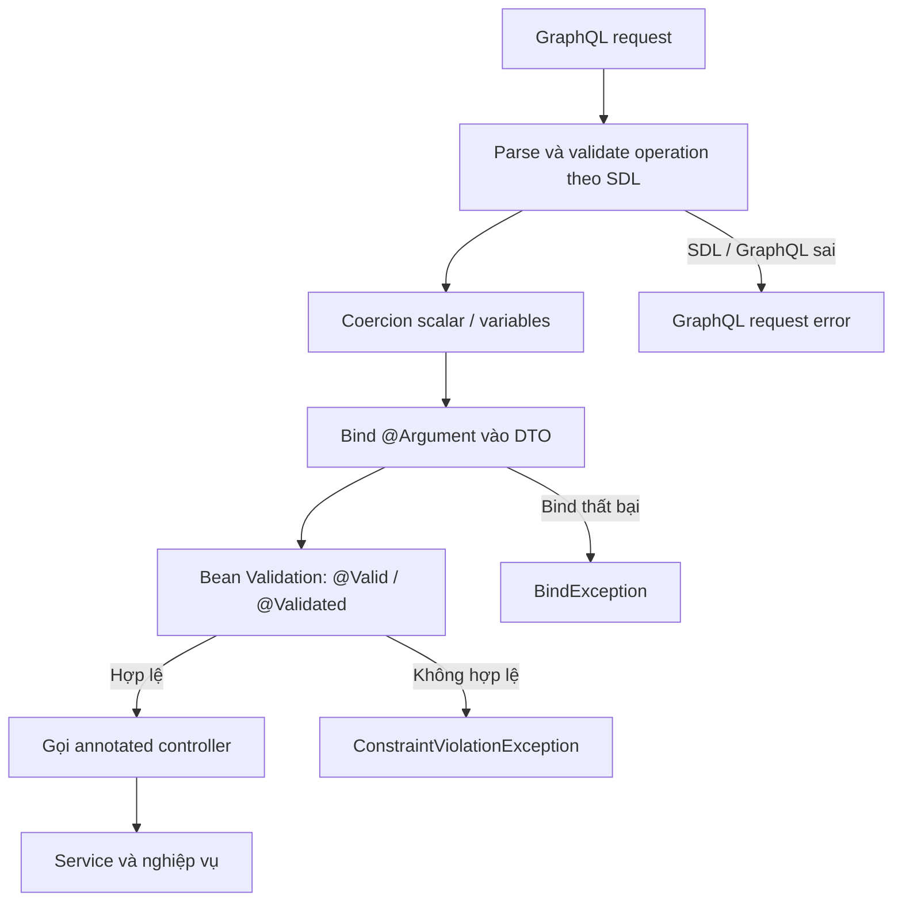

# Bean Validation trong annotated controller

GraphQL schema kiểm tra cấu trúc và kiểu của dữ liệu đầu vào, nhưng không diễn đạt hết các quy tắc nghiệp vụ. Ví dụ, `title: String!` chỉ yêu cầu có một chuỗi khác `null`; nó vẫn cho phép chuỗi rỗng hoặc chỉ chứa khoảng trắng. **Bean Validation** bổ sung các ràng buộc như `@NotBlank`, `@Size`, `@Email`, `@Positive` và các quy tắc tùy chỉnh cho input mà controller nhận được.

Spring for GraphQL tích hợp Bean Validation với annotated controller. Khi ứng dụng có một Bean Validation `Validator`, `AnnotatedControllerConfigurer` có thể validate tham số phương thức trước khi gọi handler. Với input object, đánh dấu tham số bằng `@Valid`; nếu cần validation group, dùng `@Validated` của Spring.

## Validation diễn ra ở bước nào?

Một GraphQL input thường đi qua các bước sau:

1. GraphQL parse operation và kiểm tra operation theo SDL.
2. GraphQL coercion variables và scalar input theo kiểu đã khai báo.
3. Spring for GraphQL bind argument vào tham số Java, chẳng hạn chuyển input object thành DTO.
4. Bean Validation kiểm tra các constraint trên tham số hoặc object graph được đánh dấu validation.
5. Chỉ khi các bước trên thành công, phương thức controller mới được gọi và chuyển dữ liệu sang service.



Ba nhóm lỗi cần phân biệt:

| Nhóm lỗi | Ví dụ | Xử lý ở đâu? |
| --- | --- | --- |
| GraphQL schema/coercion | Thiếu argument `String!`, truyền chuỗi vào `Int`. | GraphQL engine phát hiện trước khi gọi controller. |
| Argument binding | Không thể chuyển cấu trúc argument sang DTO hoặc không bind được thuộc tính. | Spring argument binder; có thể phát sinh `BindException`. |
| Bean Validation | Chuỗi rỗng, email sai định dạng, số lượng âm. | Validator kiểm tra trước khi gọi handler; lỗi được chuyển thành `ConstraintViolationException`. |

Bean Validation không thay thế SDL. SDL xác định hình dạng API và kiểu dữ liệu; Bean Validation xác định các ràng buộc bổ sung trên dữ liệu đã được bind.

## Thêm dependency và cấu hình Validator

Với Spring Boot, thêm starter validation cùng starter GraphQL:

```kotlin
dependencies {
    implementation("org.springframework.boot:spring-boot-starter-graphql")
    implementation("org.springframework.boot:spring-boot-starter-validation")
}
```

Hoặc với Maven:

```xml
<dependency>
    <groupId>org.springframework.boot</groupId>
    <artifactId>spring-boot-starter-graphql</artifactId>
</dependency>
<dependency>
    <groupId>org.springframework.boot</groupId>
    <artifactId>spring-boot-starter-validation</artifactId>
</dependency>
```

`spring-boot-starter-validation` đưa Bean Validation API và implementation tương thích vào ứng dụng. Với Spring Boot 3 trở lên, dùng namespace `jakarta.validation.*`; dự án Spring Boot 2 cũ dùng `javax.validation.*`. Không trộn hai namespace trong cùng một model.

Spring Boot thường tự cấu hình validator bean, phổ biến là `LocalValidatorFactoryBean`. `AnnotatedControllerConfigurer` của Spring for GraphQL phát hiện validator trong application context và bật hỗ trợ validation cho annotated controller. Nếu ứng dụng tự cấu hình validator, cần bảo đảm bean đó được đăng ký trong Spring context:

```java
import org.springframework.validation.beanvalidation.LocalValidatorFactoryBean;

@Configuration
public class ValidationConfiguration {

    @Bean
    LocalValidatorFactoryBean validator() {
        return new LocalValidatorFactoryBean();
    }
}
```

Chỉ cần khai báo bean thủ công khi ứng dụng không có auto-configuration tương ứng hoặc cần tùy chỉnh validator. Tránh đăng ký nhiều validator bean không có chủ đích vì có thể làm cấu hình validation khó đoán.

## Khai báo constraint trên input DTO

Giả sử API cho phép tạo sách:

```graphql
input CreateBookInput {
  title: String!
  isbn: String!
  authorId: ID!
}

type Mutation {
  createBook(input: CreateBookInput!): Book!
}
```

SDL bảo đảm `input`, `title`, `isbn` và `authorId` không bị bỏ qua hoặc nhận `null` theo các vị trí Non-Null. Nhưng schema vẫn cho phép `title` là `""` và không biết ISBN có đúng định dạng nghiệp vụ hay không.

DTO Java có thể khai báo constraint:

```java
import jakarta.validation.constraints.NotBlank;
import jakarta.validation.constraints.Pattern;
import jakarta.validation.constraints.Size;

public record CreateBookInput(
        @NotBlank(message = "Tiêu đề không được để trống")
        @Size(max = 200, message = "Tiêu đề tối đa 200 ký tự")
        String title,

        @NotBlank(message = "ISBN không được để trống")
        @Pattern(
                regexp = "^[0-9Xx-]{10,17}$",
                message = "ISBN không đúng định dạng")
        String isbn,

        @NotBlank(message = "Phải chọn tác giả")
        String authorId) {
}
```

`ID` được nhận dưới dạng chuỗi trong DTO để giữ định danh như một giá trị opaque. Service sẽ chuyển đổi hoặc tra cứu ID theo mô hình lưu trữ của ứng dụng. `@NotBlank` chỉ kiểm tra chuỗi có nội dung; service vẫn cần xác nhận tác giả tồn tại và người dùng có quyền tham chiếu tới tác giả đó.

Các constraint phổ biến:

| Constraint | Công dụng |
| --- | --- |
| `@NotNull` | Giá trị không được null. |
| `@NotBlank` | Chuỗi không được null, rỗng hoặc chỉ chứa khoảng trắng. |
| `@NotEmpty` | Chuỗi, collection hoặc map không được null và rỗng. |
| `@Size(min, max)` | Giới hạn độ dài chuỗi hoặc số phần tử collection/map. |
| `@Email` | Kiểm tra định dạng email ở mức cơ bản. |
| `@Pattern` | Kiểm tra chuỗi theo biểu thức chính quy. |
| `@Positive`, `@PositiveOrZero` | Ràng buộc số dương hoặc không âm. |
| `@Min`, `@Max` | Giới hạn giá trị số nguyên. |
| `@DecimalMin`, `@DecimalMax` | Giới hạn giá trị số thập phân. |

Không dùng `@NotNull` như sự thay thế cho `@NotBlank`: một chuỗi rỗng vẫn khác null. Tương tự, `@Email` không chứng minh địa chỉ email thực sự tồn tại hoặc thuộc về người dùng.

## Kích hoạt validation bằng `@Valid`

Trong annotated controller, đặt `@Valid` trên tham số nhận input object:

```java
import jakarta.validation.Valid;
import org.springframework.graphql.data.method.annotation.Argument;
import org.springframework.graphql.data.method.annotation.MutationMapping;
import org.springframework.stereotype.Controller;

@Controller
public class BookMutationController {

    private final BookService bookService;

    public BookMutationController(BookService bookService) {
        this.bookService = bookService;
    }

    @MutationMapping
    public Book createBook(
            @Argument("input") @Valid CreateBookInput input) {
        return bookService.create(input);
    }
}
```

Khi client gửi mutation `createBook`, Spring bind argument `input` vào `CreateBookInput`, sau đó chạy Bean Validation trước khi gọi `createBook`. Nếu có constraint vi phạm, controller không được gọi và exception được chuyển vào cơ chế xử lý lỗi GraphQL.

`@Valid` là annotation chuẩn của Jakarta Bean Validation. Nó yêu cầu validation object và cascade tới những thuộc tính lồng nhau cũng được đánh dấu `@Valid`. Chỉ khai báo constraint trên DTO mà không kích hoạt validation tại tham số controller thì không đủ để bảo đảm các constraint được chạy ở ranh giới GraphQL.

Validation không chỉ dùng cho Mutation. Có thể dùng với tham số `@Argument` của Query hoặc `@SchemaMapping` khi đầu vào có ràng buộc. Tuy nhiên, dữ liệu đọc được từ client và dữ liệu ghi vào hệ thống thường có chính sách validation khác nhau.

Validation trong annotated controller tập trung vào method parameters trước khi handler được gọi. Không nên giả định Spring tự chạy Bean Validation trên object mà resolver trả về; nếu cần kiểm tra dữ liệu output, hãy gọi validator hoặc kiểm tra invariant tại service/domain layer một cách tường minh.

## Validation cho object lồng nhau và collection

Bean Validation chỉ đi sâu vào object con khi thuộc tính đó được đánh dấu `@Valid`. Ví dụ input có địa chỉ và danh sách liên hệ:

```java
import jakarta.validation.Valid;
import jakarta.validation.constraints.NotBlank;
import jakarta.validation.constraints.NotNull;
import jakarta.validation.constraints.Size;
import java.util.List;

public record AddressInput(
        @NotBlank String street,
        @NotBlank String city,
        @NotBlank String postalCode) {
}

public record ContactInput(
        @NotBlank String type,
        @NotBlank String value) {
}

public record PublisherInput(
        @NotBlank String name,
        @NotNull @Valid AddressInput address,
        @Size(max = 5) List<@NotNull @Valid ContactInput> contacts) {
}
```

Trong ví dụ này:

- `@Valid AddressInput` kích hoạt kiểm tra các constraint trong địa chỉ.
- `@Size(max = 5)` giới hạn số liên hệ.
- `@NotNull` trên phần tử collection không cho phép phần tử null.
- `@Valid` trên phần tử collection kích hoạt kiểm tra từng `ContactInput`.

Có thể áp dụng cách tương tự cho input nhiều tầng. Cần thiết kế SDL và DTO nhất quán để GraphQL bind được dữ liệu trước khi validator kiểm tra.

## Dùng `@Validated` và validation groups

Có trường hợp cùng một DTO được dùng cho tạo mới và cập nhật nhưng có quy tắc khác nhau. Ví dụ khi tạo sách, `id` phải không được cung cấp; khi cập nhật, `id` bắt buộc phải có.

Bean Validation hỗ trợ validation groups. Có thể định nghĩa group và cho chúng kế thừa `Default` để các constraint không chỉ định group vẫn được chạy:

```java
import jakarta.validation.constraints.NotBlank;
import jakarta.validation.constraints.NotNull;
import jakarta.validation.constraints.Null;
import jakarta.validation.groups.Default;

public interface Create extends Default {
}

public interface Update extends Default {
}

public record SaveBookInput(
        @Null(groups = Create.class)
        @NotNull(groups = Update.class)
        String id,

        @NotBlank
        String title) {
}
```

SDL tương ứng có thể khai báo `id` nullable để phân biệt thao tác tạo và cập nhật:

```graphql
input SaveBookInput {
  id: ID
  title: String!
}
```

Dùng `@Validated` của Spring để chọn group cho từng handler:

```java
import org.springframework.validation.annotation.Validated;

@MutationMapping
public Book createBook(
        @Argument("input") @Validated(Create.class) SaveBookInput input) {
    return bookService.create(input);
}

@MutationMapping
public Book updateBook(
        @Argument("input") @Validated(Update.class) SaveBookInput input) {
    return bookService.update(input);
}
```

`@Validated` cho phép chỉ định validation groups; `@Valid` sử dụng group mặc định. Việc cho `Create` và `Update` kế thừa `Default` giúp constraint `@NotBlank` trên `title` vẫn được áp dụng cùng group được chọn.

Không nên tạo quá nhiều group chỉ để mô tả từng trường hợp nhỏ. Nếu input của create và update khác nhau đáng kể, hai DTO riêng có thể dễ hiểu và an toàn hơn một DTO có nhiều group.

## Ràng buộc ở cấp nhiều trường

Một số quy tắc phụ thuộc nhiều thuộc tính, chẳng hạn `startDate` phải trước `endDate`, hoặc phải cung cấp đúng một trong `email` và `phone`. Có thể dùng class-level constraint với custom `ConstraintValidator` để kiểm tra toàn bộ DTO.

Ví dụ về ý tưởng:

```java
@ValidDateRange
public record BookingInput(
        @NotNull LocalDate startDate,
        @NotNull LocalDate endDate) {
}
```

`@ValidDateRange` là custom constraint do ứng dụng định nghĩa. Validator của nó nhận toàn bộ `BookingInput`, kiểm tra `startDate` và `endDate`, rồi trả kết quả hợp lệ hoặc không hợp lệ. Khi báo lỗi, nên gắn violation vào field phù hợp nếu có thể để client biết cần sửa dữ liệu nào.

Không nên nhồi mọi quy tắc nghiệp vụ vào biểu thức regex hoặc custom validator phức tạp. Các quy tắc cần truy vấn database, kiểm tra quyền hoặc phụ thuộc trạng thái hiện tại nên nằm ở service/domain layer.

## Xử lý lỗi validation thành GraphQL error

Khi Bean Validation thất bại, Spring for GraphQL báo `ConstraintViolationException`. Với lỗi binding argument, `GraphQlArgumentBinder` có thể phát sinh `BindException`. Có thể dùng `@GraphQlExceptionHandler` trong controller hoặc `@ControllerAdvice` để chuyển chúng thành lỗi GraphQL có cấu trúc.

Ví dụ global exception handler:

```java
import graphql.GraphQLError;
import graphql.GraphqlErrorBuilder;
import java.util.List;
import java.util.Map;
import jakarta.validation.ConstraintViolationException;
import org.springframework.graphql.data.method.annotation.GraphQlExceptionHandler;
import org.springframework.graphql.execution.ErrorType;
import org.springframework.validation.BindException;
import org.springframework.web.bind.annotation.ControllerAdvice;

@ControllerAdvice
public class GraphQlValidationExceptionHandler {

    @GraphQlExceptionHandler
    public GraphQLError handleValidation(
            GraphqlErrorBuilder<?> errorBuilder,
            ConstraintViolationException ex) {

        List<Map<String, String>> violations = ex.getConstraintViolations()
                .stream()
                .map(violation -> Map.of(
                        "field", violation.getPropertyPath().toString(),
                        "message", violation.getMessage()))
                .toList();

        return errorBuilder
                .errorType(ErrorType.BAD_REQUEST)
                .message("Dữ liệu đầu vào không hợp lệ")
                .extensions(Map.of(
                        "code", "VALIDATION_ERROR",
                        "violations", violations))
                .build();
    }

    @GraphQlExceptionHandler
    public GraphQLError handleBinding(
            GraphqlErrorBuilder<?> errorBuilder,
            BindException ex) {

        List<Map<String, String>> violations = ex.getFieldErrors()
                .stream()
                .map(error -> Map.of(
                        "field", error.getField(),
                        "message", error.getDefaultMessage() == null
                                ? "Giá trị không hợp lệ"
                                : error.getDefaultMessage()))
                .toList();

        return errorBuilder
                .errorType(ErrorType.BAD_REQUEST)
                .message("Không thể đọc dữ liệu đầu vào")
                .extensions(Map.of(
                        "code", "ARGUMENT_BINDING_ERROR",
                        "violations", violations))
                .build();
    }
}
```

`GraphqlErrorBuilder` được Spring chuẩn bị với thông tin của field đang thực thi. `ErrorType.BAD_REQUEST` và `extensions.code` giúp client phân loại lỗi. `violations` cung cấp đường dẫn field và thông báo ngắn gọn để giao diện hiển thị lỗi.

Trong production, chỉ đưa ra những message đã được thiết kế cho người dùng API. Không trả giá trị input sai, stack trace, tên lớp nội bộ hoặc thông tin database. Nếu tên property path chứa chi tiết triển khai không phù hợp, hãy ánh xạ nó sang tên field GraphQL công khai.

Với lỗi validation chỉ thuộc một controller, có thể đặt `@GraphQlExceptionHandler` ngay trong controller đó. Đặt trong `@ControllerAdvice` khi muốn áp dụng chính sách chung cho nhiều controller.

`@GraphQlExceptionHandler` xử lý exception phát sinh từ annotated controller invocation. Nếu ứng dụng tự đăng ký DataFetcher bằng GraphQL Java hoặc `RuntimeWiringConfigurer`, cần dùng `DataFetcherExceptionResolver` phù hợp để xử lý exception từ những DataFetcher đó.

## Ví dụ response khi validation thất bại

Giả sử client gửi `title` chỉ chứa khoảng trắng. Resolver không chạy; GraphQL trả lỗi theo cấu trúc mà exception handler đã định nghĩa:

```json
{
  "errors": [
    {
      "message": "Dữ liệu đầu vào không hợp lệ",
      "extensions": {
        "classification": "BAD_REQUEST",
        "code": "VALIDATION_ERROR",
        "violations": [
          {
            "field": "createBook.input.title",
            "message": "Tiêu đề không được để trống"
          }
        ]
      }
    }
  ],
  "data": {
    "createBook": null
  }
}
```

Đây là ví dụ response minh họa. Path thực tế trong `ConstraintViolation` phụ thuộc chữ ký method, tên tham số và phiên bản framework. Client nên dựa vào `extensions.code` và danh sách violation đã được chuẩn hóa thay vì phụ thuộc cứng vào toàn bộ chuỗi property path nội bộ.

## Phân biệt lỗi validation với lỗi nghiệp vụ

Bean Validation phù hợp với những quy tắc có thể kiểm tra trực tiếp trên dữ liệu đầu vào:

- Chuỗi bắt buộc, độ dài, định dạng email hoặc mã định danh.
- Số lượng phải dương hoặc nằm trong khoảng.
- Danh sách không rỗng và không vượt quá số phần tử cho phép.
- Các field có quan hệ logic với nhau trong cùng input object.

Service/domain layer phù hợp với những quy tắc cần hiểu trạng thái hệ thống:

- ISBN hoặc email đã tồn tại trong database.
- Tác giả có thực sự tồn tại và đang hoạt động hay không.
- Người dùng có quyền tạo sách trong tenant hiện tại không.
- Trạng thái đơn hàng hiện tại có cho phép chuyển bước tiếp theo không.
- Hạn mức còn đủ để thực hiện thao tác hay không.

Có thể tạo custom constraint để kiểm tra một số dữ liệu qua service, nhưng cần tránh biến validator thành nơi thực hiện truy vấn database cho mọi field. Điều đó dễ tạo nhiều truy vấn, phụ thuộc vào transaction và làm khó kiểm thử. Các invariant quan trọng vẫn cần được bảo vệ ở domain/service và database.

## Validation không thay thế authorization

Validation trả lời câu hỏi dữ liệu có đúng định dạng và thỏa điều kiện hay không. Authorization trả lời người gọi có được phép thực hiện thao tác trên tài nguyên đó hay không.

Ví dụ `authorId` có định dạng hợp lệ và tồn tại vẫn chưa chứng minh người dùng có quyền gán tác giả đó vào sách. Controller hoặc service cần kiểm tra principal, tenant và phạm vi tài nguyên. Không đưa quyền truy cập vào `@Pattern`, `@Positive` hoặc các constraint định dạng.

## Kiểm thử Bean Validation với `GraphQlTester`

Kiểm thử cần xác nhận cả response lỗi lẫn việc controller/service không được gọi khi input không hợp lệ. Ví dụ:

```java
@Test
void rejectsBlankTitleBeforeCallingService() {
    graphQlTester.document("""
        mutation {
          createBook(input: {
            title: "   "
            isbn: "9780132350884"
            authorId: "42"
          }) {
            id
          }
        }
        """)
        .execute()
        .errors()
        .satisfy(errors -> {
            assertThat(errors).anySatisfy(error ->
                    assertThat(error.getMessage())
                            .contains("Dữ liệu đầu vào không hợp lệ"));
        });

    verifyNoInteractions(bookService);
}
```

Test giả định exception handler trả message như ví dụ và service là mock. Nếu GraphQL field trả Non-Null, lỗi có thể khiến field cha hoặc root data trở thành null theo quy tắc null propagation; vì vậy test nên tập trung vào error code/message và việc service không bị gọi.

Các trường hợp nên kiểm tra:

- Chuỗi rỗng và chuỗi chỉ chứa khoảng trắng.
- Giá trị vượt giới hạn `@Size` hoặc `@Max`.
- Pattern sai và nested object vi phạm constraint.
- Collection có phần tử null hoặc phần tử con không hợp lệ.
- Validation group cho create và update.
- Argument binding thất bại được phân biệt với constraint violation.
- SDL từ chối input sai kiểu trước khi controller chạy.
- Response không tiết lộ giá trị nhạy cảm hoặc thông tin nội bộ.
- Service không được gọi khi validation thất bại.

Có thể test riêng validator bằng `jakarta.validation.Validator` cho từng DTO, nhưng vẫn cần ít nhất một GraphQL integration test để xác minh `@Valid` được kích hoạt bởi annotated controller.

## Lỗi thường gặp

| Triệu chứng | Nguyên nhân | Cách xử lý |
| --- | --- | --- |
| Constraint khai báo nhưng không chạy | Thiếu validator bean hoặc tham số controller chưa được đánh dấu `@Valid`/`@Validated`. | Thêm starter validation, kiểm tra Validator bean và annotation trên method parameter. |
| `@NotBlank` không từ chối chuỗi rỗng | Chỉ dùng `@NotNull`, hoặc chưa kích hoạt validation. | Dùng `@NotBlank` và kiểm tra `@Valid`. |
| Constraint trong object con không chạy | Thuộc tính lồng nhau chưa có `@Valid`. | Đánh dấu cascade validation tại field hoặc phần tử collection. |
| Lỗi bind bị nhầm thành lỗi validation | Argument binder không tạo được DTO trước khi validator chạy. | Xử lý `BindException` riêng với `ConstraintViolationException`. |
| Validation group bỏ qua constraint mặc định | Group được chọn không bao gồm `Default`. | Cho group kế thừa `Default` hoặc chỉ định constraint vào group tương ứng. |
| Client nhận stack trace hoặc dữ liệu nội bộ | Exception handler trả nguyên exception message. | Chuẩn hóa message và chỉ công bố field path, mã lỗi cần thiết. |
| Validation thành công nhưng mutation vẫn thất bại | Quy tắc cần database hoặc trạng thái nghiệp vụ. | Kiểm tra ở service/domain layer và database. |
| Dùng nhầm `javax.validation` với `jakarta.validation` | Dependency namespace không tương thích với Spring Boot hiện tại. | Spring Boot 3+ dùng `jakarta.validation`; dự án cũ dùng namespace tương ứng. |

## Ghi nhớ

Bean Validation bổ sung các ràng buộc nghiệp vụ đơn giản lên dữ liệu đã được GraphQL kiểm tra kiểu và Spring bind vào DTO. Trong annotated controller, thêm validator bean và đánh dấu tham số input bằng `@Valid`; dùng `@Validated` khi cần validation groups. `@Valid` cũng cần được đặt trên các object con hoặc phần tử collection để cascade validation.

Validation thất bại tạo `ConstraintViolationException`; lỗi bind argument có thể tạo `BindException`. Dùng `@GraphQlExceptionHandler` hoặc `@ControllerAdvice` để chuyển chúng thành GraphQL errors có mã lỗi và danh sách violation rõ ràng. SDL vẫn chịu trách nhiệm kiểm tra cấu trúc/coercion; service/domain vẫn chịu trách nhiệm cho quy tắc nghiệp vụ cần trạng thái hệ thống và authorization.

## Tài liệu tham khảo

- [Spring for GraphQL — Annotated Controllers: Validation](https://docs.spring.io/spring-graphql/reference/controllers.html#controllers.validation)
- [Spring for GraphQL — Exception Handling](https://docs.spring.io/spring-graphql/reference/controllers.html#controllers.exceptions)
- [Spring Boot — Validation](https://docs.spring.io/spring-boot/reference/io/validation.html)
- [Jakarta Bean Validation](https://jakarta.ee/specifications/bean-validation/)
