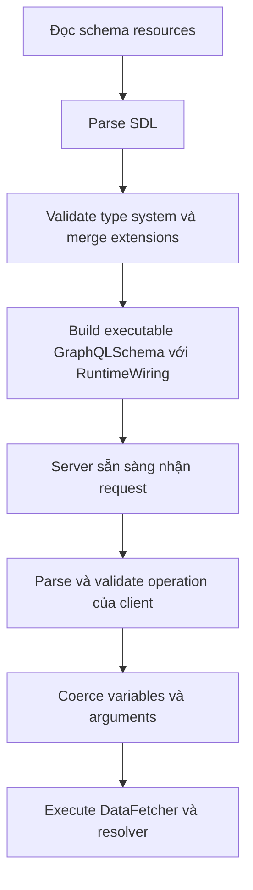

# GraphQL schema validation

GraphQL schema là hợp đồng kiểu dữ liệu mô tả những type, field, argument, input, directive và operation mà server hỗ trợ. Trước khi GraphQL server có thể xử lý request, schema SDL phải được parse và kiểm tra tính hợp lệ. Một schema có thể đúng cú pháp nhưng vẫn sai về mặt type system, chẳng hạn argument dùng output object type, object không triển khai đủ field của interface hoặc union chứa một scalar.

Trong Spring for GraphQL, Spring Boot nạp các file SDL, GraphQL Java parse và xây dựng executable schema cùng runtime wiring. Nếu schema không hợp lệ, ứng dụng thường thất bại ngay khi khởi động. Khi schema đã được tạo, mỗi GraphQL operation từ client lại trải qua bước validation riêng để kiểm tra document có phù hợp schema hay không. Hai giai đoạn này có mục đích khác nhau và cần được kiểm thử riêng.

Sau bài này, bạn có thể:

- Phân biệt SDL parsing, schema validation, operation validation và input coercion.
- Hiểu các quy tắc hợp lệ của root type, object, scalar, enum, interface, union và input object.
- Nhận diện lỗi do type reference, field, argument, directive và type extension.
- Hiểu cách Spring for GraphQL/GraphQL Java phát hiện lỗi khi tạo schema.
- Kiểm tra schema bằng application context, introspection và GraphQlTester.
- Tổ chức kiểm tra schema trong CI để phát hiện lỗi trước khi triển khai.

## 1. Schema validation là gì?

Schema validation là bước kiểm tra schema GraphQL có tuân thủ quy tắc của GraphQL type system hay không. Schema định nghĩa những gì server có thể trả về và nhận vào; validation bảo đảm các định nghĩa đó nhất quán và có thể được GraphQL engine thực thi.

Ví dụ schema hợp lệ:

```graphql
type Query {
    book(id: ID!): Book
}

type Book {
    id: ID!
    title: String!
}
```

Ví dụ sai về type system:

```graphql
type Query {
    createBook(input: Book!): Book
}

type Book {
    id: ID!
    title: String!
}
```

`Book` là output object type. Argument `input` cần một input type, chẳng hạn scalar, enum hoặc input object. SDL trên có thể được parse về mặt cú pháp nhưng không thể tạo schema hợp lệ.

Schema validation phát hiện các lỗi cấu trúc và kiểu trước khi server phục vụ request, nhờ đó tránh để client là người đầu tiên phát hiện một schema không thể thực thi.

## 2. Bốn giai đoạn cần phân biệt

Trong một ứng dụng Spring for GraphQL, có thể phân biệt bốn giai đoạn sau:



| Giai đoạn | Kiểm tra điều gì? | Ví dụ lỗi |
| --- | --- | --- |
| SDL parsing | Cú pháp của file schema | Thiếu dấu `}`, khai báo sai cú pháp |
| Schema/type-system validation | Tính nhất quán của các type và định nghĩa | Argument dùng `Book` thay vì `BookInput` |
| Operation validation | Query/mutation của client có hợp lệ với schema đã build không | Client gọi field `titel` không tồn tại |
| Input coercion | Variables và argument có chuyển được sang kiểu khai báo không | Gửi chuỗi vào argument `Int!` |

Schema validation xảy ra khi server xây dựng schema. Operation validation và input coercion xảy ra cho từng request. Một schema hợp lệ không bảo đảm mọi query của client đều hợp lệ; ngược lại, query đúng cú pháp vẫn không thể chạy nếu schema server không hợp lệ.

## 3. Root operation type

Một schema thực thi phải có query root type là object type. Theo quy ước, nếu không khai báo `schema` definition tường minh, GraphQL dùng tên `Query` làm query root type.

```graphql
type Query {
    health: String!
}
```

Có thể khai báo tên root type tường minh:

```graphql
schema {
    query: RootQuery
    mutation: RootMutation
}

type RootQuery {
    health: String!
}

type RootMutation {
    resetCache: Boolean!
}
```

Mutation và subscription root type là tùy chọn. Nếu có khai báo, chúng cũng phải là object type hợp lệ. Không thể dùng interface, union, scalar hoặc input object làm root operation type.

Những lỗi thường gặp:

- Không có query root type.
- `schema { query: Query }` nhưng không định nghĩa object type `Query`.
- Root type được khai báo là scalar hoặc interface.
- Khai báo root operation type trỏ đến tên type không tồn tại.

## 4. Tên type, field và reserved name

Tên type và field phải tuân thủ quy tắc đặt tên GraphQL. Trong cùng một type, không được có hai field cùng tên; trong cùng một input object, không được có hai input field trùng tên. Các định nghĩa type không được xung đột tên trong schema tổng hợp.

Tên bắt đầu bằng `__` được dành riêng cho introspection system. Ứng dụng không nên tự khai báo type, field, argument hoặc enum value bắt đầu bằng hai dấu gạch dưới.

Ví dụ không hợp lệ:

```graphql
type Book {
    id: ID!
    title: String!
    title: String
    __internalCode: String
}
```

Ở đây `title` bị khai báo hai lần và `__internalCode` dùng reserved prefix. Hãy chọn tên field riêng, không trùng nhau và không sử dụng namespace dành cho introspection.

## 5. Output type và input type

GraphQL chia type theo cách chúng được sử dụng:

- **Output type** có thể xuất hiện ở vị trí trả về của field: scalar, enum, object, interface và union.
- **Input type** có thể xuất hiện ở argument hoặc input object field: scalar, enum và input object.

Object, interface và union là output type; chúng không thể được dùng trực tiếp làm argument hoặc input field. Ngược lại, input object không thể được dùng làm kiểu trả về của field.

Ví dụ đúng:

```graphql
input CreateBookInput {
    title: String!
    authorId: ID!
}

type Book {
    id: ID!
    title: String!
}

type Mutation {
    createBook(input: CreateBookInput!): Book!
}
```

Ví dụ sai:

```graphql
type Query {
    findBook(filter: Book): Book
}
```

`Book` là object output type nên không thể dùng làm argument `filter`. Hãy khai báo `BookFilterInput` nếu cần truyền điều kiện tìm kiếm.

## 6. Quy tắc của object type và field

Object type phải có ít nhất một field. Mỗi field có một kiểu trả về là output type và có thể có các argument với kiểu input hợp lệ.

```graphql
type Book {
    id: ID!
    title: String!
    publishedYear: Int
    author: Author
}
```

Trong ví dụ:

- `id` và `title` là non-null output field.
- `publishedYear` là nullable scalar field.
- `author` là nullable object field.

Ví dụ sai do dùng input type làm output:

```graphql
input BookInput {
    title: String!
}

type Query {
    book: BookInput
}
```

`BookInput` chỉ được dùng ở vị trí input. Hãy tạo output object type `Book` để trả dữ liệu.

Field có thể trả về list hoặc non-null wrapper:

```graphql
type Query {
    books: [Book!]!
}
```

Các wrapper `[]` và `!` không làm thay đổi nhóm type cơ sở: phần tử vẫn phải là output type. Tương tự, argument list phải chứa input type.

## 7. Quy tắc của input object

Input object chứa các field dùng để nhận dữ liệu từ client:

```graphql
input CreateBookInput {
    title: String!
    authorId: ID!
    publishedYear: Int
}
```

Input object phải có ít nhất một field. Các field bên trong chỉ được dùng input type; không được tham chiếu object, interface hoặc union output.

Một lỗi khác là vòng tham chiếu chỉ gồm các field non-null đơn lẻ, khiến không thể tạo giá trị đầu vào hữu hạn nào. Ví dụ:

```graphql
input CategoryInput {
    parent: CategoryInput!
}
```

Định nghĩa này không có cách kết thúc chuỗi `parent` vì mỗi node đều bắt buộc có một node cha khác. Có thể phá vòng bắt buộc bằng nullable hoặc list:

```graphql
input CategoryInput {
    parent: CategoryInput
}
```

Hoặc:

```graphql
input CategoryInput {
    children: [CategoryInput!]!
}
```

Vòng tham chiếu ở output object thường hợp lệ, ví dụ `Book.author` và `Author.books`; quy tắc đặc biệt trên áp dụng cho chuỗi input field non-null, không phải mọi quan hệ vòng trong schema.

## 8. Scalar và enum

GraphQL có các scalar chuẩn `Int`, `Float`, `String`, `Boolean` và `ID`. Scalar được dùng cho cả input lẫn output. Nếu khai báo custom scalar, schema cần có implementation runtime tương ứng để parse input và serialize output.

```graphql
scalar DateTime

type Book {
    createdAt: DateTime!
}

input CreateBookInput {
    publishedAt: DateTime
}
```

Trong Spring for GraphQL, custom scalar thường được đăng ký qua runtime wiring bằng `RuntimeWiringConfigurer` hoặc cơ chế cấu hình scalar tương ứng. Khai báo `scalar DateTime` trong SDL chỉ tạo tên scalar; nó không tự định nghĩa cách chuyển Java `Instant` sang chuỗi ISO-8601.

Enum phải có ít nhất một enum value và các value trong cùng enum phải có tên duy nhất:

```graphql
enum BookStatus {
    DRAFT
    PUBLISHED
    ARCHIVED
}
```

Enum value có thể dùng làm input hoặc output. Không dùng enum value bắt đầu bằng `__`.

## 9. Interface phải được object triển khai đầy đủ

Interface định nghĩa các field chung mà object type triển khai phải cung cấp:

```graphql
interface Node {
    id: ID!
}

type Book implements Node {
    id: ID!
    title: String!
}

type Author implements Node {
    id: ID!
    name: String!
}
```

`Book` và `Author` phải có field `id` với kiểu trả về tương thích với interface. Nếu interface có argument, object phải cung cấp các argument được yêu cầu với kiểu tương ứng. Object có thể bổ sung argument tùy chọn riêng, nhưng không được làm field triển khai trở nên kém tương thích.

Ví dụ sai:

```graphql
interface Node {
    id: ID!
}

type Book implements Node {
    id: String!
    title: String!
}
```

`String!` không phải kiểu trả về hợp lệ để triển khai field `id: ID!`. Hãy giữ đúng kiểu hoặc dùng một kiểu trả về cụ thể hơn được GraphQL cho phép theo quy tắc covariance.

Khi một object type triển khai interface, schema phải khai báo `implements Node`. Việc Java class cùng có method `id()` không tự tạo quan hệ interface trong GraphQL schema.

## 10. Union chỉ chứa object type

Union biểu diễn một trong nhiều object type có thể xuất hiện tại một vị trí:

```graphql
union SearchResult = Book | Author
```

Các thành viên union phải là object type. Không đưa scalar, enum, input object hoặc interface vào danh sách thành viên.

Ví dụ sai:

```graphql
union SearchResult = Book | String
```

`String` là scalar nên không thể là union member. Hãy tạo object wrapper nếu cần biểu diễn kết quả dạng chuỗi cùng các loại object khác.

Union cần có ít nhất một thành viên và các thành viên phải khác nhau. Nếu schema mở rộng union bằng `extend union`, thành viên bổ sung cũng phải là object type hợp lệ và không trùng thành viên đã có.

## 11. Argument, default value và input coercion

Argument của field phải dùng input type. Tên argument trong cùng field phải duy nhất. Default value phải tương thích với kiểu đã khai báo và phải là constant value trong SDL; không thể dùng GraphQL variable làm default trong định nghĩa schema.

```graphql
type Query {
    books(limit: Int = 20, status: BookStatus): [Book!]!
}
```

`limit` là `Int` nullable với default `20`. Nếu client bỏ qua argument, GraphQL sử dụng default. Nếu client gửi null, default không thay thế null vì argument cho phép null.

Đây là một ví dụ operation hợp lệ:

```graphql
query Books($limit: Int = 10) {
    books(limit: $limit) {
        id
        title
    }
}
```

Nhưng nếu client gửi chuỗi cho `$limit`, input coercion thất bại trước khi resolver chạy. Đây là lỗi request của operation, không phải lỗi schema validation.

Với partial update, hãy cân nhắc omitted/null/default semantics trước khi khai báo default trên input field. Default có thể làm một field bị omitted trở thành giá trị cụ thể trong bước coercion, khiến service không còn biết client muốn giữ nguyên dữ liệu.

## 12. Directive definition và directive usage

Directive definition khai báo một directive tùy chỉnh, các argument và vị trí được phép sử dụng:

```graphql
directive @uppercase on FIELD_DEFINITION

type Query {
    greeting: String! @uppercase
}
```

Directive usage phải đúng location đã khai báo. Ví dụ `@uppercase` chỉ cho phép `FIELD_DEFINITION`, nên không thể dùng nó trên operation hoặc argument definition.

Nếu directive có argument, các argument phải dùng input type hợp lệ và giá trị truyền vào phải tương thích:

```graphql
directive @length(max: Int!) on FIELD_DEFINITION

type Book {
    title: String! @length(max: 120)
}
```

GraphQL có các directive chuẩn như `@include`, `@skip`, `@deprecated` và `@specifiedBy`. Một số implementation hoặc phiên bản mở rộng có thể hỗ trợ thêm directive khác; hãy kiểm tra phiên bản GraphQL Java/Spring for GraphQL mà dự án sử dụng. Không khai báo lại tên directive chuẩn theo cách xung đột với định nghĩa hệ thống.

Schema validation kiểm tra định nghĩa và vị trí hợp lệ của directive. Để directive tùy chỉnh thực sự thay đổi hành vi runtime, ứng dụng còn phải triển khai wiring/logic tương ứng; việc SDL parse thành công không tự làm directive chạy.

## 13. Type extension và schema nhiều file

Spring for GraphQL thường nạp nhiều file SDL rồi ghép thành một schema. Khi bổ sung field cho type đã tồn tại, dùng `extend type`:

```graphql
# root.graphqls
type Query {
    health: String!
}
```

```graphql
# books.graphqls
type Book {
    id: ID!
    title: String!
}

extend type Query {
    books: [Book!]!
}
```

`extend type Query` yêu cầu type `Query` gốc tồn tại trong schema tổng hợp. Nếu extension tham chiếu type chưa được định nghĩa, hoặc hai file định nghĩa field trùng tên không tương thích, schema build sẽ thất bại.

Các lỗi thường gặp khi chia file:

- Định nghĩa `type Query` nhiều lần thay vì một type gốc và các extension.
- Dùng `extend type` nhưng quên định nghĩa type gốc.
- Cùng một field được khai báo lặp trong các file.
- Hai module khai báo type trùng tên nhưng mục đích khác nhau.
- Extension thêm argument hoặc field không tương thích với định nghĩa đã có.

Việc đặt file ở thư mục khác nhau không tạo namespace cho GraphQL type. Tất cả resource được nạp vào schema tổng hợp và phải có tên type/field không xung đột.

## 14. Schema hợp lệ không có nghĩa mọi resolver đã được triển khai

Schema validation kiểm tra type system, không chứng minh toàn bộ field đã có business logic đúng. GraphQL Java có thể dùng default property data fetcher để đọc property từ source object. Vì vậy, một field không có `@SchemaMapping` tường minh vẫn có thể hoạt động nếu source object có getter/property phù hợp.

Ngược lại, ứng dụng có thể khởi động với schema hợp lệ nhưng một field trả null hoặc lỗi khi chạy vì:

- Không có property tương ứng trên source object.
- Resolver không được đăng ký cho field cần logic riêng.
- `@SchemaMapping` dùng sai `typeName` hoặc `field`.
- TypeResolver không ánh xạ được interface/union sang object type.
- Custom scalar chưa có runtime coercing implementation.
- Service/repository hoặc dependency runtime thất bại.

Vì vậy, cần phân biệt schema validation với kiểm thử mapping/runtime. Schema đúng là điều kiện cần; integration test mới xác nhận schema, runtime wiring và resolver phối hợp được.

## 15. Spring for GraphQL kiểm tra schema khi nào?

Với Spring Boot, schema resources được nạp khi ứng dụng tạo `GraphQlSource`. GraphQL Java parse SDL, kết hợp type definitions và runtime wiring rồi tạo executable `GraphQLSchema`. Nếu SDL sai cú pháp, type không nhất quán hoặc runtime wiring bắt buộc bị thiếu, quá trình khởi tạo có thể thất bại và application context không hoàn tất.

Các property schema location quyết định file nào được nạp, còn file extension xác định suffix được nhận diện. Ví dụ cấu hình mặc định thường tìm `.graphqls` và `.gqls` trong `classpath:graphql/**/`.

Khi ứng dụng khởi động thất bại, hãy kiểm tra log theo thứ tự:

1. Resource location có tìm thấy file schema không.
2. File có đúng extension và đã được đóng gói không.
3. SDL có parse được không.
4. Type references, field và argument có hợp lệ không.
5. Interface, union, input object và extension có nhất quán không.
6. Runtime wiring có custom scalar hoặc thành phần bắt buộc không.

Không nên xử lý một lỗi schema build như thể đó là lỗi của GraphQL query từ client. Server chưa sẵn sàng để nhận operation nếu executable schema chưa được tạo thành công.

## 16. Kiểm thử schema khi khởi động ứng dụng

Một integration test khởi động Spring application context có thể xác nhận schema được nạp và build thành công:

```java
@SpringBootTest
class GraphQlSchemaTests {

    @Autowired
    GraphQlTester graphQlTester;

    @Test
    void schemaIsAvailable() {
        graphQlTester.document("""
                query {
                    __schema {
                        queryType {
                            name
                        }
                    }
                }
                """)
            .execute()
            .path("__schema.queryType.name")
            .entity(String.class)
            .isEqualTo("Query");
    }
}
```

Test này giả định query root type của ứng dụng có tên `Query` và introspection được bật. Nếu schema dùng root type khác, assertion phải khớp tên đã cấu hình. Nếu production tắt introspection, có thể bật cho test profile hoặc kiểm tra schema qua một operation nghiệp vụ đại diện.

Đoạn test giả định test context đã cung cấp một `GraphQlTester` phù hợp. Với `@GraphQlTest`, Spring Boot có thể cấu hình tester cho GraphQL slice; với `@SpringBootTest` đầy đủ, hãy cấu hình tester theo transport đang kiểm thử, chẳng hạn `HttpGraphQlTester` từ `WebTestClient` hoặc tester gắn với `ExecutionGraphQlService`.

`@SpringBootTest` làm application context khởi động; nếu schema SDL không hợp lệ, test sẽ thất bại trước khi method test chạy. Introspection query bổ sung bằng chứng rằng schema đã được tạo và root type có tên như mong đợi.

## 17. Kiểm thử operation validation riêng

Sau khi schema hợp lệ, có thể kiểm tra một operation sai bị từ chối trước khi resolver chạy:

```java
@Test
void rejectsUnknownField() {
    graphQlTester.document("""
            query {
                book(id: "book-42") {
                    titel
                }
            }
            """)
        .execute()
        .errors()
        .satisfy(errors -> {
            assertThat(errors).isNotEmpty();
            assertThat(errors.get(0).getMessage())
                    .contains("Cannot query field");
        });
}
```

Đây là operation validation test, không phải schema validation test. Nó xác nhận GraphQL server đã có schema và từ chối một document gọi field không tồn tại. Nếu cần bảo đảm resolver không bị gọi, có thể dùng mock/spy service để xác nhận không có invocation.

Nên có các test cho:

- Field không tồn tại.
- Argument không tồn tại hoặc sai kiểu.
- Thiếu variable non-null.
- Variable không coercion được sang scalar/enum.
- Fragment type condition không phù hợp.
- Directive được dùng sai vị trí hoặc thiếu argument bắt buộc.

## 18. Kiểm tra schema trong CI

Một pipeline CI có thể kiểm tra schema theo các lớp:

1. Build/test application context để xác nhận SDL parse và executable schema build được.
2. Chạy integration test cho các query/mutation đại diện.
3. Kiểm tra introspection hoặc schema snapshot nếu dự án quản lý contract.
4. So sánh schema mới với phiên bản đã phát hành để phát hiện thay đổi breaking.
5. Kiểm tra artifact đóng gói để chắc chắn các file SDL được đưa vào JAR/container.

Schema validation tại startup chỉ xác nhận schema hiện tại tự nhất quán. Nó không tự phát hiện mọi breaking change so với client cũ. Ví dụ xóa field, đổi argument thành non-null hoặc đổi kiểu trả về có thể vẫn tạo một schema hợp lệ nhưng phá vỡ client đang dùng. Nếu cần tương thích ngược, hãy thêm bước schema diff/contract compatibility vào CI.

Không nên chỉ kiểm tra schema bằng cách mở một file SDL riêng lẻ nếu ứng dụng thực tế nạp nhiều resource. Cần kiểm tra schema tổng hợp sau khi merge tất cả file và runtime wiring.

## 19. Những lỗi schema validation thường gặp

| Lỗi | Nguyên nhân | Cách sửa |
| --- | --- | --- |
| Không có query root type | Thiếu `Query` hoặc schema definition trỏ sai tên | Khai báo query root object hợp lệ |
| Argument dùng object type | Dùng output type ở input position | Tạo scalar/enum/input object phù hợp |
| Input field dùng object type | Input object tham chiếu output type | Tạo input type riêng |
| Object không triển khai đủ interface field | Thiếu field hoặc kiểu không tương thích | Bổ sung field và sửa signature |
| Union chứa scalar/interface | Thành viên không phải object type | Chỉ liệt kê object type |
| Duplicate type/field/enum value | Các file SDL xung đột tên | Đổi tên hoặc hợp nhất định nghĩa |
| Extension không có type gốc | Dùng `extend type` nhưng type chưa được khai báo | Thêm base definition hoặc sửa extension |
| Input object có non-null singular cycle | Không có cách kết thúc chuỗi input bắt buộc | Thêm nullable/list boundary |
| Directive dùng sai location | Directive application không nằm trong location cho phép | Sửa definition hoặc vị trí sử dụng |
| Custom scalar thiếu runtime wiring | SDL có scalar nhưng chưa có coercing implementation | Đăng ký scalar implementation |
| Schema hợp lệ nhưng field runtime sai | Mapping, resolver hoặc service thiếu/sai | Thêm integration test và sửa runtime wiring |

Khi gặp lỗi, hãy đọc thông báo gốc của GraphQL Java và xác định lỗi thuộc parse, schema validation hay runtime wiring. Tránh sửa ngẫu nhiên nhiều file vì một lỗi type reference có thể tạo ra nhiều thông báo dây chuyền.

## 20. Quy trình kiểm tra GraphQL schema

Khi thêm hoặc thay đổi SDL trong Spring for GraphQL, hãy thực hiện:

1. Xác định root operation type và bảo đảm query root là object type.
2. Kiểm tra mọi field output dùng output type; mọi argument/input field dùng input type.
3. Kiểm tra tên type, field, argument và enum value không bị trùng.
4. Kiểm tra object triển khai interface đầy đủ và đúng signature.
5. Kiểm tra union chỉ chứa object type hợp lệ.
6. Kiểm tra input object, default value và circular reference.
7. Kiểm tra directive definition, argument và location.
8. Kiểm tra type extension và xung đột khi ghép nhiều file SDL.
9. Đăng ký custom scalar và runtime wiring cần thiết.
10. Khởi động application context để xác nhận executable schema build thành công.
11. Dùng introspection hoặc query đại diện để xác nhận schema được expose đúng.
12. Kiểm thử operation validation, input coercion và compatibility trong CI.

GraphQL schema validation bảo đảm SDL tạo thành một type system nhất quán trước khi server nhận request. Trong Spring for GraphQL, quá trình này diễn ra khi GraphQL Java xây dựng executable schema từ các schema resources và runtime wiring. Cần phân biệt nó với operation validation và input coercion theo từng request. Khi kiểm tra root type, input/output position, interface, union, directive, type extension và custom scalar, đồng thời khởi động ứng dụng và kiểm thử schema tổng hợp trong CI, lỗi hợp đồng GraphQL sẽ được phát hiện sớm và dễ chẩn đoán hơn.

## Tài liệu tham khảo

- [GraphQL Specification — Type System](https://spec.graphql.org/October2021/#sec-Type-System)
- [GraphQL Specification — Validation](https://spec.graphql.org/October2021/#sec-Validation)
- [GraphQL Specification — Input Objects](https://spec.graphql.org/October2021/#sec-Input-Objects)
- [Spring for GraphQL — Request Execution and Schema](https://docs.spring.io/spring-graphql/reference/request-execution.html)
- [Spring Boot — Spring for GraphQL](https://docs.spring.io/spring-boot/reference/web/spring-graphql.html)
- [GraphQL Java — Schema Generation](https://www.graphql-java.com/documentation/schema/)
