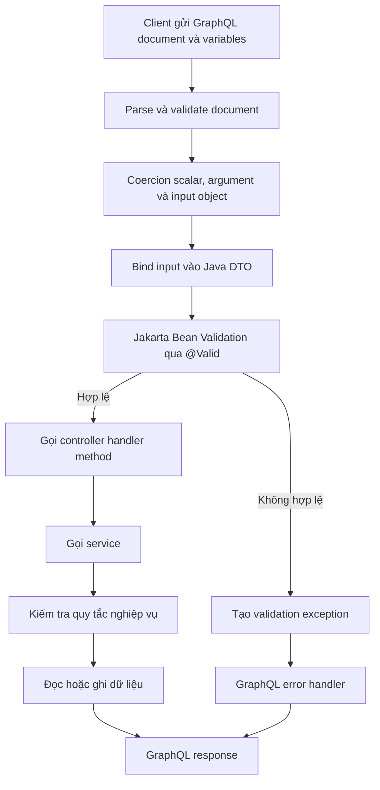

# Validation trước khi gọi service

Trong một GraphQL mutation, dữ liệu client gửi vào cần được kiểm tra trước khi controller chuyển command xuống service. Spring for GraphQL hỗ trợ kết hợp GraphQL input coercion với Jakarta Bean Validation để phát hiện dữ liệu sai cấu trúc hoặc không thỏa ràng buộc ngay tại ranh giới controller.

Khi một tham số `@Argument` được đánh dấu `@Valid`, Spring for GraphQL có thể validate input object trước khi gọi handler method. Nếu dữ liệu không hợp lệ, method resolver không được thực thi, do đó lời gọi service nằm bên trong method cũng không xảy ra. Cách này phù hợp với các quy tắc như chuỗi không được để trống, email đúng định dạng, số lượng nằm trong giới hạn hoặc object lồng nhau phải hợp lệ.

Validation tại controller không thay thế kiểm tra nghiệp vụ trong service. Các điều kiện phụ thuộc dữ liệu hiện tại, quyền người dùng, trạng thái tài nguyên hoặc tính nhất quán giữa nhiều thao tác vẫn cần được bảo vệ ở tầng nghiệp vụ và database.

## 1. Các bước kiểm tra trước khi service chạy

Một mutation có thể đi qua nhiều lớp kiểm tra trước khi service được gọi:



Mỗi bước giải quyết một loại vấn đề:

- GraphQL parse và document validation kiểm tra cú pháp operation, field, argument và selection set.
- Input coercion kiểm tra giá trị có thể chuyển sang kiểu GraphQL đã khai báo hay không.
- Binding chuyển input thành tham số Java.
- Bean Validation kiểm tra các ràng buộc trên DTO như `@NotBlank`, `@Email`, `@Size` hoặc `@Min`.
- Service kiểm tra quy tắc nghiệp vụ cần trạng thái hệ thống hoặc nhiều dữ liệu liên quan.

Nếu bước Bean Validation thất bại, Spring không gọi handler method. Vì vậy, service được gọi từ bên trong method cũng không chạy. Đây là điểm quan trọng khi muốn bảo đảm dữ liệu đầu vào được kiểm tra trước mọi tác động nghiệp vụ.

## 2. Khai báo input trong GraphQL SDL

Giả sử API cho phép tạo một cuốn sách:

```graphql
input CreateBookInput {
    title: String!
    isbn: String!
    description: String
    publishedYear: Int
    pageCount: Int!
}

type Mutation {
    createBook(input: CreateBookInput!): Book!
}

type Book {
    id: ID!
    title: String!
    isbn: String!
    description: String
    publishedYear: Int
    pageCount: Int!
}
```

SDL đã đảm bảo một số điều kiện cơ bản:

- `input` không được null.
- `title`, `isbn` và `pageCount` phải được cung cấp và không null.
- `description` và `publishedYear` có thể null hoặc bị bỏ qua.
- `pageCount` phải coercion được sang GraphQL `Int`.

Tuy nhiên, `String!` chỉ đảm bảo giá trị khác null. Nó vẫn chấp nhận chuỗi rỗng `""` hoặc chuỗi chỉ có khoảng trắng. `Int!` cũng không đảm bảo `pageCount` phải lớn hơn 0. Những ràng buộc này cần được kiểm tra ở tầng ứng dụng.

## 3. Thêm Jakarta Bean Validation

Với Spring Boot 3 trở lên, sử dụng Jakarta Bean Validation và thêm implementation validation vào runtime classpath. Dependency Maven thường dùng:

```xml
<dependency>
    <groupId>org.springframework.boot</groupId>
    <artifactId>spring-boot-starter-validation</artifactId>
</dependency>
```

Trong các dự án Spring Boot 2 cũ hơn, package validation có thể thuộc `javax.validation`; hãy dùng namespace tương ứng với phiên bản nền tảng.

Tạo DTO với các constraint:

```java
package com.example.graphql.book;

import jakarta.validation.constraints.Max;
import jakarta.validation.constraints.Min;
import jakarta.validation.constraints.NotBlank;
import jakarta.validation.constraints.NotNull;
import jakarta.validation.constraints.Pattern;
import jakarta.validation.constraints.Size;

public record CreateBookInput(
    @NotBlank(message = "Title must not be blank")
    @Size(max = 200, message = "Title must be at most 200 characters")
    String title,

    @NotBlank(message = "ISBN must not be blank")
    @Pattern(
        regexp = "[0-9Xx-]{10,17}",
        message = "ISBN format is invalid"
    )
    String isbn,

    @Size(max = 2000, message = "Description is too long")
    String description,

    @Min(value = 1000, message = "Published year is invalid")
    @Max(value = 2100, message = "Published year is invalid")
    Integer publishedYear,

    @NotNull(message = "Page count is required")
    @Min(value = 1, message = "Page count must be greater than zero")
    @Max(value = 10000, message = "Page count is too large")
    Integer pageCount
) {}
```

Một số constraint thường dùng:

| Constraint | Tác dụng |
| --- | --- |
| `@NotNull` | Giá trị không được null |
| `@NotBlank` | Chuỗi phải có ký tự khác khoảng trắng |
| `@NotEmpty` | Chuỗi hoặc collection không được rỗng |
| `@Size(min, max)` | Giới hạn độ dài chuỗi hoặc số phần tử |
| `@Min`, `@Max` | Giới hạn giá trị số |
| `@Positive`, `@PositiveOrZero` | Yêu cầu số dương hoặc không âm |
| `@Email` | Kiểm tra định dạng email |
| `@Pattern` | Kiểm tra chuỗi theo regular expression |

Chọn constraint đúng ngữ nghĩa. Ví dụ `@NotEmpty` vẫn chấp nhận chuỗi chỉ có dấu cách; `@NotBlank` mới loại trường hợp đó. `@Pattern` chỉ kiểm tra định dạng theo biểu thức chính quy, không chứng minh ISBN có checksum hợp lệ hoặc đã được cấp phát.

## 4. Kích hoạt validation trên @Argument bằng @Valid

Trong annotated controller, đánh dấu tham số `@Argument` bằng `@Valid`:

```java
package com.example.graphql.book;

import jakarta.validation.Valid;
import org.springframework.graphql.data.method.annotation.Argument;
import org.springframework.graphql.data.method.annotation.MutationMapping;
import org.springframework.stereotype.Controller;

@Controller
public class BookMutationController {

    private final BookService bookService;

    public BookMutationController(BookService bookService) {
        this.bookService = bookService;
    }

    @MutationMapping
    public BookView createBook(
            @Argument("input") @Valid CreateBookInput input) {
        return bookService.create(input);
    }
}
```

Khi Spring for GraphQL bind argument `input` thành `CreateBookInput`, Bean Validation được kích hoạt trước khi method `createBook` được gọi. Nếu một constraint thất bại, validation exception được phát sinh và dòng `bookService.create(input)` không được chạy.

Không cần viết các câu `if (input.title() == null)` hoặc `if (input.pageCount() <= 0)` lặp lại trong controller khi constraint đã mô tả được quy tắc. Controller tập trung vào việc nhận input hợp lệ và chuyển command xuống service.

Nếu input có thể null theo SDL nhưng nghiệp vụ yêu cầu phải có, hãy khai báo `@NotNull` trên tham số hoặc thay đổi SDL thành `CreateBookInput!`. Với ví dụ trên, SDL đã dùng `CreateBookInput!`, nên GraphQL từ chối null trước khi controller được gọi.

## 5. Điều gì xảy ra khi validation thất bại?

Giả sử client gửi mutation:

```graphql
mutation CreateBook($input: CreateBookInput!) {
    createBook(input: $input) {
        id
        title
    }
}
```

Variables không hợp lệ:

```json
{
  "input": {
    "title": "   ",
    "isbn": "abc",
    "pageCount": 0
  }
}
```

Bean Validation phát hiện:

- `title` không thỏa `@NotBlank`.
- `isbn` không khớp `@Pattern`.
- `pageCount` không thỏa `@Min(1)`.

Handler method `createBook` không được gọi. Do đó, service không thực hiện insert, không phát event và không tạo tác động nghiệp vụ nào từ method này.

Đây là khác biệt giữa validation tự động trên argument và kiểm tra thủ công bên trong controller. Nếu viết `if` sau khi method đã bắt đầu chạy, service có thể đã được gọi trước khi phát hiện input không hợp lệ nếu thứ tự code không được giữ đúng. Dùng `@Valid` giúp ràng buộc được thực hiện ở ranh giới nhận argument.

## 6. Validation cho input object lồng nhau

GraphQL input object có thể chứa input object khác. Để validation tiếp tục đi xuống object con, dùng `@Valid` trên thuộc tính lồng nhau.

SDL:

```graphql
input AddressInput {
    street: String!
    city: String!
    postalCode: String!
}

input CreateCustomerInput {
    name: String!
    address: AddressInput!
}
```

DTO:

```java
public record AddressInput(
    @NotBlank String street,
    @NotBlank String city,
    @NotBlank
    @Pattern(regexp = "[0-9]{5,6}")
    String postalCode
) {}

public record CreateCustomerInput(
    @NotBlank String name,
    @NotNull @Valid AddressInput address
) {}
```

`@Valid` trên `address` yêu cầu validator kiểm tra tiếp các constraint của `AddressInput`. Nếu thiếu `@Valid`, các constraint trong object con có thể không được cascade từ object cha. `@NotNull` đảm bảo thuộc tính address không null ở tầng Bean Validation; SDL `AddressInput!` cũng đã thể hiện yêu cầu không null ở tầng GraphQL.

Có thể lồng nhiều cấp, nhưng nên giữ input model dễ hiểu và tránh cấu trúc quá sâu khiến client khó tạo dữ liệu cũng như server khó validate.

## 7. Kiểm tra nhiều field cùng lúc

Một số quy tắc phụ thuộc quan hệ giữa nhiều thuộc tính, ví dụ ngày kết thúc phải sau ngày bắt đầu hoặc mật khẩu xác nhận phải giống mật khẩu chính. Có thể tạo class-level constraint với custom Jakarta Validation annotation.

Ví dụ DTO:

```java
@ValidDateRange
public record BookingInput(
    @NotNull LocalDate startDate,
    @NotNull LocalDate endDate
) {}
```

`@ValidDateRange` là annotation do ứng dụng định nghĩa và có validator nhận toàn bộ `BookingInput`. Validator so sánh hai ngày, sau đó trả violation nếu `endDate` không sau `startDate`.

Với lỗi cần gắn vào một field cụ thể, custom validator có thể tạo property path tương ứng. Điều này giúp client biết input nào cần sửa. Quy tắc cross-field thuần túy phù hợp với Bean Validation; quy tắc phụ thuộc trạng thái database nên được kiểm tra trong service.

## 8. Phân biệt Bean Validation và business validation

Không phải mọi quy tắc đều nên đặt trong DTO. Cần xác định nguồn thông tin mà quy tắc phụ thuộc.

| Loại kiểm tra | Ví dụ | Nơi phù hợp |
| --- | --- | --- |
| Kiểu và nullability GraphQL | `ID!`, `Int!`, enum hợp lệ | GraphQL schema và input coercion |
| Cấu trúc input | Chuỗi không rỗng, email đúng định dạng, số trong phạm vi | Bean Validation trên DTO |
| Quan hệ field trong cùng input | Ngày bắt đầu trước ngày kết thúc | Class-level Bean Validation hoặc validator chuyên biệt |
| Trạng thái dữ liệu | ISBN đã được dùng, mã khách hàng có tồn tại | Service/domain layer |
| Quyền truy cập | Người dùng có quyền tạo sách trong thư viện này | Authorization/service layer |
| Tính nhất quán đồng thời | Hai request cùng đăng ký một ISBN | Database constraint và transaction |

Ví dụ, kiểm tra ISBN đúng định dạng có thể dùng `@Pattern`. Nhưng kiểm tra ISBN đã tồn tại cần truy vấn dữ liệu. Nếu đặt truy vấn repository trong custom Bean Validation validator, validation sẽ phụ thuộc database và có thể tạo race condition. Hai request đồng thời vẫn có thể cùng vượt qua bước kiểm tra trước khi ghi.

Hãy giữ các quy tắc phụ thuộc trạng thái trong service/domain và dùng unique constraint ở database để bảo vệ bất biến cuối cùng. Controller validation giúp loại input sai hình dạng trước khi service chạy; nó không thay thế transaction hoặc constraint.

## 9. Tổ chức lỗi validation thành GraphQL error

Khi validation được kích hoạt bằng `@Valid` trên argument, Spring for GraphQL có thể phát sinh `BindException` nếu input không thỏa constraint. Có thể dùng `@GraphQlExceptionHandler` trong controller hoặc `@ControllerAdvice` để chuyển exception thành GraphQL error.

Ví dụ handler toàn cục:

```java
package com.example.graphql.error;

import java.util.List;
import java.util.Map;

import graphql.GraphQLError;
import graphql.GraphqlErrorBuilder;
import graphql.schema.DataFetchingEnvironment;
import org.springframework.graphql.data.method.annotation.GraphQlExceptionHandler;
import org.springframework.graphql.execution.ErrorType;
import org.springframework.validation.BindException;
import org.springframework.validation.FieldError;
import org.springframework.web.bind.annotation.ControllerAdvice;

@ControllerAdvice
public class GraphQlValidationAdvice {

    @GraphQlExceptionHandler
    public GraphQLError handleValidation(
            BindException exception,
            DataFetchingEnvironment environment) {

        List<Map<String, String>> fieldErrors =
            exception.getBindingResult().getFieldErrors().stream()
                .map(this::toFieldError)
                .toList();

        return GraphqlErrorBuilder.newError(environment)
            .errorType(ErrorType.BAD_REQUEST)
            .message("Dữ liệu đầu vào không hợp lệ.")
            .extensions(Map.of(
                "code", "VALIDATION_ERROR",
                "fieldErrors", fieldErrors
            ))
            .build();
    }

    private Map<String, String> toFieldError(FieldError error) {
        return Map.of(
            "field", error.getField(),
            "message", error.getDefaultMessage() == null
                ? "Giá trị không hợp lệ."
                : error.getDefaultMessage()
        );
    }
}
```

Handler chỉ đưa tên field và message đã cấu hình vào `extensions`. Không đưa `rejectedValue` vào response vì giá trị sai có thể chứa mật khẩu, token hoặc dữ liệu cá nhân. Với ứng dụng đa ngôn ngữ, có thể dùng message source để trả thông báo theo locale của request.

`BindException` ở đây là lỗi bind/validate argument. Nếu ứng dụng dùng method validation ở tầng khác, ví dụ constraint trực tiếp trên method hoặc service method, loại exception có thể khác tùy cách cấu hình và phiên bản Spring. Hãy xử lý đúng exception phát sinh ở ranh giới đó thay vì giả định mọi validation đều cùng một loại exception.

## 10. GraphQL error hay payload userErrors?

Có hai cách phổ biến để biểu diễn validation failure cho client:

**GraphQL error:** phù hợp khi `@Valid` tự động từ chối argument trước khi handler method chạy. Exception handler chuyển `BindException` thành error có `extensions.code` và danh sách lỗi field. Resolver không chạy và service không được gọi.

**Payload `userErrors`:** phù hợp khi validation failure là kết quả nghiệp vụ mà mutation muốn trả về như một phần response. Khi đó, controller hoặc một lớp validation chuyên biệt cần thu thập lỗi và trả payload có `userErrors`; không để `@Valid` ném exception trước khi method có cơ hội tạo payload.

Ví dụ payload:

```graphql
type UserError {
    field: String
    code: String!
    message: String!
}

type CreateBookPayload {
    book: Book
    userErrors: [UserError!]!
}

type Mutation {
    createBook(input: CreateBookInput!): CreateBookPayload!
}
```

Không nên trộn lẫn hai hợp đồng cho cùng một loại lỗi nếu không có lý do rõ ràng. Client cần biết trường hợp nào xuất hiện trong `errors` và trường hợp nào xuất hiện trong `data.createBook.userErrors`.

## 11. Validation groups và các luồng tạo/cập nhật

Một DTO có thể được dùng cho nhiều operation nhưng mỗi operation có bộ quy tắc khác nhau. Ví dụ khi tạo mới, ISBN là bắt buộc; khi cập nhật một phần, ISBN có thể không được gửi.

Jakarta Bean Validation hỗ trợ validation groups để áp dụng constraint theo ngữ cảnh:

```java
public interface Create {}
public interface Update {}

public record BookInput(
    @NotBlank(groups = Create.class)
    String title,

    @NotBlank(groups = Create.class)
    String isbn,

    @Size(max = 200, groups = {Create.class, Update.class})
    String description
) {}
```

Có thể dùng `@Validated(Create.class)` hoặc `@Validated(Update.class)` khi cấu hình validation method/argument tương ứng hỗ trợ group selection. Với annotated controller, hãy kiểm tra cách resolver áp dụng validation hints theo phiên bản Spring for GraphQL đang dùng; `@Valid` đơn thuần sử dụng default group. Nếu hai operation có input semantics khác biệt đáng kể, hai DTO riêng thường dễ hiểu và ít lỗi hơn một DTO dùng nhiều group.

## 12. Kiểm thử service không được gọi khi input sai

Điều quan trọng của bài học này là xác minh không chỉ response có lỗi mà service thực sự không được gọi. Có thể dùng `GraphQlTester` kết hợp Mockito.

Ví dụ test minh họa:

```java
import static org.assertj.core.api.Assertions.assertThat;
import static org.mockito.Mockito.verifyNoInteractions;

import org.junit.jupiter.api.Test;
import org.springframework.beans.factory.annotation.Autowired;
import org.springframework.boot.test.autoconfigure.graphql.GraphQlTest;
import org.springframework.boot.test.mock.mockito.MockBean;
import org.springframework.graphql.test.tester.GraphQlTester;

@GraphQlTest(BookMutationController.class)
class BookMutationValidationTest {

    @Autowired
    GraphQlTester graphQlTester;

    @MockBean
    BookService bookService;

    @Test
    void rejectsInvalidInputBeforeCallingService() {
        graphQlTester.document("""
                mutation {
                    createBook(input: {
                        title: "   "
                        isbn: "invalid"
                        pageCount: 0
                    }) {
                        id
                    }
                }
                """)
            .execute()
            .errors()
            .satisfy(errors -> assertThat(errors).isNotEmpty());

        verifyNoInteractions(bookService);
    }
}
```

Đoạn test dùng `@MockBean` để cung cấp `BookService` mock trong test context. Với phiên bản Spring Boot mới có thể dùng annotation thay thế tương ứng nếu `@MockBean` đã bị deprecated. Nếu controller có dependency khác, cung cấp mock tương ứng.

Nên có test đối chứng cho input hợp lệ để xác minh service được gọi đúng một lần với DTO đã bind. Nhờ vậy, test chứng minh cả hai nhánh: input sai bị chặn trước service và input đúng được chuyển xuống service.

## 13. Những lỗi thường gặp

| Triệu chứng | Nguyên nhân có thể | Cách xử lý |
| --- | --- | --- |
| `@Valid` không chạy | Thiếu validation provider hoặc thiếu annotation trên argument | Thêm starter validation và đặt `@Valid` cạnh `@Argument` |
| Chuỗi chỉ có dấu cách vẫn qua | Dùng `@NotEmpty` hoặc chỉ khai báo `String!` | Dùng `@NotBlank` |
| Constraint của object con không chạy | Thiếu `@Valid` trên thuộc tính lồng nhau | Bật cascade validation |
| Service vẫn được gọi với input sai | Validation đặt sau lời gọi service hoặc không được kích hoạt | Dùng argument validation trước handler và test bằng verify |
| Không bắt được validation exception | Handler nhận sai loại exception hoặc sai phạm vi | Kiểm tra exception thực tế và phạm vi `@GraphQlExceptionHandler` |
| Client nhận dữ liệu nhạy cảm | Trả `rejectedValue` hoặc exception message thô | Chỉ trả field, code và message an toàn |
| Unique validation vẫn bị trùng dữ liệu | Chỉ kiểm tra trước khi insert | Thêm unique constraint và xử lý conflict ở service |
| DTO dùng chung quá nhiều nhóm | Quy tắc create/update khác nhau | Dùng validation groups hoặc DTO riêng |
| Lỗi xuất hiện trong `errors` thay vì payload | `@Valid` dừng handler trước khi tạo payload | Chọn rõ error contract hoặc validate tường minh để tạo `userErrors` |

## 14. Checklist validation trước service

- SDL đã khai báo đúng input type, kiểu scalar và nullability?
- DTO có constraint phản ánh đúng quy tắc cấu trúc?
- `spring-boot-starter-validation` đã có trong runtime classpath?
- Tham số `@Argument` đã được đánh dấu `@Valid`?
- Object lồng nhau có `@Valid` để cascade validation?
- Quy tắc cần database hoặc security đã đặt ở service/domain layer?
- Handler method chỉ gọi service sau khi argument đã hợp lệ?
- Validation error có message an toàn và mã lỗi ổn định?
- API đã chọn rõ GraphQL `errors` hay payload `userErrors`?
- Test xác minh service không được gọi khi input sai và được gọi khi input đúng?
- Database vẫn bảo vệ các invariant quan trọng khi có request đồng thời?

Validation trước khi gọi service giúp Spring for GraphQL chặn input sai ngay tại ranh giới controller. GraphQL schema kiểm tra kiểu và nullability; Jakarta Bean Validation kiểm tra cấu trúc DTO qua `@Valid`; service tiếp tục bảo vệ quy tắc nghiệp vụ phụ thuộc trạng thái và quyền; database giữ các ràng buộc nhất quán cuối cùng. Khi phân chia đúng trách nhiệm và kiểm thử xác nhận service không chạy với input không hợp lệ, mutation sẽ an toàn hơn, dễ dự đoán và dễ bảo trì.
