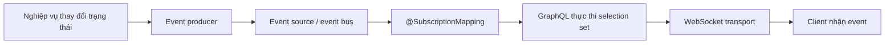
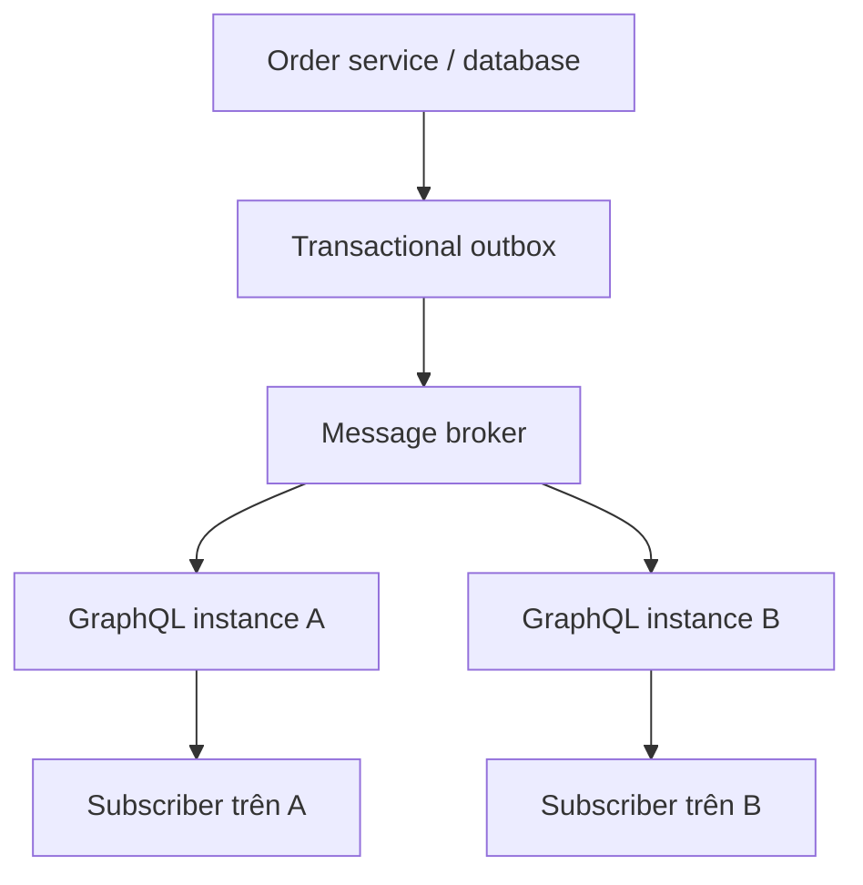

# Subscription event source trong Spring for GraphQL

Trong GraphQL, Subscription cho phép client đăng ký nhận các kết quả mới khi một sự kiện xảy ra. Phương thức `@SubscriptionMapping` thường trả về một `Publisher<T>` như Reactor `Flux<T>`. Publisher này là **event source**: nó cung cấp các giá trị theo thời gian để GraphQL thực thi selection set và gửi từng kết quả về client.

Spring for GraphQL đảm nhiệm việc nối Publisher với quá trình thực thi Subscription. Ứng dụng vẫn phải quyết định sự kiện đến từ đâu, cách lọc theo tài nguyên, cách phân phối tới từng subscriber và cách giải phóng tài nguyên khi client hủy đăng ký. Event source có thể là luồng trong bộ nhớ, Spring application event, message broker hoặc một dịch vụ streaming bên ngoài.

## Event source nằm ở đâu trong kiến trúc Subscription?

Một subscription thường có ba phần:

- **Event producer:** nơi phát sinh sự kiện nghiệp vụ, ví dụ đơn hàng chuyển trạng thái hoặc tồn kho thay đổi.
- **Event source:** cung cấp `Publisher` cho từng lần đăng ký, lọc hoặc chuyển đổi sự kiện thành payload GraphQL.
- **GraphQL Subscription resolver:** phương thức `@SubscriptionMapping` trả Publisher cho GraphQL runtime.

Transport như WebSocket chịu trách nhiệm truyền các execution result tới client. Transport không tự tạo sự kiện nghiệp vụ và cũng không thay thế event source.



Ví dụ: khi đơn hàng `ORD-1001` chuyển từ `PAID` sang `PACKING`, producer phát một event. Event source cung cấp event đó cho các subscriber đang theo dõi đơn hàng. GraphQL chỉ trả về những field client đã chọn, chẳng hạn `orderId`, `status` và `changedAt`.

## Khai báo Subscription trong SDL

Schema định nghĩa field mà client có thể đăng ký và kiểu payload được phát cho mỗi event:

```graphql
type OrderStatusChanged {
  eventId: ID!
  orderId: ID!
  previousStatus: String
  status: String!
  changedAt: String!
}

type Subscription {
  orderStatusChanged(orderId: ID!): OrderStatusChanged!
}
```

Client đăng ký theo dõi một đơn hàng:

```graphql
subscription WatchOrder($orderId: ID!) {
  orderStatusChanged(orderId: $orderId) {
    eventId
    orderId
    previousStatus
    status
    changedAt
  }
}
```

Một Subscription operation chọn một field cấp cao nhất. Khi event source phát một payload, GraphQL thực thi selection set trên payload đó và tạo một execution result. Quá trình này lặp lại cho tới khi Publisher hoàn tất, phát lỗi hoặc subscription bị hủy.

## Định nghĩa event và event source service

Nên mô hình hóa event bằng một kiểu dữ liệu riêng. Ví dụ dùng Java record:

```java
import java.time.Instant;

public record OrderStatusChanged(
        String eventId,
        String tenantId,
        String orderId,
        String previousStatus,
        String status,
        Instant changedAt) {
}
```

`tenantId` là metadata nội bộ để lọc event theo phạm vi tenant; không cần công bố field này trong GraphQL SDL nếu client không có nhu cầu đọc nó.

Event source nên cung cấp một phương thức trả Publisher theo tiêu chí đăng ký:

```java
import reactor.core.publisher.Flux;

public interface OrderEventSource {
    Flux<OrderStatusChanged> eventsForOrder(String tenantId, String orderId);
}
```

Interface này tách controller khỏi công nghệ phát sự kiện. Implementation có thể dùng Reactor sink trong ứng dụng đơn giản hoặc đọc từ Kafka/RabbitMQ trong hệ thống phân tán. Controller chỉ cần biết cách lấy luồng sự kiện.

## Event source trong bộ nhớ bằng Reactor Sinks

Đối với demo hoặc ứng dụng một instance, có thể dùng `Sinks.Many<T>` làm nguồn phát sự kiện và `Flux` làm luồng cho subscriber:

```java
import org.springframework.stereotype.Component;
import reactor.core.publisher.Flux;
import reactor.core.publisher.Sinks;

@Component
public class InMemoryOrderEventSource implements OrderEventSource {

    private final Sinks.Many<OrderStatusChanged> sink =
            Sinks.many().multicast().onBackpressureBuffer();

    @Override
    public Flux<OrderStatusChanged> eventsForOrder(String tenantId, String orderId) {
        return sink.asFlux()
                .filter(event -> event.tenantId().equals(tenantId))
                .filter(event -> event.orderId().equals(orderId));
    }

    public Sinks.EmitResult publish(OrderStatusChanged event) {
        return sink.tryEmitNext(event);
    }
}
```

`multicast()` phân phối event tới các subscriber đang đăng ký. `asFlux()` tạo view reactive để controller hoặc service tiêu thụ. `filter` giữ lại event có cả `tenantId` và `orderId` phù hợp với subscription hiện tại.

Đoạn code là event source đơn giản để học và thử nghiệm. Một sink trong bộ nhớ chỉ tồn tại trong một JVM; khi ứng dụng khởi động lại, event cũ mất. Nếu chạy nhiều instance, subscriber kết nối vào instance A sẽ không tự nhận event được phát trên instance B. Hệ thống production cần event broker hoặc cơ chế phân phối dùng chung khi yêu cầu trải rộng nhiều node.

### Kiểm tra kết quả khi phát event

Không bỏ qua kết quả từ `tryEmitNext`. `Sinks.EmitResult` cho biết việc phát thành công hay thất bại, ví dụ do không có subscriber theo cấu hình sink, sink đã kết thúc hoặc có thao tác emit đồng thời không được serialize.

Trong production, không nên tùy tiện ném exception ngược về luồng cập nhật nghiệp vụ chỉ vì một subscriber tạm thời chậm hoặc đã ngắt kết nối. Hãy xác định chính sách phát event: retry, queue, ghi outbox, log/metric hoặc chuyển sang broker. Cũng cần bảo đảm nhiều thread phát đồng thời được xử lý theo chính sách concurrency phù hợp; `tryEmitNext` có thể trả về lỗi serialization nếu emit đồng thời.

### Chọn loại sink và chính sách buffer

Reactor có nhiều loại sink với semantics khác nhau. Việc chọn sink ảnh hưởng tới subscriber và cách xử lý tải:

| Loại nguồn | Đặc điểm | Khi phù hợp |
| --- | --- | --- |
| `multicast().onBackpressureBuffer()` | Phát tới nhiều subscriber, có buffer cho subscriber tiêu thụ chậm theo giới hạn/cấu hình của sink. | Event fan-out trong demo hoặc luồng nội bộ có chính sách buffer rõ ràng. |
| `multicast().directBestEffort()` | Ưu tiên subscriber đang có demand; subscriber chậm có thể bỏ lỡ phần tử. | Chỉ dùng khi cho phép mất event trung gian. |
| `replay().limit(n)` | Subscriber mới có thể nhận lại một số phần tử gần nhất. | Demo cần replay ngắn trong bộ nhớ, không phải lưu trữ bền vững. |
| `unicast()` | Một subscriber tiêu thụ một luồng. | Nguồn riêng cho một consumer, không phải broadcast cho nhiều client. |

Không chọn `directBestEffort` nếu mọi thay đổi trạng thái đều phải được giao. Không coi replay sink trong bộ nhớ là event log bền vững. Buffer phải có giới hạn và chính sách overflow; nếu không, subscriber chậm có thể làm tăng bộ nhớ hoặc làm producer thất bại.

## Phát event từ luồng nghiệp vụ

Event source cần được nối với nơi trạng thái nghiệp vụ thay đổi. Ví dụ service cập nhật đơn hàng rồi phát event:

```java
import java.time.Instant;
import java.util.UUID;
import org.springframework.stereotype.Service;
import org.springframework.transaction.annotation.Transactional;
import reactor.core.publisher.Sinks;

@Service
public class OrderService {

    private final OrderRepository orderRepository;
    private final InMemoryOrderEventSource eventSource;

    public OrderService(
            OrderRepository orderRepository,
            InMemoryOrderEventSource eventSource) {
        this.orderRepository = orderRepository;
        this.eventSource = eventSource;
    }

    @Transactional
    public Order changeStatus(String orderId, String nextStatus) {
        Order order = orderRepository.findById(orderId).orElseThrow();
        String previousStatus = order.getStatus();
        order.setStatus(nextStatus);

        Order saved = orderRepository.save(order);
        Sinks.EmitResult emitResult = eventSource.publish(new OrderStatusChanged(
                UUID.randomUUID().toString(),
                saved.getTenantId(),
                saved.getId(),
                previousStatus,
                saved.getStatus(),
                Instant.now()));
        if (emitResult.isFailure()) {
            // Demo: ghi nhận failure. Production cần retry/outbox/broker theo yêu cầu.
        }

        return saved;
    }
}
```

Ví dụ trên dễ hiểu nhưng có một điểm cần cân nhắc: event được phát trước khi transaction commit. Nếu transaction rollback sau khi emit, subscriber có thể nhận một trạng thái chưa từng được commit vào database.

Với hệ thống cần nhất quán, chỉ phát event sau khi transaction commit. Có thể dùng `@TransactionalEventListener(phase = TransactionPhase.AFTER_COMMIT)` để chuyển domain event sang event source sau commit, hoặc dùng Transactional Outbox khi cần độ tin cậy cao giữa database và broker.

### Chỉ phát sau khi transaction commit

Service có thể publish một application event trong transaction:

Đoạn dưới là phần thân phương thức trong service đã inject `ApplicationEventPublisher`:

```java
@Transactional
public Order changeStatus(String orderId, String nextStatus) {
    Order order = orderRepository.findById(orderId).orElseThrow();
    String previousStatus = order.getStatus();
    order.setStatus(nextStatus);

    Order saved = orderRepository.save(order);
    applicationEventPublisher.publishEvent(new OrderStatusChanged(
            UUID.randomUUID().toString(),
            saved.getTenantId(),
            saved.getId(),
            previousStatus,
            saved.getStatus(),
            Instant.now()));

    return saved;
}
```

Listener chỉ chuyển event vào sink sau commit:

```java
import org.springframework.stereotype.Component;
import org.springframework.transaction.event.TransactionPhase;
import org.springframework.transaction.event.TransactionalEventListener;
import org.slf4j.Logger;
import org.slf4j.LoggerFactory;
import reactor.core.publisher.Sinks;

@Component
public class OrderEventForwarder {

    private static final Logger log = LoggerFactory.getLogger(OrderEventForwarder.class);

    private final InMemoryOrderEventSource eventSource;

    public OrderEventForwarder(InMemoryOrderEventSource eventSource) {
        this.eventSource = eventSource;
    }

    @TransactionalEventListener(phase = TransactionPhase.AFTER_COMMIT)
    public void onOrderStatusChanged(OrderStatusChanged event) {
        Sinks.EmitResult result = eventSource.publish(event);
        if (result.isFailure()) {
            log.error("Could not publish order event {}: {}", event.eventId(), result);
            // Production: retry hoặc ghi nhận để phát lại từ outbox/broker.
        }
    }
}
```

`@TransactionalEventListener` mặc định chỉ chạy khi có transaction đang hoạt động và transaction hoàn tất theo phase đã chọn. Nếu event phải được bảo toàn kể cả khi process chết ngay sau commit nhưng trước khi listener phát lên sink, application event trong bộ nhớ vẫn chưa đủ; Transactional Outbox và broker bền vững phù hợp hơn.

## Kết nối event source với `@SubscriptionMapping`

Controller nhận argument của subscription, kiểm tra quyền truy cập và trả luồng từ event source:

```java
import java.security.Principal;
import org.springframework.graphql.data.method.annotation.Argument;
import org.springframework.graphql.data.method.annotation.SubscriptionMapping;
import org.springframework.stereotype.Controller;
import reactor.core.publisher.Flux;

@Controller
public class OrderSubscriptionController {

    private final OrderEventSource eventSource;
    private final OrderAuthorizationService authorizationService;

    public OrderSubscriptionController(
            OrderEventSource eventSource,
            OrderAuthorizationService authorizationService) {
        this.eventSource = eventSource;
        this.authorizationService = authorizationService;
    }

    @SubscriptionMapping
    public Flux<OrderStatusChanged> orderStatusChanged(
            @Argument("orderId") String orderId,
            Principal principal) {

        authorizationService.checkCanReadOrder(principal, orderId);
        String tenantId = authorizationService.tenantFor(principal);
        return eventSource.eventsForOrder(tenantId, orderId);
    }
}
```

Spring for GraphQL dùng Publisher trả về từ phương thức làm nguồn cho field Subscription. `@SubscriptionMapping` mặc định suy luận tên field từ tên phương thức; có thể chỉ rõ tên nếu schema sử dụng tên khác.

Kiểm tra quyền trước khi trả Publisher giúp từ chối ngay những đăng ký không hợp lệ. Nếu quyền có thể bị thu hồi khi stream đang chạy, cần chính sách revalidation, timeout hoặc hủy subscription khi quyền thay đổi.

## Lọc event theo subscriber

Mỗi subscription có thể theo dõi một tài nguyên, tenant hoặc loại event khác nhau. Event source cần bảo đảm subscriber chỉ nhận các event thuộc phạm vi được phép.

Với sink dùng chung, ví dụ có thể lọc theo `orderId` trong `eventsForOrder`. Trong ứng dụng đa tenant, lọc phải bao gồm tenant đã xác thực từ principal hoặc server context, không lấy tenant ID do client tự khai báo làm bằng chứng quyền:

Trong ví dụ `OrderStatusChanged` có `tenantId` nội bộ và `eventsForOrder` lọc theo cả tenant lẫn order ID. Controller lấy tenant từ danh tính đã xác thực sau khi kiểm tra quyền. Một lựa chọn khác là tạo channel/topic riêng theo tenant hoặc dùng broker subscription filter để giảm lượng event phải phát qua từng subscriber.

Không nên broadcast toàn bộ event nhạy cảm tới mọi client rồi chỉ dựa vào GraphQL selection set để che field. Selection set quyết định field nào được serialize; nó không phải cơ chế authorization. Quyền truy cập phải được kiểm tra trước khi phát payload hoặc trong resolver của field nhạy cảm.

### Một sink chung hay một nguồn cho từng key?

Một sink chung dễ triển khai nhưng mỗi subscriber có thể phải nhận và lọc rất nhiều event không liên quan. Khi lượng event tăng, chi phí filter trên từng subscriber tăng theo tổng lưu lượng.

Các cách mở rộng thường gặp:

- Partition event theo `orderId`, tenant hoặc loại event.
- Tạo publisher theo key và quản lý vòng đời khi subscriber đầu tiên đăng ký và subscriber cuối cùng hủy.
- Dùng broker topic/partition và consumer subscription phù hợp với mô hình phân phối.
- Đẩy filter xuống event source hoặc broker thay vì broadcast rồi lọc toàn bộ trong JVM.

Nếu tạo map sink theo key, phải xóa entry khi không còn subscriber và xử lý race giữa đăng ký, hủy và publish. Không để map các Publisher tồn tại vô hạn theo mọi ID từng xuất hiện.

## Hot publisher, cold publisher và nhiều subscriber

Hiểu hot/cold giúp dự đoán client nhận được event nào:

| Loại Publisher | Hành vi | Hệ quả với Subscription |
| --- | --- | --- |
| Cold | Mỗi lần subscribe có thể tạo một luồng hoặc phép đọc độc lập. | Mỗi client có thể có nguồn dữ liệu riêng. |
| Hot | Event được phát độc lập với từng subscriber. | Client chỉ nhận event trong khoảng thời gian đã đăng ký, trừ khi nguồn có replay. |

Reactor `Sinks.Many` thường được dùng để tạo hot source. Một `Flux` được tạo từ `Flux.defer` hoặc từ thao tác đọc riêng có thể tạo nguồn cold. Chọn theo yêu cầu nghiệp vụ: bảng điều khiển trạng thái trực tiếp thường chấp nhận hot stream; luồng cần đọc lại lịch sử nên dựa vào event log hoặc API truy vấn lịch sử.

Subscription không tự động phát lại các event xảy ra trước khi client đăng ký. Nếu cần đồng bộ trạng thái ban đầu và nhận cập nhật liên tục, thiết kế một quy trình rõ ràng, ví dụ Query lấy snapshot kèm sequence number rồi Subscription nhận event có sequence lớn hơn snapshot. Cần xử lý khoảng trống và trùng lặp giữa hai bước.

## Nhiều instance và message broker

Event source trong bộ nhớ chỉ phù hợp khi producer và subscriber nằm trong cùng process. Trong hệ thống có nhiều instance, event source cần một cơ chế phân phối chung.

Ví dụ kiến trúc:



Kafka, RabbitMQ hoặc một hệ thống pub/sub tương đương có thể làm lớp phân phối. Event source adapter đọc event từ broker và trả Publisher cho subscription. Cần chọn semantics consumer phù hợp: mỗi GraphQL instance cần nhận bản sao event để fan-out tới subscriber cục bộ, hoặc dùng một subscription group/consumer strategy được thiết kế cho mô hình routing tương ứng.

Không cấu hình cùng một consumer group theo kiểu cạnh tranh nếu mong muốn mọi GraphQL instance đều nhận mọi event để phục vụ subscriber cục bộ. Với Kafka, consumer trong cùng group chia partition giữa các member; để broadcast tới nhiều instance, cần chiến lược group/consumer riêng hoặc một lớp fan-out phù hợp.

Broker cũng không tự giải quyết authorization. Event source vẫn cần kiểm tra tenant, tài nguyên và danh tính subscriber trước khi phát dữ liệu.

## Event ordering, duplicate và replay

Event source cần xác định semantics giao nhận:

- **Ordering:** event của cùng một đơn hàng có cần giữ đúng thứ tự hay không? Nếu có, partition theo order ID hoặc dùng sequence number.
- **Duplicate:** broker có thể giao lại event. Payload nên có `eventId` để client hoặc service nhận biết sự kiện đã xử lý.
- **Replay:** nếu client reconnect, có thể cần cursor/sequence để đọc tiếp từ vị trí đã nhận.
- **Delivery guarantee:** at-most-once, at-least-once hay exactly-once ở cấp nghiệp vụ? Không nên tuyên bố exactly-once chỉ vì dùng GraphQL Subscription.

GraphQL Subscription là cơ chế truyền kết quả tới client, không phải message log có đảm bảo lưu trữ. Nếu cần replay, event source phải hỗ trợ đọc từ cursor hoặc broker offset; schema có thể nhận `afterEventId` hoặc `afterSequence` để client yêu cầu tiếp tục.

Ví dụ schema hỗ trợ cursor:

```graphql
type Subscription {
  orderStatusChanged(
    orderId: ID!
    afterEventId: ID
  ): OrderStatusChanged!
}
```

Resolver có thể truyền cursor tới event source để chỉ phát event sau vị trí đó. Cần xác định hành vi khi cursor hết hạn hoặc không tồn tại, và tránh bỏ sót event giữa snapshot ban đầu với lúc đăng ký stream.

## Backpressure và subscriber chậm

Event producer có thể phát nhanh hơn tốc độ subscriber nhận hoặc xử lý. Nếu event source buffer không giới hạn, một subscriber chậm có thể làm bộ nhớ tăng liên tục.

Các chính sách phổ biến:

- **Buffer có giới hạn:** giữ event trong một giới hạn; khi đầy, từ chối, drop hoặc báo lỗi theo chính sách.
- **Drop:** bỏ event khi subscriber không theo kịp; chỉ phù hợp nếu event trung gian không quan trọng.
- **Latest:** chỉ giữ trạng thái mới nhất; phù hợp dashboard chỉ cần snapshot hiện tại.
- **Disconnect:** đóng subscription chậm và cho client reconnect/replay từ cursor.
- **Durable queue:** lưu event trong broker để consumer đọc theo tốc độ của mình.

Không dùng `onBackpressureBuffer` với giả định buffer luôn vô hạn và không thể đầy. Không dùng `latest` hoặc drop cho sự kiện tài chính, kiểm toán hay quy trình cần đủ lịch sử. Chính sách phải xuất phát từ yêu cầu dữ liệu.

## Cancellation và cleanup

Khi client hủy operation hoặc đóng kết nối, GraphQL runtime hủy subscription stream. Event source cần truyền cancellation về nguồn để giải phóng tài nguyên.

Các tài nguyên có thể cần cleanup:

- Listener đăng ký trên event bus.
- Consumer hoặc subscription handle của broker.
- Timer, polling task hoặc kết nối tới dịch vụ streaming.
- Entry trong map publisher theo key.
- Buffer riêng cho subscriber.

Với Reactor, có thể quan sát vòng đời bằng `doFinally`:

```java
public Flux<OrderStatusChanged> eventsForOrder(String orderId) {
    return createOrderStream(orderId)
            .doFinally(signal -> releaseSubscriberResources(orderId, signal));
}
```

Với callback API, `Flux.create` hoặc `Flux.push` cần đăng ký `sink.onCancel(...)`/`sink.onDispose(...)` để gỡ listener. Với Kotlin Flow, `callbackFlow` và `awaitClose` là cách tương ứng. Không tạo listener trước khi Publisher được subscribe rồi quên gỡ khi client rời đi.

Nếu nhiều subscriber cùng dùng một nguồn chung, cancellation của một subscriber không được đóng nguồn dùng chung khi những subscriber khác vẫn cần nó. Cleanup phải gắn với đúng subscription hoặc dùng reference count phù hợp.

## Xử lý lỗi và hoàn tất stream

Event source có thể kết thúc theo ba cách:

- **Emit event:** phát một payload để GraphQL tạo execution result.
- **Complete:** nguồn kết thúc bình thường; client không nhận thêm event từ operation đó.
- **Error:** nguồn phát lỗi; GraphQL kết thúc stream và client nhận thông tin lỗi theo transport.

Phân biệt lỗi nguồn với trường hợp không có event. Một stream đang mở nhưng chưa phát event không phải là lỗi và cũng không phải là `null` payload. Nếu event source gặp lỗi broker tạm thời, có thể retry bên trong service hoặc kết thúc stream để client reconnect; quyết định phụ thuộc semantics và khả năng replay.

Không để lộ exception message từ broker, SQL hoặc thông tin hạ tầng. Dùng cơ chế xử lý lỗi của Spring for GraphQL để chuẩn hóa lỗi trước khi gửi cho client.

## Kiểm thử event source và Subscription

Nên kiểm thử riêng event source và kiểm thử tích hợp qua GraphQL:

**Kiểm thử event source** xác minh:

- Publisher phát event khi producer gọi publish.
- Filter theo order ID hoặc tenant hoạt động đúng.
- Nhiều subscriber nhận đúng event theo semantics đã chọn.
- Event không được phát cho subscriber không thuộc phạm vi.
- `tryEmitNext` failure được xử lý.
- Subscriber hủy thì listener và tài nguyên được cleanup.
- Buffer overflow, lỗi nguồn và complete có hành vi xác định.

Có thể dùng Reactor `StepVerifier` để kiểm tra luồng:

```java
import static org.assertj.core.api.Assertions.assertThat;
import reactor.core.publisher.Sinks;
import reactor.test.StepVerifier;

@Test
void emitsOnlyEventsForRequestedOrder() {
    Flux<OrderStatusChanged> events = eventSource.eventsForOrder("TENANT-A", "ORD-1001");

    StepVerifier.create(events)
            .then(() -> {
                assertThat(eventSource.publish(event("TENANT-A", "ORD-2002", "SHIPPED")))
                        .isEqualTo(Sinks.EmitResult.OK);
                assertThat(eventSource.publish(event("TENANT-A", "ORD-1001", "PACKING")))
                        .isEqualTo(Sinks.EmitResult.OK);
            })
            .assertNext(event -> {
                assertThat(event.orderId()).isEqualTo("ORD-1001");
                assertThat(event.status()).isEqualTo("PACKING");
            })
            .thenCancel()
            .verify();
}
```

Đây là test minh họa cho sink multicast trong bộ nhớ; fixture `event(...)` là factory do test định nghĩa. Với sink có semantics buffer hoặc subscriber demand khác nhau, hãy thiết lập subscriber trước khi publish và kiểm tra kết quả emit rõ ràng.

**Kiểm thử GraphQL Subscription** nên xác minh:

- Client đăng ký field đúng tên và argument được bind đúng.
- Event source phát nhiều event và GraphQL chỉ trả field được chọn.
- User không có quyền bị từ chối trước khi đăng ký nguồn.
- Tenant hoặc order khác không rò rỉ event.
- Client gửi complete/cancel thì nguồn giải phóng tài nguyên.
- Lỗi từ event source kết thúc operation theo hợp đồng.
- WebSocket reconnect và cursor/replay hoạt động đúng nếu ứng dụng hỗ trợ.

Với Spring for GraphQL, dùng `WebSocketGraphQlTester` để kiểm thử qua WebSocket transport. Unit test chỉ gọi trực tiếp `@SubscriptionMapping` không chứng minh transport, protocol và cancellation lifecycle hoạt động đầy đủ.

## Lỗi thường gặp

| Triệu chứng | Nguyên nhân | Cách xử lý |
| --- | --- | --- |
| Client đăng ký nhưng không nhận event | Producer chưa publish vào đúng event source hoặc subscriber kết nối vào instance khác. | Kiểm tra wiring và dùng broker dùng chung khi chạy nhiều instance. |
| Client nhận event của đơn hàng khác | Event source lọc thiếu theo resource hoặc tenant. | Lọc theo danh tính/phạm vi đã xác thực ở server. |
| Event trước khi đăng ký bị mất | Dùng hot Publisher không có replay. | Dùng event log/cursor hoặc cung cấp Query snapshot. |
| Subscriber chậm làm tăng bộ nhớ | Buffer không giới hạn hoặc không có chính sách overflow. | Giới hạn buffer, drop có chủ đích hoặc dùng durable broker. |
| Một client hủy làm các client khác mất stream | Cleanup đóng nguồn multicast dùng chung. | Quản lý cancellation theo subscriber và reference count. |
| Event phát dù transaction rollback | Publish trước commit. | Phát sau commit hoặc dùng Transactional Outbox. |
| Mất event khi chạy nhiều instance | Sink chỉ tồn tại trong một JVM. | Dùng broker hoặc event distribution layer. |
| Event sai thứ tự hoặc bị trùng | Broker/consumer không có partition key hoặc event ID. | Dùng sequence, partition theo resource và xử lý duplicate. |
| `tryEmitNext` trả failure | Sink đã kết thúc, không có subscriber theo semantics hiện tại hoặc emit đồng thời. | Kiểm tra `EmitResult`, serialize producer và định nghĩa retry/error policy. |

## Ghi nhớ

Event source là Publisher cung cấp các event cho field GraphQL Subscription. Producer phát domain event; event source lọc và phân phối event; `@SubscriptionMapping` trả Publisher cho GraphQL runtime; transport như WebSocket chuyển từng execution result tới client.

Reactor `Sinks.Many` phù hợp demo hoặc fan-out trong một JVM, nhưng không có persistence và không tự chia sẻ event giữa nhiều instance. Hệ thống cần độ tin cậy nên phát event sau transaction commit, cân nhắc Transactional Outbox và broker, đồng thời thiết kế ordering, duplicate, replay, backpressure và cancellation. Luôn kiểm tra authorization theo resource/tenant trước khi phân phối event và kiểm thử cả event source lẫn vòng đời GraphQL Subscription.

## Tài liệu tham khảo

- [Spring for GraphQL — Subscription](https://docs.spring.io/spring-graphql/reference/transports.html)
- [Spring for GraphQL — Annotated Controllers](https://docs.spring.io/spring-graphql/reference/controllers.html)
- [Project Reactor — Sinks](https://projectreactor.io/docs/core/release/reference/coreFeatures/sinks.html)
- [Spring Framework — Transaction-bound Events](https://docs.spring.io/spring-framework/reference/data-access/transaction/event.html)
