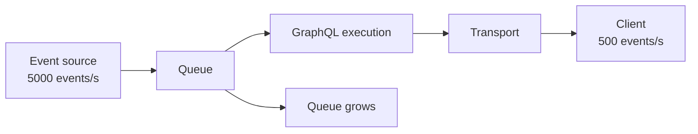
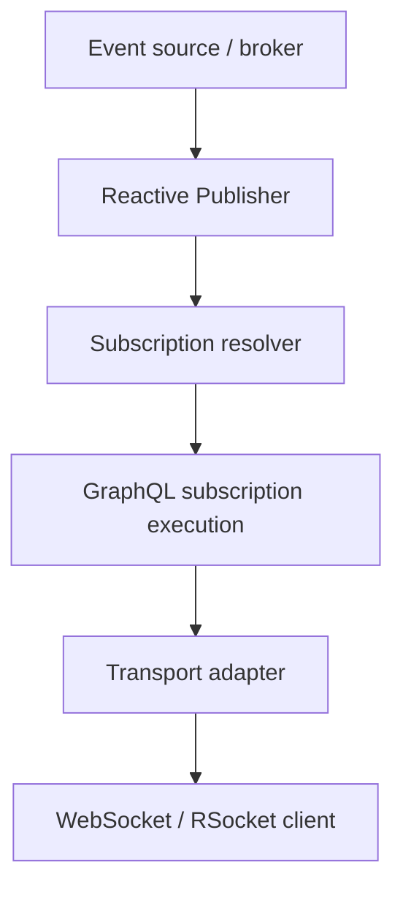
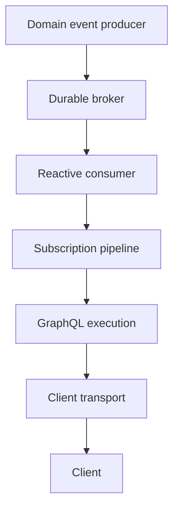

# Backpressure trong subscription

GraphQL subscription tạo một luồng kết quả có thể phát nhiều event trong suốt thời gian client đăng ký. Nếu nguồn event phát nhanh hơn khả năng xử lý hoặc truyền dữ liệu của subscriber, hệ thống có thể tích tụ hàng đợi, tăng bộ nhớ, tăng độ trễ hoặc phải bỏ dữ liệu. Backpressure là cơ chế điều tiết tốc độ phát giữa publisher và subscriber để một thành phần không bị buộc phải xử lý nhiều dữ liệu hơn khả năng của nó.

Spring for GraphQL hỗ trợ subscription thông qua reactive `Publisher`, thường là `Flux` trong ứng dụng Reactor. Khi resolver trả về một publisher, GraphQL Java thực thi selection set cho từng event và phát các execution result tương ứng. Backpressure giúp quản lý luồng dữ liệu trong pipeline reactive, nhưng hiệu quả đầu cuối còn phụ thuộc transport, broker và cách từng tầng truyền demand.

Sau bài này, bạn có thể:

- Hiểu demand và backpressure trong Reactive Streams.
- Triển khai subscription trả về `Flux` trong Spring for GraphQL.
- Nhận biết slow subscriber và các dấu hiệu quá tải.
- Chọn giữa truyền demand, buffer, drop, latest và giới hạn tốc độ.
- Thiết kế queue hữu hạn và chính sách overflow.
- Quản lý cancellation, cleanup và vòng đời subscription.
- Tích hợp nguồn event nóng, broker và pipeline xử lý bất đồng bộ.
- Kiểm thử backpressure bằng Reactor Test và kiểm thử transport.

## 1. Subscription tạo ra một luồng dữ liệu

Query thường trả một kết quả cho một lần thực thi. Subscription đăng ký nhận các kết quả phát sinh theo thời gian, ví dụ trạng thái đơn hàng thay đổi, giá thị trường cập nhật hoặc một tài liệu được chỉnh sửa.

SDL có thể khai báo:

```graphql
type Subscription {
    orderStatusChanged(orderId: ID!): OrderEvent!
}

type OrderEvent {
    orderId: ID!
    status: String!
    occurredAt: String!
}
```

Resolver Spring for GraphQL trả về `Flux<OrderEvent>`:

```java
@Controller
public class OrderSubscriptionController {

    private final OrderEventService eventService;

    public OrderSubscriptionController(OrderEventService eventService) {
        this.eventService = eventService;
    }

    @SubscriptionMapping
    public Flux<OrderEvent> orderStatusChanged(
            @Argument String orderId) {
        return eventService.eventsFor(orderId);
    }
}
```

Method subscription được gọi khi client đăng ký operation. Publisher sau đó phát nhiều event; với mỗi event, GraphQL thực thi selection set và tạo một kết quả GraphQL tương ứng. Client có thể tiếp tục nhận event cho đến khi stream hoàn tất, lỗi hoặc bị hủy.

## 2. Backpressure là gì?

Trong Reactive Streams, subscriber báo cho publisher biết nó sẵn sàng nhận bao nhiêu phần tử bằng demand. Subscriber gọi `request(n)` để yêu cầu tối đa `n` phần tử. Publisher không được phát nhiều hơn số phần tử đã được yêu cầu.

Ví dụ subscriber yêu cầu từng phần tử:

```text
Subscriber                 Publisher
    |                          |
    |------ request(1) ------->|
    |<------- onNext(A) -------|
    |                          |
    |------ request(2) ------->|
    |<------- onNext(B) -------|
    |<------- onNext(C) -------|
```

Demand là số phần tử mà subscriber sẵn sàng nhận, không phải tốc độ tính bằng giây. Khi subscriber chưa yêu cầu thêm phần tử, publisher phải giữ lại, điều tiết hoặc áp dụng chính sách phù hợp thay vì đẩy dữ liệu vượt demand.

Trong Reactor, `Flux` và `Mono` triển khai Reactive Streams. Các toán tử như `map`, `filter`, `concatMap` và nhiều toán tử khác có thể truyền demand ngược lên upstream. Đây là cơ sở để pipeline điều tiết tải.

## 3. Vì sao subscription cần backpressure?

Giả sử một nguồn event phát 5.000 event mỗi giây, trong khi client hoặc pipeline xử lý chỉ tiêu thụ được 500 event mỗi giây. Nếu server cứ giữ mọi event trong bộ nhớ, số phần tử chờ sẽ tăng khoảng 4.500 event mỗi giây.



Hệ quả có thể gồm:

- Bộ nhớ tăng dần do queue không được tiêu thụ kịp.
- Độ trễ tăng; event đến client quá muộn để còn hữu ích.
- Nhiều subscription cùng hoạt động làm áp lực tài nguyên tăng nhanh.
- Thread, connection hoặc broker consumer bị giữ lâu.
- Khi process hết bộ nhớ hoặc queue tràn, request khác cũng có thể bị ảnh hưởng.

Backpressure giúp hệ thống điều chỉnh lượng dữ liệu đang lưu chuyển. Tuy nhiên, nó không tự quyết định event nào quan trọng, có được bỏ dữ liệu hay phải lưu để phát lại. Những quyết định đó thuộc chính sách nghiệp vụ và nguồn event.

## 4. Backpressure trong luồng Spring for GraphQL

Luồng xử lý subscription có thể được hình dung như sau:



Các tầng có thể tham gia điều tiết:

1. **Nguồn event:** broker hoặc service có thể hỗ trợ demand, prefetch, pause/resume hoặc replay.
2. **Reactive pipeline:** Reactor truyền demand và cung cấp toán tử buffer/drop/limit.
3. **GraphQL execution:** mỗi event được chuyển thành execution result theo selection set.
4. **Transport:** WebSocket hoặc RSocket chuyển kết quả đến client và có cơ chế buffering riêng.
5. **Client:** giải mã, cập nhật UI hoặc xử lý dữ liệu.

Reactive Streams demand có hiệu lực giữa các thành phần tham gia Reactive Streams. Không nên mặc định mọi GraphQL transport đều cung cấp cho ứng dụng client một API `request(n)` theo từng event. Ví dụ, giao thức GraphQL over WebSocket phổ biến dùng thông điệp subscribe/next/complete và không định nghĩa một frame demand riêng. Vì vậy, backpressure đầu cuối cần được xác minh theo transport, adapter và broker thực tế.

## 5. Truyền demand tự nhiên

Khi nguồn event là publisher có thể tuân thủ demand, cách đơn giản nhất là giữ pipeline reactive và không chuyển nó thành một luồng đẩy không kiểm soát:

```java
@SubscriptionMapping
public Flux<OrderEvent> orderStatusChanged(@Argument String orderId) {
    return eventService.eventsFor(orderId)
            .map(this::toPublicEvent)
            .limitRate(32);
}
```

`limitRate(32)` điều chỉnh cách Reactor yêu cầu dữ liệu từ upstream theo các nhóm nhỏ, giúp kiểm soát lượng demand được chuyển tiếp. Nó không phải giới hạn tốc độ theo giây và không có nghĩa client chỉ nhận tối đa 32 event trong toàn bộ subscription.

Nếu nguồn hỗ trợ backpressure thực sự, demand có thể truyền từ subscriber qua các operator về nguồn. Khi downstream chậm, upstream được yêu cầu ít dữ liệu hơn hoặc tạm dừng phát.

Không phải nguồn nào cũng hỗ trợ điều tiết. Một callback từ hệ thống ngoài hoặc một event bus nóng có thể phát độc lập với demand; lúc đó cần một chính sách queue/overflow rõ ràng.

## 6. Giới hạn tốc độ và giới hạn demand khác nhau

Hai mục tiêu này thường bị nhầm lẫn:

| Cơ chế | Kiểm soát điều gì? | Ví dụ |
| --- | --- | --- |
| Backpressure/demand | Số phần tử subscriber sẵn sàng nhận | `request(10)` |
| `limitRate` | Kích thước/nhịp nhóm request lên upstream | `limitRate(32)` |
| Rate limiting | Số event hoặc request trong một khoảng thời gian | Tối đa 100 event/giây |
| Sampling/throttling | Chọn hoặc giới hạn event theo thời gian | `sample(Duration.ofMillis(100))` |

`limitRate` không thay thế rate limiter. Nếu cần giới hạn event theo tenant hoặc theo người dùng, hãy dùng policy rate limiting riêng. Nếu cần gửi trạng thái mới nhất theo chu kỳ, sampling hoặc coalescing có thể phù hợp hơn việc xếp hàng mọi event.

## 7. Slow subscriber và các chiến lược xử lý

Khi nguồn không thể giảm tốc độ theo demand, server phải chọn cách xử lý event đến nhanh hơn downstream. Các chiến lược thường gặp:

| Chiến lược | Hành vi | Phù hợp với |
| --- | --- | --- |
| Buffer | Giữ event chờ xử lý | Event cần được giữ trong giới hạn bộ nhớ |
| Drop | Bỏ event khi downstream chưa sẵn sàng | Telemetry hoặc dữ liệu có thể mất |
| Latest | Chỉ giữ giá trị mới nhất đang chờ | Trạng thái snapshot, giá trị thay đổi liên tục |
| Error on overflow | Kết thúc stream khi queue đầy | Không thể tiếp tục an toàn khi mất dữ liệu |
| Source flow control | Tạm dừng hoặc giảm tốc độ nguồn | Broker/producer hỗ trợ pause/resume hoặc demand |

Không có chiến lược đúng cho mọi subscription. Ví dụ, bỏ một event cập nhật vị trí có thể chấp nhận được nếu event mới hơn chứa trạng thái đầy đủ; bỏ một sự kiện ghi nhận thanh toán có thể không chấp nhận được.

## 8. Buffer có giới hạn

Với nguồn nóng không thể tạm dừng, có thể dùng buffer có dung lượng tối đa và chọn hành vi khi overflow:

```java
@SubscriptionMapping
public Flux<OrderEvent> orderStatusChanged(@Argument String orderId) {
    return eventService.hotEventsFor(orderId)
            .onBackpressureBuffer(
                    256,
                    dropped -> metrics.increment("subscription.buffer.overflow"),
                    BufferOverflowStrategy.ERROR)
            .doFinally(signal -> log.debug(
                    "Order subscription finished: {}", signal));
}
```

Buffer tối đa 256 phần tử trong operator này. Khi vượt giới hạn, chiến lược `ERROR` kết thúc stream bằng lỗi overflow thay vì tiếp tục tăng bộ nhớ vô hạn. Ứng dụng cần ánh xạ và ghi nhận lỗi đó phù hợp với contract của subscription.

`onBackpressureBuffer` là một ranh giới buffering: operator có thể yêu cầu upstream phát không phụ thuộc demand downstream rồi lưu các phần tử đến trong queue. Do đó, thêm buffer không đồng nghĩa upstream đã được điều tiết. Dung lượng hữu hạn và chính sách overflow là điều bắt buộc để bảo vệ bộ nhớ.

Không dùng buffer vô hạn cho subscription có thể kéo dài hàng giờ hoặc hàng ngày. Một client chậm hoặc mất kết nối không được phép làm queue tăng mãi.

## 9. Drop event khi dữ liệu cũ không còn giá trị

Nếu mỗi event là một bản cập nhật trạng thái đầy đủ và event mới hơn thay thế được event cũ, có thể bỏ event khi downstream không theo kịp:

```java
@SubscriptionMapping
public Flux<PriceSnapshot> priceUpdates(@Argument String symbol) {
    return marketDataService.liveSnapshots(symbol)
            .onBackpressureDrop(dropped ->
                    metrics.increment("subscription.price.dropped"));
}
```

`onBackpressureDrop` bỏ phần tử đến khi downstream chưa có demand và có thể gọi callback để ghi nhận. Điều này phù hợp với snapshot hoặc telemetry mà mục tiêu là dữ liệu gần hiện tại.

Không dùng drop nếu mỗi event mang một thay đổi delta cần áp dụng tuần tự, ví dụ `balance += 10`. Bỏ một delta sẽ làm trạng thái phía client sai. Với delta, cần giữ event, phát lại từ nguồn bền vững hoặc gửi snapshot đầy đủ để client đồng bộ lại.

## 10. Chỉ giữ event mới nhất

Khi client chỉ cần trạng thái gần nhất, `onBackpressureLatest()` giữ lại giá trị mới nhất trong lúc downstream chưa sẵn sàng:

```java
@SubscriptionMapping
public Flux<DashboardState> dashboardState(@Argument String dashboardId) {
    return dashboardService.stateChanges(dashboardId)
            .onBackpressureLatest();
}
```

Nếu downstream chậm và nhiều state mới đến, các state chờ cũ bị thay thế bởi state mới hơn. Khi downstream yêu cầu thêm, nó nhận state mới nhất đang giữ.

Chiến lược này phù hợp với snapshot độc lập, ví dụ nhiệt độ hiện tại, trạng thái thiết bị hoặc tiến độ xử lý được cập nhật liên tục. Nó không phù hợp với event log, giao dịch hoặc chuỗi lệnh mà mọi phần tử đều cần được xử lý.

## 11. Hiểu thứ tự và vị trí của backpressure operator

Vị trí đặt operator ảnh hưởng đến nơi dữ liệu được giữ và nơi demand được điều tiết.

Ví dụ:

```java
source
    .limitRate(32)
    .map(this::transform);
```

Pipeline có thể truyền demand đã điều chỉnh về source nếu source hỗ trợ Reactive Streams.

Trong khi đó:

```java
hotSource
    .onBackpressureBuffer(256, onOverflow, BufferOverflowStrategy.ERROR)
    .limitRate(32);
```

Buffer là ranh giới nhận dữ liệu từ nguồn nóng và có thể yêu cầu upstream không phụ thuộc demand downstream. `limitRate` sau buffer điều tiết cách consumer lấy phần tử khỏi buffer, nhưng không làm nguồn nóng tự giảm tốc độ. Khi thiết kế pipeline, cần xác định rõ operator nào đang bảo vệ nguồn, operator nào đang giữ queue và operator nào chỉ điều chỉnh demand downstream.

Đừng thêm nhiều operator backpressure theo kiểu thử-sai. Hãy mô tả tốc độ nguồn, khả năng tiêu thụ, giới hạn bộ nhớ và chính sách dữ liệu bị bỏ trước khi chọn pipeline.

## 12. Buffering, prefetch và xử lý song song

Một số operator có thể prefetch hoặc xử lý song song. Nếu dùng `flatMap`, số inner publisher đồng thời và prefetch có ảnh hưởng đến lượng công việc đang bay:

```java
return eventService.eventsFor(orderId)
        .flatMap(this::enrichAsync, 8);
```

Ví dụ giới hạn tối đa 8 inner publisher hoạt động đồng thời. Nếu cần giữ thứ tự event, dùng `concatMap`:

```java
return eventService.eventsFor(orderId)
        .concatMap(this::enrichAsync);
```

`flatMap` có thể cho kết quả hoàn tất theo thứ tự khác thứ tự đầu vào; `concatMap` tuần tự hóa việc xử lý và giữ thứ tự nhưng có thể giảm throughput. Chọn theo yêu cầu nghiệp vụ.

Không để một pipeline xử lý song song không giới hạn. Khi mỗi event gọi service ngoài hoặc truy vấn database, concurrency lớn có thể làm quá tải hệ thống phụ thuộc ngay cả khi queue đầu vào có giới hạn.

## 13. Nguồn event nóng và lạnh

**Cold publisher** thường tạo hoặc bắt đầu công việc riêng cho mỗi subscriber. Ví dụ một `Flux` đọc dữ liệu theo yêu cầu hoặc `Flux.interval` tạo lịch phát riêng cho từng lần subscribe.

**Hot publisher** phát event độc lập với việc một subscriber có đang tiêu thụ hay không. Ví dụ callback từ thiết bị, event bus hoặc một sink dùng chung. Subscriber mới có thể chỉ nhận event từ thời điểm đăng ký, tùy semantics nguồn.

Khác biệt này ảnh hưởng trực tiếp đến backpressure:

- Cold source thường có khả năng đáp ứng demand bằng cách tạo dữ liệu theo yêu cầu.
- Hot source có thể không dừng được khi subscriber chậm; cần buffer, drop, latest hoặc cơ chế điều tiết riêng.
- Một hot source dùng chung nhiều subscriber cần policy cho subscriber chậm nhất, queue riêng theo subscriber hoặc multicast semantics phù hợp.

Không chia sẻ một mutable queue toàn cục cho mọi subscription nếu không có giới hạn và cô lập. Một subscriber chậm không nên làm cạn tài nguyên của tất cả subscriber khác.

## 14. Kết nối broker và nguồn event bền vững

Với event quan trọng, một queue trong bộ nhớ của process không đủ để bảo đảm không mất dữ liệu khi server restart hoặc client ngắt kết nối. Hãy cân nhắc nguồn event bền vững có khả năng replay, offset hoặc acknowledgment.

Ví dụ kiến trúc:



Khi broker hỗ trợ flow control, cấu hình prefetch/consumer demand hợp lý và có thể pause/resume theo tải. Với hệ thống theo partition, việc pause một partition hoặc consumer cần cân nhắc ảnh hưởng tới các subscription khác.

Nếu client cần nhận lại event sau khi reconnect, thiết kế cursor/offset hoặc resume token có kiểm tra quyền. GraphQL subscription transport không tự bảo đảm replay sau khi mất kết nối. Chính sách lưu giữ, xác nhận và phát lại thuộc broker/service.

Không xác nhận message đã xử lý chỉ vì event đã được đẩy vào queue trong bộ nhớ nếu nghiệp vụ yêu cầu xử lý bền vững. Xác định rõ acknowledgment diễn ra ở thời điểm nào và điều gì xảy ra khi GraphQL execution hoặc transport thất bại.

## 15. Cancellation và vòng đời subscription

Subscription có thể kết thúc khi:

- Client gửi thông điệp hoàn tất/hủy operation theo transport protocol.
- WebSocket hoặc RSocket connection đóng.
- Publisher phát `onComplete`.
- Publisher phát `onError`.
- Server chủ động hủy do timeout, authorization hoặc giới hạn tài nguyên.

Khi subscription bị hủy, reactive pipeline nên dừng việc tiêu thụ event và giải phóng listener, queue, broker consumer hoặc tài nguyên liên quan.

Ví dụ:

```java
@SubscriptionMapping
public Flux<OrderEvent> orderStatusChanged(@Argument String orderId) {
    return eventService.eventsFor(orderId)
            .doFinally(signal -> {
                if (signal == SignalType.CANCEL) {
                    metrics.increment("subscription.cancelled");
                }
            });
}
```

`doFinally` chạy khi stream kết thúc, lỗi hoặc bị hủy. Ví dụ chỉ ghi nhận cancellation; nếu `eventService` đăng ký listener hoặc consumer riêng cho subscription, publisher của nó phải tháo đúng registration đó khi bị cancel. Không giải phóng tài nguyên chỉ dựa trên `orderId` nếu nhiều subscriber có thể cùng theo dõi một đơn hàng.

Không dùng một boolean hoặc biến mutable singleton để đại diện trạng thái của tất cả subscriber. Mỗi subscription operation cần có vòng đời và tài nguyên riêng hoặc một cơ chế chia sẻ được quản lý rõ ràng.

## 16. Timeout, heartbeat và subscriber bị treo

Một subscription có thể không phát event trong thời gian dài nhưng vẫn còn hoạt động. Cần phân biệt stream im lặng hợp lệ với connection chết hoặc consumer bị treo.

Các biện pháp thường dùng:

- Cấu hình heartbeat/ping-pong ở WebSocket transport nếu transport hỗ trợ.
- Timeout cho nguồn hoặc operation theo yêu cầu nghiệp vụ.
- Theo dõi thời gian từ event phát đến event được gửi/tiêu thụ.
- Giới hạn số subscription đồng thời theo người dùng hoặc tenant.
- Hủy subscription khi authentication hết hạn hoặc quyền bị thu hồi theo policy.
- Giải phóng queue và consumer khi connection đóng.

Không áp dụng timeout ngắn cho mọi subscription vì một stream không có event trong vài phút có thể hoàn toàn bình thường. Timeout cần dựa trên semantics của từng loại dữ liệu và transport.

## 17. Lỗi overflow và xử lý lỗi stream

Khi buffer đầy và chính sách là `ERROR`, publisher phát lỗi và subscription kết thúc. Client nhận một lỗi execution/stream theo cách transport chuyển tải. Ứng dụng cần ghi nhận nguyên nhân overflow để biết hệ thống đang phát nhanh hơn khả năng tiêu thụ.

Có thể ánh xạ lỗi nội bộ thành exception có ý nghĩa:

```java
public class SubscriptionOverflowException extends RuntimeException {
    public SubscriptionOverflowException() {
        super("Subscription event buffer is full");
    }
}
```

Nếu dùng callback overflow, có thể chủ động phát metric và log metadata không nhạy cảm. Không ghi toàn bộ payload event vào log nếu event chứa dữ liệu riêng tư.

`onErrorResume` có thể chuyển một số lỗi có thể phục hồi thành trạng thái hoặc publisher thay thế, nhưng không nên biến mọi lỗi thành stream im lặng. Nếu stream đã mất event hoặc không còn nhất quán, kết thúc với lỗi rõ ràng thường an toàn hơn gửi dữ liệu giả.

## 18. Observability cho backpressure

Để biết subscription có đang quá tải hay không, cần đo cả nguồn, pipeline và transport. Các chỉ số hữu ích:

| Metric | Điều cần quan sát |
| --- | --- |
| Active subscriptions | Số subscription đang hoạt động |
| Event rate in/out | Tốc độ event đến và tốc độ event được xử lý |
| Queue size | Số event đang chờ trong buffer |
| Buffer overflow | Số lần queue chạm giới hạn |
| Dropped/latest replaced | Số event bị bỏ hoặc bị thay thế |
| End-to-end lag | Thời gian từ `occurredAt` đến lúc phát ra |
| Cancellation count | Số subscription bị client hoặc server hủy |
| Processing latency | Thời gian enrich/resolve mỗi event |
| Error rate | Lỗi nguồn, GraphQL execution và transport |

Không dùng ID người dùng, token hoặc dữ liệu nhạy cảm làm metric label có cardinality cao. Nếu cần phân tích theo tenant, dùng nhãn đã được kiểm soát hoặc log/trace có sampling phù hợp.

## 19. Kiểm thử backpressure bằng StepVerifier

Reactor Test cung cấp `StepVerifier` để mô phỏng subscriber yêu cầu dữ liệu theo từng đợt. Ví dụ kiểm tra demand ban đầu bằng 0:

```java
Flux<Integer> source = Flux.range(1, 3);

StepVerifier.create(source, 0)
        .thenRequest(1)
        .expectNext(1)
        .thenRequest(2)
        .expectNext(2, 3)
        .verifyComplete();
```

Test này xác nhận source không phát trước khi có demand và phát đúng số phần tử được yêu cầu.

Kiểm thử drop policy bằng `TestPublisher`, mô phỏng nguồn phát độc lập với demand downstream:

```java
TestPublisher<Integer> publisher = TestPublisher.create();
Flux<Integer> flux = publisher.flux().onBackpressureDrop();

StepVerifier.create(flux, 0)
        .then(() -> publisher.next(1, 2, 3))
        .thenRequest(1)
        .then(() -> publisher.next(4))
        .expectNext(4)
        .thenCancel()
        .verify();
```

Test này minh họa publisher phát khi downstream chưa có demand; các phần tử đến trong lúc không có demand bị drop, còn phần tử phát sau khi demand được cấp có thể được chuyển tiếp. Tùy cấu hình `TestPublisher` và phiên bản Reactor, có thể cần chọn chế độ non-compliant phù hợp để mô phỏng nguồn nóng không tuân thủ demand.

Ngoài unit test pipeline, cần integration test subscription qua transport thật để xác nhận cancellation, lỗi, reconnect và buffering ở adapter.

## 20. Những lỗi thường gặp

- **Cho rằng backpressure tự giải quyết mọi nguồn event:** nguồn nóng có thể không tuân thủ demand; cần buffer/drop/flow control.
- **Dùng buffer vô hạn:** subscriber chậm làm bộ nhớ tăng không giới hạn.
- **Không định nghĩa overflow policy:** queue đầy dẫn đến lỗi hoặc hành vi khó đoán.
- **Drop event giao dịch:** mất một delta có thể làm sai trạng thái nghiệp vụ.
- **Dùng latest cho event log:** các event trung gian bị thay thế và không thể khôi phục từ stream đó.
- **Nhầm `limitRate` với rate limiter:** limitRate điều chỉnh demand, không giới hạn số event mỗi giây.
- **Đặt buffer rồi nghĩ upstream đã được giảm tốc:** buffer có thể yêu cầu upstream không phụ thuộc demand downstream.
- **Xử lý song song không giới hạn:** quá nhiều inner publisher làm quá tải database hoặc service ngoài.
- **Không xử lý cancellation:** listener, consumer và queue còn tồn tại sau khi client rời đi.
- **Không phân biệt lỗi transport và lỗi GraphQL execution:** client có thể mất connection mà không nhận được GraphQL error cuối cùng.
- **Dùng queue trong bộ nhớ cho event cần replay:** process restart làm mất dữ liệu chưa gửi.
- **Không đo queue/lag/drop:** khó phát hiện subscriber chậm và nguyên nhân quá tải.

## 21. Quy trình thiết kế backpressure cho subscription

Khi triển khai subscription phát event liên tục, hãy thực hiện:

1. Xác định event là snapshot có thể thay thế hay event log phải giữ đầy đủ.
2. Đo tốc độ nguồn, tốc độ xử lý và số subscription đồng thời dự kiến.
3. Ưu tiên nguồn reactive hỗ trợ demand nếu có thể.
4. Nếu nguồn nóng, chọn buffer hữu hạn, drop, latest hoặc error theo semantics dữ liệu.
5. Giới hạn prefetch, concurrency và kích thước batch ở các bước xử lý.
6. Xác minh backpressure được truyền qua transport và broker thực tế.
7. Xử lý cancellation để giải phóng listener, queue và consumer.
8. Với event quan trọng, dùng broker bền vững, offset/cursor và replay thay vì chỉ dựa vào bộ nhớ process.
9. Theo dõi queue size, overflow, dropped event, lag, latency và active subscriptions.
10. Kiểm thử demand, overflow, cancellation, slow consumer và reconnect.

Backpressure giúp subscription điều tiết lượng event đang lưu chuyển theo khả năng tiêu thụ của pipeline. Trong Spring for GraphQL, resolver trả `Flux` để GraphQL thực thi từng event, còn Reactor cung cấp demand và các chiến lược buffer/drop/latest. Khi nguồn không thể giảm tốc, queue phải hữu hạn và overflow policy phải phù hợp với ý nghĩa dữ liệu. Kết hợp cancellation, flow control của broker, observability và kiểm thử slow subscriber sẽ giúp subscription hoạt động ổn định khi event rate tăng hoặc client xử lý chậm.

## Tài liệu tham khảo

- [Spring for GraphQL — Subscription](https://docs.spring.io/spring-graphql/reference/request-execution.html#execution-subscriptions)
- [Spring for GraphQL — WebSocket Transport](https://docs.spring.io/spring-graphql/reference/transports.html#transports.websocket)
- [Reactive Streams Specification](https://www.reactive-streams.org/)
- [Project Reactor — Backpressure](https://projectreactor.io/docs/core/release/reference/coreFeatures/backpressure.html)
- [Project Reactor — Flux API](https://projectreactor.io/docs/core/release/api/reactor/core/publisher/Flux.html)
- [Reactor Test — StepVerifier](https://projectreactor.io/docs/test/release/api/reactor/test/StepVerifier.html)
