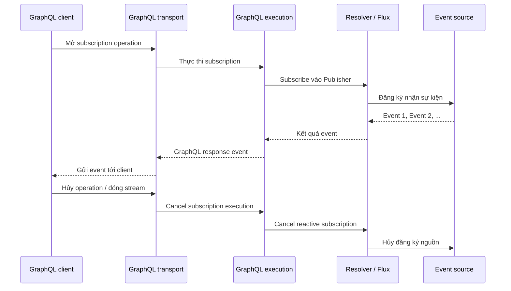

# Hủy subscription

Trong GraphQL, subscription tạo một luồng sự kiện từ server tới client. Luồng có thể tiếp tục phát dữ liệu trong thời gian dài, vì vậy client cần có cách dừng khi người dùng rời màn hình, đóng bảng theo dõi hoặc không còn cần cập nhật nữa. Hủy subscription là việc kết thúc một lần đăng ký đang hoạt động và giải phóng các tài nguyên gắn với lần đăng ký đó.

Với Spring for GraphQL, subscription thường được biểu diễn bằng `Publisher` như Reactor `Flux`. Khi client hủy operation hoặc ngắt kết nối, tín hiệu cancellation cần được truyền ngược qua reactive chain tới nguồn dữ liệu. Controller và service có thể quan sát tín hiệu này để ngừng lắng nghe message broker, đóng listener hoặc dọn dẹp tài nguyên.

## 1. Vòng đời của một subscription

Khác với query trả về một kết quả rồi kết thúc, subscription giữ một luồng hoạt động cho đến khi có một trong các sự kiện:

- Client chủ động hủy operation.
- Kết nối transport bị đóng hoặc bị ngắt.
- Publisher hoàn tất tự nhiên.
- Publisher phát sinh lỗi và kết thúc.
- Server chủ động kết thúc nguồn phát theo chính sách của ứng dụng.

Ví dụ schema theo dõi giá cổ phiếu:

```graphql
type Subscription {
    priceUpdates(symbol: String!): PriceUpdate!
}

type PriceUpdate {
    symbol: String!
    price: Float!
    changedAt: String!
}
```

Client mở subscription:

```graphql
subscription WatchPrice($symbol: String!) {
    priceUpdates(symbol: $symbol) {
        symbol
        price
        changedAt
    }
}
```

Mỗi sự kiện từ server tạo một kết quả GraphQL cho field `priceUpdates`. Luồng tiếp tục cho đến khi bị hủy, hoàn tất hoặc lỗi.

## 2. Ánh xạ subscription bằng @SubscriptionMapping

Trong Spring for GraphQL, `@SubscriptionMapping` ánh xạ method controller vào field của root type `Subscription`. Method thường trả về một reactive publisher.

```java
package com.example.graphql.market;

import org.springframework.graphql.data.method.annotation.Argument;
import org.springframework.graphql.data.method.annotation.SubscriptionMapping;
import org.springframework.stereotype.Controller;
import org.slf4j.Logger;
import org.slf4j.LoggerFactory;
import reactor.core.publisher.Flux;

@Controller
public class MarketSubscriptionController {

    private static final Logger log =
        LoggerFactory.getLogger(MarketSubscriptionController.class);

    private final PriceService priceService;

    public MarketSubscriptionController(PriceService priceService) {
        this.priceService = priceService;
    }

    @SubscriptionMapping
    public Flux<PriceUpdate> priceUpdates(
            @Argument("symbol") String symbol) {
        return priceService.priceUpdates(symbol);
    }
}
```

Spring for GraphQL kết nối publisher được trả về với GraphQL subscription execution. Không cần tạo một HTTP request riêng cho từng sự kiện; một subscription operation duy trì luồng kết quả theo transport được cấu hình.

`@SubscriptionMapping` chỉ định field ở root type `Subscription`. Nếu field lồng nhau cần resolve dữ liệu cho từng event, có thể kết hợp với resolver field thông thường, nhưng vòng đời stream gốc vẫn bắt đầu từ subscription mapping.

## 3. Client hủy một subscription operation

Cách hủy phụ thuộc transport mà client đang dùng.

**WebSocket:** client gửi thông điệp kết thúc operation theo giao thức GraphQL over WebSocket (thường gọi là `complete`). Việc kết thúc một operation không nhất thiết đóng toàn bộ WebSocket connection. Những subscription operation khác trên cùng kết nối có thể tiếp tục chạy.

**Server-Sent Events (SSE):** client dừng việc nhận stream bằng cách hủy request/đóng kết nối HTTP đang giữ luồng sự kiện. Server nhận biết kết nối bị hủy và hủy publisher tương ứng khi transport truyền cancellation xuống execution.

Ví dụ phía giao diện, khi component không còn cần dữ liệu, client cần unsubscribe/dispose subscription handle hoặc hủy stream đang tiêu thụ. Chỉ ẩn component hoặc ngừng render dữ liệu không tự động bảo đảm server đã nhận tín hiệu hủy.

Hủy một subscription là thao tác trên một operation đang hoạt động. Không nên đóng toàn bộ WebSocket nếu client chỉ muốn dừng một luồng, trừ khi ứng dụng thực sự muốn kết thúc kết nối.

## 4. Cancellation được truyền qua reactive chain

Trong Reactive Streams, subscriber có thể gọi `cancel()` trên subscription để yêu cầu publisher ngừng phát dữ liệu. Với Reactor, các operator như `map`, `filter`, `doOnNext` và các chain thông thường truyền cancellation về upstream.

Luồng tổng quát:



Khi cancellation truyền tới nguồn, nguồn có thể dừng việc phát dữ liệu dành riêng cho client đó. Khả năng dừng thực tế phụ thuộc publisher và adapter nguồn có hỗ trợ cancellation hay không. Một wrapper không truyền cancellation hoặc một lời gọi blocking không thể ngắt có thể khiến công việc phía dưới tiếp tục chạy dù client đã rời đi.

## 5. Quan sát cancellation bằng doOnCancel

Reactor cung cấp `doOnCancel` để thực hiện hành động khi subscriber hủy stream. Có thể dùng để ghi log, tăng metric hoặc yêu cầu service dừng một listener.

```java
import org.springframework.graphql.data.method.annotation.Argument;
import org.springframework.graphql.data.method.annotation.SubscriptionMapping;
import org.springframework.stereotype.Controller;
import org.slf4j.Logger;
import org.slf4j.LoggerFactory;
import reactor.core.publisher.Flux;

@Controller
public class MarketSubscriptionController {

    private static final Logger log =
        LoggerFactory.getLogger(MarketSubscriptionController.class);

    private final PriceService priceService;

    public MarketSubscriptionController(PriceService priceService) {
        this.priceService = priceService;
    }

    @SubscriptionMapping
    public Flux<PriceUpdate> priceUpdates(
            @Argument("symbol") String symbol) {

        return priceService.priceUpdates(symbol)
            .doOnCancel(() ->
                log.info("Price subscription cancelled: {}", symbol)
            );
    }
}
```

Đoạn code minh họa cần khai báo logger `log` trong controller. `doOnCancel` chỉ chạy khi downstream gửi cancellation. Nó không chạy khi publisher hoàn tất tự nhiên hoặc kết thúc do lỗi.

Không dùng `doOnCancel` làm nơi duy nhất để dọn dẹp nếu tài nguyên cần được giải phóng trong cả ba trường hợp cancel, complete và error. Khi cần xử lý mọi kết thúc, cân nhắc `doFinally` hoặc resource operator như `using`/`usingWhen`.

## 6. Dọn dẹp tài nguyên với doFinally

`doFinally` nhận `SignalType` cho biết stream kết thúc bằng `CANCEL`, `ON_COMPLETE` hay `ON_ERROR`. Có thể dùng để ghi nhận nguyên nhân kết thúc và thực hiện cleanup chung.

```java
import reactor.core.publisher.SignalType;

@SubscriptionMapping
public Flux<PriceUpdate> priceUpdates(
        @Argument("symbol") String symbol) {

    return priceService.priceUpdates(symbol)
        .doFinally(signalType -> {
            if (signalType == SignalType.CANCEL) {
                log.info("Client cancelled price stream: {}", symbol);
            } else if (signalType == SignalType.ON_COMPLETE) {
                log.info("Price stream completed: {}", symbol);
            } else if (signalType == SignalType.ON_ERROR) {
                log.warn("Price stream failed: {}", symbol);
            }
        });
}
```

`doFinally` hữu ích cho telemetry và cleanup nhẹ. Nếu thao tác giải phóng tài nguyên là bất đồng bộ hoặc có thể thất bại, hãy dùng cơ chế quản lý resource phù hợp thay vì thực hiện công việc blocking trong callback kết thúc.

Không giả định callback cleanup luôn chạy ngay tại đúng thread của controller. Reactive chain có thể chuyển thread; cleanup nên an toàn với thread đang thực thi và không dựa vào mutable state dùng chung thiếu đồng bộ.

## 7. Dùng using để quản lý resource theo subscription

Khi mỗi client tạo một listener riêng tới event broker hoặc nguồn dữ liệu, resource cần được tạo khi subscribe và đóng khi stream kết thúc, kể cả khi client cancel.

Ví dụ giả định `PriceFeedHandle` có phương thức `events()` trả về `Flux<PriceUpdate>` và `close()` gỡ listener khỏi broker:

```java
public Flux<PriceUpdate> priceUpdates(String symbol) {
    return Flux.using(
        () -> priceFeed.open(symbol),
        PriceFeedHandle::events,
        PriceFeedHandle::close
    );
}
```

`Flux.using` quản lý vòng đời resource gắn với subscription reactive. Khi downstream cancel, complete hoặc error, disposer được gọi để đóng handle. Cách này giảm nguy cơ quên gỡ listener ở một nhánh kết thúc.

Nếu việc mở hoặc đóng resource là bất đồng bộ, dùng `Flux.usingWhen` với các publisher cleanup tương ứng. Chọn operator theo API nguồn thực tế và bảo đảm cleanup không bị bỏ qua khi cancel.

Tránh viết kiểu:

```java
public Flux<PriceUpdate> priceUpdates(String symbol) {
    priceFeed.register(symbol);
    return priceFeed.events(symbol);
}
```

Nếu không có cơ chế gỡ listener gắn với vòng đời publisher, mỗi lần subscribe có thể để lại đăng ký hoạt động sau khi client đã hủy. Khi đó, số listener tăng dần và tạo rò rỉ tài nguyên.

## 8. Không tự gọi subscribe trong controller

Resolver nên trả publisher cho Spring for GraphQL quản lý. Không tự gọi `subscribe()` bên trong controller:

```java
// Không nên: tạo subscription tách khỏi GraphQL execution.
@SubscriptionMapping
public Flux<PriceUpdate> priceUpdates(String symbol) {
    priceService.priceUpdates(symbol).subscribe();
    return priceService.priceUpdates(symbol);
}
```

Đoạn code trên có thể tạo hai luồng độc lập: một luồng được subscribe thủ công và một luồng được GraphQL runtime subscribe. Việc client hủy operation chỉ tác động tới luồng mà GraphQL quản lý; luồng subscribe thủ công có thể vẫn chạy và giữ tài nguyên.

Hãy trả trực tiếp `Flux` hoặc `Publisher`:

```java
@SubscriptionMapping
public Flux<PriceUpdate> priceUpdates(@Argument String symbol) {
    return priceService.priceUpdates(symbol);
}
```

Spring for GraphQL sẽ quản lý subscription lifecycle thông qua publisher được trả về.

## 9. Phân biệt hủy một subscriber và dừng nguồn dùng chung

Không phải mọi publisher đều là nguồn riêng cho một client. Một nguồn có thể được nhiều subscriber chia sẻ, ví dụ một hot stream phát giá thị trường cho nhiều kết nối.

Khi một client hủy subscription:

- Subscriber đó cần ngừng nhận event.
- Listener hoặc tài nguyên riêng của client đó cần được gỡ.
- Nguồn dùng chung chỉ nên dừng khi không còn subscriber hoặc theo chính sách quản lý nguồn.

Không đặt lệnh shutdown toàn bộ broker/topic trong `doOnCancel` của từng client nếu nhiều client cùng sử dụng nguồn. Việc đó có thể làm gián đoạn subscription của người dùng khác.

Với shared stream, cần phân biệt lifecycle của subscription con với lifecycle của nguồn gốc. Có thể dùng `share`, `publish().refCount()` hoặc cơ chế quản lý subscriber của broker tùy thiết kế, nhưng phải hiểu điều kiện kết nối và hủy của operator được chọn.

## 10. Hủy subscription khi có lỗi hoặc hoàn tất

Cancellation khác với complete và error:

| Kết thúc | Ai khởi tạo | Reactive signal | Hành vi |
| --- | --- | --- | --- |
| Cancel | Client hoặc downstream | `cancel()` | Yêu cầu ngừng nhận event và giải phóng resource |
| Complete | Publisher/server | `onComplete` | Luồng kết thúc bình thường |
| Error | Publisher/server | `onError` | Luồng kết thúc do lỗi |

Nếu server phát một publisher hữu hạn, ví dụ `Flux.take(10)`, stream hoàn tất sau 10 event. Không cần client gửi unsubscribe để kết thúc. Nếu nguồn phát lỗi, stream kết thúc bằng `onError`; client có thể đăng ký lại theo chính sách retry riêng.

`doOnCancel` chỉ phản ánh cancellation. `doFinally` có thể quan sát cả ba trạng thái. Dù dùng operator nào, không nên coi cancel là một transaction rollback: các side effect đã xảy ra trước thời điểm hủy không tự động được đảo ngược.

## 11. Authorization và thu hồi quyền trong subscription dài hạn

Subscription có thể tồn tại lâu hơn một request thông thường. Vì vậy, cần xác định chính sách quyền ở hai thời điểm:

- **Khi bắt đầu:** xác thực client, kiểm tra quyền mở subscription và kiểm tra tham số như symbol hoặc tenant.
- **Trong lúc phát event:** nếu quyền có thể thay đổi trong thời gian stream hoạt động, cần lọc dữ liệu hoặc kết thúc stream khi quyền bị thu hồi.

Không nên chỉ kiểm tra quyền một lần nếu yêu cầu bảo mật bắt buộc thu hồi quyền phải có hiệu lực ngay trong stream đang chạy. Ngược lại, cũng không nhất thiết truy vấn database kiểm tra quyền cho mọi event nếu chính sách cho phép snapshot quyền lúc subscribe; hãy quyết định dựa trên yêu cầu nghiệp vụ.

Khi phát hiện client không còn quyền, server có thể kết thúc publisher hoặc phát lỗi theo error contract. Sau khi stream kết thúc, client cần thực hiện subscription mới sau khi quyền được cấp lại.

Không đưa token, cookie hoặc thông tin xác thực vào log cancellation. Có thể ghi nhận operation ID, user/tenant ID đã được xử lý theo chính sách log và lý do kết thúc ở mức an toàn.

## 12. Kiểm thử cancellation

Nên kiểm thử hai cấp: reactive publisher/service và GraphQL subscription qua transport.

### 12.1. Kiểm thử publisher bằng StepVerifier

Ví dụ nguồn phát liên tục và ghi nhận khi bị hủy:

```java
import java.time.Duration;
import java.util.concurrent.atomic.AtomicBoolean;

import static org.assertj.core.api.Assertions.assertThat;

import org.junit.jupiter.api.Test;
import reactor.core.publisher.SignalType;
import reactor.core.publisher.Flux;
import reactor.test.StepVerifier;

class PriceServiceTest {

    @Test
    void releasesResourceWhenSubscriberCancels() {
        AtomicBoolean closed = new AtomicBoolean();

        Flux<Long> stream = Flux.interval(Duration.ofMillis(10))
            .doFinally(signal -> {
                if (signal == SignalType.CANCEL) {
                    closed.set(true);
                }
            });

        StepVerifier.create(stream)
            .expectNext(0L)
            .thenCancel()
            .verify();

        assertThat(closed.get()).isTrue();
    }
}
```

Test minh họa cần import `SignalType` và `assertThat` từ AssertJ. Nó xác minh cancellation đi tới publisher và callback cleanup được gọi. Với resource thực, nên xác minh handle/listener đã được đóng hoặc gỡ khỏi broker.

### 12.2. Kiểm thử GraphQL subscription qua transport

Có thể dùng `GraphQlTester` ở chế độ subscription-capable, chẳng hạn tester kết nối WebSocket, để mở operation và hủy luồng nhận event:

```java
Flux<PriceUpdate> updates = graphQlTester
    .document("""
        subscription {
            priceUpdates(symbol: "ACME") {
                symbol
                price
            }
        }
        """)
    .executeSubscription()
    .toFlux("priceUpdates", PriceUpdate.class);

StepVerifier.create(updates)
    .expectNextCount(1)
    .thenCancel()
    .verify();
```

Đoạn test giả định `graphQlTester` được cấu hình bằng tester hỗ trợ subscription transport và server có nguồn phát event. Với test WebSocket, cần xác minh sau `thenCancel()` server đã nhận việc kết thúc operation và resource của subscriber được giải phóng. Một test chỉ chạy `StepVerifier` trên service Flux không chứng minh transport WebSocket/SSE truyền cancellation đúng; cần integration test cho transport đang triển khai.

## 13. Những lỗi thường gặp khi hủy subscription

| Triệu chứng | Nguyên nhân có thể | Cách xử lý |
| --- | --- | --- |
| Client ngừng hiển thị nhưng server vẫn phát event | UI chỉ bỏ render, chưa unsubscribe | Hủy operation/subscription handle khi component kết thúc |
| Listener broker vẫn còn sau khi client rời đi | Publisher không gắn cleanup với cancellation | Dùng `using`, `usingWhen`, `doFinally` hoặc disposer phù hợp |
| Một client hủy làm client khác mất dữ liệu | Cleanup dừng shared source thay vì subscriber riêng | Quản lý riêng lifecycle subscriber và shared publisher |
| Tài nguyên vẫn chạy sau cancel | Nguồn blocking hoặc adapter không truyền cancellation | Dùng API cancellable/non-blocking và kiểm tra propagation |
| Cleanup không chạy khi stream hoàn tất | Chỉ dùng `doOnCancel` | Dùng `doFinally` hoặc resource operator cho complete/error/cancel |
| Có hai luồng sau một lần subscribe | Controller tự gọi `subscribe()` rồi trả publisher | Không subscribe thủ công trong resolver |
| Không nhận biết được lý do kết thúc | Không quan sát signal type | Ghi nhận `CANCEL`, `ON_COMPLETE`, `ON_ERROR` |
| WebSocket vẫn mở sau khi hủy một operation | Chỉ operation kết thúc, connection vẫn dùng chung | Đây là hành vi bình thường; chỉ đóng connection khi cần kết thúc toàn bộ phiên |

## 14. Checklist triển khai hủy subscription

- Subscription resolver trả `Publisher`/`Flux` để GraphQL runtime quản lý?
- Client có unsubscribe operation khi không còn cần stream?
- Transport đang dùng có truyền cancellation khi operation hoặc kết nối kết thúc?
- Reactive chain có truyền cancellation tới event source?
- Listener, connection và resource riêng có được đóng khi cancel?
- Cleanup có xử lý cả complete và error nếu cần?
- Controller có tránh gọi `subscribe()` thủ công?
- Shared publisher có bảo vệ subscriber khác khi một client hủy?
- Quyền truy cập có được kiểm tra lúc bắt đầu và trong stream khi chính sách yêu cầu?
- Test đã xác minh cancellation ở service và transport?
- Log/metric ghi nhận cancellation mà không làm lộ thông tin xác thực?

Hủy subscription là một phần của vòng đời reactive stream. Client kết thúc operation qua transport, Spring for GraphQL hủy publisher tương ứng và cancellation cần truyền tới nguồn dữ liệu để gỡ listener, đóng kết nối hoặc dừng công việc riêng của subscriber. Dùng `doOnCancel`, `doFinally` hoặc `using`/`usingWhen` theo loại resource; tránh subscribe thủ công trong controller và không dừng nguồn dùng chung khi chỉ một client rời đi. Kiểm thử cả publisher lẫn transport giúp bảo đảm subscription không để lại tài nguyên sau khi client đã hủy.
