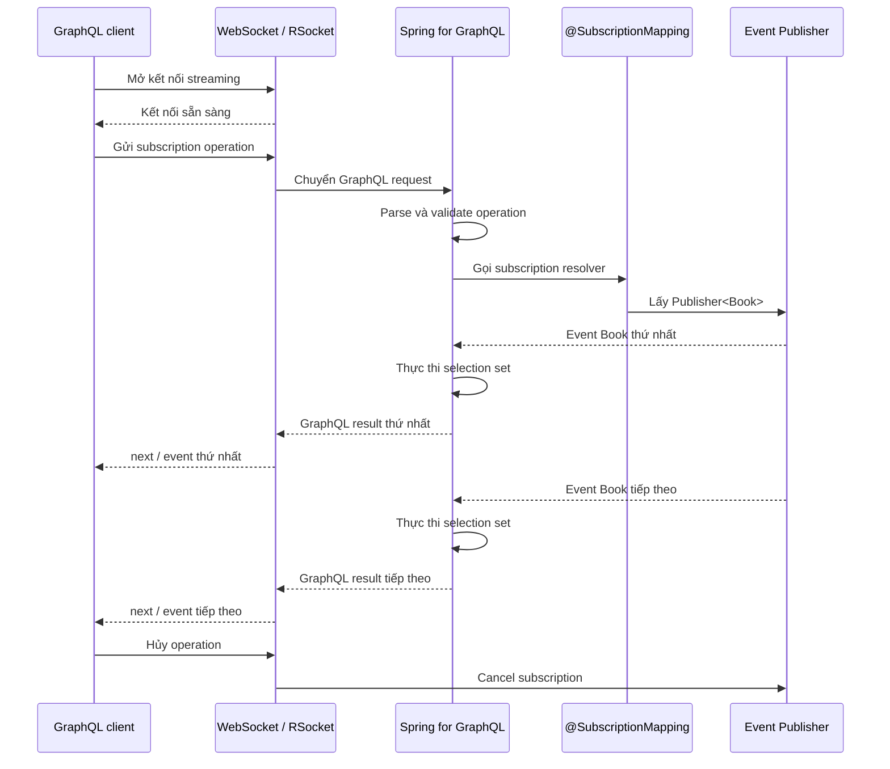

# Subscription lifecycle

## 1. Subscription là gì?

Query thường trả về một kết quả cho một lần gọi. Mutation thực hiện một thao tác thay đổi dữ liệu và cũng trả về kết quả của thao tác đó. Subscription dùng cho trường hợp client muốn nhận nhiều kết quả theo thời gian khi server phát sinh sự kiện mới.

Ví dụ, một màn hình quản trị muốn nhận thông báo mỗi khi có sách mới được tạo. Thay vì liên tục gửi Query để hỏi server có sách mới hay chưa, client mở một Subscription và giữ luồng kết nối để nhận các sự kiện:

```graphql
type Subscription {
    bookAdded: Book!
}

type Book {
    id: ID!
    title: String!
}
```

Client đăng ký:

```graphql
subscription OnBookAdded {
    bookAdded {
        id
        title
    }
}
```

Khi một quyển sách mới được phát, client nhận một kết quả GraphQL chứa dữ liệu của quyển sách đó. Khi có sự kiện tiếp theo, client nhận kết quả tiếp theo trên cùng Subscription.

Trong Spring for GraphQL, một subscription field thường được ánh xạ bằng `@SubscriptionMapping`. Phương thức resolver trả về một Reactive Streams `Publisher<T>`, thường là `Flux<T>`, đại diện cho luồng sự kiện.

## 2. Phân biệt Subscription operation và Reactive Streams Subscription

Hai khái niệm có tên gần giống nhau nhưng thuộc hai tầng khác nhau:

| Khái niệm | Vai trò |
| --- | --- |
| GraphQL Subscription operation | Operation trong GraphQL document, yêu cầu server gửi nhiều kết quả theo sự kiện |
| Reactive Streams `Publisher<T>` | Nguồn phát các phần tử bất đồng bộ ở phía Java |
| Reactive Streams `Subscription` | Đối tượng điều khiển việc yêu cầu thêm phần tử và hủy đăng ký giữa Subscriber với Publisher |
| Spring `@SubscriptionMapping` | Annotation ánh xạ một field thuộc root type `Subscription` vào controller method |

GraphQL Subscription không phải là một kiểu dữ liệu SDL có tên `Publisher`. SDL khai báo field trả về kiểu GraphQL thông thường như `Book!`; Java resolver trả về `Publisher<Book>` để cung cấp nhiều giá trị theo thời gian.

Reactive Streams `Subscription` quản lý quan hệ giữa publisher và subscriber trong Java. GraphQL Subscription quản lý một operation và các kết quả GraphQL được gửi đến client qua transport streaming. Spring for GraphQL kết nối hai tầng này.

## 3. Vòng đời tổng thể của một Subscription

Một Subscription thường đi qua các giai đoạn sau:

1. Client thiết lập transport streaming, thường là WebSocket hoặc RSocket.
2. Client gửi GraphQL Subscription operation cùng variables và operation name.
3. Server parse document, validate schema, xác định root subscription field và gọi resolver.
4. Resolver trả về một `Publisher` làm nguồn sự kiện.
5. Mỗi phần tử do Publisher phát ra trở thành source event cho một lần thực thi selection set của Subscription.
6. Server gửi từng GraphQL execution result đến client.
7. Khi Publisher hoàn tất, server kết thúc operation. Khi client hủy hoặc transport đóng, subscription được cancel và tài nguyên liên quan được giải phóng.



Một transport connection có thể sống lâu hơn một Subscription operation. Client có thể chạy nhiều operation trên cùng WebSocket connection và hủy từng operation riêng lẻ.

## 4. Khai báo Subscription root trong SDL

Schema cần có root type `Subscription` và ít nhất một field subscription:

```graphql
type Query {
    books: [Book!]!
}

type Mutation {
    createBook(input: CreateBookInput!): Book!
}

type Subscription {
    bookAdded: Book!
}

type Book {
    id: ID!
    title: String!
}
```

Trong ví dụ, `bookAdded` là field duy nhất của operation mẫu. GraphQL yêu cầu một Subscription operation có một root field thực thi. Các field con như `id` và `title` thuộc selection set của `Book`, không phải root field bổ sung của Subscription.

Kiểu trả về của field trong SDL mô tả giá trị của mỗi event. Ví dụ `Book!` có nghĩa mỗi event phải cung cấp một `Book` khác null. Nó không có nghĩa toàn bộ luồng chỉ được phát một quyển sách.

Nếu một event có thể không mang đối tượng hợp lệ, hãy xem lại mô hình event và nullability. Không dùng `Book!` rồi phát null cho một event, vì GraphQL sẽ tạo lỗi non-null cho execution tương ứng.

## 5. Ánh xạ Subscription bằng `@SubscriptionMapping`

Spring for GraphQL cung cấp `@SubscriptionMapping` để ánh xạ method vào field của root type `Subscription`:

```java
import org.springframework.graphql.data.method.annotation.SubscriptionMapping;
import org.springframework.stereotype.Controller;
import reactor.core.publisher.Flux;

@Controller
public class BookSubscriptionController {

    private final BookEventPublisher bookEventPublisher;

    public BookSubscriptionController(BookEventPublisher bookEventPublisher) {
        this.bookEventPublisher = bookEventPublisher;
    }

    @SubscriptionMapping
    public Flux<Book> bookAdded() {
        return bookEventPublisher.bookAdded();
    }
}
```

Tên method `bookAdded` được dùng làm tên field nếu không chỉ định tên tường minh. Có thể dùng `@SubscriptionMapping(name = "bookAdded")` để làm rõ mapping.

`@SubscriptionMapping` là annotation chuyên biệt cho root `Subscription`. Không dùng `@QueryMapping` cho subscription field. Phương thức phải trả về một `Publisher` tương thích, chẳng hạn `Flux<Book>` hoặc `Mono<Book>`.

`Flux<Book>` có thể phát nhiều event. `Mono<Book>` chỉ phát tối đa một event rồi hoàn tất, vì vậy chỉ phù hợp khi nghiệp vụ thực sự cần một lần phát bất đồng bộ thay vì một luồng dài.

## 6. Mỗi event tạo một GraphQL execution result

Khi subscription resolver trả về `Flux<Book>`, GraphQL không gửi trực tiếp object Java nguyên bản đến client. Mỗi phần tử `Book` được dùng làm source event cho root subscription field. GraphQL thực thi selection set trên event đó, gọi các field resolver cần thiết và tạo một GraphQL response result.

Ví dụ client yêu cầu:

```graphql
subscription {
    bookAdded {
        id
        title
        author {
            id
            name
        }
    }
}
```

Với mỗi `Book` được phát:

- GraphQL đọc `id` và `title` từ event object hoặc property data fetcher.
- GraphQL phân giải field `author` theo mapping tương ứng.
- Các lỗi field, nếu có, được ghi vào `errors` của execution result cho event đó.
- Kết quả có `data` và có thể kèm `errors` được gửi thành một thông điệp của luồng Subscription.

Do đó, một Subscription operation có thể tạo nhiều response result. Mỗi result tương ứng với một event, không phải một response JSON duy nhất chứa toàn bộ lịch sử sự kiện.

## 7. Tạo nguồn sự kiện bằng Reactor `Sinks.Many`

Trong ứng dụng thực tế, event có thể đến từ message broker, domain event hoặc một service khác. Để minh họa một nguồn phát đơn giản trong cùng ứng dụng, có thể dùng Reactor `Sinks.Many`:

```java
import org.springframework.stereotype.Component;
import reactor.core.publisher.Flux;
import reactor.core.publisher.Sinks;

@Component
public class BookEventPublisher {

    private final Sinks.Many<Book> sink =
        Sinks.many().multicast().onBackpressureBuffer();

    public Flux<Book> bookAdded() {
        return sink.asFlux();
    }

    public void publish(Book book) {
        Sinks.EmitResult result = sink.tryEmitNext(book);

        if (result.isFailure()) {
            // Ghi log hoặc áp dụng chính sách retry / xử lý event phù hợp.
            throw new IllegalStateException(
                "Không thể phát Book event: " + result
            );
        }
    }
}
```

`Sinks.Many` là nguồn phát chủ động. Service có thể gọi `publish(book)` khi có sách mới, còn các Subscription đang lắng nghe nhận event qua `asFlux()`.

Ví dụ dùng `multicast()` để gửi event cho những subscriber đang hoạt động. Subscriber mới không tự nhận lại toàn bộ event cũ. Nếu nghiệp vụ cần replay hoặc lưu lịch sử, hãy chọn chiến lược replay có giới hạn hoặc đọc event từ một event store/message broker có khả năng lưu trữ.

Không bỏ qua `Sinks.EmitResult`. Phát event có thể thất bại khi không có subscriber, sink đã kết thúc hoặc có cạnh tranh phát event tùy cấu hình sink. Ứng dụng phải quyết định ghi log, retry, lưu bền vững hay chấp nhận bỏ event theo yêu cầu nghiệp vụ.

## 8. Cold Publisher và Hot Publisher

Nguồn Subscription có thể là cold hoặc hot publisher:

| Đặc điểm | Cold Publisher | Hot Publisher |
| --- | --- | --- |
| Bắt đầu phát | Khi có subscriber | Có thể phát độc lập với subscriber |
| Dữ liệu giữa subscriber | Mỗi subscriber có thể có luồng riêng | Nhiều subscriber có thể cùng nhận event đang phát |
| Ví dụ | `Flux.defer`, truy vấn stream theo từng subscriber | `Sinks.Many`, event bus, message broker topic |
| Subscriber đến muộn | Có thể bắt đầu lại từ đầu tùy nguồn | Thường chỉ nhận event từ thời điểm đăng ký, trừ khi có replay |
| Trường hợp phù hợp | Luồng được tạo riêng cho từng client | Sự kiện chung như đơn hàng mới hoặc trạng thái hệ thống |

Ví dụ cold publisher:

```java
public Flux<Book> recentBooks() {
    return Flux.defer(() -> bookService.streamRecentBooks());
}
```

Mỗi lần có subscriber, `Flux.defer` gọi lại service để tạo luồng mới. Nếu service mở database cursor hoặc gọi remote API, mỗi Subscription có thể tạo một tài nguyên riêng.

Ví dụ hot publisher là `Sinks.Many` ở phần trước. Tất cả subscriber đang hoạt động cùng lắng nghe nguồn sự kiện đó. Cần quyết định rõ có phát lại event cũ cho subscriber mới hay không và giới hạn bộ đệm nếu subscriber xử lý chậm.

Không nên dùng một publisher toàn cục nếu dữ liệu của từng subscriber cần được lọc theo người dùng hoặc tenant mà không có bước phân luồng an toàn. Hãy lọc sự kiện theo quyền của từng Subscription hoặc tách nguồn sự kiện theo phạm vi truy cập.

## 9. Transport và giao thức WebSocket

Subscription cần một transport có thể truyền nhiều kết quả trong thời gian dài. Trong Spring for GraphQL, WebSocket là lựa chọn thường gặp; RSocket cũng hỗ trợ các interaction model streaming phù hợp. Một HTTP request-response thông thường không đủ để duy trì một luồng event dài hạn.

Với WebSocket, Spring for GraphQL hỗ trợ giao thức GraphQL over WebSocket `graphql-transport-ws`. Luồng message cơ bản gồm:

| Message | Hướng | Ý nghĩa |
| --- | --- | --- |
| `connection_init` | Client → Server | Khởi tạo GraphQL connection, có thể mang payload xác thực |
| `connection_ack` | Server → Client | Server chấp nhận connection initialization |
| `subscribe` | Client → Server | Bắt đầu một GraphQL operation với operation ID và payload |
| `next` | Server → Client | Gửi một GraphQL execution result của Subscription |
| `error` | Server → Client | Báo lỗi operation/protocol theo quy tắc giao thức |
| `complete` | Hai chiều | Server kết thúc operation hoặc client yêu cầu hủy operation |
| `ping` / `pong` | Hai chiều | Kiểm tra và duy trì trạng thái kết nối |

Một WebSocket connection có thể chứa nhiều operation với ID khác nhau. Khi client gửi `complete` cho một operation, server hủy luồng của operation đó; connection vẫn có thể tiếp tục phục vụ operation khác.

Ví dụ cấu hình endpoint WebSocket trong Spring Boot:

```yaml
spring:
  graphql:
    websocket:
      path: /graphql
```

Client phải kết nối đúng endpoint và thương lượng protocol phù hợp. Khi dùng thư viện client, kiểm tra thư viện đang dùng hỗ trợ `graphql-transport-ws`; một số thư viện cũ dùng protocol `graphql-ws` với message format khác.

## 10. Authentication và authorization trong Subscription

Subscription có thể tồn tại lâu hơn một HTTP request thông thường, vì vậy cần phân biệt xác thực connection, xác thực operation và kiểm tra quyền trên từng event.

- **Connection authentication:** xác định người dùng khi WebSocket handshake hoặc qua thông tin connection initialization. Không coi payload do client gửi là đáng tin cậy trước khi xác minh token.
- **Operation authorization:** kiểm tra người dùng có quyền mở Subscription field đó hay không khi operation bắt đầu.
- **Event authorization:** nếu quyền truy cập có thể thay đổi hoặc event chứa dữ liệu thuộc nhiều phạm vi khác nhau, kiểm tra quyền/tenant cho từng event trước khi phát đến client.
- **Connection lifecycle:** khi token hết hạn, người dùng bị khóa hoặc session bị thu hồi, ứng dụng cần chính sách kết thúc các operation đang mở.

Ví dụ lọc event theo tenant đã xác thực:

```java
@SubscriptionMapping
public Flux<Book> bookAdded(@ContextValue("tenantId") String tenantId) {
    return bookEventPublisher.bookAdded()
        .filter(book -> tenantId.equals(book.tenantId()));
}
```

Ví dụ giả định `tenantId` được đưa vào `GraphQLContext` từ principal đã xác thực và `Book` có thuộc tính tenant. Trong ứng dụng thực tế, nên lọc ở service/event source theo tenant để tránh tải hoặc phát dữ liệu ngoài phạm vi.

Method security như `@PreAuthorize` trên subscription resolver thường bảo vệ việc mở luồng. Nó không có nghĩa kiểm tra quyền tự động chạy lại cho từng event được phát ra. Nếu quyền có thể bị thu hồi trong khi stream vẫn mở, cần áp dụng kiểm tra theo từng event hoặc chủ động hủy subscription theo chính sách bảo mật.

Không dùng user ID hoặc tenant ID từ GraphQL variables làm căn cứ duy nhất để lọc dữ liệu. Giá trị phạm vi truy cập phải đến từ security context đã được xác thực.

## 11. Context và trạng thái của một Subscription

Một Subscription operation có thể cần lưu một số thông tin như tenant, principal, locale hoặc correlation ID trong suốt thời gian hoạt động. Spring for GraphQL cho phép đưa dữ liệu server-side vào `GraphQLContext` và đọc trong resolver qua `@ContextValue` hoặc `GraphQLContext`.

Ví dụ:

```java
@SubscriptionMapping
public Flux<Book> bookAdded(
        @ContextValue("tenantId") String tenantId,
        @ContextValue("correlationId") String correlationId) {

    return bookEventPublisher.bookAddedForTenant(tenantId)
        .doOnNext(book -> log.debug(
            "Delivering book {} for request {}",
            book.id(), correlationId
        ));
}
```

Context của GraphQL execution và thuộc tính của WebSocket connection là hai phạm vi khác nhau. Một connection có thể chạy nhiều operation; mỗi operation có GraphQL request và context riêng. Nếu cần dùng thông tin xác thực từ connection, hãy lấy từ principal hoặc session metadata đã được server xác minh rồi đưa vào context của operation.

Không lưu mutable state của người dùng vào field của singleton controller. Controller thường được Spring quản lý như singleton, nên dữ liệu theo từng Subscription phải nằm trong context hoặc publisher riêng của operation để tránh rò rỉ giữa người dùng.

## 12. Completion, cancellation và giải phóng tài nguyên

Một Subscription có thể kết thúc theo nhiều cách:

1. **Publisher complete:** nguồn event phát xong và gọi `onComplete`; server kết thúc operation và thông báo hoàn tất cho client.
2. **Client cancel:** client gửi message `complete` cho operation; server hủy Reactive Streams subscription tương ứng.
3. **Transport disconnect:** WebSocket hoặc RSocket connection đóng; các operation phụ thuộc connection bị hủy.
4. **Publisher error:** nguồn event gọi `onError`; operation kết thúc theo cơ chế xử lý lỗi của GraphQL/transport.
5. **Server policy:** server chủ động kết thúc operation vì timeout, giới hạn tài nguyên hoặc quyền truy cập bị thu hồi.

Publisher cần hỗ trợ cancellation để giải phóng tài nguyên như database cursor, message consumer hoặc listener. Có thể gắn cleanup vào reactive pipeline:

```java
public Flux<Book> watchBooks(String tenantId) {
    return eventSource.streamBooks(tenantId)
        .doFinally(signalType ->
            log.debug("Book stream ended: {}", signalType)
        );
}
```

`doFinally` được gọi khi stream complete, error hoặc cancel. Nếu publisher mở tài nguyên cần đóng, hãy dùng API quản lý resource phù hợp như `using`/`usingWhen` hoặc cơ chế cleanup của client message broker.

Không tự subscribe bên trong resolver và không giữ subscription handle ở một biến toàn cục để điều khiển nhiều client. Hãy trả publisher cho Spring for GraphQL để lifecycle của nó gắn với operation và transport.

## 13. Backpressure và subscriber xử lý chậm

Reactive Streams có cơ chế backpressure để subscriber điều tiết số phần tử mà nó có thể nhận. Tuy nhiên, một GraphQL WebSocket client có thể đọc chậm hơn tốc độ event source phát. Nếu hệ thống không giới hạn buffering, bộ nhớ có thể tăng theo thời gian.

Khi thiết kế Subscription, cần xác định:

- Nguồn event có hỗ trợ backpressure hay không.
- Có dùng buffer không, và giới hạn buffer là bao nhiêu.
- Khi buffer đầy, hệ thống sẽ drop, reject, retry hay lưu event bền vững.
- Có thể coalesce nhiều event thành một snapshot mới nhất hay không.
- Có cần phân trang hoặc gửi thông báo thay đổi để client tự tải dữ liệu hiện tại bằng Query.

Với `Sinks.Many`, chọn sink phù hợp với chính sách multicast, replay và backpressure. Không dùng buffer vô hạn cho luồng event có thể tăng không giới hạn. Nếu event quan trọng không được phép mất, hãy dùng message broker hoặc event store có persistence và consumer offset thay vì chỉ dựa vào in-memory sink.

Subscription không nên trở thành kênh truyền mọi thay đổi dữ liệu không giới hạn. Hãy giới hạn tần suất, kích thước payload và số lượng subscription đồng thời theo khả năng của server.

## 14. Lỗi trong vòng đời Subscription

Lỗi có thể xuất hiện trước khi luồng bắt đầu hoặc trong lúc phát event:

| Thời điểm | Ví dụ | Hành vi cần thiết |
| --- | --- | --- |
| Parse/validation operation | Sai cú pháp, field không tồn tại, chọn nhiều root field | Trả lỗi GraphQL; không mở event stream |
| Khởi tạo resolver | Người dùng không có quyền hoặc không tạo được Publisher | Từ chối khởi tạo operation và trả lỗi phù hợp |
| Publisher đang phát | Nguồn event gặp lỗi hạ tầng và gọi `onError` | Kết thúc stream theo chính sách error handling; ghi nhận lỗi nội bộ |
| Thực thi field của một event | Resolver field con lỗi khi xử lý một `Book` | GraphQL result của event đó có thể chứa `data` một phần và `errors` |
| Transport | WebSocket bị đóng hoặc protocol sai | Hủy operation liên quan và giải phóng tài nguyên |
| Authorization thay đổi | User bị thu hồi quyền trong lúc stream mở | Lọc event hoặc hủy operation theo chính sách |

Lỗi thực thi field con của một event khác với lỗi terminal của Publisher. Lỗi field có thể được biểu diễn trong GraphQL result của event; nguồn Publisher vẫn có thể tiếp tục phát các event sau. Ngược lại, khi Publisher phát `onError`, luồng nguồn đã kết thúc và không tiếp tục phát event bình thường.

Không nuốt lỗi publisher rồi thay bằng `Flux.empty()` nếu client cần biết stream bị lỗi. Điều đó biến lỗi thành hoàn tất bình thường và làm mất thông tin chẩn đoán.

## 15. Phát Subscription event sau khi Mutation commit

Một tình huống phổ biến là Mutation tạo dữ liệu và Subscription thông báo cho client. Không nên phát event trước khi transaction database commit thành công, vì client có thể nhận một đối tượng mà transaction sau đó bị rollback.

Có thể dùng domain event và `@TransactionalEventListener` ở phase `AFTER_COMMIT`:

```java
@Component
public class BookCreatedListener {

    private final BookEventPublisher publisher;

    public BookCreatedListener(BookEventPublisher publisher) {
        this.publisher = publisher;
    }

    @TransactionalEventListener(phase = TransactionPhase.AFTER_COMMIT)
    public void onBookCreated(BookCreated event) {
        publisher.publish(event.book());
    }
}
```

Service tạo sách phát domain event trong transaction:

```java
@Transactional
public Book createBook(CreateBookInput input) {
    Book saved = bookRepository.save(Book.create(input));
    eventPublisher.publishEvent(new BookCreated(saved));
    return saved;
}
```

`@TransactionalEventListener(AFTER_COMMIT)` chỉ phát sau khi transaction commit. Ví dụ này phù hợp với event in-memory trong một instance. Nếu ứng dụng chạy nhiều instance hoặc event không được phép mất khi process dừng, hãy dùng transactional outbox hoặc message broker bền vững thay vì chỉ phát qua `Sinks.Many`.

## 16. Kiểm thử Subscription bằng StepVerifier

Có thể kiểm thử Publisher ở tầng service bằng Reactor `StepVerifier`. Ví dụ:

```java
import java.time.Duration;
import org.junit.jupiter.api.Test;
import reactor.core.publisher.Flux;
import reactor.test.StepVerifier;

class BookEventPublisherTests {

    @Test
    void emitsBooksAndCompletes() {
        Flux<Book> events = Flux.just(
            new Book("b1", "GraphQL Basics", "t1"),
            new Book("b2", "Spring GraphQL", "t1")
        );

        StepVerifier.create(events)
            .expectNextMatches(book -> book.id().equals("b1"))
            .expectNextMatches(book -> book.id().equals("b2"))
            .verifyComplete();
    }
}
```

Đây là kiểm thử publisher độc lập. Nó xác nhận thứ tự event và tín hiệu complete, nhưng chưa kiểm tra GraphQL schema, resolver hoặc transport.

## 17. Kiểm thử GraphQL Subscription qua WebSocket

Để kiểm thử toàn bộ luồng, dùng `WebSocketGraphQlTester` với endpoint WebSocket đã cấu hình. Ví dụ operation:

```java
Flux<Book> events = tester.document("""
    subscription {
        bookAdded {
            id
            title
        }
    }
    """)
    .executeSubscription()
    .toFlux(Book.class);

StepVerifier.create(events)
    .expectNextMatches(book -> book.id().equals("b1"))
    .thenCancel()
    .verify(Duration.ofSeconds(5));
```

`tester` là `WebSocketGraphQlTester` đã được tạo với URL, WebSocket client và handshake phù hợp. Test fixture cần phát event `b1` sau khi operation được đăng ký; sau event đầu tiên, `thenCancel()` kiểm tra việc client hủy stream.

Nên kiểm thử thêm:

- Một Subscription nhận nhiều event theo đúng thứ tự phát.
- Hai client nhận đúng phạm vi event của từng người dùng/tenant.
- Subscriber mới có nhận event cũ hay không theo chính sách cold/hot/replay.
- Publisher complete và error được xử lý đúng.
- Client cancel làm cleanup listener hoặc consumer.
- Disconnect WebSocket hủy operation đang hoạt động.
- Field resolver của mỗi event tạo response đúng, bao gồm partial data và errors.
- Một WebSocket connection có thể chạy nhiều operation độc lập.
- Token hết hạn hoặc quyền bị thu hồi được xử lý theo chính sách.

## 18. Lỗi thường gặp khi triển khai Subscription

| Hiện tượng | Nguyên nhân có thể | Cách xử lý |
| --- | --- | --- |
| Resolver không được gọi | Dùng `@QueryMapping` hoặc tên field không khớp `Subscription` | Dùng `@SubscriptionMapping` và đối chiếu SDL |
| Subscription chỉ trả một event rồi dừng | Resolver trả `Mono<T>` hoặc nguồn phát hoàn tất sau một giá trị | Dùng `Flux<T>` nếu cần luồng nhiều event |
| Client không nhận event | Chưa cấu hình transport streaming hoặc client dùng sai WebSocket subprotocol | Kiểm tra endpoint và `graphql-transport-ws` |
| Event bị mất khi client kết nối muộn | Dùng hot publisher không replay | Chọn replay/event store nếu cần lịch sử |
| Bộ nhớ tăng liên tục | Buffer không giới hạn hoặc subscriber xử lý chậm | Giới hạn buffer, backpressure và số subscription |
| Client vẫn nhận dữ liệu sau khi hủy | Publisher không truyền cancellation hoặc có side effect ngoài luồng | Kiểm tra `doFinally`, cleanup và nguồn event |
| Người dùng nhận event tenant khác | Không lọc theo security context ở server | Xác thực tenant và lọc event trong service/source |
| Event phát trước khi transaction commit | Publish ngay trong transaction | Dùng `AFTER_COMMIT` hoặc transactional outbox |
| Lỗi publisher bị biến thành hoàn tất bình thường | Dùng `onErrorComplete` hoặc `Flux.empty()` không phù hợp | Giữ error signal và chuẩn hóa error handling |
| Hai Subscription bị ảnh hưởng lẫn nhau | Dùng mutable state hoặc subscription handle ở singleton | Giữ state theo operation và dùng publisher độc lập |

## 19. Checklist vòng đời Subscription

- [ ] Schema có root `Subscription` và field event phù hợp.
- [ ] Operation client chỉ chọn một root subscription field.
- [ ] Resolver dùng `@SubscriptionMapping` và trả `Publisher<T>`.
- [ ] Mỗi event được xử lý thành một GraphQL execution result.
- [ ] Chọn transport streaming phù hợp, thường là WebSocket hoặc RSocket.
- [ ] WebSocket client và server dùng cùng protocol `graphql-transport-ws`.
- [ ] Phân biệt connection lifecycle với operation lifecycle.
- [ ] Xác thực connection và operation trước khi phát event.
- [ ] Lọc tenant/authorization theo event khi nghiệp vụ yêu cầu.
- [ ] Chọn cold/hot publisher và chính sách replay rõ ràng.
- [ ] Xử lý backpressure, buffer và giới hạn subscription.
- [ ] Publisher hỗ trợ cancellation và cleanup tài nguyên.
- [ ] Phân biệt lỗi setup, lỗi event field và lỗi terminal của publisher.
- [ ] Phát event sau khi transaction commit.
- [ ] Kiểm thử publisher bằng `StepVerifier` và transport bằng `WebSocketGraphQlTester`.

## Kết luận

Subscription trong Spring for GraphQL tạo một luồng kết quả GraphQL dựa trên `Publisher<T>`. `@SubscriptionMapping` ánh xạ root subscription field; resolver trả về `Flux` hoặc một publisher khác làm nguồn event. Mỗi phần tử phát ra được GraphQL dùng để thực thi selection set và tạo một response riêng gửi đến client qua transport streaming.

Vòng đời không chỉ gồm lúc mở stream. Ứng dụng cần quản lý transport connection, operation, authentication, event authorization, backpressure, publisher completion/error và cancellation. Hãy chọn cold hoặc hot publisher theo cách phân phối event, phát thông báo sau khi transaction commit, giải phóng tài nguyên khi client hủy và kiểm thử cả Publisher lẫn WebSocket transport. Khi những phần này được thiết kế rõ ràng, Subscription có thể cung cấp cập nhật theo thời gian thực mà vẫn kiểm soát được tải và phạm vi dữ liệu.

## Tài liệu tham khảo

- [Spring for GraphQL — Annotated Controllers: Subscription Mapping](https://docs.spring.io/spring-graphql/reference/controllers.html)
- [Spring for GraphQL — Server Transports: WebSocket](https://docs.spring.io/spring-graphql/reference/transports.html)
- [Spring for GraphQL — Testing: WebSocketGraphQlTester](https://docs.spring.io/spring-graphql/reference/testing.html)
- [GraphQL Specification — Subscription](https://spec.graphql.org/October2021/#sec-Subscription)
- [Reactive Streams Specification](https://www.reactive-streams.org/)
- [Project Reactor — Sinks](https://projectreactor.io/docs/core/release/reference/coreFeatures/sinks.html)
