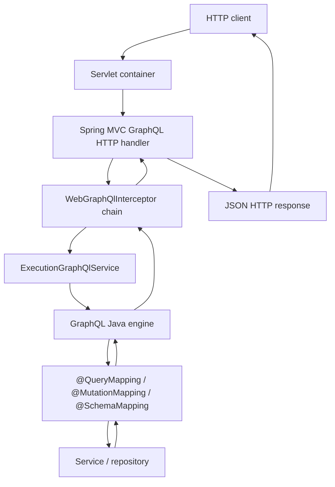

# Spring MVC transport trong Spring for GraphQL

Spring for GraphQL không phụ thuộc một web framework cụ thể. Khi ứng dụng chạy trên Spring MVC, request GraphQL được tiếp nhận qua servlet stack và được chuyển tới GraphQL engine để thực thi schema, resolver và DataFetcher. Spring Boot tự cấu hình HTTP endpoint mặc định tại `POST /graphql` khi có `spring-boot-starter-graphql` và `spring-boot-starter-web`.

Spring MVC transport phù hợp với ứng dụng servlet truyền thống, đặc biệt khi hệ thống đang dùng Spring MVC, Spring Security và các thư viện persistence đồng bộ như JDBC/JPA. Transport chịu trách nhiệm nhận request HTTP, chuyển JSON thành GraphQL request, gọi chuỗi xử lý GraphQL và ghi response về client. Các resolver vẫn là nơi xử lý nghiệp vụ; endpoint `/graphql` không cần một REST controller riêng cho từng Query hoặc Mutation.

## Spring MVC nằm ở đâu trong kiến trúc?

Một ứng dụng Spring for GraphQL thường có các lớp sau:

- **HTTP transport:** nhận request tại endpoint `/graphql`, đọc JSON body và tạo GraphQL request.
- **WebGraphQlHandler và interceptor chain:** xử lý thông tin web như header, principal, context, response metadata.
- **ExecutionGraphQlService:** chuyển request sang GraphQL Java để thực thi schema.
- **Annotated controller/DataFetcher:** resolve Query, Mutation và các field lồng nhau.
- **HTTP response:** serialize `data`, `errors`, `extensions` thành JSON và trả qua servlet response.



Spring Boot tích hợp endpoint GraphQL qua cơ chế functional routing của Spring MVC. Vì vậy, trong cấu hình thông thường, chỉ cần khai báo schema và annotated controller; không cần tạo `@PostMapping("/graphql")` để tự parse request GraphQL.

## Dependency để chạy Spring MVC transport

Với Gradle Kotlin DSL:

```kotlin
dependencies {
    implementation("org.springframework.boot:spring-boot-starter-graphql")
    implementation("org.springframework.boot:spring-boot-starter-web")
}
```

Với Maven:

```xml
<dependency>
    <groupId>org.springframework.boot</groupId>
    <artifactId>spring-boot-starter-graphql</artifactId>
</dependency>
<dependency>
    <groupId>org.springframework.boot</groupId>
    <artifactId>spring-boot-starter-web</artifactId>
</dependency>
```

`spring-boot-starter-web` cung cấp Spring MVC và servlet web server. `spring-boot-starter-graphql` cung cấp schema loading, GraphQL Java integration, annotated controller support và HTTP GraphQL handler.

Không cần thêm `spring-boot-starter-webflux` chỉ để sử dụng GraphQL. Nếu dự án có cả MVC và WebFlux, cần hiểu rõ Spring Boot sẽ chọn application type và transport nào; không nên thêm cả hai starter theo thói quen. Với ứng dụng servlet MVC, giữ stack MVC nhất quán giúp cấu hình thread, filter và security dễ dự đoán hơn.

## Endpoint GraphQL mặc định

Khi Spring Boot phát hiện các dependency phù hợp, endpoint HTTP mặc định là:

```text
POST /graphql
```

Endpoint nhận GraphQL request dưới dạng JSON. Có thể đổi path bằng cấu hình Spring Boot. Với dòng Spring Boot mới, thuộc tính là `spring.graphql.http.path`; ở các dòng Spring Boot cũ hơn, thuộc tính thường là `spring.graphql.path`. Ví dụ cấu hình cho dòng Boot mới:

```yaml
spring:
  graphql:
    http:
      path: /api/graphql
```

Sau khi đổi path, client phải gửi request tới `/api/graphql`. Cũng cần cập nhật security matcher, CORS, reverse proxy, API gateway, health check và integration test dùng endpoint cũ.

Spring Boot cung cấp endpoint bằng một `RouterFunction` có thứ tự ưu tiên mặc định. Nếu ứng dụng tự khai báo `RouterFunction` khác, hãy cấu hình `@Order` phù hợp để tránh route tùy chỉnh che hoặc tranh chấp endpoint GraphQL.

## Cấu trúc HTTP request

Một request GraphQL qua HTTP POST có `Content-Type: application/json` và JSON body chứa document cùng thông tin operation tùy chọn:

```json
{
  "query": "query BookDetail($id: ID!) { book(id: $id) { id title } }",
  "operationName": "BookDetail",
  "variables": {
    "id": "book-10"
  }
}
```

`query` là GraphQL document. `operationName` xác định operation cần chạy nếu document có nhiều operation. `variables` chứa dữ liệu đầu vào tách khỏi query string. `extensions` có thể mang metadata theo thỏa thuận giữa client và server.

Ví dụ gọi endpoint bằng curl:

```bash
curl -X POST http://localhost:8080/graphql \
  -H "Content-Type: application/json" \
  -H "Accept: application/graphql-response+json, application/json" \
  -d '{
    "query": "query BookDetail($id: ID!) { book(id: $id) { id title } }",
    "operationName": "BookDetail",
    "variables": { "id": "book-10" }
  }'
```

Trong ứng dụng thực tế, ưu tiên variables thay vì nối giá trị client vào GraphQL document. Cách này giúp tái sử dụng query, giữ dữ liệu đầu vào riêng biệt và để GraphQL engine kiểm tra kiểu theo SDL.

## Content negotiation và response body

Client có thể gửi `Accept` để khai báo định dạng response mong muốn. Media type GraphQL response hiện hành là `application/graphql-response+json`; `application/json` vẫn được hỗ trợ cho tương thích với client cũ.

Ví dụ response thành công:

```json
{
  "data": {
    "book": {
      "id": "book-10",
      "title": "Spring in Practice"
    }
  }
}
```

Ví dụ response có lỗi khi thực thi field:

```json
{
  "data": {
    "book": null
  },
  "errors": [
    {
      "message": "Không tìm thấy sách",
      "path": ["book"]
    }
  ]
}
```

GraphQL có thể trả `data` một phần cùng `errors`. Client cần đọc cả hai phần thay vì chỉ dựa vào HTTP status.

### HTTP status và GraphQL errors

Quy tắc status phụ thuộc giai đoạn xử lý và media type:

| Tình huống | HTTP status thường gặp | Nội dung cần xem |
| --- | --- | --- |
| Server không sẵn sàng hoặc lỗi hạ tầng | 5xx | HTTP error và log server. |
| Thiếu thông tin xác thực hoặc không được phép ở security filter | 401 hoặc 403 | HTTP response trước khi GraphQL engine chạy. |
| Body không phải JSON hợp lệ hoặc request HTTP sai | 4xx | Lỗi transport/binding. |
| GraphQL document parse/validation thất bại với `application/graphql-response+json` | 4xx theo GraphQL over HTTP. | GraphQL `errors`. |
| GraphQL document parse/validation thất bại với legacy `application/json` | Có thể vẫn là 200 theo hành vi tương thích. | GraphQL `errors`. |
| Request đã qua validation nhưng resolver phát sinh execution error | 200 | GraphQL `errors`, có thể đi kèm partial `data`. |

Không đổi mọi GraphQL error thành HTTP 500. Khi operation đã hợp lệ nhưng một field thất bại, GraphQL thường trả execution result với status 200 và mô tả lỗi trong body. Điều này cho phép client nhận các field còn lại đã resolve thành công.

## Schema và annotated controller vẫn giữ nguyên

Chọn Spring MVC làm transport không thay đổi cách viết SDL hoặc annotated controller. Ví dụ schema:

```graphql
type Book {
  id: ID!
  title: String!
}

type Query {
  book(id: ID!): Book
}
```

Controller xử lý Query:

```java
import org.springframework.graphql.data.method.annotation.Argument;
import org.springframework.graphql.data.method.annotation.QueryMapping;
import org.springframework.stereotype.Controller;

@Controller
public class BookController {

    private final BookService bookService;

    public BookController(BookService bookService) {
        this.bookService = bookService;
    }

    @QueryMapping
    public Book book(@Argument("id") String id) {
        return bookService.findById(id).orElse(null);
    }
}
```

Spring MVC transport nhận HTTP request và chuyển nó vào GraphQL runtime. GraphQL runtime tìm field `Query.book`, gọi DataFetcher do `@QueryMapping` đăng ký, rồi serialize kết quả thành response. Không cần thêm `@RestController` cho từng field GraphQL.

## Spring MVC xử lý bất đồng bộ như thế nào?

`GraphQlHttpHandler` có hai biến thể cho Spring MVC và Spring WebFlux. Cả hai đều hỗ trợ xử lý request bất đồng bộ, nhưng khác nhau ở I/O ghi response: MVC dựa trên servlet stack và ghi response theo mô hình blocking; WebFlux sử dụng non-blocking I/O.

Trong Spring MVC, khi GraphQL execution hoàn tất ngay, response có thể được ghi trong request flow hiện tại. Khi GraphQL trả về kết quả bất đồng bộ chưa hoàn tất, Spring MVC có thể sử dụng Servlet async request processing để tiếp tục response mà không giữ request thread trong toàn bộ thời gian chờ.

Điểm cần phân biệt: Servlet async không tự chuyển lời gọi resolver blocking sang thread pool khác. Nếu `@QueryMapping` gọi JPA/JDBC đồng bộ, thread đang thực thi DataFetcher vẫn phải chờ database. Muốn offload, controller/service cần trả kiểu bất đồng bộ và thực sự chạy công việc trên executor phù hợp.

Ví dụ dùng `CompletableFuture` với executor có giới hạn:

```java
@QueryMapping
public CompletableFuture<Book> book(@Argument String id) {
    return CompletableFuture.supplyAsync(
            () -> bookService.findById(id).orElse(null),
            graphqlBlockingExecutor);
}
```

`graphqlBlockingExecutor` là executor do ứng dụng cấu hình và quản lý. Không nên dùng common ForkJoinPool mặc định cho blocking database work trong hệ thống tải cao. Cần cân bằng pool size với connection pool và giới hạn của database.

Với ứng dụng MVC đang dùng JPA, synchronous resolver có thể phù hợp nếu số request đồng thời và thời gian truy vấn được kiểm soát. Không cần đổi mọi resolver sang reactive chỉ vì transport có hỗ trợ async.

## Cấu hình timeout cho GraphQL HTTP request

Một GraphQL operation có thể yêu cầu nhiều field và gọi nhiều dịch vụ phụ thuộc. Nếu không giới hạn thời gian, request tốn tài nguyên có thể kéo dài ngoài dự kiến.

Spring for GraphQL cung cấp `TimeoutWebGraphQlInterceptor` cho web transports. Có thể khai báo bean để đặt timeout chung:

```java
import java.time.Duration;
import org.springframework.context.annotation.Bean;
import org.springframework.context.annotation.Configuration;
import org.springframework.graphql.server.TimeoutWebGraphQlInterceptor;

@Configuration(proxyBeanMethods = false)
public class GraphQlTimeoutConfiguration {

    @Bean
    TimeoutWebGraphQlInterceptor graphQlTimeoutInterceptor() {
        return new TimeoutWebGraphQlInterceptor(Duration.ofSeconds(5));
    }
}
```

Timeout interceptor gửi tín hiệu cancel lên chuỗi xử lý khi request vượt thời gian. Reactive DataFetcher có thể phản ứng với cancellation; lời gọi blocking như JDBC không nhất thiết dừng ngay chỉ vì HTTP request đã timeout. Vì vậy vẫn cần query timeout ở database, timeout ở HTTP client và giới hạn thời gian tại dịch vụ downstream.

Không chọn một timeout quá ngắn mà không đo thời gian xử lý bình thường và các operation hợp lệ. Có thể cần chính sách riêng cho query nặng hoặc export dài.

## Bảo mật endpoint trong servlet stack

Spring MVC GraphQL endpoint nằm trong servlet filter chain, vì vậy có thể áp dụng Spring Security, authentication, authorization, CORS và CSRF như các endpoint HTTP khác.

Ví dụ yêu cầu xác thực tại endpoint:

```java
@Bean
SecurityFilterChain securityFilterChain(HttpSecurity http) throws Exception {
    return http
            .authorizeHttpRequests(authorize -> authorize
                    .requestMatchers("/graphql").authenticated()
                    .anyRequest().permitAll())
            .build();
}
```

Đoạn code minh họa rule endpoint; cấu hình thật cần kết hợp login mechanism, session/token và các matcher khác của ứng dụng. Vì mọi Query và Mutation thường đi qua cùng `/graphql`, rule ở URL chỉ xác định ai được gọi endpoint. Nó không thay thế authorization theo từng field hoặc từng tài nguyên.

Ví dụ, người dùng được gọi GraphQL nhưng chỉ được đọc đơn hàng thuộc tenant của họ. Kiểm tra quyền phải được thực hiện trong service, resolver hoặc method security dựa trên principal đã xác thực. Không tin `userId` hoặc `tenantId` do client gửi làm bằng chứng quyền.

### CSRF khi dùng session cookie

GraphQL mutation thường được gửi bằng HTTP POST. Nếu ứng dụng xác thực bằng session cookie và Spring Security bật CSRF protection, client browser cần gửi CSRF token hợp lệ cùng request mutation. Không tắt CSRF toàn cục chỉ để GraphQL client hoạt động.

Có thể cấu hình CSRF token repository và cách client lấy/gửi token theo cơ chế bảo mật của ứng dụng. Nếu API chỉ dùng bearer token trong Authorization header và không dựa vào cookie tự động gửi, đánh giá CSRF theo threat model cụ thể trước khi điều chỉnh filter chain.

### CORS cho frontend khác origin

Nếu frontend chạy trên domain khác, cấu hình CORS cho GraphQL endpoint. Ví dụ:

```yaml
spring:
  graphql:
    cors:
      allowed-origins: "https://app.example.com"
      allowed-methods: POST
      allowed-headers: Authorization,Content-Type,X-CSRF-TOKEN
      exposed-headers: X-Request-Id
      max-age: 1800s
```

Khi cho phép credentials/cookie, khai báo origin cụ thể; không dùng wildcard `*` cùng credentials. CORS chỉ là chính sách trình duyệt cho cross-origin request, không thay thế authentication hoặc authorization.

## GraphQL HTTP và GET

Spring GraphQL mặc định chỉ bật HTTP POST cho endpoint GraphQL. Một số phiên bản handler có thể được cấu hình để hỗ trợ GET theo GraphQL over HTTP. GET thường dành cho Query, không được dùng để thực thi Mutation.

GET có thể hữu ích cho client chỉ hỗ trợ GET hoặc cache ở CDN, nhưng query và variables nằm trên URL. Vì vậy cần cân nhắc độ dài URL, log proxy, cache key và dữ liệu nhạy cảm. Không đặt token hoặc dữ liệu cá nhân trong query string.

Chỉ bật GET khi handler và route predicate cùng cho phép method đó. Chỉ thay cấu hình một phía có thể khiến request bị từ chối hoặc không được route tới GraphQL handler.

## Subscription trên Spring MVC

Spring MVC không chỉ xử lý Query và Mutation qua HTTP. Servlet application cũng có thể bật WebSocket transport hoặc dùng Server-Sent Events (SSE) cho Subscription nếu cấu hình phù hợp.

- **HTTP request-response:** mặc định dùng POST `/graphql`, phù hợp Query và Mutation.
- **SSE:** client gửi GraphQL request với `Accept: text/event-stream`; server trả từng execution result dưới dạng Server-Sent Event. Spring for GraphQL hỗ trợ distinct connections mode, vì vậy cần đánh giá số kết nối đồng thời và khả năng mở rộng.
- **WebSocket:** với servlet application, thêm `spring-boot-starter-websocket` và cấu hình `spring.graphql.websocket.path`. Endpoint WebSocket không được bật mặc định.

Không thể nhận nhiều kết quả Subscription liên tục qua một HTTP response JSON thông thường. Nếu cần luồng event, hãy chọn SSE hoặc WebSocket và cấu hình client tương thích với protocol server.

## File upload và dữ liệu nhị phân

GraphQL request HTTP tiêu chuẩn tập trung vào JSON. Spring for GraphQL không hỗ trợ trực tiếp `graphql-multipart-request-spec` để upload file qua multipart GraphQL.

Với ảnh hoặc tài liệu, thường nên dùng REST upload endpoint riêng hoặc cấp pre-signed URL cho object storage. Sau khi upload thành công, client gọi Mutation GraphQL để lưu metadata hoặc liên kết file với domain object. Cách này giữ GraphQL schema tập trung vào dữ liệu nghiệp vụ và tận dụng được cơ chế upload chuyên dụng.

## Kiểm thử Spring MVC transport

`GraphQlTester` cung cấp API kiểm thử thống nhất. Để kiểm tra qua HTTP trong Spring MVC mà không cần mở server thật, có thể dùng `MockMvcWebTestClient` rồi tạo `HttpGraphQlTester`.

Ví dụ test bind vào Spring MVC application context:

Thêm test dependency `org.springframework.graphql:spring-graphql-test` (để Spring Boot dependency management quản lý phiên bản):

```kotlin
dependencies {
    testImplementation("org.springframework.graphql:spring-graphql-test")
}
```

```java
import org.junit.jupiter.api.Test;
import org.springframework.beans.factory.annotation.Autowired;
import org.springframework.boot.test.context.SpringBootTest;
import org.springframework.graphql.test.tester.HttpGraphQlTester;
import org.springframework.test.web.reactive.server.WebTestClient;
import org.springframework.test.web.servlet.client.MockMvcWebTestClient;
import org.springframework.web.context.WebApplicationContext;

@SpringBootTest
class BookGraphQlHttpTests {

    private final HttpGraphQlTester graphQlTester;

    @Autowired
    BookGraphQlHttpTests(WebApplicationContext context) {
        WebTestClient client = MockMvcWebTestClient
                .bindToApplicationContext(context)
                .configureClient()
                .baseUrl("/graphql")
                .build();
        this.graphQlTester = HttpGraphQlTester.create(client);
    }

    @Test
    void readsBookOverMvcHttpTransport() {
        graphQlTester.document("""
                query {
                  book(id: "book-10") {
                    id
                    title
                  }
                }
                """)
                .execute()
                .path("book.id")
                .entity(String.class)
                .isEqualTo("book-10");
    }
}
```

Ví dụ cần import `WebApplicationContext` từ `org.springframework.web.context`. Dự án cũng cần test dependencies của Spring Boot và Spring GraphQL test support tương ứng với phiên bản đang dùng.

Với test chạy server thật, dùng `@SpringBootTest(webEnvironment = RANDOM_PORT)` và `HttpGraphQlTester` kết nối tới URL server. Spring Boot có thể tự cấu hình tester bằng `@AutoConfigureHttpGraphQlTester` trong các phiên bản hỗ trợ annotation này.

### Những trường hợp cần kiểm tra

- HTTP POST tới đúng path mặc định hoặc path đã tùy chỉnh.
- Request JSON có query, operationName và variables được bind đúng.
- Sai `Content-Type`, body JSON lỗi và method không được hỗ trợ trả HTTP error phù hợp.
- Query và Mutation trả `data` đúng; lỗi resolver xuất hiện trong `errors`.
- `application/graphql-response+json` và legacy `application/json` có status behavior đúng với phiên bản transport.
- Security filter trả 401/403 trước khi GraphQL engine chạy khi thiếu quyền endpoint.
- CSRF token và CORS preflight hoạt động với frontend browser.
- Interceptor có thể đọc request header và thêm response header.
- Timeout hủy request theo chính sách và không để task phụ thuộc chạy vô hạn.
- Nếu bật SSE/WebSocket, kiểm thử qua tester và transport tương ứng.

## Lỗi thường gặp

| Triệu chứng | Nguyên nhân | Cách xử lý |
| --- | --- | --- |
| `/graphql` trả 404 | Thiếu starter MVC/GraphQL, endpoint path bị đổi hoặc auto-configuration không được kích hoạt. | Kiểm tra dependency, application type và `spring.graphql.*.path`. |
| Request trả 415 Unsupported Media Type | `Content-Type` không phải JSON media type được handler hỗ trợ. | Gửi `Content-Type: application/json`. |
| GraphQL query không được parse | JSON body thiếu `query` hoặc document sai cú pháp. | Kiểm tra envelope và GraphQL document. |
| Resolver đồng bộ làm request thread bị giữ lâu | JDBC/JPA blocking hoặc downstream chậm. | Tối ưu query, giới hạn tải hoặc offload blocking work phù hợp. |
| Có GraphQL errors nhưng HTTP status 200 | Operation đã qua validation nhưng lỗi xảy ra trong quá trình execute. | Client đọc `errors` và xử lý partial `data`. |
| Frontend browser bị CORS error | Origin, method hoặc headers chưa được allow. | Cấu hình CORS cho đúng frontend origin và headers. |
| Mutation bị 403 dù đã đăng nhập bằng cookie | CSRF token thiếu hoặc không hợp lệ. | Cấu hình và gửi CSRF token đúng; không tắt CSRF toàn cục. |
| GraphQL endpoint chạy nhưng WebSocket không kết nối | Chưa thêm WebSocket starter hoặc chưa cấu hình path. | Bật `spring.graphql.websocket.path` và cấu hình servlet WebSocket. |
| Test HTTP không đi qua MVC transport | Dùng tester trực tiếp `ExecutionGraphQlServiceTester` thay vì HTTP tester. | Dùng `HttpGraphQlTester` với `MockMvcWebTestClient` hoặc server thật. |

## Ghi nhớ

Spring MVC transport đưa GraphQL vào servlet stack. Với `spring-boot-starter-graphql` và `spring-boot-starter-web`, Spring Boot tự cung cấp HTTP POST endpoint mặc định `/graphql`. Client gửi JSON envelope gồm query, operationName, variables và có thể extensions; response chứa `data`, `errors`, `extensions` theo GraphQL response format.

Spring MVC hỗ trợ xử lý request bất đồng bộ, nhưng điều đó không tự offload DataFetcher blocking. Resolver gọi JDBC/JPA đồng bộ vẫn giữ thread đang thực thi cho tới khi I/O hoàn tất. Cần kiểm soát thread, connection pool, timeout và độ phức tạp operation. Bảo mật endpoint qua Spring Security, CSRF và CORS; authorization theo field/tài nguyên vẫn thuộc service và resolver. Kiểm thử HTTP transport bằng `HttpGraphQlTester` kết hợp `MockMvcWebTestClient` để xác nhận toàn bộ đường đi từ HTTP tới GraphQL engine.

## Tài liệu tham khảo

- [Spring for GraphQL — Server Transports](https://docs.spring.io/spring-graphql/reference/transports.html)
- [Spring for GraphQL — Testing](https://docs.spring.io/spring-graphql/reference/testing.html)
- [Spring Boot — Spring for GraphQL](https://docs.spring.io/spring-boot/reference/web/spring-graphql.html)
- [Spring GraphQL — Request Execution và Timeout](https://docs.spring.io/spring-graphql/reference/request-execution.html)
