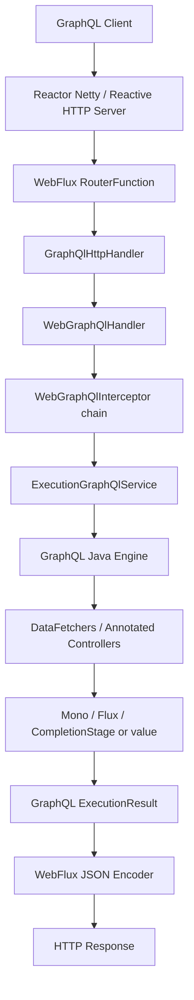

# Spring WebFlux transport

Spring for GraphQL không gắn với một web server cụ thể. GraphQL engine xử lý schema, operation và DataFetcher; lớp transport nhận HTTP hoặc WebSocket request, chuyển payload thành GraphQL request rồi gửi kết quả về client. Khi chạy trên Spring WebFlux, ứng dụng dùng HTTP handler và reactive web stack để đọc request, thực thi pipeline bất đồng bộ và ghi response bằng non-blocking I/O.

Với Spring Boot, chỉ cần kết hợp `spring-boot-starter-graphql` và `spring-boot-starter-webflux` để tạo GraphQL HTTP endpoint trên WebFlux. Endpoint mặc định là `POST /graphql`. Boot tự cấu hình `GraphQlHttpHandler` và một `RouterFunction`; phần lớn ứng dụng không cần tự viết route. Khi cần cấu hình độc lập, có thể kết nối `WebGraphQlHandler`, `GraphQlHttpHandler` và WebFlux functional routing.

Bài học này đi từ dependency và auto-configuration đến HTTP request/response, JSON codecs, reactive interceptor, non-blocking DataFetcher, SSE/WebSocket, bảo mật, kiểm thử bằng `WebTestClient` và các lỗi thường gặp khi vận hành.

## 1. WebFlux transport nằm ở đâu trong kiến trúc?

Một request GraphQL qua HTTP trên WebFlux đi qua các lớp chính:



Vai trò từng lớp:

| Thành phần | Trách nhiệm |
| --- | --- |
| WebFlux server | Nhận kết nối HTTP và cung cấp reactive request/response API |
| `RouterFunction` | Chọn handler cho URL và HTTP method |
| `GraphQlHttpHandler` | Đọc GraphQL payload, gọi Web GraphQL handler và ghi response |
| `WebGraphQlHandler` | Chạy interceptor chain trước và sau GraphQL execution |
| `ExecutionGraphQlService` | Chuyển GraphQL request vào GraphQL Java engine |
| GraphQL Java | Validate operation, thực thi field và tạo `ExecutionResult` |
| DataFetcher/controller | Tải dữ liệu và trả giá trị cho field |

Transport và DataFetcher có trách nhiệm khác nhau. WebFlux đảm nhiệm I/O HTTP non-blocking. DataFetcher quyết định cách truy cập database hoặc service. Chỉ thêm WebFlux starter không biến lời gọi JDBC/JPA blocking thành reactive.

## 2. Chọn dependency cho Spring WebFlux

Với Spring Boot, dependency tối thiểu cho GraphQL qua HTTP trên WebFlux:

```kotlin
dependencies {
    implementation("org.springframework.boot:spring-boot-starter-graphql")
    implementation("org.springframework.boot:spring-boot-starter-webflux")
}
```

Hoặc Maven:

```xml
<dependency>
    <groupId>org.springframework.boot</groupId>
    <artifactId>spring-boot-starter-graphql</artifactId>
</dependency>

<dependency>
    <groupId>org.springframework.boot</groupId>
    <artifactId>spring-boot-starter-webflux</artifactId>
</dependency>
```

Spring Boot chọn web stack dựa trên các dependency và cấu hình ứng dụng. Nếu ứng dụng có cả `spring-boot-starter-web` và `spring-boot-starter-webflux`, Boot thường chọn Spring MVC khi khởi động ứng dụng servlet. Nếu mục tiêu là WebFlux, hãy kiểm tra dependency graph và application type để tránh vô tình chạy trên MVC.

Spring WebFlux có thể chạy trên Reactor Netty hoặc một reactive server được hỗ trợ khác. Starter mặc định đưa Reactor Netty vào ứng dụng nếu không có server phù hợp khác được cấu hình.

GraphQL schema vẫn được đặt trong `src/main/resources/graphql/**` với phần mở rộng `.graphqls` hoặc `.gqls`. Transport không làm thay đổi cách khai báo schema hoặc controller:

```graphql
type Query {
  greeting(name: String!): String!
}
```

```java
@Controller
public class GreetingController {

    @QueryMapping
    public Mono<String> greeting(@Argument String name) {
        return Mono.just("Hello, " + name + "!");
    }
}
```

Controller có thể trả reactive type. WebFlux HTTP handler tiếp nhận kết quả execution theo pipeline bất đồng bộ và ghi response khi GraphQL operation hoàn tất.

## 3. Boot auto-configuration tạo HTTP endpoint

Khi có GraphQL starter và WebFlux starter, Spring Boot tự cấu hình:

- `GraphQlSource` từ schema và runtime wiring.
- `ExecutionGraphQlService` để thực thi GraphQL request.
- `WebGraphQlHandler` để chạy interceptor chain.
- WebFlux `GraphQlHttpHandler` để xử lý GraphQL HTTP.
- `RouterFunction` ánh xạ HTTP request vào handler.

Endpoint mặc định là:

```text
POST /graphql
```

Trong Spring Boot 3.4 trở về trước, property là:

```yaml
spring:
  graphql:
    path: /api/graphql
```

Từ Spring Boot 3.5 và trong Spring Boot 4.x, property được nhóm dưới `spring.graphql.http.path`:

```yaml
spring:
  graphql:
    http:
      path: /api/graphql
```

Tên property thay đổi theo major version Spring Boot; hãy kiểm tra configuration metadata của đúng phiên bản dependency đang dùng. Các phần còn lại của bài không phụ thuộc path cụ thể.

Boot cung cấp HTTP endpoint dưới dạng `RouterFunction` với order mặc định là `0`. Nếu ứng dụng tự khai báo RouterFunction khác, cần sắp xếp order để route cụ thể của ứng dụng không vô tình che route GraphQL hoặc ngược lại.

Với cấu hình mặc định, ứng dụng không cần khai báo `GraphQlHttpHandler` hay `RouterFunction` riêng. Chỉ tạo route thủ công khi cần kiểm soát rõ URL, predicate, handler hoặc tích hợp vào một WebFlux functional application độc lập.

## 4. HTTP request và response

GraphQL HTTP mặc định nhận request bằng HTTP POST. Header và body cơ bản:

```http
POST /graphql HTTP/1.1
Content-Type: application/json
Accept: application/graphql-response+json
```

Body là một JSON object chứa GraphQL request:

```json
{
  "query": "query BookById($id: ID!) { bookById(id: $id) { id title } }",
  "operationName": "BookById",
  "variables": {
    "id": "book-1"
  }
}
```

Các thuộc tính phổ biến:

| Thuộc tính | Mục đích |
| --- | --- |
| `query` | GraphQL document dưới dạng chuỗi |
| `operationName` | Tên operation cần chạy khi document có nhiều operation |
| `variables` | Map các biến đầu vào của operation |
| `extensions` | Metadata mở rộng theo thỏa thuận giữa client và server |

Response thành công:

```http
HTTP/1.1 200 OK
Content-Type: application/graphql-response+json
```

```json
{
  "data": {
    "bookById": {
      "id": "book-1",
      "title": "Spring GraphQL"
    }
  }
}
```

Nếu client không yêu cầu media type mới, server vẫn hỗ trợ legacy `application/json`. Media type response nên được thương lượng bằng header `Accept`; request body thông thường vẫn dùng header `Content-Type: application/json`.

### HTTP status và GraphQL errors

Không nên giả định mọi lỗi GraphQL đều làm HTTP status khác 200:

| Tình huống | HTTP status thường gặp |
| --- | --- |
| Server không sẵn sàng hoặc lỗi transport | 5xx |
| Thiếu thông tin xác thực hoặc bị web security từ chối | 4xx |
| Body không phải JSON hợp lệ | 4xx |
| Document parse/validation không hợp lệ, client nhận `application/graphql-response+json` | 4xx |
| Document parse/validation không hợp lệ, client dùng legacy `application/json` | 200 theo legacy behavior |
| Request đã validate, nhưng một DataFetcher phát sinh execution error | 200; chi tiết nằm trong `errors` |

Khi GraphQL operation đã được validate thành công, lỗi phát sinh trong lúc thực thi field được biểu diễn trong response body qua `errors`; HTTP status vẫn là 200. Client cần đọc cả `data` lẫn `errors`, vì response có thể chứa partial data.

### HTTP GET

`GraphQlHttpHandler` có thể hỗ trợ GET nếu bật tường minh. GET không gửi JSON body; query và operation name nằm trong query string, còn variables/extensions phải được encode thành JSON string. GET là safe method nên GraphQL server từ chối operation Mutation qua GET.

GET bị tắt mặc định. Trước khi bật, cần lưu ý query string có thể xuất hiện trong access log, browser history, Referer header, proxy và cache. Không dùng GET nếu variables chứa thông tin nhạy cảm. Với phần lớn ứng dụng, POST là lựa chọn đơn giản và an toàn hơn.

## 5. WebFlux handler và JSON codecs

`GraphQlHttpHandler` của WebFlux dùng các codec reactive của Spring WebFlux để đọc và ghi payload:

- `DecoderHttpMessageReader` đọc và giải mã JSON request body.
- `EncoderHttpMessageWriter` mã hóa GraphQL response thành JSON.
- WebFlux server ghi response mà không cần chặn thread để chờ I/O.

Các codec mặc định được lấy từ cấu hình WebFlux của ứng dụng. Nếu ứng dụng tùy chỉnh Jackson, `CodecConfigurer` hoặc giới hạn buffer, hãy kiểm tra GraphQL payload vẫn được deserialize thành request map và serialize đúng response format.

Ví dụ cấu hình giới hạn dung lượng dữ liệu cần buffer:

```yaml
spring:
  codec:
    max-in-memory-size: 2MB
```

Giá trị thực tế phụ thuộc kích thước operation, variables và môi trường triển khai. Giới hạn quá thấp có thể khiến request lớn bị từ chối; giới hạn quá cao làm tăng nguy cơ tiêu thụ bộ nhớ khi nhiều request đồng thời.

Nếu JSON codec dùng riêng cho GraphQL khác codec toàn ứng dụng, có thể cấu hình custom codec trên GraphQL HTTP handler trong setup thủ công. Không thay thế toàn bộ codec mặc định nếu chỉ cần thêm một serializer hoặc module; hãy ưu tiên mở rộng cấu hình hiện có.

## 6. Tự khai báo WebFlux route khi không dùng Boot endpoint

Trong một ứng dụng WebFlux tự cấu hình, có thể tạo route bằng functional endpoint. Ví dụ dưới đây giả định ứng dụng đã có `WebGraphQlHandler` được cấu hình với `ExecutionGraphQlService` và interceptor chain:

```java
@Configuration
public class GraphQlWebFluxRouteConfiguration {

    @Bean
    RouterFunction<ServerResponse> graphQlRouterFunction(
            WebGraphQlHandler webGraphQlHandler) {

        GraphQlHttpHandler graphQlHttpHandler =
                new GraphQlHttpHandler(webGraphQlHandler);

        RequestPredicate predicate =
                GraphQlRequestPredicates.graphQlHttp("/graphql");

        return RouterFunctions.route(
                predicate,
                graphQlHttpHandler::handleRequest);
    }
}
```

Các type trong ví dụ thuộc Spring GraphQL WebFlux transport và Spring WebFlux functional API:

- `GraphQlHttpHandler`: `org.springframework.graphql.server.webflux`.
- `GraphQlRequestPredicates`: `org.springframework.graphql.server.webflux`.
- `RouterFunction`, `RouterFunctions` và `ServerResponse`: `org.springframework.web.reactive.function.server`.

Nếu dùng Spring Boot auto-configuration, không khai báo route trùng như ví dụ trên. Hai route cùng match `/graphql` có thể tạo xung đột hoặc khiến request đi vào handler không mong muốn.

Standalone setup còn cần tạo `GraphQlSource`, `ExecutionGraphQlService` và `WebGraphQlHandler`. Hãy dùng Boot starter nếu không có lý do rõ ràng để tự lắp ghép các thành phần này.

## 7. WebGraphQlInterceptor trong WebFlux

`WebGraphQlInterceptor` chạy trước và sau GraphQL engine. Với WebFlux, method `intercept` trả về `Mono<WebGraphQlResponse>` để toàn bộ request/response tiếp tục theo reactive pipeline.

Interceptor thường được dùng để:

- Đọc HTTP header và đưa thông tin cần thiết vào `GraphQLContext`.
- Ghi correlation ID hoặc thông tin tracing.
- Thêm response header.
- Kiểm tra request metadata trước khi thực thi.
- Quan sát hoặc biến đổi execution result.

Ví dụ lấy tenant ID từ HTTP header:

```java
@Component
public class TenantHeaderInterceptor implements WebGraphQlInterceptor {

    @Override
    public Mono<WebGraphQlResponse> intercept(
            WebGraphQlRequest request,
            Chain chain) {

        String tenantId = request.getHeaders().getFirst("X-Tenant-Id");
        if (tenantId != null && !tenantId.isBlank()) {
            request.configureExecutionInput((input, builder) ->
                    builder.graphQLContext(Map.of("tenantId", tenantId)).build());
        }

        return chain.next(request);
    }
}
```

Annotated controller có thể đọc giá trị đó:

```java
@QueryMapping
public Mono<List<Book>> books(
        @ContextValue("tenantId") String tenantId) {
    return bookService.findVisibleBooks(tenantId);
}
```

Header chỉ là dữ liệu do client gửi. Không xem giá trị tenant ID trong header là danh tính đã được xác thực. Hãy lấy principal từ Spring Security hoặc xác thực header bằng cơ chế tin cậy trước khi dùng nó để phân vùng dữ liệu.

### Thêm response header

Interceptor cũng có thể quan sát response sau khi GraphQL execution hoàn tất:

```java
@Component
public class CorrelationIdInterceptor implements WebGraphQlInterceptor {

    @Override
    public Mono<WebGraphQlResponse> intercept(
            WebGraphQlRequest request,
            Chain chain) {

        String correlationId = request.getHeaders().getFirst("X-Correlation-Id");

        return chain.next(request).doOnNext(response -> {
            if (correlationId != null) {
                response.getResponseHeaders()
                        .set("X-Correlation-Id", correlationId);
            }
        });
    }
}
```

`doOnNext` chỉ thực hiện side effect đồng bộ khi response đã có. Nếu cần gọi service bất đồng bộ trước hoặc sau execution, dùng các operator như `flatMap` thay vì gọi `block()`.

Với Spring Boot, khai báo bean `WebGraphQlInterceptor` là đủ để Boot đăng ký vào web transport. Trong standalone setup, truyền interceptor vào cấu hình `WebGraphQlHandler`. Nhiều interceptor có thể được sắp xếp bằng `@Order` để xác định thứ tự thực thi.

## 8. Reactive DataFetcher và non-blocking I/O

WebFlux không bắt buộc mọi DataFetcher phải trả Reactor type. Spring for GraphQL vẫn hỗ trợ giá trị thông thường, `CompletionStage`, `Mono` và các kiểu reactive tương thích. Điểm quan trọng là công việc bên trong resolver có chặn event-loop hay không.

Ví dụ dùng reactive repository:

```java
@Controller
public class BookQueryController {

    private final ReactiveBookRepository repository;

    public BookQueryController(ReactiveBookRepository repository) {
        this.repository = repository;
    }

    @QueryMapping
    public Mono<Book> bookById(@Argument String id) {
        return repository.findById(id);
    }
}
```

`Mono<Book>` biểu diễn kết quả có tối đa một Book. Khi repository dùng reactive driver như R2DBC, I/O có thể được thực hiện non-blocking và kết quả được nối vào GraphQL execution pipeline.

Với dependency blocking như JDBC hoặc SDK đồng bộ, không gọi trực tiếp trên event-loop:

```java
@QueryMapping
public Mono<Book> bookById(@Argument String id) {
    return Mono.fromCallable(() -> blockingBookRepository.findById(id))
            .subscribeOn(Schedulers.boundedElastic());
}
```

Ví dụ trên chuyển lời gọi blocking sang bounded elastic scheduler để không giữ event-loop trong lúc chờ I/O. Đây là cách cô lập tương thích khi chưa thể thay dependency blocking; về lâu dài, dùng reactive driver hoặc thiết kế service phù hợp sẽ dễ kiểm soát tải hơn.

Các nguyên tắc quan trọng:

- Không gọi `block()` trong WebFlux controller, interceptor hoặc DataFetcher.
- Không gọi `subscribe()` thủ công để tách công việc khỏi GraphQL lifecycle; hãy trả Publisher để framework quản lý.
- Không chạy JDBC hoặc file/network I/O blocking trên event-loop.
- Chỉ dùng `Schedulers.boundedElastic()` để cô lập lời gọi blocking có giới hạn, không dùng nó để che mọi vấn đề concurrency.
- Giữ request state trong GraphQLContext hoặc Reactor Context theo đúng phạm vi; không lưu vào field mutable của singleton controller.
- Dùng timeout, connection pool và giới hạn concurrency cho dependency bên ngoài.

### Reactive transport không đồng nghĩa với reactive persistence

Một ứng dụng có thể chạy WebFlux nhưng vẫn gọi JDBC. HTTP server vẫn non-blocking khi đọc và ghi socket, nhưng thread xử lý request có thể bị chiếm nếu DataFetcher chờ JDBC. Tình huống đó làm giảm khả năng phục vụ nhiều kết nối đồng thời và có thể gây cạn event-loop.

Chọn persistence theo yêu cầu:

| Tầng truy cập dữ liệu | Đặc điểm |
| --- | --- |
| R2DBC / reactive driver | Trả Publisher, phù hợp reactive pipeline |
| JDBC / JPA đồng bộ | Blocking; cần cô lập khỏi event-loop |
| HTTP client reactive | Có thể trả `Mono`/`Flux` và kết hợp với resolver |
| SDK đồng bộ | Blocking; cần adapter hoặc executor phù hợp |

Không bọc một lời gọi blocking bằng `Mono.just(repository.call())` rồi xem đó là non-blocking. Biểu thức `repository.call()` đã chạy ngay trước khi Mono được tạo. Dùng `Mono.fromCallable` và scheduler phù hợp nếu phải tích hợp thư viện blocking.

## 9. Subscription qua SSE và WebSocket trên WebFlux

HTTP JSON thông thường phù hợp với Query và Mutation vì mỗi operation trả một response. Subscription cần gửi nhiều kết quả theo thời gian; Spring for GraphQL hỗ trợ hai transport web thường dùng:

| Transport | Handler | Đặc điểm |
| --- | --- | --- |
| Server-Sent Events (SSE) | `GraphQlSseHandler` | HTTP response dạng event stream, server gửi dữ liệu một chiều |
| WebSocket | `GraphQlWebSocketHandler` | Kết nối hai chiều, client có thể gửi operation và hủy subscription |

### SSE

Client gửi GraphQL request qua HTTP POST với `Content-Type: application/json`, đồng thời yêu cầu response stream:

```http
POST /graphql HTTP/1.1
Content-Type: application/json
Accept: text/event-stream
```

Body chứa Subscription operation:

```json
{
  "query": "subscription { bookUpdated { id title } }"
}
```

Server gửi một hoặc nhiều Server-Sent Events. SSE trong Spring for GraphQL dành cho Subscription; Query và Mutation tiếp tục dùng HTTP JSON thông thường. Transport hỗ trợ distinct connections mode, vì vậy cần tính số lượng kết nối đồng thời, timeout, proxy buffering và lợi ích của HTTP/2 khi triển khai ở quy mô lớn.

`GraphQlSseHandler` có thể được cấu hình trên WebFlux route trong standalone setup. Trong Spring Boot, endpoint HTTP GraphQL hỗ trợ `text/event-stream` cho Subscription theo cấu hình transport của phiên bản đang dùng.

### WebSocket

`GraphQlWebSocketHandler` dùng protocol `graphql-ws`. Nó có thể chạy Query/Mutation một lần và đặc biệt hữu ích cho Subscription stream.

Với Spring Boot:

- WebSocket GraphQL endpoint tắt mặc định.
- WebFlux không cần thêm `spring-boot-starter-websocket` như ứng dụng Servlet.
- Cần cấu hình path để bật endpoint.

Ví dụ:

```yaml
spring:
  graphql:
    websocket:
      path: /graphql-ws
```

WebFlux WebSocket handler sử dụng non-blocking I/O và backpressure khi gửi các message stream. Ứng dụng vẫn cần giới hạn số connection, số subscription trên mỗi session và kích thước message theo tải dự kiến.

Subscription publisher có thể phát `onNext`, `onError` hoặc `onComplete`. Client hủy operation sẽ dẫn tới cancellation; hãy bảo đảm publisher và resource downstream phản ứng đúng với cancellation.

## 10. CORS, security và request context

WebFlux GraphQL endpoint vẫn đi qua WebFlux security và CORS configuration. Nếu browser gọi API từ origin khác, hãy cấu hình CORS cụ thể:

```yaml
spring:
  graphql:
    cors:
      allowed-origins: "https://app.example.com"
      allowed-methods: GET,POST
      allowed-headers: Authorization,Content-Type,X-Correlation-Id
      max-age: 1800s
```

Chỉ cho phép origin và header thực sự cần thiết. Không dùng wildcard origin cùng credentials trong cấu hình production.

Spring Security WebFlux dùng `SecurityWebFilterChain` để bảo vệ endpoint:

```java
@Bean
SecurityWebFilterChain securityWebFilterChain(ServerHttpSecurity http) {
    return http
            .authorizeExchange(exchanges -> exchanges
                    .pathMatchers("/graphql").authenticated()
                    .anyExchange().permitAll())
            .oauth2ResourceServer(oauth2 -> oauth2.jwt(Customizer.withDefaults()))
            .build();
}
```

Đoạn code minh họa ứng dụng dùng JWT resource server. Thay đổi quy tắc authorization theo mô hình xác thực thực tế. Nếu dùng cookie/session authentication trong browser, xem xét CSRF protection cho POST mutation; không tắt CSRF toàn cục chỉ để GraphQL client gửi request dễ hơn.

Transport interceptor có thể đưa correlation ID hoặc metadata đã được xác thực vào GraphQLContext. Authorization vẫn cần được kiểm tra tại resolver/service hoặc method security; một HTTP header tự nó không chứng minh caller có quyền.

## 11. Giới hạn tài nguyên và khả năng mở rộng

Non-blocking I/O giúp server giữ ít thread hơn khi chờ network, nhưng không loại bỏ giới hạn CPU, bộ nhớ, database connection hay thời gian xử lý GraphQL.

Khi triển khai, hãy cân nhắc:

- Giới hạn request body và codec in-memory buffer.
- Timeout cho HTTP request, resolver và dependency calls.
- Giới hạn concurrency khi gọi database hoặc service ngoài.
- DataLoader và `@BatchMapping` để giảm N+1.
- Query depth/cost limit để ngăn operation quá tốn tài nguyên.
- Connection pool phù hợp với database và downstream services.
- Rate limit theo user, client hoặc tenant.
- Với SSE/WebSocket, giới hạn số kết nối và subscription đồng thời.
- Theo dõi latency, error rate, memory, event-loop utilization và số connection.

Không nên tăng số event-loop thread để bù cho DataFetcher blocking. Cần xác định blocking call và chuyển nó sang reactive driver hoặc scheduler chuyên dụng.

## 12. Kiểm thử WebFlux transport bằng WebTestClient

`GraphQlTester` kiểm tra GraphQL execution thuận tiện, nhưng không tự xác minh HTTP route, WebFlux codec, CORS hoặc security filter. Dùng `WebTestClient` để kiểm thử qua endpoint thật.

Ví dụ integration test:

```java
@SpringBootTest(webEnvironment = SpringBootTest.WebEnvironment.RANDOM_PORT)
@AutoConfigureWebTestClient
class GraphQlWebFluxTransportTests {

    @Autowired
    WebTestClient webTestClient;

    @Test
    void executesGraphQlQueryOverHttp() {
        webTestClient.post()
                .uri("/graphql")
                .contentType(MediaType.APPLICATION_JSON)
                .accept(MediaType.APPLICATION_JSON)
                .bodyValue(Map.of("query", "{ greeting }"))
                .exchange()
                .expectStatus().isOk()
                .expectBody()
                .jsonPath("$.data.greeting").isEqualTo("Hello");
    }
}
```

Ví dụ giả định schema có field `Query.greeting` trả về chuỗi `Hello` và endpoint dùng path mặc định. Nếu ứng dụng yêu cầu authentication, thêm token hoặc thiết lập test security tương ứng.

### Các lớp kiểm thử nên có

| Loại test | Công cụ | Điều cần xác nhận |
| --- | --- | --- |
| Resolver/controller logic | `@GraphQlTest`, `GraphQlTester` | Mapping, arguments, data và errors |
| HTTP transport | `WebTestClient` | Route, method, media type, codec và response |
| Security | `WebTestClient` với security test support | Unauthorized, forbidden, CSRF và CORS |
| Reactive publisher | `StepVerifier` | Emission, error, completion và cancellation |
| Subscription transport | `WebTestClient` hoặc WebSocket client | Event stream, protocol và client cancellation |

Nên kiểm tra cả request hợp lệ và không hợp lệ: sai Content-Type, body JSON sai, query không hợp lệ, DataFetcher error, request thiếu credential và operation có variables. Với SSE/WebSocket, kiểm tra client disconnect có giải phóng resource.

## 13. Lỗi thường gặp

| Biểu hiện | Nguyên nhân | Cách xử lý |
| --- | --- | --- |
| `/graphql` trả 404 | Thiếu GraphQL/WebFlux starter, sai path hoặc route không được đăng ký | Kiểm tra dependency và `spring.graphql.*.path` |
| Ứng dụng chạy MVC thay vì WebFlux | Có cả MVC và WebFlux starter, Boot chọn servlet stack | Kiểm tra dependency tree và startup application type |
| HTTP 405 | Request dùng method không được endpoint cho phép | Dùng POST hoặc cấu hình method support có chủ đích |
| HTTP 415 | Content-Type không được hỗ trợ | Gửi `application/json` |
| HTTP 406 | Accept header không khớp response media type được hỗ trợ | Dùng `application/graphql-response+json` hoặc `application/json` |
| Request lớn bị từ chối | Codec buffer limit quá thấp | Xem lại `spring.codec.max-in-memory-size` và giới hạn body |
| Response chậm dù dùng WebFlux | DataFetcher gọi JDBC/SDK blocking trên event-loop | Dùng reactive client hoặc offload blocking call |
| Thread bị giữ lâu | Gọi `block()` hoặc chờ future đồng bộ | Trả `Mono`/`CompletionStage` và nối pipeline |
| Request bị chạy hai lần hoặc route sai | Có RouterFunction trùng path hoặc order không phù hợp | Dùng một route GraphQL và kiểm tra `@Order` |
| SSE không trả event | Sai Accept header hoặc operation không phải Subscription | Dùng `Accept: text/event-stream` và Subscription |
| WebSocket endpoint không kết nối được | Chưa bật `spring.graphql.websocket.path` hoặc sai protocol | Kiểm tra path và dùng `graphql-ws` |
| Browser bị CORS error | Origin, method hoặc headers chưa được cho phép | Cấu hình CORS cụ thể cho GraphQL endpoint |
| Request context bị mất | Tự quản lý thread hoặc state ngoài reactive context | Dùng GraphQLContext/Reactor Context và interceptor |

## 14. Nguyên tắc triển khai Spring WebFlux transport

- Dùng `spring-boot-starter-graphql` cùng `spring-boot-starter-webflux` khi cần GraphQL HTTP trên WebFlux.
- Kiểm tra ứng dụng thực sự khởi động bằng reactive web stack.
- Để Boot tạo HTTP handler và RouterFunction nếu không cần route tùy chỉnh.
- Dùng POST JSON cho Query và Mutation thông thường.
- Thương lượng response media type và đọc cả `data` lẫn `errors`.
- Giữ codec và request size limit phù hợp với payload thực tế.
- Dùng `WebGraphQlInterceptor` cho request/response cross-cutting logic.
- Không chặn event-loop; không gọi `block()` hoặc `subscribe()` thủ công.
- Dùng reactive driver khi cần I/O non-blocking; cô lập dependency blocking nếu chưa thể thay thế.
- Dùng SSE hoặc WebSocket cho Subscription streaming.
- Bảo vệ endpoint bằng Spring Security và cấu hình CORS theo allowlist.
- Kiểm thử cả GraphQL execution và HTTP transport.
- Đo lường connection, memory, event-loop, database pool và query cost khi vận hành.

## 15. Bài tập thực hành

Xây dựng một GraphQL API thư viện chạy trên Spring WebFlux:

1. Thêm GraphQL starter và WebFlux starter.
2. Tạo schema `Query.greeting` và `Query.bookById`.
3. Viết annotated controller trả `Mono<String>` và `Mono<Book>`.
4. Chạy ứng dụng và gửi POST JSON đến `/graphql`.
5. Đổi HTTP path bằng property tương ứng với phiên bản Spring Boot.
6. Viết `WebGraphQlInterceptor` đọc correlation ID và thêm lại vào response header.
7. Tạo một resolver dùng reactive repository; so sánh với lời gọi JDBC blocking.
8. Viết WebTestClient integration test cho response thành công và lỗi GraphQL.
9. Cấu hình CORS và security cho endpoint.
10. Bật SSE hoặc WebSocket và tạo một Subscription gửi event cập nhật sách.
11. Kiểm tra cancellation khi client đóng kết nối.
12. Giải thích vì sao WebFlux transport không tự động biến blocking DataFetcher thành non-blocking.

Sau bài tập, bạn cần mô tả được request đi qua WebFlux router và GraphQL handler như thế nào, biết cấu hình endpoint, phân biệt transport với DataFetcher và lựa chọn HTTP/SSE/WebSocket theo kiểu operation.

## 16. Tài liệu tham khảo

- [Spring for GraphQL — Server Transports](https://docs.spring.io/spring-graphql/reference/transports.html)
- [Spring Boot 3.5 — Spring for GraphQL](https://docs.spring.io/spring-boot/3.5/reference/web/spring-graphql.html)
- [Spring Boot 4.2 — Spring for GraphQL](https://docs.spring.io/spring-boot/reference/web/spring-graphql.html)
- [Spring Framework — WebFlux](https://docs.spring.io/spring-framework/reference/web/webflux.html)
- [Spring for GraphQL — Standalone Setup](https://docs.spring.io/spring-graphql/reference/standalone-setup.html)

Tên property và API có thể thay đổi giữa các major version Spring Boot/Spring for GraphQL. Hãy dùng reference documentation và Javadoc khớp với phiên bản dependency mà dự án đang quản lý.
