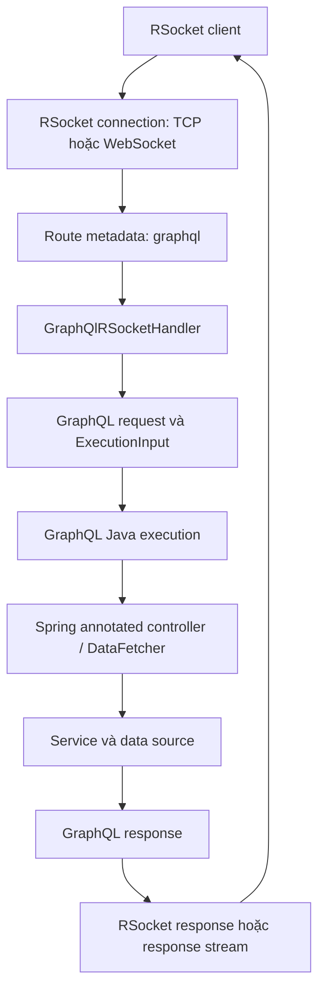

# RSocket transport

Spring for GraphQL không gắn GraphQL với một giao thức truyền tải duy nhất. Ngoài HTTP và WebSocket, ứng dụng có thể nhận GraphQL request qua RSocket. RSocket là giao thức truyền thông dạng message, hỗ trợ nhiều kiểu tương tác và có thể chạy trên TCP hoặc WebSocket.

Khi dùng RSocket, Spring for GraphQL ánh xạ GraphQL query và mutation vào interaction model `request-response`; subscription được ánh xạ vào `request-stream`. Nhờ vậy, cùng schema SDL, controller và resolver có thể phục vụ client qua RSocket mà không phải viết lại nghiệp vụ theo một API riêng.

## 1. RSocket là gì?

RSocket là giao thức ứng dụng cho giao tiếp bất đồng bộ giữa hai đầu kết nối. Nó định nghĩa các interaction model phổ biến:

| Interaction model | Cách hoạt động | Ví dụ |
| --- | --- | --- |
| Fire-and-forget | Gửi một message, không chờ response | Gửi telemetry không cần xác nhận |
| Request-response | Gửi một request và nhận một response | Lấy thông tin một resource |
| Request-stream | Gửi một request và nhận một luồng response | Theo dõi giá hoặc trạng thái đơn hàng |
| Request-channel | Hai phía trao đổi các luồng message | Trao đổi dữ liệu liên tục hai chiều |

Spring for GraphQL dùng hai interaction model phù hợp với GraphQL:

- Query và mutation dùng `request-response` vì một operation trả về một GraphQL response.
- Subscription dùng `request-stream` vì một operation có thể phát nhiều GraphQL response theo thời gian.

RSocket có cơ chế flow control và multiplexing. Một kết nối có thể phục vụ nhiều request/stream độc lập; subscriber có thể điều tiết lượng dữ liệu nhận theo khả năng tiêu thụ. Điều này hữu ích với ứng dụng có nhiều luồng sự kiện hoặc giao tiếp giữa các service.

## 2. Khi nào nên chọn RSocket cho GraphQL?

RSocket phù hợp khi ứng dụng cần giao tiếp message-based giữa các service, cần stream sự kiện hoặc muốn dùng cùng một giao thức cho request-response và request-stream.

Một số trường hợp có thể cân nhắc:

- Service backend gọi GraphQL service qua TCP trong mạng nội bộ.
- Ứng dụng cần query/mutation và subscription qua cùng một RSocket session.
- Nhiều luồng sự kiện đồng thời cần multiplex trên một kết nối.
- Hệ thống muốn tận dụng reactive stack và backpressure.
- Client và server được kiểm soát để cùng triển khai RSocket.

RSocket không mặc nhiên thay thế HTTP cho mọi ứng dụng. Browser và hệ sinh thái API công khai thường thuận tiện hơn với HTTP hoặc WebSocket chuẩn GraphQL. RSocket thường phù hợp hơn cho giao tiếp service-to-service hoặc client có hỗ trợ RSocket rõ ràng.

## 3. Chuẩn bị dependency trong Spring Boot

Ứng dụng cần Spring for GraphQL và RSocket server support. Với Maven, có thể thêm các starter:

```xml
<dependencies>
    <dependency>
        <groupId>org.springframework.boot</groupId>
        <artifactId>spring-boot-starter-graphql</artifactId>
    </dependency>

    <dependency>
        <groupId>org.springframework.boot</groupId>
        <artifactId>spring-boot-starter-rsocket</artifactId>
    </dependency>
</dependencies>
```

`spring-boot-starter-graphql` cung cấp auto-configuration cho schema, GraphQL runtime và annotated controller. `spring-boot-starter-rsocket` cung cấp RSocket server transport trên Reactor Netty. Nếu ứng dụng cũng cần HTTP endpoint, có thể thêm starter web phù hợp; RSocket không yêu cầu phải bật HTTP GraphQL endpoint.

RSocket server phải được cấu hình trước khi Spring Boot có thể gắn GraphQL handler vào route. Chọn TCP hoặc WebSocket dựa trên môi trường triển khai và khả năng của client.

## 4. Cấu hình RSocket server và GraphQL route

Ví dụ chạy RSocket server trên TCP port `7000` và đặt GraphQL handler tại route `graphql`:

```yaml
spring:
  rsocket:
    server:
      transport: tcp
      port: 7000
  graphql:
    rsocket:
      mapping: graphql
```

Trong cấu hình này:

- `spring.rsocket.server.transport` chọn transport RSocket, ví dụ `tcp` hoặc `websocket`.
- `spring.rsocket.server.port` là cổng RSocket server lắng nghe khi dùng TCP.
- `spring.graphql.rsocket.mapping` xác định route mà GraphQL handler nhận request.

Route `graphql` là RSocket route metadata, không phải URL path HTTP. Client cần gửi request tới đúng route đã cấu hình. Nếu dùng RSocket qua WebSocket, server còn cần cấu hình endpoint WebSocket theo thuộc tính RSocket server tương ứng; không nhầm route GraphQL với mapping path của WebSocket handshake.

Spring Boot có thể tự cấu hình GraphQL RSocket handler khi có RSocket server và `spring.graphql.rsocket.mapping`. Kiểm tra tài liệu của phiên bản Spring Boot đang dùng vì tên và điều kiện cấu hình có thể thay đổi giữa các major version.

## 5. Dùng chung schema và annotated controller

RSocket là transport, không phải một GraphQL schema khác. Các file SDL vẫn được nạp như cấu hình GraphQL thông thường:

```graphql
type Query {
    book(id: ID!): Book
}

type Subscription {
    priceUpdates(symbol: String!): PriceUpdate!
}

type Book {
    id: ID!
    title: String!
}

type PriceUpdate {
    symbol: String!
    price: Float!
}
```

Resolver vẫn dùng annotation quen thuộc:

```java
@Controller
public class BookController {

    private final BookService bookService;

    public BookController(BookService bookService) {
        this.bookService = bookService;
    }

    @QueryMapping
    public Book book(@Argument("id") String id) {
        return bookService.findById(id);
    }
}
```

RSocket handler chuyển request payload vào GraphQL execution service. Sau đó GraphQL runtime gọi `@QueryMapping`, `@MutationMapping`, `@SchemaMapping`, `@BatchMapping` hoặc `@SubscriptionMapping` theo operation và selection set. Business service không cần biết request đến từ HTTP hay RSocket nếu không có nhu cầu phụ thuộc transport.

## 6. GraphQlRSocketHandler xử lý request như thế nào?

`GraphQlRSocketHandler` là thành phần server của Spring for GraphQL để xử lý GraphQL request qua RSocket. Handler nhận payload đã được giải mã, chuyển thành GraphQL request và ủy quyền thực thi cho GraphQL engine.

Luồng xử lý khái quát:



Đối với query và mutation, handler tạo một response cho request-response interaction. Đối với subscription, handler trả một `Flux` các response để phục vụ request-stream interaction.

## 7. Cấu hình tự động với Spring Boot

Trong ứng dụng Spring Boot, cách đơn giản nhất là cấu hình route bằng `spring.graphql.rsocket.mapping` và để auto-configuration kết nối RSocket server với GraphQL handler.

Ví dụ cấu hình:

```yaml
spring:
  rsocket:
    server:
      transport: tcp
      port: 7000
  graphql:
    rsocket:
      mapping: graphql
```

Sau khi ứng dụng khởi động, GraphQL handler nhận request tại route `graphql`. Không cần viết thêm một controller chỉ để chuyển tiếp payload nếu auto-configuration của phiên bản Boot đang dùng đã tạo route này.

Khi debug endpoint không hoạt động, kiểm tra:

- RSocket server đã được bật và lắng nghe đúng transport/port chưa.
- `spring.graphql.rsocket.mapping` có đúng route client gửi không.
- Dependency `spring-boot-starter-rsocket` có trong runtime classpath không.
- Phiên bản Spring Boot có hỗ trợ GraphQL RSocket auto-configuration tương ứng không.
- Security hoặc firewall có chặn kết nối TCP/WebSocket không.

## 8. Tích hợp thủ công bằng @MessageMapping

Nếu tự cấu hình RSocket route hoặc không dùng cơ chế auto-configuration phù hợp, có thể dùng `GraphQlRSocketHandler` làm delegate trong controller được ánh xạ bằng `@MessageMapping`.

```java
package com.example.graphql.transport;

import java.util.Map;

import org.springframework.graphql.server.GraphQlRSocketHandler;
import org.springframework.messaging.handler.annotation.MessageMapping;
import org.springframework.stereotype.Controller;
import reactor.core.publisher.Flux;
import reactor.core.publisher.Mono;

@Controller
public class GraphQlRSocketController {

    private final GraphQlRSocketHandler handler;

    public GraphQlRSocketController(GraphQlRSocketHandler handler) {
        this.handler = handler;
    }

    @MessageMapping("graphql")
    public Mono<Map<String, Object>> handle(Map<String, Object> payload) {
        return handler.handle(payload);
    }

    @MessageMapping("graphql")
    public Flux<Map<String, Object>> handleSubscription(
            Map<String, Object> payload) {
        return handler.handleSubscription(payload);
    }
}
```

Hai method cùng nhận route `graphql`, nhưng phục vụ hai interaction model khác nhau:

- `Mono<Map<String, Object>>` xử lý request-response cho query và mutation.
- `Flux<Map<String, Object>>` xử lý request-stream cho subscription.

Đây là cấu hình delegate thủ công. Không tạo controller này đồng thời với route auto-configured cho cùng route nếu không có chủ đích, vì có thể dẫn đến mapping trùng hoặc xung đột handler.

## 9. Cấu trúc GraphQL payload trên RSocket

Payload mang nội dung GraphQL request theo dạng JSON map, thường gồm các key:

```json
{
  "query": "query BookById($id: ID!) { book(id: $id) { id title } }",
  "operationName": "BookById",
  "variables": {
    "id": "book-42"
  }
}
```

Các thành phần tương ứng với GraphQL request:

- `query`: GraphQL document cần thực thi.
- `operationName`: tên operation nếu document có nhiều operation hoặc client muốn chỉ rõ operation.
- `variables`: map giá trị biến của operation.
- `extensions`: metadata mở rộng nếu ứng dụng hoặc client sử dụng.

RSocket payload có phần data và metadata. Route được truyền qua routing metadata; GraphQL request nằm trong data payload. Không ghép route vào chuỗi GraphQL query hoặc xem route như một field trong SDL.

Client `RSocketGraphQlClient` mặc định cấu hình data MIME type `application/graphql+json` cùng JSON codecs khi tạo builder chuẩn. Nếu tự cấu hình `RSocketRequester` hoặc codec, bảo đảm server và client thống nhất MIME type và cách serialize payload.

## 10. Gọi query và mutation từ RSocketGraphQlClient

Spring for GraphQL cung cấp `RSocketGraphQlClient`, dùng `RSocketRequester` để gửi GraphQL request qua RSocket. Trong Spring Boot, có thể inject `RSocketGraphQlClient.Builder<?>` đã được auto-configure.

Ví dụ tạo client TCP:

```java
import org.springframework.graphql.client.RSocketGraphQlClient;
import org.springframework.stereotype.Component;

@Component
public class BookRemoteClient {

    private final RSocketGraphQlClient graphQlClient;

    public BookRemoteClient(RSocketGraphQlClient.Builder<?> builder) {
        this.graphQlClient = builder
            .tcp("localhost", 7000)
            .route("graphql")
            .build();
    }
}
```

Client gửi query:

```java
public Mono<BookView> findBook(String id) {
    return graphQlClient.document("""
            query BookById($id: ID!) {
                book(id: $id) {
                    id
                    title
                }
            }
            """)
        .variable("id", id)
        .retrieve("book")
        .toEntity(BookView.class);
}
```

Mutation cũng dùng cùng workflow:

```java
public Mono<BookView> renameBook(String id, String title) {
    return graphQlClient.document("""
            mutation RenameBook($id: ID!, $title: String!) {
                renameBook(id: $id, title: $title) {
                    id
                    title
                }
            }
            """)
        .variable("id", id)
        .variable("title", title)
        .retrieve("renameBook")
        .toEntity(BookView.class);
}
```

API `GraphQlClient` dùng chung giữa các transport. Điểm khác nằm ở cách builder tạo kết nối và route; cách viết document, truyền variables và đọc response tương tự HTTP/WebSocket client.

## 11. Kết nối session và multiplexing

`RSocketGraphQlClient` là client connection-oriented. Nó cần thiết lập RSocket session trước khi trao đổi request, nhưng việc kết nối có thể diễn ra tự động khi request đầu tiên được gửi. Nếu muốn chủ động mở session, gọi `start()`.

Client có thể được tái sử dụng để nhiều request cùng dùng một session. RSocket client hỗ trợ multiplexing, vì vậy nhiều request và stream có thể chạy trên cùng kết nối. Khi session mất, client có thể thiết lập lại ở request tiếp theo hoặc khi gọi `start()`.

Ví dụ lifecycle:

```java
graphQlClient.start()
    .then(findBook("book-42"))
    .doFinally(signal -> {
        // Không gọi stop sau mỗi request nếu client còn được tái sử dụng.
    });
```

Trong ứng dụng lâu dài, nên quản lý một client instance cho mỗi server và đóng session khi component/application dừng. `stop()` hủy request đang chạy, đóng session và từ chối request mới trên client đó; vì vậy không gọi `stop()` sau mỗi query nếu còn request khác cần dùng session.

## 12. Thực hiện subscription qua RSocket

Vì RSocket hỗ trợ request-stream, `RSocketGraphQlClient` có thể nhận GraphQL subscription. Ví dụ:

```java
public Flux<PriceUpdate> watchPrice(String symbol) {
    return graphQlClient.document("""
            subscription WatchPrice($symbol: String!) {
                priceUpdates(symbol: $symbol) {
                    symbol
                    price
                }
            }
            """)
        .variable("symbol", symbol)
        .retrieveSubscription("priceUpdates")
        .toEntity(PriceUpdate.class);
}
```

Client nhận một `Flux<PriceUpdate>`. Khi downstream hủy Flux, cancellation được truyền tới RSocket request-stream để server dừng subscription tương ứng nếu publisher và nguồn dữ liệu hỗ trợ cancellation.

Không cần mở một RSocket session mới cho từng event. Một session có thể multiplex nhiều request-stream. Nếu client ngừng sử dụng hoàn toàn, gọi `stop()` để đóng session và hủy các request đang hoạt động.

## 13. Bảo mật RSocket transport

RSocket transport cần được bảo vệ tương tự các API khác. Việc route khó đoán hoặc chạy trong mạng nội bộ không thay thế xác thực và phân quyền.

Các lớp bảo vệ cần cân nhắc:

- **TLS:** dùng kết nối mã hóa, ví dụ RSocket qua WebSocket bảo mật hoặc TCP có cấu hình bảo mật phù hợp.
- **Authentication:** xác định danh tính peer bằng cơ chế Spring Security/RSocket Security hoặc cơ chế xác thực phù hợp với hệ thống.
- **Authorization:** kiểm tra quyền trên từng operation và resource trong service/resolver.
- **Metadata:** chỉ đưa thông tin xác thực qua cơ chế metadata được thiết kế, không nhúng bí mật vào GraphQL query hoặc log payload.
- **Validation:** kiểm tra route, kích thước payload, input, độ sâu và độ phức tạp query.
- **Rate limiting:** giới hạn request và subscription dài hạn theo danh tính hoặc tenant.

Spring for GraphQL có `RSocketQlInterceptor` để can thiệp request trước/sau GraphQL execution, ví dụ bổ sung dữ liệu vào `ExecutionInput` hoặc tùy chỉnh `ExecutionResult`. Interceptor không thay thế Spring Security; authentication và authorization vẫn cần được thiết kế ở lớp transport và nghiệp vụ phù hợp.

Với subscription kéo dài, cần xác định chính sách khi quyền bị thu hồi trong lúc stream đang chạy. Có thể lọc event hoặc kết thúc stream theo yêu cầu bảo mật.

## 14. Xử lý lỗi qua RSocket

Cần phân biệt lỗi ở tầng RSocket với lỗi GraphQL execution:

| Nhóm lỗi | Ví dụ | Cách xử lý |
| --- | --- | --- |
| Kết nối/session | Server không mở cổng, timeout, session bị đóng | Kiểm tra transport, retry có giới hạn và reconnect |
| Route/protocol | Route không khớp, MIME type hoặc codec sai | Đồng bộ route, data MIME type và codec hai phía |
| GraphQL request | Document sai, variables không hợp lệ | Đọc GraphQL response errors và sửa operation |
| Resolver execution | Service ném exception, field lỗi | Dùng GraphQL exception handling và error contract |
| Subscription stream | Publisher phát lỗi hoặc hoàn tất | Xử lý error/complete ở client và quyết định có đăng ký lại |

Không retry mù quáng mọi mutation khi kết nối bị mất. Client có thể không biết server đã thực hiện mutation trước khi session đứt hay chưa. Với command có side effect, cần thiết kế idempotency key hoặc cơ chế kiểm tra trạng thái trước khi gửi lại.

Với subscription, retry có thể mở stream mới nhưng không tự khôi phục các event đã bỏ lỡ. Nếu cần bảo đảm không mất sự kiện, thiết kế event ID, cursor/offset và cơ chế resume ở tầng nghiệp vụ.

## 15. Kiểm thử RSocket GraphQL

Nên kiểm thử cả server route, GraphQL execution và lifecycle stream. Các nhóm test quan trọng:

- Kết nối TCP/WebSocket đúng port và route.
- Query dùng request-response trả đúng data.
- Mutation dùng request-response thực hiện side effect và trả payload.
- Subscription dùng request-stream phát nhiều event.
- Client cancel stream làm server dừng publisher và cleanup resource.
- Sai route, sai payload hoặc lỗi GraphQL được phân biệt đúng.
- Authentication và authorization được áp dụng qua transport.
- Nhiều request đồng thời dùng chung session không làm lẫn response.
- Mất kết nối và reconnect không tạo side effect lặp.

Có thể dùng `RSocketGraphQlClient` làm client trong integration test để thực thi query/mutation và `retrieveSubscription` để kiểm tra stream. Với subscription cancellation, dùng `StepVerifier.thenCancel()` rồi xác minh server đã nhận cancellation và gỡ resource. Một unit test cho service publisher không thay thế integration test xác minh RSocket transport.

## 16. So sánh RSocket với HTTP, WebSocket và SSE

| Tiêu chí | HTTP | WebSocket GraphQL | SSE | RSocket |
| --- | --- | --- | --- | --- |
| Kiểu tương tác chính | Request-response | Kết nối hai chiều, nhiều operation | HTTP response stream một chiều | Request-response, request-stream và các interaction khác |
| Query/mutation | Có | Có thể dùng | Không phải mục đích của SSE GraphQL handler | Có, request-response |
| Subscription | Không với HTTP response thông thường | Có | Có | Có, request-stream |
| Multiplexing | Theo request HTTP | Nhiều operation trên kết nối | Mỗi stream là một HTTP request | Nhiều request/stream trên session |
| Flow control | Theo HTTP stack | Theo WebSocket/reactive stack | Theo HTTP stream | Reactive Streams backpressure |
| Client phổ biến | Browser, mobile, service | Browser/app hỗ trợ graphql-ws | Browser/app hỗ trợ SSE | Service hoặc client có RSocket support |

RSocket qua WebSocket vẫn là RSocket protocol được vận chuyển trên WebSocket; nó không tự động trở thành GraphQL over WebSocket protocol (`graphql-ws`). Client cần dùng RSocket client và RSocket route, không phải WebSocket GraphQL client.

## 17. Lỗi thường gặp khi cấu hình RSocket transport

| Triệu chứng | Nguyên nhân có thể | Cách xử lý |
| --- | --- | --- |
| Client không kết nối được | Sai TCP port, transport hoặc WebSocket path | Kiểm tra cấu hình RSocket server và firewall |
| Route not found | `spring.graphql.rsocket.mapping` khác route client | Đồng bộ route server/client |
| Payload không giải mã được | Data MIME type hoặc JSON codec không tương thích | Dùng builder chuẩn hoặc cấu hình codec hai phía giống nhau |
| Query chạy nhưng subscription không hoạt động | Dùng nhầm request-response thay cho request-stream hoặc server handler không có subscription mapping | Kiểm tra `handleSubscription` và `@SubscriptionMapping` |
| Hai controller cùng nhận route | Auto-configuration và controller delegate thủ công cùng đăng ký | Chọn một cách cấu hình route |
| Client giữ session quá lâu | Không gọi `stop()` khi component dừng | Quản lý lifecycle client và đóng session khi shutdown |
| Mỗi request tạo kết nối mới | Tạo client instance liên tục | Tái sử dụng một `RSocketGraphQlClient` cho mỗi server |
| Mutation bị thực thi lặp sau reconnect | Retry request không idempotent | Dùng idempotency key và xác minh trạng thái command |
| Subscription không cleanup | Publisher không truyền cancellation tới nguồn | Gắn cleanup với reactive lifecycle và test cancellation |

## 18. Checklist triển khai

- Đã chọn RSocket vì nhu cầu request-response/stream hoặc giao tiếp service phù hợp?
- `spring-boot-starter-graphql` và `spring-boot-starter-rsocket` đã có trong runtime classpath?
- RSocket server đã được cấu hình TCP hoặc WebSocket?
- `spring.graphql.rsocket.mapping` có khớp route client không?
- GraphQL schema và annotated controller có được nạp như bình thường?
- Query/mutation dùng request-response và subscription dùng request-stream?
- Client và server thống nhất route, MIME type và JSON codec?
- `RSocketGraphQlClient` được tái sử dụng theo server và session được đóng đúng lúc?
- Authentication, authorization, TLS, validation và rate limit đã được thiết kế?
- Retry mutation có idempotency; subscription có cách resume nếu cần?
- Integration test bao phủ query, mutation, subscription, cancellation và lỗi transport?

RSocket transport cho phép Spring for GraphQL nhận query và mutation qua request-response, đồng thời phát subscription qua request-stream. Spring Boot có thể cấu hình route bằng `spring.graphql.rsocket.mapping`; `GraphQlRSocketHandler` xử lý request và `RSocketGraphQlClient` cung cấp API client dùng chung với các transport khác. Khi chọn đúng interaction model, tái sử dụng session, đồng bộ route/codec và bảo vệ transport bằng authentication, authorization cùng TLS, RSocket có thể là lựa chọn hiệu quả cho giao tiếp GraphQL giữa các service hoặc hệ thống cần stream dữ liệu.
