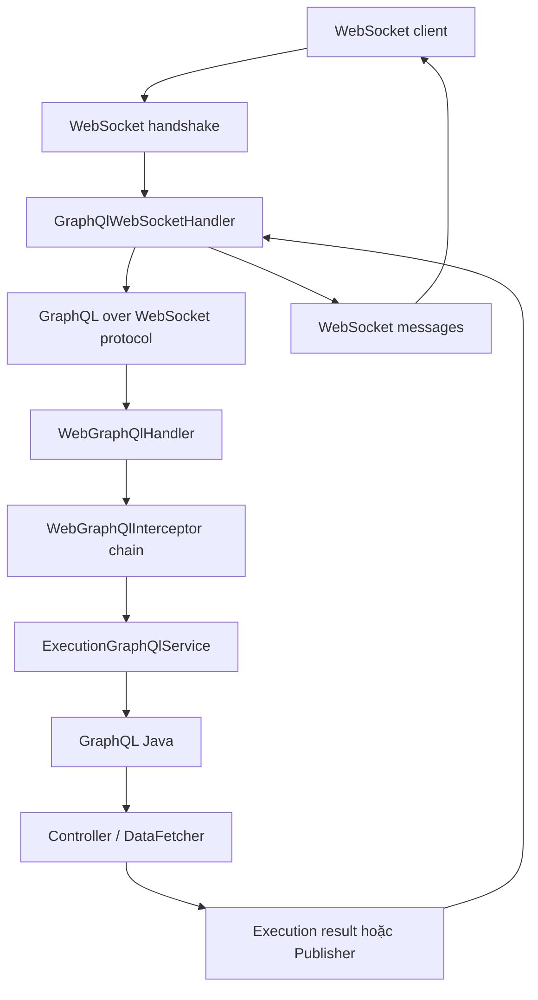
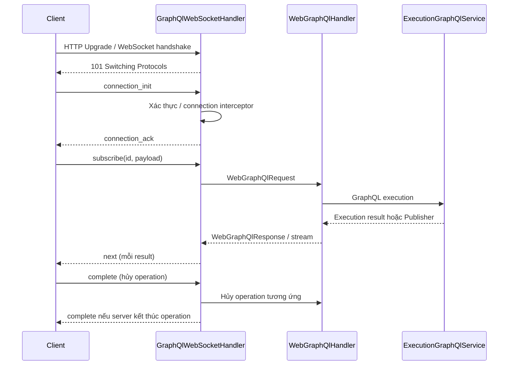

# WebSocketGraphQlHandler

> **Lưu ý về tên API:** Spring for GraphQL đặt tên class thực tế là `GraphQlWebSocketHandler`, không phải `WebSocketGraphQlHandler`. Bài học giữ nguyên tên chủ đề trong menu, đồng thời dùng đúng tên class và package trong ví dụ code. Có hai implementation: một cho Spring MVC và một cho Spring WebFlux.

## 1. WebSocket handler trong Spring for GraphQL là gì?

GraphQL thường được gọi qua HTTP request-response: client gửi một operation, server trả về một response rồi kết thúc request. Cách này phù hợp với Query và Mutation thông thường. Với Subscription, client cần nhận nhiều kết quả theo thời gian trên một luồng kết nối còn mở.

WebSocket cung cấp kết nối hai chiều tồn tại lâu hơn một HTTP request. Client có thể gửi operation mới, hủy operation đang chạy và nhận nhiều kết quả từ server trên cùng connection. Spring for GraphQL cung cấp `GraphQlWebSocketHandler` để xử lý GraphQL over WebSocket theo GraphQL over WebSocket protocol.

Handler này có thể phục vụ Subscription, đồng thời cũng hỗ trợ Query hoặc Mutation cần một kết quả. Mỗi GraphQL request nhận qua WebSocket được chuyển tiếp vào chuỗi xử lý GraphQL của Spring để parse, validate, gọi resolver và tạo response.

`GraphQlWebSocketHandler` là thành phần ở tầng transport. Nó xử lý WebSocket session, message protocol và việc gửi kết quả về client. Nó không thay thế schema, controller, `@SubscriptionMapping` hay resolver của ứng dụng.

## 2. Phân biệt `WebGraphQlHandler` và `GraphQlWebSocketHandler`

Hai class có trách nhiệm khác nhau:

| Thành phần | Trách nhiệm |
| --- | --- |
| `WebGraphQlHandler` | Chuỗi xử lý GraphQL chung cho web transport; chạy interceptor và chuyển request đến `ExecutionGraphQlService` |
| `GraphQlWebSocketHandler` | Adapter WebSocket; đọc/ghi message, quản lý session và thực thi protocol GraphQL over WebSocket |
| `WebGraphQlInterceptor` | Can thiệp request/response GraphQL trước và sau execution |
| `WebSocketGraphQlInterceptor` | Mở rộng interceptor web với callback cho lifecycle của WebSocket connection và việc client hủy subscription |
| `@SubscriptionMapping` | Ánh xạ root field của GraphQL `Subscription` sang phương thức trả về `Publisher` |

Mối quan hệ xử lý:



Handler WebSocket không tự quyết định nghiệp vụ của field. `WebGraphQlHandler` và execution service tiếp tục đảm nhiệm phần xử lý GraphQL dùng chung với HTTP.

## 3. Hai implementation: Spring MVC và Spring WebFlux

Spring for GraphQL có hai class cùng tên `GraphQlWebSocketHandler` trong hai package khác nhau:

| Stack | Class đầy đủ | Tích hợp WebSocket |
| --- | --- | --- |
| Spring MVC / Servlet | `org.springframework.graphql.server.webmvc.GraphQlWebSocketHandler` | Dựa trên `spring-websocket`, kế thừa `TextWebSocketHandler` và hỗ trợ `SubProtocolCapable` |
| Spring WebFlux | `org.springframework.graphql.server.webflux.GraphQlWebSocketHandler` | Triển khai reactive `WebSocketHandler`, dùng `CodecConfigurer` và trả `Mono<Void>` từ `handle` |

Hai implementation có cùng mục đích và xử lý cùng GraphQL over WebSocket protocol, nhưng phụ thuộc vào web stack khác nhau:

- MVC sử dụng `HttpMessageConverter` để encode/decode JSON và tích hợp với Servlet WebSocket API.
- WebFlux sử dụng `CodecConfigurer`, reactive I/O và backpressure khi đọc/ghi message.

Ví dụ import cho WebFlux:

```java
import org.springframework.graphql.server.webflux.GraphQlWebSocketHandler;
```

Ví dụ import cho MVC:

```java
import org.springframework.graphql.server.webmvc.GraphQlWebSocketHandler;
```

Không import nhầm class cùng tên của stack còn lại. Nếu dự án dùng Spring Boot auto-configuration, thông thường không cần tự khởi tạo class này; Boot sẽ chọn implementation theo application type và dependency trên classpath.

## 4. Bật WebSocket endpoint trong Spring Boot

Spring Boot cần `spring-boot-starter-graphql` và một web stack. WebSocket endpoint GraphQL mặc định không được bật. Ứng dụng phải cấu hình path cho endpoint.

Với Spring MVC, dependency thường gồm:

```kotlin
dependencies {
    implementation("org.springframework.boot:spring-boot-starter-graphql")
    implementation("org.springframework.boot:spring-boot-starter-web")
    implementation("org.springframework.boot:spring-boot-starter-websocket")
}
```

Với Spring WebFlux:

```kotlin
dependencies {
    implementation("org.springframework.boot:spring-boot-starter-graphql")
    implementation("org.springframework.boot:spring-boot-starter-webflux")
}
```

WebFlux không cần thêm WebSocket starter riêng. Với ứng dụng Servlet, cần `spring-boot-starter-websocket` để cung cấp tích hợp WebSocket.

Cấu hình endpoint:

```yaml
spring:
  graphql:
    websocket:
      path: /graphql
```

Sau khi bật, client có thể kết nối đến `ws://localhost:8080/graphql` trong môi trường local. Khi triển khai HTTPS, URL WebSocket tương ứng thường dùng `wss://`.

`spring.graphql.http.path` và `spring.graphql.websocket.path` là hai cấu hình riêng. Chúng có thể cùng dùng `/graphql`, nhưng HTTP và WebSocket vẫn là hai transport khác nhau.

## 5. Cấu hình connection-init timeout và keep-alive

Sau khi WebSocket handshake thành công, client cần gửi message `connection_init` theo protocol. Server chờ message khởi tạo này trong một khoảng thời gian giới hạn. Spring Boot cung cấp thuộc tính `connection-init-timeout`:

```yaml
spring:
  graphql:
    websocket:
      path: /graphql
      connection-init-timeout: 60s
      keep-alive: 30s
```

Ý nghĩa:

- `path`: URL path dùng để mở GraphQL WebSocket endpoint.
- `connection-init-timeout`: thời gian tối đa server chờ `connection_init` sau khi connection được thiết lập. Giá trị mặc định trong Spring Boot hiện hành là `60s`.
- `keep-alive`: khoảng idle tối đa trước khi server gửi ping keep-alive đến client. Nếu không cấu hình, server không nhất thiết gửi ping định kỳ.

Timeout quá ngắn có thể khiến client chậm xác thực bị đóng connection. Timeout quá dài giữ các session chưa khởi tạo trong thời gian không cần thiết. Hãy chọn theo latency của hệ thống và cách client gửi credential.

Keep-alive giúp phát hiện connection chết hoặc giữ connection qua proxy có idle timeout. Giá trị phải phù hợp với timeout của load balancer, ingress và reverse proxy. Keep-alive không thay thế heartbeat hoặc timeout của hạ tầng mạng.

## 6. GraphQL over WebSocket protocol

Spring for GraphQL sử dụng GraphQL over WebSocket protocol được triển khai bởi dự án `graphql-ws`, với subprotocol `graphql-transport-ws`. Không nhầm protocol này với `subscriptions-transport-ws` cũ; hai protocol dùng message format khác nhau và không tương thích trực tiếp.

Các message chính:

| Message | Hướng | Ý nghĩa |
| --- | --- | --- |
| `connection_init` | Client → Server | Bắt đầu GraphQL connection; payload có thể chứa thông tin xác thực |
| `connection_ack` | Server → Client | Server xác nhận khởi tạo connection thành công |
| `subscribe` | Client → Server | Gửi một GraphQL operation với operation ID và payload |
| `next` | Server → Client | Gửi một GraphQL execution result |
| `error` | Server → Client | Báo lỗi của operation theo protocol |
| `complete` | Client → Server hoặc Server → Client | Client hủy operation hoặc server báo operation đã hoàn tất |
| `ping` / `pong` | Hai chiều | Kiểm tra trạng thái và duy trì connection |

Một WebSocket connection có thể mang nhiều operation cùng lúc. Mỗi operation có ID riêng để server phân biệt luồng kết quả và việc hủy. Ví dụ client có thể mở hai Subscription trên cùng connection, hủy một Subscription mà vẫn giữ Subscription còn lại.

## 7. Vòng đời từ handshake đến operation

WebSocket GraphQL có hai giai đoạn khởi tạo riêng:

1. **WebSocket handshake:** client gửi HTTP Upgrade request; server chấp nhận và tạo WebSocket session.
2. **GraphQL connection initialization:** client gửi `connection_init`; server kiểm tra payload hoặc xác thực qua interceptor rồi phản hồi `connection_ack`.

Sau khi connection đã được xác nhận, client có thể gửi `subscribe` để chạy operation. Dù tên message là `subscribe`, payload có thể là Query, Mutation hoặc Subscription theo khả năng của handler. Subscription tạo luồng nhiều kết quả; Query và Mutation thông thường tạo một kết quả.



Nếu client không gửi `connection_init` trong thời hạn cấu hình, server có thể đóng connection. Nếu connection đã được xác nhận nhưng operation không hợp lệ, lỗi được xử lý ở cấp operation theo protocol.

## 8. Handler xử lý Query, Mutation và Subscription

WebSocket chủ yếu hữu ích cho Subscription, nhưng GraphQL over WebSocket không chỉ dành cho Subscription. Handler có thể chuyển tiếp Query và Mutation thông thường qua cùng execution chain.

| Operation | Hành vi trên WebSocket |
| --- | --- |
| Query | Server gửi một execution result rồi kết thúc operation |
| Mutation | Server gửi một execution result của thao tác ghi rồi kết thúc operation |
| Subscription | Server gửi nhiều execution result khi Publisher phát event; operation kết thúc khi Publisher complete, error hoặc bị hủy |

Ví dụ payload trong message `subscribe`:

```json
{
  "id": "op-1",
  "type": "subscribe",
  "payload": {
    "operationName": "BookAdded",
    "query": "subscription BookAdded { bookAdded { id title } }",
    "variables": {}
  }
}
```

Server xử lý document như một GraphQL operation bình thường. Khác biệt nằm ở cách transport nhận kết quả: Subscription có thể phát nhiều `next` message trên cùng operation ID.

## 9. Tích hợp `WebGraphQlInterceptor`

WebSocket request được chuyển qua `WebGraphQlHandler`, do đó chuỗi `WebGraphQlInterceptor` vẫn được áp dụng cho từng GraphQL request. Interceptor có thể:

- Đọc thông tin request và context.
- Bổ sung dữ liệu vào `ExecutionInput` hoặc `GraphQLContext`.
- Ghi response header khi transport hỗ trợ.
- Biến đổi GraphQL response hoặc errors.
- Ghi log và tracing theo operation.

Ví dụ interceptor ghi correlation ID vào context:

```java
import java.util.UUID;
import org.springframework.graphql.server.WebGraphQlInterceptor;
import org.springframework.graphql.server.WebGraphQlRequest;
import org.springframework.graphql.server.WebGraphQlResponse;
import org.springframework.stereotype.Component;
import reactor.core.publisher.Mono;

@Component
public class CorrelationInterceptor implements WebGraphQlInterceptor {

    @Override
    public Mono<WebGraphQlResponse> intercept(
            WebGraphQlRequest request, Chain chain) {

        String correlationId = UUID.randomUUID().toString();

        request.configureExecutionInput((input, builder) ->
            builder.graphQLContext(context ->
                context.put("correlationId", correlationId)
            ).build()
        );

        return chain.next(request);
    }
}
```

Interceptor được áp dụng cho request GraphQL đi qua web handler. Nếu cần theo dõi toàn bộ vòng đời WebSocket connection, chỉ dùng `WebGraphQlInterceptor` là chưa đủ; hãy xem `WebSocketGraphQlInterceptor` ở phần tiếp theo.

## 10. `WebSocketGraphQlInterceptor` và lifecycle connection

`WebSocketGraphQlInterceptor` mở rộng `WebGraphQlInterceptor` với callback liên quan đến WebSocket connection:

- Connection được thiết lập.
- Connection bị đóng.
- Client hủy một Subscription operation.
- Mỗi GraphQL request trên connection vẫn đi qua interceptor chain.

Điều này hữu ích khi cần lưu metadata theo connection, theo dõi session, ghi log khi client ngắt kết nối hoặc dọn tài nguyên liên quan đến operation bị hủy.

Spring for GraphQL cho phép tối đa một `WebSocketGraphQlInterceptor` trong một chain interceptor. Có thể kết hợp interceptor WebSocket chuyên biệt với các `WebGraphQlInterceptor` thông thường, nhưng không đăng ký nhiều interceptor WebSocket chuyên biệt trong cùng chain.

Trong Spring Boot, khai báo bean interceptor để Boot đưa nó vào cấu hình web GraphQL. Hãy giữ state theo connection hoặc operation bằng cơ chế phù hợp; không đặt dữ liệu người dùng mutable vào field dùng chung của singleton interceptor nếu không có cấu trúc map/lifecycle đồng bộ và cleanup rõ ràng.

## 11. Xác thực từ `connection_init`

Client thường cần gửi access token khi bắt đầu WebSocket connection. GraphQL over WebSocket protocol cho phép `connection_init` mang payload, ví dụ:

```json
{
  "type": "connection_init",
  "payload": {
    "Authorization": "Bearer eyJ..."
  }
}
```

Server phải xác minh token, kiểm tra chữ ký, thời hạn, issuer, audience và quyền cần thiết trước khi chấp nhận connection hoặc operation. Không tin payload chỉ vì nó được gửi trong `connection_init`.

Spring for GraphQL cung cấp các implementation `AuthenticationWebSocketInterceptor` cho Spring MVC và Spring WebFlux. Các interceptor này hỗ trợ lấy thông tin xác thực từ payload `connection_init`, xác thực và truyền `SecurityContext` đến các request tiếp theo trên WebSocket connection.

Hai implementation có package khác nhau theo web stack. Hãy chọn đúng class cho MVC hoặc WebFlux và kiểm tra cấu hình Spring Security của ứng dụng. Nếu dùng cơ chế xác thực riêng, có thể triển khai `WebSocketGraphQlInterceptor` để xử lý payload và thiết lập context.

Xác thực connection không có nghĩa mọi operation về sau đều tự động được phép. Resolver hoặc method security vẫn phải kiểm tra authorization theo operation và theo dữ liệu mà người dùng muốn truy cập.

## 12. CORS, Origin và bảo vệ WebSocket endpoint

WebSocket bắt đầu bằng HTTP handshake, vì vậy server cần kiểm tra nguồn gốc kết nối và áp dụng chính sách bảo mật phù hợp. Một số điểm cần chú ý:

- Chỉ cho phép origin của frontend đáng tin cậy trong môi trường production.
- Không dùng wildcard origin khi cho phép credentials.
- Xác thực token hoặc session; kiểm tra quyền cho từng operation.
- Không coi `Origin` là cơ chế xác thực người dùng. Origin chỉ giúp kiểm soát website nào được phép khởi tạo kết nối từ trình duyệt.
- Giới hạn số connection và số operation để giảm nguy cơ một client chiếm tài nguyên.
- Không ghi access token từ `connection_init` vào log.

Spring Boot hỗ trợ cấu hình CORS qua `spring.graphql.cors.*`. Ví dụ:

```yaml
spring:
  graphql:
    cors:
      allowed-origins:
        - https://app.example.com
      allowed-methods:
        - GET
        - POST
      allowed-headers:
        - Authorization
        - Content-Type
      allow-credentials: true
```

Khi bật credentials, không cấu hình `allowed-origins: "*"`; hãy khai báo origin cụ thể hoặc dùng origin patterns phù hợp. Kiểm tra hành vi CORS/Origin của đúng server stack và phiên bản Spring đang dùng, đặc biệt khi tự tạo WebSocket handler thay vì dùng Boot auto-configuration.

## 13. Quản lý tài nguyên của WebSocket session

HTTP request thường kết thúc sau khi gửi response. WebSocket connection có thể tồn tại nhiều giờ và mang nhiều Subscription cùng lúc. Vì vậy, cần quản lý tài nguyên ở cả cấp connection và cấp operation.

Các giới hạn nên xem xét:

| Tài nguyên | Nơi cấu hình hoặc kiểm soát |
| --- | --- |
| Số WebSocket connection đồng thời | Web server, connector, reverse proxy hoặc load balancer |
| Kích thước message được buffer | Jakarta WebSocket `ServerContainer` với MVC; cấu hình server reactive tương ứng với WebFlux |
| Số Subscription đồng thời trên một session | `maxSubscriptionsPerSession` trong builder option của `GraphQlWebSocketHandler` ở các phiên bản hỗ trợ |
| Thời gian chờ `connection_init` | `spring.graphql.websocket.connection-init-timeout` |
| Ping khi connection idle | `spring.graphql.websocket.keep-alive` |
| Tài nguyên theo Subscription | Publisher, DataLoader, listener và cleanup khi cancel/complete/error |

Theo tài liệu Spring for GraphQL hiện hành, mặc định không giới hạn số Subscription đồng thời trên một session. Khi giới hạn `maxSubscriptionsPerSession` được cấu hình và đạt ngưỡng, session có thể bị đóng. Kiểm tra API của phiên bản Spring for GraphQL đang dùng trước khi gọi builder option vì constructor và builder API có thể thay đổi theo phiên bản.

Không chỉ giới hạn số connection. Một client có thể mở ít connection nhưng tạo rất nhiều Subscription trên cùng một connection. Hãy kết hợp giới hạn session, giới hạn operation, timeout và rate limit.

## 14. Khác biệt giữa MVC và WebFlux khi vận hành

Hai implementation xử lý cùng protocol nhưng mô hình I/O khác nhau:

| Khía cạnh | Spring MVC | Spring WebFlux |
| --- | --- | --- |
| I/O | Servlet WebSocket, message handling theo mô hình MVC | Reactive WebSocket, non-blocking I/O |
| JSON codec | `HttpMessageConverter<?>` | `CodecConfigurer` |
| Handler class | `server.webmvc.GraphQlWebSocketHandler` | `server.webflux.GraphQlWebSocketHandler` |
| Kiểu thực thi handler | WebSocket handler của Spring Messaging | `Mono<Void>` cho `handle(WebSocketSession)` |
| Phù hợp | Ứng dụng Servlet và thư viện imperative hiện có | Ứng dụng reactive cần streaming và backpressure xuyên suốt |

Chọn WebFlux không tự động làm mọi resolver non-blocking. Nếu resolver gọi JDBC/JPA hoặc một thư viện blocking, các thao tác đó vẫn cần được xử lý theo thread model phù hợp. Ngược lại, ứng dụng MVC vẫn có thể dùng publisher reactive cho Subscription; transport MVC chỉ khác cách quản lý I/O.

Không trộn hai implementation handler trong cùng endpoint. Hãy để Spring Boot chọn theo application type hoặc tự cấu hình đúng class tương ứng nếu có lý do đặc biệt.

## 15. Khi nào cần tự tạo handler?

Trong ứng dụng Spring Boot thông thường, nên bật WebSocket endpoint bằng `spring.graphql.websocket.path` và để auto-configuration tạo handler, WebSocket mapping và các thành phần cần thiết.

Chỉ nên tự tạo handler khi cần kiểm soát chi tiết transport, codec, timeout, keep-alive, CORS hoặc cách đăng ký URL. Khi đó, cần tạo đúng implementation theo web stack:

```java
// Spring WebFlux: chữ ký constructor tiêu biểu
new org.springframework.graphql.server.webflux.GraphQlWebSocketHandler(
    webGraphQlHandler,
    codecConfigurer,
    connectionInitTimeout
);
```

```java
// Spring MVC: chữ ký constructor tiêu biểu
new org.springframework.graphql.server.webmvc.GraphQlWebSocketHandler(
    webGraphQlHandler,
    httpMessageConverter,
    connectionInitTimeout
);
```

`webGraphQlHandler` là chuỗi xử lý web GraphQL đã được cấu hình với execution service và interceptor. MVC nhận `HttpMessageConverter`; WebFlux nhận `CodecConfigurer`.

Handler cần được expose qua WebSocket URL mapping. Với MVC, `initWebSocketHttpRequestHandler(HandshakeHandler)` còn tạo `WebSocketHttpRequestHandler` và bổ sung handshake interceptor để context được truyền đúng. Với WebFlux, handler được đăng ký trong WebSocket handler mapping của WebFlux.

Không tự tạo một `WebGraphQlHandler` mới nếu mục đích chỉ là thêm WebSocket endpoint. Hãy tái sử dụng execution service, interceptor chain và GraphQlSource đã được cấu hình để HTTP và WebSocket có cùng schema, resolver, error handling và security policy.

## 16. Kiểm thử endpoint bằng `WebSocketGraphQlTester`

Spring for GraphQL cung cấp `WebSocketGraphQlTester` trong module `spring-graphql-test`. Tester sử dụng một WebSocket connection dùng chung cho các operation, vì vậy phù hợp để kiểm thử cả Query và Subscription qua transport thực.

Thêm dependency test:

```kotlin
dependencies {
    testImplementation("org.springframework.graphql:spring-graphql-test")
}
```

Tạo tester:

```java
import java.net.URI;
import java.time.Duration;
import org.springframework.graphql.test.tester.WebSocketGraphQlTester;
import org.springframework.web.reactive.socket.client.ReactorNettyWebSocketClient;
import org.springframework.web.reactive.socket.client.WebSocketClient;
import reactor.core.publisher.Flux;
import reactor.test.StepVerifier;

URI url = URI.create("ws://localhost:8080/graphql");
WebSocketClient client = new ReactorNettyWebSocketClient();

WebSocketGraphQlTester tester =
    WebSocketGraphQlTester.builder(url, client).build();
```

Kiểm thử Query qua WebSocket:

```java
tester.document("""
    query {
        book(id: "book-42") {
            id
            title
        }
    }
    """)
    .execute()
    .path("book.id")
    .entity(String.class)
    .isEqualTo("book-42");
```

Kiểm thử Subscription:

```java
Flux<String> titles = tester.document("""
    subscription {
        bookAdded {
            title
        }
    }
    """)
    .executeSubscription()
    .toFlux("bookAdded.title", String.class);

StepVerifier.create(titles)
    .expectNext("Spring for GraphQL")
    .thenCancel()
    .verify(Duration.ofSeconds(5));
```

Test fixture cần phát event sau khi Subscription được đăng ký. `thenCancel()` xác nhận client hủy stream. Sau khi test hoàn tất, gọi `tester.stop()` để đóng WebSocket connection dùng chung và giải phóng tài nguyên.

Nên kiểm thử thêm:

- Client gửi `connection_init` hợp lệ và nhận được `connection_ack`.
- Client không gửi `connection_init` trong timeout và bị đóng connection.
- Token sai hoặc hết hạn bị từ chối.
- Nhiều operation có thể chạy trên cùng connection.
- Hủy một Subscription không làm hủy các operation khác.
- Publisher complete/error được phản ánh đúng.
- Client disconnect làm cleanup Publisher/listener.
- Origin không được phép bị từ chối.
- Giới hạn số Subscription trên một session hoạt động đúng.

## 17. Lỗi thường gặp khi cấu hình WebSocket handler

| Hiện tượng | Nguyên nhân có thể | Cách xử lý |
| --- | --- | --- |
| HTTP GraphQL chạy nhưng WebSocket không kết nối | WebSocket endpoint chưa được bật | Đặt `spring.graphql.websocket.path` |
| Servlet app không có WebSocket endpoint | Thiếu `spring-boot-starter-websocket` | Thêm WebSocket starter cho ứng dụng MVC |
| Import không tìm thấy class | Dùng sai package hoặc nhầm tên `WebSocketGraphQlHandler` | Dùng `GraphQlWebSocketHandler` trong package MVC/WebFlux tương ứng |
| Client nhận lỗi subprotocol | Client và server dùng protocol khác nhau | Dùng `graphql-transport-ws`, không dùng protocol legacy `subscriptions-transport-ws` |
| Connection đóng trước operation | Client không gửi `connection_init` trong thời hạn | Kiểm tra client initialization và timeout |
| Không nhận `connection_ack` | Payload xác thực sai hoặc interceptor từ chối connection | Kiểm tra server log và `WebSocketGraphQlInterceptor` |
| Query chạy nhưng Subscription không có event | Publisher không phát dữ liệu hoặc event source chưa được đăng ký | Kiểm tra `@SubscriptionMapping`, publisher và fixture |
| Subscription bị ngắt khi idle | Proxy timeout hoặc keep-alive không phù hợp | Cấu hình `keep-alive` và timeout của proxy |
| Client bị đóng khi mở nhiều Subscription | Đạt giới hạn per-session hoặc tài nguyên server | Kiểm tra `maxSubscriptionsPerSession` và capacity |
| MVC/WebFlux lỗi codec | Khởi tạo handler của stack khác hoặc codec không tương thích | Dùng đúng implementation và codec theo stack |
| Authentication không đến resolver | Chưa xử lý connection payload hoặc SecurityContext propagation | Cấu hình `AuthenticationWebSocketInterceptor` phù hợp hoặc interceptor tùy chỉnh |
| Connection vẫn giữ tài nguyên sau cancel | Publisher không cleanup khi cancel | Dùng `doFinally`/resource cleanup và kiểm thử cancellation |

## 18. Checklist triển khai WebSocket GraphQL

- [ ] Dùng đúng class `GraphQlWebSocketHandler`, không nhầm tên hoặc package.
- [ ] Chọn implementation theo Spring MVC hoặc Spring WebFlux.
- [ ] Có `spring-boot-starter-graphql` và web stack tương ứng.
- [ ] Với MVC, thêm `spring-boot-starter-websocket`.
- [ ] Cấu hình `spring.graphql.websocket.path` để bật endpoint.
- [ ] Cấu hình `connection-init-timeout` theo thời gian khởi tạo thực tế.
- [ ] Cấu hình keep-alive phù hợp với timeout của proxy/load balancer.
- [ ] Dùng GraphQL over WebSocket protocol `graphql-transport-ws`.
- [ ] Hiểu sự khác nhau giữa HTTP handshake và GraphQL `connection_init`.
- [ ] Đăng ký interceptor và xác thực connection payload an toàn.
- [ ] Kiểm tra authorization cho từng operation và dữ liệu.
- [ ] Giới hạn số connection, message size và Subscription trên mỗi session.
- [ ] Đảm bảo cancel/disconnect giải phóng Publisher và tài nguyên.
- [ ] Kiểm thử bằng `WebSocketGraphQlTester` và đóng tester sau test.

## Kết luận

Spring for GraphQL dùng class `GraphQlWebSocketHandler` để xử lý GraphQL over WebSocket. Có implementation riêng cho Spring MVC và Spring WebFlux; cả hai nhận WebSocket message theo protocol, chuyển GraphQL request vào `WebGraphQlHandler` và gửi execution result trở lại client. Tên trong đề bài `WebSocketGraphQlHandler` bị đảo thứ tự so với tên class thực tế trong framework.

Trong Spring Boot, cách cấu hình thông thường là thêm WebSocket dependency phù hợp và đặt `spring.graphql.websocket.path`. Sau khi handshake, client gửi `connection_init`, nhận `connection_ack`, rồi gửi các operation qua `subscribe`. Handler hỗ trợ Query/Mutation một kết quả và Subscription nhiều kết quả. Khi triển khai production, cần quản lý authentication, Origin, connection timeout, keep-alive, số Subscription, message size và cancellation. Dùng `WebSocketGraphQlTester` để kiểm thử transport thật và đóng tester sau khi hoàn tất.

## Tài liệu tham khảo

- [Spring for GraphQL — Server Transports: WebSocket](https://docs.spring.io/spring-graphql/reference/transports.html)
- [Spring for GraphQL — `GraphQlWebSocketHandler` for WebFlux](https://docs.spring.io/spring-graphql/docs/current/api/org/springframework/graphql/server/webflux/GraphQlWebSocketHandler.html)
- [Spring for GraphQL — `GraphQlWebSocketHandler` for MVC](https://docs.spring.io/spring-graphql/docs/current/api/org/springframework/graphql/server/webmvc/GraphQlWebSocketHandler.html)
- [Spring Boot — Spring for GraphQL and WebSocket endpoint](https://docs.spring.io/spring-boot/reference/web/spring-graphql.html)
- [Spring Boot — Application properties](https://docs.spring.io/spring-boot/appendix/application-properties/index.html)
- [Spring for GraphQL — Testing with `WebSocketGraphQlTester`](https://docs.spring.io/spring-graphql/reference/testing.html)
- [GraphQL over WebSocket Protocol](https://github.com/enisdenjo/graphql-ws/blob/master/PROTOCOL.md)
