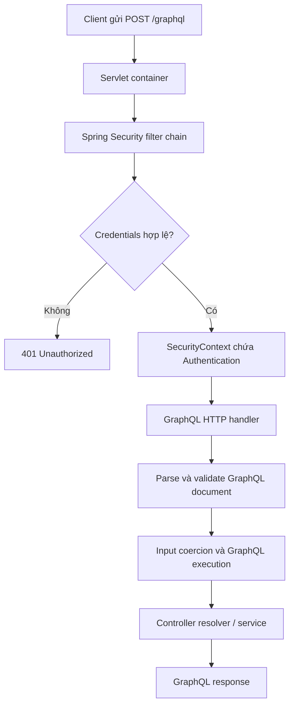

# Authentication trước execution

Trong Spring for GraphQL, authentication nên được thực hiện trước khi GraphQL engine bắt đầu thực thi operation. Với HTTP transport, Spring Security filter chain xác thực request trước khi request đến GraphQL HTTP handler. Nếu thông tin xác thực thiếu hoặc không hợp lệ, request bị từ chối ngay tại lớp bảo mật; GraphQL parser, resolver và service không được gọi.

Cách tổ chức này tạo một ranh giới rõ ràng: transport xác định danh tính người gọi, còn GraphQL và tầng nghiệp vụ sử dụng danh tính đó để quyết định dữ liệu hoặc hành động được phép. Authentication trả lời câu hỏi “ai đang gọi?”, còn authorization trả lời “người đó được phép làm gì?”.

## 1. Authentication nằm trước GraphQL execution

Một HTTP request tới GraphQL endpoint thường đi qua chuỗi xử lý sau:



Với endpoint HTTP mặc định `/graphql`, Spring Security có thể bảo vệ toàn bộ request bằng một rule xác thực. Khi token không hợp lệ hoặc không được gửi, filter chain kết thúc request trước GraphQL execution. Đây là lý do nên đặt authentication ở transport security layer thay vì tự kiểm tra token trong từng `@QueryMapping`.

GraphQL request có thể chứa nhiều field và nhiều loại operation. Một endpoint duy nhất thường phục vụ query, mutation và có thể cả subscription qua transport tương ứng. Bảo vệ endpoint ở lớp security giúp tất cả operation đi qua cùng một cổng xác thực.

## 2. Thêm Spring Security dependency

Với ứng dụng Spring Boot dùng HTTP và servlet stack, thêm Spring Security starter:

```xml
<dependency>
    <groupId>org.springframework.boot</groupId>
    <artifactId>spring-boot-starter-security</artifactId>
</dependency>
```

Nếu API dùng OAuth 2.0 Bearer JWT và ứng dụng đóng vai trò resource server, thêm resource server starter:

```xml
<dependency>
    <groupId>org.springframework.boot</groupId>
    <artifactId>spring-boot-starter-oauth2-resource-server</artifactId>
</dependency>
```

`spring-boot-starter-security` cung cấp filter chain và cơ chế xác thực. Resource server support xác minh bearer token JWT, kiểm tra chữ ký và các claim theo cấu hình issuer/JWK. Không tự giải mã JWT bằng cách Base64 decode rồi tin claim; token phải được xác minh chữ ký và các điều kiện như issuer, thời hạn.

## 3. Bảo vệ GraphQL endpoint bằng SecurityFilterChain

Ví dụ sau dùng JWT bearer token và yêu cầu mọi request tới `/graphql` phải được xác thực:

```java
package com.example.graphql.security;

import static org.springframework.security.config.Customizer.withDefaults;

import org.springframework.context.annotation.Bean;
import org.springframework.context.annotation.Configuration;
import org.springframework.security.config.annotation.web.builders.HttpSecurity;
import org.springframework.security.config.http.SessionCreationPolicy;
import org.springframework.security.web.SecurityFilterChain;

@Configuration
public class SecurityConfiguration {

    @Bean
    SecurityFilterChain securityFilterChain(HttpSecurity http) throws Exception {
        return http
            .authorizeHttpRequests(authorize -> authorize
                .requestMatchers("/graphql").authenticated()
                .anyRequest().permitAll()
            )
            .oauth2ResourceServer(oauth2 -> oauth2.jwt(withDefaults()))
            .sessionManagement(session -> session
                .sessionCreationPolicy(SessionCreationPolicy.STATELESS)
            )
            .csrf(csrf -> csrf.disable())
            .build();
    }
}
```

Đây là cấu hình cho API stateless dùng Bearer token trong `Authorization` header và không dùng cookie làm credential. Với ứng dụng xác thực bằng session cookie hoặc cookie tự động được browser gửi, không nên tắt CSRF một cách máy móc; cần giữ và cấu hình CSRF protection phù hợp, đặc biệt vì mutation GraphQL thường được gửi bằng HTTP POST.

Rule `authenticated()` chỉ yêu cầu request có danh tính hợp lệ. Nó chưa kiểm tra người dùng có quyền đọc sách, sửa sách hoặc xem dữ liệu của tenant nào. Những quyết định đó thuộc authorization.

## 4. Cấu hình issuer cho JWT resource server

Spring Security cần biết cách xác minh token. Có thể cấu hình issuer URI trong `application.yml`:

```yaml
spring:
  security:
    oauth2:
      resourceserver:
        jwt:
          issuer-uri: https://identity.example.com/issuer
```

Thay URL ví dụ bằng issuer thực tế của hệ thống Identity Provider. Resource server dùng metadata/JWK của issuer để xác minh JWT và kiểm tra các claim chuẩn. Không hardcode private key hoặc secret vào source code.

Nếu hệ thống dùng opaque token thay vì JWT, có thể cấu hình introspection endpoint với client credentials phù hợp. Cách xác thực phụ thuộc identity provider; nguyên tắc vẫn là Spring Security xác minh credential trước khi request đến GraphQL handler.

## 5. Điều gì xảy ra khi request chưa được xác thực?

Client gửi request nhưng không có bearer token:

```http
POST /graphql HTTP/1.1
Content-Type: application/json

{"query":"{ books { id title } }"}
```

Với rule `.requestMatchers("/graphql").authenticated()`, Spring Security từ chối request và trả `401 Unauthorized` theo cấu hình entry point. GraphQL engine không cần parse document; controller resolver và service không được gọi.

Khi token có chữ ký sai, hết hạn hoặc issuer không hợp lệ, request cũng bị từ chối trước execution. Không nên trả `200 OK` kèm GraphQL `errors` cho lỗi authentication xảy ra ở filter chain nếu hợp đồng transport đang dùng quy định đây là lỗi HTTP authentication.

Nếu người dùng đã xác thực nhưng không có quyền thực hiện hành động, đó là trường hợp khác: request đã qua authentication và có thể đi vào GraphQL execution trước khi authorization từ chối field hoặc service method.

## 6. Đọc Principal trong GraphQL controller

Sau khi request được xác thực, controller có thể nhận `Principal` để biết người gọi hiện tại:

```java
package com.example.graphql.account;

import java.security.Principal;

import org.springframework.graphql.data.method.annotation.QueryMapping;
import org.springframework.stereotype.Controller;

@Controller
public class AccountController {

    private final AccountService accountService;

    public AccountController(AccountService accountService) {
        this.accountService = accountService;
    }

    @QueryMapping
    public AccountView me(Principal principal) {
        return accountService.findByUsername(principal.getName());
    }
}
```

Spring for GraphQL hỗ trợ phân giải `Principal` thành tham số handler method. `principal.getName()` lấy định danh principal do cơ chế authentication cung cấp. Trong ứng dụng thực tế, có thể nhận `Authentication` khi cần authorities hoặc thông tin xác thực đã được chuẩn hóa.

Không nhận `userId` từ GraphQL argument để xác định người dùng hiện tại trong field như `me`. Nếu client có thể tự chọn ID, họ có thể thử truy cập dữ liệu của tài khoản khác. Hãy lấy danh tính từ `Principal`/security context và để service kiểm tra quyền trên resource đích.

## 7. Phân biệt Authentication và Authorization

Hai khái niệm liên quan nhưng không thay thế nhau:

| Khái niệm | Câu hỏi | Ví dụ |
| --- | --- | --- |
| Authentication | Ai đang gửi request? | Bearer JWT hợp lệ đại diện user `alice` |
| Authorization | Người đó được phép làm gì? | `alice` có authority đọc sách nhưng không được xóa sách |

Authentication thường diễn ra trước GraphQL execution ở transport layer. Authorization có thể được kiểm tra ở nhiều lớp:

- Endpoint-level: chỉ cho người đã xác thực truy cập `/graphql`.
- Operation/controller-level: chỉ role phù hợp mới gọi một nhóm mutation.
- Field-level: kiểm tra quyền khi resolve một field cụ thể.
- Service/domain-level: bảo vệ nghiệp vụ dù service được gọi từ GraphQL, REST hay job nền.
- Data access-level: giới hạn query theo owner, tenant hoặc phạm vi dữ liệu.

Không nên chỉ bảo vệ nút hoặc field ở client. Client có thể gửi GraphQL document tùy ý; mọi quyết định quyền phải được thực thi phía server.

## 8. Kết hợp method security cho GraphQL resolver

Có thể bật method security và áp dụng `@PreAuthorize` cho resolver hoặc service method:

```java
import org.springframework.security.access.prepost.PreAuthorize;
import org.springframework.stereotype.Service;

@Service
public class BookService {

    private final BookRepository repository;

    public BookService(BookRepository repository) {
        this.repository = repository;
    }

    @PreAuthorize("hasAuthority('SCOPE_books.read')")
    public BookView findById(String id) {
        return repository.findViewById(id).orElseThrow();
    }
}
```

Trong ví dụ, `BookRepository.findViewById` là phương thức repository trả về `Optional<BookView>`; phần khai báo repository được lược bỏ để tập trung vào method security.

Cấu hình method security:

```java
import org.springframework.context.annotation.Configuration;
import org.springframework.security.config.annotation.method.configuration.EnableMethodSecurity;

@Configuration
@EnableMethodSecurity
public class MethodSecurityConfiguration {
}
```

Với JWT resource server, claim `scope` thường được ánh xạ thành authority có tiền tố `SCOPE_`, ví dụ scope `books.read` trở thành `SCOPE_books.read` theo converter mặc định. Nếu identity provider dùng claim hoặc quy ước khác, cần cấu hình `JwtAuthenticationConverter` tương ứng.

Đặt authorization trong service giúp bảo vệ nghiệp vụ xuyên suốt nhiều entry point. Có thể dùng `@PreAuthorize` trên resolver để từ chối sớm một field, nhưng service vẫn cần bảo vệ quy tắc quan trọng nếu có thể được gọi từ nơi khác.

## 9. Authentication cho WebFlux

Nếu ứng dụng chạy reactive WebFlux thay vì Servlet MVC, cấu hình security dùng `SecurityWebFilterChain` và `ServerHttpSecurity`:

```java
import static org.springframework.security.config.Customizer.withDefaults;

import org.springframework.context.annotation.Bean;
import org.springframework.context.annotation.Configuration;
import org.springframework.security.config.web.server.ServerHttpSecurity;
import org.springframework.security.web.server.SecurityWebFilterChain;

@Configuration
public class ReactiveSecurityConfiguration {

    @Bean
    SecurityWebFilterChain springSecurityFilterChain(ServerHttpSecurity http) {
        return http
            .authorizeExchange(exchange -> exchange
                .pathMatchers("/graphql").authenticated()
                .anyExchange().permitAll()
            )
            .oauth2ResourceServer(oauth2 -> oauth2.jwt(withDefaults()))
            .csrf(ServerHttpSecurity.CsrfSpec::disable)
            .build();
    }
}
```

Ví dụ này cũng giả định API stateless dùng bearer token header. Nếu xác thực bằng cookie/session, hãy giữ CSRF protection và cấu hình token phù hợp. Không trộn `SecurityFilterChain` của Servlet với `SecurityWebFilterChain` của WebFlux; chọn loại security chain theo web application stack.

Trong WebFlux, security context được truyền qua Reactor context. Tránh lưu `Authentication` vào biến static hoặc `ThreadLocal` tự quản lý vì reactive execution có thể chuyển thread. Dùng cơ chế context propagation được Spring cung cấp và nhận `Principal` qua handler method khi phù hợp.

## 10. WebSocket và RSocket có ranh giới authentication riêng

Quy tắc `requestMatchers("/graphql")` bảo vệ HTTP request đi qua Servlet Security filter chain. Các transport khác cần được bảo vệ tại lớp tương ứng:

- **WebSocket:** handshake bắt đầu bằng HTTP và có thể được bảo vệ tại handshake bằng Spring Security. Cần xác định rõ cách client cung cấp credential và cách principal được gắn với WebSocket session/GraphQL request. Không giả định một header có thể được gửi tùy ý trong mọi browser WebSocket API.
- **RSocket:** dùng cơ chế xác thực RSocket connection hoặc setup/metadata phù hợp. Servlet `SecurityFilterChain` không tự bảo vệ TCP RSocket listener.
- **SSE:** request mở stream đi qua HTTP security chain; xác thực được thực hiện trước khi server bắt đầu phát event.

Nếu ứng dụng hỗ trợ nhiều transport, hãy lập chính sách authentication riêng cho từng transport và dùng cùng một mô hình principal/authority ở tầng nghiệp vụ. Không để một endpoint RSocket hoặc WebSocket vô tình bỏ qua quy tắc bảo vệ chỉ vì HTTP `/graphql` đã được khóa.

## 11. GraphQlInterceptor không thay thế authentication filter

`WebGraphQlInterceptor` cho phép can thiệp vào GraphQL request/response tại tầng GraphQL web transport. Nó hữu ích để bổ sung metadata, correlation ID, tenant context hoặc quan sát execution.

Tuy nhiên, interceptor thường được gọi khi request đã đi qua web security layer và đã tới GraphQL handler. Nếu cần từ chối một request chưa xác thực trước khi GraphQL execution, nên cấu hình Spring Security filter chain. Dùng interceptor để kiểm tra hoặc truyền tiếp thông tin principal đã xác thực, không tự viết một hệ thống kiểm tra chữ ký token thay thế Spring Security.

Ví dụ khái niệm về việc đọc principal đã xác thực:

```java
import java.security.Principal;

import org.slf4j.Logger;
import org.slf4j.LoggerFactory;
import org.springframework.graphql.server.WebGraphQlInterceptor;
import org.springframework.graphql.server.WebGraphQlRequest;
import org.springframework.graphql.server.WebGraphQlResponse;
import org.springframework.stereotype.Component;
import reactor.core.publisher.Mono;

@Component
public class RequestAuditInterceptor implements WebGraphQlInterceptor {

    private static final Logger log =
        LoggerFactory.getLogger(RequestAuditInterceptor.class);

    @Override
    public Mono<WebGraphQlResponse> intercept(
            WebGraphQlRequest request,
            Chain chain) {

        Principal principal = request.getPrincipal().orElse(null);
        String username = principal != null ? principal.getName() : "anonymous";

        return chain.next(request)
            .doOnSubscribe(subscription ->
                log.debug("GraphQL request started for {}", username)
            );
    }
}
```

Nếu endpoint đã yêu cầu authentication, trường hợp anonymous không nên được coi là luồng bình thường cho operation được bảo vệ. Interceptor không phải nơi thay thế filter chain để trả HTTP 401 trước execution.

## 12. Authentication error và GraphQL execution error

Cần phân biệt response tùy giai đoạn phát sinh lỗi:

| Giai đoạn | Ví dụ | Kết quả thường thấy |
| --- | --- | --- |
| Authentication tại transport | Không có token, token sai chữ ký hoặc hết hạn | HTTP `401` trước GraphQL execution |
| Authorization tại endpoint | Đã xác thực nhưng thiếu quyền truy cập endpoint | HTTP `403` |
| Authorization trong resolver/service | Đã qua endpoint nhưng không có quyền với field/resource | GraphQL `errors`, có thể kèm `data` một phần |
| Lỗi nghiệp vụ trong resolver | Resource không tồn tại hoặc trạng thái không hợp lệ | GraphQL `errors` hoặc payload nghiệp vụ theo hợp đồng |

HTTP status chính xác còn phụ thuộc entry point, access denied handler và transport. Nhưng nguyên tắc thiết kế là: lỗi credential ở security layer được xử lý trước GraphQL; lỗi khi thực thi field được biểu diễn theo GraphQL response format.

Không chuyển mọi lỗi authentication thành `@GraphQlExceptionHandler`. Nếu filter chain từ chối request, controller resolver chưa chạy nên GraphQL exception handler không có cơ hội xử lý.

## 13. Kiểm thử authentication trước execution

Nên kiểm tra rằng request thiếu token bị từ chối và service không được gọi. Ví dụ dùng MockMvc với JWT request post processor:

```java
import static org.mockito.Mockito.verifyNoInteractions;
import static org.springframework.test.web.servlet.request.MockMvcRequestBuilders.post;
import static org.springframework.test.web.servlet.result.MockMvcResultMatchers.status;

import org.junit.jupiter.api.Test;
import org.springframework.beans.factory.annotation.Autowired;
import org.springframework.boot.test.autoconfigure.web.servlet.AutoConfigureMockMvc;
import org.springframework.boot.test.context.SpringBootTest;
import org.springframework.boot.test.mock.mockito.MockBean;
import org.springframework.http.MediaType;
import org.springframework.test.web.servlet.MockMvc;
import com.example.graphql.book.BookService;

@SpringBootTest
@AutoConfigureMockMvc
class GraphQlAuthenticationTest {

    @Autowired
    MockMvc mockMvc;

    @MockBean
    BookService bookService;

    @Test
    void rejectsUnauthenticatedRequestBeforeGraphQlExecution() throws Exception {
        mockMvc.perform(post("/graphql")
                .contentType(MediaType.APPLICATION_JSON)
                .content("""{"query":"{ books { id } }"}"""))
            .andExpect(status().isUnauthorized());

        verifyNoInteractions(bookService);
    }
}
```

Test dùng `@MockBean` để cung cấp service mock và xác minh service không có tương tác. Với Spring Boot mới, có thể dùng `@MockitoBean` tương ứng nếu dự án đã chuyển sang API đó. Cấu hình test phải thực sự nạp security filter chain và resource server; không dùng test slice chỉ nạp controller mà bỏ qua security.

Để kiểm thử request có token hợp lệ, có thể dùng `SecurityMockMvcRequestPostProcessors.jwt()` từ `spring-security-test`:

```java
import static org.springframework.security.test.web.servlet.request.SecurityMockMvcRequestPostProcessors.jwt;
import static org.springframework.test.web.servlet.request.MockMvcRequestBuilders.post;
import static org.springframework.test.web.servlet.result.MockMvcResultMatchers.status;

import org.springframework.security.core.authority.SimpleGrantedAuthority;

mockMvc.perform(post("/graphql")
        .with(jwt().authorities(
            new SimpleGrantedAuthority("SCOPE_books.read")))
        .contentType(MediaType.APPLICATION_JSON)
        .content("""{"query":"{ books { id } }"}"""))
    .andExpect(status().isOk());
```

Đoạn này giả định operation `books` hợp lệ và resolver trả response thành công. Bổ sung test cho token hết hạn/invalid, thiếu scope, endpoint permit rule và method-level authorization để xác minh cả authentication lẫn authorization.

## 14. Những lỗi thường gặp

| Triệu chứng | Nguyên nhân có thể | Cách xử lý |
| --- | --- | --- |
| GraphQL endpoint vẫn truy cập được khi không có token | `/graphql` chưa nằm trong rule authenticated hoặc filter chain không áp dụng | Kiểm tra matcher, chain order và application stack |
| Controller tự kiểm tra token trong từng method | Authentication đặt sai tầng | Đưa xác thực về Spring Security filter chain hoặc transport security |
| `Principal` là null | Request không được xác thực hoặc context không được truyền đúng | Kiểm tra transport, security chain và context propagation |
| JWT hợp lệ nhưng `@PreAuthorize` từ chối | Authority mapping khác tên scope/role mong đợi | Kiểm tra `JwtAuthenticationConverter` và authority prefix |
| HTTP trả 401 thay vì GraphQL errors | Authentication bị từ chối trước GraphQL handler | Đây là hành vi đúng của transport authentication |
| WebSocket/RSocket không được bảo vệ dù HTTP đã khóa | Transport khác không đi qua cùng filter chain | Cấu hình security cho handshake hoặc RSocket riêng |
| Mutation bị CSRF block | CSRF token thiếu trong session/cookie setup | Cấu hình CSRF đúng với cơ chế credential; không tắt nếu dùng cookie |
| Reactive request mất security context | Dùng ThreadLocal hoặc chuyển thread sai cách | Dùng Reactor context và cơ chế Spring Security hỗ trợ |

## 15. Checklist triển khai authentication trước execution

- GraphQL endpoint đã được bảo vệ ở transport security layer?
- Spring Security filter chain có chạy trước GraphQL HTTP handler?
- Bearer token được xác minh chữ ký, issuer và thời hạn?
- Cấu hình CSRF có phù hợp với bearer token hay cookie/session?
- Request thiếu hoặc sai credential bị từ chối trước khi resolver/service chạy?
- Controller lấy danh tính từ `Principal` hoặc security context thay vì tin user ID do client gửi?
- Authorization được kiểm tra riêng ở field, service và data access khi cần?
- WebSocket, SSE và RSocket có chính sách xác thực riêng phù hợp transport?
- Reactive stack truyền security context qua Reactor context?
- Test xác minh 401/403, token hợp lệ và service không được gọi khi authentication thất bại?
- Log không ghi bearer token, cookie hoặc dữ liệu xác thực thô?

Authentication trước execution giúp Spring for GraphQL từ chối request không có danh tính hợp lệ trước khi GraphQL operation được parse và thực thi. Với HTTP, Spring Security filter chain bảo vệ `/graphql`, xác minh credential và đặt `Authentication` vào security context; resolver có thể nhận `Principal` khi cần biết người gọi. Authorization vẫn là lớp kiểm tra riêng, có thể áp dụng ở method, field, service và data access. Khi mỗi transport có cấu hình bảo mật phù hợp và test chứng minh service không chạy cho request chưa xác thực, GraphQL API có một ranh giới truy cập rõ ràng và dễ bảo trì.
