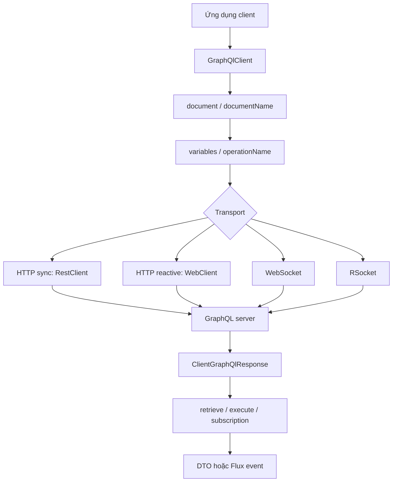

# `GraphQlClient` trong Spring for GraphQL

`GraphQlClient` là API phía client của Spring for GraphQL, dùng để gửi Query, Mutation và Subscription tới một GraphQL server. API cung cấp cùng một cách xây dựng request và đọc response, trong khi transport bên dưới có thể là HTTP đồng bộ, HTTP reactive, WebSocket hoặc RSocket.

Điểm quan trọng là tách **cách mô tả GraphQL operation** khỏi **cách truyền operation qua mạng**. Client xây request bằng document, variables và operation name; sau đó chọn cách lấy một field, xử lý toàn bộ response hoặc nhận một luồng Subscription. Nhờ vậy, phần gọi GraphQL có thể được giữ gần như giống nhau khi ứng dụng thay HTTP bằng WebSocket hoặc RSocket.

## `GraphQlClient` trong kiến trúc client

Ở phía client, luồng xử lý thường gồm:

1. Tạo transport client và cấu hình endpoint, headers, authentication, timeout hoặc codec.
2. Tạo một implementation của `GraphQlClient` phù hợp với transport.
3. Tạo request bằng `document(...)` hoặc `documentName(...)`.
4. Truyền variables và các thuộc tính request cần thiết.
5. Chọn `retrieve` để lấy một field hoặc `execute` để xử lý toàn bộ GraphQL response.
6. Decode dữ liệu thành DTO, record hoặc collection.



`GraphQlClient` là client để gọi server trong ứng dụng thật. `GraphQlTester` có mục đích kiểm thử GraphQL endpoint và thường được dùng trong test thay vì làm client nghiệp vụ của ứng dụng.

## Các implementation và transport

Spring for GraphQL cung cấp các implementation chính sau:

| Client | Transport bên dưới | Đặc điểm |
| --- | --- | --- |
| `HttpSyncGraphQlClient` | Spring `RestClient` | Blocking; gọi và chờ response ngay trên thread hiện tại. |
| `HttpGraphQlClient` | Spring `WebClient` | Non-blocking; request và response được biểu diễn bằng Reactor `Mono`. |
| `WebSocketGraphQlClient` | Spring `WebSocketClient` | Kết nối lâu dài, multiplex nhiều operation trên một connection; hỗ trợ Subscription. |
| `RSocketGraphQlClient` | Spring `RSocketRequester` | Session lâu dài, multiplex request qua RSocket; hỗ trợ streaming interaction. |

Với HTTP server hỗ trợ Server-Sent Events (SSE), `HttpGraphQlClient` cũng có thể nhận Subscription stream. Subscription cần transport streaming; một HTTP JSON request-response thông thường không thể tự phát nhiều kết quả liên tục.

Chọn client dựa trên web stack và nhu cầu của ứng dụng:

- Dùng `HttpSyncGraphQlClient` khi code đang theo mô hình đồng bộ và muốn tích hợp với `RestClient`.
- Dùng `HttpGraphQlClient` khi cần non-blocking I/O hoặc ứng dụng đang dùng WebFlux/Reactor.
- Dùng `WebSocketGraphQlClient` khi cần connection dùng chung, nhiều operation đồng thời hoặc Subscription qua WebSocket.
- Dùng `RSocketGraphQlClient` khi hệ thống đã triển khai RSocket và cần request/stream qua session.

Không nên chọn WebSocket chỉ vì muốn gọi Query. Với request-response thông thường, HTTP thường đơn giản hơn. Không nên chọn reactive client rồi gọi `.block()` ở mọi nơi; làm vậy sẽ mất lợi ích non-blocking.

## Dependency cần thiết

Các class client thuộc Spring for GraphQL. Ứng dụng Spring Boot đã dùng `spring-boot-starter-graphql` thường đã có Spring GraphQL trên classpath. Nếu chỉ viết một client độc lập, cần dependency `org.springframework.graphql:spring-graphql` cùng transport phù hợp.

Ví dụ Gradle khi dùng HTTP reactive client:

```kotlin
dependencies {
    implementation("org.springframework.graphql:spring-graphql")
    implementation("org.springframework:spring-webflux")
}
```

Với HTTP sync client dùng `RestClient`, cần Spring Web. Với WebSocket, cần WebSocket client implementation tương ứng; với RSocket, cần RSocket client transport và Spring Messaging/RSocket dependencies tương thích.

Trong ứng dụng Spring Boot, ưu tiên các starter và dependency management cùng một dòng Boot để các phiên bản Spring Framework, Spring GraphQL, Reactor và transport tương thích với nhau.

## Tạo `HttpGraphQlClient` với WebClient

`HttpGraphQlClient` dùng `WebClient` để gửi request GraphQL qua HTTP theo mô hình non-blocking. Ví dụ cấu hình base URL và bearer token:

```java
import org.springframework.graphql.client.HttpGraphQlClient;
import org.springframework.web.reactive.function.client.WebClient;

WebClient webClient = WebClient.builder()
        .baseUrl("https://api.example.com/graphql")
        .build();

HttpGraphQlClient graphQlClient = HttpGraphQlClient.builder(webClient)
        .headers(headers -> headers.setBearerAuth(accessToken))
        .build();
```

`baseUrl` là endpoint GraphQL của server. `headers(...)` cấu hình các HTTP headers dùng chung cho request, ví dụ `Authorization`, `Accept` hoặc header correlation ID. Không ghi cứng access token trong source code; lấy token từ cơ chế credential/configuration phù hợp với ứng dụng.

Có thể tạo nhanh client khi không cần tùy chỉnh:

```java
HttpGraphQlClient graphQlClient = HttpGraphQlClient.create(
        WebClient.create("https://api.example.com/graphql"));
```

Với ứng dụng cần connection pool, TLS, proxy, timeout hoặc codec riêng, hãy cấu hình `WebClient.Builder` rồi truyền WebClient đã tạo vào GraphQL client.

## Tạo `HttpSyncGraphQlClient` với RestClient

`HttpSyncGraphQlClient` dùng Spring `RestClient` và có hợp đồng blocking. Ví dụ:

```java
import org.springframework.graphql.client.HttpSyncGraphQlClient;
import org.springframework.web.client.RestClient;

RestClient restClient = RestClient.builder()
        .baseUrl("https://api.example.com/graphql")
        .build();

HttpSyncGraphQlClient graphQlClient =
        HttpSyncGraphQlClient.builder(restClient)
                .headers(headers -> headers.setBearerAuth(accessToken))
                .build();
```

Khi gọi `retrieveSync(...)` hoặc `executeSync()`, thread hiện tại chờ HTTP response. Cách này phù hợp với ứng dụng đồng bộ, nhưng không nên gọi trên event-loop của WebFlux hoặc trong luồng cần non-blocking I/O.

## Request document, variables và operation name

GraphQL operation thường được truyền dưới dạng document string. Nên dùng variables để truyền dữ liệu đầu vào thay vì ghép giá trị vào query:

```java
String document = """
        query BookById($id: ID!) {
          book(id: $id) {
            id
            title
            author {
              id
              name
            }
          }
        }
        """;

Mono<Book> bookMono = graphQlClient.document(document)
        .variable("id", "book-10")
        .retrieve("book")
        .toEntity(Book.class);
```

`document(...)` bắt đầu request. `variable("id", ...)` gán giá trị cho GraphQL variable `$id`. `retrieve("book")` chọn đường dẫn `book` bên trong phần `data` của response. `toEntity(Book.class)` chuyển object tại đường dẫn đó thành DTO `Book`.

Có thể đặt operation name trong document để dễ theo dõi:

```graphql
query BookById($id: ID!) {
  book(id: $id) {
    id
    title
  }
}
```

Operation name đặc biệt hữu ích khi document chứa nhiều operation, hoặc khi server/APM ghi nhận tên operation để tracing và metrics. Nếu document có nhiều operation, cần chỉ định operation name để server biết operation nào sẽ được thực thi.

Có thể chỉ định operation được chọn bằng `operationName(...)`:

```java
Mono<Book> bookMono = graphQlClient.document(multiOperationDocument)
        .operationName("BookById")
        .variable("id", "book-10")
        .retrieve("book")
        .toEntity(Book.class);
```

Variables cũng có thể truyền cùng lúc bằng map:

```java
Map<String, Object> variables = Map.of(
        "id", "book-10",
        "includeReviews", true);

String searchDocument = """
        query BookById($id: ID!, $includeReviews: Boolean!) {
          book(id: $id) {
            id
            title
            reviews @include(if: $includeReviews) {
              id
              rating
            }
          }
        }
        """;

Mono<Book> result = graphQlClient.document(searchDocument)
        .variables(variables)
        .retrieve("book")
        .toEntity(Book.class);
```

Không nối dữ liệu người dùng vào GraphQL document bằng string concatenation. Variables giúp GraphQL engine kiểm tra kiểu đầu vào, tránh lỗi escaping và làm operation dễ tái sử dụng.

## Lấy một field bằng `retrieve`

`retrieve(path)` là cách ngắn gọn khi chỉ cần decode một field trong response. Path được tính tương đối từ key `data` và hỗ trợ đường dẫn lồng nhau:

```java
Mono<String> title = graphQlClient.document(document)
        .variable("id", "book-10")
        .retrieve("book.title")
        .toEntity(String.class);
```

Với list, path có thể dùng chỉ số phần tử:

```java
Mono<String> firstAuthorName = graphQlClient.document(document)
        .variable("id", "book-10")
        .retrieve("book.authors[0].name")
        .toEntity(String.class);
```

Path không phải JSONPath đầy đủ; nó là notation đơn giản gồm tên field, dấu chấm và index list. Dùng đúng field path theo selection set trong document.

Với response có một field object, dùng `toEntity`. Với field list, dùng `toEntityList`: 

```java
Mono<List<Book>> books = graphQlClient.document("""
        query {
          books {
            id
            title
          }
        }
        """)
        .retrieve("books")
        .toEntityList(Book.class);
```

Ở HTTP reactive client, kết quả là `Mono`; request chỉ được thực thi khi publisher được subscribe. Trong WebFlux controller, có thể trả `Mono` trực tiếp cho framework. Trong code imperative, chỉ block tại ranh giới được kiểm soát, không block tùy tiện trên event-loop.

## Lấy toàn bộ response bằng `execute`

`retrieve` là shortcut cho trường hợp chỉ quan tâm một path. Khi cần kiểm tra nhiều field, partial data, `errors` hoặc `extensions`, dùng `execute()` để nhận `ClientGraphQlResponse`:

```java
Mono<ClientGraphQlResponse> responseMono = graphQlClient.document(document)
        .variable("id", "book-10")
        .execute();

Mono<Book> bookMono = responseMono.flatMap(response -> {
    if (!response.isValid()) {
        return Mono.error(new IllegalStateException(
                "GraphQL request không có data hợp lệ"));
    }

    ClientResponseField field = response.field("book");
    if (field.getValue() == null) {
        if (!field.getErrors().isEmpty()) {
            return Mono.error(new IllegalStateException("Field book bị lỗi"));
        }
        return Mono.empty();
    }

    return Mono.just(field.toEntity(Book.class));
});
```

Đây là ví dụ minh họa cách rẽ nhánh theo response; trong ứng dụng thực tế nên dùng exception riêng hoặc trả kiểu kết quả nghiệp vụ thay cho `IllegalStateException` chung. Cần phân biệt:

- Request không có data hợp lệ và chỉ trả lỗi ở cấp operation.
- Field có giá trị `null` nhưng không có error, có thể là nullable field thực sự không có dữ liệu.
- Field có giá trị `null` kèm errors, nghĩa là resolver field thất bại.
- Field có dữ liệu nhưng không decode được sang kiểu Java mong muốn, khi đó có thể phát sinh `GraphQlClientException`.

`ClientGraphQlResponse` cho phép đọc `field(...)`, `getErrors()`, `getExtensions()` và thông tin response khác. Dùng `execute()` khi cần giữ đầy đủ ngữ cảnh lỗi hoặc xử lý partial data.

## Xử lý lỗi từ `retrieve`

Khi đường dẫn được yêu cầu không tồn tại hoặc field có giá trị null kèm GraphQL error, `retrieve` có thể ném `FieldAccessException`. Exception này cung cấp response và field gây lỗi:

```java
Mono<Book> bookMono = graphQlClient.document(document)
        .variable("id", "missing-book")
        .retrieve("book")
        .toEntity(Book.class)
        .onErrorResume(FieldAccessException.class, ex -> {
            ClientGraphQlResponse response = ex.getResponse();
            ClientResponseField field = ex.getField();

            log.warn("GraphQL field book failed: {}", field.getErrors());
            return Mono.empty();
        });
```

Chỉ dùng fallback `Mono.empty()` nếu nghiệp vụ thật sự coi trường hợp đó là không có kết quả. Nếu lỗi là authorization, server unavailable hoặc validation, chuyển thành lỗi phù hợp thay vì âm thầm coi như dữ liệu vắng mặt.

Với `HttpSyncGraphQlClient`, dùng `retrieveSync(...)` và bắt `FieldAccessException` bằng try/catch tương ứng. Lỗi transport như timeout, kết nối bị đóng hoặc HTTP response không hợp lệ là nhóm lỗi khác với GraphQL field error; cần có chính sách retry/timeout phù hợp cho từng loại.

## Gửi Mutation

Mutation được gửi bằng cùng request API; khác biệt nằm ở document và field path cần lấy:

```java
String mutation = """
        mutation CreateBook($input: CreateBookInput!) {
          createBook(input: $input) {
            id
            title
          }
        }
        """;

Mono<Book> createdBook = graphQlClient.document(mutation)
        .variable("input", new CreateBookInput(
                "Spring GraphQL in Action", "9781234567890"))
        .retrieve("createBook")
        .toEntity(Book.class);
```

DTO `CreateBookInput` cần có các thuộc tính phù hợp với input type trong SDL. Khi gửi mutation có side effect, tránh tự động retry mọi lỗi transport mà không xét tính idempotent: server có thể đã commit thao tác nhưng response bị mất trên đường truyền. Nếu cần retry an toàn, thiết kế idempotency key hoặc cơ chế deduplication ở API.

## Dùng document trong file `.graphql` hoặc `.gql`

Không nhất thiết phải đặt mọi GraphQL document trong Java string. Spring for GraphQL có `DocumentSource` để tải operation từ classpath. Mặc định có thể đặt file trong thư mục `graphql-documents/` với phần mở rộng `.graphql` hoặc `.gql`.

Cấu trúc ví dụ:

```text
src/main/resources/
└── graphql-documents/
    ├── bookById.graphql
    └── createBook.graphql
```

Nội dung `bookById.graphql`:

```graphql
query BookById($id: ID!) {
  book(id: $id) {
    id
    title
    author {
      id
      name
    }
  }
}
```

Gọi document theo tên file, bỏ phần mở rộng:

```java
Mono<Book> bookMono = graphQlClient.documentName("bookById")
        .variable("id", "book-10")
        .retrieve("book")
        .toEntity(Book.class);
```

`documentName("bookById")` tìm `bookById.graphql` trong `graphql-documents/`. Cách này giúp query có thể được IntelliJ GraphQL plugin hỗ trợ autocomplete, syntax highlighting và inspection. Nếu cấu trúc file khác mặc định, có thể tùy chỉnh `DocumentSource` qua builder.

Đặt operation trong file cũng giúp review thay đổi selection set rõ ràng hơn, tái sử dụng operation và hạn chế lỗi cú pháp do text block dài.

## Tùy chỉnh headers và cấu hình transport

Builder của các client cho phép cấu hình chung và cấu hình riêng theo transport. Với HTTP, thường cần base URL, default headers, authentication, timeout và codec.

Ví dụ dùng token động qua interceptor có thể phù hợp khi token thay đổi theo request. Không nên tạo một singleton client với bearer token của một người dùng rồi dùng chung cho nhiều người dùng khác.

Với client cần cấu hình riêng, có thể dùng `mutate()` trên client đã tạo để lấy builder từ cấu hình hiện tại rồi build instance khác:

```java
HttpGraphQlClient anotherClient = graphQlClient.mutate()
        .headers(headers -> headers.setBearerAuth(anotherAccessToken))
        .build();
```

`mutate()` hữu ích khi tạo client với cấu hình khác nhưng muốn giữ lại phần lớn cấu hình gốc. Với WebSocket, mỗi client instance tạo connection riêng; không tạo client mới cho mỗi operation nếu mục tiêu là dùng một connection chia sẻ.

## Interceptor cho request và response

`GraphQlClientInterceptor` cho phép can thiệp request/response của client non-blocking. Có thể dùng để thêm correlation metadata, logging đã được lọc, đo thời gian hoặc xử lý lỗi chung:

```java
import org.springframework.graphql.client.ClientGraphQlRequest;
import org.springframework.graphql.client.ClientGraphQlResponse;
import org.springframework.graphql.client.GraphQlClientInterceptor;
import org.slf4j.Logger;
import org.slf4j.LoggerFactory;
import reactor.core.publisher.Flux;
import reactor.core.publisher.Mono;

public class LoggingGraphQlClientInterceptor implements GraphQlClientInterceptor {

    private static final Logger log =
            LoggerFactory.getLogger(LoggingGraphQlClientInterceptor.class);

    @Override
    public Mono<ClientGraphQlResponse> intercept(
            ClientGraphQlRequest request, Chain chain) {
        return chain.next(request)
                .doOnNext(response ->
                        log.debug("GraphQL response received, valid={}",
                                response.isValid()));
    }

    @Override
    public Flux<ClientGraphQlResponse> interceptSubscription(
            ClientGraphQlRequest request, SubscriptionChain chain) {
        return chain.next(request);
    }
}
```

Đăng ký interceptor qua builder:

```java
HttpGraphQlClient graphQlClient = HttpGraphQlClient.builder(webClient)
        .interceptor(new LoggingGraphQlClientInterceptor())
        .build();
```

Với transport blocking như `HttpSyncGraphQlClient`, dùng `SyncGraphQlClientInterceptor`, có method đồng bộ trả về `ClientGraphQlResponse`. Không dùng interceptor blocking cho client non-blocking hoặc ngược lại.

Interceptor nên tránh log toàn bộ variables, headers hoặc response data nếu có token, thông tin cá nhân hay dữ liệu nhạy cảm. Nên log operation name, correlation ID, thời gian và mã lỗi đã được làm sạch.

## Subscription với `retrieveSubscription`

Để nhận nhiều kết quả từ Subscription, client cần transport streaming như HTTP SSE, WebSocket hoặc RSocket. API `retrieveSubscription(path)` trả về stream `Flux<T>` sau khi decode field được chọn:

```java
String subscription = """
        subscription WatchOrder($orderId: ID!) {
          orderStatusChanged(orderId: $orderId) {
            eventId
            orderId
            status
            changedAt
          }
        }
        """;

Flux<OrderStatusChanged> events = graphQlClient.document(subscription)
        .variable("orderId", "ORD-1001")
        .retrieveSubscription("orderStatusChanged")
        .toEntity(OrderStatusChanged.class);
```

`Flux` phát một `OrderStatusChanged` cho mỗi execution result nhận được. Khi client không còn cần dữ liệu, hủy subscription bằng cách cancel subscription hoặc dùng operator như `take`, `timeout` phù hợp. Với WebSocket, cancellation làm transport gửi message `complete` cho operation tương ứng.

### WebSocket client

Ví dụ tạo client dùng WebSocket:

```java
import java.time.Duration;
import org.springframework.graphql.client.WebSocketGraphQlClient;
import org.springframework.web.reactive.socket.client.ReactorNettyWebSocketClient;
import org.springframework.web.reactive.socket.client.WebSocketClient;

String url = "wss://api.example.com/graphql";
WebSocketClient transport = new ReactorNettyWebSocketClient();

WebSocketGraphQlClient graphQlClient = WebSocketGraphQlClient
        .builder(url, transport)
        .keepAlive(Duration.ofSeconds(30))
        .build();
```

Kết nối được thiết lập ngầm khi gửi request đầu tiên; có thể gọi `start()` để kết nối tường minh trước. `WebSocketGraphQlClient` multiplex nhiều operation trên cùng connection và có thể kết nối lại khi connection mất rồi có request mới hoặc gọi `start()` lần nữa. `stop()` hủy operation đang chạy, đóng connection và từ chối request mới.

Thông thường nên dùng một `WebSocketGraphQlClient` cho mỗi server và phạm vi xác thực phù hợp, thay vì tạo instance cho từng subscription. Nếu client dùng danh tính khác nhau, phải quản lý connection và credential theo đúng ranh giới người dùng; không chia sẻ connection đã xác thực của user này cho user khác.

### Xử lý lỗi và reconnect của Subscription

Subscription stream có thể kết thúc bằng `SubscriptionErrorException` nếu server gửi thông điệp lỗi GraphQL. Lỗi transport như `WebSocketDisconnectedException` cho biết connection bị đóng hoặc mất. Có thể dùng Reactor `retry` cho lỗi transport tạm thời, nhưng cần thiết kế resume semantics:

- Nếu không có cursor hoặc event ID, reconnect có thể bỏ lỡ event trong khoảng mất kết nối.
- Nếu server replay event, client có thể nhận trùng và cần deduplicate theo event ID.
- Không retry vô hạn với lỗi authorization hoặc lỗi nghiệp vụ.
- Khi hủy stream, phải giải phóng subscription và tài nguyên liên quan.

Không phải mọi GraphQlClient đều hỗ trợ Subscription. `HttpGraphQlClient` chỉ dùng được khi HTTP server hỗ trợ SSE; WebSocket và RSocket cần endpoint/server transport tương ứng.

## WebSocket connection initialization và authentication

GraphQL over WebSocket có thông điệp khởi tạo connection. Nếu server yêu cầu credential trong connection init payload, có thể triển khai `WebSocketGraphQlClientInterceptor` để cung cấp payload và xử lý acknowledgement:

```java
import java.util.Map;
import org.springframework.graphql.client.WebSocketGraphQlClientInterceptor;
import reactor.core.publisher.Mono;

public class AuthWebSocketInterceptor implements WebSocketGraphQlClientInterceptor {

    private final String accessToken;

    public AuthWebSocketInterceptor(String accessToken) {
        this.accessToken = accessToken;
    }

    @Override
    public Mono<Object> connectionInitPayload() {
        return Mono.just(Map.of(
                "Authorization", "Bearer " + accessToken));
    }

    @Override
    public Mono<Void> handleConnectionAck(Map<String, Object> payload) {
        return Mono.empty();
    }
}
```

Đăng ký interceptor như một GraphQL client interceptor trong builder. Chỉ có thể có tối đa một interceptor kiểu `WebSocketGraphQlClientInterceptor` trên một WebSocket client. Payload chính xác phụ thuộc giao thức và cách server xác thực; một số server nhận token trong `connection_init`, server khác yêu cầu HTTP handshake headers.

Không gửi access token vào cả header lẫn payload nếu server không cần. Dùng `wss://` trên mạng không tin cậy và bảo vệ token như credential nhạy cảm.

## Dùng `executeSubscription` khi cần response đầy đủ

`retrieveSubscription` chỉ decode một field từ mỗi response. Khi cần kiểm tra errors hoặc nhiều field trên mỗi event, dùng `executeSubscription()` để nhận `Flux<ClientGraphQlResponse>`:

```java
Flux<ClientGraphQlResponse> responses = graphQlClient.document(subscription)
        .variable("orderId", "ORD-1001")
        .executeSubscription();

Flux<OrderStatusChanged> events = responses.map(response -> {
    if (!response.isValid()) {
        throw new IllegalStateException("Subscription response không hợp lệ");
    }
    return response.field("orderStatusChanged")
            .toEntity(OrderStatusChanged.class);
});
```

Đây là cách hữu ích khi muốn đọc toàn bộ response metadata cho mỗi event hoặc tự xử lý lỗi field. Trong production, hãy phân biệt `SubscriptionErrorException`, lỗi field và lỗi transport thay vì chuyển tất cả thành cùng một exception.

## RSocket GraphQL client

`RSocketGraphQlClient` dùng `RSocketRequester` và có session connection-oriented tương tự WebSocket. Có thể tạo client với transport websocket hoặc TCP:

```java
import java.net.URI;
import org.springframework.graphql.client.RSocketGraphQlClient;
import org.springframework.messaging.rsocket.WebsocketClientTransport;

URI uri = URI.create("wss://api.example.com/rsocket");
WebsocketClientTransport transport = WebsocketClientTransport.create(uri);

RSocketGraphQlClient graphQlClient = RSocketGraphQlClient.builder()
        .clientTransport(transport)
        .build();
```

RSocket client thiết lập session khi request đầu tiên được gửi hoặc khi gọi `start()`. Một session có thể multiplex nhiều request; `stop()` đóng session và hủy request đang chạy. Nên tái sử dụng client cho mỗi server thay vì tạo một session mới cho mỗi operation.

Với Spring Boot, có thể inject `RSocketGraphQlClient.Builder<?>` đã được auto-configure rồi cấu hình TCP/route hoặc transport mong muốn. Server cần cấu hình RSocket và route GraphQL tương ứng; chỉ tạo client không làm server tự bật RSocket.

## Optional input: phân biệt omitted và null

Với Mutation cập nhật, có thể cần phân biệt field không được gửi (giữ nguyên giá trị cũ) và field được gửi rõ `null` (xóa giá trị). JSON thông thường có thể biểu diễn `null`, nhưng một DTO Java đơn giản không luôn giữ được sự khác nhau giữa omitted và null.

Spring for GraphQL hỗ trợ `ArgumentValue<T>` trong input object. Client cũng có thể dùng `ArgumentValue<T>` cho field input khi cấu hình Jackson module `GraphQlJacksonModule` để serialize đúng. Hãy kiểm tra phiên bản Spring for GraphQL đang dùng vì hỗ trợ optional input phía client phụ thuộc phiên bản:

```java
import org.springframework.graphql.data.ArgumentValue;

public record UpdateProjectInput(
        String id,
        ArgumentValue<String> description) {
}
```

Khi muốn gửi giá trị:

```java
UpdateProjectInput input = new UpdateProjectInput(
        "project-10",
        ArgumentValue.ofNullable("New description"));
```

Khi muốn bỏ qua field:

```java
UpdateProjectInput input = new UpdateProjectInput(
        "project-10",
        ArgumentValue.omitted());
```

Để serialization hoạt động, đăng ký `GraphQlJacksonModule` với Jackson mapper/encoder mà underlying HTTP client sử dụng. Với Jackson 2, Spring for GraphQL cung cấp `GraphQlJackson2Module`. Không chỉ thêm module vào một mapper khác không được WebClient dùng; cần cấu hình đúng encoder của transport.

## DGS Codegen client API

Ngoài việc viết GraphQL document dưới dạng text, có thể dùng DGS Codegen để sinh các request/projection class từ schema. `DgsGraphQlClient` của Spring for GraphQL có thể wrap một `GraphQlClient` bất kỳ và hỗ trợ xây operation bằng generated API.

Đây là lựa chọn hữu ích khi ứng dụng có nhiều operation, muốn type-safe request builder hoặc muốn selection set được kiểm tra ở compile time. Đổi lại, dự án cần cấu hình code generation và quản lý generated sources. Với số lượng operation nhỏ, document `.graphql` trong classpath thường đơn giản hơn.

## Kiểm thử và quan sát GraphQlClient

Có thể kiểm thử lớp service gọi GraphQL bằng cách mock `GraphQlClient` hoặc dùng mock HTTP server/transport để xác nhận document, variables, headers và response mapping. Với integration test, nên chạy server GraphQL thực hoặc test endpoint qua `HttpGraphQlTester`; client production và tester có API/mục đích khác nhau.

Các tình huống nên kiểm tra:

- Query gửi đúng document, variables và operation name.
- Mutation serialize input object đúng với SDL.
- Nested path và list index được decode đúng.
- Field nullable trả null không bị nhầm với field error.
- Partial data cùng GraphQL errors được xử lý đúng.
- Lỗi parse/validation và lỗi transport được phân biệt.
- Authentication header hoặc WebSocket connection init payload được gửi đúng.
- Document source tìm đúng file `.graphql`/`.gql` trên classpath.
- Subscription phát nhiều event, cancel và reconnect theo chính sách.
- Timeout, retry và logging không làm lộ token hoặc dữ liệu nhạy cảm.

Có thể thêm metrics/tracing ở interceptor để ghi nhận operation name, transport, thời gian, trạng thái hợp lệ và số lỗi. Tránh log toàn bộ GraphQL variables hoặc response payload nếu có thông tin nhạy cảm.

## Lỗi thường gặp

| Triệu chứng | Nguyên nhân | Cách xử lý |
| --- | --- | --- |
| Không kết nối được server | Sai endpoint URL, TLS, proxy hoặc transport không tương thích. | Kiểm tra base URL, scheme `https`/`wss`, network và server transport. |
| `retrieve("book")` báo `FieldAccessException` | Field path không tồn tại hoặc field null kèm GraphQL error. | Kiểm tra selection set, response errors và path. |
| DTO decode thiếu field | Document không chọn field đó hoặc tên/kiểu DTO không khớp response. | Kiểm tra selection set và mapping JSON. |
| Variable không được nhận | Tên variable trong document khác tên truyền qua `.variable(...)`. | Đối chiếu `$id`, argument và tên key. |
| Query có partial data nhưng code coi là thất bại toàn bộ | Dùng `retrieve` mà không xem field-level errors hoặc response semantics. | Dùng `execute()` khi cần xử lý partial data và errors. |
| Reactive client không chạy request | `Mono` chưa được subscribe hoặc chưa được trả về framework. | Subscribe ở ranh giới phù hợp hoặc trả publisher cho WebFlux. |
| WebSocket mở nhiều connection | Tạo client mới cho mỗi request/subscription. | Tái sử dụng một client instance cho mỗi server và phạm vi credential. |
| Subscription mất event sau reconnect | Không có cursor/replay hoặc retry không xử lý duplicate. | Dùng event ID/sequence và resume contract. |
| Subscription không dừng | Flux không bị cancel hoặc client không quản lý lifecycle. | Giữ Disposable/Subscription hoặc dùng operator kết thúc stream. |
| Token không được server nhận trên WebSocket | Server mong credential trong `connection_init` nhưng client chỉ gửi HTTP header, hoặc ngược lại. | Đối chiếu authentication contract của server và cấu hình interceptor/handshake. |

## Ghi nhớ

`GraphQlClient` cung cấp API thống nhất để tạo GraphQL request và đọc response. `HttpSyncGraphQlClient` dùng `RestClient` blocking; `HttpGraphQlClient` dùng `WebClient` non-blocking; `WebSocketGraphQlClient` và `RSocketGraphQlClient` dùng connection/session lâu dài và có thể hỗ trợ Subscription. Chọn transport theo mô hình I/O và yêu cầu streaming của ứng dụng.

`document(...)` hoặc `documentName(...)` xác định operation; `variable(...)`/`variables(...)` truyền dữ liệu; `retrieve(path)` decode một field; `execute()` cho phép xử lý toàn bộ `ClientGraphQlResponse`. Với Subscription, dùng `retrieveSubscription` hoặc `executeSubscription` trên transport streaming. Quản lý partial data, field errors, transport failures, authentication, cancellation và client lifecycle rõ ràng để lời gọi GraphQL ổn định.

## Tài liệu tham khảo

- [Spring for GraphQL — Client](https://docs.spring.io/spring-graphql/reference/client.html)
- [Spring for GraphQL — `GraphQlClient` API](https://docs.spring.io/spring-graphql/docs/current/api/org/springframework/graphql/client/GraphQlClient.html)
- [Spring Boot — Spring for GraphQL transports](https://docs.spring.io/spring-boot/reference/web/spring-graphql.html)
