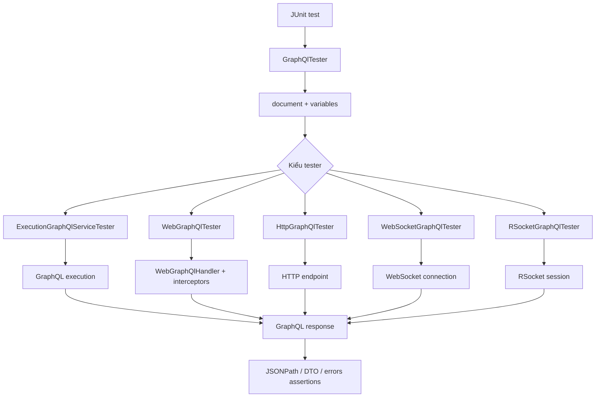

# `GraphQlTester` trong Spring for GraphQL

`GraphQlTester` là API kiểm thử GraphQL của Spring for GraphQL. Nó cho phép tạo request bằng GraphQL document, truyền variables, thực thi operation, đọc dữ liệu theo JSONPath và kiểm tra GraphQL errors. Cùng một fluent API có thể dùng để kiểm thử trực tiếp GraphQL engine hoặc gửi request qua HTTP, WebSocket và RSocket.

Điểm quan trọng là `GraphQlTester` tách cách viết test khỏi transport. Test có thể giữ nguyên phần document và assertion khi chuyển từ kiểm thử controller không có web server sang kiểm thử HTTP endpoint thật. Mỗi loại tester chỉ khác cách kết nối và cấu hình ở bước khởi tạo.

## `GraphQlTester` kiểm thử điều gì?

Một GraphQL request không chỉ là lời gọi method. Nó đi qua schema, coercion, argument binding, resolver, DataLoader, error handling và serialization. `GraphQlTester` giúp kiểm tra kết quả từ góc nhìn của client GraphQL:

- Gửi Query, Mutation hoặc Subscription bằng GraphQL document.
- Truyền variables và operation name.
- Kiểm tra dữ liệu trong phần `data` bằng JSONPath.
- Chuyển field thành DTO hoặc collection để so sánh.
- Kiểm tra errors, error path và metadata trong response.
- Kiểm tra luồng event của Subscription bằng Reactor `StepVerifier`.



`GraphQlTester` dành cho test. Khi ứng dụng cần gọi một GraphQL server khác trong luồng nghiệp vụ, dùng `GraphQlClient`; không dùng tester làm client production.

## Thêm dependency kiểm thử

Spring for GraphQL cung cấp module `spring-graphql-test`. Thêm vào test scope để dùng `GraphQlTester` và các implementation của nó:

```kotlin
dependencies {
    testImplementation("org.springframework.graphql:spring-graphql-test")
    testImplementation("org.springframework.boot:spring-boot-starter-test")
}
```

Với Maven:

```xml
<dependency>
    <groupId>org.springframework.graphql</groupId>
    <artifactId>spring-graphql-test</artifactId>
    <scope>test</scope>
</dependency>
<dependency>
    <groupId>org.springframework.boot</groupId>
    <artifactId>spring-boot-starter-test</artifactId>
    <scope>test</scope>
</dependency>
```

Khi kiểm thử HTTP bằng `WebTestClient`, cần có Spring WebFlux test client trên test classpath. Với ứng dụng MVC, có thể dùng `MockMvcWebTestClient`; với ứng dụng WebFlux, dùng `WebTestClient` trực tiếp. Hãy để Spring Boot dependency management chọn phiên bản tương thích, tránh tự ghép các phiên bản Spring GraphQL, Spring Framework và Reactor.

Nếu kiểm thử Subscription bằng `StepVerifier`, thêm `reactor-test` ở test scope. Với ứng dụng MVC dùng `MockMvcWebTestClient`, cần có WebFlux test client trên test classpath theo hướng dẫn dependency của Spring Boot.

## Năm implementation của GraphQlTester

Spring for GraphQL cung cấp năm loại tester phổ biến:

| Tester | Phạm vi kiểm thử | Có đi qua transport? |
| --- | --- | --- |
| `ExecutionGraphQlServiceTester` | GraphQL execution service và các thành phần thực thi schema. | Không; gọi trực tiếp service. |
| `WebGraphQlTester` | `WebGraphQlHandler` và chuỗi `WebGraphQlInterceptor`. | Không có HTTP/WebSocket thật; dùng web request mô phỏng. |
| `HttpGraphQlTester` | HTTP GraphQL endpoint. | Có; dùng `WebTestClient`, có thể gắn server thật hoặc mock. |
| `WebSocketGraphQlTester` | GraphQL request và Subscription qua WebSocket. | Có; dùng một WebSocket connection chia sẻ. |
| `RSocketGraphQlTester` | GraphQL request qua RSocket. | Có; dùng một RSocket session chia sẻ. |

Chọn loại tester theo ranh giới cần xác minh:

- Kiểm tra resolver, schema và mapping nhanh: `ExecutionGraphQlServiceTester` hoặc `@GraphQlTest`.
- Kiểm tra interceptor và web context: `WebGraphQlTester`.
- Kiểm tra endpoint, HTTP headers, security filter và status: `HttpGraphQlTester`.
- Kiểm tra WebSocket protocol, connection và Subscription: `WebSocketGraphQlTester`.
- Kiểm tra RSocket route/session: `RSocketGraphQlTester`.

Không cần dùng HTTP tester cho mọi test. Test ở tầng thấp giúp phản hồi nhanh; một số integration test ở transport thật mới xác minh được routing, headers, authentication và protocol.

## Fluent API cơ bản

Phần lớn test bắt đầu bằng `document(...)` hoặc `documentName(...)`, sau đó gán variables và gọi `execute()`:

```java
graphQlTester.document("""
        query BookById($id: ID!) {
          book(id: $id) {
            id
            title
          }
        }
        """)
        .variable("id", "book-10")
        .execute()
        .path("book.id")
        .entity(String.class)
        .isEqualTo("book-10");
```

Luồng trên thực hiện các bước:

1. `document(...)` cung cấp GraphQL document.
2. `variable(...)` gán giá trị cho biến `$id`.
3. `execute()` gửi operation tới tester đã cấu hình.
4. `path("book.id")` chọn field từ phần `data` của response.
5. `entity(String.class)` chuyển giá trị thành kiểu Java.
6. `isEqualTo(...)` xác minh kết quả mong đợi.

`GraphQlTester` dùng JSONPath cho `path(...)`. Đường dẫn được tính tương đối từ phần `data`, không cần viết tiền tố `data.`. Có thể dùng nested path, index mảng và wildcard như `books[0].title` hoặc `books[*].id`.

## Truyền variables và operation name

Nên truyền dữ liệu test bằng GraphQL variables để kiểm tra đúng quy trình coercion và binding:

```java
graphQlTester.document("""
        query SearchBooks($keyword: String!, $first: Int!) {
          searchBooks(keyword: $keyword, first: $first) {
            id
            title
          }
        }
        """)
        .variable("keyword", "Spring")
        .variable("first", 10)
        .execute()
        .path("searchBooks")
        .entityList(BookSummary.class)
        .hasSize(2);
```

Có thể truyền nhiều biến bằng một `Map`:

```java
Map<String, Object> variables = Map.of(
        "keyword", "Spring",
        "first", 10);

graphQlTester.document(searchDocument)
        .variables(variables)
        .execute()
        .path("searchBooks")
        .entityList(BookSummary.class)
        .hasSize(2);
```

Khi document chứa nhiều operation, chỉ định operation cần chạy bằng `operationName(...)`:

```java
graphQlTester.document(multiOperationDocument)
        .operationName("BookById")
        .variable("id", "book-10")
        .execute()
        .path("book.id")
        .entity(String.class)
        .isEqualTo("book-10");
```

Việc dùng operation name cũng giúp log, tracing và test report dễ nhận biết operation đang được kiểm tra.

## Kiểm tra scalar, object và collection

Với scalar, dùng `entity(...)` để kiểm tra kiểu và giá trị:

```java
graphQlTester.document("{ version }")
        .execute()
        .path("version")
        .entity(String.class)
        .isEqualTo("1.0");
```

Với object, decode thành DTO hoặc record:

```java
graphQlTester.document("""
        query {
          book(id: "book-10") {
            id
            title
          }
        }
        """)
        .execute()
        .path("book")
        .entity(BookSummary.class)
        .satisfies(book -> {
            assertThat(book.id()).isEqualTo("book-10");
            assertThat(book.title()).contains("Spring");
        });
```

Với collection, dùng `entityList(...)` và các assertion về kích thước, thứ tự hoặc phần tử:

```java
graphQlTester.document("{ books { id title } }")
        .execute()
        .path("books")
        .entityList(BookSummary.class)
        .hasSize(2)
        .contains(new BookSummary("book-10", "Spring GraphQL"));
```

Các ví dụ trên giả định DTO có constructor/record và `equals` phù hợp. Nếu chỉ muốn kiểm tra một phần dữ liệu, có thể dùng nhiều `path(...)` riêng thay vì decode toàn object.

### JSONPath với wildcard và nested path

Khi cần kiểm tra một thuộc tính trên mọi phần tử, dùng wildcard:

```java
graphQlTester.document("{ books { id title } }")
        .execute()
        .path("books[*].id")
        .entityList(String.class)
        .contains("book-10", "book-20");
```

Có thể đi sâu theo từng object và thực hiện nhiều assertion tương đối với object đó:

```java
graphQlTester.document("{ project(slug: \"spring-framework\") { name releases { version } } }")
        .execute()
        .path("project", project -> project
                .path("name")
                .entity(String.class)
                .isEqualTo("spring-framework")
                .path("releases[*].version")
                .entityList(String.class)
                .hasSizeGreaterThan(1));
```

Nested path giúp gom assertion liên quan tới cùng object. JSONPath chỉ đọc dữ liệu có trong selection set; nếu document không chọn field, response sẽ không có field đó để kiểm tra.

## Kiểm tra Mutation không có response data

Một Mutation có thể chỉ trả về scalar hoặc có thiết kế không cần đọc payload. Nếu mục tiêu là xác nhận operation chạy mà không có GraphQL errors, dùng `executeAndVerify()`:

```java
graphQlTester.document("""
        mutation DeleteDraft($id: ID!) {
          deleteDraft(id: $id)
        }
        """)
        .variable("id", "draft-10")
        .executeAndVerify();
```

`executeAndVerify()` thực thi request và xác minh response không có lỗi chưa được xử lý. Nếu cần kiểm tra giá trị Mutation trả về, dùng `execute()` rồi đọc field bằng `path(...)` như Query.

Đối với Mutation có side effect, test nên xác minh cả kết quả GraphQL và trạng thái thay đổi ở service/repository hoặc qua Query tiếp theo. Chỉ kiểm tra không có errors chưa chứng minh dữ liệu đã được lưu đúng.

## Kiểm tra GraphQL errors

GraphQL response có thể chứa `data` một phần cùng `errors`. `GraphQlTester` cho phép xác minh lỗi mong đợi hoặc lọc lỗi đã được chấp nhận trong test.

### Kỳ vọng một lỗi cụ thể

`expect(...)` yêu cầu có ít nhất một error khớp predicate; nếu không tìm thấy, test thất bại. `verify()` kiểm tra không còn lỗi chưa được xử lý:

```java
graphQlTester.document("""
        query {
          book(id: "missing-book") {
            id
          }
        }
        """)
        .execute()
        .errors()
        .expect(error -> error.getMessage().contains("Book not found"))
        .verify();
```

### Lọc lỗi đã biết

`filter(...)` đánh dấu lỗi phù hợp là đã xử lý để test có thể tiếp tục kiểm tra phần `data`. Những lỗi khác vẫn khiến `verify()` thất bại:

```java
graphQlTester.document(query)
        .execute()
        .errors()
        .filter(error -> error.getMessage().contains("Optional recommendation unavailable"))
        .verify()
        .path("book.title")
        .entity(String.class)
        .isEqualTo("Spring GraphQL");
```

Chỉ filter lỗi đã được dự kiến và có lý do nghiệp vụ rõ ràng. Không dùng predicate luôn trả `true` để làm test xanh vì khi đó mọi GraphQL error đều bị bỏ qua.

### Kiểm tra toàn bộ danh sách lỗi

`satisfy(...)` cho phép assertion trên toàn bộ danh sách errors. Khi callback được thực thi, các lỗi đã được xem là đã xử lý, nên có thể tiếp tục kiểm tra data nếu cần:

```java
graphQlTester.document(query)
        .execute()
        .errors()
        .satisfy(errors -> assertThat(errors)
                .anyMatch(error -> error.getMessage().contains("Access denied")));
```

Có thể cấu hình `errorFilter(...)` ở tester builder để bỏ qua một nhóm lỗi chung cho nhiều test. Dùng cấu hình toàn cục thận trọng; filter ở một test cụ thể thường dễ đọc và ít che giấu regression hơn.

## Kiểm tra error extensions và path

Khi API trả `extensions` với mã lỗi hoặc metadata riêng, kiểm tra chúng qua `ResponseError` trong `expect(...)` hoặc `satisfy(...)`. `ResponseError` cũng cung cấp `getPath()` và `getParsedPath()` để xác định field gây lỗi:

```java
graphQlTester.document(query)
        .execute()
        .errors()
        .expect(error -> "FORBIDDEN".equals(error.getExtensions().get("code"))
                && "book.internalNotes".equals(error.getPath()))
        .verify();
```

Đối với error path, lấy thông tin từ `ResponseError` trong `expect` hoặc `satisfy` và xác minh field gây lỗi. Điều này hữu ích khi bảo vệ field lồng nhau: lỗi phải chỉ tới `book.internalNotes`, còn các field công khai vẫn có thể trả dữ liệu. `extensions` của lỗi nằm trên `ResponseError`; nó không thuộc JSONPath của phần `data`.

Không assert nguyên văn toàn bộ message nếu message có thể thay đổi theo ngôn ngữ hoặc cách diễn đạt. Ưu tiên mã lỗi ổn định trong `extensions`, path và loại lỗi công khai mà API cam kết.

## Dùng document từ file `.graphql`

Để tránh nhúng query dài vào Java test, đặt document test trong thư mục `graphql-test/` trên classpath:

```text
src/test/resources/
└── graphql-test/
    ├── bookById.graphql
    ├── searchBooks.graphql
    └── bookSummary.graphql
```

Ví dụ `bookById.graphql`:

```graphql
query BookById($id: ID!) {
  book(id: $id) {
    id
    title
  }
}
```

Gọi document theo tên file, bỏ phần mở rộng:

```java
graphQlTester.documentName("bookById")
        .variable("id", "book-10")
        .execute()
        .path("book.id")
        .entity(String.class)
        .isEqualTo("book-10");
```

`documentName(...)` và `fragmentName(...)` cùng dùng `DocumentSource` đã cấu hình. Mặc định, `GraphQlTester` dùng `ResourceDocumentSource` với classpath location `graphql-test/` và các phần mở rộng `.graphql`/`.gql`. Có thể nạp fragment từ file riêng bằng `fragmentName(...)`:

```java
graphQlTester.documentName("searchBooks")
        .fragmentName("bookSummary")
        .variable("keyword", "Spring")
        .execute()
        .path("searchBooks[*].title")
        .entityList(String.class)
        .hasSizeGreaterThan(0);
```

Fragment được thêm vào document theo tên file. Cần bảo đảm fragment được khai báo với đúng tên và type condition tương ứng với schema. Khi dự án dùng thư mục khác, cấu hình `DocumentSource` tùy chỉnh trên builder.

## Cấu hình chung của tester

Các builder của `GraphQlTester` chia sẻ một số tùy chọn:

| Tùy chọn | Tác dụng |
| --- | --- |
| `documentSource(...)` | Chỉ định nơi tải document và fragment. |
| `errorFilter(...)` | Đánh dấu các lỗi phù hợp là đã xử lý. |
| `responseTimeout(...)` | Giới hạn thời gian chờ kết quả. |

Ví dụ cấu hình timeout và error filter:

```java
WebTestClient.Builder webTestClientBuilder = WebTestClient.bindToServer()
        .baseUrl("http://localhost:8080/graphql");

HttpGraphQlTester tester = HttpGraphQlTester.builder(webTestClientBuilder)
        .responseTimeout(Duration.ofSeconds(5))
        .errorFilter(error -> error.getMessage().contains("Known optional warning"))
        .build();
```

`responseTimeout` giúp test không treo quá lâu khi resolver hoặc transport bị kẹt. Mặc định là 5 giây. Với Subscription, timeout cần được cân nhắc theo cách kiểm tra stream; `StepVerifier` thường phù hợp hơn để đặt giới hạn thời gian cho luồng event.

Không dùng timeout ngắn tùy tiện nếu test phụ thuộc database/container khởi động chậm. Hãy chọn giá trị dựa trên thời gian test bình thường và giữ timeout đủ thấp để phát hiện lỗi treo.

## Kiểm thử trực tiếp `ExecutionGraphQlService`

`ExecutionGraphQlServiceTester` kiểm thử phía server mà không cần client hoặc transport. Đây là lựa chọn gọn cho test tập trung vào GraphQL execution:

```java
ExecutionGraphQlServiceTester tester =
        ExecutionGraphQlServiceTester.create(executionGraphQlService);

tester.document("{ book(id: \"book-10\") { id title } }")
        .execute()
        .path("book.title")
        .entity(String.class)
        .isEqualTo("Spring GraphQL");
```

Tester này gọi trực tiếp `ExecutionGraphQlService`. Nó kiểm tra schema, DataFetcher, argument binding, DataLoader và execution behavior, nhưng không kiểm tra HTTP routing, servlet filters, WebSocket protocol hoặc `WebGraphQlInterceptor` chain.

Builder còn cho phép tùy chỉnh `ExecutionInput`, ví dụ gắn execution ID hoặc GraphQL context phục vụ test:

```java
ExecutionId executionId = ExecutionId.generate();

ExecutionGraphQlServiceTester tester =
        ExecutionGraphQlServiceTester.builder(executionGraphQlService)
                .configureExecutionInput((input, builder) ->
                        builder.executionId(executionId).build())
                .build();
```

Dùng cách này khi test cần điều khiển metadata execution mà không cần dựng web transport.

## Kiểm thử `WebGraphQlHandler` và interceptor

`WebGraphQlTester` thực thi request qua `WebGraphQlHandler`, do đó đi qua `WebGraphQlInterceptor` chain trước khi tới `ExecutionGraphQlService`. Nó phù hợp để kiểm tra request headers, GraphQL context và response transformation của interceptor mà không cần mở HTTP server:

```java
WebGraphQlTester tester = WebGraphQlTester.builder(webGraphQlHandler)
        .headers(headers -> headers.set("X-Tenant-Id", "tenant-a"))
        .build();

tester.document("{ currentTenant { id } }")
        .execute()
        .path("currentTenant.id")
        .entity(String.class)
        .isEqualTo("tenant-a");
```

Builder cho phép thêm HTTP-like request headers vào `WebGraphQlRequest` mô phỏng. Đây không phải test CORS, servlet filter hoặc HTTP status; nếu cần kiểm tra các phần đó, dùng `HttpGraphQlTester`.

## Kiểm thử controller bằng `@GraphQlTest`

Spring Boot cung cấp `@GraphQlTest` để tạo test slice tập trung vào GraphQL. Annotation này cấu hình schema và GraphQL infrastructure, tìm các GraphQL controller cùng một số thành phần liên quan, nhưng không tải toàn bộ service/repository như `@SpringBootTest`.

Ví dụ dưới đây giả định schema có trong `src/main/resources/graphql/schema.graphqls`:

```graphql
type Book {
  id: ID!
  title: String!
}

type Query {
  book(id: ID!): Book
}
```

Ví dụ controller:

```java
@Controller
public class BookController {

    private final BookService bookService;

    public BookController(BookService bookService) {
        this.bookService = bookService;
    }

    @QueryMapping
    public Book book(@Argument("id") String id) {
        return bookService.findById(id);
    }
}
```

Test slice có thể mock service dependency:

```java
// Spring Boot 4.x:
import org.springframework.boot.graphql.test.autoconfigure.GraphQlTest;
// Spring Boot 3.x dùng:
// import org.springframework.boot.test.autoconfigure.graphql.GraphQlTest;

import static org.mockito.BDDMockito.given;
import static org.mockito.BDDMockito.then;

import org.junit.jupiter.api.Test;
import org.springframework.beans.factory.annotation.Autowired;
import org.springframework.graphql.test.tester.GraphQlTester;
import org.springframework.test.context.bean.override.mockito.MockitoBean;

@GraphQlTest(BookController.class)
class BookControllerTests {

    @Autowired
    GraphQlTester graphQlTester;

    @MockitoBean
    BookService bookService;

    @Test
    void returnsBookById() {
        given(bookService.findById("book-10"))
                .willReturn(new Book("book-10", "Spring GraphQL"));

        graphQlTester.document("""
                query BookById($id: ID!) {
                  book(id: $id) {
                    id
                    title
                  }
                }
                """)
                .variable("id", "book-10")
                .execute()
                .path("book.title")
                .entity(String.class)
                .isEqualTo("Spring GraphQL");

        then(bookService).should().findById("book-10");
    }
}
```

Đoạn code giả định `Book` có constructor tương ứng, `BookService.findById` trả về `Book`, và test dùng Mockito BDD API. `@MockitoBean` có trong Spring Framework mới; với Spring Boot/Spring Framework cũ, dùng cơ chế mock bean tương ứng của phiên bản đó, thường là `@MockBean`.

`@GraphQlTest` không tự quét mọi `@Service`, `@Repository` hoặc `@Configuration` của ứng dụng. Dùng `@MockitoBean` cho collaborator hoặc `@Import` để thêm cấu hình/thành phần cần thiết. Nếu test cần persistence thật, security filter hoặc transport, hãy chọn integration test phù hợp thay vì cố mở rộng slice quá nhiều.

## Kiểm thử HTTP bằng `HttpGraphQlTester`

`HttpGraphQlTester` dùng `WebTestClient`, nên có thể kiểm thử endpoint không cần server thật hoặc gọi tới server đang chạy.

### Với Spring MVC không mở server

Dùng `MockMvcWebTestClient` để nối `WebTestClient` với Spring MVC application context:

```java
WebTestClient client = MockMvcWebTestClient
        .bindToApplicationContext(applicationContext)
        .configureClient()
        .baseUrl("/graphql")
        .build();

HttpGraphQlTester tester = HttpGraphQlTester.create(client);
```

### Với Spring WebFlux không mở server

Dùng `WebTestClient.bindToApplicationContext(...)`:

```java
WebTestClient client = WebTestClient
        .bindToApplicationContext(applicationContext)
        .configureClient()
        .baseUrl("/graphql")
        .build();

HttpGraphQlTester tester = HttpGraphQlTester.create(client);
```

### Với server thật

Có thể tạo client trỏ tới địa chỉ server:

```java
WebTestClient client = WebTestClient
        .bindToServer()
        .baseUrl("http://localhost:8080/graphql")
        .build();

HttpGraphQlTester tester = HttpGraphQlTester.create(client);
```

Trong Spring Boot, `@SpringBootTest(webEnvironment = RANDOM_PORT)` kết hợp `@AutoConfigureHttpGraphQlTester` có thể cung cấp `HttpGraphQlTester` đã cấu hình tới server đang chạy. Package của annotation có thể thay đổi theo major version Spring Boot; dùng đúng package trong phiên bản dự án.

Khi cần thay đổi header hoặc transport config cho một nhóm test, dùng `mutate()` để tạo tester mới từ tester hiện có:

```java
HttpGraphQlTester authenticatedTester = tester.mutate()
        .headers(headers -> headers.setBearerAuth(accessToken))
        .build();
```

Đây là cách kiểm tra authentication header hoặc các header tenant/correlation mà không phải tạo lại toàn bộ `WebTestClient`.

`GraphQlTester` tập trung vào GraphQL response. Nếu cần assert HTTP status, response header hoặc cookie, giữ lại và dùng `WebTestClient` trực tiếp cho assertion transport, rồi dùng tester cho phần GraphQL body.

## Kiểm thử WebSocket

`WebSocketGraphQlTester` dùng một WebSocket connection được chia sẻ cho nhiều request. Mỗi tester instance quản lý connection riêng; thường tạo một tester cho một server trong phạm vi test class và đóng nó khi hoàn tất:

```java
WebSocketClient client = new ReactorNettyWebSocketClient();

WebSocketGraphQlTester tester = WebSocketGraphQlTester
        .builder("ws://localhost:8080/graphql", client)
        .build();
```

Có thể cấu hình headers cho handshake hoặc tạo tester khác bằng `mutate()`. Với server yêu cầu authentication qua connection init payload, cần cấu hình cơ chế phù hợp với protocol server; header handshake và payload `connection_init` là hai vị trí khác nhau.

Kết thúc test, gọi `stop()` để đóng WebSocket connection và giải phóng tài nguyên:

```java
@AfterEach
void closeWebSocketTester() {
    tester.stop();
}
```

Không tạo một WebSocket tester mới cho từng operation nếu mục tiêu là kiểm thử multiplexing hoặc tái sử dụng connection. Cũng không chia sẻ tester đã xác thực bằng credential của một user cho test khác có danh tính khác.

## Kiểm thử RSocket

`RSocketGraphQlTester` dùng `RSocketRequester` và một session được chia sẻ cho các request. Ví dụ với WebSocket transport:

```java
URI url = URI.create("ws://localhost:8080/rsocket");
WebsocketClientTransport transport = WebsocketClientTransport.create(url);

RSocketGraphQlTester tester = RSocketGraphQlTester.builder()
        .clientTransport(transport)
        .build();
```

RSocket tester phù hợp khi ứng dụng thực sự cung cấp GraphQL qua RSocket. Gọi `stop()` sau khi test hoàn tất để đóng session. Không cần thêm RSocket transport vào test nếu ứng dụng chỉ cung cấp GraphQL qua HTTP.

## Kiểm thử Subscription với StepVerifier

Với Subscription, gọi `executeSubscription()` để nhận stream response, sau đó decode field thành `Flux<T>`. Dùng Reactor `StepVerifier` để kiểm tra thứ tự, số event, completion và lỗi:

```java
Flux<String> greetings = tester.document("subscription { greetings }")
        .executeSubscription()
        .toFlux("greetings", String.class);

StepVerifier.create(greetings)
        .expectNext("Hi")
        .expectNext("Bonjour")
        .expectNext("Hola")
        .verifyComplete();
```

Theo testing support của Spring for GraphQL, Subscription được hỗ trợ trong `WebSocketGraphQlTester` và các tester phía server (`ExecutionGraphQlServiceTester`, `WebGraphQlTester`). Không giả định `HttpGraphQlTester` request-response hoặc `RSocketGraphQlTester` tự cung cấp Subscription testing theo cùng API này.

Với stream không tự complete, dùng `thenCancel()` hoặc `expectNextCount(...)` rồi cancel thay vì `verifyComplete()`. Ví dụ:

```java
StepVerifier.create(statusEvents)
        .expectNextMatches(event -> event.status().equals("PAID"))
        .expectNextMatches(event -> event.status().equals("PACKING"))
        .thenCancel()
        .verify();
```

Test cancellation quan trọng vì nó xác minh event source giải phóng listener, subscription và buffer khi client dừng theo dõi.

## Kiểm tra validation, binding và error mapping

GraphQL có nhiều giai đoạn có thể phát sinh lỗi. Dùng `GraphQlTester` để kiểm tra API contract ở từng giai đoạn:

- Sai cú pháp document hoặc field không có trong schema: lỗi parse/validation của GraphQL.
- Variable sai kiểu hoặc thiếu Non-Null: lỗi input coercion trước khi resolver chạy.
- Không bind được input object: lỗi argument binding.
- Constraint `@NotBlank`, `@Size` thất bại: lỗi Bean Validation.
- Service ném `BookNotFoundException` hoặc `AccessDeniedException`: execution error từ resolver/service.

Ví dụ kiểm tra mã lỗi validation đã chuẩn hóa:

```java
graphQlTester.document("""
        mutation {
          createBook(input: { title: "   " }) {
            id
          }
        }
        """)
        .execute()
        .errors()
        .expect(error -> "VALIDATION_ERROR".equals(
                error.getExtensions().get("code")))
        .verify();
```

Đoạn test giả định exception handler đưa mã `VALIDATION_ERROR` vào `extensions.code`. Ưu tiên kiểm tra mã lỗi ổn định và path field thay vì phụ thuộc message nội bộ hoặc stack trace.

## Kiểm tra DataLoader và N+1

`GraphQlTester` có thể gửi một operation chọn field lồng nhau để kích hoạt DataLoader hoặc `@BatchMapping`. Tuy nhiên, chỉ assert response đúng chưa chứng minh batching hoạt động; resolver riêng từng object vẫn có thể trả đúng dữ liệu nhưng tạo N+1.

Kết hợp tester với mock/spy ở batch service hoặc metric để xác minh số lần gọi và danh sách key:

```java
graphQlTester.document("""
        query {
          books {
            id
            author {
              id
              name
            }
          }
        }
        """)
        .execute()
        .path("books")
        .entityList(BookWithAuthor.class)
        .hasSize(3);

then(authorBatchService).should(times(1))
        .findAllByIds(Set.of("author-1", "author-2"));
```

Đây là ví dụ minh họa; tập key và số lần batch phụ thuộc fixture, DataLoader dispatch và số batch tối đa. Với test thực tế, xác định rõ số parent object và số ID duy nhất, rồi kiểm tra batch service được gọi với nhóm key kỳ vọng. Nếu test chạy đồng thời hoặc dùng cache ngoài request, cần cô lập dữ liệu và metric để tránh kết quả sai lệch.

## Những nguyên tắc thiết kế test GraphQL

- **Kiểm tra theo góc nhìn client:** gửi document và variables thực tế, assert `data`, `errors` và path công khai.
- **Chọn đúng ranh giới:** service execution, web handler hay HTTP/WebSocket/RSocket transport tùy điều cần xác minh.
- **Dùng operation name:** giúp log và test report chỉ rõ operation.
- **Không bỏ qua errors toàn cục:** chỉ filter lỗi đã dự kiến; mọi lỗi mới cần làm test thất bại.
- **Kiểm tra nullability:** field nullable có thể là null hợp lệ; field Non-Null có thể gây null propagation lên object cha.
- **Kiểm tra side effect:** Mutation cần xác minh trạng thái dữ liệu hoặc tương tác service, không chỉ response.
- **Kiểm tra authorization:** thử cả user được phép và không được phép, bao gồm field lồng nhau và tenant isolation.
- **Kiểm tra transport riêng:** headers, status, cookies, CORS, CSRF và protocol không thể được xác minh chỉ bằng service tester.
- **Đóng tài nguyên:** WebSocket/RSocket tester và Subscription stream cần được stop/cancel.
- **Giữ fixture ổn định:** dữ liệu test phải xác định, không phụ thuộc thứ tự ngẫu nhiên hoặc môi trường bên ngoài.

## Lỗi thường gặp

| Triệu chứng | Nguyên nhân | Cách xử lý |
| --- | --- | --- |
| Không tìm thấy `GraphQlTester` class | Thiếu `spring-graphql-test` ở test scope. | Thêm test dependency tương thích với Spring GraphQL. |
| `@GraphQlTest` không inject được service | Test slice không tự quét `@Service` và `@Repository`. | Dùng `@MockitoBean` hoặc `@Import` collaborator cần thiết. |
| `path(...)` không tìm thấy field | JSONPath sai hoặc document không chọn field đó. | Đối chiếu selection set và path tương đối với `data`. |
| Test thất bại do error không mong muốn | Response có GraphQL errors chưa được xác minh/lọc. | Dùng `errors().expect(...)`, `filter(...)` hoặc sửa lỗi thật trong resolver. |
| Test vẫn xanh dù server trả lỗi | Error filter quá rộng hoặc không gọi `verify()`. | Chỉ lọc lỗi cụ thể và yêu cầu `verify()` kiểm tra phần còn lại. |
| Mutation test không có data path | Mutation không trả payload hoặc test chỉ cần xác minh không lỗi. | Dùng `executeAndVerify()` hoặc chọn field trả về trong SDL. |
| HTTP tester không kiểm tra được status/header | Chỉ dùng GraphQL response abstraction. | Dùng `WebTestClient` cho assertion transport và tester cho GraphQL body. |
| WebSocket test treo hoặc rò connection | Không cancel stream hoặc không gọi `stop()`. | Dùng `StepVerifier` với cancellation và đóng tester trong teardown. |
| Subscription test không nhận event | Dùng tester/transport không hỗ trợ subscription testing hoặc publisher không phát. | Dùng WebSocket/server-side tester và kiểm tra event source. |
| Test response đúng nhưng N+1 vẫn tồn tại | Chỉ assert dữ liệu, không đo batch invocation hoặc SQL. | Spy batch service, đếm key và kiểm tra số truy vấn. |

## Ghi nhớ

`GraphQlTester` cung cấp một fluent API chung cho GraphQL test: tạo document, truyền variables, execute, đọc JSONPath và assert DTO/collection/errors. Chọn `ExecutionGraphQlServiceTester` để test execution trực tiếp, `WebGraphQlTester` để test web handler/interceptors, `HttpGraphQlTester` cho HTTP, `WebSocketGraphQlTester` cho WebSocket và `RSocketGraphQlTester` cho RSocket.

Dùng `executeAndVerify()` khi chỉ cần xác minh operation không có errors; dùng `execute()` khi cần đọc data; dùng `errors().expect/filter/satisfy().verify()` để kiểm tra lỗi có chủ đích. Tổ chức test theo ranh giới cần bảo vệ, kết hợp `@GraphQlTest` cho controller slice và `@SpringBootTest` cùng HTTP tester cho integration. Với Subscription, dùng `executeSubscription()` và `StepVerifier`, đồng thời kiểm tra cancellation và cleanup. Một test tốt xác minh cả response contract lẫn những hành vi quan trọng như authorization, validation, side effect và batching.

## Tài liệu tham khảo

- [Spring for GraphQL — Testing](https://docs.spring.io/spring-graphql/reference/testing.html)
- [Spring Boot — Auto-configured Spring GraphQL Tests](https://docs.spring.io/spring-boot/reference/testing/spring-boot-applications.html)
- [Spring for GraphQL — `GraphQlTester` API](https://docs.spring.io/spring-graphql/docs/current/api/org/springframework/graphql/test/tester/GraphQlTester.html)
