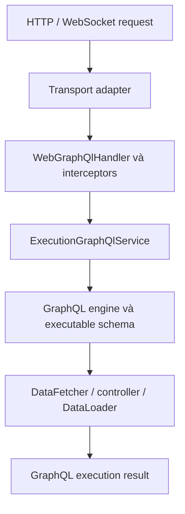
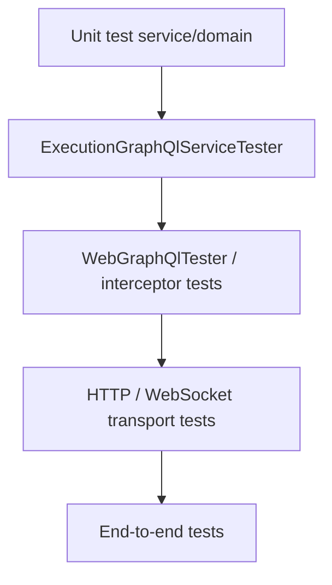

# ExecutionGraphQlServiceTester trong Spring for GraphQL

Khi kiểm thử GraphQL server, không phải test nào cũng cần khởi động HTTP server hoặc mở kết nối WebSocket. Nhiều lỗi nằm ngay ở lớp thực thi GraphQL: schema và runtime wiring, annotated controller, argument binding, resolver, DataLoader hoặc xử lý exception. `ExecutionGraphQlServiceTester` cho phép gọi trực tiếp `ExecutionGraphQlService` để kiểm thử những phần này mà không cần đi qua HTTP hay một transport khác.

Tester này triển khai API `GraphQlTester`, vì vậy cách viết operation và kiểm tra kết quả tương tự các GraphQL tester khác: tạo document, gắn variables, thực thi, rồi đọc field hoặc kiểm tra errors. Điểm cần nhớ là nó kiểm thử lớp execution. Nếu mục tiêu là xác nhận HTTP headers, status code, content negotiation, security filter chain hoặc WebSocket protocol, cần một tester ở tầng transport phù hợp.

Sau bài này, bạn có thể:

- Hiểu vị trí của `ExecutionGraphQlServiceTester` trong các lớp kiểm thử GraphQL.
- Tạo tester từ `ExecutionGraphQlService`.
- Thực thi query và mutation bằng GraphQL document.
- Truyền variables và sử dụng document đặt tên.
- Kiểm tra scalar, object, list, nested field và alias.
- Xác minh GraphQL errors, path và partial data.
- Kiểm thử argument binding, validation và resolver behavior.
- Chọn đúng giữa execution tester và HTTP/WebSocket tester.

## 1. ExecutionGraphQlServiceTester kiểm thử lớp nào?

Một request GraphQL trong ứng dụng Spring thường đi qua nhiều lớp:



`ExecutionGraphQlServiceTester` bắt đầu ở `ExecutionGraphQlService`. Nó gọi lớp thực thi GraphQL trực tiếp, vì vậy test có thể xác nhận operation được validate, resolver được gọi, dữ liệu được ánh xạ và lỗi được tạo như mong đợi.

Nó không gửi HTTP request qua server connector và không kiểm thử các bước nằm trước execution service, chẳng hạn:

- HTTP route `/graphql` có được đăng ký đúng không.
- Request `Content-Type` và response `Accept` có được thương lượng đúng không.
- HTTP status code và response headers có chính xác không.
- CORS, HTTP authentication filter hoặc WebSocket handshake có hoạt động không.
- Proxy, TLS, network timeout hoặc transport disconnect có được xử lý đúng không.

Vì vậy, đây là lựa chọn tốt cho test tập trung vào GraphQL execution. Nó không thay thế integration test qua HTTP hoặc WebSocket khi cần xác nhận hợp đồng transport.

## 2. GraphQlTester là API kiểm thử chung

Spring for GraphQL cung cấp `GraphQlTester` như một API kiểm thử thống nhất. Các implementation khác nhau thay đổi cách gửi operation, nhưng phần lớn cách viết document và assertion giữ nguyên.

| Tester | Điểm tích hợp | Mục tiêu phù hợp |
| --- | --- | --- |
| `ExecutionGraphQlServiceTester` | `ExecutionGraphQlService` | Kiểm thử GraphQL execution trực tiếp |
| `WebGraphQlTester` | `WebGraphQlHandler` | Kiểm thử WebGraphQL handler và interceptor ở tầng web abstraction |
| `HttpGraphQlTester` | HTTP endpoint | Kiểm thử request/response HTTP thật hoặc test client HTTP |
| `WebSocketGraphQlTester` | WebSocket GraphQL transport | Kiểm thử subscription và protocol qua WebSocket |
| `RSocketGraphQlTester` | RSocket transport | Kiểm thử ứng dụng dùng RSocket |

`ExecutionGraphQlServiceTester` phù hợp khi muốn test resolver nhanh và trực tiếp, không cần tạo server socket. Nếu test cần xác minh interceptor ở `WebGraphQlHandler`, hãy chọn `WebGraphQlTester`. Nếu cần kiểm tra HTTP status/header hoặc cấu hình transport, hãy dùng `HttpGraphQlTester`.

## 3. Thêm dependency kiểm thử

Trong dự án dùng Maven, thêm module test của Spring for GraphQL với scope test:

```xml
<dependency>
    <groupId>org.springframework.graphql</groupId>
    <artifactId>spring-graphql-test</artifactId>
    <scope>test</scope>
</dependency>
```

Với Gradle:

```groovy
testImplementation("org.springframework.graphql:spring-graphql-test")
```

Nếu dự án dùng Spring Boot dependency management, để BOM quản lý version tương thích với Spring for GraphQL đang dùng. Không tự thêm một version khác với runtime dependency vì có thể gây lệch API hoặc dependency graph.

Các ví dụ dưới đây giả định đã có `spring-graphql-test` trên test classpath và ứng dụng đã cấu hình `ExecutionGraphQlService` từ schema cùng runtime wiring.

## 4. Tạo ExecutionGraphQlServiceTester

Tester được tạo từ bean `ExecutionGraphQlService`:

```java
import org.springframework.beans.factory.annotation.Autowired;
import org.springframework.graphql.ExecutionGraphQlService;
import org.springframework.graphql.test.tester.ExecutionGraphQlServiceTester;
import org.junit.jupiter.api.BeforeEach;

class BookGraphQlExecutionTests {

    @Autowired
    ExecutionGraphQlService graphQlService;

    ExecutionGraphQlServiceTester graphQlTester;

    @BeforeEach
    void setUp() {
        graphQlTester = ExecutionGraphQlServiceTester
                .create(graphQlService)
                .build();
    }
}
```

`ExecutionGraphQlServiceTester.create(graphQlService)` nhận execution service mà Spring đã cấu hình. Gọi `build()` để tạo tester có thể tái sử dụng trong test class.

Trong test tích hợp, có thể để Spring inject service từ application context. Nếu muốn kiểm thử một cấu hình nhỏ hơn, có thể tạo `ExecutionGraphQlService` từ `GraphQlSource` được dựng cho test. Dù cách nào, schema và runtime wiring được kiểm thử phải là cấu hình mà test đang muốn xác nhận.

## 5. Khởi động Spring application context

Một cách đơn giản là dùng `@SpringBootTest` để lấy execution service từ ứng dụng:

```java
@SpringBootTest
class BookGraphQlExecutionTests {

    @Autowired
    ExecutionGraphQlService graphQlService;

    private ExecutionGraphQlServiceTester graphQlTester;

    @BeforeEach
    void setUp() {
        this.graphQlTester = ExecutionGraphQlServiceTester
                .create(graphQlService)
                .build();
    }
}
```

Test này khởi tạo Spring context đầy đủ. Nếu SDL sai, runtime wiring không thể build hoặc dependency của controller không khởi tạo được, test sẽ thất bại trong giai đoạn startup trước khi thực thi operation.

`@SpringBootTest` có thể chậm hơn test slice, nhưng phù hợp khi muốn kiểm tra schema resources, controller beans, services, repositories và cấu hình thực tế cùng nhau. Nếu chỉ cần một phần cấu hình, có thể dùng test configuration riêng để dựng đúng các thành phần liên quan.

## 6. Thực thi một query

API của `ExecutionGraphQlServiceTester` sử dụng cùng kiểu request builder của `GraphQlTester`:

```java
@Test
void retrievesBookTitle() {
    graphQlTester.document("""
            query {
                book(id: "book-42") {
                    title
                }
            }
            """)
        .execute()
        .path("book.title")
        .entity(String.class)
        .isEqualTo("Spring GraphQL in Practice");
}
```

Các bước:

1. `document(...)` cung cấp GraphQL operation.
2. `execute()` thực thi operation thông qua execution service.
3. `path("book.title")` chọn field trong response data.
4. `entity(String.class)` chuyển field thành kiểu Java.
5. `isEqualTo(...)` xác nhận giá trị mong đợi.

Path là response path, nên nếu query dùng alias, assertion phải dùng alias. Ví dụ `featured: book { title }` thì path là `featured.title`.

## 7. Truyền variables vào operation

Không cần nối giá trị test trực tiếp vào query. Dùng variable giúp operation gần với cách client thực tế gửi request:

```java
@Test
void retrievesBookById() {
    graphQlTester.document("""
            query BookById($id: ID!) {
                book(id: $id) {
                    id
                    title
                }
            }
            """)
        .variable("id", "book-42")
        .execute()
        .path("book.id")
        .entity(String.class)
        .isEqualTo("book-42");
}
```

`variable("id", "book-42")` gắn giá trị cho `$id` đã khai báo trong document. Kiểu giá trị phải tương thích với kiểu GraphQL `ID!`.

Có thể truyền input object hoặc list làm variable bằng Java `Map`, record/DTO hoặc collection phù hợp với JSON/GraphQL input mapping. Hãy giữ tên variable và cấu trúc input đồng nhất với schema.

## 8. Kiểm thử nested object và list

Có thể đọc một field sâu trong object:

```java
graphQlTester.document("""
        query {
            book(id: "book-42") {
                author {
                    name
                }
            }
        }
        """)
    .execute()
    .path("book.author.name")
    .entity(String.class)
    .isEqualTo("Nguyen An");
```

Với list, dùng index trong path:

```java
graphQlTester.document("""
        query {
            books {
                id
                title
            }
        }
        """)
    .execute()
    .path("books[0].title")
    .entity(String.class)
    .isEqualTo("Spring GraphQL in Practice");
```

Có thể kiểm tra toàn bộ list:

```java
graphQlTester.document("""
        query {
            books {
                id
            }
        }
        """)
    .execute()
    .path("books[*].id")
    .entityList(String.class)
    .contains("book-42", "book-43");
```

Khi test list, nên có fixture với nhiều phần tử và xác nhận cả thứ tự nếu thứ tự là một phần của hợp đồng API. Đừng chỉ kiểm tra list có ít nhất một phần tử nếu nghiệp vụ yêu cầu sắp xếp ổn định.

## 9. Kiểm thử Mutation

Execution tester cũng có thể kiểm thử mutation. Ví dụ schema:

```graphql
input CreateBookInput {
    title: String!
}

type Mutation {
    createBook(input: CreateBookInput!): Book!
}
```

Test truyền input object:

```java
@Test
void createsBook() {
    graphQlTester.document("""
            mutation CreateBook($input: CreateBookInput!) {
                createBook(input: $input) {
                    id
                    title
                }
            }
            """)
        .variable("input", Map.of("title", "GraphQL Testing"))
        .execute()
        .path("createBook.title")
        .entity(String.class)
        .isEqualTo("GraphQL Testing");
}
```

Test này kiểm tra argument binding và execution của mutation. Vì mutation có side effect, fixture database hoặc external dependency cần được chuẩn bị và dọn dẹp rõ ràng. Nếu test chạy trong transaction, hãy kiểm tra transaction boundary thực tế của service và cách test context rollback; không giả định mọi công việc async đều tham gia transaction của test thread.

## 10. Dùng documentName cho operation tái sử dụng

Khi query được lưu trong resource, có thể kiểm thử theo tên document:

```java
graphQlTester.documentName("book-by-id")
        .variable("id", "book-42")
        .execute()
        .path("book.title")
        .entity(String.class)
        .isEqualTo("Spring GraphQL in Practice");
```

Document name phải khớp với operation resource mà cấu hình GraphQL test đang tìm thấy. Cách này hữu ích khi ứng dụng quản lý GraphQL document tách khỏi Java source hoặc dùng cùng operation ở nhiều client.

Nếu test không tìm thấy document, kiểm tra resource path và quy ước tên document trong cấu hình. Không nên thay bằng cách copy query vào test nếu mục tiêu là xác nhận chính document resource được ứng dụng sử dụng.

## 11. Kiểm tra GraphQL errors

Khi resolver ném exception hoặc operation không hợp lệ, response có thể chứa GraphQL errors. Dùng `errors()` để kiểm tra:

```java
@Test
void reportsUnknownBook() {
    graphQlTester.document("""
            query {
                book(id: "missing") {
                    title
                }
            }
            """)
        .execute()
        .errors()
        .satisfy(errors -> {
            assertThat(errors).isNotEmpty();
            assertThat(errors.get(0).getMessage())
                    .contains("Book not found");
        });
}
```

`errors().satisfy(...)` cho phép dùng assertion library như AssertJ để kiểm tra danh sách lỗi. Có thể kiểm tra error classification, `extensions` và path nếu những thông tin đó là một phần của API contract.

Ví dụ kiểm tra path:

```java
graphQlTester.document("""
        query {
            book(id: "book-42") {
                author {
                    name
                }
            }
        }
        """)
    .execute()
    .errors()
    .satisfy(errors -> {
        assertThat(errors).anySatisfy(error ->
                assertThat(error.getPath())
                        .containsExactly("book", "author", "name"));
    });
```

Không nên chỉ assert message nếu client phụ thuộc vào `extensions.code`. Message có thể thay đổi theo ngôn ngữ hoặc cách diễn đạt; error code và path thường phù hợp hơn để làm contract máy đọc được.

## 12. Kiểm tra partial data

GraphQL execution có thể trả dữ liệu một phần khi một field thất bại nhưng các field khác vẫn thành công. Hãy lưu response để kiểm tra cả errors và data:

```java
@Test
void keepsBookTitleWhenAuthorFieldFails() {
    GraphQlTester.Response response = graphQlTester.document("""
            query {
                book(id: "book-42") {
                    title
                    author {
                        name
                    }
                }
            }
            """)
        .execute();

    response.errors().satisfy(errors ->
            assertThat(errors).isNotEmpty());

    response.path("book.title")
            .entity(String.class)
            .isEqualTo("Spring GraphQL in Practice");

    response.path("book.author")
            .valueIsNull();
}
```

Test giả định `Book.author` là nullable trong SDL và fixture làm resolver `author` phát sinh lỗi. Nếu field hoặc parent được khai báo non-null, null propagation có thể làm một ancestor trở thành null; assertion phải khớp nullability thật của schema.

Partial data là hành vi quan trọng của GraphQL. Không nên viết test chỉ xác nhận errors có mặt rồi bỏ qua các field khác vẫn có thể được trả thành công.

## 13. Kiểm tra operation validation và variable coercion

Execution tester có thể xác nhận GraphQL engine từ chối document không phù hợp với schema:

```java
@Test
void rejectsUnknownField() {
    graphQlTester.document("""
            query {
                book(id: "book-42") {
                    titel
                }
            }
            """)
        .execute()
        .errors()
        .satisfy(errors -> {
            assertThat(errors).anySatisfy(error ->
                    assertThat(error.getMessage())
                            .contains("Cannot query field"));
        });
}
```

Có thể kiểm thử variable sai kiểu hoặc thiếu variable non-null. Những lỗi này xảy ra trước khi resolver thực thi, vì vậy nên xác nhận service không bị gọi nếu đó là điều quan trọng của test.

Để kiểm tra chính xác resolver không chạy, dùng mock/spy service và xác minh không có invocation. Một error response đúng chưa tự chứng minh mọi dependency đã không bị gọi.

## 14. Kiểm thử argument binding

Spring for GraphQL ánh xạ GraphQL arguments sang tham số controller. Execution tester có thể xác nhận việc bind argument:

```java
@QueryMapping
BookView book(@Argument("id") String bookId) {
    return bookService.findById(bookId);
}
```

Operation test:

```java
graphQlTester.document("""
        query Book($id: ID!) {
            book(id: $id) {
                id
            }
        }
        """)
    .variable("id", "book-42")
    .execute()
    .path("book.id")
    .entity(String.class)
    .isEqualTo("book-42");
```

Với input object, test nên bao gồm field bắt buộc bị thiếu, nullable field bị bỏ qua, explicit null và default value. Những trường hợp này có thể có semantics khác nhau khi Spring bind thành Java object hoặc record.

## 15. Kiểm thử resolver, DataLoader và batch mapping

Vì tester thực thi GraphQL engine cùng runtime wiring, có thể dùng nó để kiểm tra nested resolver và DataLoader qua một operation thực tế:

```java
graphQlTester.document("""
        query {
            books {
                id
                author {
                    id
                    name
                }
            }
        }
        """)
    .execute()
    .path("books[0].author.name")
    .entity(String.class)
    .isEqualTo("Nguyen An");
```

Để xác nhận batching thật sự giảm số lần gọi backend, dùng spy/mock repository hoặc instrumentation/metrics phù hợp rồi xác minh số invocation. Chỉ kiểm tra response đúng không chứng minh DataLoader đã gom key thành một batch; resolver có thể vẫn gọi repository một lần cho mỗi parent mà response vẫn đúng.

Với `@BatchMapping`, nên kiểm tra:

- Nhiều source object được xử lý trong cùng batch invocation.
- Mỗi source nhận đúng target.
- Thứ tự kết quả đúng nếu loader trả về list theo vị trí.
- Source không có target được xử lý theo nullability của schema.
- Authorization/tenant filtering áp dụng cho tất cả resource trong batch.

## 16. Kiểm thử GraphQL context ở execution layer

Một số resolver nhận dữ liệu từ `GraphQLContext`, chẳng hạn actor snapshot, tenant ID hoặc correlation ID. Vì `ExecutionGraphQlServiceTester` gọi execution service trực tiếp, test phù hợp để kiểm tra resolver sử dụng context đúng sau khi context đã được cung cấp cho execution input.

Tuy nhiên, tester này không kiểm tra `WebGraphQlInterceptor` có lấy đúng HTTP principal rồi chép dữ liệu vào context hay không, vì đó là bước thuộc web handler/transport. Nếu mục tiêu là xác nhận toàn bộ đường đi từ HTTP authentication đến GraphQL context, cần test qua `WebGraphQlTester` hoặc `HttpGraphQlTester` với interceptor và security configuration thật.

Tách hai mục tiêu sẽ làm test rõ ràng:

- Execution test: resolver đọc đúng actor/tenant khi context đã có giá trị.
- Web/HTTP integration test: interceptor nhận đúng request context và thêm dữ liệu vào GraphQL execution.

Không dùng mock context trong execution test rồi kết luận HTTP security integration cũng hoạt động.

## 17. Kiểm thử method security

Nếu controller/service dùng `@PreAuthorize`, test cần có Spring Security method security configuration và authentication phù hợp. Có thể dùng `@WithMockUser` để tạo principal test:

```java
@Test
@WithMockUser(authorities = "BOOK_READ")
void allowsBookReadAuthority() {
    graphQlTester.document("""
            query {
                books {
                    id
                }
            }
            """)
        .execute()
        .path("books")
        .entityList(BookView.class);
}
```

Và một test thiếu quyền:

```java
@Test
@WithMockUser(authorities = "PROFILE_READ")
void deniesCallerWithoutBookReadAuthority() {
    graphQlTester.document("""
            query {
                books {
                    id
                }
            }
            """)
        .execute()
        .errors()
        .satisfy(errors -> assertThat(errors).isNotEmpty());
}
```

Test này xác nhận method security ở execution path khi authentication test được thiết lập trên thread phù hợp. Với reactive method security, async execution hoặc HTTP security filter chain, cần test theo stack tương ứng và xác nhận context propagation. `@WithMockUser` không thay thế test JWT converter, bearer token hoặc CORS.

## 18. Những gì ExecutionGraphQlServiceTester không kiểm thử

Vì tester gọi execution service trực tiếp, cần test bổ sung cho những thành phần nằm ngoài lớp này:

| Thành phần | Tester phù hợp hơn |
| --- | --- |
| HTTP path, method, headers, status | `HttpGraphQlTester` |
| Request/response content negotiation | `HttpGraphQlTester` |
| JSON codec và request body parsing | `HttpGraphQlTester` |
| CORS và security filter chain | HTTP integration test |
| `WebGraphQlInterceptor` | `WebGraphQlTester` hoặc HTTP integration test |
| WebSocket handshake/protocol/subscription lifecycle | `WebSocketGraphQlTester` |
| RSocket routing và metadata | `RSocketGraphQlTester` |
| TLS, proxy, timeout và network disconnect | Transport/integration test phù hợp |

Ví dụ, nếu cần xác nhận response có `Content-Type: application/graphql-response+json`, execution tester không đủ vì nó không tạo HTTP response. Nếu cần xác nhận `@SubscriptionMapping` phát event qua WebSocket và dừng khi client hủy operation, hãy test qua WebSocket transport.

## 19. Tổ chức test fixture và dữ liệu

Execution test vẫn gọi controller, service và repository thật nếu application context dùng bean thật. Hãy chọn fixture phù hợp với mục tiêu:

- Mock service để tập trung vào argument binding và mapping của controller.
- Dùng repository test/database test để kiểm tra truy vấn và mapping persistence.
- Dùng dữ liệu fixture ổn định để kiểm tra resolver và DataLoader.
- Dọn dữ liệu do mutation tạo ra để test có thể chạy độc lập và lặp lại.
- Tránh phụ thuộc vào thứ tự test hoặc trạng thái database từ test trước.

Nếu mock service, hãy kiểm tra cả argument mà resolver truyền vào service. Nếu dùng service thật, test sẽ bao phủ nhiều logic hơn nhưng có thể chậm và cần quản lý database/external dependency.

Không mock `ExecutionGraphQlService` khi mục tiêu là kiểm tra GraphQL execution. Tester cần gọi implementation thật được cấu hình với schema và runtime wiring.

## 20. Chiến lược test theo tầng

Một bộ test GraphQL hiệu quả thường kết hợp nhiều tầng:



- Unit test service kiểm tra quy tắc nghiệp vụ mà không cần GraphQL.
- `ExecutionGraphQlServiceTester` kiểm tra schema execution, resolver, binding và GraphQL errors.
- `WebGraphQlTester` kiểm tra web handler và interceptor.
- HTTP/WebSocket tester kiểm tra transport, headers, status, connection và protocol.
- End-to-end test kiểm tra luồng quan trọng qua các thành phần triển khai gần production.

Không cần biến mọi test resolver thành end-to-end test. Chọn tầng thấp nhất có thể xác nhận hành vi cần thiết, rồi bổ sung một số integration test ở tầng cao hơn cho các ranh giới có rủi ro.

## 21. Những lỗi thường gặp

- **Dùng execution tester để kiểm tra HTTP header:** tester không tạo HTTP response.
- **Nhầm tester với GraphQlTester:** `GraphQlTester` là API chung; `ExecutionGraphQlServiceTester` là một implementation.
- **Mock chính ExecutionGraphQlService:** test không còn xác nhận GraphQL execution thực tế.
- **Quên `spring-graphql-test`:** class tester không có trên test classpath.
- **Dùng query inline trong khi muốn test resource document:** test không còn xác nhận operation resource được nạp đúng.
- **Chỉ kiểm tra data và bỏ qua errors:** partial execution failure có thể bị bỏ sót.
- **Chỉ kiểm tra response để kết luận DataLoader batching:** cần kiểm tra số lần gọi backend hoặc batch invocation.
- **Giả định context HTTP interceptor được chạy:** execution tester không đi qua web interceptor chain.
- **Giả định `@WithMockUser` xác nhận toàn bộ JWT/HTTP flow:** đây chỉ là authentication test support cho test context.
- **Không dọn dữ liệu mutation:** test phụ thuộc thứ tự hoặc làm bẩn database.
- **Không kiểm tra null propagation:** assertion có thể không khớp SDL khi field non-null.
- **Dùng tester sai transport cho subscription:** execution tester không xác nhận WebSocket protocol/lifecycle.

## 22. Quy trình sử dụng ExecutionGraphQlServiceTester

Khi cần kiểm thử một GraphQL operation ở execution layer, hãy thực hiện:

1. Thêm `spring-graphql-test` vào test classpath với version tương thích.
2. Lấy `ExecutionGraphQlService` đã được cấu hình từ Spring context.
3. Tạo tester bằng `ExecutionGraphQlServiceTester.create(graphQlService).build()`.
4. Viết operation với selection set rõ ràng và variables nếu có argument.
5. Gọi `execute()` để chạy operation.
6. Dùng `path(...).entity(...)` hoặc `entityList(...)` để kiểm tra data.
7. Dùng `errors()` để kiểm tra exception mapping, error path và extensions.
8. Kiểm tra partial data và null propagation khi field có thể lỗi.
9. Dùng mock/spy hoặc metrics để xác nhận batching và số lần gọi dependency.
10. Bổ sung Web/HTTP/WebSocket test nếu cần xác nhận interceptor hoặc transport.

`ExecutionGraphQlServiceTester` giúp kiểm thử GraphQL execution trực tiếp qua `ExecutionGraphQlService`, với cùng API document và assertion của `GraphQlTester`. Nó phù hợp để xác nhận schema đã được nạp, resolver chạy đúng, arguments được bind, DataLoader hoạt động và GraphQL errors được tạo theo hợp đồng. Vì tester bỏ qua HTTP và transport, hãy kết hợp nó với test ở tầng web hoặc transport khi cần xác minh headers, status, security filter, interceptor hay subscription protocol.

## Tài liệu tham khảo

- [Spring for GraphQL — Testing](https://docs.spring.io/spring-graphql/reference/testing.html)
- [Spring for GraphQL — ExecutionGraphQlServiceTester API](https://docs.spring.io/spring-graphql/docs/current/api/org/springframework/graphql/test/tester/ExecutionGraphQlServiceTester.html)
- [Spring for GraphQL — GraphQlTester API](https://docs.spring.io/spring-graphql/docs/current/api/org/springframework/graphql/test/tester/GraphQlTester.html)
- [Spring for GraphQL — GraphQL Execution](https://docs.spring.io/spring-graphql/reference/request-execution.html)
- [Spring Boot — Testing](https://docs.spring.io/spring-boot/reference/testing/index.html)
