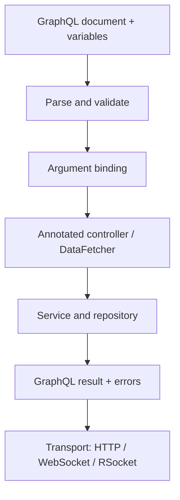

# Test không cần live server

Kiểm thử GraphQL không nhất thiết phải khởi động HTTP server hoặc mở cổng mạng. Nhiều lỗi quan trọng nằm ở schema, argument binding, controller mapping, runtime wiring, DataFetcher, error resolver và cách GraphQL engine tạo response. Có thể kiểm tra các thành phần đó trực tiếp trong Spring test context.

Spring for GraphQL cung cấp `GraphQlTester` với cùng một workflow kiểm thử nhưng nhiều cách kết nối khác nhau. Khi không cần kiểm thử giao thức HTTP thực tế, có thể dùng `ExecutionGraphQlServiceTester` để gọi trực tiếp GraphQL execution service. Khi cần xác minh interceptor chain và web request metadata, dùng `WebGraphQlTester`. Nếu muốn kiểm tra cả HTTP handler và route mà không mở socket, dùng `WebTestClient` bind vào application context.

Spring Boot bổ sung `@GraphQlTest` để tạo test slice tập trung vào GraphQL request execution, không tải toàn bộ ứng dụng và không khởi động web server. Bài học này giúp chọn đúng phạm vi test, viết GraphQL assertions, kiểm tra lỗi, context, mutation, subscription và xử lý các giới hạn của test không live server.

## 1. Vì sao nên test không cần live server?

Một GraphQL request đi qua nhiều lớp:



Không phải test nào cũng cần chạy qua toàn bộ đường đi:

- Khi kiểm tra schema, resolver mapping và GraphQL response, test trực tiếp execution service là đủ.
- Khi kiểm tra `WebGraphQlInterceptor`, request headers và GraphQLContext, cần đi qua `WebGraphQlHandler`.
- Khi kiểm tra URL, HTTP method, content type, JSON codec và security web filter, cần kiểm thử web layer; có thể dùng mock/in-process web client mà không cần live server.
- Khi kiểm tra socket, TLS, reverse proxy, load balancer hoặc behavior của server đang chạy trên port thật, mới cần live server.

Test không live server thường nhanh, ổn định và ít phụ thuộc môi trường. Chúng phù hợp để chạy thường xuyên trong unit test và CI.

## 2. Các mức kiểm thử không cần live server

Spring for GraphQL có hai tester phía server và một lựa chọn kiểm thử HTTP trong mock environment:

| Cách test | Đường đi của request | Thành phần được kiểm tra |
| --- | --- | --- |
| `ExecutionGraphQlServiceTester` | Trực tiếp vào `ExecutionGraphQlService` | GraphQL engine, schema, DataFetcher, controller mapping và execution errors |
| `WebGraphQlTester` | Qua `WebGraphQlHandler` và interceptor chain | Execution service, `WebGraphQlInterceptor`, request headers và GraphQLContext |
| `HttpGraphQlTester` + mock `WebTestClient` | Qua HTTP handler/route trong application context | HTTP mapping, request/response codecs và web filters trong mock environment |
| `@GraphQlTest` | GraphQL test slice, không có web layer | Controller, schema, runtime wiring và GraphQL execution với collaborator được mock |

Ba lựa chọn đầu không cần embedded server lắng nghe port. Tuy vậy, phạm vi của chúng khác nhau. `ExecutionGraphQlServiceTester` bỏ qua web layer; `WebGraphQlTester` có web GraphQL interceptor nhưng không chạy HTTP codec/route; mock `HttpGraphQlTester` kiểm tra thêm HTTP integration.

### Khi nào chọn từng loại?

- Chọn `@GraphQlTest` cho controller slice test thường ngày.
- Chọn `ExecutionGraphQlServiceTester` khi đã có `ExecutionGraphQlService` và muốn kiểm tra trực tiếp execution.
- Chọn `WebGraphQlTester` khi logic nằm trong interceptor hoặc phụ thuộc HTTP headers được chuyển vào GraphQLContext.
- Chọn `HttpGraphQlTester` khi cần xác minh GraphQL HTTP endpoint trong mock web environment.
- Chọn `@SpringBootTest(webEnvironment = MOCK)` khi cần nhiều cấu hình ứng dụng nhưng vẫn không muốn mở live server.

Không dùng test không live server để kết luận TLS, TCP connection, proxy timeout hoặc WebSocket handshake ngoài môi trường thực.

## 3. Thêm dependency kiểm thử

Spring for GraphQL cung cấp module test riêng:

```kotlin
dependencies {
    testImplementation("org.springframework.graphql:spring-graphql-test")
    testImplementation("org.springframework.boot:spring-boot-starter-test")
}
```

Hoặc Maven:

```xml
<dependency>
    <groupId>org.springframework.graphql</groupId>
    <artifactId>spring-graphql-test</artifactId>
    <scope>test</scope>
</dependency>

<dependency>
    <groupId>org.springframework.boot</groupId>
    <artifactId>spring-boot-starter-test</artifactId>
    <scope>test</scope>
</dependency>
```

Để test WebFlux mock HTTP, cần thêm `spring-boot-starter-webflux` hoặc Spring WebFlux test dependencies nếu ứng dụng chưa có. Đối với Spring MVC, dùng MockMvc integration tương ứng.

Để tránh lệch version, nên để Spring Boot dependency management hoặc version catalog quản lý phiên bản Spring for GraphQL. Không tùy tiện trộn `spring-graphql-test` version khác với `spring-graphql`.

`spring-graphql-test` cung cấp `GraphQlTester` và các tester phía server. Với Spring Boot 3, `@GraphQlTest` thường đến từ test auto-configuration được kéo vào qua Boot test dependencies. Với Spring Boot 4, annotation được tách trong module `spring-boot-graphql-test`; thêm module này nếu dùng test slice. Kiểm tra dependency tree của major version đang chạy để biết module nào cung cấp annotation.

Với Spring Boot 4, dependency test slice có thể khai báo riêng:

```kotlin
dependencies {
    testImplementation("org.springframework.boot:spring-boot-graphql-test")
}
```

Artifact trên dành cho test annotation/auto-configuration của Boot; `spring-graphql-test` vẫn là module cung cấp GraphQlTester của Spring for GraphQL.

## 4. Dùng ExecutionGraphQlServiceTester

`ExecutionGraphQlServiceTester` thực thi GraphQL request trực tiếp trên `ExecutionGraphQlService`. Nó không cần HTTP client, WebSocket client hoặc transport server.

Nếu Spring context đã cung cấp execution service, có thể tạo tester như sau:

```java
@SpringBootTest(webEnvironment = SpringBootTest.WebEnvironment.NONE)
class BookExecutionTests {

    @Autowired
    ExecutionGraphQlService graphQlService;

    GraphQlTester graphQlTester;

    @BeforeEach
    void setUp() {
        graphQlTester = ExecutionGraphQlServiceTester.create(graphQlService);
    }
}
```

`WebEnvironment.NONE` tạo application context không có web environment. Nếu test cần Boot web-related GraphQL handler thì dùng một trong các lựa chọn có mock web environment ở phần sau.

Có thể tạo tester một lần nếu test class không thay đổi cấu hình execution:

```java
ExecutionGraphQlServiceTester tester =
        ExecutionGraphQlServiceTester.create(graphQlService);
```

Builder cho phép tùy chỉnh `ExecutionInput` trước khi GraphQL engine thực thi:

```java
ExecutionGraphQlServiceTester tester =
        ExecutionGraphQlServiceTester.builder(graphQlService)
                .configureExecutionInput((input, builder) ->
                        builder.graphQLContext(context ->
                                context.put("tenantId", "tenant-42"))
                                .build())
                .build();
```

Điều này hữu ích khi resolver đọc tenant, principal, locale hoặc metadata từ GraphQLContext. Mỗi tester có thể dùng cấu hình riêng cho test case mà không cần gửi HTTP header.

## 5. Viết assertion bằng GraphQlTester

Các tester dùng chung API `GraphQlTester`. Một test có thể gửi document trực tiếp:

```java
graphQlTester.document("""
        query BookById($id: ID!) {
            bookById(id: $id) {
                id
                title
            }
        }
        """)
        .variable("id", "book-1")
        .execute()
        .path("bookById.id")
        .entity(String.class)
        .isEqualTo("book-1");
```

`path(...)` dùng JsonPath tương đối với phần `data` của GraphQL response. Vì vậy không cần viết `data.bookById.id`. Sau khi chọn path:

- `entity(Class<T>)` giải mã một giá trị thành kiểu Java.
- `entityList(Class<T>)` giải mã danh sách.
- `path(...)` có thể gọi tiếp để kiểm tra field lồng nhau.
- Có thể dùng assertion trên entity hoặc list để kiểm tra cấu trúc response theo nhu cầu.

Ví dụ kiểm tra nhiều field trong cùng object:

```java
graphQlTester.document("""
        query {
            bookById(id: "book-1") {
                id
                title
                status
            }
        }
        """)
        .execute()
        .path("bookById", book -> book
                .path("id").entity(String.class).isEqualTo("book-1")
                .path("title").entity(String.class).isEqualTo("Spring GraphQL")
                .path("status").entity(String.class).isEqualTo("AVAILABLE"));
```

Với Mutation chỉ cần xác nhận không có GraphQL errors, dùng `executeAndVerify()`:

```java
graphQlTester.document("""
        mutation {
            deleteBook(id: "book-1")
        }
        """)
        .executeAndVerify();
```

`executeAndVerify()` phù hợp khi không cần đọc response data. Nếu cần kiểm tra giá trị mutation trả về, dùng `execute()` rồi assert path như Query.

## 6. Kiểm tra GraphQL errors

GraphQL có thể trả đồng thời partial data và errors. Test cần xác nhận lỗi mong đợi thay vì chỉ kiểm tra HTTP status.

Kiểm tra một error cụ thể:

```java
graphQlTester.document("""
        query {
            bookById(id: "missing") {
                id
            }
        }
        """)
        .execute()
        .errors()
        .expect(error -> error.getMessage().contains("Book not found"))
        .verify();
```

`expect(...)` thất bại nếu không tìm thấy error phù hợp. Có thể kiểm tra nhiều thuộc tính như message, path hoặc extensions:

```java
graphQlTester.document(document)
        .execute()
        .errors()
        .expect(error -> error.getPath().equals(List.of("bookById")))
        .expect(error -> "NOT_FOUND".equals(
                error.getExtensions().get("code")))
        .verify();
```

Nếu test chủ đích xác nhận lỗi và vẫn cần đọc partial data, `satisfy(...)` nhận toàn bộ danh sách lỗi và đánh dấu chúng đã được xử lý:

```java
graphQlTester.document(document)
        .execute()
        .errors()
        .satisfy(errors -> assertThat(errors)
                .anyMatch(error -> error.getMessage().contains("Book not found")));
```

Chỉ lọc error đã biết và mong đợi. Không đặt error filter quá rộng để mọi lỗi đều bị bỏ qua; điều đó khiến test pass dù resolver hoặc schema đang lỗi.

Builder cũng hỗ trợ `errorFilter` dùng chung cho các test:

```java
GraphQlTester tester = ExecutionGraphQlServiceTester.builder(graphQlService)
        .errorFilter(error -> error.getMessage().contains("expected warning"))
        .build();
```

Khi test cần xác nhận không có error, gọi `verify()` hoặc `executeAndVerify()` thay vì chỉ đọc data path. Một test chỉ assert data có thể bỏ sót error trong response.

## 7. Tạo GraphQL slice test bằng @GraphQlTest

Với Spring Boot, `@GraphQlTest` tạo application context giới hạn cho GraphQL request execution:

```java
import static org.mockito.BDDMockito.given;
import static org.mockito.BDDMockito.then;

@GraphQlTest(BookController.class)
class BookControllerGraphQlTests {

    @Autowired
    GraphQlTester graphQlTester;

    @MockitoBean
    BookService bookService;

    @Test
    void returnsBookById() {
        given(bookService.findById("book-1"))
                .willReturn(new Book("book-1", "Spring GraphQL"));

        graphQlTester.document("""
                query {
                    bookById(id: "book-1") {
                        id
                        title
                    }
                }
                """)
                .execute()
                .path("bookById.id")
                .entity(String.class)
                .isEqualTo("book-1");

        then(bookService).should().findById("book-1");
    }
}
```

`@GraphQlTest(BookController.class)` nạp GraphQL infrastructure và controller được chỉ định, nhưng không khởi động web server và không tạo HTTP transport. Spring Boot auto-configure `GraphQlTester` để test gửi operation trực tiếp vào GraphQL execution.

### Những bean được scan trong test slice

`@GraphQlTest` tập trung vào thành phần liên quan GraphQL, thường bao gồm:

- `@Controller` và `@ControllerAdvice`.
- `RuntimeWiringConfigurer`.
- `Converter` và `GenericConverter`.
- `DataFetcherExceptionResolver`.
- `Instrumentation`.
- `GraphQlSourceBuilderCustomizer`.
- Các Jackson component được Spring Boot hỗ trợ.

Các `@Service` và `@Repository` thông thường không tự động được scan. Hãy mock collaborator bằng `@MockitoBean` hoặc import cấu hình cần thiết. Nếu test cần custom scalar, exception resolver hoặc DataFetcher config, kiểm tra bean đó đã có trong test context.

Với Spring Boot cũ chưa có `@MockitoBean`, có thể dùng `@MockBean` theo phiên bản đang sử dụng. Tên package của `@GraphQlTest` và module test cũng có thể thay đổi giữa các major version Boot; dùng import được quản lý bởi dependency hiện tại.

Ví dụ package phổ biến:

- Spring Boot 3.x: `org.springframework.boot.test.autoconfigure.graphql.GraphQlTest`.
- Spring Boot 4.x: `org.springframework.boot.graphql.test.autoconfigure.GraphQlTest`.

Danh sách component được scan cũng thay đổi theo phiên bản. Chẳng hạn tài liệu Boot 4 liệt kê `@ControllerAdvice` và `@JacksonComponent`, trong khi các bản Boot 3 cũ có danh sách ngắn hơn. Khi test không tìm thấy bean, đối chiếu Javadoc của đúng phiên bản thay vì giả định mọi bản Boot có cùng slice filters.

### Kiểm tra @BatchMapping và DataLoader

Test không live server vẫn có thể xác minh nested field được batch:

1. Gửi một query lấy nhiều parent object cùng child field, ví dụ danh sách sách và tác giả của từng sách.
2. Cho batch loader trả dữ liệu cho toàn bộ parent key trong cùng một execution.
3. Assert response giữ đúng quan hệ giữa từng sách và tác giả.
4. Verify batch loader nhận tập hợp key cần thiết trong một lần dispatch, thay vì gọi service riêng cho từng parent.

DataLoader registry được tạo theo GraphQL execution, vì vậy `ExecutionGraphQlServiceTester` và `@GraphQlTest` có thể kiểm tra batch mapping cùng request lifecycle mà không cần HTTP transport. Chỉ cần import `RuntimeWiringConfigurer` hoặc cấu hình loader tương ứng vào test context.

### Import thêm cấu hình

Nếu cần một converter, runtime wiring config hoặc exception resolver:

```java
@GraphQlTest(BookController.class)
@Import(BookGraphQlTestConfiguration.class)
class BookControllerGraphQlTests {
    // ...
}
```

Có thể dùng nested `@TestConfiguration` để khai báo bean chỉ dành cho test. Tránh import toàn bộ application configuration nếu mục tiêu là giữ test slice nhỏ và dễ hiểu.

## 8. Kiểm tra document từ file và fragment

Document dài nên được lưu thành file riêng trong classpath:

```text
src/test/resources/graphql-test/bookById.graphql
```

Nội dung:

```graphql
query BookById($id: ID!) {
  bookById(id: $id) {
    id
    title
  }
}
```

Gọi document bằng tên file, không cần phần mở rộng:

```java
graphQlTester.documentName("bookById")
        .variable("id", "book-1")
        .execute()
        .path("bookById.title")
        .entity(String.class)
        .isEqualTo("Spring GraphQL");
```

Có thể lưu fragment riêng và thêm vào operation bằng `fragmentName(...)`. Cách này giúp tái sử dụng selection set và giữ test document gần với query mà client thực tế gửi.

Khi document thay đổi, test vẫn kiểm tra cùng một file GraphQL. IDE có plugin GraphQL có thể cung cấp syntax highlighting, validation và autocomplete cho các file này.

## 9. Dùng WebGraphQlTester để kiểm tra interceptor

`ExecutionGraphQlServiceTester` gọi thẳng execution service, vì vậy nó không chạy `WebGraphQlInterceptor`. Nếu resolver phụ thuộc header hoặc metadata do interceptor chuyển vào GraphQLContext, hãy dùng `WebGraphQlTester`.

Tạo handler bằng execution service và interceptor:

```java
WebGraphQlHandler handler = WebGraphQlHandler.builder(graphQlService)
        .interceptor(tenantHeaderInterceptor)
        .build();

WebGraphQlTester tester = WebGraphQlTester.builder(handler)
        .headers(headers -> headers.set("X-Tenant-Id", "tenant-42"))
        .build();
```

Ví dụ interceptor:

```java
public class TenantHeaderInterceptor implements WebGraphQlInterceptor {

    @Override
    public Mono<WebGraphQlResponse> intercept(
            WebGraphQlRequest request,
            Chain chain) {

        String tenantId = request.getHeaders().getFirst("X-Tenant-Id");
        request.configureExecutionInput((input, builder) ->
                builder.graphQLContext(context ->
                        context.put("tenantId", tenantId)).build());
        return chain.next(request);
    }
}
```

Controller có thể đọc giá trị đã được đưa vào context:

```java
@QueryMapping
public List<Book> books(@ContextValue("tenantId") String tenantId) {
    return bookService.findVisibleBooks(tenantId);
}
```

Test:

```java
tester.document("{ books { id } }")
        .execute()
        .path("books[*].id")
        .entityList(String.class)
        .hasSize(1);
```

Như vậy test xác minh được cả ba phần: header có mặt trong request giả lập, interceptor đọc header và đưa tenant vào GraphQLContext, resolver nhận đúng context value.

`WebGraphQlTester` kiểm tra web GraphQL handling, không kiểm tra HTTP route hoặc JSON codec. Nếu cần xác minh `POST /graphql`, content type, route mapping hoặc web filter, dùng mock HTTP tester ở phần tiếp theo.

## 10. Kiểm thử HTTP handler mà không mở port

Có thể kiểm thử GraphQL HTTP endpoint trong application context bằng `WebTestClient.bindToApplicationContext(...)`. Đây là mock/in-process web client, không mở socket và không cần embedded server.

Ví dụ với WebFlux:

```java
@SpringBootTest(webEnvironment = SpringBootTest.WebEnvironment.MOCK)
class GraphQlHttpMockTests {

    @Autowired
    ApplicationContext applicationContext;

    HttpGraphQlTester graphQlTester;

    @BeforeEach
    void setUp() {
        WebTestClient webTestClient =
                WebTestClient.bindToApplicationContext(applicationContext)
                        .configureClient()
                        .baseUrl("/graphql")
                        .build();

        graphQlTester = HttpGraphQlTester.create(webTestClient);
    }

    @Test
    void handlesHttpGraphQlRequest() {
        graphQlTester.document("{ greeting }")
                .execute()
                .path("greeting")
                .entity(String.class)
                .isEqualTo("Hello");
    }
}
```

Ví dụ giả định ứng dụng có GraphQL HTTP endpoint tại `/graphql` và field `Query.greeting` trả về `Hello`. `WebEnvironment.MOCK` không khởi động embedded server. `WebTestClient.bindToApplicationContext` gắn client vào web infrastructure trong context.

Với Spring MVC, có thể dùng `MockMvcWebTestClient.bindToApplicationContext(applicationContext)` để tạo `WebTestClient` dựa trên MockMvc. Sau đó vẫn dùng `HttpGraphQlTester.create(webTestClient)` và cùng GraphQlTester DSL.

### Phạm vi của mock HTTP test

Mock HTTP test có thể kiểm tra:

- Route và URL GraphQL endpoint.
- HTTP method, headers và content type.
- Request/response JSON mapping.
- Web filter hoặc security configuration được gắn vào mock web context.
- Tích hợp giữa HTTP handler, WebGraphQlHandler và GraphQL execution.

Nó không kiểm tra socket thật, TLS handshake, network latency, proxy buffering hoặc hành vi của load balancer. Nếu cần các thuộc tính đó, phải có test với server thực.

## 11. Kiểm thử Subscription không cần WebSocket server

Subscription có thể được kiểm tra trực tiếp ở server-side bằng `ExecutionGraphQlServiceTester` hoặc `WebGraphQlTester`. Không cần tạo WebSocket client hoặc mở port.

Ví dụ:

```java
Flux<String> greetings = graphQlTester.document("""
        subscription {
            greetings
        }
        """)
        .executeSubscription()
        .toFlux("greetings", String.class);

StepVerifier.create(greetings)
        .expectNext("Hi")
        .expectNext("Bonjour")
        .expectNext("Hola")
        .verifyComplete();
```

`executeSubscription()` trả về workflow cho stream response. `toFlux(path, type)` giải mã field trong từng response event. `StepVerifier` xác nhận thứ tự event và tín hiệu hoàn tất.

Có thể kiểm tra cancellation:

```java
StepVerifier.create(graphQlTester.document("subscription { greetings }")
                .executeSubscription()
                .toFlux("greetings", String.class))
        .expectNext("Hi")
        .thenCancel()
        .verify(Duration.ofSeconds(5));
```

Lưu ý:

- `ExecutionGraphQlServiceTester` kiểm tra Subscription execution mà không qua web interceptor.
- `WebGraphQlTester` kiểm tra Subscription execution sau web interceptor chain.
- `WebSocketGraphQlTester` kiểm tra GraphQL qua WebSocket connection thực; đây không phải lựa chọn server-side không live server.
- `HttpGraphQlTester` qua HTTP request/response một lần không thay thế test Subscription stream.

Nếu mục tiêu là kiểm tra GraphQL publisher và thứ tự event, dùng server-side tester. Nếu mục tiêu là handshake, WebSocket protocol, reconnect hoặc connection lifecycle, cần test transport riêng.

## 12. Tùy chỉnh timeout và document source

Một GraphQL test không nên chờ vô hạn nếu resolver bị treo hoặc publisher không phát tín hiệu. `GraphQlTester.Builder` cho phép cấu hình response timeout:

```java
ExecutionGraphQlServiceTester tester =
        ExecutionGraphQlServiceTester.builder(graphQlService)
                .responseTimeout(Duration.ofSeconds(5))
                .build();
```

Để dùng GraphQL document từ classpath, cấu hình `DocumentSource`:

```java
ResourceDocumentSource documentSource =
        new ResourceDocumentSource(
                new ClassPathResource("graphql-test/"));

ExecutionGraphQlServiceTester tester =
        ExecutionGraphQlServiceTester.builder(graphQlService)
                .documentSource(documentSource)
                .responseTimeout(Duration.ofSeconds(5))
                .build();
```

Sau đó gọi `documentName("bookById")` để load `bookById.graphql`. Có thể lưu fragment riêng và thêm bằng `fragmentName("bookFields")`.

Timeout của tester giới hạn thời gian chờ response. Với Subscription stream không hoàn tất tự nhiên, dùng `StepVerifier` với timeout hoặc cancel rõ ràng để test không bị treo.

## 13. Phân biệt rõ phạm vi từng tester

Mỗi tester bỏ qua hoặc thêm một số lớp trong kiến trúc. Chọn sai loại test có thể khiến test pass nhưng thành phần cần kiểm tra chưa từng chạy:

| Thành phần | ExecutionGraphQlServiceTester | WebGraphQlTester | HttpGraphQlTester mock |
| --- | --- | --- | --- |
| GraphQL parse/validation | Có | Có | Có |
| Schema và runtime wiring | Có | Có | Có |
| Controller/DataFetcher | Có | Có | Có |
| `WebGraphQlInterceptor` | Không | Có | Có |
| HTTP route và method | Không | Không | Có |
| JSON HTTP codec | Không | Không | Có |
| WebFlux/Servlet security filter | Không | Không | Có, nếu filter nằm trong mock web context |
| WebSocket handshake/protocol | Không | Không | Không |
| Subscription execution stream | Có | Có | Không qua HTTP request/response thông thường |
| Network socket/TLS/proxy | Không | Không | Không |

### Lưu ý với Spring Security

`WebGraphQlTester` gọi `WebGraphQlHandler` trực tiếp. Nó chạy `WebGraphQlInterceptor` nhưng không tự chạy toàn bộ Spring Security WebFilter chain hoặc Servlet Filter chain. Nếu ứng dụng lấy principal từ security filter, hãy kiểm tra filter bằng mock HTTP test hoặc kiểm thử riêng security configuration.

Không nhầm việc thêm header Authorization vào `WebGraphQlTester` với việc token đã được xác thực. Header chỉ là dữ liệu request; authentication chỉ có khi security infrastructure hoặc interceptor của ứng dụng thực sự xác minh nó.

## 14. Lỗi thường gặp

| Biểu hiện | Nguyên nhân | Cách xử lý |
| --- | --- | --- |
| Không inject được `GraphQlTester` | Thiếu `spring-graphql-test` hoặc chưa bật test auto-configuration | Thêm test dependency và dùng `@GraphQlTest` hoặc cấu hình tester |
| Controller không được tìm thấy | Controller không thuộc test slice hoặc khai báo sai schema mapping | Chỉ định controller trong `@GraphQlTest` và kiểm tra schema |
| Service bean không có trong context | `@GraphQlTest` không scan service/repository thông thường | Dùng `@MockitoBean` hoặc `@Import` |
| Custom scalar không hoạt động | `RuntimeWiringConfigurer` hoặc converter chưa được nạp | Import cấu hình scalar/runtime wiring |
| Interceptor không chạy | Dùng `ExecutionGraphQlServiceTester` trực tiếp | Chuyển sang `WebGraphQlTester` |
| HTTP route không được kiểm tra | Dùng `ExecutionGraphQlServiceTester` hoặc `WebGraphQlTester` | Dùng `HttpGraphQlTester` với mock `WebTestClient` |
| Security filter không chạy | Tester gọi GraphQL handler trực tiếp | Dùng mock HTTP test gắn web filter chain |
| Assertion path không tìm thấy | Path tính từ root thay vì phần `data` hoặc field bị alias | Kiểm tra response và dùng path tương đối với data |
| Test vẫn pass khi có error | Chỉ assert data mà không verify errors | Dùng `errors().expect(...).verify()` hoặc `executeAndVerify()` |
| Expected error làm test fail | Chưa xác nhận/lọc lỗi có chủ đích | Dùng `errors().expect(...)` hoặc `satisfy(...)` |
| Subscription test treo | Stream không complete hoặc không cancel | Dùng `StepVerifier` với timeout và cancellation |
| Test phụ thuộc port đang chạy | Dùng `WebTestClient.bindToServer()` | Bind vào application context hoặc mock web context |
| Test suite chậm | Dùng full application context cho mọi controller case | Dùng `@GraphQlTest` cho test slice, giữ full context test cho số ít integration case |

## 15. Nguyên tắc thiết kế test không live server

- Test service/domain độc lập bằng unit test thông thường, không cần khởi tạo GraphQL.
- Dùng `@GraphQlTest` để kiểm tra annotated controller và GraphQL schema trong test slice.
- Dùng `ExecutionGraphQlServiceTester` khi cần kiểm tra GraphQL execution trực tiếp.
- Dùng `WebGraphQlTester` khi cần kiểm tra interceptor và metadata của web request.
- Dùng `HttpGraphQlTester` với mock `WebTestClient` khi cần kiểm tra HTTP handler/route mà không mở port.
- Dùng `GraphQlTester` DSL chung để kiểm tra data, nested path và errors.
- Dùng `documentName` và fragment cho operation dài hoặc dùng lại.
- Kiểm tra cả response data lẫn errors; không bỏ qua lỗi không mong đợi.
- Dùng `StepVerifier` cho Subscription stream, cancellation và completion.
- Đặt response timeout để tránh test treo.
- Mock service boundary để test controller không phụ thuộc database hoặc dịch vụ ngoài.
- Import rõ custom scalar, converter, exception resolver và runtime wiring cần cho test.
- Không kết luận về socket, TLS, proxy hoặc WebSocket handshake từ test không live server.
- Bổ sung một số integration test với server thật ở nơi cần xác minh transport/network behavior.

## 16. Bài tập thực hành

Xây dựng bộ test cho GraphQL API thư viện:

1. Thêm dependency `spring-graphql-test`.
2. Viết `BookController` với Query `bookById` và Mutation `createBook`.
3. Dùng `@GraphQlTest(BookController.class)` và mock `BookService`.
4. Gửi query bằng `GraphQlTester.document(...)` và kiểm tra nested response path.
5. Kiểm tra mutation không có lỗi bằng `executeAndVerify()`.
6. Làm service phát sinh `BookNotFoundException` và xác nhận GraphQL error path cùng error code.
7. Tạo `ExecutionGraphQlServiceTester` và kiểm tra execution context chứa tenant ID.
8. Tạo `WebGraphQlHandler` có `WebGraphQlInterceptor`, gửi header giả lập bằng `WebGraphQlTester` và xác nhận resolver nhận tenant.
9. Tạo mock `WebTestClient` bind vào application context và kiểm tra HTTP POST `/graphql`.
10. Viết Subscription trả ba greeting event, xác nhận thứ tự bằng `StepVerifier`.
11. Kiểm tra cancellation và timeout của Subscription.
12. Giải thích thành phần nào không được chạy trong mỗi loại tester.

Sau bài tập, bạn cần biết kiểm thử GraphQL execution mà không cần live server, chọn đúng tester theo lớp cần xác minh và nhận ra khi nào cần chuyển sang transport integration test.

## 17. Tài liệu tham khảo

- [Spring for GraphQL — Testing](https://docs.spring.io/spring-graphql/reference/testing.html)
- [Spring Boot — Testing Spring Boot Applications](https://docs.spring.io/spring-boot/reference/testing/spring-boot-applications.html)
- [Spring for GraphQL — ExecutionGraphQlServiceTester API](https://docs.spring.io/spring-graphql/docs/current/api/org/springframework/graphql/test/tester/ExecutionGraphQlServiceTester.html)
- [Spring for GraphQL — WebGraphQlTester API](https://docs.spring.io/spring-graphql/docs/current/api/org/springframework/graphql/test/tester/WebGraphQlTester.html)
- [Spring for GraphQL — GraphQlTester API](https://docs.spring.io/spring-graphql/docs/current/api/org/springframework/graphql/test/tester/GraphQlTester.html)
- [Spring Boot 3 — GraphQlTest API](https://docs.spring.io/spring-boot/3.4/api/java/org/springframework/boot/test/autoconfigure/graphql/GraphQlTest.html)
- [Spring Boot 4 — GraphQlTest API](https://docs.spring.io/spring-boot/4.2/api/java/org/springframework/boot/graphql/test/autoconfigure/GraphQlTest.html)
- [Project Reactor — StepVerifier](https://projectreactor.io/docs/test/release/api/reactor/test/StepVerifier.html)

Các package của `@GraphQlTest` và module test có thể thay đổi theo major version Spring Boot. Hãy dùng annotation, starter và Javadoc khớp với dependency được dự án quản lý.
