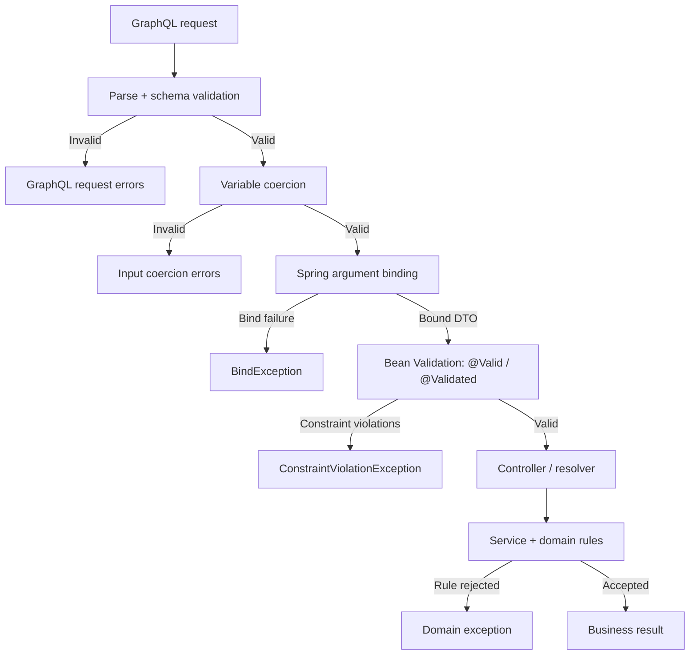

# Test validation trong Spring for GraphQL

Kiểm thử validation của GraphQL cần xác minh dữ liệu sai bị chặn ở đúng giai đoạn, lỗi trả về đúng hợp đồng API và nghiệp vụ không chạy khi request chưa hợp lệ. Một test chỉ kiểm tra `errors` xuất hiện là chưa đủ: lỗi có thể đến từ schema, coercion, argument binding, Bean Validation hoặc service/domain rule, và mỗi nhóm có thời điểm thực thi khác nhau.

Với Spring for GraphQL, có thể dùng `GraphQlTester` để gửi operation giống client thật rồi kiểm tra `data`, `errors`, error code và path. Kết hợp tester với mock service hoặc repository để chứng minh resolver không được gọi khi GraphQL document hoặc input không hợp lệ.

## Các tầng validation cần kiểm thử

Một input đi qua nhiều tầng trước khi được xử lý:

1. **Parse và schema validation:** GraphQL kiểm tra cú pháp, field, argument và kiểu theo SDL.
2. **Variable coercion:** GraphQL chuyển variables thành kiểu khai báo; sai kiểu hoặc thiếu biến Non-Null sẽ bị từ chối trước khi gọi resolver.
3. **Argument binding:** Spring for GraphQL bind argument vào tham số Java/DTO. Cấu trúc không bind được có thể tạo `BindException`.
4. **Bean Validation:** `@Valid` hoặc `@Validated` kích hoạt constraint trên DTO và object lồng nhau. Vi phạm tạo `ConstraintViolationException` trong annotated controller.
5. **Domain/service validation:** kiểm tra quy tắc cần trạng thái hệ thống, database hoặc ngữ cảnh nghiệp vụ, ví dụ ISBN đã tồn tại hay người dùng có quyền sửa bản ghi.



Các tầng này không thay thế nhau. SDL bảo vệ hình dạng và kiểu của API; Bean Validation kiểm tra dữ liệu đã bind; service/domain layer bảo vệ invariant phụ thuộc trạng thái hệ thống. Test nên có ít nhất một trường hợp đại diện cho mỗi tầng được ứng dụng sử dụng.

## Chuẩn bị schema và input DTO

Ví dụ API tạo sách:

```graphql
input CreateBookInput {
  title: String!
  isbn: String!
  authorId: ID!
}

type Book {
  id: ID!
  title: String!
  isbn: String!
}

type Query {
  health: Boolean
}

type Mutation {
  createBook(input: CreateBookInput!): Book!
}
```

Các SDL ở những mục sau minh họa những test fixture độc lập. Nếu đưa nhiều input type vào cùng một schema, chỉ khai báo `type Query`/`type Mutation` một lần rồi bổ sung field bằng `extend type Query` hoặc `extend type Mutation`.

SDL yêu cầu ba field trong input phải có giá trị khác `null`, nhưng `title: "   "` vẫn là một chuỗi hợp lệ theo GraphQL. Bean Validation bổ sung constraint:

```java
import jakarta.validation.constraints.NotBlank;
import jakarta.validation.constraints.Pattern;
import jakarta.validation.constraints.Size;

public record CreateBookInput(
        @NotBlank(message = "Tiêu đề không được để trống")
        @Size(max = 200, message = "Tiêu đề tối đa 200 ký tự")
        String title,

        @NotBlank(message = "ISBN không được để trống")
        @Pattern(
                regexp = "^[0-9Xx-]{10,17}$",
                message = "ISBN không đúng định dạng")
        String isbn,

        @NotBlank(message = "Phải chọn tác giả")
        String authorId) {
}
```

Annotated controller kích hoạt validation trước khi gọi handler:

```java
import jakarta.validation.Valid;
import org.springframework.graphql.data.method.annotation.Argument;
import org.springframework.graphql.data.method.annotation.MutationMapping;
import org.springframework.stereotype.Controller;

@Controller
public class BookMutationController {

    private final BookService bookService;

    public BookMutationController(BookService bookService) {
        this.bookService = bookService;
    }

    @MutationMapping
    public Book createBook(
            @Argument("input") @Valid CreateBookInput input) {
        return bookService.create(input);
    }
}
```

Trong Spring Boot, thêm `spring-boot-starter-validation` để có Bean Validation implementation. Spring for GraphQL dùng `Validator` bean trong `AnnotatedControllerConfigurer`; nếu test slice không tự nạp validator, import cấu hình cung cấp `LocalValidatorFactoryBean` vào test.

```java
import org.springframework.context.annotation.Bean;
import org.springframework.context.annotation.Configuration;
import org.springframework.validation.beanvalidation.LocalValidatorFactoryBean;

@Configuration(proxyBeanMethods = false)
public class ValidationConfiguration {

    @Bean
    LocalValidatorFactoryBean validator() {
        return new LocalValidatorFactoryBean();
    }
}
```

Với Spring Boot 3 trở lên, dùng `jakarta.validation.*`. Nếu dự án có auto-configuration validator, không cần tạo thêm bean thủ công; test phải sử dụng đúng cấu hình validation của ứng dụng để tránh kiểm tra một cấu hình khác production.

## Thiết lập GraphQlTester cho test slice

`@GraphQlTest` tạo test slice tập trung vào GraphQL controller và hạ tầng GraphQL. Có thể mock service để kiểm tra controller và xác nhận service không bị gọi khi validation thất bại.

Ví dụ dưới đây giả định schema nằm trong `src/main/resources/graphql/schema.graphqls`. Import validator và exception advice nếu test slice không tự nạp các bean đó:

```java
// Spring Boot 4.x:
import org.springframework.boot.graphql.test.autoconfigure.GraphQlTest;
// Spring Boot 3.x:
// import org.springframework.boot.test.autoconfigure.graphql.GraphQlTest;

import static org.mockito.ArgumentMatchers.any;
import static org.mockito.Mockito.times;
import static org.mockito.BDDMockito.given;
import static org.mockito.BDDMockito.then;
import static org.assertj.core.api.Assertions.assertThat;

import java.util.List;
import java.util.Map;
import org.junit.jupiter.api.Test;
import org.springframework.beans.factory.annotation.Autowired;
import org.springframework.context.annotation.Import;
import org.springframework.graphql.test.tester.GraphQlTester;
import org.springframework.test.context.bean.override.mockito.MockitoBean;

@GraphQlTest(BookMutationController.class)
@Import({ValidationConfiguration.class, GraphQlValidationExceptionHandler.class})
class BookValidationTests {

    @Autowired
    GraphQlTester graphQlTester;

    @MockitoBean
    BookService bookService;
}
```

Với Spring Boot/Spring Framework cũ, thay `@MockitoBean` bằng cơ chế mock bean tương ứng của phiên bản, thường là `@MockBean`. `@GraphQlTest` không tải toàn bộ service/repository; những collaborator cần thiết phải được mock hoặc import.

Trong các test bên dưới, giả sử `GraphQlValidationExceptionHandler` ánh xạ `ConstraintViolationException` thành GraphQL error có `extensions.code = "VALIDATION_ERROR"` và `BindException` thành `ARGUMENT_BINDING_ERROR`. Dùng mã lỗi ổn định giúp client và test không phụ thuộc vào nội dung message mặc định của framework.

Một exception advice tối giản có thể tạo response contract như sau:

```java
import graphql.GraphQLError;
import graphql.GraphqlErrorBuilder;
import jakarta.validation.ConstraintViolationException;
import java.util.List;
import java.util.Map;
import org.springframework.graphql.data.method.annotation.GraphQlExceptionHandler;
import org.springframework.graphql.execution.ErrorType;
import org.springframework.validation.BindException;
import org.springframework.web.bind.annotation.ControllerAdvice;

@ControllerAdvice
public class GraphQlValidationExceptionHandler {

    @GraphQlExceptionHandler
    public GraphQLError handle(
            GraphqlErrorBuilder<?> builder,
            ConstraintViolationException ex) {
        List<Map<String, String>> violations = ex.getConstraintViolations().stream()
                .map(violation -> Map.of(
                        "field", violation.getPropertyPath().toString(),
                        "message", violation.getMessage()))
                .toList();

        return builder
                .errorType(ErrorType.BAD_REQUEST)
                .message("Dữ liệu đầu vào không hợp lệ")
                .extensions(Map.of(
                        "code", "VALIDATION_ERROR",
                        "violations", violations))
                .build();
    }

    @GraphQlExceptionHandler
    public GraphQLError handle(
            GraphqlErrorBuilder<?> builder,
            BindException ex) {
        return builder
                .errorType(ErrorType.BAD_REQUEST)
                .message("Không thể đọc dữ liệu đầu vào")
                .extensions(Map.of("code", "ARGUMENT_BINDING_ERROR"))
                .build();
    }

    @GraphQlExceptionHandler
    public GraphQLError handle(
            GraphqlErrorBuilder<?> builder,
            DuplicateIsbnException ex) {
        return builder
                .errorType(ErrorType.BAD_REQUEST)
                .message("ISBN đã tồn tại")
                .extensions(Map.of("code", "DUPLICATE_ISBN"))
                .build();
    }
}
```

Đây là policy mẫu; production nên ánh xạ property path sang field name công khai và tránh trả chi tiết nội bộ của object binding.

## Test GraphQL schema validation

Schema validation xảy ra trước khi controller được gọi. Ví dụ client bỏ sót `isbn` trong input object, trong khi SDL khai báo `isbn: String!`:

```java
@Test
void rejectsMissingRequiredInputField() {
    graphQlTester.document("""
            mutation {
              createBook(input: {
                title: "Spring GraphQL",
                authorId: "author-10"
              }) {
                id
              }
            }
            """)
            .execute()
            .errors()
            .expect(error -> error.getMessage().contains("isbn"))
            .verify();

    then(bookService).shouldHaveNoInteractions();
}
```

GraphQL document không hợp lệ nên execution dừng trước khi resolver chạy. Kiểm tra `bookService` không có tương tác giúp xác nhận test đang bắt đúng ranh giới. Trong dự án thực tế, nên kiểm tra error classification hoặc message fragment ổn định theo phiên bản GraphQL Java đang dùng; tránh assert toàn bộ message nếu wording có thể thay đổi.

Có thể kiểm tra field hoặc argument không tồn tại theo cách tương tự. Các lỗi như sai tên field, sai kiểu argument, thiếu selection set cho object field hoặc gửi argument không được khai báo đều thuộc schema validation.

## Test variable coercion

Variable coercion kiểm tra giá trị JSON truyền vào có phù hợp với kiểu GraphQL hay không. Ví dụ `isbn` khai báo `String!` nhưng client truyền số:

```java
@Test
void rejectsVariableWithWrongScalarType() {
    Map<String, Object> input = Map.of(
            "title", "Spring GraphQL",
            "isbn", 1234567890,
            "authorId", "author-10");

    graphQlTester.document("""
            mutation CreateBook($input: CreateBookInput!) {
              createBook(input: $input) {
                id
              }
            }
            """)
            .variable("input", input)
            .execute()
            .errors()
            .expect(error -> error.getMessage().contains("String"))
            .verify();

    then(bookService).shouldHaveNoInteractions();
}
```

Đây là lỗi coercion của GraphQL, không phải Bean Validation. Resolver chưa nhận DTO nên constraint `@Pattern` trên `isbn` chưa chạy. Test nên xác nhận lỗi xuất hiện ở giai đoạn input coercion và service không được gọi.

Các ca nên có trong nhóm test coercion:

- Thiếu variable được khai báo `ID!`, `String!` hoặc input object Non-Null.
- Truyền scalar sai kiểu, ví dụ number vào `String` hoặc object vào `Int`.
- Truyền enum value không tồn tại.
- Truyền list item sai kiểu.
- Truyền `null` cho variable hoặc field Non-Null.

Không dùng `Map.of(...)` khi cần kiểm tra giá trị null vì Java `Map.of` không cho phép null. Với ca đó, dùng map mutable hoặc một DTO/fixture hỗ trợ null.

## Test argument binding

Ngay cả khi GraphQL document và variables hợp lệ, Spring vẫn phải bind argument thành kiểu Java mà controller yêu cầu. Ví dụ input DTO có kiểu Java không tương thích hoặc cấu trúc nested không thể chuyển đổi có thể tạo `BindException`.

Khi ứng dụng có custom scalar, enum mapping hoặc DTO binding riêng, cần test các giá trị biên và cấu trúc lồng nhau qua GraphQlTester thay vì chỉ gọi constructor DTO trực tiếp.

Ví dụ SDL khai báo `id` là GraphQL `ID`, trong khi DTO Java yêu cầu `UUID`:

```graphql
input BookLookupInput {
  id: ID!
}

type Book {
  id: ID!
}

type Query {
  lookupBook(input: BookLookupInput!): Book
}
```

```java
import java.util.UUID;
import org.springframework.graphql.data.method.annotation.Argument;
import org.springframework.graphql.data.method.annotation.QueryMapping;

public record BookLookupInput(UUID id) {
}

@QueryMapping
public Book lookupBook(@Argument("input") BookLookupInput input) {
    return bookService.findById(input.id());
}
```

GraphQL `ID` chấp nhận chuỗi `not-a-uuid`, nhưng Spring không thể chuyển chuỗi đó thành `UUID`. Đây là tình huống binding phù hợp để kiểm tra `BindException`.

Ví dụ kiểm tra mã lỗi binding đã chuẩn hóa:

Đây là test slice riêng cho `BookLookupController`, cấu hình bằng `@GraphQlTest(BookLookupController.class)` và mock `BookService` như phần thiết lập ở trên.

```java
@Test
void reportsArgumentBindingFailureSeparately() {
    graphQlTester.document("""
            query LookupBook($input: BookLookupInput!) {
              lookupBook(input: $input) {
                id
              }
            }
            """)
            .variable("input", Map.of(
                    "id", "not-a-uuid"))
            .execute()
            .errors()
            .expect(error -> "ARGUMENT_BINDING_ERROR".equals(
                    error.getExtensions().get("code")))
            .verify();

    then(bookService).shouldHaveNoInteractions();
}
```

GraphQL đã chấp nhận giá trị vì `ID` là scalar hợp lệ; lỗi xảy ra khi binder chuyển giá trị sang `UUID`. Không cố tạo lỗi binding bằng một input mà GraphQL đã từ chối ở bước coercion.

## Test Bean Validation qua GraphQL

Bean Validation chạy sau khi input đã được coercion và bind. Dùng input có kiểu GraphQL hợp lệ nhưng vi phạm constraint Java, ví dụ `title` chỉ chứa khoảng trắng và ISBN sai pattern:

```java
@Test
void rejectsBlankTitleAndInvalidIsbn() {
    graphQlTester.document("""
            mutation CreateBook($input: CreateBookInput!) {
              createBook(input: $input) {
                id
              }
            }
            """)
            .variable("input", Map.of(
                    "title", "   ",
                    "isbn", "not-an-isbn",
                    "authorId", "author-10"))
            .execute()
            .errors()
            .expect(error -> "VALIDATION_ERROR".equals(
                    error.getExtensions().get("code")))
            .verify();

    then(bookService).shouldHaveNoInteractions();
}
```

`String!` chấp nhận chuỗi khoảng trắng và `String` chấp nhận `not-an-isbn`, vì vậy GraphQL coercion thành công. Sau đó `@Valid` kích hoạt `@NotBlank` và `@Pattern`; exception handler chuyển các vi phạm thành mã lỗi `VALIDATION_ERROR`.

Nếu cần xác nhận danh sách violation, đưa chúng vào `extensions.violations` với field path và message đã chuẩn hóa, rồi kiểm tra qua `ResponseError.getExtensions()`:

```java
graphQlTester.document(invalidCreateBookMutation)
        .variable("input", invalidInput)
        .execute()
        .errors()
        .satisfy(errors -> assertThat(errors).anySatisfy(error -> {
            assertThat(error.getExtensions().get("code"))
                    .isEqualTo("VALIDATION_ERROR");
            @SuppressWarnings("unchecked")
            List<Map<String, String>> violations =
                    (List<Map<String, String>>) error.getExtensions().get("violations");
            assertThat(violations)
                    .anySatisfy(violation -> {
                        assertThat(violation.get("field")).contains("title");
                        assertThat(violation.get("message")).contains("không được để trống");
                    });
        }));
```

Đoạn assertion trên giả định handler công bố `violations` theo cấu trúc map như ví dụ. Không nên buộc test vào property path nội bộ của Java nếu API đã ánh xạ chúng sang tên field GraphQL công khai.

## Xác minh controller và service không chạy

Khi lỗi phát sinh trước khi controller được gọi, service không được có tương tác. Đây là assertion quan trọng để ngăn side effect ngoài ý muốn:

```java
then(bookService).shouldHaveNoInteractions();
```

Có thể dùng `verifyNoInteractions(bookService)` từ Mockito. Nếu controller có gọi một service phụ để tạo context trước validation, hãy xác minh riêng method ghi dữ liệu không được gọi thay vì yêu cầu mock hoàn toàn không có interaction.

Với Mutation, test thêm một trường hợp hợp lệ để chứng minh service được gọi đúng một lần:

```java
@Test
void invokesServiceForValidInput() {
    Book saved = new Book("book-10", "Spring GraphQL", "9780132350884");
    given(bookService.create(any(CreateBookInput.class))).willReturn(saved);

    graphQlTester.document("""
            mutation CreateBook($input: CreateBookInput!) {
              createBook(input: $input) {
                id
                title
              }
            }
            """)
            .variable("input", Map.of(
                    "title", "Spring GraphQL",
                    "isbn", "9780132350884",
                    "authorId", "author-10"))
            .execute()
            .path("createBook.id")
            .entity(String.class)
            .isEqualTo("book-10");

    then(bookService).should(times(1)).create(any(CreateBookInput.class));
}
```

Test hợp lệ giúp phát hiện trường hợp cấu hình validation sai khiến mọi request đều bị từ chối hoặc controller không được đăng ký đúng với schema.

## Test nested validation

Khi input có object lồng nhau, constraint bên trong chỉ được kiểm tra khi cascade validation được kích hoạt bằng `@Valid` trên thuộc tính đó:

SDL tương ứng:

```graphql
input AddressInput {
  city: String!
  postalCode: String!
}

input ContactInput {
  type: String!
  value: String!
}

input PublisherInput {
  name: String!
  address: AddressInput!
  contacts: [ContactInput!]
}

type Publisher {
  id: ID!
}

type Query {
  publisher(id: ID!): Publisher
}

type Mutation {
  createPublisher(input: PublisherInput!): Publisher!
}
```

```java
import jakarta.validation.Valid;
import jakarta.validation.constraints.NotBlank;
import jakarta.validation.constraints.NotNull;
import jakarta.validation.constraints.Size;
import java.util.List;

public record AddressInput(
        @NotBlank String city,
        @NotBlank String postalCode) {
}

public record ContactInput(
        @NotBlank String type,
        @NotBlank String value) {
}

public record PublisherInput(
        @NotBlank String name,
        @NotNull @Valid AddressInput address,
        @Size(max = 5) List<@NotNull @Valid ContactInput> contacts) {
}
```

Test nên tạo một publisher có `address.city` hợp lệ nhưng `address.postalCode` rỗng, hoặc một contact con có `value` rỗng. Sau đó gửi mutation qua GraphQlTester và xác minh `VALIDATION_ERROR` cùng violation tương ứng.

Ví dụ document:

```graphql
mutation CreatePublisher($input: PublisherInput!) {
  createPublisher(input: $input) {
    id
  }
}
```

Variables cho ca nested validation:

```java
Map<String, Object> input = Map.of(
        "name", "Northwind Press",
        "address", Map.of("city", "Hanoi", "postalCode", " "),
        "contacts", List.of(Map.of("type", "email", "value", "editor@example.com")));
```

```java
graphQlTester.document(createPublisherMutation)
        .variable("input", input)
        .execute()
        .errors()
        .expect(error -> "VALIDATION_ERROR".equals(
                error.getExtensions().get("code")))
        .verify();

then(publisherService).shouldHaveNoInteractions();
```

Trong test của publisher, mock `PublisherService` và nạp controller tạo publisher tương ứng; tên biến ở đây minh họa cho collaborator của controller đó.

Kiểm tra nested validation giúp phát hiện lỗi thường gặp: DTO đã có constraint nhưng controller chỉ đánh dấu `@Valid` ở root, trong khi thuộc tính con chưa cascade bằng `@Valid`.

## Test validation groups

Khi cùng một DTO được dùng cho create và update, `@Validated(Group.class)` chọn bộ constraint cần chạy. Test nên xác minh cả hai nhánh, vì cấu hình group sai có thể khiến một thao tác vô tình bỏ qua constraint.

Ví dụ model:

```java
import jakarta.validation.constraints.NotBlank;
import jakarta.validation.constraints.NotNull;
import jakarta.validation.constraints.Null;
import jakarta.validation.groups.Default;

public interface Create extends Default {
}

public interface Update extends Default {
}

public record SaveBookInput(
        @Null(groups = Create.class)
        @NotNull(groups = Update.class)
        String id,
        @NotBlank String title) {
}
```

Controller:

```java
import org.springframework.graphql.data.method.annotation.Argument;
import org.springframework.graphql.data.method.annotation.MutationMapping;
import org.springframework.validation.annotation.Validated;

@MutationMapping
public Book createBook(
        @Argument("input") @Validated(Create.class) SaveBookInput input) {
    return bookService.create(input);
}

@MutationMapping
public Book updateBook(
        @Argument("input") @Validated(Update.class) SaveBookInput input) {
    return bookService.update(input);
}
```

Test create với `id` không null phải nhận `VALIDATION_ERROR`; test update thiếu `id` cũng phải nhận cùng mã lỗi. Test hợp lệ cho từng operation cần xác nhận service được gọi với đúng DTO/command.

Cho group `Create` và `Update` kế thừa `Default` để constraint không chỉ định group, như `@NotBlank`, vẫn chạy. Nếu không kế thừa hoặc không bao gồm `Default`, test có thể phát hiện các constraint mặc định bị bỏ qua.

## Test class-level và cross-field constraint

Quy tắc phụ thuộc nhiều field, chẳng hạn ngày bắt đầu phải trước ngày kết thúc, nên được test bằng custom class-level constraint. Nên có hai lớp test:

- Unit test validator với `jakarta.validation.Validator` để kiểm tra logic constraint nhanh.
- GraphQL test qua controller để xác nhận `@Valid` kích hoạt constraint và lỗi được ánh xạ thành GraphQL response đúng.

Ví dụ unit test:

```java
import static org.assertj.core.api.Assertions.assertThat;

import jakarta.validation.ConstraintViolation;
import jakarta.validation.Validation;
import jakarta.validation.ValidatorFactory;
import java.time.LocalDate;
import java.util.Set;
import org.junit.jupiter.api.Test;

@ValidDateRange
record BookingInput(LocalDate startDate, LocalDate endDate) {
}

class BookingInputValidationTests {

    @Test
    void rejectsEndDateBeforeStartDate() {
        BookingInput input = new BookingInput(
                LocalDate.of(2026, 5, 10),
                LocalDate.of(2026, 5, 1));

        try (ValidatorFactory factory = Validation.buildDefaultValidatorFactory()) {
            Set<ConstraintViolation<BookingInput>> violations =
                    factory.getValidator().validate(input);

            assertThat(violations)
                    .anySatisfy(violation -> assertThat(violation.getMessage())
                            .contains("ngày kết thúc phải sau ngày bắt đầu"));
        }
    }
}
```

Validator unit test không chứng minh controller GraphQL đã gắn `@Valid`; vì vậy vẫn cần ít nhất một test integration qua GraphQlTester với input vi phạm.

## Test domain validation cần database

Bean Validation không nên thay thế các quy tắc cần truy vấn database, ví dụ ISBN đã tồn tại. Quy tắc này nằm ở service/domain layer và thường được biểu diễn bằng exception nghiệp vụ:

```java
@Service
public class BookService {

    public Book create(CreateBookInput input) {
        if (repository.existsByIsbn(input.isbn())) {
            throw new DuplicateIsbnException(input.isbn());
        }
        return repository.save(Book.create(input));
    }
}
```

Test service có thể dùng repository mock hoặc database test để kiểm tra invariant. Test GraphQL cần xác minh exception được ánh xạ thành error code công khai, ví dụ `DUPLICATE_ISBN`, và không làm lộ dữ liệu nội bộ:

```java
@Test
void mapsDuplicateIsbnToConflictError() {
    given(bookService.create(any(CreateBookInput.class)))
            .willThrow(new DuplicateIsbnException("9780132350884"));

    graphQlTester.document("""
            mutation CreateBook($input: CreateBookInput!) {
              createBook(input: $input) {
                id
              }
            }
            """)
            .variable("input", Map.of(
                    "title", "Spring GraphQL",
                    "isbn", "9780132350884",
                    "authorId", "author-10"))
            .execute()
            .errors()
            .expect(error -> "DUPLICATE_ISBN".equals(
                    error.getExtensions().get("code")))
            .verify();
}
```

Đây là test mapping ở tầng GraphQL với service mock. Một test khác ở tầng service/repository cần xác minh truy vấn tồn tại và transaction/unique constraint hoạt động đúng. Không chỉ dựa vào `existsByIsbn` để bảo vệ uniqueness khi có concurrent requests; database unique constraint vẫn cần thiết để chống race condition.

## Kiểm tra custom scalar và enum input

Custom scalar có thể từ chối dữ liệu trong bước coercion trước khi argument binding hoặc Bean Validation chạy. Ví dụ scalar `Date` chỉ chấp nhận ISO date `yyyy-MM-dd`; test nên gửi cả giá trị hợp lệ và sai định dạng qua GraphQlTester.

Enum cũng cần test value hợp lệ và value không tồn tại. Với enum GraphQL, giá trị thường được truyền dưới dạng enum literal trong document hoặc string trong JSON variables theo quy tắc coercion. Sai enum value là lỗi GraphQL input, không phải lỗi `@Pattern` trên DTO.

Các ca cần có:

- Date hợp lệ và ngày sai định dạng.
- UUID hợp lệ và chuỗi không phải UUID.
- Decimal vượt precision/scale nếu scalar có giới hạn.
- Enum value hợp lệ và không được khai báo trong schema.

Nếu custom scalar có parser và serializer riêng, unit test scalar coercing để kiểm tra logic chi tiết; GraphQlTester integration test xác nhận scalar được đăng ký đúng trong runtime wiring và lỗi được trả về qua GraphQL.

## Kiểm tra error path và null propagation

GraphQL error có `path` chỉ ra field đã thất bại. Nếu Mutation trả về `Book!` nhưng field `createBook` phát sinh error, null propagation có thể làm `data.createBook` thành null hoặc làm root `data` thành null tùy cấu trúc Non-Null của schema.

Khi test validation, không mặc định mọi response phải có cùng hình dạng `data`. Nên assert error code và path theo contract, sau đó kiểm tra data nếu schema cho phép partial data:

```java
graphQlTester.document(invalidMutation)
        .execute()
        .errors()
        .expect(error -> "VALIDATION_ERROR".equals(
                error.getExtensions().get("code"))
                && error.getPath().contains("createBook"))
        .verify();
```

`ResponseError.getPath()` trong Spring GraphQL là biểu diễn path dạng chuỗi; nếu cần kiểm tra cấu trúc path, dùng `getParsedPath()`. Tránh assert `data` cụ thể nếu null propagation của schema khiến kết quả thay đổi khi field chuyển từ nullable sang Non-Null.

## Kiểm tra HTTP status và GraphQL errors

Với lỗi schema validation, coercion hoặc execution, GraphQL error thường nằm trong response body. HTTP status còn phụ thuộc media type và giai đoạn request theo GraphQL over HTTP. Vì vậy:

- Dùng `GraphQlTester` để assert GraphQL `errors`, `extensions` và `data`.
- Dùng `WebTestClient` hoặc `MockMvc` để assert HTTP status, headers và content type.
- Không biến mọi validation error thành HTTP 500; lỗi GraphQL thường là lỗi client/request và cần status phù hợp với media type/protocol.
- Test cả `application/graphql-response+json` và `application/json` nếu API hỗ trợ cả media type hiện hành lẫn legacy.

Đối với test slice `@GraphQlTest`, không có servlet filter hoặc HTTP transport thật. Muốn xác minh status và headers, thêm integration test với `HttpGraphQlTester` và `WebTestClient`/`MockMvcWebTestClient`.

## Ma trận test validation nên có

| Tầng | Input test | Assertion chính | Side effect mong đợi |
| --- | --- | --- | --- |
| Schema validation | Thiếu field `String!`, field không tồn tại. | Có GraphQL request error. | Controller/service không chạy. |
| Variable coercion | Number vào `String`, null vào `ID!`. | Có input coercion error. | Controller/service không chạy. |
| Argument binding | DTO/field không thể bind theo cấu trúc Java. | Error code binding đã chuẩn hóa. | Handler không xử lý nghiệp vụ. |
| Bean Validation | Blank, pattern sai, vượt size. | `VALIDATION_ERROR`, violation tương ứng. | Service ghi dữ liệu không chạy. |
| Nested validation | Field con hoặc phần tử list vi phạm. | Nested property violation. | Service không chạy. |
| Validation groups | Create có ID, update thiếu ID. | Nhánh group tương ứng bị từ chối. | Service chỉ chạy với input hợp lệ. |
| Domain validation | ISBN trùng, trạng thái không cho phép. | Error code nghiệp vụ ổn định. | Không có thay đổi dữ liệu ngoài ý muốn. |
| Custom scalar/enum | Date/UUID/enum sai. | Coercion error. | Resolver không chạy. |

## Lỗi thường gặp khi test validation

| Triệu chứng | Nguyên nhân | Cách xử lý |
| --- | --- | --- |
| `@NotBlank` không chạy | Thiếu Validator bean hoặc tham số chưa có `@Valid`/`@Validated`. | Kiểm tra starter validation, Validator bean và method parameter. |
| Test mong `ConstraintViolationException` nhưng nhận binding error | Input chưa bind được thành DTO. | Sửa fixture để GraphQL coercion và binding thành công trước khi vi phạm constraint. |
| Không xác định được service có bị gọi hay không | Chỉ assert message mà không theo dõi collaborator. | Dùng mock/spy và xác minh không có interaction. |
| Test schema validation gọi resolver | Document thực tế vẫn hợp lệ hoặc test đang dùng schema khác. | Kiểm tra schema được load trong test context và operation cố ý sai. |
| Constraint lồng nhau không chạy | Thiếu `@Valid` trên object con hoặc list element. | Đánh dấu cascade validation và test từng cấp. |
| Validation group bỏ qua `@NotBlank` | Group không bao gồm `Default`. | Cho group kế thừa `Default` hoặc khai báo constraint vào group. |
| Test phụ thuộc message quá cụ thể | Message thay đổi theo locale/framework version. | Assert error code, path và message fragment thuộc API contract. |
| Test GraphQL slice không có validator/advice | `@GraphQlTest` không nạp cấu hình cần thiết. | `@Import` validator và exception handler hoặc dùng integration context. |
| Test domain uniqueness vẫn pass khi có race | Chỉ kiểm tra `existsBy...`, chưa kiểm tra unique constraint database. | Test database constraint và xử lý lỗi duplicate khi insert. |

## Ghi nhớ

Test validation cần kiểm tra đúng tầng phát hiện lỗi. GraphQL schema validation và variable coercion xảy ra trước resolver; argument binding chuyển dữ liệu thành DTO; Bean Validation chạy khi annotated controller kích hoạt `@Valid` hoặc `@Validated`; domain validation chạy trong service khi cần database hoặc trạng thái nghiệp vụ.

Dùng `GraphQlTester` để gửi operation và assert error code/path, kết hợp mock service để xác minh không có side effect khi input sai. Kiểm thử cả input hợp lệ để bảo đảm handler vẫn chạy, nested object, validation groups, custom scalar và domain rules. Khi cần xác minh HTTP status hoặc filter chain, bổ sung transport integration test. Một bộ test tốt phân biệt rõ lỗi schema, coercion, binding, constraint và nghiệp vụ thay vì gom tất cả thành một loại validation error.

## Tài liệu tham khảo

- [Spring for GraphQL — Testing](https://docs.spring.io/spring-graphql/reference/testing.html)
- [Spring for GraphQL — Annotated Controllers: Validation](https://docs.spring.io/spring-graphql/reference/controllers.html#controllers.validation)
- [Spring for GraphQL — Exception Handling](https://docs.spring.io/spring-graphql/reference/controllers.html#controllers.exceptions)
- [Jakarta Bean Validation](https://jakarta.ee/specifications/bean-validation/)
