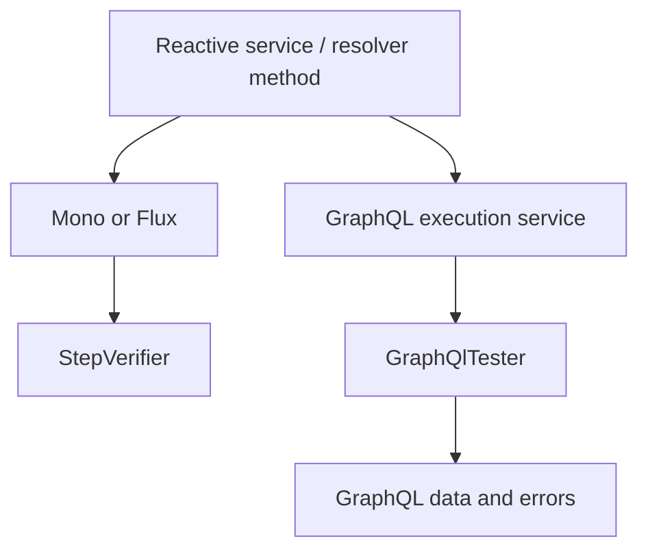

# Test reactive resolver trong Spring for GraphQL

Resolver trong Spring for GraphQL có thể trả về `Mono<T>` hoặc `Flux<T>` để xử lý dữ liệu bất đồng bộ theo Reactor. Cách kiểm thử phù hợp phụ thuộc vào điều cần xác nhận: kiểm tra publisher riêng bằng `StepVerifier`, hay chạy một GraphQL operation để xác nhận schema, argument binding, resolver và response phối hợp đúng.

`StepVerifier` phù hợp để kiểm tra tín hiệu reactive như `onNext`, `onComplete`, `onError`, demand và cancellation. `GraphQlTester` phù hợp để kiểm tra kết quả GraphQL sau khi execution engine gọi resolver. Với subscription, API `executeSubscription()` cung cấp một luồng response có thể kiểm tra bằng Reactor Test. Kết hợp các tầng này giúp phát hiện cả lỗi trong publisher lẫn lỗi khi publisher được tích hợp vào GraphQL execution.

Sau bài này, bạn có thể:

- Phân biệt test publisher trực tiếp và test resolver qua GraphQL execution.
- Kiểm tra `Mono` bằng `StepVerifier`.
- Kiểm tra `Flux`, thứ tự event và luồng hoàn tất.
- Kiểm thử empty publisher, reactive error và timeout.
- Xác minh cancellation và cleanup.
- Kiểm thử reactive resolver qua `GraphQlTester`.
- Kiểm thử subscription stream bằng `executeSubscription()`.
- Kiểm tra context propagation và lựa chọn đúng test boundary.

## 1. Reactive resolver là gì?

Trong annotated controller, resolver có thể trả về kiểu Java đồng bộ hoặc kiểu reactive. `Mono<T>` biểu diễn tối đa một kết quả bất đồng bộ; `Flux<T>` biểu diễn một luồng có thể phát nhiều phần tử.

Ví dụ query trả một sách:

```java
@Controller
public class BookController {

    private final BookService bookService;

    public BookController(BookService bookService) {
        this.bookService = bookService;
    }

    @QueryMapping
    public Mono<BookView> book(@Argument String id) {
        return bookService.findById(id);
    }
}
```

Resolver trả `Mono<BookView>` để Spring for GraphQL thực thi bất đồng bộ. Không cần gọi `.block()` để lấy `BookView` trước khi return.

Ví dụ query trả danh sách:

```java
@QueryMapping
public Flux<BookView> books() {
    return bookService.findAll();
}
```

Với field mapping lồng nhau, resolver cũng có thể trả `Mono` hoặc `Flux` tùy semantics của field và schema. Reactive return type cho phép pipeline downstream phối hợp với nguồn dữ liệu reactive mà không chặn thread xử lý request.

## 2. Hai tầng kiểm thử reactive resolver

Một reactive resolver có thể được kiểm tra ở hai tầng chính:



| Tầng | Công cụ | Điều được xác nhận |
| --- | --- | --- |
| Publisher | `StepVerifier` | Giá trị, thứ tự, completion, error, cancellation, demand và thời gian |
| GraphQL execution | `GraphQlTester` | SDL, resolver mapping, argument binding, field path, null propagation và GraphQL errors |
| Subscription | `executeSubscription()` + `StepVerifier` | Chuỗi GraphQL response, event stream, lỗi và kết thúc subscription |
| Web/transport | `WebGraphQlTester`, `HttpGraphQlTester` hoặc WebSocket tester | Interceptor, security context, HTTP/WebSocket protocol và transport lifecycle |

Đảm bảo test classpath có `reactor-test` cho `StepVerifier` và `spring-graphql-test` cho các GraphQL tester. Nếu dự án dùng Spring Boot dependency management, để BOM quản lý version tương thích thay vì ghim các version độc lập.

Không có một công cụ duy nhất thay thế tất cả các tầng. Test publisher trực tiếp không chứng minh GraphQL mapping đúng; test GraphQL execution không nhất thiết chứng minh cancellation hoặc backpressure của publisher theo đúng kỳ vọng.

## 3. Kiểm tra Mono bằng StepVerifier

`StepVerifier` đăng ký vào publisher, yêu cầu dữ liệu và xác nhận các tín hiệu theo thứ tự.

Ví dụ service trả một sách:

```java
Mono<BookView> findById(String id) {
    return repository.findById(id)
            .map(BookView::from);
}
```

Test:

```java
@Test
void emitsBookAndCompletes() {
    BookView expected = new BookView("book-42", "Reactive GraphQL");

    StepVerifier.create(bookService.findById("book-42"))
            .expectNext(expected)
            .verifyComplete();
}
```

`expectNext(...)` kiểm tra phần tử phát ra. `verifyComplete()` xác nhận publisher phát `onComplete` sau phần tử đó và không phát thêm dữ liệu.

Nếu DTO không có equality semantics phù hợp, kiểm tra bằng predicate:

```java
StepVerifier.create(bookService.findById("book-42"))
        .assertNext(book -> {
            assertThat(book.id()).isEqualTo("book-42");
            assertThat(book.title()).isEqualTo("Reactive GraphQL");
        })
        .verifyComplete();
```

Không dùng `.block()` chỉ để lấy giá trị rồi assert nếu mục tiêu là xác minh reactive signals. `StepVerifier` kiểm tra được cả dữ liệu lẫn cách publisher kết thúc.

## 4. Kiểm tra Mono.empty()

Một `Mono` có thể hoàn tất mà không phát phần tử. Đây là trạng thái khác với phát một object có các thuộc tính null.

```java
@Test
void completesEmptyWhenBookDoesNotExist() {
    StepVerifier.create(bookService.findById("missing"))
            .verifyComplete();
}
```

Test này xác nhận không có `onNext` và publisher hoàn tất bình thường. Nếu service được thiết kế để phát `BookNotFoundException`, hãy dùng `expectError(...)` thay vì `verifyComplete()`.

Khi tích hợp với GraphQL, `Mono.empty()` có thể trở thành giá trị null cho field resolver. Kết quả cuối cùng phụ thuộc nullability trong SDL: field nullable có thể trả null; field non-null có thể tạo GraphQL execution error và null propagation. Vì vậy, nên có cả unit test cho `Mono.empty()` lẫn GraphQL execution test cho schema contract.

## 5. Kiểm tra Mono phát lỗi

Reactive error được phát qua `onError`, không phải `onNext`:

```java
@Test
void emitsBookNotFoundError() {
    StepVerifier.create(bookService.findById("missing"))
            .expectError(BookNotFoundException.class)
            .verify();
}
```

Nếu cần kiểm tra message hoặc thuộc tính exception:

```java
StepVerifier.create(bookService.findById("missing"))
        .expectErrorSatisfies(error -> {
            assertThat(error)
                    .isInstanceOf(BookNotFoundException.class)
                    .hasMessageContaining("missing");
        })
        .verify();
```

`expectErrorSatisfies(...)` hữu ích khi exception có error code hoặc resource ID. Không nên assert stack trace hay thông tin phụ thuộc môi trường.

## 6. Kiểm tra Flux và thứ tự phần tử

Với `Flux`, có thể kiểm tra nhiều phần tử theo thứ tự:

```java
@Test
void emitsBooksInRepositoryOrder() {
    StepVerifier.create(bookService.findAll())
            .expectNext(
                    new BookView("book-1", "First"),
                    new BookView("book-2", "Second"),
                    new BookView("book-3", "Third"))
            .verifyComplete();
}
```

Thứ tự chỉ nên được assert nếu service contract đảm bảo thứ tự đó, ví dụ repository query có `ORDER BY`. Nếu thứ tự không xác định, thu thập các phần tử và so sánh theo tập hoặc sắp xếp trong assertion.

Có thể kiểm tra từng phần tử bằng `assertNext(...)`:

```java
StepVerifier.create(bookService.findAll(), 0)
        .thenRequest(2)
        .assertNext(book -> assertThat(book.id()).isEqualTo("book-1"))
        .assertNext(book -> assertThat(book.id()).isEqualTo("book-2"))
        .thenCancel()
        .verify();
```

Ví dụ này hủy stream sau hai phần tử. Chỉ dùng `thenCancel()` nếu cancellation là hành vi test muốn xác minh; nếu stream hữu hạn và phải phát hết, dùng `verifyComplete()`.

## 7. Kiểm tra Flux.empty() và list rỗng

`Flux.empty()` phát `onComplete` mà không phát phần tử:

```java
StepVerifier.create(bookService.findAll())
        .verifyComplete();
```

Khi GraphQL resolver trả `Flux` cho một field list, stream rỗng thường được materialize thành list rỗng trong response, miễn schema và resolver mapping định nghĩa field theo list semantics. Kiểm tra qua GraphQL:

```java
graphQlTester.document("""
        query {
            books {
                id
            }
        }
        """)
    .execute()
    .errors()
    .verify();
```

Sau đó xác nhận `books` là list rỗng bằng assertion phù hợp, ví dụ `entityList(BookView.class).isEmpty()`. Unit test `Flux.empty()` và integration test list rỗng xác nhận hai contract khác nhau.

## 8. Kiểm tra reactive resolver trực tiếp

Nếu muốn xác nhận controller truyền argument và trả đúng publisher từ service, có thể test method trực tiếp với mock service:

```java
@Test
void resolverDelegatesBookIdToService() {
    BookView expected = new BookView("book-42", "Reactive GraphQL");
    when(bookService.findById("book-42")).thenReturn(Mono.just(expected));

    StepVerifier.create(controller.book("book-42"))
            .expectNext(expected)
            .verifyComplete();

    verify(bookService).findById("book-42");
}
```

Test này tập trung vào method Java và delegation. Nó không xác nhận `@QueryMapping` được ánh xạ vào đúng SDL field hoặc GraphQL argument được bind đúng. Những điều đó cần một test đi qua GraphQL execution.

## 9. Kiểm thử reactive resolver qua GraphQlTester

`GraphQlTester` có thể thực thi query để xác nhận resolver trả `Mono`/`Flux` được tích hợp đúng với GraphQL engine:

Với test ở server execution layer, tạo `ExecutionGraphQlServiceTester` từ service đã cấu hình:

```java
ExecutionGraphQlServiceTester graphQlTester =
        ExecutionGraphQlServiceTester.create(executionGraphQlService);
```

Nếu cần chạy qua interceptor chain của `WebGraphQlHandler`, dùng `WebGraphQlTester`. Các tester này đều cung cấp workflow `GraphQlTester` chung.

```java
@Test
void executesReactiveBookResolver() {
    graphQlTester.document("""
            query Book($id: ID!) {
                book(id: $id) {
                    id
                    title
                }
            }
            """)
        .variable("id", "book-42")
        .execute()
        .errors()
        .verify()
        .path("book.title")
        .entity(String.class)
        .isEqualTo("Reactive GraphQL");
}
```

Test này kiểm tra operation, schema field, variable binding và kết quả resolver. `GraphQlTester.execute()` cung cấp response GraphQL để assertion; nó không thay thế `StepVerifier` cho các hành vi như demand, cancellation hoặc virtual time của publisher.

Nếu test cần kiểm tra `WebGraphQlInterceptor` hoặc context được thêm ở web layer, dùng `WebGraphQlTester`. Nếu cần HTTP headers, status và content negotiation, dùng HTTP tester.

## 10. Kiểm tra reactive error qua GraphQL

Service có thể phát reactive error:

```java
@QueryMapping
public Mono<BookView> book(@Argument String id) {
    return bookService.findById(id);
}
```

Khi service trả `Mono.error(new BookNotFoundException(id))`, GraphQL execution chuyển lỗi thành GraphQL error theo exception resolver và error handler đang cấu hình.

Test:

```java
GraphQlTester.Response response = graphQlTester.document("""
        query {
            book(id: "missing") {
                title
            }
        }
        """)
    .execute();

response.errors().satisfy(errors -> {
    assertThat(errors).singleElement().satisfies(error -> {
        assertThat(error.getExtensions())
                .containsEntry("code", "BOOK_NOT_FOUND");
        assertThat(error.getParsedPath())
                .containsExactly("book");
    });
});
```

Đây là execution error nên path gắn với field đang resolve. Nếu exception xảy ra trong resolver field lồng nhau, path sẽ chứa các response key tương ứng.

Không assert exception Java trực tiếp từ `GraphQlTester.execute()` cho lỗi resolver thông thường; hãy kiểm tra GraphQL `errors`. Lỗi transport hoặc lỗi không thể tạo GraphQL response là nhóm khác.

## 11. Kiểm tra onErrorResume và fallback

Reactive service có thể chuyển một số lỗi thành fallback:

```java
public Mono<BookView> findBook(String id) {
    return remoteBookClient.findById(id)
            .onErrorResume(RemoteServiceException.class,
                    error -> cache.findById(id));
}
```

Test publisher để xác nhận fallback được dùng:

```java
@Test
void usesCacheWhenRemoteServiceFails() {
    when(remoteBookClient.findById("book-42"))
            .thenReturn(Mono.error(new RemoteServiceException("offline")));
    when(cache.findById("book-42"))
            .thenReturn(Mono.just(new BookView("book-42", "Cached title")));

    StepVerifier.create(bookService.findBook("book-42"))
            .assertNext(book ->
                    assertThat(book.title()).isEqualTo("Cached title"))
            .verifyComplete();

    verify(cache).findById("book-42");
}
```

Nếu fallback là một phần của API contract, thêm GraphQL execution test để xác nhận client nhận dữ liệu fallback mà không có lỗi ngoài ý muốn. Nếu fallback chỉ là chi tiết nội bộ, test service có thể đã đủ.

Không dùng `onErrorResume(error -> Mono.empty())` để nuốt mọi lỗi nếu việc biến lỗi thành null có thể che giấu sự cố hoặc vi phạm non-null schema.

## 12. Kiểm tra timeout reactive

`timeout(...)` biến một publisher không phát tín hiệu trong khoảng thời gian quy định thành lỗi timeout:

```java
public Mono<BookView> findBook(String id) {
    return remoteBookClient.findById(id)
            .timeout(Duration.ofSeconds(2));
}
```

Test có thể dùng virtual time để không phải chờ thời gian thật:

```java
@Test
void timesOutWhenSourceDoesNotRespond() {
    StepVerifier.withVirtualTime(() ->
            Mono.<BookView>never()
                    .timeout(Duration.ofSeconds(2)))
        .thenAwait(Duration.ofSeconds(2))
        .expectError(TimeoutException.class)
        .verify();
}
```

`withVirtualTime` tạo scheduler ảo cho các operator dùng scheduler mặc định tương ứng. Publisher nên được tạo bên trong supplier để operator lấy scheduler ảo của StepVerifier. Nếu code dùng scheduler tùy chỉnh được inject, hãy inject `VirtualTimeScheduler` hoặc abstraction scheduler để test kiểm soát thời gian.

Không dùng `Thread.sleep()` để test timeout; cách đó làm test chậm và dễ flaky.

## 13. Kiểm tra cancellation và cleanup

Một resolver có thể đăng ký listener, mở cursor hoặc bắt đầu consumer. Khi client hủy operation, publisher nên nhận cancellation và giải phóng tài nguyên.

Ví dụ publisher có cleanup:

```java
Flux<OrderEvent> eventsFor(String orderId) {
    return eventSource.listen(orderId)
            .doFinally(signal -> {
                if (signal == SignalType.CANCEL) {
                    metrics.increment("order.subscription.cancelled");
                }
            });
}
```

Test cancellation:

```java
@Test
void releasesListenerWhenCancelled() {
    AtomicReference<SignalType> terminalSignal = new AtomicReference<>();

    Flux<Integer> source = Flux.<Integer>never()
            .doFinally(terminalSignal::set);

    StepVerifier.create(source)
            .thenCancel()
            .verify();

    assertThat(terminalSignal.get()).isEqualTo(SignalType.CANCEL);
}
```

Trong test thực tế, nên xác minh listener hoặc resource registry được giải phóng đúng một lần. `doFinally` chạy khi complete, error hoặc cancel; cleanup phải an toàn với mọi terminal signal.

## 14. Kiểm tra subscription bằng executeSubscription

GraphQL subscription là luồng nhiều execution result. Với `GraphQlTester`, dùng `executeSubscription()` rồi chuyển response field thành `Flux`:

```java
@Test
void streamsOrderEvents() {
    StepVerifier.create(
            graphQlTester.document("""
                    subscription {
                        orderEvents(orderId: "order-42") {
                            status
                        }
                    }
                    """)
                .executeSubscription()
                .toFlux("orderEvents.status", String.class))
        .expectNext("CREATED", "PAID", "SHIPPED")
        .verifyComplete();
}
```

Ví dụ giả định tester đang kết nối với execution service có subscription publisher phát các trạng thái theo thứ tự. `toFlux(path, String.class)` tạo luồng giá trị đã giải mã từ response field ở mỗi event.

Nếu publisher tự hoàn tất sau một số event, dùng `verifyComplete()` thay cho `thenCancel()`. Nếu stream vô hạn, `thenCancel()` là cách kết thúc test có chủ đích và cũng giúp xác minh cancellation.

`executeSubscription()` hỗ trợ subscription test với `WebSocketGraphQlTester`, hoặc tester phía server như `ExecutionGraphQlServiceTester` và `WebGraphQlTester`. Nếu cần xác minh WebSocket handshake, subprotocol, reconnect hoặc connection close, cần test WebSocket transport riêng.

## 15. Kiểm tra lỗi trong subscription stream

Subscription có thể phát một số event rồi gặp lỗi. Test nên xác nhận các event đã phát và terminal error:

```java
StepVerifier.create(
        graphQlTester.document("""
                subscription {
                    orderEvents(orderId: "order-42") {
                        status
                    }
                }
                """)
            .executeSubscription()
            .toFlux("orderEvents.status", String.class))
    .expectNext("CREATED", "PAID")
    .expectError()
    .verify();
```

Tùy cách transport/tester biểu diễn lỗi subscription, lỗi có thể nằm trong response event cuối cùng hoặc làm publisher kết thúc bằng error. Hãy kiểm tra contract và implementation đang dùng. Nếu error được biểu diễn như một GraphQL response, kiểm tra `response.errors()` trên event tương ứng thay vì chỉ dùng `expectError()`.

Không giả định lỗi ở một event luôn kết thúc subscription; một số nguồn có thể phục hồi hoặc phát tiếp. Test cần phản ánh policy thực tế của publisher.

## 16. Kiểm tra backpressure và demand

`StepVerifier` có thể kiểm soát demand ban đầu và số phần tử yêu cầu:

```java
@Test
void emitsOnlyWhenDemandIsRequested() {
    StepVerifier.create(Flux.range(1, 3), 0)
            .thenRequest(1)
            .expectNext(1)
            .thenRequest(2)
            .expectNext(2, 3)
            .verifyComplete();
}
```

Test này xác nhận subscriber bắt đầu với demand bằng `0`, sau đó yêu cầu từng nhóm phần tử. Đây là kiểm tra publisher ở tầng Reactor.

Với nguồn nóng hoặc `TestPublisher`, có thể mô phỏng event đến khi downstream chưa yêu cầu. Khi đó, test phải xác định rõ operator đang buffer, drop, giữ latest hay báo overflow. Không suy ra backpressure đầu cuối chỉ từ việc resolver trả `Flux`; transport và nguồn event cũng phải hỗ trợ semantics tương ứng.

## 17. Kiểm tra context propagation

Reactive pipeline có thể đọc metadata từ Reactor Context, ví dụ tenant hoặc correlation ID:

```java
Mono<String> currentTenant() {
    return Mono.deferContextual(context ->
            Mono.just(context.get("tenantId")));
}
```

Test:

```java
@Test
void readsTenantFromReactorContext() {
    StepVerifier.create(
            service.currentTenant()
                    .contextWrite(context ->
                            context.put("tenantId", "tenant-a")))
        .expectNext("tenant-a")
        .verifyComplete();
}
```

`contextWrite(...)` đặt dữ liệu vào Reactor Context cho subscription. Không nhầm Reactor Context với `ThreadLocal`; pipeline có thể đổi thread mà vẫn giữ context nếu các operator và integration tuân thủ Reactor semantics.

Nếu resolver lấy actor/tenant từ `GraphQLContext` được thêm bởi `WebGraphQlInterceptor`, test publisher trực tiếp không xác nhận interceptor đã hoạt động. Hãy dùng `WebGraphQlTester` hoặc HTTP integration test để kiểm tra đường đi từ request đến context.

## 18. Reactive Security Context

Trong WebFlux, Spring Security lưu security context trong Reactor Context. Khi service dùng `ReactiveSecurityContextHolder`, test có thể cung cấp authentication bằng context helper:

```java
Authentication authentication =
        new UsernamePasswordAuthenticationToken(
                "user-42", "N/A", List.of(new SimpleGrantedAuthority("BOOK_READ")));

StepVerifier.create(
        securedBookService.findVisibleBooks()
                .contextWrite(ReactiveSecurityContextHolder
                        .withAuthentication(authentication)))
    .expectNextCount(1)
    .verifyComplete();
```

Test này xác nhận service đọc được authentication trong reactive chain. Để kiểm tra JWT decoder, bearer token hoặc security web filter chain, cần test qua HTTP layer với cấu hình Spring Security thật.

Không tự truyền user ID từ GraphQL variables vào policy như thể đó là principal. Danh tính phải đến từ security context đáng tin cậy.

## 19. Kiểm tra scheduler và công việc blocking

Reactive resolver không nên chặn event-loop thread bằng thao tác blocking. Nếu phải gọi API blocking, có thể cô lập nó trên scheduler phù hợp:

```java
Mono<BookView> findLegacyBook(String id) {
    return Mono.fromCallable(() -> blockingClient.findById(id))
            .subscribeOn(Schedulers.boundedElastic());
}
```

Unit test có thể xác nhận publisher phát kết quả và hoàn tất, nhưng không nên assert thread name trừ khi thread placement là một phần của thiết kế. Kiểm tra thread name thường làm test phụ thuộc scheduler implementation.

Tốt hơn là inject abstraction cho executor/scheduler nếu logic cần điều khiển concurrency. Dùng test để xác nhận không có blocking call ngoài dự kiến hoặc đo latency ở integration/performance test, thay vì dựa vào `Thread.sleep()`.

## 20. Kiểm tra concurrency và thứ tự

Operator `flatMap` cho phép nhiều inner publisher chạy đồng thời; thứ tự kết quả có thể khác thứ tự đầu vào. `concatMap` xử lý tuần tự và giữ thứ tự:

```java
Flux<BookView> enriched = ids
        .flatMap(bookService::findById, 8);
```

Nếu thứ tự là contract:

```java
Flux<BookView> enrichedInOrder = ids
        .concatMap(bookService::findById);
```

Test concurrency không nên phụ thuộc vào timing ngẫu nhiên. Dùng publisher có thể điều khiển như `Sinks.One`, `TestPublisher` hoặc `Mono.delay` với virtual time để hoàn tất các inner publisher theo thứ tự mong muốn. Sau đó xác nhận kết quả theo contract: giữ thứ tự hay cho phép reorder.

Nếu chỉ cần giới hạn số request đồng thời, test số lượng active operation tối đa bằng counter đồng bộ an toàn và nguồn có thể điều khiển; không dùng sleep để cố tạo race condition.

### Kiểm thử reactive @BatchMapping

`@BatchMapping` cũng có thể trả về `Mono<Map<K, V>>` hoặc `Flux<V>`. Với dạng map, test publisher trực tiếp có thể xác nhận mỗi source object được ghép với đúng target:

```java
@BatchMapping(typeName = "Book", field = "author")
public Mono<Map<Book, Author>> author(List<Book> books) {
    return authorService.findForBooks(books);
}
```

```java
StepVerifier.create(controller.author(List.of(bookOne, bookTwo)))
        .assertNext(result -> {
            assertThat(result).containsEntry(bookOne, authorOne);
            assertThat(result).containsEntry(bookTwo, authorTwo);
        })
        .verifyComplete();
```

Nếu batch method trả `Flux<V>`, các phần tử phải theo cùng thứ tự với danh sách source object đầu vào. Hãy tạo test với nhiều source và cố ý trả kết quả bất đồng bộ để xác nhận thứ tự được giữ. Sau đó dùng `GraphQlTester` để xác nhận field `author` xuất hiện đúng dưới từng `Book`; test method riêng không chứng minh batch mapping đã được đăng ký vào schema.

## 21. Test reactive resolver với GraphQlTester và fixture

Một test execution đầy đủ cần có schema và controller thật trong GraphQL source. Có thể khởi tạo `GraphQlTester` từ `ExecutionGraphQlService` hoặc dùng test slice phù hợp với ứng dụng.

Ví dụ kiểm tra list reactive:

```java
@Test
void mapsReactiveBooksToGraphQlList() {
    graphQlTester.document("""
            query {
                books {
                    id
                    title
                }
            }
            """)
        .execute()
        .errors()
        .verify()
        .path("books[*].id")
        .entityList(String.class)
        .contains("book-1", "book-2");
}
```

Test này kiểm tra list response được tạo từ reactive resolver. Để xác nhận publisher được subscribe đúng một lần hoặc dependency được gọi đúng số lần, dùng mock/spy và verify tương ứng; response đúng không chứng minh subscription count hoặc batching behavior.

Fixture nên ổn định, không phụ thuộc test khác. Với `Flux`, xác định rõ test cần thứ tự hay chỉ cần tập phần tử. Với `Mono`, xác định semantics khi empty và error.

## 22. Những lỗi thường gặp

- **Chỉ dùng `block()` trong test:** bỏ qua tín hiệu reactive và không kiểm tra cancellation/demand.
- **Dùng StepVerifier để kiểm tra SDL mapping:** test publisher riêng không thực thi GraphQL operation.
- **Dùng GraphQlTester để kiểm tra backpressure:** execution assertion không thay thế demand test của Reactor.
- **Nhầm `Mono.empty()` với `Mono.just(null)`:** Reactor không cho phép phát null; empty là không có phần tử.
- **Không kiểm tra nullability:** `Mono.empty()` có thể tạo null và vi phạm field non-null.
- **Nuốt mọi lỗi bằng `onErrorResume`:** có thể che giấu lỗi và biến failure thành dữ liệu rỗng.
- **Không xác minh completion:** test chỉ thấy phần tử đầu tiên nhưng publisher vẫn có thể lỗi sau đó.
- **Dùng `Thread.sleep()` cho timeout:** test chậm và dễ flaky; ưu tiên virtual time.
- **Không test cancellation:** listener hoặc resource có thể bị giữ sau khi client rời đi.
- **Giả định mọi `Flux` là subscription:** query list và GraphQL subscription có semantics khác nhau.
- **Bỏ qua context propagation:** principal/tenant có thể mất khi chuyển executor hoặc rời reactive chain.
- **Assert thứ tự khi contract không bảo đảm:** `flatMap` có thể reorder kết quả.
- **Chỉ test resolver method trực tiếp:** không xác nhận argument binding, field path hoặc exception mapping.
- **Dùng execution tester để kiểm tra WebSocket:** cần test transport cho handshake và lifecycle.

## 23. Quy trình test reactive resolver

Khi kiểm thử resolver trả `Mono` hoặc `Flux`, hãy thực hiện:

1. Xác định behavior cần test ở publisher, GraphQL execution hay transport.
2. Dùng `StepVerifier` cho giá trị, completion, error, timeout, demand và cancellation.
3. Test `Mono.empty()`/`Flux.empty()` theo semantics của service.
4. Test reactive error và fallback riêng.
5. Dùng `GraphQlTester` để xác nhận resolver mapping, argument binding, data và GraphQL errors.
6. Kiểm tra null propagation theo SDL khi publisher không phát giá trị hoặc field lỗi.
7. Với subscription, dùng `executeSubscription()` và `StepVerifier` để xác nhận event sequence.
8. Test cleanup khi stream bị cancel.
9. Kiểm tra Reactor Context/Security Context ở đúng tầng tạo context.
10. Bổ sung web/transport test cho interceptor, HTTP/WebSocket và protocol behavior.

Reactive resolver cần được kiểm thử ở cả mức publisher và GraphQL execution. `StepVerifier` xác nhận cách `Mono`/`Flux` phát dữ liệu, hoàn tất, lỗi hoặc bị hủy; `GraphQlTester` xác nhận GraphQL engine ánh xạ publisher thành response theo schema. Với subscription và context phụ thuộc transport, cần thêm test ở tầng tương ứng. Chọn đúng boundary giúp test vừa tập trung, vừa phát hiện được lỗi thực tế trong reactive pipeline.

## Tài liệu tham khảo

- [Spring for GraphQL — Annotated Controllers](https://docs.spring.io/spring-graphql/reference/controllers.html)
- [Spring for GraphQL — Testing](https://docs.spring.io/spring-graphql/reference/testing.html)
- [Project Reactor — Testing](https://projectreactor.io/docs/core/release/reference/testing.html)
- [Reactor Test — StepVerifier API](https://projectreactor.io/docs/test/release/api/reactor/test/StepVerifier.html)
- [Project Reactor — Context](https://projectreactor.io/docs/core/release/reference/advancedFeatures/context.html)
